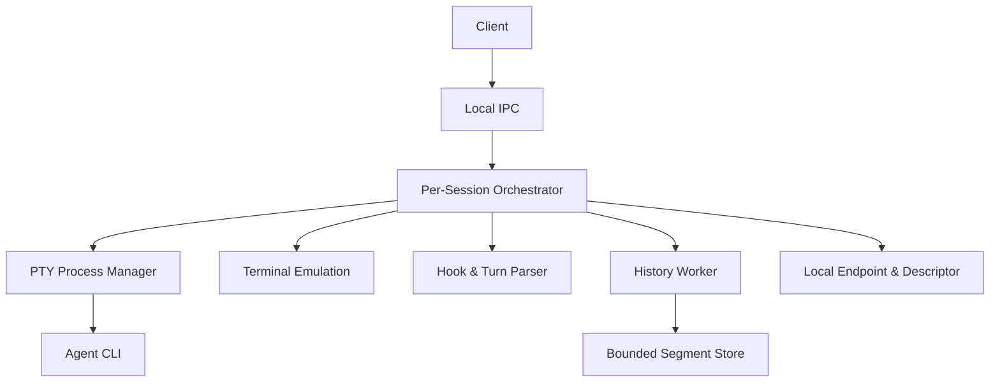
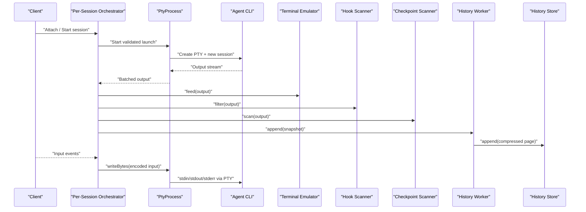
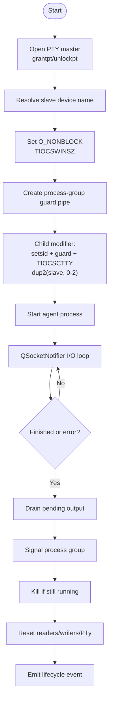
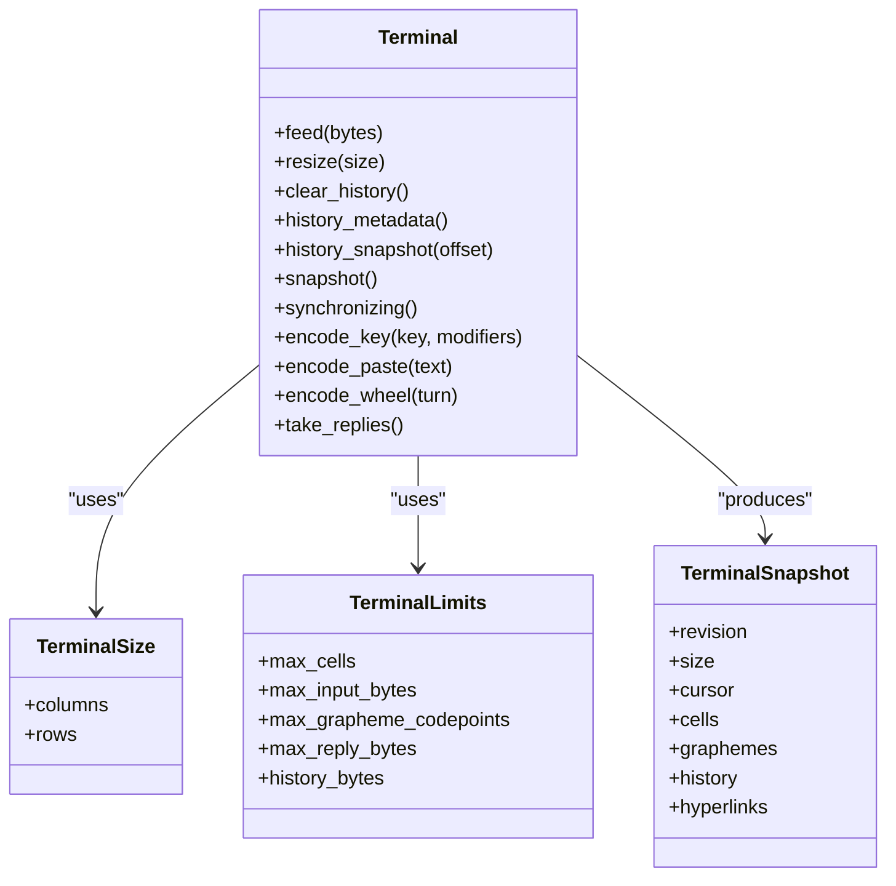
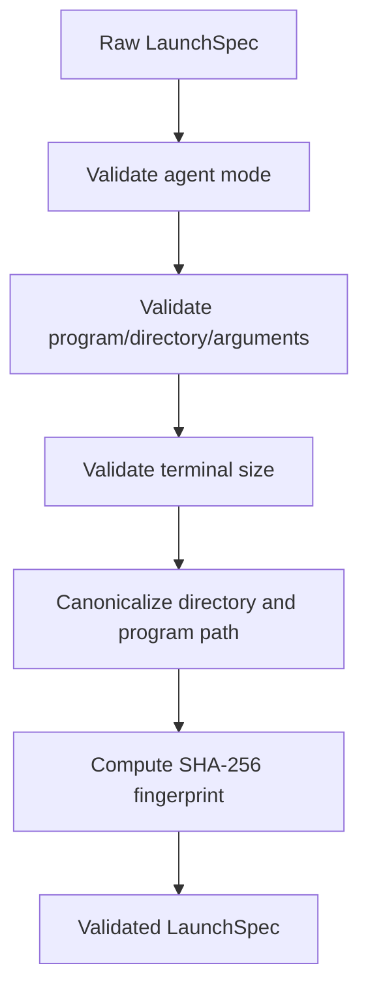
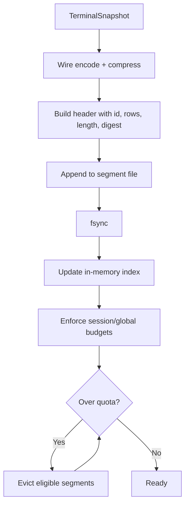
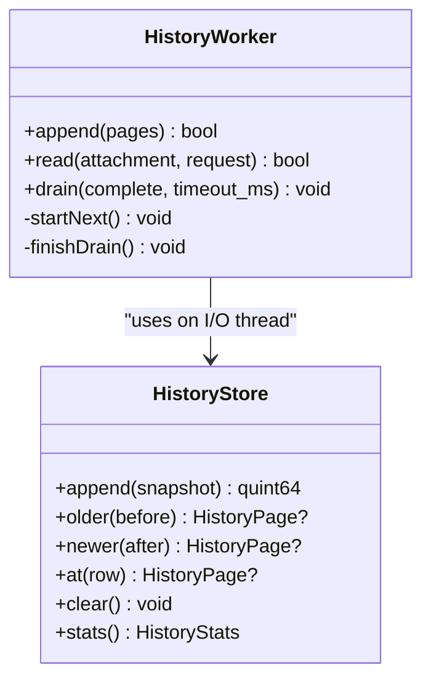
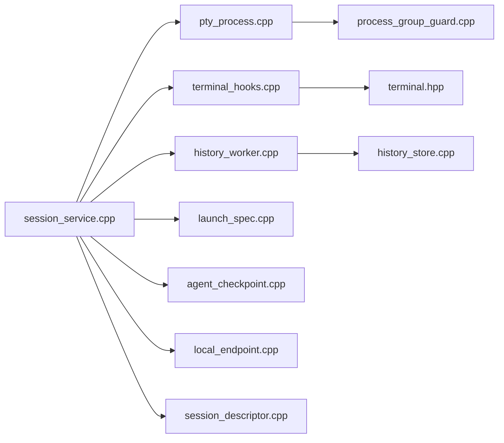

# Session Service Architecture

<cite>
**Referenced Files in This Document**
- [session_service.cpp](file://services/session/src/session_service.cpp)
- [terminal.hpp](file://services/session/include/lapis/session/terminal.hpp)
- [terminal_hooks.cpp](file://services/session/src/terminal_hooks.cpp)
- [terminal_hooks.hpp](file://services/session/src/terminal_hooks.hpp)
- [history_store.hpp](file://services/session/src/history_store.hpp)
- [history_store.cpp](file://services/session/src/history_store.cpp)
- [history_worker.cpp](file://services/session/src/history_worker.cpp)
- [launch_spec.cpp](file://services/session/src/launch_spec.cpp)
- [agent_checkpoint.hpp](file://services/session/src/agent_checkpoint.hpp)
- [agent_checkpoint.cpp](file://services/session/src/agent_checkpoint.cpp)
- [pty_process.cpp](file://services/session/src/platform/posix/pty_process.cpp)
- [process_group_guard.cpp](file://services/session/src/platform/posix/process_group_guard.cpp)
- [local_endpoint.cpp](file://services/session/src/platform/posix/local_endpoint.cpp)
- [session_descriptor.cpp](file://services/session/src/session_descriptor.cpp)
</cite>

## Table of Contents
1. [Introduction](#introduction)
2. [Project Structure](#project-structure)
3. [Core Components](#core-components)
4. [Architecture Overview](#architecture-overview)
5. [Detailed Component Analysis](#detailed-component-analysis)
6. [Dependency Analysis](#dependency-analysis)
7. [Performance Considerations](#performance-considerations)
8. [Troubleshooting Guide](#troubleshooting-guide)
9. [Conclusion](#conclusion)

## Introduction
This document explains the per-session service layer that manages one agent process, its pseudo-terminal, terminal I/O stream, and conversation history. Each session owns a distinct agent CLI invocation, translates between the application’s terminal model and the PTY, integrates with agent-specific adapters (Claude, Codex), persists terminal snapshots into a bounded history store, and exposes a local endpoint for clients to attach. The design separates concerns across launch configuration, process lifecycle, terminal emulation, hook parsing, checkpoint scanning, and durable storage.

## Project Structure
The relevant code lives under `services/session`. The key layers are:

| Layer | Responsibility | Representative files |
|---|---|---|
| Per-session orchestrator | Owns process, transport, attention, hooks, history, and cleanup | `session_service.cpp` |
| Process abstraction | PTY creation, child process, signals, and resource cleanup | `pty_process.cpp`, `process_group_guard.cpp` |
| Terminal model | In-process VT emulation and snapshot API | `terminal.hpp`, `terminal.cpp` |
| Agent integration | Hook parsing, turn notifications, observer-backed resume | `terminal_hooks.*`, `agent_checkpoint.*` |
| Launch configuration | Validated CLI specification and fingerprinting | `launch_spec.cpp` |
| History persistence | Compressed page segments, quotas, checkpoints | `history_store.*`, `history_worker.cpp` |
| Local IPC security | Endpoint validation, descriptor exchange | `local_endpoint.cpp`, `session_descriptor.cpp` |



**Diagram sources**
- [session_service.cpp:1-120](file://services/session/src/session_service.cpp#L1-L120)
- [pty_process.cpp:1-80](file://services/session/src/platform/posix/pty_process.cpp#L1-L80)
- [terminal.hpp:1-120](file://services/session/include/lapis/session/terminal.hpp#L1-L120)
- [terminal_hooks.cpp:1-60](file://services/session/src/terminal_hooks.cpp#L1-L60)
- [history_store.hpp:1-74](file://services/session/src/history_store.hpp#L1-L74)
- [history_worker.cpp:1-40](file://services/session/src/history_worker.cpp#L1-L40)
- [local_endpoint.cpp:1-40](file://services/session/src/platform/posix/local_endpoint.cpp#L1-L40)
- [session_descriptor.cpp:1-60](file://services/session/src/session_descriptor.cpp#L1-L60)

**Section sources**
- [session_service.cpp:1-120](file://services/session/src/session_service.cpp#L1-L120)
- [pty_process.cpp:1-80](file://services/session/src/platform/posix/pty_process.cpp#L1-L80)
- [terminal.hpp:1-120](file://services/session/include/lapis/session/terminal.hpp#L1-L120)
- [terminal_hooks.cpp:1-60](file://services/session/src/terminal_hooks.cpp#L1-L60)
- [history_store.hpp:1-74](file://services/session/src/history_store.hpp#L1-L74)
- [history_worker.cpp:1-40](file://services/session/src/history_worker.cpp#L1-L40)
- [local_endpoint.cpp:1-40](file://services/session/src/platform/posix/local_endpoint.cpp#L1-L40)
- [session_descriptor.cpp:1-60](file://services/session/src/session_descriptor.cpp#L1-L60)

## Core Components
- **Per-session orchestrator**: Coordinates PTY startup, output admission pacing, transport framing, attention state, hook filtering, checkpoint discovery, history archival, and shutdown. It also implements agent-specific policy logic for managed integrations such as Codex permission flags and endpoint management.
- **PTY process manager**: Creates a master/slave PTY pair, sets terminal size, starts the agent process in a new session with stdin/stdout/stderr connected to the slave, and manages termination through a process-group guard.
- **Terminal emulation**: Provides an owned, single-threaded terminal engine that accepts byte feeds, produces terminal snapshots, encodes input events, and enforces cell/grapheme/reply budgets.
- **Hook parser**: Extracts private Lapis OSC sequences from agent output, authenticates them via a nonce bound during initialization, and emits structured events for Claude or Codex backends without leaking prompts.
- **Launch specification**: Validates program paths, working directories, argument count, NUL bytes, initial terminal size, and agent-mode constraints; computes a stable fingerprint including agent mode.
- **Checkpoint scanner**: Parses agent-reported checkpoint sequences and validates identity, host, and format before allowing resume.
- **History worker and store**: Serializes terminal snapshots into compressed pages inside append-only segment files, enforces per-session and global quotas, supports older/newer/at navigation, and provides atomic writes with integrity digests.
- **Endpoint and descriptor helpers**: Validate trusted socket directories, reject symlinks, enforce owner-only permissions, and safely stage and publish session descriptors.

**Section sources**
- [session_service.cpp:1-120](file://services/session/src/session_service.cpp#L1-L120)
- [pty_process.cpp:80-200](file://services/session/src/platform/posix/pty_process.cpp#L80-L200)
- [terminal.hpp:120-201](file://services/session/include/lapis/session/terminal.hpp#L120-L201)
- [terminal_hooks.cpp:1-120](file://services/session/src/terminal_hooks.cpp#L1-L120)
- [launch_spec.cpp:1-144](file://services/session/src/launch_spec.cpp#L1-L144)
- [agent_checkpoint.cpp:1-120](file://services/session/src/agent_checkpoint.cpp#L1-L120)
- [history_store.cpp:1-120](file://services/session/src/history_store.cpp#L1-L120)
- [history_worker.cpp:1-126](file://services/session/src/history_worker.cpp#L1-L126)
- [local_endpoint.cpp:1-93](file://services/session/src/platform/posix/local_endpoint.cpp#L1-L93)
- [session_descriptor.cpp:1-120](file://services/session/src/session_descriptor.cpp#L1-L120)

## Architecture Overview
At runtime, each agent session is represented by a service instance. It creates a PTY, launches the configured agent CLI, feeds terminal output into both the in-process terminal emulator and the hook/checkpoint scanners, publishes snapshots to clients over a local IPC endpoint, and archives selected frames to disk.



**Diagram sources**
- [session_service.cpp:1-120](file://services/session/src/session_service.cpp#L1-L120)
- [pty_process.cpp:80-200](file://services/session/src/platform/posix/pty_process.cpp#L80-L200)
- [terminal.hpp:120-201](file://services/session/include/lapis/session/terminal.hpp#L120-L201)
- [terminal_hooks.cpp:1-120](file://services/session/src/terminal_hooks.cpp#L1-L120)
- [agent_checkpoint.cpp:1-120](file://services/session/src/agent_checkpoint.cpp#L1-L120)
- [history_worker.cpp:40-126](file://services/session/src/history_worker.cpp#L40-L126)
- [history_store.cpp:200-521](file://services/session/src/history_store.cpp#L200-L521)

## Detailed Component Analysis

### Per-Session Orchestrator
The session service is the central controller. It:
- Validates and applies per-agent policies for managed CLIs, including rejecting unsafe options for Claude and controlling Codex remote endpoints.
- Paces backend output using an admission window to avoid unbounded memory growth while preserving interactive responsiveness.
- Bridges client requests to PTY input, parses agent output, updates attention state, filters hooks, scans checkpoints, and archives terminal snapshots.
- Cleans up sockets, descriptors, timers, and child processes on failure or shutdown.

Key behaviors include:
- Session ID parsing and validation.
- Stale Codex endpoint cleanup before binding.
- Codex permission flag translation into configuration values.
- Output admission limits tied to 64 KiB service boundaries.
- Backend probe timing constants for connection health.

**Section sources**
- [session_service.cpp:1-120](file://services/session/src/session_service.cpp#L1-L120)
- [session_service.cpp:120-300](file://services/session/src/session_service.cpp#L120-L300)

### PTY Creation and Process Lifecycle
The POSIX PTY implementation handles the full lifecycle:

1. Allocate master/slave PTY pair and resolve the slave device name.
2. Set non-blocking I/O and initial terminal size.
3. Create a process-group guard pipe so background workers can terminate the entire group safely.
4. Configure QSocketNotifiers for asynchronous read/write on the PTY master.
5. Inject environment variables such as `TERM` and `COLORTERM`, set working directory, program, arguments, and Unix process parameters.
6. In the child modifier, create a new session, install the process-group guard, make the slave the controlling terminal, redirect standard file descriptors, and start the agent.
7. On process finish or error, drain pending output, signal the process group, kill if necessary, and emit lifecycle events.



**Diagram sources**
- [pty_process.cpp:80-200](file://services/session/src/platform/posix/pty_process.cpp#L80-L200)
- [process_group_guard.cpp:1-97](file://services/session/src/platform/posix/process_group_guard.cpp#L1-L97)

**Section sources**
- [pty_process.cpp:80-200](file://services/session/src/platform/posix/pty_process.cpp#L80-L200)
- [pty_process.cpp:200-431](file://services/session/src/platform/posix/pty_process.cpp#L200-L431)
- [process_group_guard.cpp:1-97](file://services/session/src/platform/posix/process_group_guard.cpp#L1-L97)

### Terminal Abstraction Layer
The terminal abstraction defines a unified interface for VT processing and snapshot access:

- **Data structures**: `TerminalSize`, `TerminalLimits`, `TerminalCell`, `TerminalStyle`, `TerminalCursor`, `TerminalHistory`, `TerminalHyperlink`, and `TerminalSnapshot`.
- **Contract guarantees**: Single-owner thread, no concurrent access, no direct I/O, no callbacks into client code, bounded allocations, and explicit exception semantics for invalid geometry, oversized input, or reply overflow.
- **Operations**: Feed bytes, resize, clear history, extract snapshots, encode keys, encode pastes, encode wheel events, and drain replies.

This abstraction allows different terminal engines to be tested or swapped behind a stable API, even though the current repository focuses on the in-process emulator contract.



**Diagram sources**
- [terminal.hpp:1-201](file://services/session/include/lapis/session/terminal.hpp#L1-L201)

**Section sources**
- [terminal.hpp:1-201](file://services/session/include/lapis/session/terminal.hpp#L1-L201)

### Agent-Specific Adapter Integration
The session layer integrates with agents through two complementary mechanisms:

1. **Terminal hook channel**: Private OSC sequences carry authentication and structured JSON events. The first `init` sequence binds the CLI type and nonce; subsequent events are accepted only when the nonce matches. Oversized or malformed sequences are quarantined and discarded safely.
2. **Turn notifications**: For agents whose completion signal comes only at turn end, the parser tracks whether a turn has completed and coordinates with the attention state so UI activity transitions remain consistent.

Agent-specific validation also occurs in the launch layer:
- Claude managed mode rejects conflicting settings flags.
- Codex managed mode forbids overriding its remote endpoint.
- Additional Codex permission flags are translated into configuration values while respecting option grammar.

```mermaid
sequenceDiagram
    participant Agent as "Agent CLI"
    participant PTY as "PTY Master"
    participant Hooks as "TerminalHookChannel"
    participant Check as "CheckpointScanner"
    participant Attention as "Attention State"

    Agent-->>PTY: "OSC init(lapis-init;cli;nonce)"
    PTY-->>Hooks: "filter(output)"
    Hooks-->>Hooks: "validate nonce + cli"
    Agent-->>PTY: "OSC event(lapis-event;nonce;base64(JSON))"
    PTY-->>Hooks: "filter(output)"
    Hooks-->>Hooks: "base64 decode + JSON parse"
    Hooks-->>Attention: "structured event"
    PTY-->>Check: "scan(output)"
    Check-->>Check: "decode base64 checkpoint record"
```

**Diagram sources**
- [terminal_hooks.cpp:1-200](file://services/session/src/terminal_hooks.cpp#L1-L200)
- [terminal_hooks.hpp:1-82](file://services/session/src/terminal_hooks.hpp#L1-L82)
- [agent_checkpoint.cpp:1-120](file://services/session/src/agent_checkpoint.cpp#L1-L120)

**Section sources**
- [terminal_hooks.cpp:1-200](file://services/session/src/terminal_hooks.cpp#L1-L200)
- [terminal_hooks.hpp:1-82](file://services/session/src/terminal_hooks.hpp#L1-L82)
- [agent_checkpoint.cpp:1-120](file://services/session/src/agent_checkpoint.cpp#L1-L120)
- [session_service.cpp:120-300](file://services/session/src/session_service.cpp#L120-L300)

### Launch Specification Pattern
The launch specification pattern configures agent CLIs with validated, canonical inputs:

- Program resolution prefers absolute paths or executable discovery.
- Working directory must exist and is canonicalized.
- Argument count is limited, and all text fields are checked for NUL characters and total byte budget.
- Initial terminal dimensions are validated against wire limits.
- Agent-mode restrictions prevent unsafe combinations.
- A fingerprint includes program, arguments, directory, and agent mode, enabling cacheability and replay diagnostics.
- A helper constructs a login shell launch, preferring `SHELL` and falling back to the password database entry or `/bin/sh`.



**Diagram sources**
- [launch_spec.cpp:1-144](file://services/session/src/launch_spec.cpp#L1-L144)

**Section sources**
- [launch_spec.cpp:1-144](file://services/session/src/launch_spec.cpp#L1-L144)

### History Store Implementation
The history store persists conversation snapshots as compressed, integrity-checked pages organized into append-only segment files:

- **Page format**: Header includes page ID, starting row index, row count, payload length, and SHA-256 digest. Payload is the encoded terminal snapshot, compressed.
- **Segments**: Pages are appended to numbered `.seg` files. A new segment is opened when the current one would exceed a clamped per-segment limit.
- **Quotas**: Per-session and global byte budgets are enforced. Eviction removes closed segments, never the newest open segment for a session, and respects least-recently-written ordering under global pressure.
- **Index**: An in-memory record list maps segment, offset, length, ID, first row, and row count.
- **Atomicity**: Writes use temporary files, fsync, rename, and lockfiles. Interrupted writes are truncated or removed during recovery.
- **Accessors**: Older/newer/at navigation returns optional pages with reconstructed history metadata. Clear deletes all session records and advances the counter.



**Diagram sources**
- [history_store.cpp:200-521](file://services/session/src/history_store.cpp#L200-L521)
- [history_store.hpp:1-74](file://services/session/src/history_store.hpp#L1-L74)

**Section sources**
- [history_store.cpp:1-200](file://services/session/src/history_store.cpp#L1-L200)
- [history_store.cpp:200-521](file://services/session/src/history_store.cpp#L200-L521)
- [history_store.hpp:1-74](file://services/session/src/history_store.hpp#L1-L74)

### History Worker and Bounded Snapshots
The history worker isolates blocking filesystem operations:

- Maintains a queue bounded by page count and byte size.
- Runs one operation at a time on a dedicated thread pool.
- Lazily constructs the `HistoryStore`.
- Accepts batched snapshots, reads older/newer/at pages, and reports errors through a promise/future callback.
- Supports draining with a timer to notify when background work completes.



**Diagram sources**
- [history_worker.cpp:1-126](file://services/session/src/history_worker.cpp#L1-L126)
- [history_store.hpp:1-74](file://services/session/src/history_store.hpp#L1-L74)

**Section sources**
- [history_worker.cpp:1-126](file://services/session/src/history_worker.cpp#L1-L126)
- [history_store.hpp:1-74](file://services/session/src/history_store.hpp#L1-L74)

### Checkpoint Management and Resume Policy
Checkpoint handling ensures only safe, locally originated conversation identifiers can influence resume behavior:

- Scans PTY output for agent checkpoint sequences and keeps a bounded carry buffer.
- Decodes base64 JSON records and validates agent name, version, printable identity, and local host.
- Reads/writes `.resume` files beside the private endpoint with strict ownership, link count, permissions, and size checks.
- Determines which agents have observer-backed resume support and maps launch specifications to checkpoint agents.
- For Codex, optionally inspects open rollout files to identify active threads, excluding subagent rollouts.

**Section sources**
- [agent_checkpoint.hpp:1-66](file://services/session/src/agent_checkpoint.hpp#L1-L66)
- [agent_checkpoint.cpp:1-200](file://services/session/src/agent_checkpoint.cpp#L1-L200)

### Local Endpoint Security and Process Isolation
Security controls span endpoint preparation, descriptor exchange, and process isolation:

- Trusted directory validation requires owner-only writable ancestors and rejects untrusted sticky shared directories where appropriate.
- Socket paths cannot be symlinks, must not already contain non-socket files, and must fit kernel address structures.
- Session descriptors are staged atomically, validate owner, link count, permissions, and fixed size, and include a fingerprint check.
- PTY processes run in a new session with standard streams redirected to the slave.
- Process-group termination avoids relying on potentially reused PIDs after reaping and uses a detached guard process for reliable group-wide signaling.

**Section sources**
- [local_endpoint.cpp:1-93](file://services/session/src/platform/posix/local_endpoint.cpp#L1-L93)
- [session_descriptor.cpp:1-200](file://services/session/src/session_descriptor.cpp#L1-L200)
- [pty_process.cpp:80-200](file://services/session/src/platform/posix/pty_process.cpp#L80-L200)
- [process_group_guard.cpp:1-97](file://services/session/src/platform/posix/process_group_guard.cpp#L1-L97)

## Dependency Analysis
The per-session service depends on several cohesive subsystems:



**Diagram sources**
- [session_service.cpp:1-120](file://services/session/src/session_service.cpp#L1-L120)
- [pty_process.cpp:1-80](file://services/session/src/platform/posix/pty_process.cpp#L1-L80)
- [terminal_hooks.cpp:1-60](file://services/session/src/terminal_hooks.cpp#L1-L60)
- [history_worker.cpp:1-40](file://services/session/src/history_worker.cpp#L1-L40)
- [history_store.cpp:1-120](file://services/session/src/history_store.cpp#L1-L120)
- [launch_spec.cpp:1-40](file://services/session/src/launch_spec.cpp#L1-L40)
- [agent_checkpoint.cpp:1-40](file://services/session/src/agent_checkpoint.cpp#L1-L40)
- [local_endpoint.cpp:1-40](file://services/session/src/platform/posix/local_endpoint.cpp#L1-L40)
- [session_descriptor.cpp:1-60](file://services/session/src/session_descriptor.cpp#L1-L60)
- [process_group_guard.cpp:1-40](file://services/session/src/platform/posix/process_group_guard.cpp#L1-L40)
- [terminal.hpp:1-60](file://services/session/include/lapis/session/terminal.hpp#L1-L60)

**Section sources**
- [session_service.cpp:1-120](file://services/session/src/session_service.cpp#L1-L120)
- [pty_process.cpp:1-80](file://services/session/src/platform/posix/pty_process.cpp#L1-L80)
- [terminal_hooks.cpp:1-60](file://services/session/src/terminal_hooks.cpp#L1-L60)
- [history_worker.cpp:1-40](file://services/session/src/history_worker.cpp#L1-L40)
- [history_store.cpp:1-120](file://services/session/src/history_store.cpp#L1-L120)
- [launch_spec.cpp:1-40](file://services/session/src/launch_spec.cpp#L1-L40)
- [agent_checkpoint.cpp:1-40](file://services/session/src/agent_checkpoint.cpp#L1-L40)
- [local_endpoint.cpp:1-40](file://services/session/src/platform/posix/local_endpoint.cpp#L1-L40)
- [session_descriptor.cpp:1-60](file://services/session/src/session_descriptor.cpp#L1-L60)
- [process_group_guard.cpp:1-40](file://services/session/src/platform/posix/process_group_guard.cpp#L1-L40)
- [terminal.hpp:1-60](file://services/session/include/lapis/session/terminal.hpp#L1-L60)

## Performance Considerations
- **Output admission pacing**: Large bursts are admitted through a bounded window rather than parsed immediately, reducing memory pressure while keeping interactive latency low.
- **Terminal snapshot limits**: Cell, grapheme, reply, and history budgets constrain per-frame allocation and prevent runaway memory growth.
- **History compression**: Terminal snapshots are wire-encoded then compressed before appending to segments, significantly reducing disk usage.
- **Segmented storage**: Append-only segments reduce locking and allow incremental eviction without rewriting large files.
- **Single-history-worker serialization**: One queued operation per store prevents concurrent filesystem contention and simplifies indexing.
- **PTY I/O batching**: Asynchronous readers/writers and pending write buffers avoid tight polling loops.

[No sources needed since this section provides general guidance]

## Troubleshooting Guide
Common failure modes and their likely causes:

| Symptom | Likely cause | Where to inspect |
|---|---|---|
| Agent fails to start | Invalid program, missing executable, bad working directory, or unsupported agent flags | `launch_spec.cpp` validation |
| PTY cannot be created | Kernel PTY allocation failure or permission problem | `pty_process.cpp` PTY setup |
| No output reaches UI | Hook quarantine, oversized sequence, or missing terminator | `terminal_hooks.cpp` filter and discard logic |
| Resume ignored | Remote host, unknown agent, malformed checkpoint, or unsafe `.resume` file | `agent_checkpoint.cpp` decoding and safety checks |
| History grows without shrinking | Quota misconfiguration or evicted segments not yet scanned | `history_store.cpp` budget enforcement |
| History read fails after another session closes | Segment evicted concurrently; retry behavior may return empty | `history_store.cpp` read-selected recovery |
| IPC endpoint conflict | Symlink, wrong permissions, existing non-socket file, or stale Codex symlink | `local_endpoint.cpp`, `session_service.cpp` cleanup |
| Process hangs on shutdown | Process group not terminated or child still alive | `pty_process.cpp` destructor and `process_group_guard.cpp` |

**Section sources**
- [launch_spec.cpp:1-144](file://services/session/src/launch_spec.cpp#L1-L144)
- [pty_process.cpp:80-200](file://services/session/src/platform/posix/pty_process.cpp#L80-L200)
- [terminal_hooks.cpp:1-200](file://services/session/src/terminal_hooks.cpp#L1-L200)
- [agent_checkpoint.cpp:1-200](file://services/session/src/agent_checkpoint.cpp#L1-L200)
- [history_store.cpp:200-521](file://services/session/src/history_store.cpp#L200-L521)
- [local_endpoint.cpp:1-93](file://services/session/src/platform/posix/local_endpoint.cpp#L1-L93)
- [session_descriptor.cpp:1-200](file://services/session/src/session_descriptor.cpp#L1-L200)

## Conclusion
The per-session service layer cleanly separates agent process lifecycle, PTY I/O, terminal emulation, agent adapter integration, and durable history. Its design emphasizes bounded resources, strict validation, atomic persistence, and secure IPC. The launch specification pattern makes agent configurations explicit and reproducible, while the terminal abstraction provides a stable contract for rendering and input encoding. Security boundaries are enforced at every sensitive boundary: PTY creation, process-group termination, endpoint validation, descriptor staging, and checkpoint acceptance.