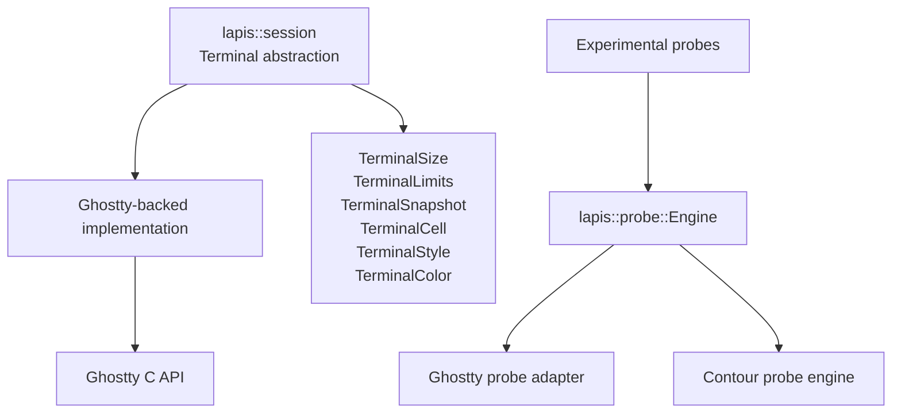
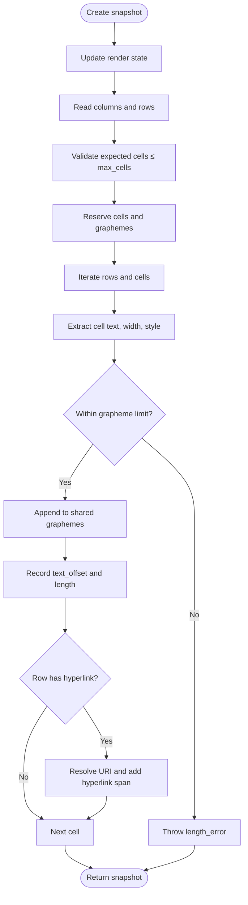
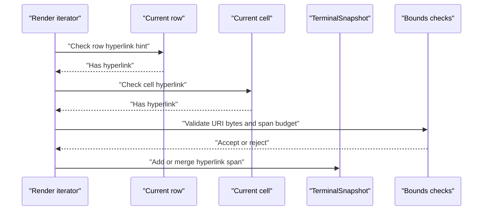
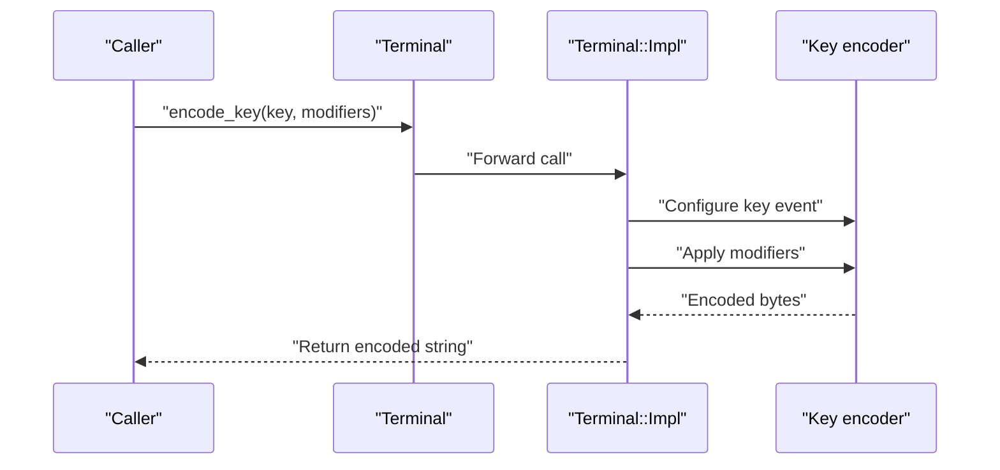
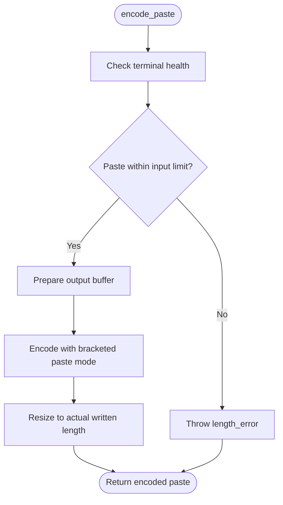
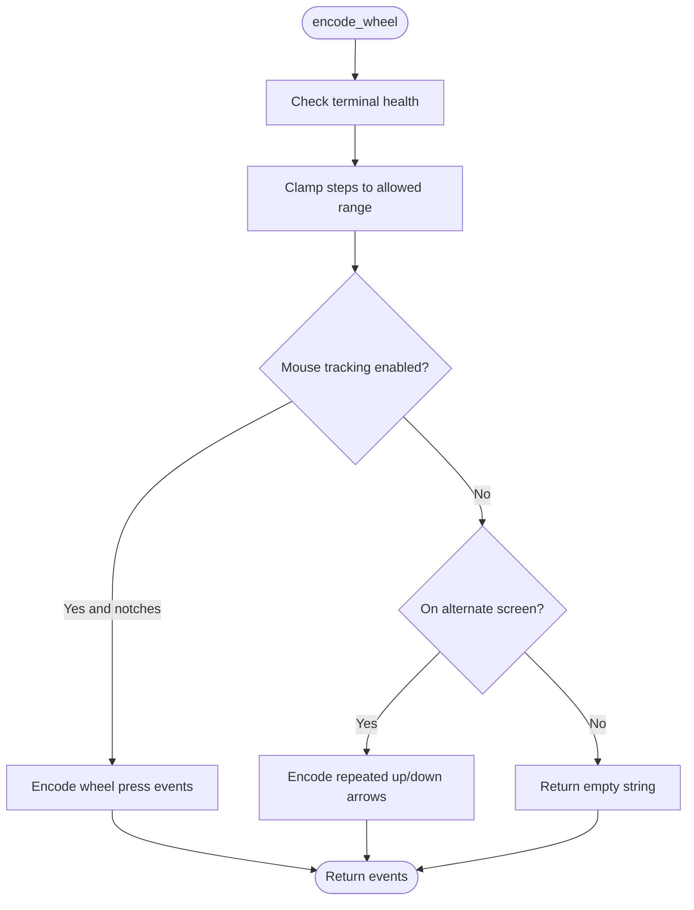
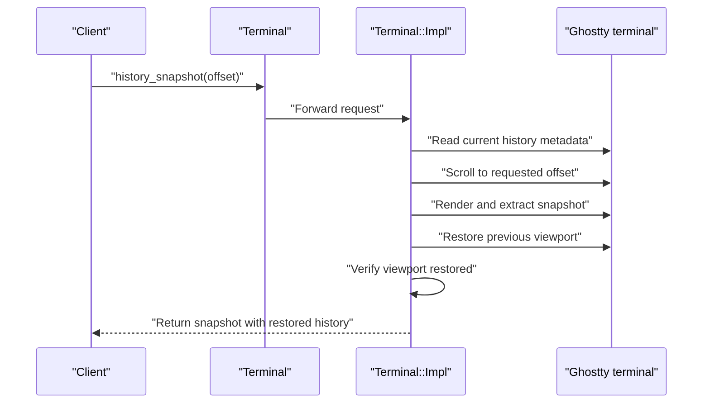
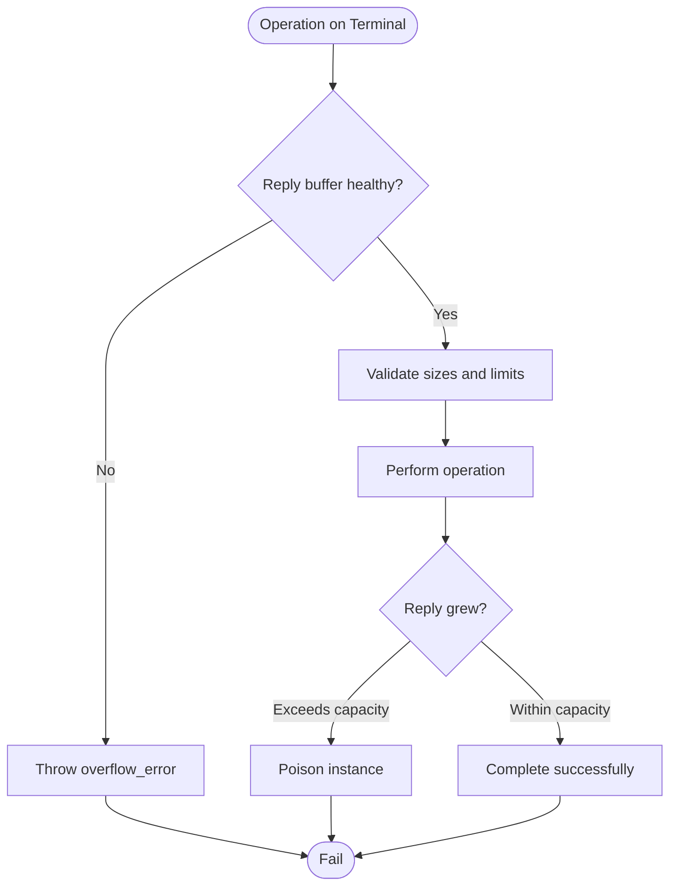
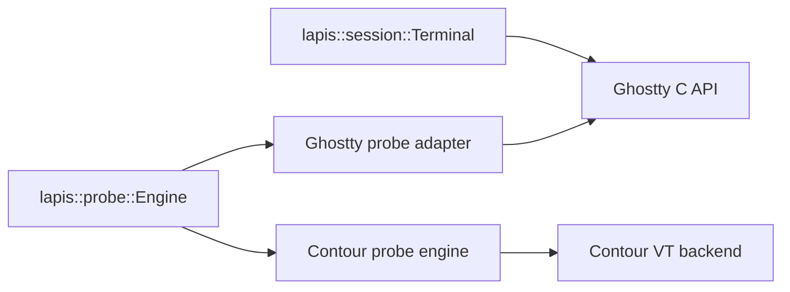

# Terminal Abstraction Layer

<cite>
**Referenced Files in This Document**
- [terminal.hpp](file://services/session/include/lapis/session/terminal.hpp)
- [terminal.cpp](file://services/session/src/terminal/terminal.cpp)
- [probe.hpp](file://tools/terminal_probe/probe.hpp)
- [adapter.cpp](file://tools/terminal_probe/ghostty/adapter.cpp)
- [engine.cpp](file://tools/terminal_probe/contour/engine.cpp)
</cite>

## Table of Contents
1. [Introduction](#introduction)
2. [Project Structure](#project-structure)
3. [Core Components](#core-components)
4. [Architecture Overview](#architecture-overview)
5. [Detailed Component Analysis](#detailed-component-analysis)
6. [Dependency Analysis](#dependency-analysis)
7. [Performance Considerations](#performance-considerations)
8. [Troubleshooting Guide](#troubleshooting-guide)
9. [Conclusion](#conclusion)

## Introduction
This document describes the Terminal abstraction layer that provides a unified, in-process interface over terminal engines such as Ghostty and Contour. The abstraction defines a stable state model for terminal size, limits, history, snapshots, and cells; it exposes input encoding methods for keyboard shortcuts, paste operations, and mouse wheel events; and it coordinates synchronization modes including DEC private mode 2026 updates, bracketed paste mode, and application cursor key modes.

The public API is designed around a single-owner-thread contract: callers must not access a `Terminal` instance concurrently from multiple threads. It also separates rendering state from transport output by producing snapshots for consumers while returning encoded byte sequences through a reply queue.

## Project Structure
The Terminal abstraction lives under the session service headers and implementation, with experimental engine probes under the tools directory.

**Diagram sources**
- [terminal.hpp:1-200](file://services/session/include/lapis/session/terminal.hpp#L1-L200)
- [terminal.cpp:1-200](file://services/session/src/terminal/terminal.cpp#L1-L200)
- [probe.hpp:1-58](file://tools/terminal_probe/probe.hpp#L1-L58)
- [adapter.cpp:1-50](file://tools/terminal_probe/ghostty/adapter.cpp#L1-L50)
- [engine.cpp:1-40](file://tools/terminal_probe/contour/engine.cpp#L1-L40)

**Section sources**
- [terminal.hpp:1-200](file://services/session/include/lapis/session/terminal.hpp#L1-L200)
- [terminal.cpp:1-200](file://services/session/src/terminal/terminal.cpp#L1-L200)
- [probe.hpp:1-58](file://tools/terminal_probe/probe.hpp#L1-L58)

## Core Components
The core data model is defined in the public header.

| Concept | Description | Key Fields / Behavior |
|---|---|---|
| `TerminalSize` | Screen geometry. | `columns`, `rows`. Default 80×24. Equality supported. |
| `TerminalLimits` | Resource budgets and safety bounds. | `max_cells`, `max_input_bytes`, `max_grapheme_codepoints`, `max_reply_bytes`, `history_bytes`. |
| `TerminalColor` | Indexed or RGB color value. | `kind`, `value`. Zero indicates default. |
| `Underline` | Underline style enumeration. | `none`, `single`, `double_line`, `curly`, `dotted`, `dashed`. |
| `TerminalStyle` | Cell styling. | Foreground/background/underline colors, underline style, bold, italic, faint, blink, inverse, invisible, strikethrough, overline. |
| `CellKind` | Cell width semantics. | `narrow`, `wide`, `wide_tail`, `wrap_spacer`. |
| `TerminalCell` | Reference into snapshot storage. | `text_offset`, `text_length`, `kind`, `style`. Avoids per-cell heap allocation. |
| `TerminalCursor` | Cursor position and appearance. | Column, row, viewport visibility, wide tail, blinking, shape. |
| `TerminalHistory` | Scrollbar metadata. | Total rows, viewport offset, viewport rows, primary availability. |
| `TerminalHyperlink` | OSC 8 hyperlink span. | First cell index, cell count, URI string, plus global byte/spans/URI limits. |
| `TerminalSnapshot` | Complete screen frame. | Revision, size, cursor, alternate screen, wheel acceptance flags, palette, cells, graphemes, history, hyperlinks. Includes helper methods to resolve text and effective foreground/background colors. |
| `TerminalKey` | Supported navigation/input keys. | Arrow keys, home/end, page up/down, insert/delete, enter/tab/backspace/escape. |
| `WheelTurn` | Mouse wheel event. | Steps, column, row. Positive steps scroll back/up. |
| `KeyModifiers` | Keyboard modifier set. | Shift, control, alt, super. |

**Section sources**
- [terminal.hpp:10-190](file://services/session/include/lapis/session/terminal.hpp#L10-L190)

## Architecture Overview
The `Terminal` class is the single entry point. Its internal `Impl` owns Ghostty handles, renders state through a render iterator, and buffers transport replies in a pre-sized buffer.

```mermaid
classDiagram
    class Terminal {
        +feed(bytes)
        +resize(size)
        +clear_history()
        +history_metadata()
        +history_snapshot(offset)
        +snapshot()
        +synchronizing()
        +encode_key(key, modifiers)
        +encode_paste(text)
        +encode_wheel(turn)
        +take_replies()
    }

    class Impl {
        -limits
        -revision
        -poisoned
        -replies
        -reply_size
        -terminal
        -render
        -row_iterator
        -row_cells
        -encoder
        -key
        -mouse_encoder
        -mouse
        -scratch
        +make_snapshot()
        +extract_cell(snapshot)
        +encode_key(key, modifiers)
        +encode_paste(text)
        +encode_wheel(turn)
    }

    class TerminalSnapshot {
        +size
        +cursor
        +alternate_screen
        +accepts_wheel
        +bracketed_paste
        +application_cursor_keys
        +foreground_rgb
        +background_rgb
        +cursor_rgb
        +palette
        +cells
        +graphemes
        +history
        +hyperlinks
        +text(cell_index)
        +cell_foreground(cell_index)
        +cell_background(cell_index)
    }

    class TerminalCell {
        +text_offset
        +text_length
        +kind
        +style
    }

    class TerminalStyle {
        +foreground
        +background
        +underline_color
        +underline
        +bold
        +italic
        +faint
        +blink
        +inverse
        +invisible
        +strikethrough
        +overline
    }

    class TerminalColor {
        +kind
        +value
    }

    Terminal --> Impl : "owns"
    Impl --> TerminalSnapshot : "produces"
    TerminalSnapshot --> TerminalCell : "contains"
    TerminalCell --> TerminalStyle : "uses"
    TerminalStyle --> TerminalColor : "uses"
```

**Diagram sources**
- [terminal.hpp:100-200](file://services/session/include/lapis/session/terminal.hpp#L100-L200)
- [terminal.cpp:250-787](file://services/session/src/terminal/terminal.cpp#L250-L787)

**Section sources**
- [terminal.hpp:100-200](file://services/session/include/lapis/session/terminal.hpp#L100-L200)
- [terminal.cpp:250-787](file://services/session/src/terminal/terminal.cpp#L250-L787)

## Detailed Component Analysis

### State Model and Snapshot Extraction
`TerminalSnapshot` represents a complete frame. It stores:
- Geometry and cursor state.
- Alternate-screen flag and protocol mode flags.
- Palette and effective foreground/background colors.
- A row-major cell array exactly equal to `columns × rows`.
- A contiguous UTF-32 grapheme buffer referenced by each cell.
- History metadata.
- Hyperlink spans indexed by first cell and length.

Text resolution is safe because `TerminalSnapshot::text` validates the requested cell index before slicing the shared grapheme buffer. Effective foreground and background colors apply inverse logic against resolved palette entries or defaults.

**Diagram sources**
- [terminal.cpp:560-787](file://services/session/src/terminal/terminal.cpp#L560-L787)

**Section sources**
- [terminal.hpp:120-190](file://services/session/include/lapis/session/terminal.hpp#L120-L190)
- [terminal.cpp:100-180](file://services/session/src/terminal/terminal.cpp#L100-L180)
- [terminal.cpp:560-787](file://services/session/src/terminal/terminal.cpp#L560-L787)

### Cell-Based Rendering and Styled Text
Each `TerminalCell` holds only an offset and length into the snapshot’s contiguous grapheme storage, together with a `TerminalStyle` and `CellKind`. This design avoids one heap allocation per cell and keeps ordinary screens memory-efficient.

Wide characters are represented explicitly:
- `CellKind::narrow` occupies one logical cell.
- `CellKind::wide` marks the leading cell of a two-column glyph.
- `CellKind::wide_tail` marks the trailing cell.
- `CellKind::wrap_spacer` represents wrap-related spacers returned by the underlying renderer.

Styled text supports:
- Foreground, background, and underline colors.
- Color kinds: default, indexed palette, and direct RGB.
- Underline styles: none, single, double-line, curly, dotted, dashed.
- Formatting flags: bold, italic, faint, blink, inverse, invisible, strikethrough, overline.

Effective color computation applies inverse swapping and resolves indexed colors through the snapshot palette. Bold does not imply brightening; it remains a separate attribute.

**Section sources**
- [terminal.hpp:20-90](file://services/session/include/lapis/session/terminal.hpp#L20-L90)
- [terminal.cpp:200-330](file://services/session/src/terminal/terminal.cpp#L200-L330)

### Hyperlinks
OSC 8 hyperlink spans are stored separately from cell text and style to avoid per-cell strings. Each hyperlink records:
- The first cell index.
- The number of cells covered.
- The URI string.

Global limits protect against excessive hyperlink payloads:
- Maximum URI bytes per hyperlink.
- Maximum hyperlink span count.
- Maximum total hyperlink bytes.

URIs are extracted via a grid reference at the current cell coordinate. Invalid or non-UTF-8 OSC payloads are rejected rather than propagated as transport errors. Adjacent contiguous spans with the same URI are merged.

**Diagram sources**
- [terminal.cpp:100-200](file://services/session/src/terminal/terminal.cpp#L100-L200)
- [terminal.cpp:600-700](file://services/session/src/terminal/terminal.cpp#L600-L700)

**Section sources**
- [terminal.hpp:140-160](file://services/session/include/lapis/session/terminal.hpp#L140-L160)
- [terminal.cpp:100-200](file://services/session/src/terminal/terminal.cpp#L100-L200)
- [terminal.cpp:600-700](file://services/session/src/terminal/terminal.cpp#L600-L700)

### Input Encoding Methods

#### Keyboard Shortcuts: `encode_key`
`encode_key` maps a small, verified navigation subset of `TerminalKey` values to Ghostty key events. Modifiers are applied through shift, control, alt, and super flags. The resulting bytes are written into a fixed-size buffer and returned as a string. Unknown keys raise an invalid argument error.

**Diagram sources**
- [terminal.cpp:520-560](file://services/session/src/terminal/terminal.cpp#L520-L560)

**Section sources**
- [terminal.hpp:160-190](file://services/session/include/lapis/session/terminal.hpp#L160-L190)
- [terminal.cpp:520-560](file://services/session/src/terminal/terminal.cpp#L520-L560)

#### Paste Operations: `encode_paste`
`encode_paste` sanitizes input without accessing the system clipboard. It:
- Rejects pastes exceeding `max_input_bytes`.
- Uses the current bracketed paste mode to decide whether to wrap the text.
- Encodes the result into a pre-sized buffer.

This method never grants an application access to the host clipboard; it only produces terminal input bytes.

**Diagram sources**
- [terminal.cpp:560-620](file://services/session/src/terminal/terminal.cpp#L560-L620)

**Section sources**
- [terminal.hpp:170-190](file://services/session/include/lapis/session/terminal.hpp#L170-L190)
- [terminal.cpp:560-620](file://services/session/src/terminal/terminal.cpp#L560-L620)

#### Mouse Wheel Events: `encode_wheel`
`encode_wheel` implements three behaviors depending on terminal mode:
1. If mouse reporting is enabled and there are notches, it generates wheel button events positioned at the given viewport cell.
2. If on the alternate screen without mouse reporting, it synthesizes three arrow-key presses per notch, matching common terminal behavior.
3. Otherwise, it returns no input.

A maximum notch bound prevents runaway flings. Position clamping ensures valid viewport coordinates.

**Diagram sources**
- [terminal.cpp:620-700](file://services/session/src/terminal/terminal.cpp#L620-L700)

**Section sources**
- [terminal.hpp:160-190](file://services/session/include/lapis/session/terminal.hpp#L160-L190)
- [terminal.cpp:620-700](file://services/session/src/terminal/terminal.cpp#L620-L700)

### History Management
History management combines scrollbar metadata, absolute viewport scrolling, and snapshot extraction.

- `history_metadata()` returns current total rows, viewport offset, viewport rows, and primary-screen availability.
- `history_snapshot(offset)` scrolls to an absolute history row, extracts a snapshot, restores the previous viewport, and verifies restoration succeeded.
- The offset must leave a complete viewport inside primary history; otherwise, an invalid argument error is raised.

**Diagram sources**
- [terminal.cpp:430-520](file://services/session/src/terminal/terminal.cpp#L430-L520)

**Section sources**
- [terminal.hpp:100-160](file://services/session/include/lapis/session/terminal.hpp#L100-L160)
- [terminal.cpp:430-520](file://services/session/src/terminal/terminal.cpp#L430-L520)

### Synchronization Protocol and Mode Flags
The abstraction tracks several protocol modes exposed by the terminal:

| Mode | Meaning | Access Point |
|---|---|---|
| DEC private mode 2026 synchronized output | Indicates a frame update started but not yet ended; screen may be partially drawn. | `Terminal::synchronizing()` |
| Bracketed paste mode | Determines how `encode_paste` wraps text. | Snapshot field and encoding path |
| Application cursor key mode | Indicates application cursor key behavior. | Snapshot field |
| Alternate screen | Controls whether wheel fallback uses arrow keys. | Snapshot field and wheel encoding |
| Mouse tracking | Controls whether wheel events become mouse reports. | Wheel encoding path |

**Section sources**
- [terminal.hpp:120-190](file://services/session/include/lapis/session/terminal.hpp#L120-L190)
- [terminal.cpp:500-700](file://services/session/src/terminal/terminal.cpp#L500-L700)

### Bounds Checking, Overflow Protection, and Thread Contract

#### Bounds and Limits
- Terminal dimensions are validated against `max_cells`.
- Snapshot cell counts are checked against expected geometry and extraction limits.
- Grapheme codepoint accumulation is bounded by `max_grapheme_codepoints`.
- Input bytes and paste payloads are bounded by `max_input_bytes`.
- Reply buffer growth is bounded by `max_reply_bytes`.
- Hyperlink URIs, span counts, and total hyperlink bytes are bounded.
- Wheel notches are clamped to a safe maximum.

#### Overflow Protection
If the reply queue overflows, the implementation enters a poisoned state. Subsequent operations throw `overflow_error`, and the instance must be recreated and resynchronized. This protects the caller from corrupting further state after a transport overflow.

#### Single-Owner-Thread Contract
The header documents that `Terminal` has a single owner thread. Callers must not access it concurrently. The implementation itself performs no I/O, threading, PTY lifecycle, timers, or callbacks into client code beyond writing to its own owned reply buffer. Snapshots outlive the `Terminal` instance.

**Diagram sources**
- [terminal.hpp:170-200](file://services/session/include/lapis/session/terminal.hpp#L170-L200)
- [terminal.cpp:250-330](file://services/session/src/terminal/terminal.cpp#L250-L330)

**Section sources**
- [terminal.hpp:170-200](file://services/session/include/lapis/session/terminal.hpp#L170-L200)
- [terminal.cpp:250-330](file://services/session/src/terminal/terminal.cpp#L250-L330)

## Dependency Analysis
The public abstraction depends on Ghostty’s C API for parsing, rendering, and input encoding. Experimental probes demonstrate how other engines can implement the same observation contract.

**Diagram sources**
- [terminal.cpp:1-200](file://services/session/src/terminal/terminal.cpp#L1-L200)
- [adapter.cpp:1-50](file://tools/terminal_probe/ghostty/adapter.cpp#L1-L50)
- [engine.cpp:1-40](file://tools/terminal_probe/contour/engine.cpp#L1-L40)

**Section sources**
- [terminal.cpp:1-200](file://services/session/src/terminal/terminal.cpp#L1-L200)
- [probe.hpp:1-58](file://tools/terminal_probe/probe.hpp#L1-L58)
- [adapter.cpp:1-50](file://tools/terminal_probe/ghostty/adapter.cpp#L1-L50)
- [engine.cpp:1-40](file://tools/terminal_probe/contour/engine.cpp#L1-L40)

## Performance Considerations
- **Cell storage:** `TerminalCell` references a shared grapheme buffer instead of allocating per-cell strings. This reduces allocations for large screens.
- **Reserved capacities:** Snapshots reserve space for expected cells and graphemes based on viewport size and limits.
- **Pre-sized reply buffer:** The reply queue is sized once from `max_reply_bytes`, avoiding reallocation during write callbacks.
- **Bounded wheel events:** Wheel notches are clamped to prevent excessive event generation.
- **Palette handling:** Palette entries are copied once per snapshot, allowing indexed colors to remain stable across palette updates.

[No sources needed since this section provides general guidance]

## Troubleshooting Guide

| Symptom | Likely Cause | Recommended Action |
|---|---|---|
| Invalid argument when resizing | Zero dimensions or product exceeds `max_cells`. | Verify `columns` and `rows`; ensure their product is within limits. |
| Length error on input or paste | Exceeded `max_input_bytes`. | Reduce payload size or increase limits if appropriate. |
| Length error during snapshot | Exceeded `max_grapheme_codepoints`. | Inspect unusually large grapheme runs; adjust limits or sanitize upstream output. |
| Overflow error after many operations | Reply buffer exceeded `max_reply_bytes`. | Recreate the `Terminal` and resynchronize; drain replies more frequently. |
| Runtime error about viewport restoration | History restore failed after snapshot extraction. | Treat as unrecoverable state change; recreate the instance. |
| Unknown key error | Unsupported `TerminalKey` value. | Use only keys from the documented navigation subset. |
| Empty wheel output | Mouse tracking disabled and not on alternate screen. | Enable mouse tracking or handle wheel on the alternate screen. |
| Missing hyperlink | URI invalid, too long, or outside budget. | Inspect OSC 8 payloads; ensure valid UTF-8 and within configured limits. |

**Section sources**
- [terminal.hpp:170-200](file://services/session/include/lapis/session/terminal.hpp#L170-L200)
- [terminal.cpp:250-330](file://services/session/src/terminal/terminal.cpp#L250-L330)
- [terminal.cpp:430-520](file://services/session/src/terminal/terminal.cpp#L430-L520)
- [terminal.cpp:560-700](file://services/session/src/terminal/terminal.cpp#L560-L700)

## Conclusion
The Terminal abstraction layer provides a clear, bounded, and thread-safe interface for working with terminal engines. It separates terminal state from transport output, enforces resource limits, and models screen content through efficient cell-based structures. By exposing synchronized-update awareness, bracketed paste support, application cursor key mode, and consistent input encodings, it enables higher-level components to interact with terminals uniformly while keeping engine-specific details contained behind a stable API.

[No sources needed since this section summarizes without analyzing specific files]