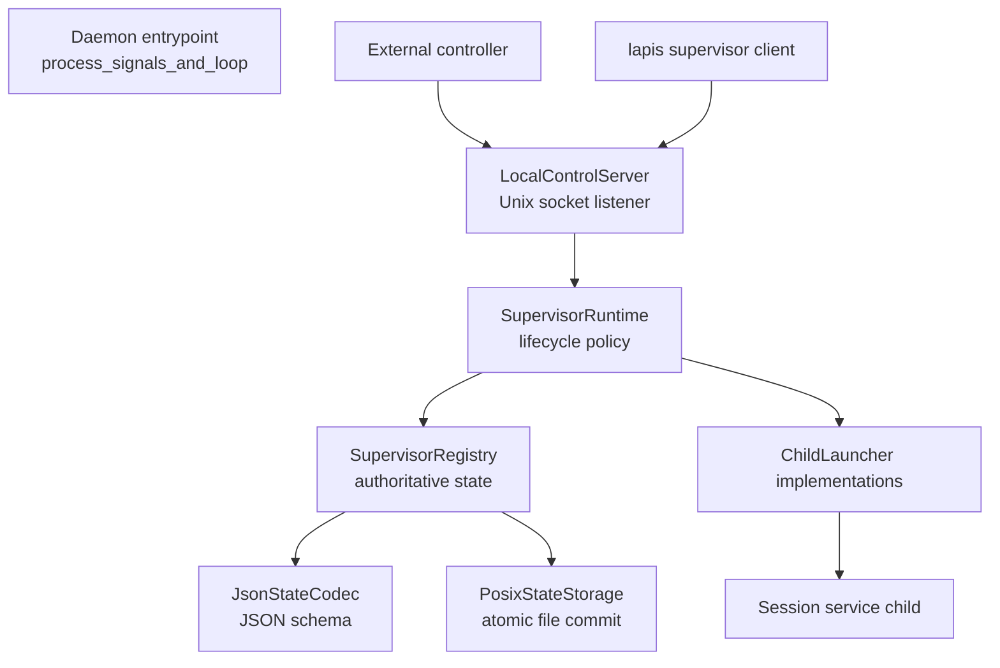
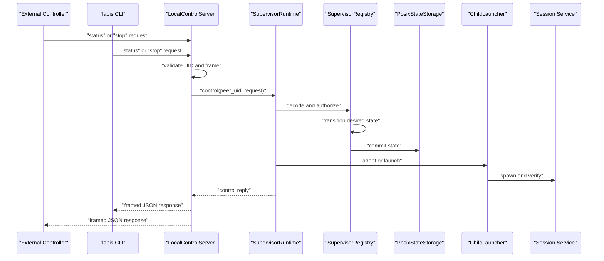
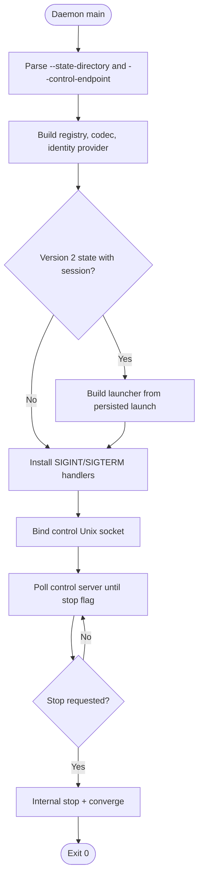
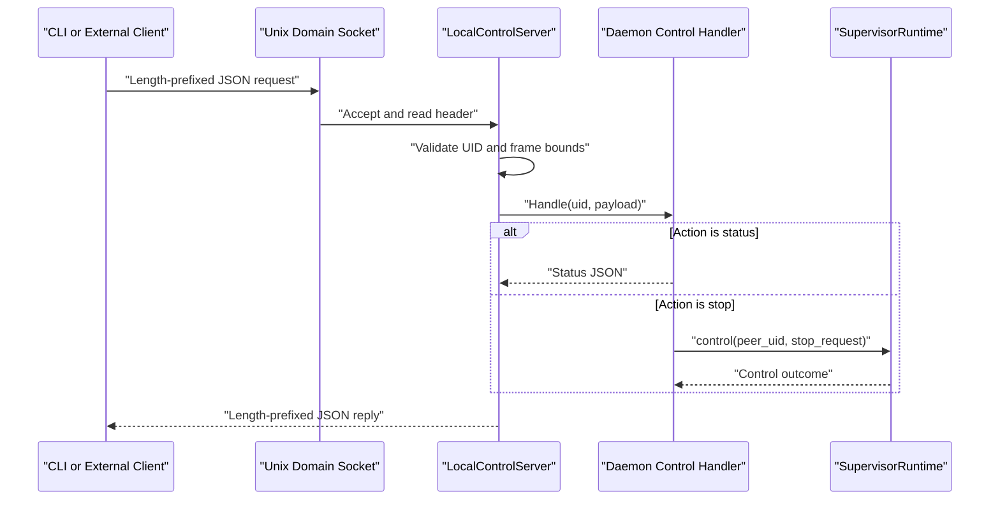
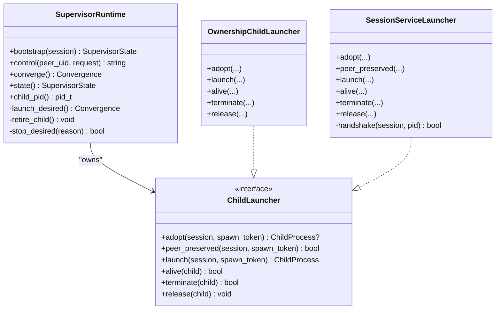
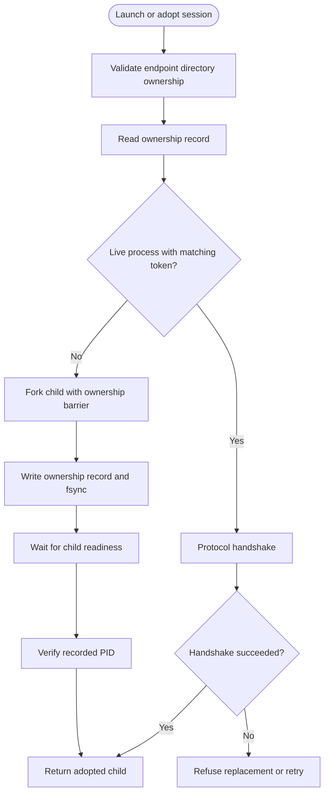
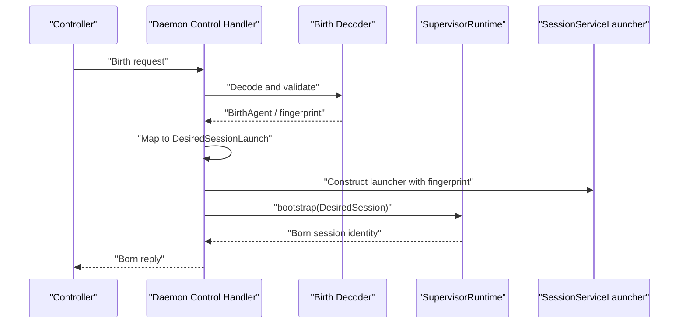
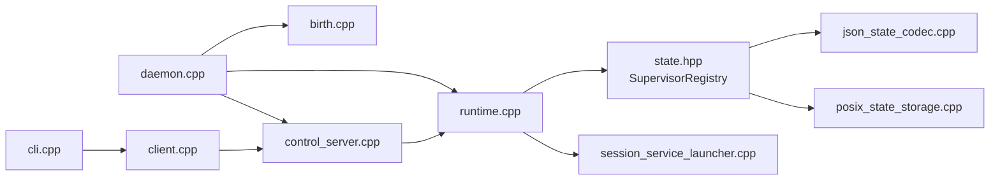

# Supervisor Daemon Design

<cite>
**Referenced Files in This Document**
- [daemon.cpp](file://services/supervisor/src/daemon.cpp)
- [control_server.cpp](file://services/supervisor/src/control_server.cpp)
- [runtime.cpp](file://services/supervisor/src/runtime.cpp)
- [session_service_launcher.cpp](file://services/supervisor/src/session_service_launcher.cpp)
- [birth.cpp](file://services/supervisor/src/birth.cpp)
- [json_state_codec.cpp](file://services/supervisor/src/json_state_codec.cpp)
- [posix_state_storage.cpp](file://services/supervisor/src/posix_state_storage.cpp)
- [cli.cpp](file://services/supervisor/src/cli.cpp)
- [client.cpp](file://services/supervisor/src/client.cpp)
- [state.hpp](file://services/supervisor/include/lapis/supervisor/state.hpp)
- [runtime.hpp](file://services/supervisor/include/lapis/supervisor/runtime.hpp)
- [control_server.hpp](file://services/supervisor/include/lapis/supervisor/control_server.hpp)
- [session_service_launcher.hpp](file://services/supervisor/include/lapis/supervisor/session_service_launcher.hpp)
- [birth.hpp](file://services/supervisor/include/lapis/supervisor/birth.hpp)
- [architecture.md](file://docs/architecture.md)
</cite>

## Table of Contents
1. [Introduction](#introduction)
2. [Project Structure](#project-structure)
3. [Core Components](#core-components)
4. [Architecture Overview](#architecture-overview)
5. [Detailed Component Analysis](#detailed-component-analysis)
6. [Dependency Analysis](#dependency-analysis)
7. [Performance Considerations](#performance-considerations)
8. [Troubleshooting Guide](#troubleshooting-guide)
9. [Conclusion](#conclusion)

## Introduction
This document describes the long-lived supervisor daemon that orchestrates a single session service lifecycle. Its responsibilities are intentionally narrow: admission of supervised sessions, durable desired-state storage, process supervision with restart policy, and a local control interface for authenticated clients. The daemon is not a general-purpose process manager; it owns one session slot and delegates terminal, history, adapter, and PTY concerns to the session service child.

The current implementation is an experimental same-UID macOS-oriented supervisor that prepares production delivery for launchd registration, GUI-driven birth admission, and update-safe recovery. It exposes a Unix-domain control socket for status queries and explicit stop operations, while external processes communicate through a bounded JSON protocol over that socket.

**Section sources**
- [architecture.md:1-100](file://docs/architecture.md#L1-L100)
- [daemon.cpp:1-120](file://services/supervisor/src/daemon.cpp#L1-L120)

## Project Structure
The supervisor lives under `services/supervisor/` and is split into headers defining interfaces and source files implementing behavior:

| Area | Responsibility | Key Files |
|---|---|---|
| State model and codecs | Persistent schema, control request decoding, identity generation | [state.hpp](file://services/supervisor/include/lapis/supervisor/state.hpp), [json_state_codec.cpp](file://services/supervisor/src/json_state_codec.cpp) |
| Persistence | Filesystem-backed singleton lock, atomic state commit | [posix_state_storage.cpp](file://services/supervisor/src/posix_state_storage.cpp) |
| Runtime policy | Convergence, restart window, child lifecycle, control dispatch | [runtime.hpp](file://services/supervisor/include/lapis/supervisor/runtime.hpp), [runtime.cpp](file://services/supervisor/src/runtime.cpp) |
| Child launching | Process ownership, handshake, adoption, termination | [session_service_launcher.hpp](file://services/supervisor/include/lapis/supervisor/session_service_launcher.hpp), [session_service_launcher.cpp](file://services/supervisor/src/session_service_launcher.cpp) |
| Control server | Local Unix-domain listener, framing, peer UID enforcement | [control_server.hpp](file://services/supervisor/include/lapis/supervisor/control_server.hpp), [control_server.cpp](file://services/supervisor/src/control_server.cpp) |
| Birth admission | External process birth request validation and reply encoding | [birth.hpp](file://services/supervisor/include/lapis/supervisor/birth.hpp), [birth.cpp](file://services/supervisor/src/birth.cpp) |
| Daemon entrypoint | Argument parsing, signal handling, reconstruction, event loop | [daemon.cpp](file://services/supervisor/src/daemon.cpp) |
| Client tools | Status query, explicit stop, control transport | [client.cpp](file://services/supervisor/src/client.cpp), [cli.cpp](file://services/supervisor/src/cli.cpp) |

**Diagram sources**
- [daemon.cpp:120-274](file://services/supervisor/src/daemon.cpp#L120-L274)
- [control_server.cpp:240-327](file://services/supervisor/src/control_server.cpp#L240-L327)
- [runtime.hpp:110-151](file://services/supervisor/include/lapis/supervisor/runtime.hpp#L110-L151)
- [state.hpp:100-232](file://services/supervisor/include/lapis/supervisor/state.hpp#L100-L232)

**Section sources**
- [daemon.cpp:1-274](file://services/supervisor/src/daemon.cpp#L1-L274)
- [control_server.cpp:1-327](file://services/supervisor/src/control_server.cpp#L1-L327)
- [runtime.hpp:1-151](file://services/supervisor/include/lapis/supervisor/runtime.hpp#L1-L151)
- [state.hpp:1-232](file://services/supervisor/include/lapis/supervisor/state.hpp#L1-L232)

## Core Components
The supervisor is composed of five cooperating subsystems:

1. **State registry and codec**: Holds the canonical supervisor state, including whether it is enabled, its instance epoch, and the optional one-session slot. The codec validates JSON schema, length bounds, hex identifiers, and versioning before accepting or emitting state.
2. **POSIX state storage**: Provides exclusive access via a filesystem lock, validates directory permissions, and writes state atomically using a pending file plus rename and directory sync.
3. **Runtime**: Implements convergence between desired state and actual child process. It enforces restart limits, waits for child termination, and manages child adoption when a supervisor restarts.
4. **Child launcher**: Encapsulates how a child process is created, adopted, verified, signaled, and released. The production path uses `SessionServiceLauncher`; the generic `OwnershipChildLauncher` supports harmless or fixture children.
5. **Control server**: Listens on a private Unix-domain socket, accepts at most four clients, enforces same-UID access, parses a strict framed protocol, and forwards requests to the runtime.

Key constants bound the system:
- Maximum state size: 8 KiB.
- Maximum control message size: 8 KiB.
- Maximum endpoint path: 4096 bytes.
- Identity fields: 32-byte lowercase hex identifiers.
- Fingerprint field: 64-byte lowercase hex digest.
- Spawn token: 64-byte lowercase hex secret.
- Restart limit: three restarts per one-minute monotonic window.

**Section sources**
- [state.hpp:1-120](file://services/supervisor/include/lapis/supervisor/state.hpp#L1-L120)
- [runtime.hpp:1-60](file://services/supervisor/include/lapis/supervisor/runtime.hpp#L1-L60)
- [posix_state_storage.cpp:1-171](file://services/supervisor/src/posix_state_storage.cpp#L1-L171)
- [json_state_codec.cpp:1-120](file://services/supervisor/src/json_state_codec.cpp#L1-L120)

## Architecture Overview
The supervisor follows a layered architecture:

**Diagram sources**
- [control_server.cpp:120-327](file://services/supervisor/src/control_server.cpp#L120-L327)
- [runtime.cpp:330-560](file://services/supervisor/src/runtime.cpp#L330-L560)
- [state.hpp:160-232](file://services/supervisor/include/lapis/supervisor/state.hpp#L160-L232)
- [posix_state_storage.cpp:80-171](file://services/supervisor/src/posix_state_storage.cpp#L80-L171)

### Process Supervision Model
The supervisor owns one active session slot. A child is either:
- Adopted from a previous supervisor run using a matching spawn token and verified process identity.
- Launched by validating the parent endpoint directory, creating an ownership record, waiting for a cooperative handshake, and then returning the child process descriptor.
- Terminated gracefully with SIGTERM to the process group, followed by SIGKILL if it does not exit within a bounded wait loop.
- Released by removing its ownership marker after successful termination.

### Service Discovery
Discovery is local and implicit:
- The daemon listens on a private Unix-domain socket whose path is supplied at startup.
- The session service exposes its own endpoint path inside the supervisor’s state.
- Clients discover the session endpoint only through the supervisor status reply when the service is live.

### State Persistence and Crash Recovery
The persistent state is a compact JSON document stored under a private directory. On startup:
- The daemon reconstructs a registry backed by the persisted state.
- If version 2 state contains a session with a canonical launch payload, it builds a launcher capable of adopting or restarting the service.
- If the persisted slot was started but no live child can be adopted, reconstruction fails closed until an explicit reset protocol is implemented later.
- A failed persistence commit poisons the registry so that stale in-memory transitions cannot overwrite unknown disk state.

**Section sources**
- [daemon.cpp:120-274](file://services/supervisor/src/daemon.cpp#L120-L274)
- [runtime.cpp:201-330](file://services/supervisor/src/runtime.cpp#L201-L330)
- [json_state_codec.cpp:201-339](file://services/supervisor/src/json_state_codec.cpp#L201-L339)
- [posix_state_storage.cpp:1-171](file://services/supervisor/src/posix_state_storage.cpp#L1-L171)

## Detailed Component Analysis

### Daemon Lifecycle and Signal Handling
The daemon parses two required absolute-path arguments: state directory and control endpoint. It installs SIGINT and SIGTERM handlers that set a volatile flag. The main loop repeatedly polls the control server with a short timeout until shutdown is requested. On shutdown, it asks the runtime to send an internal stop request and converge, swallowing exceptions so cleanup remains reliable.

Birth admission is handled by the daemon’s control handler:
- Same-UID clients are admitted; other UIDs receive rejection.
- Status requests return serialized state and a liveness indicator derived from the runtime’s child PID.
- Stop requests delegate to the runtime with full authentication.
- New birth requests construct a new runtime and launcher, bootstrap a session, and reject on any construction or convergence failure.

**Diagram sources**
- [daemon.cpp:1-120](file://services/supervisor/src/daemon.cpp#L1-L120)
- [daemon.cpp:120-274](file://services/supervisor/src/daemon.cpp#L120-L274)

**Section sources**
- [daemon.cpp:1-274](file://services/supervisor/src/daemon.cpp#L1-L274)

### Control Server Interface
The control server implements a strict framed protocol:
- Four big-endian header bytes declare payload length.
- Payloads are limited to the global maximum control size.
- Connections are accepted only from the same effective user ID.
- Each client has a deadline and is dropped if it cannot complete one request-response frame.
- The server binds a Unix-domain socket, removes stale sockets owned by the same user, sets mode `0600`, and verifies the bound socket is also owner-only.

Requests are dispatched through a handler function object. In the daemon, this maps:
- `version=1`, `action=status` → serialized status reply.
- `version=1`, `action=stop` → runtime-controlled stop.
- Unknown actions → birth rejection.

The headless `lapis supervisor` CLI is a separate binary that constructs status and stop requests, reads the authoritative state directory for stop authorization, and sends them over the same framed protocol.

**Diagram sources**
- [control_server.cpp:1-200](file://services/supervisor/src/control_server.cpp#L1-L200)
- [control_server.cpp:201-327](file://services/supervisor/src/control_server.cpp#L201-L327)
- [daemon.cpp:160-274](file://services/supervisor/src/daemon.cpp#L160-L274)
- [client.cpp:201-249](file://services/supervisor/src/client.cpp#L201-L249)

**Section sources**
- [control_server.cpp:1-327](file://services/supervisor/src/control_server.cpp#L1-L327)
- [client.cpp:1-249](file://services/supervisor/src/client.cpp#L1-L249)
- [cli.cpp:1-97](file://services/supervisor/src/cli.cpp#L1-L97)

### Runtime Management and Restart Policy
`SupervisorRuntime` owns convergence between desired state and the actual child process. Its important behaviors include:

- **Bootstrap**: Creates the first authoritative session slot when no session exists.
- **Converge**: Starts, stops, restarts, disables, or reports exhaustion/failure based on current desired state and child health.
- **Restart window**: Tracks restart timestamps using monotonic nanoseconds and rejects further restarts when more than three occur within one minute.
- **Adoption**: Attempts to adopt an existing child using a spawn token before launching a replacement.
- **Health monitoring**: Checks whether the child process is alive and terminates it when stopping.
- **Graceful shutdown**: Uses process-group termination and a bounded wait loop; fallback to force kill if needed.

The runtime stores child metadata including PID, spawn token, endpoint, transport descriptor, adoption flag, session identity, and fingerprint. Only adoptable, verified children expose enough information for safe process-group signaling.

**Diagram sources**
- [runtime.hpp:60-151](file://services/supervisor/include/lapis/supervisor/runtime.hpp#L60-L151)
- [runtime.cpp:201-560](file://services/supervisor/src/runtime.cpp#L201-L560)
- [session_service_launcher.hpp:1-56](file://services/supervisor/include/lapis/supervisor/session_service_launcher.hpp#L1-L56)

**Section sources**
- [runtime.hpp:1-151](file://services/supervisor/include/lapis/supervisor/runtime.hpp#L1-L151)
- [runtime.cpp:1-560](file://services/supervisor/src/runtime.cpp#L1-L560)

### Session Service Launching and Handshake
`SessionServiceLauncher` is the production child launcher. It validates the fixed launch description against the expected fingerprint, canonicalizes the agent program and working directory, and refuses conflicting Codex/Claude modes.

Its workflow includes:

1. Validate parent endpoint directory is owned by the supervisor user and has mode `0700`.
2. Check for an existing ownership record.
3. If a live process matches both the expected executable and spawn token, perform a protocol handshake.
4. On successful handshake, adopt the process instead of replacing it.
5. Otherwise, spawn a new process, write an ownership record, wait for the child’s cooperative readiness barrier, and then verify the recorded PID.
6. Connect to the session service endpoint and send a wire-frame attach request.
7. Accept transient overload replies during early startup, retry with backoff, and fail hard on final rejection or identity mismatch.

**Diagram sources**
- [session_service_launcher.cpp:1-200](file://services/supervisor/src/session_service_launcher.cpp#L1-L200)
- [session_service_launcher.cpp:201-400](file://services/supervisor/src/session_service_launcher.cpp#L201-L400)

**Section sources**
- [session_service_launcher.cpp:1-710](file://services/supervisor/src/session_service_launcher.cpp#L1-L710)

### Birth Admission Protocol
External controllers admit supervised sessions through a birth request validated by `decode_birth_request`. The request must contain:
- Version `1`.
- Action `birth`.
- An absolute endpoint path bounded by the global endpoint limit.
- A 64-byte hex fingerprint.
- An agent description containing mode, program, arguments, working directory, columns, and rows.
- A service description whose environment override map must be empty.

The daemon converts the birth request into a `DesiredSessionLaunch`, then into a `SessionServiceLaunch`, constructs a launcher with the provided fingerprint, bootstraps the runtime, and returns the generated session identity on success. Failure paths always return a rejected birth reply rather than leaking diagnostics.

**Diagram sources**
- [birth.cpp:1-151](file://services/supervisor/src/birth.cpp#L1-L151)
- [daemon.cpp:1-160](file://services/supervisor/src/daemon.cpp#L1-L160)

**Section sources**
- [birth.hpp:1-39](file://services/supervisor/include/lapis/supervisor/birth.hpp#L1-L39)
- [birth.cpp:1-151](file://services/supervisor/src/birth.cpp#L1-L151)
- [daemon.cpp:1-160](file://services/supervisor/src/daemon.cpp#L1-L160)

### State Serialization Format and Crash Recovery
The JSON state format is explicitly versioned and strictly validated:

| Field | Type | Meaning |
|---|---|---|
| `version` | integer | Schema version; currently `1` or `2`. |
| `enabled` | boolean | Whether the supervisor is enabled. |
| `instance_epoch` | 32-byte lowercase hex | Monotonic instance identifier used to reject stale control requests. |
| `session` | object or null | Optional one-session slot. |
| `session.endpoint` | string | Absolute Unix-domain endpoint path. |
| `session.fingerprint` | 64-byte lowercase hex | Canonical launch fingerprint. |
| `session.identity.session_id` | 32-byte lowercase hex | Session identifier. |
| `session.identity.epoch` | 32-byte lowercase hex | Session epoch. |
| `session.desired_state` | string | `started` or `stopped`. |
| `session.spawn_token` | 64-byte lowercase hex | Secret used to authenticate stop and adoption. |
| `session.blocked_reason` | string | Optional diagnostic reason for blocking. |
| `session.launch` | object or null | Version 2 addition describing the canonical literal launch. |

Persistence uses an atomic swap pattern:
1. Acquire an exclusive lock on `.supervisor.lock`.
2. Read `supervisor.json` only if it passes ownership, link count, permission, and size checks.
3. Write to `.supervisor.json.pending` with mode `0600`.
4. Sync the pending file.
5. Atomically rename pending to `supervisor.json`.
6. Sync the directory.

On crash recovery:
- The daemon loads the latest valid state.
- Version 2 state with a session and launch payload allows reconstruction of a launcher.
- A stopped v2 slot may validate launcher construction but stays refused until an explicit reset protocol is implemented.
- A started slot without an adoptable child causes reconstruction to fail closed.

**Section sources**
- [json_state_codec.cpp:1-339](file://services/supervisor/src/json_state_codec.cpp#L1-L339)
- [posix_state_storage.cpp:1-171](file://services/supervisor/src/posix_state_storage.cpp#L1-L171)
- [state.hpp:1-160](file://services/supervisor/include/lapis/supervisor/state.hpp#L1-L160)
- [daemon.cpp:120-274](file://services/supervisor/src/daemon.cpp#L120-L274)

### Process Group Management and Graceful Shutdown
For the generic `OwnershipChildLauncher`, termination uses process groups:
- Send `SIGTERM` to the child process group.
- Wait up to a bounded number of attempts with short sleeps.
- If the process remains alive, send `SIGKILL`.
- Remove the ownership marker after release.

The session service launcher relies on protocol-level verification before allowing replacement. If a retained process cannot be verified through the handshake, the supervisor refuses to signal or replace it because doing so could terminate an unrelated process with the same PID reuse risk.

**Section sources**
- [runtime.cpp:330-560](file://services/supervisor/src/runtime.cpp#L330-L560)
- [session_service_launcher.cpp:400-710](file://services/supervisor/src/session_service_launcher.cpp#L400-L710)

### Platform-Specific Behavior and macOS Integration
The codebase contains several platform-sensitive details:

| Area | Implementation Detail |
|---|---|
| Peer credential inspection | Uses `getpeereid` on BSD-family systems and `SO_PEERCRED` on Linux. |
| Executable discovery | Uses `proc_pidpath` on macOS and `/proc/<pid>/exe` on Linux. |
| Process group signals | Uses POSIX `killpg` for graceful process group termination. |
| Endpoint preparation | Delegates to session-layer POSIX endpoint preparation utilities. |
| macOS service registration | The supervisor itself is not a launchd registration layer; documentation states launchd owns registration and unregistration. |

The architecture document clarifies that the supervisor owns birth admission, desired state, convergence, and private ownership records, while launchd owns registration. Production delivery order expects explicit per-user launchd registration as a later step, with observable enabled, disabled, unregistered, and unknown states reconciled without spawning a second daemon or terminating children implicitly.

**Section sources**
- [control_server.cpp:1-120](file://services/supervisor/src/control_server.cpp#L1-L120)
- [session_service_launcher.cpp:1-120](file://services/supervisor/src/session_service_launcher.cpp#L1-L120)
- [runtime.cpp:330-560](file://services/supervisor/src/runtime.cpp#L330-L560)
- [architecture.md:1-100](file://docs/architecture.md#L1-L100)

## Dependency Analysis
The supervisor components have clear boundaries:

**Diagram sources**
- [daemon.cpp:1-274](file://services/supervisor/src/daemon.cpp#L1-L274)
- [control_server.cpp:1-327](file://services/supervisor/src/control_server.cpp#L1-L327)
- [runtime.cpp:1-560](file://services/supervisor/src/runtime.cpp#L1-L560)
- [json_state_codec.cpp:1-339](file://services/supervisor/src/json_state_codec.cpp#L1-L339)
- [posix_state_storage.cpp:1-171](file://services/supervisor/src/posix_state_storage.cpp#L1-L171)
- [session_service_launcher.cpp:1-710](file://services/supervisor/src/session_service_launcher.cpp#L1-L710)
- [client.cpp:1-249](file://services/supervisor/src/client.cpp#L1-L249)
- [cli.cpp:1-97](file://services/supervisor/src/cli.cpp#L1-L97)

Coupling is strongest between the daemon and the control server, and between the runtime and child launcher. The registry isolates state semantics from process management. The codec isolates JSON schema evolution from filesystem I/O. The storage layer isolates POSIX locking and atomic commits from higher-level logic.

Potential circular dependencies are avoided by keeping launchers and codecs abstracted behind interfaces defined in headers.

**Section sources**
- [state.hpp:100-232](file://services/supervisor/include/lapis/supervisor/state.hpp#L100-L232)
- [runtime.hpp:60-151](file://services/supervisor/include/lapis/supervisor/runtime.hpp#L60-L151)

## Performance Considerations
The supervisor is designed for low overhead:

- The control server uses `poll` over Unix-domain sockets and handles at most four clients concurrently.
- Each client is bounded by a strict frame and a timeout, preventing slow or malformed clients from blocking the event loop.
- State writes use atomic rename and directory sync, minimizing partial-state exposure.
- Restart limiting prevents rapid restart storms.
- The daemon’s main loop polls every 100 milliseconds, which is acceptable for a background supervisor that is primarily event-driven.
- Handshake retries for the session service use a shared budget and small sleeps, avoiding tight polling loops.

Optimization opportunities should preserve correctness and boundedness:
- Avoid adding heavy synchronous work to the control server event loop.
- Keep state serialization and validation fast since they execute on every control request and restart.
- Preserve timeouts and bounds before introducing concurrency.

[No sources needed since this section provides general guidance]

## Troubleshooting Guide
Common failure modes and their likely causes:

| Symptom | Likely Cause | Resolution |
|---|---|---|
| Control connection refused or rejected | Foreign UID or malformed request | Ensure the client runs as the same user as the supervisor and sends a valid versioned JSON frame. |
| Stale epoch error | Control request carries an older `supervisor_epoch` | Refresh the supervisor state and resend the stop request with the current epoch. |
| Birth rejected | Invalid endpoint, fingerprint, agent payload, or launch fingerprint mismatch | Inspect the birth request fields and ensure the controller supplies the correct fingerprint. |
| Reconstruction failed | Started v2 state has no adoptable child or missing launch payload | Use explicit reset or restore procedures before attempting automatic recovery. |
| Service handshake expired | Session service did not respond within the handshake budget | Check the session service logs; transient overload is retried, but identity mismatch or permanent overload fails. |
| Ownership record unsafe | Incorrect permissions, wrong owner, non-regular file, or symlink risk | Remove or repair the state directory and ownership markers carefully, ensuring only the supervisor user owns them. |
| Stop command fails | Missing state directory, invalid state file, or unauthorized stop token | Provide the exact state directory used by the daemon and ensure the state file is valid version 2 JSON. |

Diagnostic steps:
1. Query status with the headless client using `lapis supervisor status --control-endpoint <socket>`.
2. If stopping, also provide `--state-directory <directory>` and `--json` for machine-readable output.
3. Inspect the state directory for `supervisor.json`, `.supervisor.lock`, and ownership marker files.
4. Verify that all files are owned by the supervisor user and have owner-only permissions.
5. Check whether the control socket is still present and has mode `0600`.

**Section sources**
- [cli.cpp:1-97](file://services/supervisor/src/cli.cpp#L1-L97)
- [client.cpp:1-249](file://services/supervisor/src/client.cpp#L1-L249)
- [posix_state_storage.cpp:1-171](file://services/supervisor/src/posix_state_storage.cpp#L1-L171)
- [json_state_codec.cpp:1-339](file://services/supervisor/src/json_state_codec.cpp#L1-L339)

## Conclusion
The supervisor daemon is a focused, safety-oriented process supervisor for a single session service. Its design emphasizes explicit state, bounded protocols, strict ownership records, and conservative recovery. It does not yet implement full launchd integration or a general service discovery mechanism; those remain product delivery goals documented alongside the current experimental supervisor slice.

The most important guarantees are:
- External controllers authenticate through UID checks, instance epochs, and spawn tokens.
- Children are adopted only when process identity and spawn tokens match.
- State changes are serialized through a versioned JSON schema and committed atomically.
- Restart storms are prevented by a monotonic restart window.
- Graceful shutdown prefers process-group signals and falls back to force termination within bounded waits.
- Platform-specific behavior is isolated to credential inspection, executable discovery, and POSIX process primitives.

Future production work adds explicit launchd registration, GUI-driven birth routes, and robust reset/recovery semantics beyond the current one-shot experimental daemon.

[No sources needed since this section summarizes without analyzing specific files]