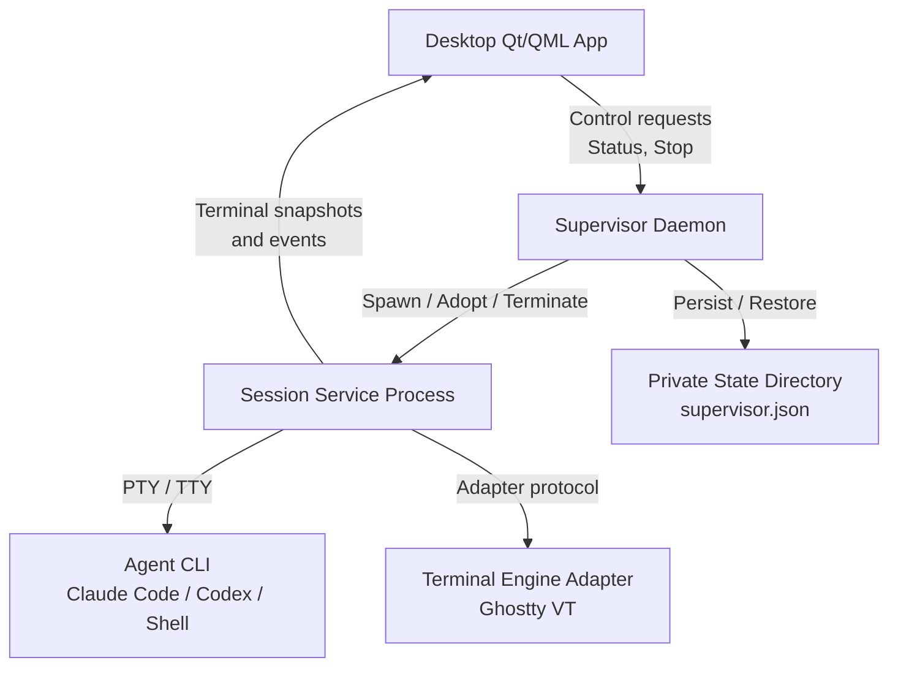
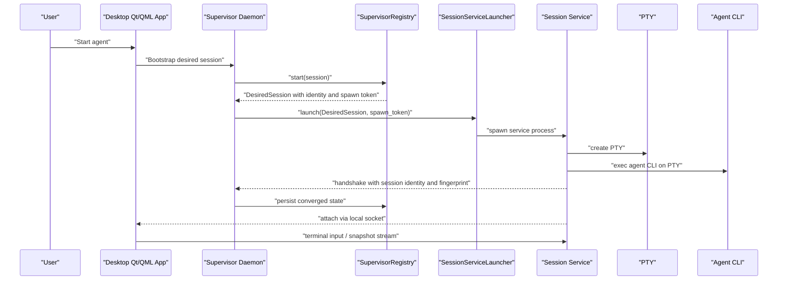
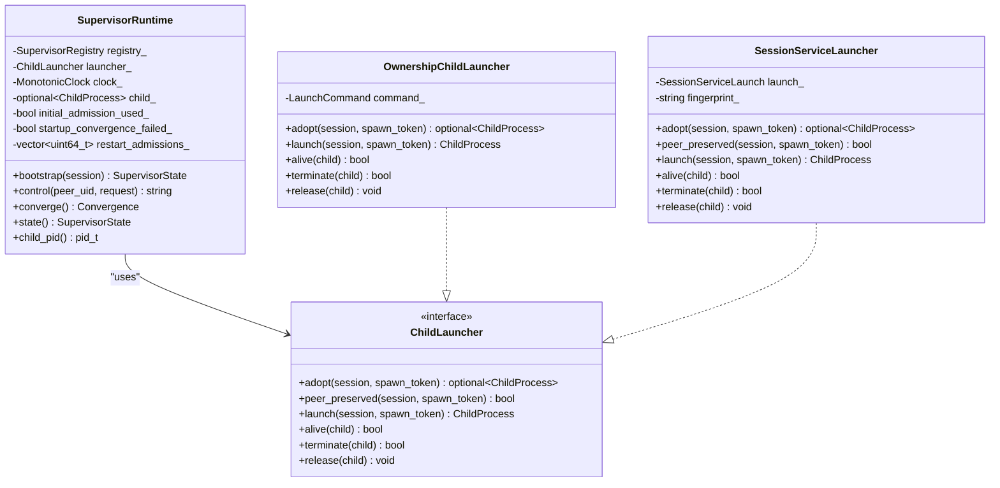
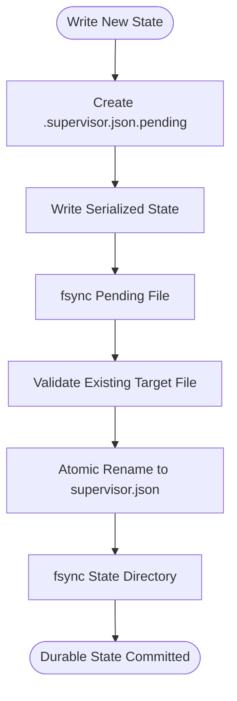
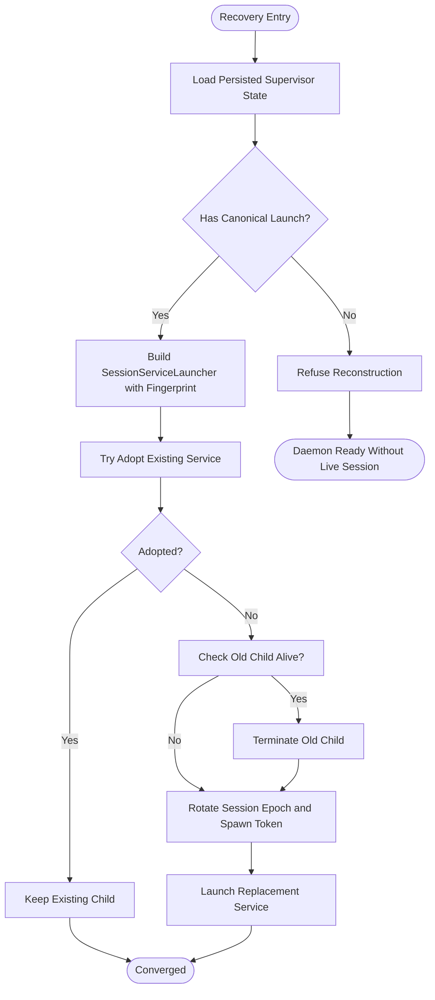
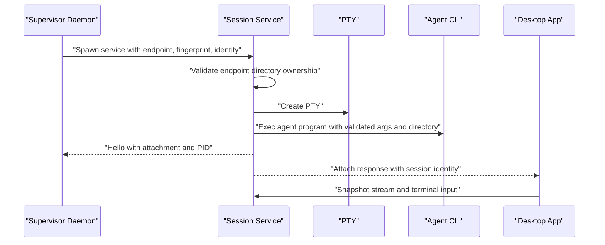
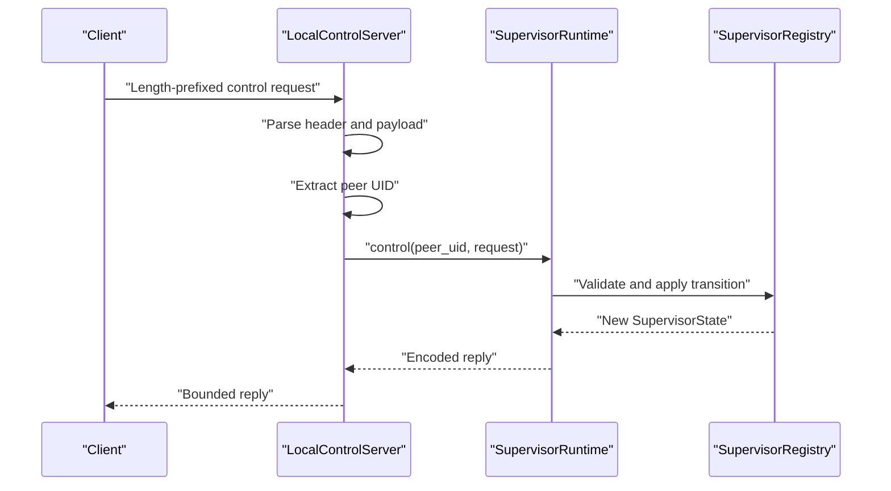
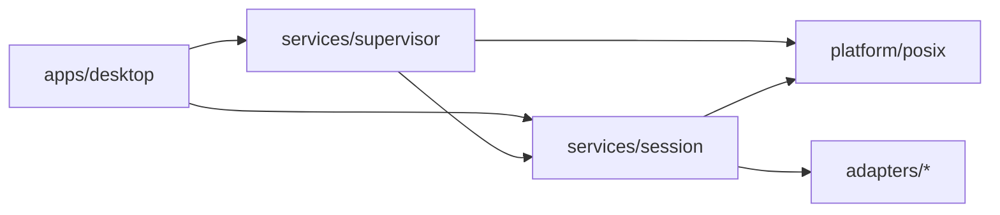

# System Context and Process Model

<cite>
**Referenced Files in This Document**   
- [README.md](file://README.md)
- [architecture.md](file://docs/architecture.md)
- [daemon.cpp](file://services/supervisor/src/daemon.cpp)
- [runtime.hpp](file://services/supervisor/include/lapis/supervisor/runtime.hpp)
- [runtime.cpp](file://services/supervisor/src/runtime.cpp)
- [state.hpp](file://services/supervisor/include/lapis/supervisor/state.hpp)
- [state.cpp](file://services/supervisor/src/state.cpp)
- [json_state_codec.cpp](file://services/supervisor/src/json_state_codec.cpp)
- [posix_state_storage.cpp](file://services/supervisor/src/posix_state_storage.cpp)
- [control_server.cpp](file://services/supervisor/src/control_server.cpp)
- [client.hpp](file://services/supervisor/include/lapis/supervisor/client.hpp)
- [birth.hpp](file://services/supervisor/include/lapis/supervisor/birth.hpp)
- [session_service_launcher.hpp](file://services/supervisor/include/lapis/supervisor/session_service_launcher.hpp)
- [session_service_launcher.cpp](file://services/supervisor/src/session_service_launcher.cpp)
- [launch_spec.cpp](file://services/session/src/launch_spec.cpp)
- [local_protocol.cpp](file://services/session/src/transport/local_protocol.cpp)
- [session_service.cpp](file://services/session/src/session_service.cpp)
- [main.cpp](file://apps/desktop/src/main.cpp)
</cite>

## Table of Contents
1. [Introduction](#introduction)
2. [Project Structure](#project-structure)
3. [Core Components](#core-components)
4. [Architecture Overview](#architecture-overview)
5. [Detailed Component Analysis](#detailed-component-analysis)
6. [Dependency Analysis](#dependency-analysis)
7. [Performance Considerations](#performance-considerations)
8. [Troubleshooting Guide](#troubleshooting-guide)
9. [Conclusion](#conclusion)

## Introduction
Lapis is a macOS desktop application that supervises multiple coding agents, such as Claude Code and Codex. Each agent runs in its own isolated session service process. A long-lived supervisor daemon owns the single desired session slot, persists state, validates process birth, manages lifecycle transitions, and enables recovery after crashes or reboots. The Qt/QML desktop UI owns presentation, input focus, workspace layout, and user interaction but does not directly own terminal processes or per-session PTYs in the production route.

The system is deliberately process-isolated:
- Desktop UI: Qt/QML interface and workspace coordination.
- Supervisor daemon: durable state, admission control, service launch, adoption, convergence, and shutdown.
- Session service: one process per coding agent session; it owns the PTY, terminal engine adapter, agent CLI, and protocol handling.
- Agent CLI: external program (Claude Code, Codex, shell, etc.) whose output is observed and whose input is injected through the session service.

This document explains how these components interact, how the startup sequence works, and how failure isolation, security boundaries, and platform-specific considerations are implemented.

**Section sources**
- [README.md:1-30](file://README.md#L1-L30)
- [architecture.md:13-39](file://docs/architecture.md#L13-L39)

## Project Structure
The repository separates concerns by feature and layer rather than by platform alone:
- `services/supervisor`: supervisor daemon, runtime policy, state storage, JSON codec, control server, and child launcher interfaces.
- `services/session`: per-session service implementation, PTY/process group handling, local IPC transport, attention protocol, history, checkpoints, and terminal hooks.
- `adapters`: agent-specific observation and hook-relay code for Claude Code and Codex.
- `apps/desktop`: Qt/QML desktop application entry point, GUI state, terminals, workspace, and platform integration.
- `apps/android`, `apps/ios`, `apps/ultratab`, `apps/remote`: other client or overlay surfaces that are outside the primary macOS supervisor model.

**Diagram sources**
- [architecture.md:13-39](file://docs/architecture.md#L13-L39)
- [daemon.cpp:1-60](file://services/supervisor/src/daemon.cpp#L1-L60)
- [session_service.cpp:1-40](file://services/session/src/session_service.cpp#L1-L40)
- [main.cpp:1-40](file://apps/desktop/src/main.cpp#L1-L40)

**Section sources**
- [architecture.md:13-39](file://docs/architecture.md#L13-L39)
- [README.md:1-30](file://README.md#L1-L30)

## Core Components
The core runtime boundary is defined by the supervisor’s `ChildLauncher` abstraction, which decouples lifecycle policy from the concrete mechanism used to start, adopt, observe, terminate, and release a child process. For the production path, this is implemented by `SessionServiceLauncher`; for experimental or harmless children, an `OwnershipChildLauncher` may be used.

Key responsibilities:
- `SupervisorRuntime`: owns convergence policy, restart accounting, child ownership, and transition orchestration.
- `SupervisorRegistry` + `StateStorage` + `JsonStateCodec`: authoritative state owner with validation, persistence, and versioned schema handling.
- `LocalControlServer`: bounded, authenticated local control endpoint for status and stop operations.
- `SessionServiceLauncher`: spawns the per-session service, performs handshake and fingerprint validation, writes ownership records, and manages process groups.
- Session service: owns PTY, terminal state, agent CLI process, and wire protocol messages exchanged with the desktop UI.

**Section sources**
- [runtime.hpp:28-151](file://services/supervisor/include/lapis/supervisor/runtime.hpp#L28-L151)
- [state.hpp:17-200](file://services/supervisor/include/lapis/supervisor/state.hpp#L17-L200)
- [session_service_launcher.hpp:12-56](file://services/supervisor/include/lapis/supervisor/session_service_launcher.hpp#L12-L56)

## Architecture Overview
At a high level, Lapis separates three major responsibilities:
1. **User-facing surface**: Qt/QML desktop app, workspace layout, terminal rendering, attention strip, and user commands.
2. **Process ownership and durability**: supervisor daemon with serialized state, process birth validation, spawn tokens, and convergence.
3. **Per-session execution**: session service that owns the PTY, terminal engine, agent CLI, and adapter protocol.

**Diagram sources**
- [daemon.cpp:60-140](file://services/supervisor/src/daemon.cpp#L60-L140)
- [runtime.hpp:90-151](file://services/supervisor/include/lapis/supervisor/runtime.hpp#L90-L151)
- [session_service_launcher.cpp:1-60](file://services/supervisor/src/session_service_launcher.cpp#L1-L60)
- [session_service.cpp:1-40](file://services/session/src/session_service.cpp#L1-L40)

### Process Boundaries and Failure Isolation
| Boundary | Owner | What it isolates | Failure consequence |
|---|---|---|---|
| Desktop ↔ Supervisor | Local control endpoint | GUI cannot directly own PTYs or services | GUI crash does not automatically terminate sessions; supervisor remains durable |
| Supervisor ↔ Session service | Spawn token, fingerprint, endpoint directory ownership | Only authorized peers can attach to a live session | Malformed, stale, or foreign UID requests fail closed |
| Session service ↔ Agent CLI | PTY and process group | Agent process has no direct access to supervisor state or desktop memory | Agent crash leaves the supervisor able to detect and optionally replace it |
| Session service ↔ Terminal engine | Adapter boundary | Ghostty parser and renderer internals stay out of the UI thread | Terminal engine changes do not corrupt desktop UI state |

**Section sources**
- [architecture.md:13-39](file://docs/architecture.md#L13-L39)
- [runtime.hpp:28-89](file://services/supervisor/include/lapis/supervisor/runtime.hpp#L28-L89)

## Detailed Component Analysis

### Supervisor Runtime and Lifecycle Policy
The supervisor runtime encapsulates lifecycle policy without owning low-level process creation details. It exposes bootstrap, control, converge, state inspection, and child PID queries. Internal helpers manage launching desired state, retiring failed children, stopping desired sessions, and tracking restart admissions within a time window.

Important constants:
- Maximum concurrent control clients.
- Control client timeout.
- Restart rate limiting (`max_restarts_per_window`, `restart_window_ns`).

**Diagram sources**
- [runtime.hpp:28-151](file://services/supervisor/include/lapis/supervisor/runtime.hpp#L28-L151)
- [session_service_launcher.hpp:12-56](file://services/supervisor/include/lapis/supervisor/session_service_launcher.hpp#L12-L56)

**Section sources**
- [runtime.hpp:28-151](file://services/supervisor/include/lapis/supervisor/runtime.hpp#L28-L151)
- [runtime.cpp:1-120](file://services/supervisor/src/runtime.cpp#L1-L120)

### State Schema, Validation, and Persistence
Supervisor state is a single-session slot designed for durability across GUI replacement, updates, and daemon restarts. Version 2 requires a canonical `DesiredSessionLaunch` payload so a replacement daemon can reconstruct the same service launch.

Validation rules include:
- Bounded text fields.
- Hexadecimal identifiers for instance epoch, session ID, epoch, fingerprint, and spawn token.
- Endpoint must be an absolute path.
- Launch mode must be terminal, codex, or claude.
- Column and row dimensions must be positive and bounded.
- Version-dependent launch presence.

Persistence uses an exclusive lock file and atomic rename with directory sync:
- `.supervisor.lock` ensures singleton ownership.
- `.supervisor.json.pending` is written atomically.
- Final `supervisor.json` is replaced only after successful sync.
- File metadata checks enforce owner-only regular files with restricted permissions.

**Diagram sources**
- [posix_state_storage.cpp:86-171](file://services/supervisor/src/posix_state_storage.cpp#L86-L171)

**Section sources**
- [state.hpp:17-120](file://services/supervisor/include/lapis/supervisor/state.hpp#L17-L120)
- [state.cpp:1-120](file://services/supervisor/src/state.cpp#L1-L120)
- [json_state_codec.cpp:1-120](file://services/supervisor/src/json_state_codec.cpp#L1-L120)
- [posix_state_storage.cpp:1-171](file://services/supervisor/src/posix_state_storage.cpp#L1-L171)

### Process Birth Validation and Adoption
When the supervisor starts, it attempts to reconstruct a previous session from persisted state. If the persisted state contains a launch payload, it builds a `SessionServiceLauncher` with the expected fingerprint and tries to adopt an existing service process before launching a new one.

Adoption involves:
- Checking whether the endpoint directory is owned by the current effective UID with restrictive permissions.
- Reading a private ownership record containing a spawn token and PID.
- Verifying the process executable path matches the expected service binary.
- Validating the spawn token against authoritative state.
- Connecting to the service endpoint to confirm liveness.

If adoption fails, the supervisor terminates the old child if needed, rotates the session epoch and spawn token, and launches a replacement.

**Diagram sources**
- [daemon.cpp:60-140](file://services/supervisor/src/daemon.cpp#L60-L140)
- [session_service_launcher.cpp:60-160](file://services/supervisor/src/session_service_launcher.cpp#L60-L160)
- [runtime.cpp:120-220](file://services/supervisor/src/runtime.cpp#L120-L220)

**Section sources**
- [daemon.cpp:60-140](file://services/supervisor/src/daemon.cpp#L60-L140)
- [session_service_launcher.cpp:60-160](file://services/supervisor/src/session_service_launcher.cpp#L60-L160)
- [runtime.cpp:120-220](file://services/supervisor/src/runtime.cpp#L120-L220)

### Session Service Startup and Agent CLI Launch
The session service is a separate process responsible for:
- Validating its endpoint directory ownership.
- Creating and owning the PTY.
- Launching the agent CLI with validated arguments and working directory.
- Managing terminal hooks and attention routing.
- Exposing a local Unix socket for attachment.
- Streaming terminal snapshots and attention events to connected peers.

The desktop UI can connect in discovery, join, reconnect, or explicit attach modes. Attachments carry capability flags for hyperlinks, attention phases, and paste transactions, and they validate session identity and epoch according to the chosen mode.

**Diagram sources**
- [session_service_launcher.cpp:160-260](file://services/supervisor/src/session_service_launcher.cpp#L160-L260)
- [session_service.cpp:1-120](file://services/session/src/session_service.cpp#L1-L120)
- [local_protocol.cpp:120-220](file://services/session/src/transport/local_protocol.cpp#L120-L220)

**Section sources**
- [session_service.cpp:1-120](file://services/session/src/session_service.cpp#L1-L120)
- [launch_spec.cpp:1-144](file://services/session/src/launch_spec.cpp#L1-L144)
- [local_protocol.cpp:120-220](file://services/session/src/transport/local_protocol.cpp#L120-L220)

### Control Plane: Status and Stop
The supervisor exposes a local control endpoint used by tools and the desktop UI to inspect or change supervisor state. Requests are length-prefixed, bounded, and authenticated using the supervisor instance epoch and a spawn token. The control server reads peer credentials using platform mechanisms where available and enforces strict frame parsing.

Supported operations include:
- `status`: read-only supervisor state plus service liveness.
- `stop`: internal or external shutdown of the supervised session.

**Diagram sources**
- [control_server.cpp:1-120](file://services/supervisor/src/control_server.cpp#L1-L120)
- [client.hpp:1-34](file://services/supervisor/include/lapis/supervisor/client.hpp#L1-L34)
- [runtime.hpp:90-151](file://services/supervisor/include/lapis/supervisor/runtime.hpp#L90-L151)

**Section sources**
- [control_server.cpp:1-120](file://services/supervisor/src/control_server.cpp#L1-L120)
- [client.hpp:1-34](file://services/supervisor/include/lapis/supervisor/client.hpp#L1-L34)

### Desktop Application Entry Point and Non-Interactive Modes
The desktop application supports normal interactive use as well as non-interactive modes for restoration and serving. Relevant options include:
- `--restore-agents`: restart agents whose services are gone after a reboot.
- `--serve`: host the workspace for a phone until a desktop window opens.
- `--new-session` and `--discover`: explicitly start or discover an existing session on a specific socket.
- `--socket`, `--cwd`, and positional agent arguments for qualified launch paths.

The desktop process intentionally avoids unqualified workspace launches and delegates agent lifecycle to the supervisor in the supported production flow.

**Section sources**
- [main.cpp:1-120](file://apps/desktop/src/main.cpp#L1-L120)

## Dependency Analysis
The supervisor depends on shared session types and utilities, while the session service depends on POSIX process primitives, local sockets, and terminal protocol types. The desktop application depends on Qt/QML and higher-level domain modules, but does not directly own PTY handles in the production route.

**Diagram sources**
- [architecture.md:13-39](file://docs/architecture.md#L13-L39)
- [session_service_launcher.cpp:1-60](file://services/supervisor/src/session_service_launcher.cpp#L1-L60)
- [session_service.cpp:1-40](file://services/session/src/session_service.cpp#L1-L40)

**Section sources**
- [architecture.md:13-39](file://docs/architecture.md#L13-L39)

## Performance Considerations
The session service implements bounded output admission to handle sustained pressure from agent output. Key characteristics include:
- A 64 KiB admission limit once sustained pressure opens.
- A quiet batch threshold below which interactive output parses immediately.
- Backend probing intervals and attempt limits for agent readiness.
- Tight bounds on paste sizes, hyperlink spans, and message payloads.

These constraints protect the desktop UI and terminal pipeline from being overwhelmed by unbounded agent output.

**Section sources**
- [session_service.cpp:1-60](file://services/session/src/session_service.cpp#L1-L60)
- [local_protocol.cpp:1-60](file://services/session/src/transport/local_protocol.cpp#L1-L60)

## Troubleshooting Guide
Common operational issues and their architectural causes:

| Symptom | Likely Cause | Resolution Guidance |
|---|---|---|
| Supervisor refuses reconstruction | Missing or malformed persisted launch payload, wrong version, or invalid state | Use explicit operator recovery; do not guess a launch from version 1 state |
| Session attachment rejected | Stale session epoch, wrong spawn token, or mismatched fingerprint | Reconnect with the current supervisor state; the supervisor rotates identity on restart |
| Control request unauthorized | Invalid instance epoch, missing token, or malformed frame | Verify the client request encoding and supervisor instance epoch |
| Service endpoint unavailable | Dead symlink, wrong ownership, or crashed service | Check endpoint directory permissions, ownership record, and supervisor logs |
| Agent CLI not launched | Invalid program path, non-executable binary, invalid terminal size, or blocked launch spec | Validate launch spec and ensure the agent binary exists and is executable |
| State file corrupted or locked | Another supervisor holds the lock or file permissions are unsafe | Ensure only one supervisor process owns the state directory and that files are owner-only |

Security-related validations to inspect:
- Endpoint directories must be owned by the effective UID with mode `0700`.
- Ownership records must be owner-only regular files with mode `0600`, single link count, and bounded size.
- Spawn tokens use constant-time comparison windows.
- Control requests are bounded and strictly framed.
- Peer credentials are extracted using platform mechanisms where available.

**Section sources**
- [state.cpp:1-120](file://services/supervisor/src/state.cpp#L1-L120)
- [runtime.cpp:120-220](file://services/supervisor/src/runtime.cpp#L120-L220)
- [control_server.cpp:120-220](file://services/supervisor/src/control_server.cpp#L120-L220)
- [posix_state_storage.cpp:1-171](file://services/supervisor/src/posix_state_storage.cpp#L1-L171)

## Conclusion
Lapis’s system context separates the desktop UI, supervisor daemon, per-session services, agent adapters, and terminal engine into distinct processes. The supervisor is the durable authority for a single desired session: it validates and serializes launch configuration, protects state with filesystem-level isolation, adopts surviving children when possible, and replaces them safely when necessary. The session service owns the PTY and agent CLI, while the desktop UI focuses on presentation and user interaction.

This design provides strong failure isolation: a crashing agent or desktop UI does not necessarily lose a running session, and a crashed supervisor can recover state and restore the service. Security boundaries rely on Unix ownership, spawn tokens, fingerprints, endpoint directory restrictions, and bounded control frames. On macOS, process management includes executable-path verification through platform APIs, privileged process registration handled by launchd, and careful handling of symlinks and endpoint cleanup.