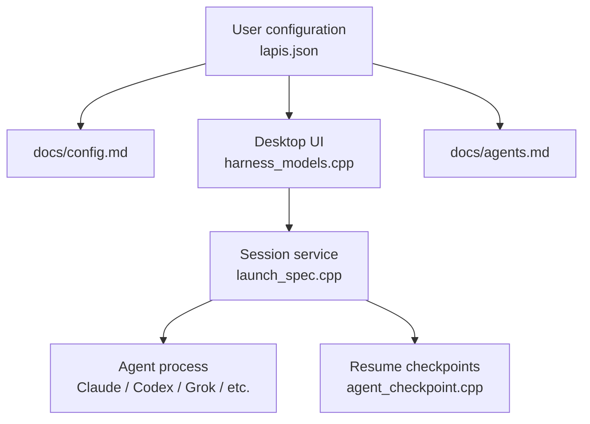
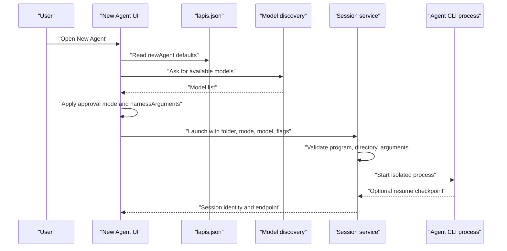
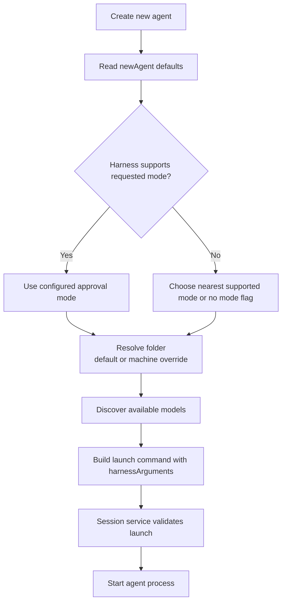
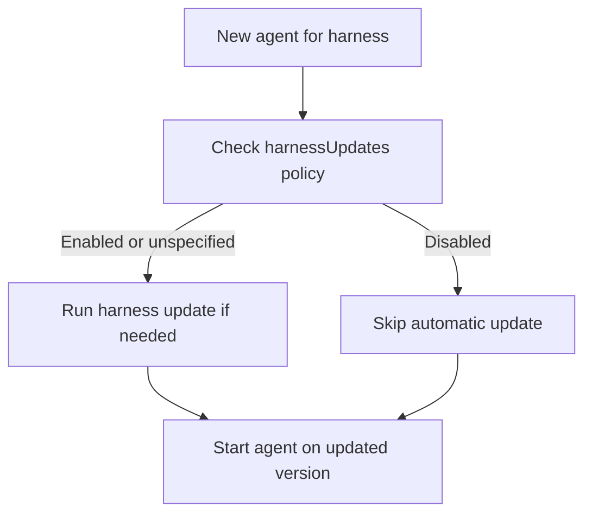
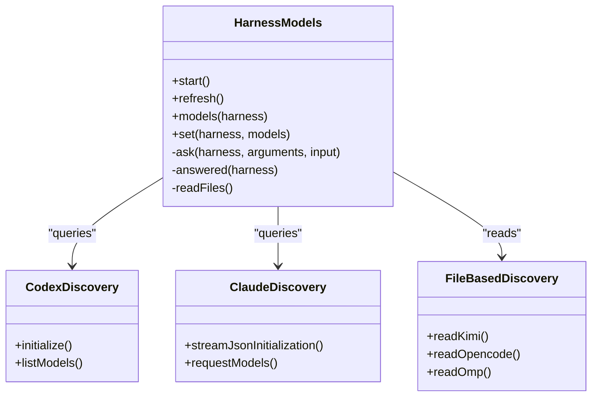
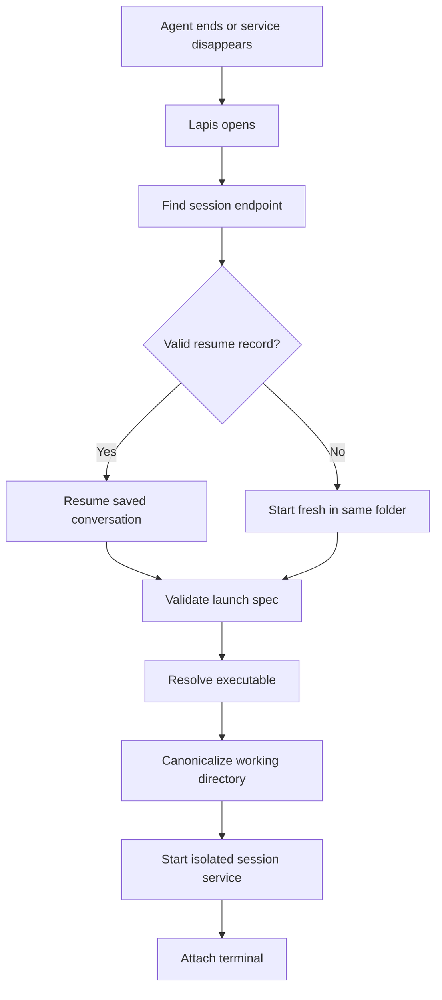
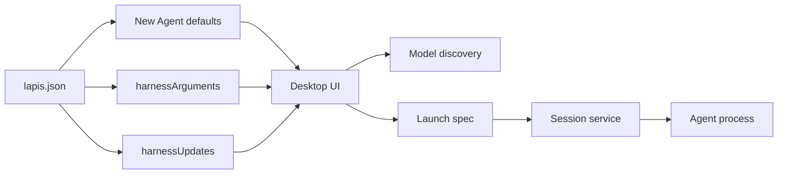

# Agent Configuration

<cite>
**Referenced Files in This Document**   
- [README.md](file://README.md)
- [docs/agents.md](file://docs/agents.md)
- [docs/config.md](file://docs/config.md)
- [apps/desktop/src/harness_models.cpp](file://apps/desktop/src/harness_models.cpp)
- [services/session/src/launch_spec.cpp](file://services/session/src/launch_spec.cpp)
- [services/session/src/agent_checkpoint.cpp](file://services/session/src/agent_checkpoint.cpp)
</cite>

## Table of Contents
1. [Introduction](#introduction)
2. [Project Structure](#project-structure)
3. [Core Components](#core-components)
4. [Architecture Overview](#architecture-overview)
5. [Detailed Component Analysis](#detailed-component-analysis)
6. [Dependency Analysis](#dependency-analysis)
7. [Performance Considerations](#performance-considerations)
8. [Troubleshooting Guide](#troubleshooting-guide)
9. [Conclusion](#conclusion)
10. [Appendices](#appendices)

## Introduction
This document explains agent-specific configuration for the Lapis desktop application. It focuses on:

- The `newAgent` section: default harness selection, starting folder, approval mode, per-machine folder overrides, and model lists.
- `harnessArguments`: adding CLI flags to every new agent process for a selected harness.
- `harnessUpdates`: controlling automatic CLI updates.
- The models mapping and how available models are discovered.
- Agent lifecycle behavior: resume, session persistence, and process isolation.
- Complex configuration patterns for local development, remote SSH agents, and multi-machine workflows.
- Security considerations around permissions, credentials, and file safety.

Lapis is a Mac application that runs multiple coding agents at once, giving each one its own live terminal and session service. Agents include Claude Code, Codex, Grok, OpenCode, OMP, Kimi, and Antigravity.

**Section sources**
- [README.md:1-30](file://README.md#L1-L30)

## Project Structure
Agent configuration is primarily user-facing through `lapis.json`, while implementation lives across the desktop UI and the session service:

- User configuration is documented in `docs/config.md`.
- Agent startup, modes, restart, resume, and update behavior are documented in `docs/agents.md`.
- Model discovery and harness querying are implemented in the desktop layer under `apps/desktop/src/harness_models.cpp`.
- Launch validation, working directory resolution, executable checks, shell launching, and launch fingerprints live in `services/session/src/launch_spec.cpp`.
- Resume checkpoint scanning, record validation, and safe file handling are implemented in `services/session/src/agent_checkpoint.cpp`.

**Diagram sources**
- [docs/config.md:1-60](file://docs/config.md#L1-L60)
- [docs/agents.md:1-40](file://docs/agents.md#L1-L40)
- [apps/desktop/src/harness_models.cpp:250-330](file://apps/desktop/src/harness_models.cpp#L250-L330)
- [services/session/src/launch_spec.cpp:1-120](file://services/session/src/launch_spec.cpp#L1-L120)
- [services/session/src/agent_checkpoint.cpp:1-120](file://services/session/src/agent_checkpoint.cpp#L1-L120)

**Section sources**
- [docs/config.md:1-60](file://docs/config.md#L1-L60)
- [docs/agents.md:1-40](file://docs/agents.md#L1-L40)

## Core Components
The agent configuration surface is organized into these areas:

| Area | Purpose | Where it appears |
|---|---|---|
| `newAgent` | Defaults for the New Agent dialog: harness, folder, approval mode, per-machine folder override, and model list | `lapis.json`; documented in `docs/config.md` and `docs/agents.md` |
| `harnessArguments` | Extra CLI flags added to every new agent for a given harness | `lapis.json`; documented in `docs/config.md` |
| `harnessUpdates` | Policy for automatically updating CLIs before starting them | `lapis.json`; documented in `docs/config.md` and `docs/agents.md` |
| Models | Available model choices per harness; may be overridden by recent sessions or config | Desktop model discovery in `apps/desktop/src/harness_models.cpp` |
| Lifecycle | Restart, reload, resume, session persistence, and process isolation | `docs/agents.md`, `services/session/src/launch_spec.cpp`, `services/session/src/agent_checkpoint.cpp` |

**Section sources**
- [docs/config.md:1-60](file://docs/config.md#L1-L60)
- [docs/agents.md:1-80](file://docs/agents.md#L1-L80)

## Architecture Overview
Agent configuration flows from user settings into three layers:

1. **Configuration layer:** `lapis.json` holds `newAgent`, `harnessArguments`, `harnessUpdates`, alerts, usage, editor, and other preferences.
2. **Desktop UI layer:** The New Agent form reads defaults from `newAgent`, discovers available models, applies approval-mode selection rules, and prepares launch data.
3. **Session service layer:** The session service validates the launch specification, resolves the executable and working directory, starts the agent process in isolation, and records resume information where supported.

**Diagram sources**
- [docs/config.md:1-60](file://docs/config.md#L1-L60)
- [apps/desktop/src/harness_models.cpp:250-330](file://apps/desktop/src/harness_models.cpp#L250-L330)
- [services/session/src/launch_spec.cpp:1-120](file://services/session/src/launch_spec.cpp#L1-L120)

## Detailed Component Analysis

### The `newAgent` Section
`newAgent` defines defaults for creating new agents. According to the documentation, it includes:

- **Default harness:** The initial CLI selected when opening the New Agent dialog. Supported harnesses mentioned in documentation include Claude, Codex, OpenCode, Grok, OMP, Antigravity, and Kimi.
- **Starting folder:** The default workspace folder. Folder suggestions prioritize recent and frequent work.
- **Approval mode:** One of `edits`, `auto`, or `full`. This maps to each CLI’s own approval flag.
- **Per-machine folder overrides:** A `machines` map can assign different folders for named machines.
- **Model list:** A mapping of harness to model identifiers offered by the New Agent form.

The documentation example shows `newAgent` with `harness`, `folder`, `mode`, `machines`, and `models`.

#### Approval Modes
Approval modes control how much an agent may do without asking:

| Mode | Meaning | Notes |
|---|---|---|
| `edits` | Accept edits | Closest to limited but useful automated editing. |
| `auto` | Auto | Automated approval within supported bounds. |
| `full` | Full access | Highest access level, used initially or when no less-permissive mode is configured. |

If a harness does not support the requested mode, Lapis chooses the nearest supported mode with less access or adds no mode flag. Explicit request modes take precedence over `newAgent.mode`.

#### Per-Machine Folder Overrides
The `machines` map allows different starting folders per machine. For example, a machine named `devbox` can have its own folder while the default remains elsewhere. Remote agents launched over SSH use the host’s `newAgent` folder when present, otherwise the home directory.

#### Model Mapping
The `models` mapping associates harness names with model identifiers. The desktop layer also discovers models dynamically:

- Codex: queries the app server.
- Claude: initializes via stream-json input/output and requests models.
- Grok: parses model listing output.
- Antigravity: parses model listing output.
- Kimi: reads configuration and recent roles.
- OpenCode: reads recent/favorite state files.
- OMP: reads model roles and recent sessions.

The final displayed model list is deduplicated, keeps the default first, and limits the number shown.

**Diagram sources**
- [docs/config.md:1-60](file://docs/config.md#L1-L60)
- [docs/agents.md:1-40](file://docs/agents.md#L1-L40)
- [apps/desktop/src/harness_models.cpp:250-330](file://apps/desktop/src/harness_models.cpp#L250-L330)
- [services/session/src/launch_spec.cpp:1-120](file://services/session/src/launch_spec.cpp#L1-L120)

**Section sources**
- [docs/config.md:1-60](file://docs/config.md#L1-L60)
- [docs/agents.md:1-40](file://docs/agents.md#L1-L40)
- [apps/desktop/src/harness_models.cpp:1-120](file://apps/desktop/src/harness_models.cpp#L1-L120)
- [apps/desktop/src/harness_models.cpp:250-407](file://apps/desktop/src/harness_models.cpp#L250-L407)

### `harnessArguments`
`harnessArguments` lets you add extra CLI flags to every new agent of a particular harness. Key behaviors:

- Flags are appended alongside Lapis-generated options such as model, approval mode, and resume options.
- Configured approval flags take precedence when a request has no explicit mode.
- Shell aliases do not apply because Lapis starts the executable directly.
- Literal arguments after `--` do not replace generated conversation-resume arguments.

For example, the documentation shows passing a permission-skipping flag to Claude.

Security note: `harnessArguments` can change agent behavior significantly. Avoid granting unnecessary broad permissions. Prefer narrow flags and explicit approval modes.

**Section sources**
- [docs/config.md:1-60](file://docs/config.md#L1-L60)
- [docs/agents.md:1-40](file://docs/agents.md#L1-L40)

### `harnessUpdates`
`harnessUpdates` controls whether Lapis updates a harness before starting a new agent.

Behavior:

- If a harness is set to `false`, Lapis does not run its automatic update for that harness.
- New agents of that harness start without running the update first.
- Commands such as “Update this tab’s CLI and reload it” report updates are off for that harness instead of running the update.
- Any update already running continues before waiting agents start.
- Harnesses absent from `harnessUpdates` or explicitly set to `true` keep updating automatically.
- The global `--no-harness-updates` flag disables updates for all harnesses.

Supported update commands referenced by documentation include `claude update`, `omp update`, `grok update`, `kimi upgrade`, `opencode upgrade`, and `agy update`. Codex is special: Lapis observes only qualified builds and starts supported Codex with update checking disabled.

**Diagram sources**
- [docs/config.md:1-60](file://docs/config.md#L1-L60)
- [docs/agents.md:120-197](file://docs/agents.md#L120-L197)

**Section sources**
- [docs/config.md:1-60](file://docs/config.md#L1-L60)
- [docs/agents.md:120-197](file://docs/agents.md#L120-L197)

### Models Discovery
The desktop layer discovers models differently per harness:

| Harness | Discovery mechanism |
|---|---|
| Codex | JSON-RPC call to initialize and list models through the app server. |
| Claude | Stream-json initialization followed by a control request for models. |
| Grok | Parses textual model listing output. |
| Antigravity | Parses textual model listing output. |
| Kimi | Reads configuration files and recent roles. |
| OpenCode | Reads recent/favorite model state. |
| OMP | Reads model roles and scans recent session files for recently switched models. |

After discovery, results are tidied:

- Default models are placed first.
- Duplicate model identifiers are removed.
- A maximum number of models is shown.
- Some harnesses normalize display names from provider/model identifiers.

**Diagram sources**
- [apps/desktop/src/harness_models.cpp:250-407](file://apps/desktop/src/harness_models.cpp#L250-L407)

**Section sources**
- [apps/desktop/src/harness_models.cpp:1-200](file://apps/desktop/src/harness_models.cpp#L1-L200)
- [apps/desktop/src/harness_models.cpp:250-407](file://apps/desktop/src/harness_models.cpp#L250-L407)

### Agent Lifecycle Configuration

#### Resume Behavior
When Lapis starts, agents whose session services are gone are restarted in their cards. Supported agents such as Codex and Claude Code resume saved conversations using their own resume option. Other harnesses, or conversations without saved transcripts, start fresh in the same folder.

Resume records are stored beside the session endpoint with a `.resume` suffix. Lapis validates resume records:

- Only known agents are accepted.
- Session identifiers must be valid.
- Hosts must be local; checkpoints from agents running inside another host’s SSH session cannot be resumed here.
- Existing resume files must be regular files, owned by the current user, with strict permissions (`0600`) and link count checks.
- Records are size-limited and safely opened without following symlinks.

Explicit resume arguments provided by the user take precedence over auto-added resume options.

#### Session Persistence
The desktop layer launches Claude with `--no-session-persistence` when discovering models, so model discovery does not create persistent Claude sessions. The documentation states that Lapis does not change approval settings or global hooks; each agent runs in its own session service with its own identity and endpoint.

#### Process Isolation
Every agent gets its own session service, identity, and endpoint. The session service validates the launch specification:

- Program and working directory are required.
- Working directory must exist and is canonicalized.
- Program is resolved relative to the working directory or through PATH.
- Program must be an existing executable file.
- Argument count is bounded.
- Launch values cannot contain NUL characters and total bytes are bounded.
- Initial terminal dimensions are validated.
- Managed integration constraints are enforced (for example, certain conflicting Claude flags).

On POSIX systems, the shell launcher prefers the caller’s `SHELL` environment variable, then the real login shell from the password database, falling back to `/bin/sh`.

**Diagram sources**
- [docs/agents.md:160-197](file://docs/agents.md#L160-L197)
- [services/session/src/agent_checkpoint.cpp:1-120](file://services/session/src/agent_checkpoint.cpp#L1-L120)
- [services/session/src/launch_spec.cpp:1-120](file://services/session/src/launch_spec.cpp#L1-L120)

**Section sources**
- [docs/agents.md:160-197](file://docs/agents.md#L160-L197)
- [services/session/src/agent_checkpoint.cpp:1-120](file://services/session/src/agent_checkpoint.cpp#L1-L120)
- [services/session/src/agent_checkpoint.cpp:200-273](file://services/session/src/agent_checkpoint.cpp#L200-L273)
- [services/session/src/launch_spec.cpp:1-120](file://services/session/src/launch_spec.cpp#L1-L120)

### Complex Agent Configuration Examples

#### Local Development Environment
A developer may want:

- A default harness such as Codex or Claude.
- A project folder such as `~/dev`.
- An approval mode appropriate for daily work, such as `edits`.
- A curated model list per harness.
- Optional harness-specific flags for debugging or sandboxing.

Recommended pattern:

- Set `newAgent.harness` to the primary CLI.
- Set `newAgent.folder` to the main development root.
- Set `newAgent.mode` to `edits` or `auto` depending on trust level.
- Add harness-specific flags through `harnessArguments`.
- Keep `harnessUpdates` enabled unless a specific version must be pinned.

#### Remote SSH Setup
Remote agents are launched over SSH using hosts from the SSH configuration:

- The New Agent form offers local and SSH hosts.
- On a remote host, the agent runs in that host’s `newAgent` folder when configured, otherwise in the home directory.
- Connection drops can trigger reconnection and conversation resume for supported agents.
- Hooks or notify programs are passed on the command line for remote agents.

Recommended pattern:

- Define `newAgent.machines` with remote host names and their preferred folders.
- Use `harnessArguments` carefully on remote hosts because credentials and permissions travel with the process.
- Prefer explicit approval modes rather than globally permissive flags.
- Pin versions with `harnessUpdates` when remote environments require stable CLI versions.

#### Multi-Machine Workflow
For multiple machines:

- Use `newAgent.machines` to map machine names to folders.
- Use `usage.machines` to track usage across machines where applicable.
- Keep `harnessUpdates` consistent across machines unless a machine requires a pinned version.
- Ensure resume records remain local to the host where the agent ran; cross-host resume is intentionally rejected.

Recommended pattern:

- Centralize shared policies such as update behavior.
- Allow per-machine folder overrides for project layout differences.
- Avoid sharing configuration files containing credentials.

[No sources needed since this section provides conceptual configuration patterns derived from documented behavior]

### Security Considerations

#### Agent Permissions
- Lapis never changes a CLI’s approval policy itself. Approval decisions come from the CLI, permission prompts, or approved manual actions.
- For Claude, Lapis uses hooks that report events but do not print decisions or block tools; Claude’s own permission rules decide approvals.
- For Codex, explicit requests are listed, and users must explicitly approve, decline, cancel, or send answers. Opening or selecting a request does not approve it.

#### Credential Management
- Interaction logs redact sensitive input when macOS secure input is active or when terminal lines mention passwords, passphrases, passcodes, PINs, OTPs, tokens, keys, or secrets.
- The interaction log is owner-only and written with restrictive permissions.
- Resume records are validated for ownership, permissions, link count, size, and host locality.
- The GUI state file is private, versioned, replaced atomically, and size-limited.

#### Process and Launch Safety
- Launch specifications validate executables, directories, argument counts, and value sizes.
- Managed integration constraints prevent unsafe combinations of flags.
- Resume records reject unknown agents, invalid session identifiers, and non-local hosts.
- Resume files are opened without following symlinks and checked with strict Unix permissions.

**Section sources**
- [docs/agents.md:40-120](file://docs/agents.md#L40-L120)
- [docs/config.md:60-236](file://docs/config.md#L60-L236)
- [services/session/src/agent_checkpoint.cpp:1-120](file://services/session/src/agent_checkpoint.cpp#L1-L120)
- [services/session/src/launch_spec.cpp:1-120](file://services/session/src/launch_spec.cpp#L1-L120)

## Dependency Analysis
The configuration system connects user settings, UI logic, model discovery, and process management:

**Diagram sources**
- [docs/config.md:1-60](file://docs/config.md#L1-L60)
- [apps/desktop/src/harness_models.cpp:250-407](file://apps/desktop/src/harness_models.cpp#L250-L407)
- [services/session/src/launch_spec.cpp:1-120](file://services/session/src/launch_spec.cpp#L1-L120)

**Section sources**
- [docs/config.md:1-60](file://docs/config.md#L1-L60)
- [apps/desktop/src/harness_models.cpp:250-407](file://apps/desktop/src/harness_models.cpp#L250-L407)
- [services/session/src/launch_spec.cpp:1-120](file://services/session/src/launch_spec.cpp#L1-L120)

## Performance Considerations
- Model discovery is asynchronous and bounded. Processes asked for model lists are killed after a timeout and when answers arrive.
- Output buffers for model responses are truncated to avoid excessive memory use.
- OMP model discovery scans recent session files and reads only the head of each file to find recent model changes.
- Configuration changes are applied when they occur, but heavy operations such as sound file checks and background writes are deferred.
- Resume scanning and checkpoint parsing guard against oversized or malformed data.

[No sources needed since this section provides general performance guidance based on observed implementation behavior]

## Troubleshooting Guide

| Symptom | Likely cause | Recommended action |
|---|---|---|
| New agent starts with unexpected approval mode | Harness does not support the configured mode | Choose a supported mode or rely on Lapis fallback; verify `harnessArguments` does not already specify a mode. |
| Agent does not update automatically | `harnessUpdates` is disabled for that harness | Remove the harness from `harnessUpdates` or set it to `true`. |
| Resume fails after reboot | No resume record, unsupported harness, or cross-host checkpoint | Confirm the harness supports resume, ensure the agent ran locally, and check the `.resume` file permissions. |
| Agent cannot start | Invalid working directory, missing executable, or too many arguments | Verify the folder exists, the harness executable is installed, and `harnessArguments` is reasonable. |
| Remote agent disconnects | Network change or sleep | Let Lapis reconnect; supported agents should resume their conversation. |
| Excessive notifications | Alert settings or next-prompt judgment behavior | Adjust `alerts`, including `awayAfter`, `remindAfter`, and `judge`. |

**Section sources**
- [docs/config.md:60-236](file://docs/config.md#L60-L236)
- [docs/agents.md:120-197](file://docs/agents.md#L120-L197)
- [services/session/src/agent_checkpoint.cpp:1-120](file://services/session/src/agent_checkpoint.cpp#L1-L120)
- [services/session/src/launch_spec.cpp:1-120](file://services/session/src/launch_spec.cpp#L1-L120)

## Conclusion
Agent configuration in Lapis centers on predictable defaults, explicit approval boundaries, and safe process isolation. The `newAgent` section establishes the default harness, folder, approval mode, per-machine overrides, and model offerings. `harnessArguments` extends CLI behavior carefully, while `harnessUpdates` gives operators control over automatic CLI upgrades. Resume and session persistence are designed for resilience but enforce strict security checks. For complex environments, combine per-machine folders, selective update policies, and cautious credential handling to balance convenience with safety.

[No sources needed since this section summarizes without analyzing specific files]

## Appendices

### Configuration Reference Summary

| Setting | Type | Purpose |
|---|---|---|
| `newAgent.harness` | String | Default harness for new agents |
| `newAgent.folder` | String | Starting folder |
| `newAgent.mode` | String | Approval mode: `edits`, `auto`, or `full` |
| `newAgent.machines` | Map | Per-machine folder overrides |
| `newAgent.models` | Map | Harness-to-model mappings |
| `harnessArguments` | Map of arrays | Extra CLI flags per harness |
| `harnessUpdates` | Map of booleans | Disable automatic CLI updates per harness |

**Section sources**
- [docs/config.md:1-60](file://docs/config.md#L1-L60)