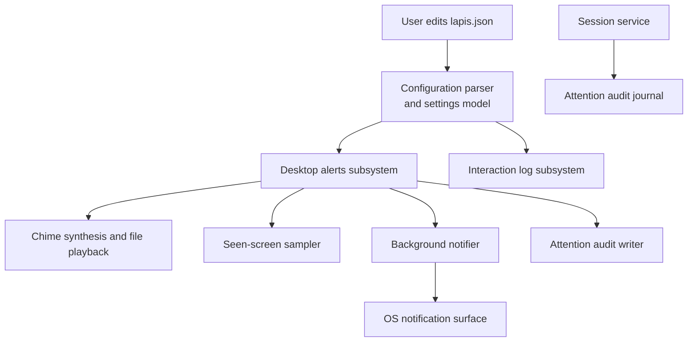
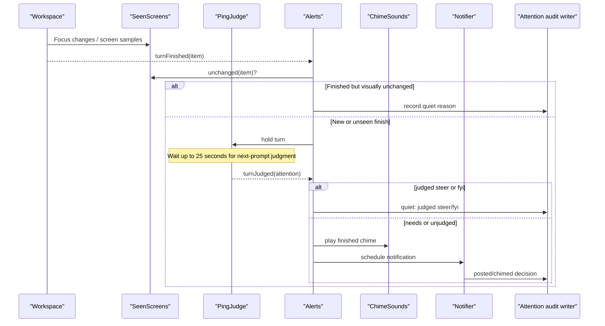
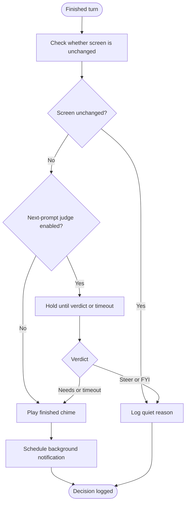
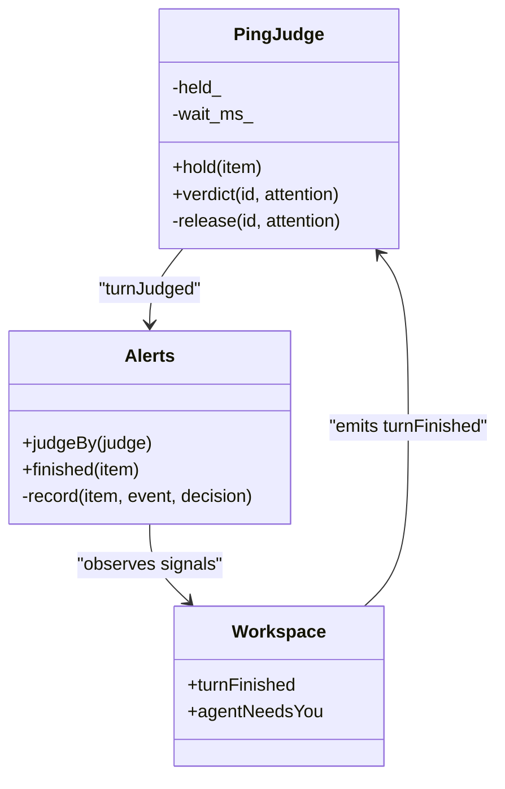
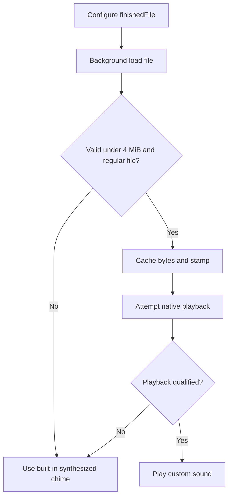
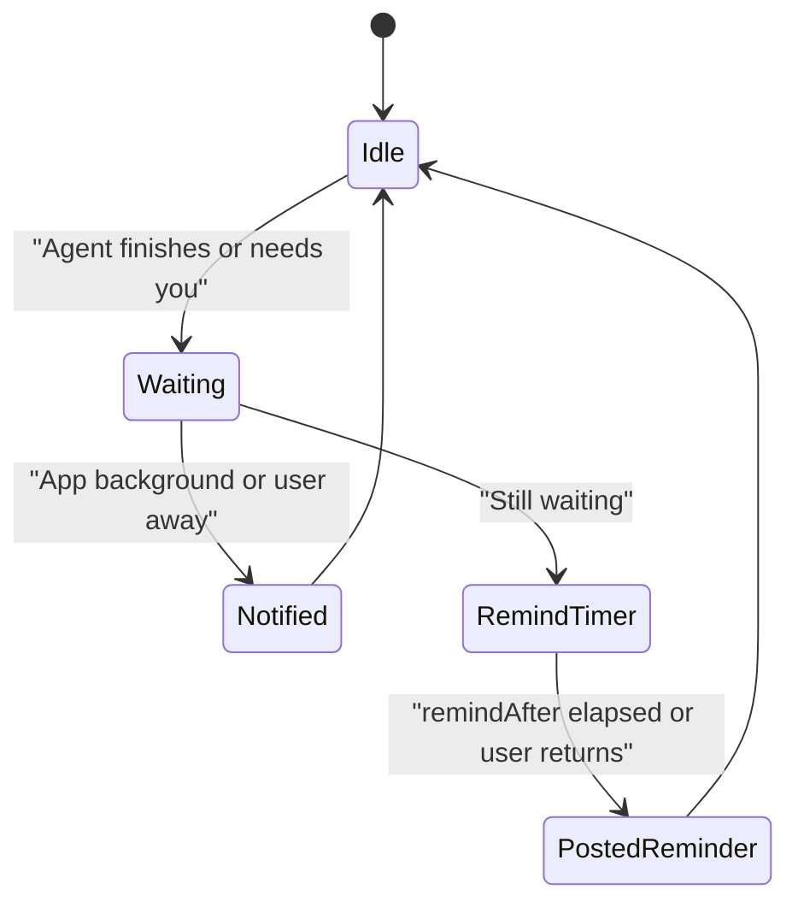
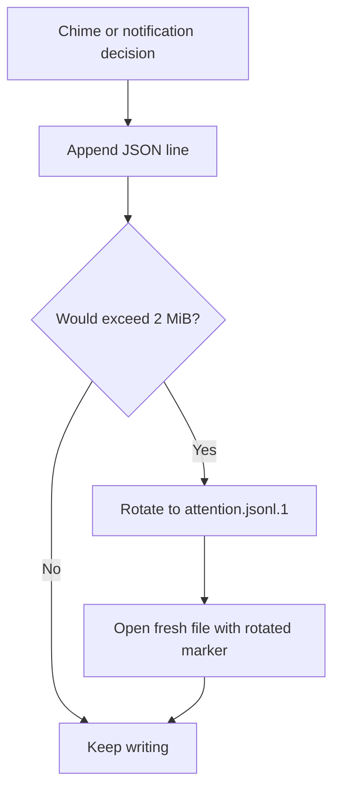
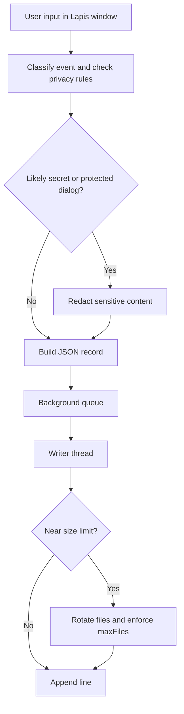
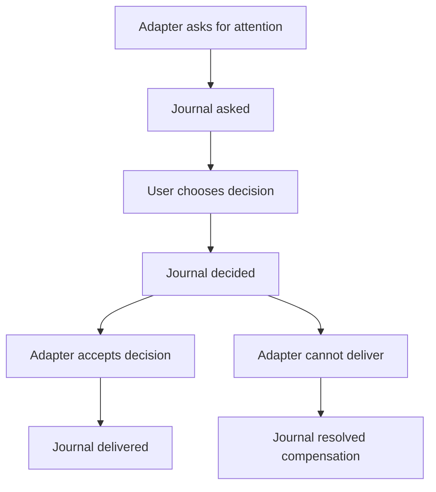
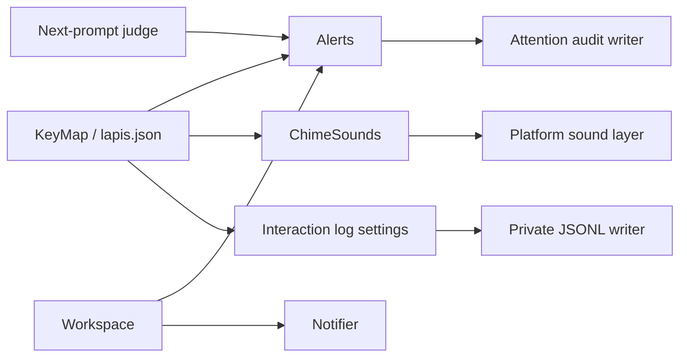

# Alert & Notification Settings

<cite>
**Referenced Files in This Document**
- [config.md](file://docs/config.md)
- [alerts.hpp](file://apps/desktop/src/alerts.hpp)
- [alerts.cpp](file://apps/desktop/src/alerts.cpp)
- [chime_sounds.hpp](file://apps/desktop/src/chime_sounds.hpp)
- [chime_sounds.cpp](file://apps/desktop/src/chime_sounds.cpp)
- [chime_file.hpp](file://apps/desktop/src/platform/chime_file.hpp)
- [chime_file.cpp](file://apps/desktop/src/platform/chime_file.cpp)
- [interaction_log.hpp](file://apps/desktop/src/interaction_log.hpp)
- [interaction_log.cpp](file://apps/desktop/src/interaction_log.cpp)
- [attention_audit.hpp](file://services/session/src/attention_audit.hpp)
- [attention_audit.cpp](file://services/session/src/attention_audit.cpp)
</cite>

## Table of Contents
1. [Introduction](#introduction)
2. [Project Structure](#project-structure)
3. [Core Components](#core-components)
4. [Architecture Overview](#architecture-overview)
5. [Detailed Component Analysis](#detailed-component-analysis)
6. [Dependency Analysis](#dependency-analysis)
7. [Performance Considerations](#performance-considerations)
8. [Troubleshooting Guide](#troubleshooting-guide)
9. [Conclusion](#conclusion)

## Introduction
This document explains Lapis’s alert and notification configuration system. It covers:

- The `alerts` section in `lapis.json`: sound behavior, background notifications, away detection, reminder scheduling, intelligent judging for next-prompt analysis, and custom finished sound files.
- The attention-driven alert system: chime sounds, background notifications, screen-sampling quieting, away detection, and reminder timers.
- The interaction log configuration for recording user interactions with privacy safeguards and retention policies.
- Attention audit logging to the session service’s journal, including event types, decision durability, and rotation behavior.
- Practical customization scenarios and troubleshooting guidance for notification delivery issues.

The documentation is intended for both users configuring Lapis and developers integrating or extending its alerting behavior.

## Project Structure
Alerting spans three layers:

1. **User configuration**: `lapis.json`, documented in the project configuration guide.
2. **Desktop application layer**: Chime synthesis, custom sound loading, alert timing, seen-screen quieting, attention audit logging, and background notifications.
3. **Session service layer**: Attention state, request auditing, and durable decision records.

**Diagram sources**
- [config.md:1-100](file://docs/config.md#L1-L100)
- [alerts.hpp:1-213](file://apps/desktop/src/alerts.hpp#L1-L213)
- [chime_sounds.hpp:1-54](file://apps/desktop/src/chime_sounds.hpp#L1-L54)
- [interaction_log.hpp:1-142](file://apps/desktop/src/interaction_log.hpp#L1-L142)
- [attention_audit.hpp:1-51](file://services/session/src/attention_audit.hpp#L1-L51)

**Section sources**
- [config.md:1-100](file://docs/config.md#L1-L100)

## Core Components
This section summarizes the configuration keys and their runtime meaning.

### Alerts Configuration Keys
| Key | Type | Default | Behavior |
| --- | --- | --- | --- |
| `alerts.sound` | Boolean | True | Enables the shared chime cue for unseen completed turns. |
| `alerts.finished` | Boolean | True | Plays one quiet cue when a turn completes without new content. |
| `alerts.notify` | Boolean | True | Posts background notifications when appropriate. |
| `alerts.awayAfter` | Integer seconds | 120 (range 15–3600) | No keyboard, mouse, or trackpad input anywhere marks you as away after this period. |
| `alerts.remindAfter` | Integer minutes | 30 (range 0–1440; zero means never) | A still-waiting agent notifies once more after this delay, or immediately when you return if you were away. |
| `alerts.judge` | Boolean | True | Uses next-prompt judgment to suppress “steer” and “fyi” finishes. |
| `alerts.finishedFile` | String path | Unset | Custom WAV-like sound for completion cues; falls back to built-in cue if unavailable. |

Additional legacy and diagnostic fields referenced by the desktop layer include `alerts.repeat` and `alerts.soundFile`; the primary user-facing configuration described in the documentation uses the keys above.

### Interaction Log Configuration Keys
| Key | Type | Default | Range | Behavior |
| --- | --- | --- | --- | --- |
| `interactionLog.enabled` | Boolean | False | N/A | Turns local interaction recording on. |
| `interactionLog.pointerSampleMs` | Integer milliseconds | 50 | 0–10,000 | Throttles pointer-movement records while the pointer moves. |
| `interactionLog.maxFileMiB` | Integer MiB | 64 | 1–1,024 | Rotates the current interaction log before it exceeds this size. |
| `interactionLog.maxFiles` | Integer | 8 | 1–64 | Keeps at most this many rotated files, including the current one. |

**Section sources**
- [config.md:1-100](file://docs/config.md#L1-L100)
- [config.md:100-200](file://docs/config.md#L100-L200)
- [interaction_log.hpp:17-53](file://apps/desktop/src/interaction_log.hpp#L17-L53)

## Architecture Overview
The attention-driven alert system combines several cooperating components.

**Diagram sources**
- [alerts.hpp:55-135](file://apps/desktop/src/alerts.hpp#L55-L135)
- [alerts.cpp:64-140](file://apps/desktop/src/alerts.cpp#L64-L140)
- [chime_sounds.hpp:25-54](file://apps/desktop/src/chime_sounds.hpp#L25-L54)
- [config.md:60-120](file://docs/config.md#L60-L120)

## Detailed Component Analysis

### Alerts and Seen-Screen Quiet Logic
`Alerts` is the central controller for chimes and repeat timing. It receives workspace signals for agents needing attention and for completed turns. When a turn finishes:

1. If the terminal screen has not changed since it was last seen, the alert stays quiet.
2. If intelligent judging is active, the turn is held until the next-prompt model reports whether it needs attention, would benefit from steering, or is merely informational.
3. On a “needs” result, or when no judgment arrives within 25 seconds, the normal chime/notification path runs.
4. On “steer” or “fyi”, the alert remains quiet and logs the quiet reason.

`SeenScreens` samples the focused agent’s terminal snapshot every second while the app is visible and the user is present. It excludes Claude Code’s input box area by detecting box-drawing divider lines and computes a cross-launch fingerprint using an FNV-style hash so restarts can preserve what was already seen.

**Diagram sources**
- [alerts.hpp:18-54](file://apps/desktop/src/alerts.hpp#L18-L54)
- [alerts.hpp:115-160](file://apps/desktop/src/alerts.hpp#L115-L160)
- [alerts.cpp:64-140](file://apps/desktop/src/alerts.cpp#L64-L140)

**Section sources**
- [alerts.hpp:18-54](file://apps/desktop/src/alerts.hpp#L18-L54)
- [alerts.hpp:115-160](file://apps/desktop/src/alerts.hpp#L115-L160)
- [alerts.cpp:64-140](file://apps/desktop/src/alerts.cpp#L64-L140)
- [config.md:60-120](file://docs/config.md#L60-L120)

### Intelligent Alerting with Next-Prompt Judgment
`PingJudge` holds each completed turn that does not already have an open request. If `alerts.judge` is enabled and next-prompt guessing is active, it waits up to 25 seconds for a verdict. An open request bypasses waiting and is treated as needing attention immediately.

The verdict values are:

| Verdict | Meaning | Alert behavior |
| --- | --- | --- |
| `needs` | Agent asks a question, requires a decision or approval | Chime and notification proceed. |
| `steer` | Agent could take direction but can continue | Stay quiet; logged as quiet judgment. |
| `fyi` | Waiting on background work, subagents, another person, or a report | Stay quiet; logged as quiet judgment. |
| None (timeout) | No judgment arrived within the wait window | Treat as unjudged and ping normally. |

**Diagram sources**
- [alerts.hpp:82-135](file://apps/desktop/src/alerts.hpp#L82-L135)
- [alerts.cpp:100-140](file://apps/desktop/src/alerts.cpp#L100-L140)

**Section sources**
- [alerts.hpp:82-135](file://apps/desktop/src/alerts.hpp#L82-L135)
- [alerts.cpp:100-140](file://apps/desktop/src/alerts.cpp#L100-L140)

### Chime Sound System
Lapis ships synthesized chimes rather than bundled audio files. Two default chimes exist:

- **Needs-you chime**: rising glassy taps.
- **Finished chime**: falling, quieter glassy taps.

Custom sounds are configured through `alerts.finishedFile`. The sound system:

- Reads the configured file in the background.
- Limits files to 4 MiB.
- Validates that the target is a regular file and is readable.
- Caches file contents by path and file metadata stamp.
- Falls back to the built-in synthesized chime when the file cannot be loaded or played.
- Supports `~` expansion and paths relative to `lapis.json`.
- Reports diagnostics without requiring a full configuration reload.

On macOS, platform playback limitations fall back to the built-in cue at normal gain. Built-in fallbacks also apply when a custom file is explicitly set but unavailable.

**Diagram sources**
- [chime_sounds.hpp:25-54](file://apps/desktop/src/chime_sounds.hpp#L25-L54)
- [chime_sounds.cpp:1-120](file://apps/desktop/src/chime_sounds.cpp#L1-L120)
- [chime_file.hpp:1-17](file://apps/desktop/src/platform/chime_file.hpp#L1-L17)
- [chime_file.cpp:1-54](file://apps/desktop/src/platform/chime_file.cpp#L1-L54)
- [config.md:120-170](file://docs/config.md#L120-L170)

**Section sources**
- [chime_sounds.hpp:25-54](file://apps/desktop/src/chime_sounds.hpp#L25-L54)
- [chime_sounds.cpp:1-120](file://apps/desktop/src/chime_sounds.cpp#L1-L120)
- [chime_file.hpp:1-17](file://apps/desktop/src/platform/chime_file.hpp#L1-L17)
- [chime_file.cpp:1-54](file://apps/desktop/src/platform/chime_file.cpp#L1-L54)
- [config.md:120-170](file://docs/config.md#L120-L170)

### Background Notifications and Away Detection
`Notifier` posts system notifications when an agent needs attention or completes a turn while the user is not watching. It considers two conditions:

- The app is in the background.
- The user is away: no keyboard, mouse, or trackpad input anywhere for `alerts.awayAfter` seconds.

Even when the app is in front, showing the relevant agent, presence is not enough to count as having seen the turn while away.

Reminders work as follows:

- An agent left waiting with no new turn and not looked at notifies once more after `alerts.remindAfter` minutes.
- If the user becomes away during that wait, the reminder is delivered when they return.
- Clicking a notification brings the relevant agent forward.

**Diagram sources**
- [alerts.hpp:160-213](file://apps/desktop/src/alerts.hpp#L160-L213)
- [config.md:60-120](file://docs/config.md#L60-L120)

**Section sources**
- [alerts.hpp:160-213](file://apps/desktop/src/alerts.hpp#L160-L213)
- [config.md:60-120](file://docs/config.md#L60-L120)

### Attention Audit Logging
Every alert decision is written as one JSON line to `runtime/attention.jsonl` in the Lapis folder. Each line includes:

- Timestamp
- Agent conversation title
- CLI name
- Event type (`needs you`, `finished`, or `still waiting`)
- Kind (`chime` or `notification`)
- Decision (`chimed`, `posted`, `posted: you are away`, `posted: reminder`, or a quiet reason such as `quiet: judged steer`)

Rotation policy:

- Before a new line would exceed 2 MiB, the current file rotates to `attention.jsonl.1`.
- The older predecessor is removed.
- The fresh file opens with a `rotated` marker line.
- The file is owner-only and should not be shared because titles may contain first prompts.

**Diagram sources**
- [config.md:80-120](file://docs/config.md#L80-L120)
- [alerts.hpp:55-80](file://apps/desktop/src/alerts.hpp#L55-L80)

**Section sources**
- [config.md:80-120](file://docs/config.md#L80-L120)
- [alerts.hpp:55-80](file://apps/desktop/src/alerts.hpp#L55-L80)

### Interaction Log Configuration and Privacy Safeguards
The interaction log records user actions inside Lapis windows to help understand workflows and train future features like next-prompt suggestions. It is off by default.

Recorded data includes:

- Keyboard events: presses, releases, modifiers, auto-repeat, source, selected agent, handling outcome.
- IME composition and commits.
- Paste and copy events with length limits and truncation markers.
- Mouse presses, releases, double-clicks, wheel gestures, and sampled pointer positions.
- UI state changes: agent focus, categories, tiles, history position, dialogs, commands, shortcuts, window focus, and app activation.

Privacy safeguards:

- Only input received by Lapis windows is recorded.
- While macOS secure input is active, sensitive prompt rows, paste text, and IME text are redacted to a class or length.
- Sensitive prompts are detected by keywords such as password, passphrase, passcode, PIN, OTP, verification code, security code, or patterns ending in `secret:`, `token:`, or `key:`.
- During plan sign-in or usage dialog visibility, no records are emitted except a closing dialog entry noting the unrecorded interval.
- The log directory must be private to the user; wider permissions cause writes to fail.
- The log file itself is created with restrictive permissions.

Retention and rotation:

- Records are JSON lines in `runtime/interaction.jsonl`.
- Rotation occurs before exceeding `maxFileMiB`.
- At most `maxFiles` rotated files are kept.
- Total disk usage is bounded by `maxFileMiB × maxFiles`.
- Writes run on a background thread; dropped records are counted and reported as `dropped` entries.

**Diagram sources**
- [interaction_log.hpp:17-142](file://apps/desktop/src/interaction_log.hpp#L17-L142)
- [interaction_log.cpp:1-120](file://apps/desktop/src/interaction_log.cpp#L1-L120)
- [interaction_log.cpp:201-318](file://apps/desktop/src/interaction_log.cpp#L201-L318)
- [config.md:100-200](file://docs/config.md#L100-L200)

**Section sources**
- [interaction_log.hpp:17-142](file://apps/desktop/src/interaction_log.hpp#L17-L142)
- [interaction_log.cpp:1-120](file://apps/desktop/src/interaction_log.cpp#L1-L120)
- [interaction_log.cpp:201-318](file://apps/desktop/src/interaction_log.cpp#L201-L318)
- [config.md:100-200](file://docs/config.md#L100-L200)

### Attention Audit Journal in the Session Service
Beyond desktop-side decision logging, the session service maintains an attention audit journal. It tracks:

- When a request is asked.
- When a request is resolved without a user choice.
- When a user intends a decision.
- When the adapter delivers that decision.
- When a locally valid decision cannot be delivered and must be compensated.

Each entry carries epoch and revision information so decisions remain tied to the exact request state even across restarts or reconnections.

**Diagram sources**
- [attention_audit.hpp:1-51](file://services/session/src/attention_audit.hpp#L1-L51)
- [attention_audit.cpp:1-82](file://services/session/src/attention_audit.cpp#L1-L82)

**Section sources**
- [attention_audit.hpp:1-51](file://services/session/src/attention_audit.hpp#L1-L51)
- [attention_audit.cpp:1-82](file://services/session/src/attention_audit.cpp#L1-L82)

## Dependency Analysis
The alerting system depends on configuration, workspace signals, platform sound APIs, and optional next-prompt intelligence.

**Diagram sources**
- [alerts.hpp:115-213](file://apps/desktop/src/alerts.hpp#L115-L213)
- [chime_sounds.hpp:25-54](file://apps/desktop/src/chime_sounds.hpp#L25-L54)
- [interaction_log.hpp:55-142](file://apps/desktop/src/interaction_log.hpp#L55-L142)

**Section sources**
- [alerts.hpp:115-213](file://apps/desktop/src/alerts.hpp#L115-L213)
- [chime_sounds.hpp:25-54](file://apps/desktop/src/chime_sounds.hpp#L25-L54)
- [interaction_log.hpp:55-142](file://apps/desktop/src/interaction_log.hpp#L55-L142)

## Performance Considerations
- Screen sampling for seen-content quieting runs every second only while the app is focused and the user is present, avoiding constant heavy work.
- Chime file checks run asynchronously with at most two concurrent jobs, so configuration changes do not block the UI.
- Synthesized chimes avoid shipping audio assets and reduce startup dependencies.
- Interaction log writes occur on a dedicated background thread; dropping records prevents input latency spikes.
- Attention audit and interaction log rotations bound disk growth and keep file I/O predictable.
- Background notifications are throttled by away detection and reminder timers rather than posted on every minor state change.

[No sources needed since this section provides general guidance]

## Troubleshooting Guide

### Chime Does Not Play
- Verify that `alerts.sound` and `alerts.finished` are enabled.
- If using `alerts.finishedFile`, confirm the path exists, is a regular file, and is under 4 MiB.
- Check that the file is readable and not replaced by a pipe or device during load.
- Review chime diagnostics exposed by the GUI; they report unreadable files, playback errors, and output availability.
- If the custom file fails, Lapis falls back to the built-in synthesized chime.

**Section sources**
- [chime_file.cpp:25-54](file://apps/desktop/src/platform/chime_file.cpp#L25-L54)
- [chime_sounds.cpp:120-200](file://apps/desktop/src/chime_sounds.cpp#L120-L200)
- [config.md:120-170](file://docs/config.md#L120-L170)

### Notification Never Appears
- Confirm `alerts.notify` is true.
- Determine whether the app is in the foreground and whether you are considered present.
- Check that `alerts.awayAfter` has not made you appear away due to lack of input.
- Ensure the agent is actually waiting or finishing; visually unchanged finished turns may stay quiet.
- For reminders, verify `alerts.remindAfter` is nonzero and that the agent has not started a new turn.

**Section sources**
- [config.md:60-120](file://docs/config.md#L60-L120)
- [alerts.hpp:160-213](file://apps/desktop/src/alerts.hpp#L160-L213)

### Intelligent Judging Makes Finishes Too Quiet
- If `alerts.judge` is true, “steer” and “fyi” judgments intentionally suppress alerts.
- Check whether next-prompt guessing is active; otherwise the turn passes after 25 seconds without a verdict.
- Open requests bypass judgment and always trigger normal alerting behavior.

**Section sources**
- [config.md:60-120](file://docs/config.md#L60-L120)
- [alerts.cpp:100-140](file://apps/desktop/src/alerts.cpp#L100-L140)

### Interaction Log Not Written
- Confirm `interactionLog.enabled` is true.
- Verify the Lapis data directory is owned by you and not group/world readable.
- Check that `runtime/interaction.jsonl` and its parent directory have the expected restrictive permissions.
- Look for `dropped` records indicating the writer queue was overwhelmed.
- Review warning messages about inability to write to the folder.

**Section sources**
- [interaction_log.cpp:1-120](file://apps/desktop/src/interaction_log.cpp#L1-L120)
- [interaction_log.cpp:201-318](file://apps/desktop/src/interaction_log.cpp#L201-L318)
- [config.md:100-200](file://docs/config.md#L100-L200)

### Attention Audit File Issues
- Confirm the Lapis folder is writable and private.
- Inspect `runtime/attention.jsonl` for the latest decision and any `rotated` marker.
- Expect rotation when a new line would exceed 2 MiB.
- Remember that conversation titles may contain sensitive first prompts; do not share the file.

**Section sources**
- [config.md:80-120](file://docs/config.md#L80-L120)
- [alerts.hpp:55-80](file://apps/desktop/src/alerts.hpp#L55-L80)

## Conclusion
Lapis’s alert and notification system balances usability, privacy, and observability. Users can enable quiet chimes, background notifications, away-aware reminders, and optional intelligent suppression based on next-prompt judgment. Developers can rely on clear component boundaries: `Alerts` coordinates workspace signals, `SeenScreens` reduces redundant alerts, `ChimeSounds` handles synthesis and custom files, `Notifier` manages background presence and reminders, and the audit logs provide traceability. The interaction log offers powerful workflow telemetry with strong defaults favoring privacy and bounded disk use.

[No sources needed since this section summarizes without analyzing specific files]