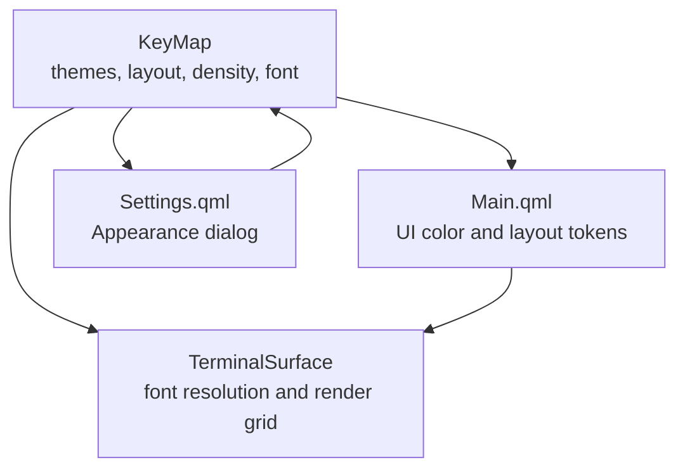
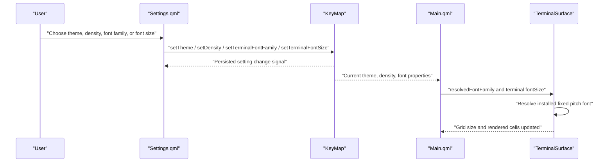
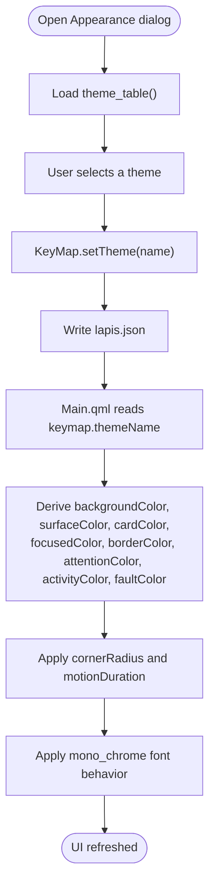
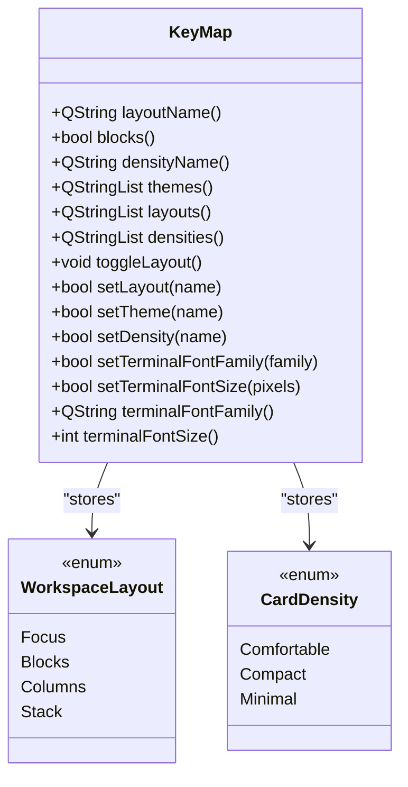
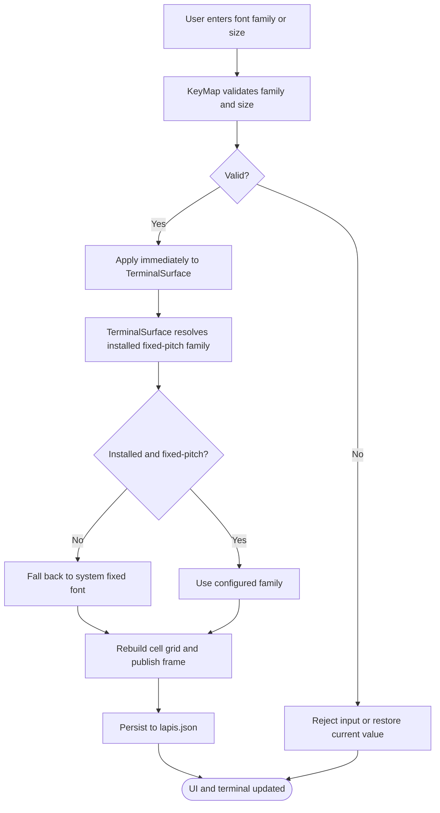
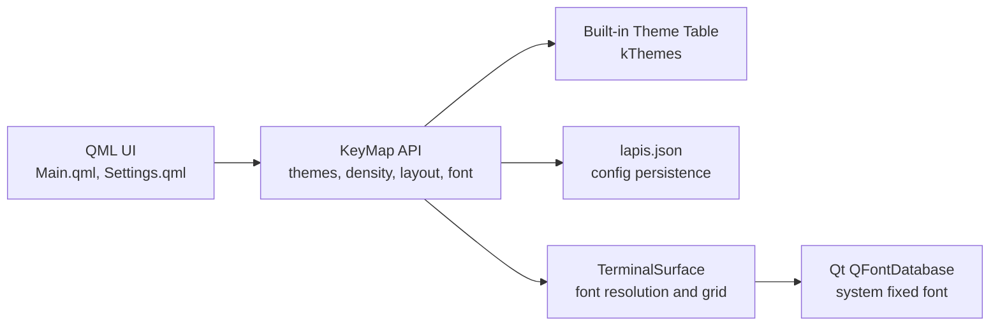

# Appearance Customization

<cite>
**Referenced Files in This Document**
- [keymap.hpp](file://apps/desktop/src/keymap.hpp)
- [keymap.cpp](file://apps/desktop/src/keymap.cpp)
- [terminal_surface.hpp](file://apps/desktop/src/terminal_surface.hpp)
- [terminal_surface.cpp](file://apps/desktop/src/terminal_surface.cpp)
- [Settings.qml](file://apps/desktop/qml/Settings.qml)
- [Main.qml](file://apps/desktop/qml/Main.qml)
- [ui_preview_test.cpp](file://apps/desktop/tests/ui_preview_test.cpp)
</cite>

## Table of Contents
1. [Introduction](#introduction)
2. [Project Structure](#project-structure)
3. [Core Components](#core-components)
4. [Architecture Overview](#architecture-overview)
5. [Detailed Component Analysis](#detailed-component-analysis)
6. [Dependency Analysis](#dependency-analysis)
7. [Performance Considerations](#performance-considerations)
8. [Troubleshooting Guide](#troubleshooting-guide)
9. [Conclusion](#conclusion)

## Introduction
This document explains Lapis desktop appearance customization: built-in themes, workspace layout and card density options, terminal font configuration, and the persistence and live-update behavior that connects the settings dialog, configuration file, UI, and terminal rendering engine.

The key ideas are:
- A `Theme` struct defines semantic colors, corner radius, motion duration, monochrome mode, and heading tracking for window chrome.
- Built-in themes are selected through `theme_for()` and listed by `theme_table()`.
- Workspace layout and card density control how sessions and preview cards are arranged.
- Terminal font family and size are validated, applied live to the terminal surface, and persisted to the user’s `lapis.json`.

## Project Structure
Appearance customization is implemented primarily in the desktop application layer:

| Area | Responsibility |
|---|---|
| `apps/desktop/src/keymap.hpp` | Declares `Theme`, `WorkspaceLayout`, `CardDensity`, font constants, and the `KeyMap` API exposed to QML. |
| `apps/desktop/src/keymap.cpp` | Defines the seven built-in themes, theme lookup, density names, font validation, and persistence logic. |
| `apps/desktop/qml/Main.qml` | Reads the current theme from `KeyMap.themes`, derives UI colors, motion behavior, density metrics, and terminal font values. |
| `apps/desktop/qml/Settings.qml` | Provides the Appearance dialog for choosing themes, density, terminal font family, and terminal font size. |
| `apps/desktop/src/terminal_surface.*` | Builds platform fonts, resolves installed fixed-pitch families, applies pixel size, rebuilds grid sizing, and renders terminal cells. |
| `apps/desktop/tests/ui_preview_test.cpp` | Validates live font updates, persistence, rollback on invalid input, and density/theme interaction. |

**Diagram sources**
- [keymap.hpp:29-70](file://apps/desktop/src/keymap.hpp#L29-L70)
- [keymap.cpp:180-238](file://apps/desktop/src/keymap.cpp#L180-L238)
- [Main.qml:15-65](file://apps/desktop/qml/Main.qml#L15-L65)
- [Settings.qml:1-35](file://apps/desktop/qml/Settings.qml#L1-L35)
- [terminal_surface.hpp:161-170](file://apps/desktop/src/terminal_surface.hpp#L161-L170)
- [terminal_surface.cpp:83-90](file://apps/desktop/src/terminal_surface.cpp#L83-L90)

**Section sources**
- [keymap.hpp:29-70](file://apps/desktop/src/keymap.hpp#L29-L70)
- [keymap.cpp:180-238](file://apps/desktop/src/keymap.cpp#L180-L238)
- [Main.qml:15-65](file://apps/desktop/qml/Main.qml#L15-L65)
- [Settings.qml:1-35](file://apps/desktop/qml/Settings.qml#L1-L35)
- [terminal_surface.hpp:161-170](file://apps/desktop/src/terminal_surface.hpp#L161-L170)
- [terminal_surface.cpp:83-90](file://apps/desktop/src/terminal_surface.cpp#L83-L90)

## Core Components

### Theme Struct
`Theme` describes the window chrome palette and visual behavior. It does not color terminal program output; terminal cell colors come from the active session’s own palette.

| Field | Meaning |
|---|---|
| `name` | Stable identifier used by configuration and code (for example, `"lapis"`, `"graphite"`). |
| `label` | Human-readable name shown in the settings dialog. |
| `background` | Application window background. |
| `surface` | Main content surface behind panels and dialogs. |
| `card` | Preview card background. |
| `hovered_card` | Preview card hover state. |
| `focused` | Selected or focused container fill. |
| `border` | Neutral border color. |
| `focused_border` | Keyboard-focus accent edge. |
| `text` | Primary text color. |
| `muted_text` | Secondary or disabled text color. |
| `attention` | Pending-request attention indicator. |
| `attention_text` | Text color paired with attention. |
| `activity` | Working-agent activity indicator. |
| `fault` | Lost connection or error indicator. |
| `plenty` | Usage gauge remaining capacity. |
| `scarce` | Usage gauge nearly exhausted capacity. |
| `corner_radius` | Rounded corners for windows, dialogs, and choice surfaces. |
| `motion_ms` | Animation duration in milliseconds. Zero disables motion. |
| `mono_chrome` | When true, UI typography uses the resolved terminal monospace family. |
| `heading_tracking` | Heading letter-spacing multiplier. |

Built-in themes share contrast relationships: backgrounds are darkest, cards sit above them, focus accents are bright, and activity, attention, and fault remain visually distinct.

**Section sources**
- [keymap.hpp:37-65](file://apps/desktop/src/keymap.hpp#L37-L65)
- [keymap.cpp:30-179](file://apps/desktop/src/keymap.cpp#L30-L179)

### Built-in Themes
There are seven built-in themes:

| Theme name | Label | Notable characteristics |
|---|---|---|
| `lapis` | Command | Default dark command-deck palette with a teal focus accent and higher heading tracking. |
| `graphite` | Graphite | Dark gray palette, rounded corners, longer motion duration, reduced heading tracking. |
| `daylight` | Daylight | Light palette with blue focus accent, larger corner radius, reduced heading tracking. |
| `solarized` | Solarized | Classic solarized-style dark palette without explicit corner radius or motion overrides. |
| `amber` | Amber | Warm amber-focused palette, sharp corners, shorter motion, monochrome UI typography enabled. |
| `contrast` | High contrast | Black background with maximum-contrast white text, zero motion, zero heading tracking. |
| `oled` | OLED black | Pure black resting surfaces optimized for OLED displays while preserving structure through subtle fills and borders. |

Lookup helpers:
- `theme_for(name)` returns the matching theme or falls back to the first built-in theme.
- `theme_table()` exposes the complete array of built-in themes.
- `theme_exists(name)` checks whether a name matches a built-in theme.

**Section sources**
- [keymap.cpp:30-179](file://apps/desktop/src/keymap.cpp#L30-L179)
- [keymap.cpp:229-238](file://apps/desktop/src/keymap.cpp#L229-L238)
- [keymap.cpp:337-345](file://apps/desktop/src/keymap.cpp#L337-L345)

### Workspace Layout Options
`WorkspaceLayout` controls the main session area arrangement:

| Value | Behavior |
|---|---|
| `Focus` | One large pane with a strip of session cards below it. |
| `Blocks` | Every session receives an equal tile. |
| `Columns` | Preview cards stack in a left channel beside the main pane. |
| `Stack` | Shows one session at a time with the carousel hidden. |

The `KeyMap` class exposes layout selection, cycling, and persistence through `layoutName()`, `toggleLayout()`, and `setLayout()`.

**Section sources**
- [keymap.hpp:25-32](file://apps/desktop/src/keymap.hpp#L25-L32)
- [keymap.hpp:168-175](file://apps/desktop/src/keymap.hpp#L168-L175)

### Card Density Settings
`CardDensity` controls how much space preview cards and chrome elements take in `Focus` and `Columns` layouts:

| Value | Description |
|---|---|
| `Comfortable` | Wider category rail and tabs. Terminal text is unchanged. |
| `Compact` | Tighter categories and tabs. Terminal text is unchanged. |
| `Minimal` | Smallest chrome while keeping the terminal as the main surface. |

The string representation returned by `densityName()` is `"comfortable"`, `"compact"`, or `"minimal"`.

**Section sources**
- [keymap.hpp:34-35](file://apps/desktop/src/keymap.hpp#L34-L35)
- [keymap.cpp:229-238](file://apps/desktop/src/keymap.cpp#L229-L238)
- [Settings.qml:330-375](file://apps/desktop/qml/Settings.qml#L330-L375)

### Terminal Font Configuration
Terminal font configuration has two parts:
1. **Configuration and validation**: handled by `KeyMap`.
2. **Live rendering**: handled by `TerminalSurface`.

Font constraints:
- Minimum size: 10 pixels.
- Default size: 14 pixels.
- Maximum size: 32 pixels.
- Family: empty means the platform’s fixed-width system font. Any configured family must be valid and eventually resolved as an installed fixed-pitch font.

Persistence and live behavior:
- `setTerminalFontFamily()` validates the family, applies it immediately, and persists it.
- `setTerminalFontSize()` validates the pixel size, applies it immediately, and persists it.
- If a save fails, the value is rolled back so the window remains consistent with the saved configuration.
- Invalid text entry is rejected without changing the current size.
- An out-of-range committed value is restored to the current saved size.

Resolution fallback:
- If the configured family is not available or is not fixed-pitch, `TerminalSurface` falls back to the system fixed font and exposes the resolved family through `resolvedFontFamily()`.
- The UI binds `monoFamily` to this resolved family when `mono_chrome` is enabled.

**Section sources**
- [keymap.hpp:54-65](file://apps/desktop/src/keymap.hpp#L54-L65)
- [keymap.hpp:193-199](file://apps/desktop/src/keymap.hpp#L193-L199)
- [keymap.hpp:303-326](file://apps/desktop/src/keymap.hpp#L303-L326)
- [keymap.cpp:321-329](file://apps/desktop/src/keymap.cpp#L321-L329)
- [keymap.cpp:353-362](file://apps/desktop/src/keymap.cpp#L353-L362)
- [terminal_surface.cpp:83-90](file://apps/desktop/src/terminal_surface.cpp#L83-L90)
- [terminal_surface.cpp:1165-1192](file://apps/desktop/src/terminal_surface.cpp#L1165-L1192)
- [terminal_surface.hpp:161-170](file://apps/desktop/src/terminal_surface.hpp#L161-L170)
- [terminal_surface.hpp:290-294](file://apps/desktop/src/terminal_surface.hpp#L290-L294)
- [ui_preview_test.cpp:499-600](file://apps/desktop/tests/ui_preview_test.cpp#L499-L600)

## Architecture Overview
The appearance system connects configuration, UI, and rendering through a small set of contracts:

**Diagram sources**
- [Settings.qml:1-35](file://apps/desktop/qml/Settings.qml#L1-L35)
- [keymap.hpp:193-199](file://apps/desktop/src/keymap.hpp#L193-L199)
- [Main.qml:15-65](file://apps/desktop/qml/Main.qml#L15-L65)
- [terminal_surface.cpp:1165-1192](file://apps/desktop/src/terminal_surface.cpp#L1165-L1192)

## Detailed Component Analysis

### Theme Selection Flow
The settings dialog shows every built-in theme as a selectable card. Selecting a theme:
1. Calls `KeyMap.setTheme()`.
2. Persists the chosen theme name.
3. Emits changes observed by `Main.qml`.
4. Derives all UI colors, corner radius, motion duration, and monochrome typography from the matched theme.

**Diagram sources**
- [keymap.cpp:180-238](file://apps/desktop/src/keymap.cpp#L180-L238)
- [keymap.cpp:337-345](file://apps/desktop/src/keymap.cpp#L337-L345)
- [Main.qml:15-65](file://apps/desktop/qml/Main.qml#L15-L65)
- [Settings.qml:395-460](file://apps/desktop/qml/Settings.qml#L395-L460)

**Section sources**
- [keymap.cpp:180-238](file://apps/desktop/src/keymap.cpp#L180-L238)
- [Main.qml:15-65](file://apps/desktop/qml/Main.qml#L15-L65)
- [Settings.qml:395-460](file://apps/desktop/qml/Settings.qml#L395-L460)

### Workspace Layout and Density Controls
The settings dialog provides:
- Theme selection cards.
- Density buttons labeled “Comfortable”, “Compact”, and “Minimal”.
- Descriptions explaining that density affects chrome, not terminal text.

Layout selection is exposed via `KeyMap.toggleLayout()` and `KeyMap.setLayout()`, but the Appearance dialog itself focuses on theme, density, and terminal font because there is only one workspace stage.

**Diagram sources**
- [keymap.hpp:25-35](file://apps/desktop/src/keymap.hpp#L25-L35)
- [keymap.hpp:168-175](file://apps/desktop/src/keymap.hpp#L168-L175)
- [keymap.hpp:193-199](file://apps/desktop/src/keymap.hpp#L193-L199)
- [Settings.qml:330-375](file://apps/desktop/qml/Settings.qml#L330-L375)

**Section sources**
- [keymap.hpp:25-35](file://apps/desktop/src/keymap.hpp#L25-L35)
- [keymap.hpp:168-175](file://apps/desktop/src/keymap.hpp#L168-L175)
- [Settings.qml:330-375](file://apps/desktop/qml/Settings.qml#L330-L375)

### Terminal Font Resolution and Rendering
Terminal font handling separates validation from rendering:

| Layer | Responsibility |
|---|---|
| `KeyMap` | Validates family length and characters, validates pixel size against 10–32, persists values, and exposes defaults and limits to QML. |
| `TerminalSurface` | Creates a Qt fixed-pitch font, resolves the configured family if available, rebuilds the cell grid, and recalculates row heights. |
| `Main.qml` | Binds UI typography to `resolvedFontFamily` when monochrome mode is enabled and passes terminal font size into the terminal surface. |

**Diagram sources**
- [keymap.cpp:321-362](file://apps/desktop/src/keymap.cpp#L321-L362)
- [terminal_surface.cpp:83-90](file://apps/desktop/src/terminal_surface.cpp#L83-L90)
- [terminal_surface.cpp:1165-1192](file://apps/desktop/src/terminal_surface.cpp#L1165-L1192)
- [ui_preview_test.cpp:499-600](file://apps/desktop/tests/ui_preview_test.cpp#L499-L600)

**Section sources**
- [keymap.cpp:321-362](file://apps/desktop/src/keymap.cpp#L321-L362)
- [terminal_surface.cpp:83-90](file://apps/desktop/src/terminal_surface.cpp#L83-L90)
- [terminal_surface.cpp:1165-1192](file://apps/desktop/src/terminal_surface.cpp#L1165-L1192)
- [ui_preview_test.cpp:499-600](file://apps/desktop/tests/ui_preview_test.cpp#L499-L600)

### Example Custom Theme Configuration
A custom theme should preserve the semantic meaning of each color. For example, a high-contrast dark theme might:
- Use a near-black background and surface.
- Use a light neutral card color.
- Use a bright accent for `focused_border`.
- Keep `attention`, `activity`, and `fault` distinct.
- Set `corner_radius` to match the desired UI style.
- Set `motion_ms` to a small value for snappy feedback or zero to disable motion.
- Enable `mono_chrome` if UI typography should use the terminal monospace family.
- Adjust `heading_tracking` to increase or reduce heading letter spacing.

Because `theme_for()` and `theme_table()` operate on the built-in table, extending the built-in palette requires adding entries to the implementation table rather than relying on runtime-only JSON. Existing usage paths read `theme_table()` and match `Theme.name`.

**Section sources**
- [keymap.hpp:37-70](file://apps/desktop/src/keymap.hpp#L37-L70)
- [keymap.cpp:30-179](file://apps/desktop/src/keymap.cpp#L30-L179)
- [keymap.cpp:337-345](file://apps/desktop/src/keymap.cpp#L337-L345)

## Dependency Analysis
The appearance subsystem has clear layering:

**Diagram sources**
- [Main.qml:15-65](file://apps/desktop/qml/Main.qml#L15-L65)
- [Settings.qml:1-35](file://apps/desktop/qml/Settings.qml#L1-L35)
- [keymap.cpp:30-179](file://apps/desktop/src/keymap.cpp#L30-L179)
- [keymap.cpp:337-345](file://apps/desktop/src/keymap.cpp#L337-L345)
- [terminal_surface.cpp:83-90](file://apps/desktop/src/terminal_surface.cpp#L83-L90)

**Section sources**
- [Main.qml:15-65](file://apps/desktop/qml/Main.qml#L15-L65)
- [Settings.qml:1-35](file://apps/desktop/qml/Settings.qml#L1-L35)
- [keymap.cpp:30-179](file://apps/desktop/src/keymap.cpp#L30-L179)
- [terminal_surface.cpp:83-90](file://apps/desktop/src/terminal_surface.cpp#L83-L90)

## Performance Considerations
- **Motion duration**: Themes can set `motion_ms` to 0 for instant transitions, which is useful for accessibility or performance-sensitive environments.
- **Monochrome mode**: Enabling `mono_chrome` switches UI typography to the terminal monospace family, which may affect perceived layout width compared to the system UI font.
- **Font resolution**: Changing terminal font family triggers a full grid rebuild because row metrics depend on the font. Prefer choosing an installed fixed-pitch family to avoid repeated fallback evaluation.
- **Density vs terminal text**: Density changes chrome spacing, not terminal text size. This keeps terminal readability independent of panel density.

[No sources needed since this section provides general guidance]

## Troubleshooting Guide

### Terminal Font Appears Blurry or Incorrectly Sized
Check these points:
1. Confirm the configured family is installed and fixed-pitch. If not, Lapis falls back to the system fixed font.
2. Verify the pixel size is between 10 and 32. Values outside this range are rejected or restored to the current saved size.
3. Inspect `resolvedFontFamily()` in the terminal surface. If it differs from the configured family, the configured font was unavailable.
4. Check whether `mono_chrome` is enabled; when true, UI typography also uses the terminal monospace family.

**Section sources**
- [terminal_surface.cpp:1183-1192](file://apps/desktop/src/terminal_surface.cpp#L1183-L1192)
- [terminal_surface.hpp:161-170](file://apps/desktop/src/terminal_surface.hpp#L161-L170)
- [ui_preview_test.cpp:499-600](file://apps/desktop/tests/ui_preview_test.cpp#L499-L600)

### Font Size Changes Do Not Persist
Expected behavior:
- Live changes apply immediately.
- On successful validation and save, the new size is persisted.
- On failed save, the value rolls back so the window remains consistent with the file.
- Direct numeric entry and step buttons follow the same path.

Verify by reloading the configuration after a direct entry test and checking that the persisted value matches the expected size.

**Section sources**
- [ui_preview_test.cpp:499-600](file://apps/desktop/tests/ui_preview_test.cpp#L499-L600)

### Theme Colors Look Wrong
Possible causes:
- The wrong theme name is selected in configuration.
- A custom theme is missing required semantic fields.
- The UI is reading `appearance` from `keymap.themes`; if no match exists, defaults are used.
- Monochrome mode changes UI typography to the terminal monospace family.

Confirm that `theme_name` matches one of the built-in names or a correctly defined custom theme, and inspect the derived colors in `Main.qml`.

**Section sources**
- [Main.qml:15-65](file://apps/desktop/qml/Main.qml#L15-L65)
- [keymap.cpp:180-238](file://apps/desktop/src/keymap.cpp#L180-L238)

### Density Does Not Change Terminal Text
This is expected. Density changes chrome density, not terminal font size. Adjust `terminalFontSize` separately if terminal text needs to change.

**Section sources**
- [Settings.qml:330-375](file://apps/desktop/qml/Settings.qml#L330-L375)
- [keymap.hpp:193-199](file://apps/desktop/src/keymap.hpp#L193-L199)

## Conclusion
Lapis appearance customization is centered around three concerns:
1. **Visual identity**: the `Theme` struct and seven built-in themes define semantic chrome colors, motion, corner radius, monochrome typography, and heading tracking.
2. **Workspace organization**: `WorkspaceLayout` and `CardDensity` control session arrangement and chrome density without affecting terminal text.
3. **Terminal typography**: terminal font family and size are validated, applied live, persisted, and safely resolved or rolled back.

For most users, the Appearance dialog is the correct place to select a theme, adjust density, and configure terminal font. For developers extending the theme system, built-in themes are defined in the implementation table and consumed consistently by both the settings UI and the main application window.

[No sources needed since this section summarizes without analyzing specific files]