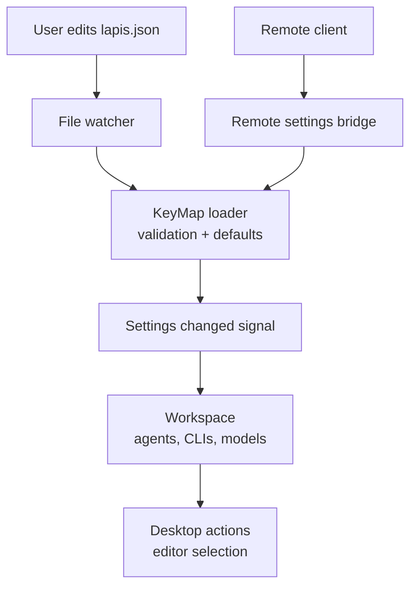
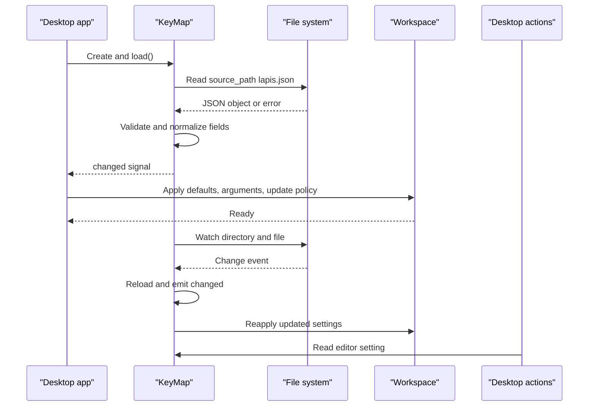
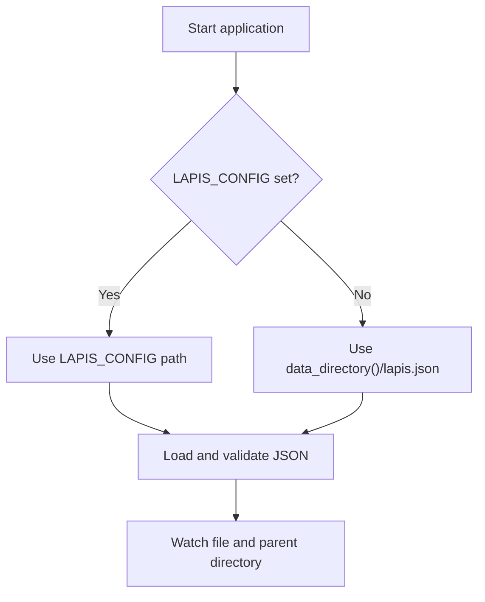
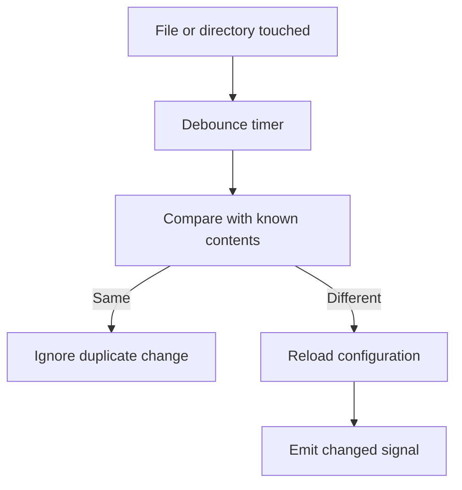
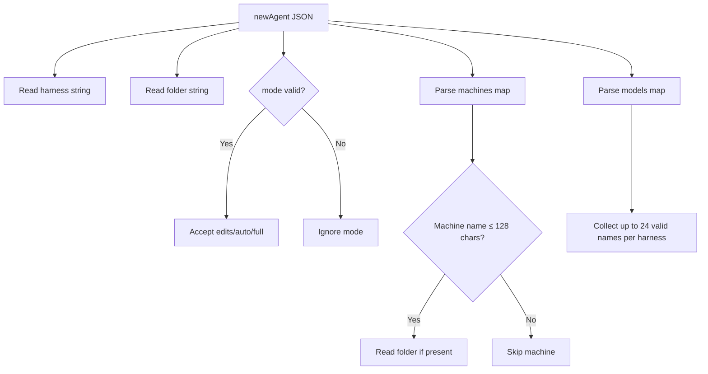
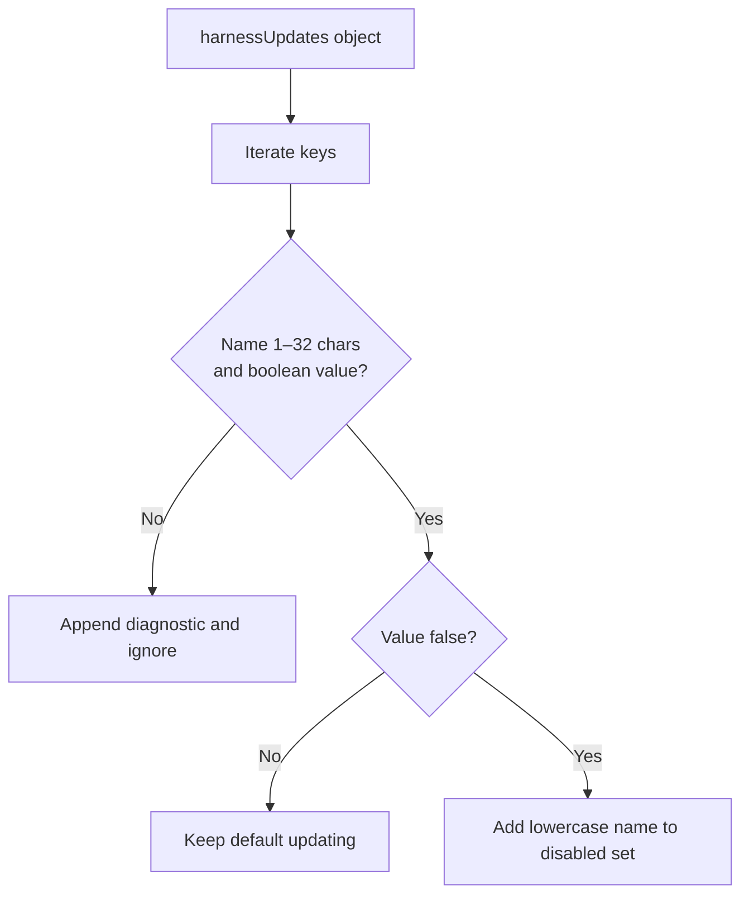
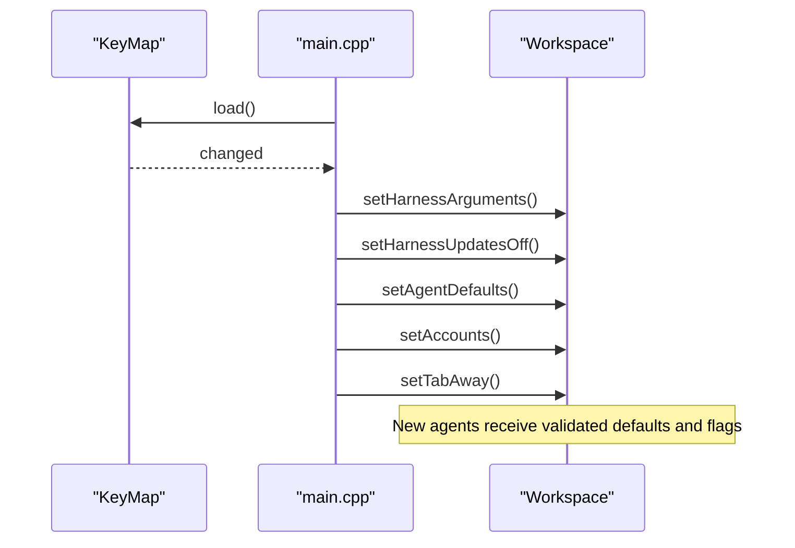
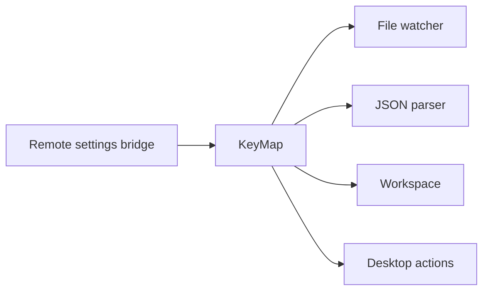

# Application Settings

<cite>
**Referenced Files in This Document**
- [lapis.json](file://lapis.json)
- [config.md](file://docs/config.md)
- [keymap.cpp](file://apps/desktop/src/keymap.cpp)
- [main.cpp](file://apps/desktop/src/main.cpp)
- [workspace.cpp](file://apps/desktop/src/workspace.cpp)
- [desktop_actions.cpp](file://apps/desktop/src/desktop_actions.cpp)
- [lapis_remote.py](file://apps/remote/lapis_remote.py)
</cite>

## Table of Contents
1. [Introduction](#introduction)
2. [Project Structure](#project-structure)
3. [Core Components](#core-components)
4. [Architecture Overview](#architecture-overview)
5. [Detailed Component Analysis](#detailed-component-analysis)
6. [Dependency Analysis](#dependency-analysis)
7. [Performance Considerations](#performance-considerations)
8. [Troubleshooting Guide](#troubleshooting-guide)
9. [Conclusion](#conclusion)

## Introduction
This document explains Lapis application-level settings stored in `lapis.json`. It focuses on the user-facing configuration surface for starting new agents, controlling CLI flags and updates, selecting an external editor, keeping the machine awake, and displaying usage information. It also describes where the file is read from, how it reloads automatically, what validation rules are applied, how older formats migrate, and what security considerations apply to sensitive values.

The repository ships a minimal committed `lapis.json` with only key bindings and a schema version; most personal defaults live under `~/.lapis/lapis.json`, while development builds can use a checkout-specific `lapis.json`.

**Section sources**
- [lapis.json:1-4](file://lapis.json#L1-L4)
- [config.md:1-30](file://docs/config.md#L1-L30)

## Project Structure
The configuration system is implemented in the desktop application:

| Area | Responsibility |
|---|---|
| Configuration loader | Reads `lapis.json`, validates fields, emits change notifications |
| Workspace integration | Receives agent defaults, harness arguments, update policy, and other settings |
| Editor selection | Chooses a configured or installed editor for opening files |
| Remote settings bridge | Allows remote clients to update selected settings such as keep-awake and usage display |
| Documentation | Explains the supported JSON shape and behavior |

**Diagram sources**
- [keymap.cpp:437-510](file://apps/desktop/src/keymap.cpp#L437-L510)
- [main.cpp:1075-1095](file://apps/desktop/src/main.cpp#L1075-L1095)
- [desktop_actions.cpp:36-88](file://apps/desktop/src/desktop_actions.cpp#L36-L88)

**Section sources**
- [keymap.cpp:437-510](file://apps/desktop/src/keymap.cpp#L437-L510)
- [main.cpp:1075-1095](file://apps/desktop/src/main.cpp#L1075-L1095)

## Core Components
The following `lapis.json` settings are relevant to application-level behavior:

| Setting | Type | Default | Meaning |
|---|---|---:|---|
| `newAgent.harness` | String | None | Default CLI harness for new-agent forms |
| `newAgent.folder` | String | None | Default folder shown when creating an agent |
| `newAgent.mode` | String | None | Default approval mode: `edits`, `auto`, or `full` |
| `newAgent.machines` | Object mapping machine name to object | Empty | Per-machine overrides, especially default folders |
| `newAgent.models` | Object mapping harness to string list | Empty | Suggested model names per harness |
| `harnessArguments` | Object mapping harness to string array | Empty | Extra CLI flags passed to new agent processes |
| `harnessUpdates` | Object mapping harness to boolean | All updating by default | Disable automatic CLI updates for listed harnesses |
| `editor` | String | None | Preferred external editor name or executable |
| `keepAwake` | Boolean | `true` | Prevent the operating system from sleeping while Lapis is active |
| `usage.show` | Boolean | True through legacy top-level `showUsage` | Show usage metering in the UI |
| `usage.meter` | String array | Empty | Harnesses whose usage should be metered |
| `usage.machines` | String array | Empty | Machines included in usage metering |

Additional related keys documented elsewhere include `alerts`, `interactionLog`, `tabAway`, `accounts`, `limitResets`, and `nextPrompt`. They are not the focus of this document but may appear in the same configuration file.

**Section sources**
- [config.md:5-30](file://docs/config.md#L5-L30)
- [keymap.cpp:720-900](file://apps/desktop/src/keymap.cpp#L720-L900)

## Architecture Overview
Configuration loading follows a clear sequence:

**Diagram sources**
- [keymap.cpp:437-510](file://apps/desktop/src/keymap.cpp#L437-L510)
- [keymap.cpp:654-694](file://apps/desktop/src/keymap.cpp#L654-L694)
- [main.cpp:1075-1095](file://apps/desktop/src/main.cpp#L1075-L1095)

**Section sources**
- [keymap.cpp:437-510](file://apps/desktop/src/keymap.cpp#L437-L510)
- [main.cpp:1075-1095](file://apps/desktop/src/main.cpp#L1075-L1095)

## Detailed Component Analysis

### Configuration Source Resolution
Lapis resolves `lapis.json` in this order:

1. If the environment variable `LAPIS_CONFIG` is set, its value is treated as the absolute path to the configuration file.
2. Otherwise, Lapis uses `data_directory()` plus `lapis.json`.

In normal usage, `data_directory()` maps to the user’s Lapis data area, so the effective default location is `~/.lapis/lapis.json`. A development build can place `lapis.json` at the project root, and tests and automation can override the location through `LAPIS_CONFIG`.

**Diagram sources**
- [keymap.cpp:478-490](file://apps/desktop/src/keymap.cpp#L478-L490)

**Section sources**
- [keymap.cpp:478-490](file://apps/desktop/src/keymap.cpp#L478-L490)
- [config.md:1-10](file://docs/config.md#L1-L10)

### Automatic Reloading
On disk changes, Lapis watches both the configuration file and its parent directory because editors and agents often replace rather than edit the file in place. A short debounce timer settles bursts of filesystem events before reloading. The reload reads the file again, parses it, applies validation, and emits a `changed` signal so running components receive the new settings immediately.

**Diagram sources**
- [keymap.cpp:437-476](file://apps/desktop/src/keymap.cpp#L437-L476)

**Section sources**
- [keymap.cpp:437-476](file://apps/desktop/src/keymap.cpp#L437-L476)

### Schema Validation and Defaults

#### `newAgent`
`newAgent` configures defaults for the new-agent form.

| Field | Rules |
|---|---|
| `harness` | Optional string; trimmed, no NUL character, maximum 4096 characters |
| `folder` | Optional string; trimmed, no NUL character, maximum 4096 characters |
| `mode` | Must be one of `edits`, `auto`, or `full`; otherwise ignored |
| `machines` | Object mapping machine names to objects; machine names are limited to 128 characters |
| `machines.*.folder` | Optional string; trimmed, no NUL character, maximum 4096 characters |
| `models` | Object mapping harness names to arrays of strings |
| `models.*` | Up to 24 entries per harness; each entry must be a non-empty string without NUL characters and must not start with `-` |

Paths are kept as written, with `~` representing the machine’s home directory. Validation happens during parsing, and invalid entries are silently ignored rather than causing the whole section to fail.

**Diagram sources**
- [keymap.cpp:880-940](file://apps/desktop/src/keymap.cpp#L880-L940)

**Section sources**
- [keymap.cpp:880-940](file://apps/desktop/src/keymap.cpp#L880-L940)

#### `harnessArguments`
`harnessArguments` adds extra command-line flags to newly launched CLIs.

Validation rules:

- The value must be an object mapping harness names to arrays.
- Each harness name must be non-empty and at most 32 characters.
- Each array must contain up to 32 items.
- Each item must be a non-empty string at most 1024 characters long and must not contain NUL characters.
- At most 16 harnesses are retained; later entries beyond that limit are ignored.
- An empty harness name is rejected.

These limits protect against malformed hand-written configurations and excessive memory use.

**Section sources**
- [keymap.cpp:736-815](file://apps/desktop/src/keymap.cpp#L736-L815)

#### `harnessUpdates`
`harnessUpdates` controls whether Lapis automatically updates the selected CLIs.

Validation rules:

- The value must be an object mapping harness names to booleans.
- Each harness name must be between 1 and 32 characters.
- Only `false` is recorded as disabling updates; `true` is accepted but has no effect.
- Invalid keys or values are ignored.
- At most 16 harnesses are retained.
- Disabled harnesses are stored in lowercase.

When a harness is disabled here, new agents for that harness do not run its update first, and Lapis reports that updates are off for that harness instead of performing an update.

**Diagram sources**
- [keymap.cpp:817-858](file://apps/desktop/src/keymap.cpp#L817-L858)
- [workspace.cpp:2997-2997](file://apps/desktop/src/workspace.cpp#L2997-L2997)

**Section sources**
- [keymap.cpp:817-858](file://apps/desktop/src/keymap.cpp#L817-L858)
- [config.md:31-46](file://docs/config.md#L31-L46)

#### `editor`
The `editor` field stores a preferred editor identifier or executable name. It is trimmed and truncated to 1024 characters. The desktop layer chooses an editor based on this configured value and then checks installed applications and executables. If no editor matches, none is selected.

This setting does not launch arbitrary commands directly from configuration text; the editor resolution is constrained to known editor names and discovered executables.

**Section sources**
- [keymap.cpp:854-860](file://apps/desktop/src/keymap.cpp#L854-L860)
- [desktop_actions.cpp:36-88](file://apps/desktop/src/desktop_actions.cpp#L36-L88)

#### `keepAwake`
`keepAwake` is a boolean that defaults to `true`. When enabled, Lapis asks the operating system to stay awake while active. The setting can be changed through the UI and persisted back to `lapis.json`. It is also exposed through the remote settings interface.

**Section sources**
- [keymap.cpp:854-860](file://apps/desktop/src/keymap.cpp#L854-L860)
- [keymap.cpp:1227-1227](file://apps/desktop/src/keymap.cpp#L1227-L1227)
- [lapis_remote.py:1376-1389](file://apps/remote/lapis_remote.py#L1376-L1389)

#### Usage Display Preferences
The `usage` object controls whether usage metering appears in the UI and which harnesses and machines are included.

Rules:

- `usage.show` enables usage display.
- For backward compatibility, a legacy top-level `showUsage` boolean still sets the same behavior.
- `usage.meter` lists harness names to meter; names are trimmed, deduplicated, limited to 32 characters, cannot start with `-`, cannot contain spaces, and are capped at 32 entries.
- `usage.machines` lists machine names; names are trimmed, deduplicated, limited to 128 characters, follow the same naming restrictions, and are capped at 32 entries.

**Section sources**
- [keymap.cpp:860-879](file://apps/desktop/src/keymap.cpp#L860-L879)

### Data Flow from Configuration to Running Agents
Once loaded, configuration values flow into the workspace and related subsystems:

**Diagram sources**
- [main.cpp:1075-1095](file://apps/desktop/src/main.cpp#L1075-L1095)

**Section sources**
- [main.cpp:1075-1095](file://apps/desktop/src/main.cpp#L1075-L1095)

### Migration Paths

#### Schema Version
The committed configuration includes a `version` field. On save, Lapis ensures the configuration contains `version: 1`. If a saved configuration lacks a version, it is added. This helps distinguish checked-in default configuration from local user overrides.

#### Legacy `showUsage`
The modern format uses `usage.show`. Older configurations may have a top-level boolean `showUsage`. During parsing, Lapis falls back to that legacy field when `usage.show` is absent. On persistence, the legacy top-level `showUsage` key is removed and replaced by `usage.show`.

#### Unknown or Malformed Fields
Most optional fields tolerate missing or invalid values:

- Unknown layout, theme, density, or font family are reported as diagnostics but do not crash the application.
- Invalid enum-like values (for example, an unsupported `newAgent.mode`) are ignored.
- Oversized arrays, excessively long strings, or invalid types produce diagnostics and drop the offending entries.
- Persist failures leave the previous configuration unchanged.

This design makes hand-edited configuration safer: unrelated appearance or binding changes do not erase unrelated custom keys unless explicitly rewritten by the application.

**Section sources**
- [keymap.cpp:700-740](file://apps/desktop/src/keymap.cpp#L700-L740)
- [keymap.cpp:860-940](file://apps/desktop/src/keymap.cpp#L860-L940)
- [keymap.cpp:1220-1270](file://apps/desktop/src/keymap.cpp#L1220-L1270)

### Common Application Configurations

#### Custom Editor Integration
To integrate a custom editor:

1. Set `editor` to the editor’s recognized name or executable.
2. Ensure the editor is discoverable by the desktop platform layer.
3. Lapis will choose the configured editor when opening files through desktop actions.

If the configured editor is not found, Lapis falls back to no editor rather than launching an unknown command.

#### Usage Metering Setup
To enable usage metering:

1. Enable `usage.show`.
2. List the harnesses you want to meter in `usage.meter`.
3. Optionally restrict metering to specific machines using `usage.machines`.

Names must be simple identifiers: no leading hyphen, no spaces, and reasonable length limits.

#### Machine-Specific Folder Mappings
For multi-machine setups:

1. Set `newAgent.folder` as the global default folder.
2. Add entries under `newAgent.machines` keyed by machine name.
3. Provide a per-machine `folder` override.

This lets a developer work in different directories on different machines while keeping a shared base configuration.

#### Disabling Automatic CLI Updates
If you manage your own CLI versions:

1. Add the harness to `harnessUpdates` with `false`.
2. Launch agents normally; Lapis will not attempt to update that harness.
3. Be aware that pinned harnesses skip automatic updates even if newer versions are available.

**Section sources**
- [desktop_actions.cpp:36-88](file://apps/desktop/src/desktop_actions.cpp#L36-L88)
- [keymap.cpp:860-940](file://apps/desktop/src/keymap.cpp#L860-L940)
- [keymap.cpp:817-858](file://apps/desktop/src/keymap.cpp#L817-L858)
- [config.md:5-46](file://docs/config.md#L5-L46)

## Dependency Analysis
The configuration layer depends on several runtime concerns:

| Dependency | Reason |
|---|---|
| File system watcher | Detects replacement and in-place edits |
| JSON parser | Loads and validates configuration structure |
| Workspace | Consumes agent defaults, harness arguments, and update policy |
| Desktop actions | Uses editor preference to open files |
| Remote settings bridge | Persists selected runtime-safe settings back to `lapis.json` |
| Diagnostic logging | Reports malformed fields without failing the application |

**Diagram sources**
- [keymap.cpp:437-510](file://apps/desktop/src/keymap.cpp#L437-L510)
- [main.cpp:1075-1095](file://apps/desktop/src/main.cpp#L1075-L1095)
- [desktop_actions.cpp:36-88](file://apps/desktop/src/desktop_actions.cpp#L36-L88)

**Section sources**
- [keymap.cpp:437-510](file://apps/desktop/src/keymap.cpp#L437-L510)
- [main.cpp:1075-1095](file://apps/desktop/src/main.cpp#L1075-L1095)

## Performance Considerations
- Configuration reload is debounced to avoid repeated reloads during rapid edits.
- Maximum configuration size is enforced during read and write operations.
- Arrays and strings have bounded lengths to prevent uncontrolled memory growth.
- Background watchers and timers are used for file observation rather than polling.
- Persistence uses atomic-style writes and locking to reduce corruption risk.

[No sources needed since this section provides general guidance]

## Troubleshooting Guide

| Symptom | Likely Cause | Recommended Action |
|---|---|---|
| Settings do not apply after editing | File was replaced or watcher did not settle | Wait briefly or reload manually; verify the file is in the expected location |
| `keepAwake` reverts or errors | Invalid type or failed save | Ensure the value is a boolean and the configuration file is writable |
| Custom editor does not open files | Editor name or executable not recognized | Use a known editor name or ensure the executable is discoverable |
| CLI flags are ignored | Invalid harness name, too many flags, or malformed array | Check harness name length, flag count, and string constraints |
| Automatic CLI updates still run | Harness not listed as `false` in `harnessUpdates` | Add the harness to `harnessUpdates` with `false` |
| Usage metering shows unexpected harnesses | Names contain spaces, start with `-`, or exceed limits | Use simple identifiers within the documented length limits |
| Configuration fails to save | Lock conflict, permission issue, or exceeds size limit | Check file permissions, concurrent writers, and total file size |

Diagnostics produced by the loader are emitted through the configuration subsystem and can help identify malformed fields without stopping the application.

**Section sources**
- [keymap.cpp:654-694](file://apps/desktop/src/keymap.cpp#L654-L694)
- [keymap.cpp:1159-1270](file://apps/desktop/src/keymap.cpp#L1159-L1270)

## Security Considerations

### Sensitive Values
Avoid storing secrets directly in `lapis.json`:

- Do not put API tokens, passwords, or private keys in `harnessArguments`, `newAgent.folder`, or other fields.
- Use account credential management provided by Lapis where available.
- Keep `~/.lapis` and its contents readable only by the intended user.

### Environment Variable Overrides
`LAPIS_CONFIG` allows pointing Lapis at an alternate configuration file. Treat this variable as privileged because it can redirect configuration loading to any file accessible by the process. Restrict access to environments or scripts that set it.

### Command Execution Risk
Although `harnessArguments` passes strings to child processes, it is not a general shell command interpreter. Still, treat every configured argument as potentially executed by a child process. Validate harness names and argument content, and avoid injecting user-controlled data into configuration.

### Filesystem Safety
- The configuration is watched and reloaded on changes.
- Atomic-style writes and lock files reduce corruption risk.
- Large or malformed configurations are rejected safely.
- Relative paths resolve relative to the configuration file location.

**Section sources**
- [keymap.cpp:478-490](file://apps/desktop/src/keymap.cpp#L478-L490)
- [keymap.cpp:736-815](file://apps/desktop/src/keymap.cpp#L736-L815)
- [keymap.cpp:1159-1270](file://apps/desktop/src/keymap.cpp#L1159-L1270)

## Conclusion
Lapis application settings in `lapis.json` provide a controlled, validated surface for configuring new agents, CLI flags, update behavior, editor selection, wake behavior, and usage display. The loader supports automatic reloading, safe migration of legacy fields, robust validation, and secure defaults. Users should keep secrets out of the configuration file, respect the documented field constraints, and use Lapis-provided credential management where possible.