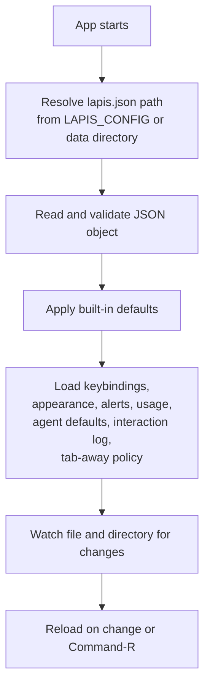
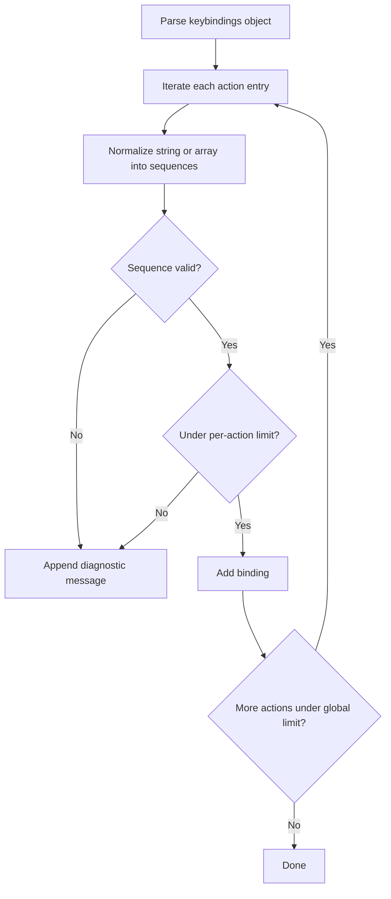
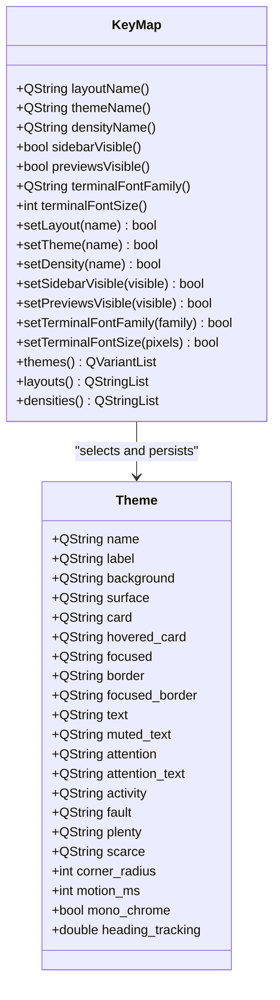
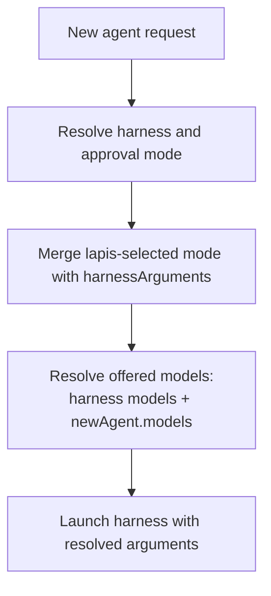
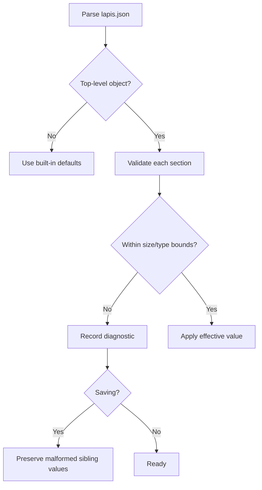

# Configuration Reference

<cite>
**Referenced Files in This Document**
- [lapis.json](file://lapis.json)
- [config.md](file://docs/config.md)
- [keys.md](file://docs/keys.md)
- [keymap.hpp](file://apps/desktop/src/keymap.hpp)
- [keymap.cpp](file://apps/desktop/src/keymap.cpp)
- [main.cpp](file://apps/desktop/src/main.cpp)
- [platform_preferences.mm](file://apps/desktop/src/platform_preferences.mm)
</cite>

## Table of Contents
1. [Introduction](#introduction)
2. [Configuration File and Location](#configuration-file-and-location)
3. [Schema Overview](#schema-overview)
4. [Keybinding Configuration](#keybinding-configuration)
5. [Appearance Customization](#appearance-customization)
6. [Agent-Specific Configuration](#agent-specific-configuration)
7. [Alerts, Notifications, and System Integration](#alerts-notifications-and-system-integration)
8. [Platform-Specific Settings](#platform-specific-settings)
9. [Validation Rules, Limits, and Defaults](#validation-rules-limits-and-defaults)
10. [Migration and Versioning](#migration-and-versioning)
11. [Common Configuration Scenarios](#common-configuration-scenarios)
12. [Troubleshooting](#troubleshooting)
13. [Security Considerations](#security-considerations)

## Introduction
This document describes Lapis configuration through `lapis.json`. It covers application defaults, user preferences, environment overrides, keybindings, appearance settings, agent harness configuration, platform integration options, validation rules, migration behavior, examples, and troubleshooting guidance.

The configuration is applied when the desktop app starts and can be reloaded at runtime. Invalid or unreadable values degrade to built-in defaults rather than preventing the application from running.

## Configuration File and Location
The primary configuration file is `lapis.json`.

| Context | Location |
|---|---|
| Production desktop app | `~/.lapis/lapis.json` |
| Development build checked out from this repository | `<checkout>/lapis.json` |
| Alternate location for tests or custom runs | The path given by the `LAPIS_CONFIG` environment variable |

On reload, Lapis watches both the file and its containing directory so that edits made inside Lapis, external editors, or agents are picked up after a short debounce.



**Diagram sources**
- [keymap.cpp:639-691](file://apps/desktop/src/keymap.cpp#L639-L691)
- [keymap.cpp:721-744](file://apps/desktop/src/keymap.cpp#L721-L744)

**Section sources**
- [config.md:1-11](file://docs/config.md#L1-L11)
- [keymap.cpp:639-691](file://apps/desktop/src/keymap.cpp#L639-L691)

## Schema Overview
At the top level, `lapis.json` contains:

| Field | Type | Default | Purpose |
|---|---|---|---|
| `version` | Integer | `1` | Configuration schema version marker written during save |
| `keybindings` | Object mapping action names to one or more keyboard sequences | Empty object | User-defined shortcuts |
| `layout` | String: `focus`, `blocks`, `columns`, or `stack` | `focus` | Workspace layout |
| `theme` | String name or structured theme object | `lapis` | Window chrome color scheme |
| `density` | String: `comfortable`, `compact`, or `minimal` | `comfortable` | Preview card density |
| `sidebarVisible` | Boolean | `true` | Whether the category sidebar is visible |
| `previewsVisible` | Boolean | `true` | Whether the live preview strip is visible |
| `terminalFont` | Object with `family` and `size` | System fixed-width font, 14 pixels | Terminal font customization |
| `harnessArguments` | Object mapping harness names to string arrays | Empty | Extra CLI arguments passed to agents |
| `harnessUpdates` | Object mapping harness names to booleans | Empty; all CLIs update automatically | Per-harness automatic-update policy |
| `alerts` | Object | See Alerts section | Sound, notification, away detection, and next-prompt judgment settings |
| `keepAwake` | Boolean | `true` | Prevent macOS from sleeping while plugged in |
| `editor` | String | First installed editor among Cursor, VS Code, Zed, Windsurf, Sublime Text | Application used to open an agent folder |
| `usage` | Object | Show enabled, no meter order, no machine filter | Usage dashboard behavior |
| `newAgent` | Object | Empty defaults | New-agent form defaults including harness, folder, mode, models, and per-machine folders |
| `interactionLog` | Object | Disabled | Local input recording for diagnostics and training |
| `tabAway` | Object | Plain ranking with work categories and overdue ordering | Tab-to-next-agent selection policy |

A minimal configuration may contain only the fields you want to override. Unknown fields are preserved during writes where possible because Lapis merges into existing configuration objects.

**Section sources**
- [lapis.json:1-4](file://lapis.json#L1-L4)
- [config.md:1-20](file://docs/config.md#L1-L20)
- [keymap.cpp:693-744](file://apps/desktop/src/keymap.cpp#L693-L744)
- [keymap.cpp:1204-1246](file://apps/desktop/src/keymap.cpp#L1204-L1246)

## Keybinding Configuration
Keybindings map internal action names to Qt key sequences. Each action accepts either a single sequence string or an array of strings.

### Supported Action Names
| Action | Default (macOS) | Default (Linux) | Purpose |
|---|---|---|---|
| `quit` | `Meta+Q` | `Ctrl+Shift+Q` | Quit the app |
| `category1` through `category9` | `Meta+1`–`Meta+9` | `Ctrl+Shift+1`–`Ctrl+Shift+9` | Switch categories |
| `openSettings` | `Meta+,` | `Ctrl+Shift+,` | Open Appearance/settings |
| `reloadConfig` | `Meta+R` | `Ctrl+Shift+R` | Reload `lapis.json` |
| `newAgent` | `Meta+T` | `Ctrl+Shift+T` | Start a new agent |
| `newCategory` | `Meta+N` | `Ctrl+Shift+N` | Create a new category |
| `searchAgents` | `Meta+K` | `Ctrl+Shift+K` | Search agents |
| `nextAttention` | `Meta+J` | `Ctrl+Shift+J` | Jump to the next agent that needs attention |
| `latestAttention` | `Meta+L` | `Ctrl+Shift+L` | Jump to the most recent attention event |
| `toggleSidebar` | `Meta+B` | `Ctrl+Shift+B` | Show or hide the category sidebar |
| `splitRight` | `Meta+D` | `Ctrl+Shift+D` | Tile a new agent to the right |
| `splitDown` | `Meta+Shift+D` | `Ctrl+Alt+Shift+D` | Tile a new agent below |
| `tileLeft` | `Meta+Ctrl+Left` | `Ctrl+Alt+Left` | Move focus to the left tile |
| `tileRight` | `Meta+Ctrl+Right` | `Ctrl+Alt+Right` | Move focus to the right tile |
| `tileUp` | `Meta+Ctrl+Up` | `Ctrl+Alt+Up` | Move focus to the upper tile |
| `tileDown` | `Meta+Ctrl+Down` | `Ctrl+Alt+Down` | Move focus to the lower tile |
| `zoomTile` | `Meta+Shift+Return` | `Ctrl+Shift+Return` | Fill the stage with the selected tile |
| `reopenAgent` | `Meta+Shift+T` | `Ctrl+Alt+Shift+T` | Reopen the last closed agent |
| `closeAgent` | `Meta+W` | `Ctrl+Shift+W` | Close the focused agent or side terminal |
| `closeWindow` | `Meta+Shift+W` | No default on Linux | Close the window |
| `minimizeWindow` | `Meta+M` | No default | Minimize the window |
| `toggleTerminal` | `Meta+\`` or `Ctrl+\`` | `Ctrl+\`` | Toggle the side terminal |
| `chooseTerminal` | `Meta+Shift+\`` or `Meta+~` | `Ctrl+Shift+~` or `Ctrl+~` | Choose the side terminal's machine |
| `nextCategory` | `Meta+]`, `Meta+Alt+Right`, `Meta+Shift+Down`, `Meta+Shift+J` | `Ctrl+Shift+Alt+Right` or `Ctrl+Shift+Down` | Move to the next category |
| `previousCategory` | `Meta+[`, `Meta+Alt+Left`, `Meta+Shift+Up`, `Meta+Shift+K` | `Ctrl+Shift+Alt+Left` or `Ctrl+Shift+Up` | Move to the previous category |
| `nextWindow` | `Meta+Shift+]` | `Ctrl+Shift+]` | Move to the next application window |
| `previousWindow` | `Meta+Shift+[` | `Ctrl+Shift+[` | Move to the previous application window |
| `openCommands` | `Meta+Shift+P` | `Ctrl+Shift+P` | Open the command palette |

### Binding Rules
- Each action supports up to four sequences.
- A single-sequence-only action (`openSettings`) rejects multi-chord bindings.
- Whitespace is trimmed; empty entries are ignored.
- Unknown actions are silently skipped.
- At most 64 distinct actions are loaded.
- Invalid sequences are reported in the keymap diagnostic but do not prevent other bindings from loading.



**Diagram sources**
- [keymap.cpp:613-663](file://apps/desktop/src/keymap.cpp#L613-L663)
- [keymap.cpp:695-712](file://apps/desktop/src/keymap.cpp#L695-L712)

**Section sources**
- [keys.md:1-64](file://docs/keys.md#L1-L64)
- [keymap.cpp:574-663](file://apps/desktop/src/keymap.cpp#L574-L663)
- [keymap.cpp:693-712](file://apps/desktop/src/keymap.cpp#L693-L712)

## Appearance Customization
Appearance settings control layout, theme, card density, visibility, and terminal typography.

### Layout
Valid values:
- `focus`: One large pane with a card strip.
- `blocks`: Every session gets an equal tile.
- `columns`: Previews stack in a left channel beside the main pane.
- `stack`: One session at a time with the carousel hidden.

Invalid layout names are rejected and logged as a diagnostic; the current layout remains unchanged.

### Theme
Themes are named presets that affect the window chrome, cards, borders, text colors, attention/activity/fault indicators, usage gauge colors, corner radius, motion duration, monochrome preference, and heading tracking.

Built-in themes include:
- `lapis`
- `graphite`
- `daylight`
- `solarized`
- `amber`
- `contrast`
- `oled`

You can set `theme` as a string name or as an object containing `name`. If the name is unknown, Lapis keeps the current theme and reports the diagnostic.

### Density
Card density controls how much space preview cards occupy:
- `comfortable`
- `compact`
- `minimal`

### Visibility
- `sidebarVisible`: Category sidebar visibility.
- `previewsVisible`: Live preview strip visibility.

### Terminal Font
`terminalFont` is an object:
- `family`: A font family name. Empty means the system fixed-width font.
- `size`: An integer pixel size between 10 and 32.

Invalid families are rejected without changing state; invalid sizes keep the previous value and report a diagnostic.



**Diagram sources**
- [keymap.hpp:21-72](file://apps/desktop/src/keymap.hpp#L21-L72)
- [keymap.cpp:949-1012](file://apps/desktop/src/keymap.cpp#L949-L1012)

**Section sources**
- [keymap.cpp:714-729](file://apps/desktop/src/keymap.cpp#L714-L729)
- [keymap.cpp:890-1012](file://apps/desktop/src/keymap.cpp#L890-L1012)
- [keymap.cpp:1014-1121](file://apps/desktop/src/keymap.cpp#L1014-L1121)
- [keymap.cpp:1204-1231](file://apps/desktop/src/keymap.cpp#L1204-L1231)

## Agent-Specific Configuration
Agent-related configuration affects how new agents are started, which CLI flags are added, whether harnesses update themselves, and which model names are offered.

### `newAgent`
Controls defaults shown in the new-agent form.

| Field | Type | Validation | Meaning |
|---|---|---|---|
| `harness` | String | Up to 4096 characters, no NUL | Default harness, such as `codex` or `claude` |
| `folder` | String | Up to 4096 characters, no NUL | Starting folder for this machine |
| `mode` | String | Must be `edits`, `auto`, or `full` | Approval mode sent to the harness |
| `machines` | Object mapping machine names to `{ folder }` | Machine name up to 128 characters; optional folder up to 4096 characters | Override starting folder per machine |
| `models` | Object mapping harness names to string arrays | Up to 24 model names per harness; each up to 4096 characters, no leading dash | Offered model names alongside harness-provided models |

Approval modes are described in the agent documentation. Lapis passes the configured mode to the harness unless your `harnessArguments` already select a mode.

### `harnessArguments`
Adds extra arguments to every new agent of a matching harness.

| Constraint | Rule |
|---|---|
| Top-level type | Object |
| Harness key length | Up to 32 characters |
| Values | Array of strings |
| Maximum arrays per harness | 32 |
| Maximum harness entries | 16 |
| Argument length | Up to 1024 characters |
| Forbidden content | Empty strings, non-string items, NUL characters |

Unknown or malformed harness keys are ignored and reported in the diagnostic.

### `harnessUpdates`
Controls automatic updates for individual harnesses.

| Value | Behavior |
|---|---|
| Missing or `true` | Harness updates automatically |
| `false` | Skip automatic update for that harness |

Constraints:
- Keys must be harness names of 1–32 characters.
- Values must be booleans.
- At most 16 harnesses are kept.
- Keys are stored case-insensitively.

### Model Selection
Model names come from:
1. The harness itself.
2. The `newAgent.models` table if present.
3. Recent models and roles known to Lapis.

Names beginning with `-` are rejected because they could otherwise be interpreted as option flags.



**Diagram sources**
- [keymap.cpp:886-923](file://apps/desktop/src/keymap.cpp#L886-L923)
- [keymap.cpp:747-820](file://apps/desktop/src/keymap.cpp#L747-L820)
- [config.md:12-20](file://docs/config.md#L12-L20)

**Section sources**
- [config.md:12-20](file://docs/config.md#L12-L20)
- [keymap.cpp:747-820](file://apps/desktop/src/keymap.cpp#L747-L820)
- [keymap.cpp:886-923](file://apps/desktop/src/keymap.cpp#L886-L923)

## Alerts, Notifications, and System Integration
The `alerts` object controls audio cues, background notifications, away detection, next-prompt judgment, and custom sound files.

| Field | Type | Default | Range / Constraints | Purpose |
|---|---|---|---|---|
| `sound` | Boolean | `true` | — | Play a chime when an agent needs you |
| `finished` | Boolean | `true` | — | Play a cue when a turn ends outside view |
| `repeat` | Integer | `3` | 1–10 | Repeat count while an agent waits unseen |
| `notify` | Boolean | `true` | — | Post a background system notification |
| `awayAfter` | Integer seconds | `120` | 15–3600 | Seconds of no system input before considering you away |
| `remindAfter` | Integer minutes | `30` | 0–1440 | Minutes before sending another reminder; `0` disables reminders |
| `judge` | Boolean | `true` | — | Use next-prompt judgment to suppress quiet events |
| `soundFile` | Path string | Built-in cue | Up to 4096 characters | Custom chime file |
| `finishedFile` | Path string | Built-in finished cue | Up to 4096 characters | Custom finished-sound file |

### Sound Resolution
- `~/` expands to the home directory.
- Relative paths resolve beside `lapis.json`.
- Invalid or unavailable files fall back to built-in cues.
- File checks and playback run in bounded background work.
- On macOS, unsupported files fall back to the built-in cue at normal gain.

### Interaction Log
`interactionLog` enables local recording of input within Lapis windows.

| Field | Type | Default | Purpose |
|---|---|---|---|
| `enabled` | Boolean | `false` | Turn interaction logging on |
| `pointerSampleMs` | Integer | `50` | Pointer sampling interval |
| `maxFileMiB` | Integer | `64` | Maximum megabytes per log file |
| `maxFiles` | Integer | `8` | Maximum rotated files |

The interaction log records key presses, IME composition, paste/copy events, mouse and wheel gestures, pointer movement, focus changes, dialog state, commands, and shortcut use. It redacts passwords and secret-like prompts. It does not record input to other applications.

### Tab-Away Policy
`tabAway` controls how Tab selects the next agent needing attention.

| Field | Type | Default | Purpose |
|---|---|---|---|
| `rank` | String | `plain` | Ranking strategy: `plain`, `learned`, or `fixed` |
| `work` | String array | Matches category named `work` | Categories considered work |
| `overdueHours` | Number | `4` | Threshold for overdue agents; `0` disables overdue-first behavior |

**Section sources**
- [config.md:12-20](file://docs/config.md#L12-L20)
- [config.md:22-100](file://docs/config.md#L22-L100)
- [config.md:101-200](file://docs/config.md#L101-L200)
- [keymap.cpp:821-889](file://apps/desktop/src/keymap.cpp#L821-L889)
- [keymap.cpp:1221-1231](file://apps/desktop/src/keymap.cpp#L1221-L1231)

## Platform-Specific Settings
Most configuration is cross-platform, but some behavior differs by operating system.

### macOS Integration
- Keyboard modifiers use `Meta` for Command.
- `keepAwake` prevents the Mac from sleeping while plugged in so remote devices can reach it.
- Notification behavior integrates with macOS background notifications.
- The desktop window uses native Cocoa window chrome: transparent title bar, hidden native title, dark or light appearance based on theme brightness, and disabled titlebar separator on supported versions.
- macOS text input services such as inline prediction, autocorrection, smart quotes, and writing tools are declined for terminal views to avoid unwanted text substitution.
- Reduced-motion accessibility settings are exposed through the platform preferences interface.

### Linux Behavior
- The default modifier prefix is `Ctrl+Shift+` instead of `Meta+`.
- Some macOS-only shortcuts have different Linux defaults or no default.
- Terminal Control chords remain bound to the agent.

### Environment Variables
| Variable | Purpose |
|---|---|
| `LAPIS_CONFIG` | Overrides the `lapis.json` path used by the app |

This is particularly useful for tests and development workflows where you want to isolate configuration files.

**Section sources**
- [keymap.cpp:574-638](file://apps/desktop/src/keymap.cpp#L574-L638)
- [keymap.cpp:639-663](file://apps/desktop/src/keymap.cpp#L639-L663)
- [platform_preferences.mm:1-118](file://apps/desktop/src/platform_preferences.mm#L1-L118)

## Validation Rules, Limits, and Defaults
Lapis applies defensive validation so malformed configuration degrades gracefully.

### Global Limits
| Setting | Limit |
|---|---|
| Maximum config file size | 1 MiB |
| Maximum pretty-print depth | 64 |
| Maximum actions loaded from `keybindings` | 64 |
| Maximum sequences per action | 4 |
| Maximum font family length | 128 characters |
| Maximum terminal font size range | 10–32 pixels |
| Maximum editor path length | 1024 characters |
| Maximum sound path length | 4096 characters |

### Section-Specific Validation
- `keybindings`: Strings or arrays of strings; invalid sequences produce diagnostics.
- `layout`: Must be one of `focus`, `blocks`, `columns`, `stack`.
- `theme`: Must match a built-in name; also accepts `{ name }`.
- `density`: Must be `comfortable`, `compact`, or `minimal`.
- `terminalFont`: Must be an object; `family` must be a usable font name; `size` must be an integer in range.
- `harnessArguments`: Object of harness-name-to-string-array mappings with length and content constraints.
- `harnessUpdates`: Object of harness-name-to-boolean mappings.
- `newAgent`: Mode must be exactly `edits`, `auto`, or `full`; model lists reject names starting with `-`.
- `alerts.soundFile` and `alerts.finishedFile`: Treated as paths and normalized relative to `lapis.json`.
- `usage.meter` and `usage.machines`: Sanitized name lists; names cannot start with `-` or contain spaces.

### Error Handling Strategy
- Missing sections use defaults.
- Unrecognized layout/theme/density values keep the current value and emit a diagnostic.
- Malformed hand-written values are often preserved rather than overwritten, so unrelated UI saves do not corrupt them.
- Save failures report a diagnostic and roll back temporary changes.
- Config watch bursts settle after 150 milliseconds.



**Diagram sources**
- [keymap.cpp:663-744](file://apps/desktop/src/keymap.cpp#L663-L744)
- [keymap.cpp:747-889](file://apps/desktop/src/keymap.cpp#L747-L889)
- [keymap.cpp:1165-1246](file://apps/desktop/src/keymap.cpp#L1165-L1246)

**Section sources**
- [keymap.cpp:663-744](file://apps/desktop/src/keymap.cpp#L663-L744)
- [keymap.cpp:747-889](file://apps/desktop/src/keymap.cpp#L747-L889)
- [keymap.cpp:1165-1246](file://apps/desktop/src/keymap.cpp#L1165-L1246)

## Migration and Versioning
The configuration file includes a `version` field. During persistence, Lapis inserts `version` as `1` if it is missing.

### Known Migrations
- `showUsage` at the top level is deprecated. Writes remove it and move the setting into `usage.show`.
- `theme` accepts both a string and a structured object with `name` for compatibility with hand-edited configurations.

### Safe Edit Practices
- Keep the file under 1 MiB.
- Prefer editing through Appearance when possible.
- Avoid adding shell aliases to `harnessArguments`; Lapis launches executables directly.
- Do not share logs such as `runtime/attention.jsonl` or `runtime/interaction.jsonl`, because they may contain conversation titles and sensitive input history.

**Section sources**
- [keymap.cpp:1241-1246](file://apps/desktop/src/keymap.cpp#L1241-L1246)
- [keymap.cpp:1229-1231](file://apps/desktop/src/keymap.cpp#L1229-L1231)
- [config.md:101-200](file://docs/config.md#L101-L200)

## Common Configuration Scenarios

### Customize Navigation Shortcuts
Set `keybindings` to remap actions such as `newAgent`, `searchAgents`, `nextAttention`, `reopenAgent`, or `openSettings`. You can provide multiple sequences per action.

Example shape:
```json
{
  "keybindings": {
    "newAgent": ["Meta+T", "Meta+N"],
    "searchAgents": ["Meta+K", "Meta+F"]
  }
}
```

### Change Workspace Layout and Card Density
```json
{
  "layout": "blocks",
  "density": "compact"
}
```

### Select a Theme
```json
{
  "theme": "daylight"
}
```

Or use the structured form:
```json
{
  "theme": {
    "name": "graphite"
  }
}
```

### Customize Terminal Font
```json
{
  "terminalFont": {
    "family": "Monaco",
    "size": 16
  }
}
```

### Configure Agent Defaults and Models
```json
{
  "newAgent": {
    "harness": "codex",
    "folder": "~/dev",
    "mode": "edits",
    "models": {
      "codex": ["gpt-6-astra", "gpt-6-sol"]
    },
    "machines": {
      "devbox": {
        "folder": "~/work"
      }
    }
  }
}
```

### Add Harness Arguments
```json
{
  "harnessArguments": {
    "claude": ["--dangerously-skip-permissions"]
  }
}
```

### Disable Automatic Updates for a Harness
```json
{
  "harnessUpdates": {
    "omp": false
  }
}
```

### Adjust Alerts and Notifications
```json
{
  "alerts": {
    "sound": true,
    "finished": true,
    "repeat": 3,
    "notify": true,
    "awayAfter": 120,
    "remindAfter": 30,
    "judge": true
  }
}
```

### Enable Interaction Logging
```json
{
  "interactionLog": {
    "enabled": true,
    "pointerSampleMs": 50,
    "maxFileMiB": 64,
    "maxFiles": 8
  }
}
```

### Configure Tab-Away Ranking
```json
{
  "tabAway": {
    "rank": "plain",
    "work": ["work"],
    "overdueHours": 4
  }
}
```

**Section sources**
- [config.md:12-20](file://docs/config.md#L12-L20)
- [keys.md:1-64](file://docs/keys.md#L1-L64)
- [keymap.cpp:693-744](file://apps/desktop/src/keymap.cpp#L693-L744)

## Troubleshooting

### Configuration Is Not Applied
Check the keymap diagnostic, available through Appearance or the keymap API. Common causes:
- The file path is wrong.
- The file is not a regular file.
- The file is missing.
- The JSON is not a valid object.
- The file exceeds 1 MiB.
- A requested layout, theme, or density is unknown.
- `terminalFont` is not an object.

### Keys Do Nothing
- Verify the action name exists.
- Check that the sequence is valid.
- Remember that `openSettings` allows only a single chord.
- Confirm platform modifier differences: macOS uses `Meta` for Command; Linux uses `Ctrl+Shift+`.

### Sounds Are Silent
- Check `alerts.sound` and `alerts.finished`.
- Inspect `alerts.repeat`.
- Verify custom `soundFile` or `finishedFile` paths.
- Ensure the file is readable and under the size limit.
- On macOS, unsupported files fall back to built-in cues.

### Harness Arguments Are Ignored
- Confirm the harness key matches the harness identifier.
- Ensure each value is a non-empty string under 1024 characters.
- Check that there are no NUL characters.
- Confirm the total number of harnesses and argument entries is within limits.

### Harness Updates Are Off Unexpectedly
- Only explicitly listed harnesses with `false` skip updates.
- Absent or `true` entries update automatically.
- The global `--no-harness-updates` flag can override behavior at launch.

### Logs Contain Sensitive Data
- Do not share `runtime/attention.jsonl` or `runtime/interaction.jsonl`.
- Interaction logging records typed and pasted text; password-like prompts are redacted, but sharing the entire log is unsafe.
- Keep the `runtime` directory owner-only.

### Configuration Cannot Be Saved
- Another process may hold the lock file.
- The destination may be read-only.
- A malformed `terminalFont` value can block related appearance saves.
- Updated content exceeding 1 MiB is rejected.

**Section sources**
- [keymap.cpp:663-744](file://apps/desktop/src/keymap.cpp#L663-L744)
- [keymap.cpp:747-889](file://apps/desktop/src/keymap.cpp#L747-L889)
- [keymap.cpp:1165-1246](file://apps/desktop/src/keymap.cpp#L1165-L1246)
- [config.md:101-200](file://docs/config.md#L101-L200)

## Security Considerations
- Treat `lapis.json` as user configuration; avoid storing secrets in plain text.
- Do not put tokens, API keys, or credentials in `harnessArguments` unless you trust the surrounding environment.
- Never share `runtime/attention.jsonl` or `runtime/interaction.jsonl`; they may contain conversation titles and personal input.
- The interaction log is intended to be private: Lapis requires the folder to be owner-only and refuses to write into directories others can read.
- Password-like input is redacted where detected, but redaction depends on context and should not be treated as a complete security boundary.
- Use `LAPIS_CONFIG` to point tests or CI environments at isolated configuration files.
- Restrict access to the `runtime` directory and any custom sound files referenced by `alerts.soundFile` or `alerts.finishedFile`.
- Validate harness names and argument lengths to avoid excessive memory or parsing costs.

**Section sources**
- [config.md:101-200](file://docs/config.md#L101-L200)
- [keymap.cpp:747-820](file://apps/desktop/src/keymap.cpp#L747-L820)
- [keymap.cpp:639-663](file://apps/desktop/src/keymap.cpp#L639-L663)