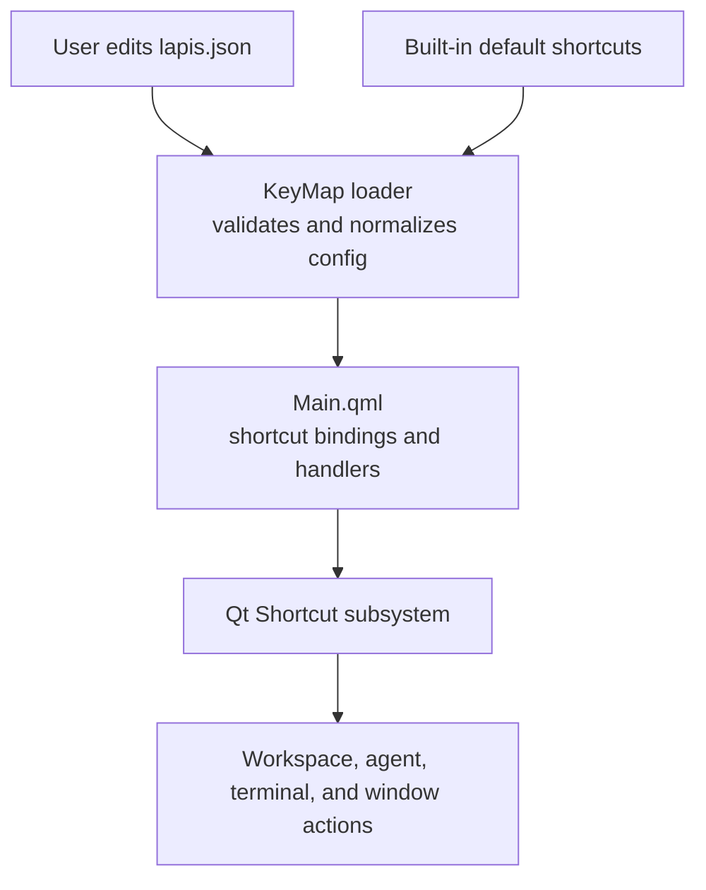
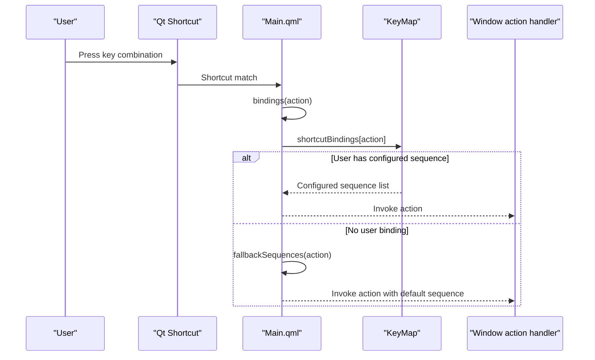
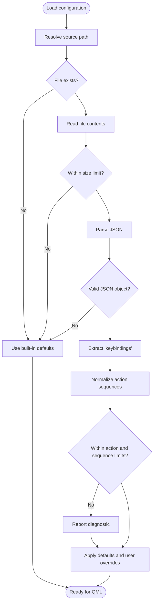
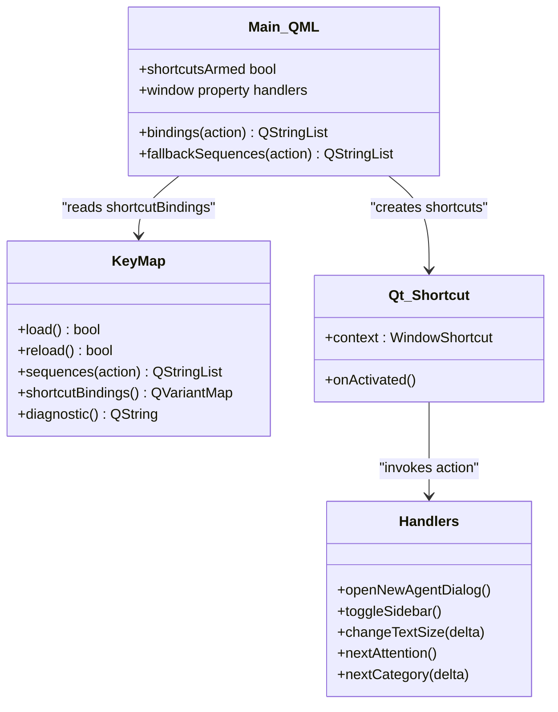

# Keybinding Configuration

<cite>
**Referenced Files in This Document**
- [lapis.json](file://lapis.json)
- [keys.md](file://docs/keys.md)
- [keymap.cpp](file://apps/desktop/src/keymap.cpp)
- [keymap.hpp](file://apps/desktop/src/keymap.hpp)
- [Main.qml](file://apps/desktop/qml/Main.qml)
</cite>

## Table of Contents
1. [Introduction](#introduction)
2. [Project Structure](#project-structure)
3. [Core Components](#core-components)
4. [Architecture Overview](#architecture-overview)
5. [Detailed Component Analysis](#detailed-component-analysis)
6. [Built-in Shortcut Reference](#built-in-shortcut-reference)
7. [Customizing Keybindings](#customizing-keybindings)
8. [Qt Key Sequence Syntax and Modifiers](#qt-key-sequence-syntax-and-modifiers)
9. [Platform-Specific Behavior](#platform-specific-behavior)
10. [QML Integration and Runtime Resolution](#qml-integration-and-runtime-resolution)
11. [Troubleshooting Conflicts](#troubleshooting-conflicts)
12. [Performance Considerations](#performance-considerations)
13. [Conclusion](#conclusion)

## Introduction
Lapis lets you customize desktop keyboard shortcuts through a project-level configuration file named `lapis.json`. The keybinding system loads default shortcuts for navigation, agent control, workspace operations, terminal commands, window management, and command palette actions. Users can override these defaults by adding entries under the `keybindings` section. The runtime resolves each shortcut through Qt’s QML `Shortcut` infrastructure, allowing per-action lists of alternative sequences.

The default documentation for macOS shortcuts is maintained alongside the implementation, while Linux substitutes platform-appropriate modifier combinations. All user-facing behavior falls back to built-in defaults when the configuration file is missing, invalid, or contains unsupported keys.

## Project Structure
The keybinding feature spans three layers:

| Layer | Responsibility | Primary File |
|---|---|---|
| Configuration format | Declares the editable structure and schema surface for user settings | [lapis.json](file://lapis.json) |
| Desktop runtime loader | Parses `lapis.json`, validates limits, applies defaults, watches changes, and exposes shortcuts to QML | [keymap.cpp](file://apps/desktop/src/keymap.cpp), [keymap.hpp](file://apps/desktop/src/keymap.hpp) |
| Interface binding | Connects action names to UI handlers and displays shortcut hints | [Main.qml](file://apps/desktop/qml/Main.qml) |
| User documentation | Lists documented default shortcuts and their intended behavior | [keys.md](file://docs/keys.md) |



**Diagram sources**
- [keymap.cpp:649-704](file://apps/desktop/src/keymap.cpp#L649-L704)
- [Main.qml:133-200](file://apps/desktop/qml/Main.qml#L133-L200)

**Section sources**
- [lapis.json:1-4](file://lapis.json#L1-L4)
- [keymap.hpp:73-125](file://apps/desktop/src/keymap.hpp#L73-L125)
- [Main.qml:133-200](file://apps/desktop/qml/Main.qml#L133-L200)

## Core Components
The keybinding system is centered on the desktop `KeyMap` class. Its responsibilities include:

- Loading and parsing `lapis.json` from the configured source path.
- Reading the `keybindings` object and normalizing each action’s value into a list of Qt key sequences.
- Maintaining built-in default shortcuts for supported actions.
- Exposing current bindings through `sequences(action)` and a serialized `shortcutBindings` map.
- Watching the configuration file and reloading it at runtime.
- Reporting diagnostics when the configuration is malformed, too large, unknown, or otherwise rejected.

Key constraints enforced by the loader are:

| Constraint | Limit or Rule | Reason |
|---|---:|---|
| Maximum key sequences per action | 4 | Prevents excessively long fallback chains |
| Maximum custom actions | 64 | Binds the size of the user-provided shortcut table |
| Maximum configuration file size | 1 MiB | Avoids loading oversized files |
| Pretty-print depth | 64 | Limits JSON serialization nesting |
| Missing or invalid input | Built-in defaults | Ensures graceful degradation |

**Section sources**
- [keymap.cpp:29-31](file://apps/desktop/src/keymap.cpp#L29-L31)
- [keymap.cpp:406-420](file://apps/desktop/src/keymap.cpp#L406-L420)
- [keymap.cpp:649-704](file://apps/desktop/src/keymap.cpp#L649-L704)
- [keymap.hpp:101-136](file://apps/desktop/src/keymap.hpp#L101-L136)

## Architecture Overview
At startup, the desktop application constructs the keymap, loads the user configuration, and registers a file watcher. When a shortcut is pressed, QML’s `Shortcut` element receives the event, looks up the configured sequence through `window.bindings(action)`, and invokes the corresponding handler. If no user binding exists, the interface falls back to the platform-aware defaults.



**Diagram sources**
- [Main.qml:133-200](file://apps/desktop/qml/Main.qml#L133-L200)
- [keymap.cpp:1004-1006](file://apps/desktop/src/keymap.cpp#L1004-L1006)

**Section sources**
- [Main.qml:133-200](file://apps/desktop/qml/Main.qml#L133-L200)
- [keymap.cpp:649-704](file://apps/desktop/src/keymap.cpp#L649-L704)

## Detailed Component Analysis

### Configuration Format
The root `lapis.json` currently declares a version field and an empty `keybindings` object. This structure is the entry point for all user-customizable shortcuts. Additional appearance, layout, terminal font, alerting, editor, usage, and workspace fields are also loaded by the same `KeyMap` component, but only `keybindings` directly controls keyboard shortcuts.

| Field | Type | Purpose |
|---|---|---|
| `version` | Integer | Identifies the configuration schema version |
| `keybindings` | Object | Maps action names to one or more key sequences |

A minimal configuration that leaves every other setting unchanged can be represented as:

```json
{
    "keybindings": {},
    "version": 1
}
```

**Section sources**
- [lapis.json:1-4](file://lapis.json#L1-L4)
- [keymap.cpp:695-704](file://apps/desktop/src/keymap.cpp#L695-L704)

### Action Name Resolution
Actions are string identifiers used throughout the interface. The QML layer defines handlers for specific actions such as opening the command palette, creating a new agent, navigating categories, splitting tiles, changing text size, closing agents, quitting, and reloading configuration. Each `ActionShortcut` binds an action name to a concrete function call.

Supported action families include:

| Family | Example Actions | Purpose |
|---|---|---|
| Agent creation and search | `newAgent`, `searchAgents` | Open agent dialogs and search interfaces |
| Workspace navigation | `nextCategory`, `previousCategory`, `category1` through `category9` | Move between categories and select numbered categories |
| Tile and stage layout | `splitRight`, `splitDown`, `tileLeft`, `tileRight`, `tileUp`, `tileDown`, `zoomTile` | Arrange and focus tiled agent views |
| Terminal behavior | `textBigger`, `textSmaller`, `textReset`, `find`, `reopenAgent`, `resumeConversation`, `toggleTerminal`, `chooseTerminal` | Control terminal text, search, session state, and side terminals |
| Window lifecycle | `quit`, `closeWindow`, `minimizeWindow`, `closeAgent` | Manage application and window state |
| Command palette and settings | `openCommands`, `reloadConfig`, `toggleSidebar` | Open commands, reload configuration, and toggle UI panels |

**Section sources**
- [Main.qml:302-514](file://apps/desktop/qml/Main.qml#L302-L514)
- [Main.qml:1337-1526](file://apps/desktop/qml/Main.qml#L1337-L1526)

### Default Shortcuts
Built-in defaults are defined in the desktop implementation and mirrored in QML fallback logic. The C++ defaults primarily define macOS-oriented shortcuts using `Meta+`, while QML provides non-macOS fallbacks using `Ctrl+Shift+` where appropriate.

Important default patterns:

| Action Family | macOS Pattern | Non-macOS Fallback Pattern |
|---|---|---|
| Command palette | `Meta+Shift+P` | `Ctrl+Shift+P` |
| New agent | `Meta+T` | `Ctrl+Shift+T` |
| Category selection | `Meta+1` through `Meta+9` | `Ctrl+Shift+1` through `Ctrl+Shift+9` |
| Next category | `Meta+Alt+Right`, `Meta+Shift+Down`, `Meta+Shift+J` | `Ctrl+Shift+Alt+Right`, `Ctrl+Shift+Down` |
| Previous category | `Meta+Alt+Left`, `Meta+Shift+Up`, `Meta+Shift+K` | `Ctrl+Shift+Alt+Left`, `Ctrl+Shift+Up` |
| Split tile right | `Meta+D` | `Ctrl+Shift+D` |
| Split tile down | `Meta+Shift+D` | `Ctrl+Alt+Shift+D` |
| Tile movement | `Meta+Ctrl+Arrow` | `Ctrl+Alt+Arrow` |
| Zoom tile | `Meta+Shift+Return` | `Ctrl+Shift+Return` |
| Text zoom | `Meta+=` / `Meta++`, `Meta+-`, `Meta+0` | `Ctrl+Shift+=` / `Ctrl+Shift++`, `Ctrl+Shift+-`, `Ctrl+Shift+0` |

The documentation file explicitly states that Linux uses `Control-Shift` in place of `Command`, which aligns with the QML fallback logic.

**Section sources**
- [keymap.cpp:526-620](file://apps/desktop/src/keymap.cpp#L526-L620)
- [Main.qml:148-200](file://apps/desktop/qml/Main.qml#L148-L200)
- [keys.md:1-64](file://docs/keys.md#L1-L64)

### Configuration Loading and Validation
When `KeyMap::load()` runs, it:

1. Clears previous diagnostics.
2. Resolves the source path.
3. Opens the file.
4. Enforces the 1 MiB size limit.
5. Parses JSON.
6. Reads the `keybindings` object.
7. Normalizes each action’s value into Qt key sequences.
8. Applies validated layout, theme, density, and other settings.
9. Reports diagnostic messages without crashing or bricking the interface.

If the file cannot be read, does not exist, exceeds the size limit, is not valid JSON, or contains unknown values, the system logs diagnostics and falls back to built-in defaults.



**Diagram sources**
- [keymap.cpp:649-704](file://apps/desktop/src/keymap.cpp#L649-L704)
- [keymap.cpp:406-420](file://apps/desktop/src/keymap.cpp#L406-L420)

**Section sources**
- [keymap.cpp:649-704](file://apps/desktop/src/keymap.cpp#L649-L704)
- [keymap.cpp:406-420](file://apps/desktop/src/keymap.cpp#L406-L420)

## Built-in Shortcut Reference
The following reference summarizes the documented and implemented shortcuts. Where multiple sequences are supported, they are listed together.

### Agents and Categories
| Action | Default Sequences | Behavior |
|---|---|---|
| New agent | `Command-T` (macOS), `Ctrl-Shift-T` (Linux) | Opens the new-agent dialog |
| New category | `Command-N` (macOS), `Ctrl-Shift-N` (Linux) | Creates a new category |
| Close focused agent | `Command-W` (macOS), `Ctrl-Shift-W` (Linux) | Closes the front agent panel |
| Reopen last closed agent | `Command-Shift-T` (macOS), `Ctrl-Shift-Shift-T` via QML fallback | Restores the most recently closed agent |
| Resume past conversation | `Command-O` (documented) | Opens resume dialog; handled by `resumeConversation` |
| Select category 1–9 | `Command-1` through `Command-9` | Selects the first nine categories |
| Next category | `Command-Option-Right`, `Command-Shift-Down`, `Command-Shift-J` | Moves to the next category |
| Previous category | `Command-Option-Left`, `Command-Shift-Up`, `Command-Shift-K` | Moves to the previous category |
| Next or previous agent | `Command-Shift-[` / `]` | Navigates agents within the current category |
| Attention navigation | `Command-J`, `Command-L` | Jumps to the next or latest agent needing attention |
| Search agents | `Command-K` | Opens the agent search dialog |

### Stage and Tiles
| Action | Default Sequences | Behavior |
|---|---|---|
| Split right | `Command-D` | Starts a tiled agent to the right |
| Split down | `Command-Shift-D` (macOS), `Ctrl-Alt-Shift-D` (Linux) | Starts a tiled agent below |
| Tile left/right/up/down | `Command-Control-Arrows` (macOS), `Ctrl-Alt-Arrows` (Linux) | Focuses adjacent tiles |
| Zoom tile | `Command-Shift-Return` (macOS), `Ctrl-Shift-Return` (Linux) | Expands or collapses the selected tile |
| Toggle side terminal | `Command-`` or `Control-`` | Shows or hides the side terminal |
| Choose side terminal machine | `Command-~` (macOS), `Ctrl-Shift-~` (Linux) | Selects the terminal’s target machine |
| Toggle sidebar | `Command-B` | Hides or shows the category sidebar |

### Terminal
| Action | Default Sequences | Behavior |
|---|---|---|
| Find text | `Command-F` | Opens find in screen and history |
| Copy / paste | `Command-C` / `Command-V` | Copies or pastes terminal selection |
| Increase text size | `Command-plus` | Increases terminal font size |
| Decrease text size | `Command-minus` | Decreases terminal font size |
| Reset text size | `Command-zero` | Resets terminal font size |
| Line start/end | `Command-Left` / `Command-Right` | Moves to line boundaries |
| Delete to start/end | `Command-Backspace` / `Command-Delete` | Deletes toward line boundaries |
| Link handling | `Command-hover`, `Command-click` | Displays and opens links, files, or folders |

### Window and Application
| Action | Default Sequences | Behavior |
|---|---|---|
| Command palette | `Command-Shift-P` (macOS), `Ctrl-Shift-P` (Linux) | Opens the command palette |
| Appearance settings | `Command-comma` | Opens appearance configuration |
| Reload configuration | `Command-R` (macOS), `Ctrl-Shift-R` (Linux) | Reloads `lapis.json` |
| Minimize window | `Command-M` (macOS) | Minimizes the window |
| Close window | `Command-Shift-W` (macOS) | Closes the window while keeping Lapis running |
| Quit application | `Command-Q` (macOS), `Ctrl-Shift-Q` (Linux) | Quits Lapis |

**Section sources**
- [keys.md:1-64](file://docs/keys.md#L1-L64)
- [Main.qml:148-200](file://apps/desktop/qml/Main.qml#L148-L200)
- [keymap.cpp:570-620](file://apps/desktop/src/keymap.cpp#L570-L620)
- [Main.qml:1337-1526](file://apps/desktop/qml/Main.qml#L1337-L1526)

## Customizing Keybindings
To customize shortcuts, add the desired action name and one or more key sequences under `keybindings`. Each action can have multiple sequences; they act as alternatives.

### Supported Customization Patterns
- Override a single action with one new sequence.
- Provide multiple alternative sequences for the same action.
- Leave `keybindings` empty to keep all built-in defaults.
- Combine modifiers with key names recognized by Qt’s key sequence parser.

### Examples

#### Assign a single shortcut to the command palette
```json
{
    "keybindings": {
        "openCommands": "Ctrl+Shift+Slash"
    },
    "version": 1
}
```

#### Add two alternatives for creating a new agent
```json
{
    "keybindings": {
        "newAgent": ["Cmd+T", "Cmd+N"]
    },
    "version": 1
}
```

#### Replace attention navigation
```json
{
    "keybindings": {
        "nextAttention": "Alt+A",
        "latestAttention": "Alt+L"
    },
    "version": 1
}
```

#### Remove a default shortcut
Set the action to an empty array so no sequence matches:
```json
{
    "keybindings": {
        "openCommands": []
    },
    "version": 1
}
```

### Important Rules
- The maximum number of sequences per action is four.
- The maximum number of custom actions is sixty-four.
- Unknown action names are ignored after validation.
- Invalid key sequences are skipped and reported through diagnostics.
- A malformed configuration degrades to built-in defaults rather than failing the application.

**Section sources**
- [keymap.cpp:29-31](file://apps/desktop/src/keymap.cpp#L29-L31)
- [keymap.cpp:406-420](file://apps/desktop/src/keymap.cpp#L406-L420)
- [keymap.cpp:695-704](file://apps/desktop/src/keymap.cpp#L695-L704)
- [lapis.json:1-4](file://lapis.json#L1-L4)

## Qt Key Sequence Syntax and Modifiers
Lapis relies on Qt’s key sequence parser. A key sequence may contain one or more modifier prefixes followed by a key. Common modifiers include:

| Modifier | Meaning | Notes |
|---|---|---|
| `Meta` | Command key on macOS, usually mapped to Control elsewhere | The desktop code treats `Meta` as the primary modifier for macOS-style defaults |
| `Alt` | Option key on macOS, Alt key elsewhere | Used for secondary navigation chords |
| `Shift` | Shift key | Frequently paired with navigation and punctuation-sensitive shortcuts |
| `Control` | Control key | Used for platform-specific combinations, especially on Linux |
| `Keypad` | Numpad keys | Separate from regular numeric keys |

Examples of accepted forms:

| Syntax | Interpretation |
|---|---|
| `Meta+T` | Command-T on macOS |
| `Meta+Shift+P` | Command-Shift-P |
| `Meta+Alt+Right` | Command-Option-Right |
| `Meta+Ctrl+Left` | Command-Control-Left |
| `Ctrl+Shift+P` | Ctrl-Shift-P on non-macOS platforms |
| `Alt+A` | Alt-A |
| `Meta+0` | Command-zero |

The implementation trims whitespace around sequences and normalizes them before storing. It also includes a helper for X11 shifted punctuation because some systems report punctuation as its shifted symbol.

**Section sources**
- [keymap.cpp:406-420](file://apps/desktop/src/keymap.cpp#L406-L420)
- [keymap.cpp:384-406](file://apps/desktop/src/keymap.cpp#L384-L406)

## Platform-Specific Behavior
Lapis distinguishes macOS from other platforms in both default shortcuts and modifier semantics.

### macOS
- `Meta` represents the physical Command key.
- The application sets a Qt attribute so Control and Meta are not swapped.
- Many defaults use `Meta+`, including `Command-T`, `Command-Shift-P`, `Command-Shift-J`, `Command-Shift-K`, `Command-Shift-Return`, and `Command-Control-Arrows`.
- Window-specific shortcuts like `Command-Shift-W` and `Command-M` are available.

### Linux and Other Platforms
- The documentation states that Linux uses `Control-Shift` in place of `Command`.
- QML fallbacks commonly substitute `Ctrl+Shift+` for macOS `Meta+` sequences.
- Some actions expose different fallbacks, such as `Ctrl+Alt+Arrow` for tile movement and `Ctrl+Alt+Shift+D` for split-down.

### Terminal Keys
Terminal-related shortcuts generally remain associated with the agent terminal. This keeps navigation, editing, and search behavior predictable inside the active shell.

**Section sources**
- [keys.md:1-6](file://docs/keys.md#L1-L6)
- [Main.qml:148-200](file://apps/desktop/qml/Main.qml#L148-L200)
- [keymap.cpp:526-620](file://apps/desktop/src/keymap.cpp#L526-L620)

## QML Integration and Runtime Resolution
QML connects user actions to keyboard input through two mechanisms:

1. **Configurable bindings**: `window.bindings(action)` checks `keymap.shortcutBindings[action]`. If the user provided one or more sequences, those are used.
2. **Fallback defaults**: If no user binding exists, `fallbackSequences(action)` returns platform-aware defaults.

Each `ActionShortcut` then creates a `Qt.WindowShortcut` bound to that action. When matched, the shortcut calls a window method such as `openNewAgentDialog()`, `toggleSidebar()`, `changeTextSize()`, `nextAttention()`, or `workspace.nextCategory()`.



**Diagram sources**
- [keymap.hpp:101-136](file://apps/desktop/src/keymap.hpp#L101-L136)
- [Main.qml:133-200](file://apps/desktop/qml/Main.qml#L133-L200)
- [Main.qml:1126-1526](file://apps/desktop/qml/Main.qml#L1126-L1526)

**Section sources**
- [Main.qml:133-200](file://apps/desktop/qml/Main.qml#L133-L200)
- [Main.qml:1126-1526](file://apps/desktop/qml/Main.qml#L1126-L1526)
- [keymap.hpp:101-136](file://apps/desktop/src/keymap.hpp#L101-L136)

## Troubleshooting Conflicts
Common issues and resolutions:

| Problem | Likely Cause | Resolution |
|---|---|---|
| A shortcut does nothing | The action name is misspelled or unsupported | Use an action name present in the QML shortcut definitions |
| A shortcut works only once | Another shortcut or widget consumes the event | Check whether the terminal, dialog, or another `Shortcut` intercepts the key |
| Multiple shortcuts trigger | Several actions share the same sequence | Give each action a unique sequence |
| Configuration is ignored | The file is invalid, too large, or malformed | Fix JSON syntax, stay under 1 MiB, and check diagnostics |
| A shortcut works differently on Linux | Platform fallbacks differ from macOS defaults | Consult the platform-specific defaults |
| Punctuation shortcuts behave unexpectedly on X11 | Shifted punctuation is reported differently | Avoid ambiguous punctuation combinations or test on the target platform |
| The app reports diagnostics | The configuration contains unknown layouts, themes, densities, or invalid key sequences | Correct the reported issue or remove the problematic entry |

### Diagnostic Sources
The loader reports problems such as:

- Missing configuration file.
- Unreadable file.
- Configuration exceeding 1 MiB.
- Invalid JSON.
- Unknown layout, theme, or density.
- Invalid terminal font family or size.
- Unsupported or malformed key sequences.
- Too many sequences per action.
- Too many custom actions.

These diagnostics are exposed through `KeyMap::diagnostic()` and logged during reload.

**Section sources**
- [keymap.cpp:649-704](file://apps/desktop/src/keymap.cpp#L649-L704)
- [keymap.cpp:704-811](file://apps/desktop/src/keymap.cpp#L704-L811)
- [keymap.cpp:1104-1125](file://apps/desktop/src/keymap.cpp#L1104-L1125)
- [keymap.cpp:1171-1193](file://apps/desktop/src/keymap.cpp#L1171-L1193)

## Performance Considerations
The keybinding system is lightweight by design:

- Default shortcuts are stored in compact tables.
- User key sequences are normalized once during load.
- QML reads a precomputed `shortcutBindings` map instead of parsing JSON at runtime.
- Configuration reload is debounced through a timer settling mechanism.
- File watching is limited to the directory containing `lapis.json`.
- Hard limits prevent pathological configurations from bloating memory or CPU usage.

Recommended practices:

- Keep custom keybindings small and readable.
- Prefer one clear primary sequence per action.
- Use alternative sequences sparingly.
- Avoid overlapping sequences across actions.
- Test changes by reloading the configuration.

**Section sources**
- [keymap.cpp:29-31](file://apps/desktop/src/keymap.cpp#L29-L31)
- [keymap.cpp:448-471](file://apps/desktop/src/keymap.cpp#L448-L471)
- [keymap.cpp:1013-1020](file://apps/desktop/src/keymap.cpp#L1013-L1020)

## Conclusion
Lapis’s keybinding system separates configuration, validation, defaults, and interface binding. Users edit `lapis.json` under `keybindings`, the desktop `KeyMap` validates and normalizes those entries, and QML connects action names to Qt shortcuts and window handlers. The result is a flexible, platform-aware system that supports macOS Command-style shortcuts, Linux Control-Shift alternatives, terminal-local behavior, and robust fallbacks when configuration is absent or invalid.

For most users, the safest customization path is to override one action at a time, verify the action name against the QML shortcut definitions, and rely on the documented default shortcuts as a starting point. For developers, the integration points are clearly bounded: `KeyMap` owns configuration loading and normalization, while `Main.qml` owns action-to-handler mapping and runtime shortcut resolution.