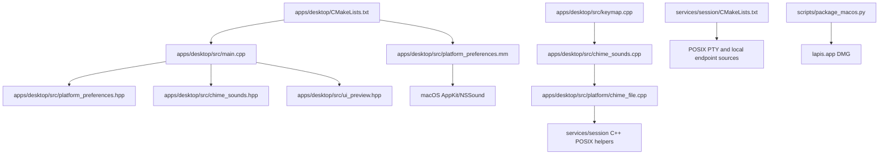
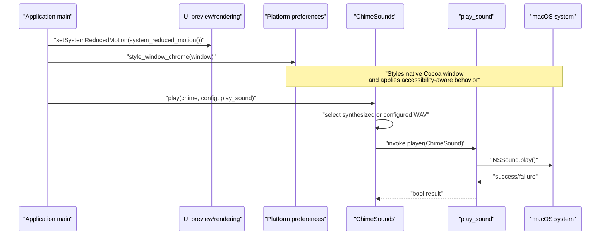
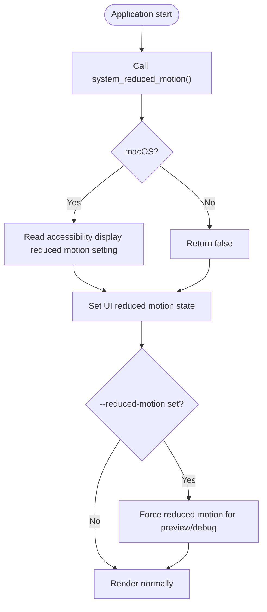
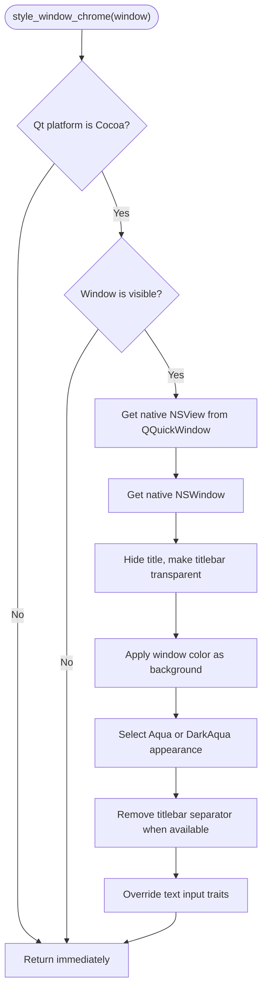
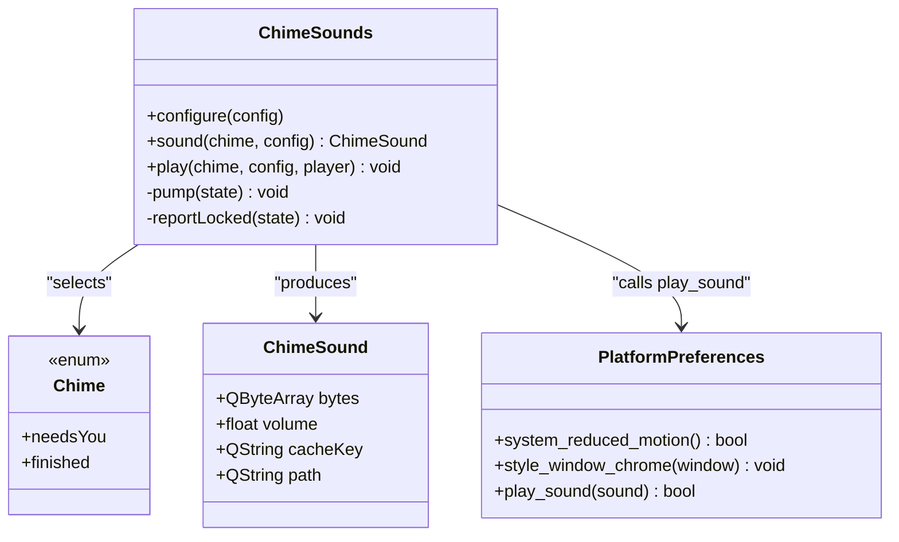
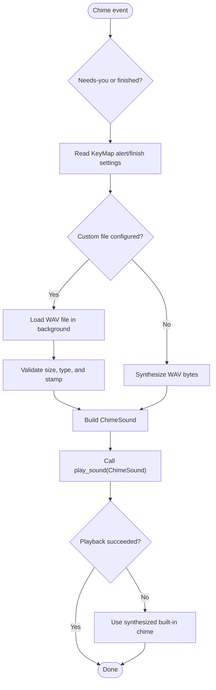
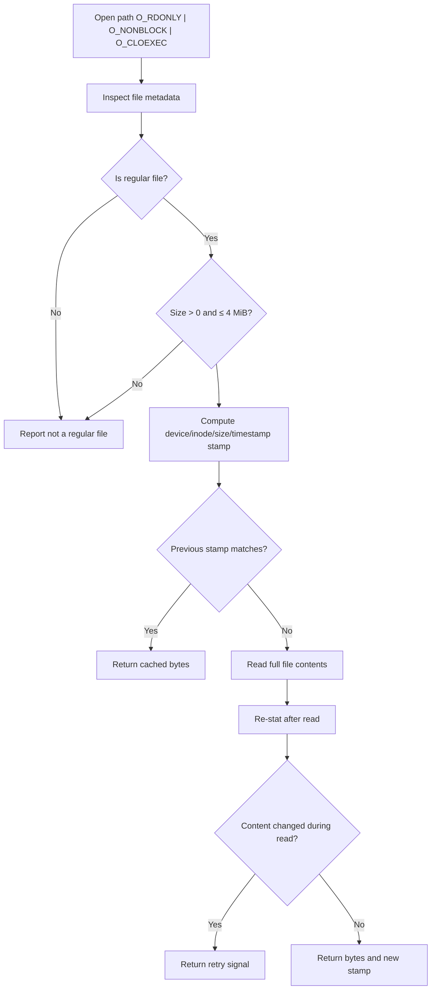
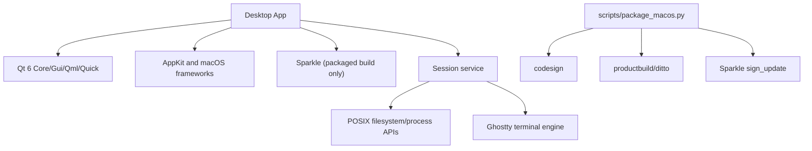

# Platform-Specific Settings

<cite>
**Referenced Files in This Document**
- [platform_preferences.hpp](file://apps/desktop/src/platform_preferences.hpp)
- [platform_preferences.mm](file://apps/desktop/src/platform_preferences.mm)
- [main.cpp](file://apps/desktop/src/main.cpp)
- [chime_sounds.hpp](file://apps/desktop/src/chime_sounds.hpp)
- [chime_sounds.cpp](file://apps/desktop/src/chime_sounds.cpp)
- [chime_file.hpp](file://apps/desktop/src/platform/chime_file.hpp)
- [chime_file.cpp](file://apps/desktop/src/platform/chime_file.cpp)
- [keymap.hpp](file://apps/desktop/src/keymap.hpp)
- [keymap.cpp](file://apps/desktop/src/keymap.cpp)
- [ui_preview.hpp](file://apps/desktop/src/ui_preview.hpp)
- [ui_capture.cpp](file://apps/desktop/src/ui_capture.cpp)
- [platform_desktop.hpp](file://apps/desktop/src/platform_desktop.hpp)
- [desktop/CMakeLists.txt](file://apps/desktop/CMakeLists.txt)
- [services/session/CMakeLists.txt](file://services/session/CMakeLists.txt)
- [package_macos.py](file://scripts/package_macos.py)
- [build.md](file://docs/build.md)
</cite>

## Table of Contents
1. [Introduction](#introduction)
2. [Project Structure](#project-structure)
3. [Core Components](#core-components)
4. [Architecture Overview](#architecture-overview)
5. [Detailed Component Analysis](#detailed-component-analysis)
6. [Dependency Analysis](#dependency-analysis)
7. [Performance Considerations](#performance-considerations)
8. [Troubleshooting Guide](#troubleshooting-guide)
9. [Conclusion](#conclusion)

## Introduction
This document explains platform-specific configuration and system integration for the desktop application, with a focus on macOS while documenting cross-platform behavior for Windows and Linux. It covers:

- macOS reduced-motion support through `system_reduced_motion()`.
- Native window chrome styling through `style_window_chrome()`.
- Native sound playback via `play_sound()` and the synthesized or file-based chime system.
- Differences in alert sound handling across platforms.
- File association rules for custom chime files.
- System integration features such as notifications, login items, update checking, terminal key interception, secure input detection, and idle input tracking.
- Cross-platform considerations for terminal emulation, input handling, and UI rendering.
- Build configuration, code signing, notarization, and distribution guidance.
- Troubleshooting and performance tips per target platform.

## Project Structure
The relevant platform-specific implementation lives primarily under the desktop application source tree:

**Diagram sources**
- [main.cpp:375-400](file://apps/desktop/src/main.cpp#L375-L400)
- [main.cpp:492-500](file://apps/desktop/src/main.cpp#L492-L500)
- [main.cpp:1196-1206](file://apps/desktop/src/main.cpp#L1196-L1206)
- [platform_preferences.hpp:8-22](file://apps/desktop/src/platform_preferences.hpp#L8-L22)
- [platform_preferences.mm:37-118](file://apps/desktop/src/platform_preferences.mm#L37-L118)
- [chime_sounds.hpp:10-54](file://apps/desktop/src/chime_sounds.hpp#L10-L54)
- [chime_sounds.cpp:78-110](file://apps/desktop/src/chime_sounds.cpp#L78-L110)
- [chime_file.cpp:1-54](file://apps/desktop/src/platform/chime_file.cpp#L1-L54)
- [desktop/CMakeLists.txt:1-40](file://apps/desktop/CMakeLists.txt#L1-L40)
- [desktop/CMakeLists.txt:130-170](file://apps/desktop/CMakeLists.txt#L130-L170)
- [services/session/CMakeLists.txt:15-30](file://services/session/CMakeLists.txt#L15-L30)
- [package_macos.py:1-12](file://scripts/package_macos.py#L1-L12)

**Section sources**
- [platform_preferences.hpp:8-22](file://apps/desktop/src/platform_preferences.hpp#L8-L22)
- [platform_preferences.mm:37-118](file://apps/desktop/src/platform_preferences.mm#L37-L118)
- [main.cpp:375-400](file://apps/desktop/src/main.cpp#L375-L400)
- [main.cpp:492-500](file://apps/desktop/src/main.cpp#L492-L500)
- [main.cpp:1196-1206](file://apps/desktop/src/main.cpp#L1196-L1206)
- [desktop/CMakeLists.txt:1-40](file://apps/desktop/CMakeLists.txt#L1-L40)
- [desktop/CMakeLists.txt:130-170](file://apps/desktop/CMakeLists.txt#L130-L170)
- [services/session/CMakeLists.txt:15-30](file://services/session/CMakeLists.txt#L15-L30)

## Core Components
The platform abstraction layer exposes three macOS-only APIs with nonfunctional fallbacks elsewhere:

| API | macOS behavior | Non-macOS fallback | Purpose |
|---|---|---|---|
| `system_reduced_motion()` | Reads the system accessibility setting that reduces motion. | Returns false. | Tells the UI whether to suppress animations and motion effects. |
| `style_window_chrome(QQuickWindow&)` | Styles the native Cocoa window: transparent titlebar, hidden title, background color, appearance, separator style, and text input trait overrides. | No-op. | Makes the Qt Quick window match the app theme and disables unwanted iOS-style text services. |
| `play_sound(const ChimeSound&)` | Plays an in-memory WAV or other NSSound-compatible format at a bounded volume with a small GUI-thread cache. | Returns false. | Plays alert and finish sounds natively without blocking the caller. |

These functions are declared once in a header and implemented conditionally so callers can use the same interface across platforms.

**Section sources**
- [platform_preferences.hpp:8-22](file://apps/desktop/src/platform_preferences.hpp#L8-L22)
- [platform_preferences.mm:37-118](file://apps/desktop/src/platform_preferences.mm#L37-L118)

## Architecture Overview
The runtime integrates platform settings into three main flows:

1. **UI initialization**: The application reads system reduced motion and passes it to the preview/rendering layer.
2. **Window lifecycle**: When a window becomes visible, the Cocoa chrome is styled.
3. **Alert flow**: A chime event selects either a synthesized WAV or a user-provided file, then delegates playback to `play_sound`, which uses NSSound on macOS.

**Diagram sources**
- [main.cpp:375-400](file://apps/desktop/src/main.cpp#L375-L400)
- [main.cpp:492-500](file://apps/desktop/src/main.cpp#L492-L500)
- [main.cpp:1196-1206](file://apps/desktop/src/main.cpp#L1196-L1206)
- [platform_preferences.mm:37-118](file://apps/desktop/src/platform_preferences.mm#L37-L118)
- [chime_sounds.cpp:226-260](file://apps/desktop/src/chime_sounds.cpp#L226-L260)

## Detailed Component Analysis

### macOS Reduced Motion Support
`system_reduced_motion()` queries the system accessibility preference for reduced motion. On non-macOS builds, it always returns false, so the UI must treat this as “motion is allowed” unless explicitly overridden by command-line flags.

The application wires this value into the UI preview state and also exposes a `--reduced-motion` option for testing steady attention markers without motion.

**Diagram sources**
- [platform_preferences.hpp:10-11](file://apps/desktop/src/platform_preferences.hpp#L10-L11)
- [platform_preferences.hpp:18-19](file://apps/desktop/src/platform_preferences.hpp#L18-L19)
- [platform_preferences.mm:37-39](file://apps/desktop/src/platform_preferences.mm#L37-L39)
- [main.cpp:492-492](file://apps/desktop/src/main.cpp#L492-L492)
- [main.cpp:1196-1197](file://apps/desktop/src/main.cpp#L1196-L1197)
- [ui_preview.hpp:67-68](file://apps/desktop/src/ui_preview.hpp#L67-L68)

**Section sources**
- [platform_preferences.hpp:10-11](file://apps/desktop/src/platform_preferences.hpp#L10-L11)
- [platform_preferences.hpp:18-19](file://apps/desktop/src/platform_preferences.hpp#L18-L19)
- [platform_preferences.mm:37-39](file://apps/desktop/src/platform_preferences.mm#L37-L39)
- [main.cpp:492-492](file://apps/desktop/src/main.cpp#L492-L492)
- [main.cpp:1196-1197](file://apps/desktop/src/main.cpp#L1196-L1197)
- [ui_preview.hpp:67-68](file://apps/desktop/src/ui_preview.hpp#L67-L68)

### Native Window Chrome Styling
On macOS with the Cocoa platform plugin, `style_window_chrome()` performs several native adjustments:

- Hides the default title and makes the titlebar transparent.
- Sets the native window background color from the QQuickWindow color.
- Chooses light or dark appearance based on window brightness.
- Removes the titlebar separator where available.
- Overrides text input traits to decline inline prediction, completion, autocorrection, spell checking, grammar checking, smart replacements, and writing tools.

This matters because Qt does not propagate certain input mode flags to AppKit, which could otherwise insert unwanted text suggestions into prompts and search fields.

**Diagram sources**
- [platform_preferences.mm:40-64](file://apps/desktop/src/platform_preferences.mm#L40-L64)

**Section sources**
- [platform_preferences.hpp:11](file://apps/desktop/src/platform_preferences.hpp#L11)
- [platform_preferences.mm:40-64](file://apps/desktop/src/platform_preferences.mm#L40-L64)
- [main.cpp:1206-1206](file://apps/desktop/src/main.cpp#L1206-L1206)

### Native Sound Playback and Alert Sounds
The sound system separates sound selection from playback:

- `ChimeSounds` owns the selection logic, background file loading, and diagnostic reporting.
- It synthesizes two glassy WAV tones: one rising tone for “agent needs you,” and one quieter falling tone for “turn finished.”
- Users may configure custom alert and finish sound files through the settings configuration.
- The selected sound is passed to `play_sound`, which on macOS uses NSSound.
- On non-macOS builds, `play_sound` returns false; alert sound configuration still exists but has no native playback.

**Diagram sources**
- [chime_sounds.hpp:10-54](file://apps/desktop/src/chime_sounds.hpp#L10-L54)
- [chime_sounds.cpp:78-110](file://apps/desktop/src/chime_sounds.cpp#L78-L110)
- [chime_sounds.cpp:226-260](file://apps/desktop/src/chime_sounds.cpp#L226-L260)
- [platform_preferences.hpp:15-21](file://apps/desktop/src/platform_preferences.hpp#L15-L21)
- [platform_preferences.mm:66-118](file://apps/desktop/src/platform_preferences.mm#L66-L118)

#### Alert Sound Selection Flow

**Diagram sources**
- [chime_sounds.cpp:78-110](file://apps/desktop/src/chime_sounds.cpp#L78-L110)
- [chime_sounds.cpp:226-260](file://apps/desktop/src/chime_sounds.cpp#L226-L260)
- [chime_file.cpp:20-54](file://apps/desktop/src/platform/chime_file.cpp#L20-L54)
- [keymap.cpp:823-860](file://apps/desktop/src/keymap.cpp#L823-L860)
- [keymap.cpp:1222-1227](file://apps/desktop/src/keymap.cpp#L1222-L1227)

**Section sources**
- [chime_sounds.hpp:10-54](file://apps/desktop/src/chime_sounds.hpp#L10-L54)
- [chime_sounds.cpp:78-110](file://apps/desktop/src/chime_sounds.cpp#L78-L110)
- [chime_sounds.cpp:226-260](file://apps/desktop/src/chime_sounds.cpp#L226-L260)
- [chime_file.hpp:1-17](file://apps/desktop/src/platform/chime_file.hpp#L1-L17)
- [chime_file.cpp:20-54](file://apps/desktop/src/platform/chime_file.cpp#L20-L54)
- [platform_preferences.hpp:15-21](file://apps/desktop/src/platform_preferences.hpp#L15-L21)
- [platform_preferences.mm:66-118](file://apps/desktop/src/platform_preferences.mm#L66-L118)
- [keymap.cpp:823-860](file://apps/desktop/src/keymap.cpp#L823-L860)
- [keymap.cpp:1222-1227](file://apps/desktop/src/keymap.cpp#L1222-L1227)

### File Association Rules for Custom Sounds
Custom alert and finish sound files are loaded asynchronously and validated before use:

- Only regular files are accepted; pipes, devices, sockets, and special files are rejected.
- Empty files are rejected.
- Files larger than 4 MiB are rejected.
- The loader computes a stamp from device, inode, size, and timestamps; if the stamp matches a previous load, the cached bytes are reused.
- If the file changes during read, the operation is treated as inconsistent and retried later.
- Errors are surfaced through `ChimeSounds` diagnostics rather than crashing the UI.

**Diagram sources**
- [chime_file.cpp:20-54](file://apps/desktop/src/platform/chime_file.cpp#L20-L54)

**Section sources**
- [chime_file.hpp:1-17](file://apps/desktop/src/platform/chime_file.hpp#L1-L17)
- [chime_file.cpp:20-54](file://apps/desktop/src/platform/chime_file.cpp#L20-L54)
- [chime_sounds.cpp:108-110](file://apps/desktop/src/chime_sounds.cpp#L108-L110)
- [chime_sounds.cpp:144-159](file://apps/desktop/src/chime_sounds.cpp#L144-L159)
- [keymap.cpp:857-860](file://apps/desktop/src/keymap.cpp#L857-L860)

### User Configuration for Alerts and Notifications
The settings layer exposes alert-related options:

| Setting | Default | Meaning |
|---|---:|---|
| `alerts.sound` | true | Enable alert chimes. |
| `alerts.finished` | true | Enable finish chimes. |
| `alerts.repeat` | 3 | Allowed repeat range is 1 through 10. |
| `alerts.notify` | true | Show system notification for alerts. |
| `alerts.soundFile` | empty | Path to custom alert sound file. |
| `alerts.finishedFile` | empty | Path to custom finish sound file. |
| `keepAwake` | true | Keep the Mac awake so remote connections remain reachable. |
| `editor` | empty | Preferred editor for opening agent folders; defaults to a common installed editor. |

These values are persisted in the project configuration and exposed to QML through the `KeyMap` object.

**Section sources**
- [keymap.hpp:130-170](file://apps/desktop/src/keymap.hpp#L130-L170)
- [keymap.cpp:624-634](file://apps/desktop/src/keymap.cpp#L624-L634)
- [keymap.cpp:823-860](file://apps/desktop/src/keymap.cpp#L823-L860)
- [keymap.cpp:1222-1227](file://apps/desktop/src/keymap.cpp#L1222-L1227)
- [keymap.cpp:1308-1382](file://apps/desktop/src/keymap.cpp#L1308-L1382)

### System Integration Features
Beyond reduced motion, window chrome, and sound, macOS provides additional platform capabilities:

| Feature | macOS capability | Non-macOS behavior |
|---|---|---|
| Notifications | Post user-facing notifications and handle click-to-open events. | No-op functions. |
| Login item | Enable/disable the app’s login item. | Always reports unavailable. |
| Updates | Start Sparkle updater and check for updates in packaged apps. | No-op functions. |
| Terminal keys | Intercept Command-` and related shortcuts before AppKit consumes them. | No-op registration. |
| Latest attention key | Global shortcut to bring lapis to the front. | Always returns failure. |
| Application activation | Bring the application forward when another app requests focus. | No-op. |
| Secure input detection | Detect when password fields are active. | Always reports disabled. |
| Idle input tracking | Measure seconds since last hardware keyboard/mouse/trackpad input. | Returns negative value. |

These functions are grouped behind a single platform namespace so higher layers can call them safely on all targets.

**Section sources**
- [platform_desktop.hpp:10-58](file://apps/desktop/src/platform_desktop.hpp#L10-L58)
- [desktop/CMakeLists.txt:40-70](file://apps/desktop/CMakeLists.txt#L40-L70)

## Dependency Analysis
The platform-specific dependencies split along three axes:

1. **GUI platform dependency**: macOS adds Objective-C++, AppKit, Carbon, CoreGraphics, Foundation, Security, ServiceManagement, UserNotifications, and optional Sparkle.
2. **Session service dependency**: The session service uses POSIX utilities for process groups, unique file descriptors, PTY processes, and Unix-domain endpoints.
3. **Build-time packaging dependency**: macOS packaging relies on `codesign`, `productbuild`, `ditto`, and Sparkle tooling.

**Diagram sources**
- [desktop/CMakeLists.txt:1-70](file://apps/desktop/CMakeLists.txt#L1-L70)
- [desktop/CMakeLists.txt:130-170](file://apps/desktop/CMakeLists.txt#L130-L170)
- [services/session/CMakeLists.txt:15-30](file://services/session/CMakeLists.txt#L15-L30)
- [services/session/CMakeLists.txt:74-90](file://services/session/CMakeLists.txt#L74-L90)
- [package_macos.py:811-1012](file://scripts/package_macos.py#L811-L1012)
- [package_macos.py:1067-1110](file://scripts/package_macos.py#L1067-L1110)

**Section sources**
- [desktop/CMakeLists.txt:1-70](file://apps/desktop/CMakeLists.txt#L1-L70)
- [desktop/CMakeLists.txt:130-170](file://apps/desktop/CMakeLists.txt#L130-L170)
- [services/session/CMakeLists.txt:15-30](file://services/session/CMakeLists.txt#L15-L30)
- [services/session/CMakeLists.txt:74-90](file://services/session/CMakeLists.txt#L74-L90)
- [package_macos.py:811-1012](file://scripts/package_macos.py#L811-L1012)
- [package_macos.py:1067-1110](file://scripts/package_macos.py#L1067-L1110)

## Performance Considerations

### macOS
- **Reduced motion**: Respect `system_reduced_motion()` to avoid unnecessary animations for users who prefer reduced motion.
- **Window chrome**: Avoid calling `style_window_chrome()` when windows are hidden or closing; the implementation already guards against invisible windows.
- **Sound caching**: NSSound instances are retained in a bounded cache with up to eight entries and approximately 16 MiB total cost. Old sounds are stopped and removed when the limit is exceeded.
- **Sound volume**: Use the `volume` field in `ChimeSound` instead of repeatedly creating loud or repeated cues.
- **Idle input**: Use `seconds_since_input()` cautiously; it measures hardware input time and may return negative values when unavailable.

**Section sources**
- [platform_preferences.mm:40-64](file://apps/desktop/src/platform_preferences.mm#L40-L64)
- [platform_preferences.mm:66-118](file://apps/desktop/src/platform_preferences.mm#L66-L118)
- [platform_desktop.hpp:10-58](file://apps/desktop/src/platform_desktop.hpp#L10-L58)

### Windows and Linux
- **Reduced motion**: `system_reduced_motion()` always returns false. Do not assume macOS-level reduced motion awareness unless explicitly tested.
- **Window chrome**: `style_window_chrome()` is a no-op. Theme colors still apply through Qt and QML, but native titlebar behavior remains platform-default.
- **Sound playback**: `play_sound()` returns false. Configure alert sound toggles, but do not expect native playback on these platforms.
- **Terminal emulation**: The terminal engine is independent of the OS surface; the session service uses POSIX-like abstractions for process management and terminals.
- **Input handling**: Platform-native global hotkeys, secure input detection, and idle input tracking are macOS-only. Cross-platform input should rely on Qt keymaps and terminal adapters.

**Section sources**
- [platform_preferences.hpp:15-21](file://apps/desktop/src/platform_preferences.hpp#L15-L21)
- [platform_desktop.hpp:25-58](file://apps/desktop/src/platform_desktop.hpp#L25-L58)
- [services/session/CMakeLists.txt:15-30](file://services/session/CMakeLists.txt#L15-L30)
- [services/session/CMakeLists.txt:74-90](file://services/session/CMakeLists.txt#L74-L90)

## Troubleshooting Guide

### macOS Reduced Motion Not Applied
- Verify that the system accessibility setting for reduced motion is enabled.
- Use the `--reduced-motion` flag in development or preview modes to force reduced motion behavior.
- Confirm that the UI receives the system value through `setSystemReducedMotion`.

**Section sources**
- [platform_preferences.mm:37-39](file://apps/desktop/src/platform_preferences.mm#L37-L39)
- [main.cpp:492-492](file://apps/desktop/src/main.cpp#L492-L492)
- [main.cpp:1196-1197](file://apps/desktop/src/main.cpp#L1196-L1197)

### Native Window Chrome Looks Incorrect
- Ensure the app runs under the Cocoa platform plugin; the chrome styler checks `QGuiApplication::platformName()`.
- Call `style_window_chrome()` only when the window is visible.
- Inspect the window color and appearance choice; light themes select Aqua, dark themes select DarkAqua.

**Section sources**
- [platform_preferences.mm:40-64](file://apps/desktop/src/platform_preferences.mm#L40-L64)
- [main.cpp:1206-1206](file://apps/desktop/src/main.cpp#L1206-L1206)

### Custom Sound File Does Not Play
- Confirm the path points to a regular file, not a pipe, device, or symlink to a special file.
- Ensure the file is non-empty and no larger than 4 MiB.
- Check `ChimeSounds` diagnostics; errors include “not found,” “not readable,” “not a regular file,” “empty file,” “over 4 MiB,” and “changed during read; retrying.”
- Remember that non-macOS builds return false from `play_sound`; custom file validation still runs, but native playback is not supported there.

**Section sources**
- [chime_file.cpp:20-54](file://apps/desktop/src/platform/chime_file.cpp#L20-L54)
- [chime_sounds.cpp:108-110](file://apps/desktop/src/chime_sounds.cpp#L108-L110)
- [chime_sounds.cpp:144-159](file://apps/desktop/src/chime_sounds.cpp#L144-L159)
- [chime_sounds.cpp:226-260](file://apps/desktop/src/chime_sounds.cpp#L226-L260)
- [platform_preferences.hpp:15-21](file://apps/desktop/src/platform_preferences.hpp#L15-L21)

### Notification Permission or Click Handling Issues
- The first notification request asks the user for permission; subsequent notifications depend on granted access.
- Click-to-open handlers are only meaningful on macOS; on other platforms they are no-ops.
- Combine notification failures with sound diagnostics if both alert channels are configured.

**Section sources**
- [platform_desktop.hpp:10-23](file://apps/desktop/src/platform_desktop.hpp#L10-L23)
- [platform_desktop.hpp:25-58](file://apps/desktop/src/platform_desktop.hpp#L25-L58)

### Build and Distribution Problems on macOS
- The downloadable app requires a macOS host.
- Signing uses `codesign --options runtime` and entitlements from `apps/desktop/macos/lapis.entitlements`.
- The packaged app embeds Sparkle for updates; the appcast signature is verified against the signed DMG.
- DMGs are signed separately from the app and recorded in the release manifest.

**Section sources**
- [package_macos.py:1-12](file://scripts/package_macos.py#L1-L12)
- [package_macos.py:306-363](file://scripts/package_macos.py#L306-L363)
- [package_macos.py:811-1012](file://scripts/package_macos.py#L811-L1012)
- [package_macos.py:1067-1110](file://scripts/package_macos.py#L1067-L1110)
- [package_macos.py:1601-1635](file://scripts/package_macos.py#L1601-L1635)

### Cross-Platform Build Notes
- macOS is the active target for routine checks.
- `linux-gui` exists only for an explicitly chosen Linux port check.
- Tests can run offscreen with a virtual screen for GUI fixtures.
- The terminal engine bootstrap and comparison toolchain are separate from platform-specific UI code.

**Section sources**
- [build.md:1-120](file://docs/build.md#L1-L120)

## Conclusion
The desktop application implements a clear boundary between cross-platform configuration and platform-specific integration:

- macOS gains reduced-motion awareness, native window chrome styling, NSSound playback, notifications, login items, Sparkle updates, terminal key interception, secure input detection, and idle input tracking.
- Windows and Linux receive safe fallbacks: reduced motion defaults to allowed, window chrome remains Qt-driven, sound playback is unsupported, and many system integrations become no-ops.
- Sound selection is robust and asynchronous, with strict file validation and bounded caching.
- macOS packaging is explicit about signing, entitlements, Sparkle, and DMG provenance.
- Developers should test reduced motion, sound diagnostics, and platform-specific features per target, relying on the documented fallbacks for non-macOS deployments.