# Application Overview and Architecture

<cite>
**Referenced Files in This Document**
- [README.md](file://README.md)
- [CMakeLists.txt](file://CMakeLists.txt)
- [ProjectOptions.cmake](file://cmake/ProjectOptions.cmake)
- [main.cpp](file://apps/desktop/src/main.cpp)
- [Main.qml](file://apps/desktop/qml/Main.qml)
- [terminal_surface.cpp](file://apps/desktop/src/terminal_surface.cpp)
- [workspace_control.cpp](file://apps/desktop/src/workspace_control.cpp)
- [terminals.cpp](file://apps/desktop/src/terminals.cpp)
- [client.hpp](file://services/supervisor/include/lapis/supervisor/client.hpp)
- [runtime.hpp](file://services/supervisor/include/lapis/supervisor/runtime.hpp)
- [control_server.hpp](file://services/supervisor/include/lapis/supervisor/control_server.hpp)
- [state.hpp](file://services/supervisor/include/lapis/supervisor/state.hpp)
- [client.cpp](file://services/supervisor/src/client.cpp)
- [control_server.cpp](file://services/supervisor/src/control_server.cpp)
- [launch_spec.cpp](file://services/session/src/launch_spec.cpp)
- [terminal.hpp](file://services/session/include/lapis/session/terminal.hpp)
- [observer.hpp](file://adapters/codex/src/observer.hpp)
- [claude_observer.hpp](file://adapters/claude/src/claude_observer.hpp)
</cite>

## Table of Contents
1. [Introduction](#introduction)
2. [Project Structure](#project-structure)
3. [Core Components](#core-components)
4. [Architecture Overview](#architecture-overview)
5. [Detailed Component Analysis](#detailed-component-analysis)
6. [Dependency Analysis](#dependency-analysis)
7. [Performance Considerations](#performance-considerations)
8. [Troubleshooting Guide](#troubleshooting-guide)
9. [Conclusion](#conclusion)

## Introduction
Lapis is a desktop application for running multiple coding agents concurrently, giving each agent its own live terminal while providing workspace navigation, attention handling, usage tracking, and platform-specific features. The desktop app is built with Qt and QML: QML owns the user interface, while C++ owns business logic, session management, terminal rendering, and communication with background services.

At runtime, the desktop app is not the process that executes agent CLIs directly. Instead, it communicates with supervisor and session services through local IPC. This separation keeps agent processes isolated, allows sessions to survive normal application exits, and gives the supervisor authority over lifecycle policies such as restarts, endpoints, and state persistence.

The repository also contains adapters for specific agent CLIs (Codex and Claude Code), a session service implementing the terminal wire protocol, and an experimental supervisor runtime that owns child processes and control endpoints.

**Section sources**
- [README.md:1-100](file://README.md#L1-L100)

## Project Structure
The repository is organized by target rather than strictly by layer:

| Area | Responsibility |
|---|---|
| `apps/desktop` | Qt/QML desktop application, UI components, workspace model, terminal surface, and integration with session services |
| `apps/ultratab` | Overlay companion application with shared Qt/C++ patterns |
| `services/session` | In-process terminal contract, PTY-backed session, transport, attention, history, and launch validation |
| `services/supervisor` | Supervisor client, daemon, runtime, state storage, and local control server |
| `adapters/codex` | Codex CLI adapter exposing attention hooks through a QObject-based observer |
| `adapters/claude` | Claude Code hook observer supporting local socket and terminal-relayed input |
| `tools` | Terminal engine probes, verification tools, and test helpers |
| `scripts` | Build, packaging, testing, and development tooling |
| `cmake` | Shared CMake project options and third-party configuration |
| `docs` | User-facing and design documentation |

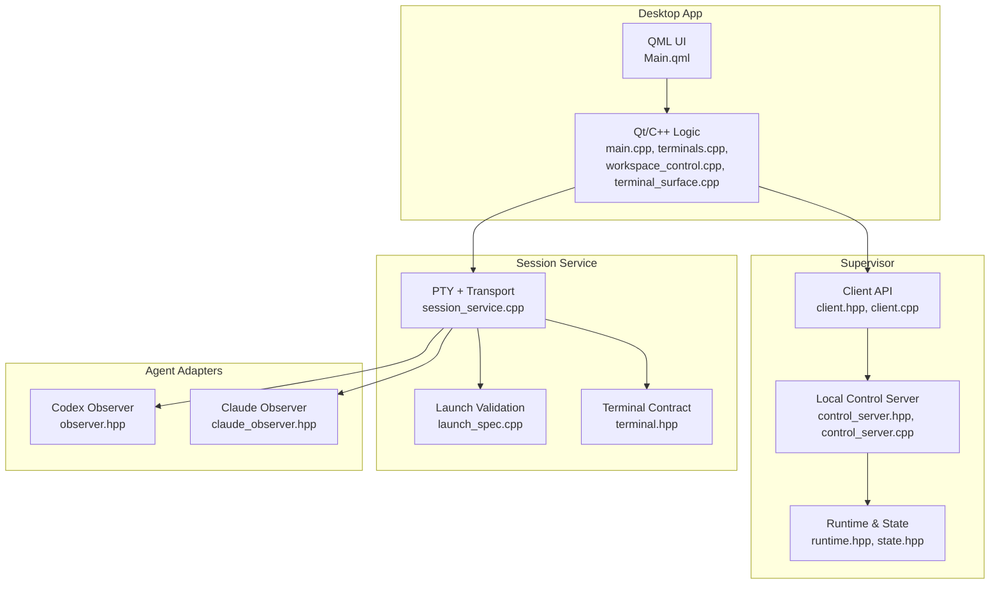

**Diagram sources**
- [main.cpp:1057-1220](file://apps/desktop/src/main.cpp#L1057-L1220)
- [Main.qml:1-40](file://apps/desktop/qml/Main.qml#L1-L40)
- [client.hpp:1-34](file://services/supervisor/include/lapis/supervisor/client.hpp#L1-L34)
- [control_server.hpp:1-32](file://services/supervisor/include/lapis/supervisor/control_server.hpp#L1-L32)
- [runtime.hpp:1-151](file://services/supervisor/include/lapis/supervisor/runtime.hpp#L1-L151)
- [state.hpp:1-120](file://services/supervisor/include/lapis/supervisor/state.hpp#L1-L120)
- [launch_spec.cpp:1-144](file://services/session/src/launch_spec.cpp#L1-L144)
- [terminal.hpp:1-200](file://services/session/include/lapis/session/terminal.hpp#L1-L200)
- [observer.hpp:1-55](file://adapters/codex/src/observer.hpp#L1-L55)
- [claude_observer.hpp:1-50](file://adapters/claude/src/claude_observer.hpp#L1-L50)

**Section sources**
- [CMakeLists.txt:1-65](file://CMakeLists.txt#L1-L65)
- [README.md:63-100](file://README.md#L63-L100)

## Core Components
The desktop application has several core responsibilities:

1. **Application entry point**: Parse command-line options, configure Qt, register QML types, construct the workspace, connect to or create a session, and start the event loop.
2. **UI composition**: Main.qml defines the application window, theme properties, keyboard bindings, dialog state, and bindings to exported C++ models.
3. **Workspace orchestration**: WorkspaceControl manages workspace operations, local IPC for phone handover, and coordination between the UI and session objects.
4. **Terminal management**: Terminals tracks per-machine session previews, launches sessions, saves/restores registry state, and connects UI signals to session events.
5. **Terminal rendering**: TerminalSurface is a QQuickItem that renders terminal snapshots, handles keyboard/mouse input, selection, links, and suggestions.
6. **Supervisor communication**: The desktop uses the supervisor client to read state, send status requests, and stop sessions through authenticated control frames.
7. **Session service integration**: The desktop creates or discovers session services, validates agent launches, and drives the in-process terminal abstraction.
8. **Agent adapters**: Codex and Claude observers translate agent-specific attention and hook behavior into the shared session attention state.

**Section sources**
- [main.cpp:1-200](file://apps/desktop/src/main.cpp#L1-L200)
- [Main.qml:1-200](file://apps/desktop/qml/Main.qml#L1-L200)
- [workspace_control.cpp:47-331](file://apps/desktop/src/workspace_control.cpp#L47-L331)
- [terminals.cpp:91-480](file://apps/desktop/src/terminals.cpp#L91-L480)
- [terminal_surface.cpp:794-1839](file://apps/desktop/src/terminal_surface.cpp#L794-L1839)
- [client.hpp:1-34](file://services/supervisor/include/lapis/supervisor/client.hpp#L1-L34)
- [launch_spec.cpp:1-144](file://services/session/src/launch_spec.cpp#L1-L144)

## Architecture Overview
The Lapis desktop architecture follows a layered Qt/QML pattern with clear separation between presentation and backend logic:

- **Presentation layer**: QML files define declarative UI, keymap-driven themes, and interactive behaviors.
- **Binding layer**: C++ classes expose models, commands, and observable state to QML through Qt property binding, signals, slots, and `qmlRegisterType`.
- **Business layer**: Workspace, terminal, attention, usage, limits, shell environment, and platform integrations implement domain logic.
- **Service layer**: The session service runs agent CLIs, manages PTYs, decodes terminal output, and exposes attention/hook channels.
- **Supervision layer**: The supervisor owns process lifecycle, state persistence, control authorization, and endpoint discovery.

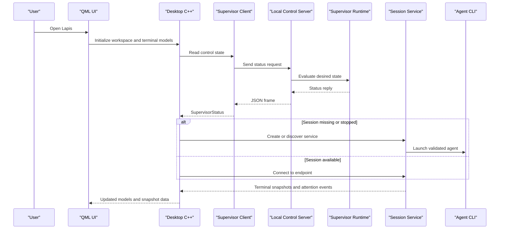

**Diagram sources**
- [main.cpp:929-1220](file://apps/desktop/src/main.cpp#L929-L1220)
- [client.cpp:1-200](file://services/supervisor/src/client.cpp#L1-L200)
- [control_server.cpp:1-200](file://services/supervisor/src/control_server.cpp#L1-L200)
- [runtime.hpp:1-151](file://services/supervisor/include/lapis/supervisor/runtime.hpp#L1-L151)
- [launch_spec.cpp:1-144](file://services/session/src/launch_spec.cpp#L1-L144)

## Detailed Component Analysis

### Desktop Application Lifecycle
The desktop entry point performs these steps:

1. Parse command-line options for development shells, managed agents, restore-and-exit mode, phone serving, explicit session sockets, working directories, UI preview mode, capture mode, and screen selection.
2. Validate mutually exclusive options such as Codex vs Claude, new-session vs discover, and UI-preview constraints.
3. Construct the Qt GUI application and set the Quick style.
4. Register the `TerminalSurface` QML type under the `Lapis 1.0` namespace.
5. Build workspace controls, terminal managers, and optional phone-handover or restore-only modes.
6. Start the Qt event loop unless the process is operating in a non-interactive diagnostic mode.

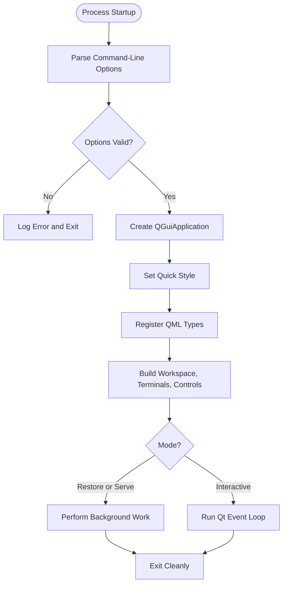

**Diagram sources**
- [main.cpp:1-200](file://apps/desktop/src/main.cpp#L1-L200)
- [main.cpp:1057-1220](file://apps/desktop/src/main.cpp#L1057-L1220)

**Section sources**
- [main.cpp:1-200](file://apps/desktop/src/main.cpp#L1-L200)
- [main.cpp:1057-1220](file://apps/desktop/src/main.cpp#L1057-L1220)

### QML UI and Binding Model
Main.qml defines the root `ApplicationWindow`, theme properties derived from the keymap, density and motion settings, sidebar and strip visibility, shortcut fallbacks, and interaction guards. It imports the desktop C++ module as `Lapis 1.0`, which exposes types such as `TerminalSurface`.

Key characteristics:
- Theme colors, font sizes, radius, and motion duration are computed from the active keymap theme.
- Keyboard shortcuts have macOS-aware defaults and can be overridden by the keymap.
- Input blocking prevents shortcuts while dialogs, composing, or paste operations own focus.
- The window title reflects the active category and focused session when available.

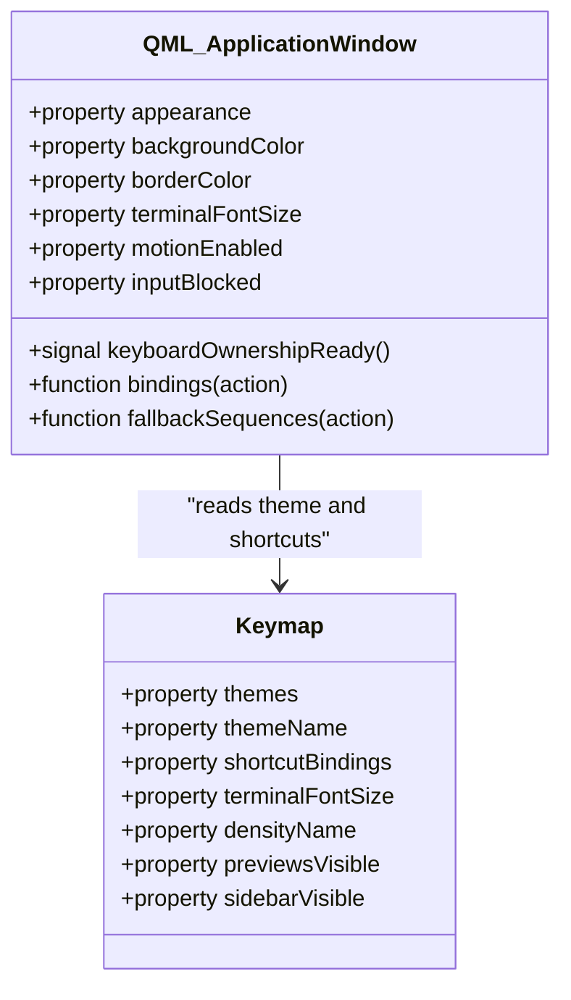

**Diagram sources**
- [Main.qml:1-200](file://apps/desktop/qml/Main.qml#L1-L200)

**Section sources**
- [Main.qml:1-200](file://apps/desktop/qml/Main.qml#L1-L200)

### Workspace Control and Phone Handover
WorkspaceControl implements a local IPC server for workspace operations. It dispatches requests such as harness listing, agent creation, category management, terminal open/close, settings, and handover to another process. It also emits `handoverRequested` so the desktop can coordinate UI transitions.

Responsibilities:
- Expose a local endpoint for phone or companion processes.
- Map string-based request kinds to typed handlers.
- Refuse unknown requests.
- Coordinate handover timing using delayed signals.

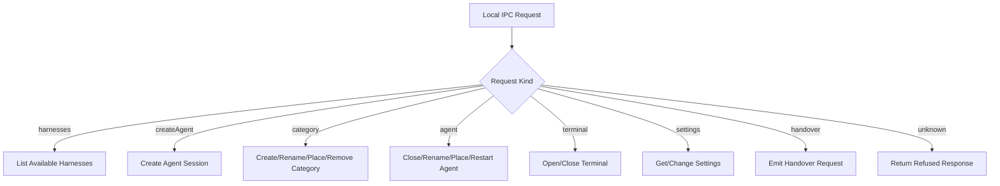

**Diagram sources**
- [workspace_control.cpp:47-331](file://apps/desktop/src/workspace_control.cpp#L47-L331)

**Section sources**
- [workspace_control.cpp:47-331](file://apps/desktop/src/workspace_control.cpp#L47-L331)

### Terminal Surface Rendering
TerminalSurface is a custom QQuickItem registered as `TerminalSurface` in the desktop entry point. It owns rendering state, frame publishing, input context binding, link hover/click behavior, mouse wheel handling, text selection, suggestion filling, and clipboard access.

Important aspects:
- It receives a `SessionPreview` document and subscribes to snapshot changes.
- It computes cell geometry, applies fonts, and draws cells from terminal snapshots.
- It translates keyboard and mouse events into terminal input.
- It supports wheel scrolling, alternate-screen wheel ownership, and IME composition boundaries.

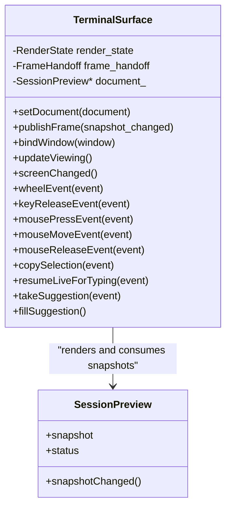

**Diagram sources**
- [main.cpp:589-589](file://apps/desktop/src/main.cpp#L589-L589)
- [terminal_surface.cpp:707-1839](file://apps/desktop/src/terminal_surface.cpp#L707-L1839)

**Section sources**
- [main.cpp:589-589](file://apps/desktop/src/main.cpp#L589-L589)
- [terminal_surface.cpp:794-1839](file://apps/desktop/src/terminal_surface.cpp#L794-L1839)

### Supervisor Communication Pattern
The desktop uses the supervisor client to query supervisor state and perform authenticated control actions. The client encodes status requests, reads supervisor JSON replies, validates state files, and sends control frames over local Unix-domain sockets.

Key types:
- `SupervisorStatus`: lightweight status returned to clients.
- `send_control_request`: sends bounded JSON frames with timeouts.
- `read_control_state`: loads and validates the supervisor state file.

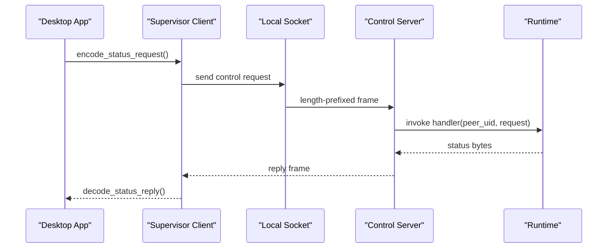

**Diagram sources**
- [client.hpp:1-34](file://services/supervisor/include/lapis/supervisor/client.hpp#L1-L34)
- [client.cpp:1-200](file://services/supervisor/src/client.cpp#L1-L200)
- [control_server.hpp:1-32](file://services/supervisor/include/lapis/supervisor/control_server.hpp#L1-L32)
- [control_server.cpp:1-200](file://services/supervisor/src/control_server.cpp#L1-L200)

**Section sources**
- [client.hpp:1-34](file://services/supervisor/include/lapis/supervisor/client.hpp#L1-L34)
- [client.cpp:1-200](file://services/supervisor/src/client.cpp#L1-L200)
- [control_server.cpp:1-200](file://services/supervisor/src/control_server.cpp#L1-L200)

### Supervisor Runtime and Process Model
The supervisor runtime owns lifecycle policy rather than raw process details. It works with a `ChildLauncher` abstraction, allowing different implementations to adopt, launch, monitor, terminate, and release child processes.

Important concepts:
- `DesiredSession`: describes the endpoint, fingerprint, identity, desired state, spawn token, blocked reason, and canonical launch.
- `ChildLauncher`: abstracts adopt/launch/alive/terminate/release.
- `OwnershipChildLauncher`: concrete launcher used by the experimental runtime.
- Convergence states include converged, started, restarted, stopped, disabled, exhausted, and failed.
- Restart windows and per-window restart limits prevent rapid restart loops.

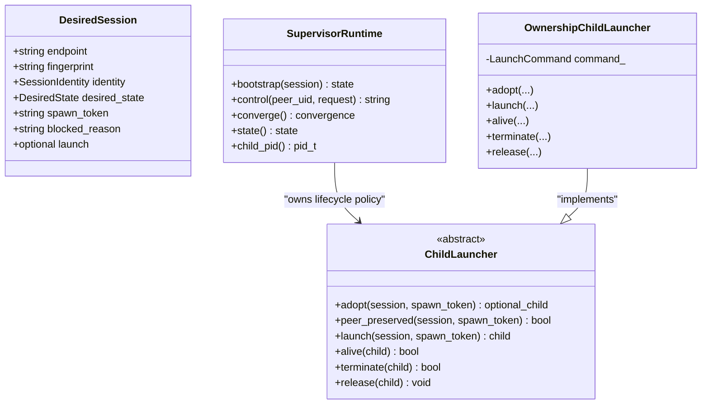

**Diagram sources**
- [runtime.hpp:1-151](file://services/supervisor/include/lapis/supervisor/runtime.hpp#L1-L151)
- [state.hpp:1-120](file://services/supervisor/include/lapis/supervisor/state.hpp#L1-L120)

**Section sources**
- [runtime.hpp:1-151](file://services/supervisor/include/lapis/supervisor/runtime.hpp#L1-L151)
- [state.hpp:1-120](file://services/supervisor/include/lapis/supervisor/state.hpp#L1-L120)

### Session Service and Terminal Contract
The session service implements the in-process terminal contract and bridges agent CLIs to the desktop UI. It validates agent launch specifications, starts PTY-backed processes, decodes terminal output, archives history, and exposes attention/hook channels.

Highlights:
- `TerminalSize`, `TerminalLimits`, `TerminalSnapshot`, `TerminalCell`, `TerminalCursor`, `TerminalHistory`, and `TerminalHyperlink` describe the terminal wire format.
- `Terminal.feed`, `resize`, `snapshot`, `encode_key`, `encode_paste`, and `encode_wheel` form the primary input/output contract.
- Launch validation enforces program existence, executable permissions, directory validity, argument count, size bounds, and agent-mode restrictions.
- Managed Codex and Claude modes inject adapter-specific behavior through hook relays and observer instances.

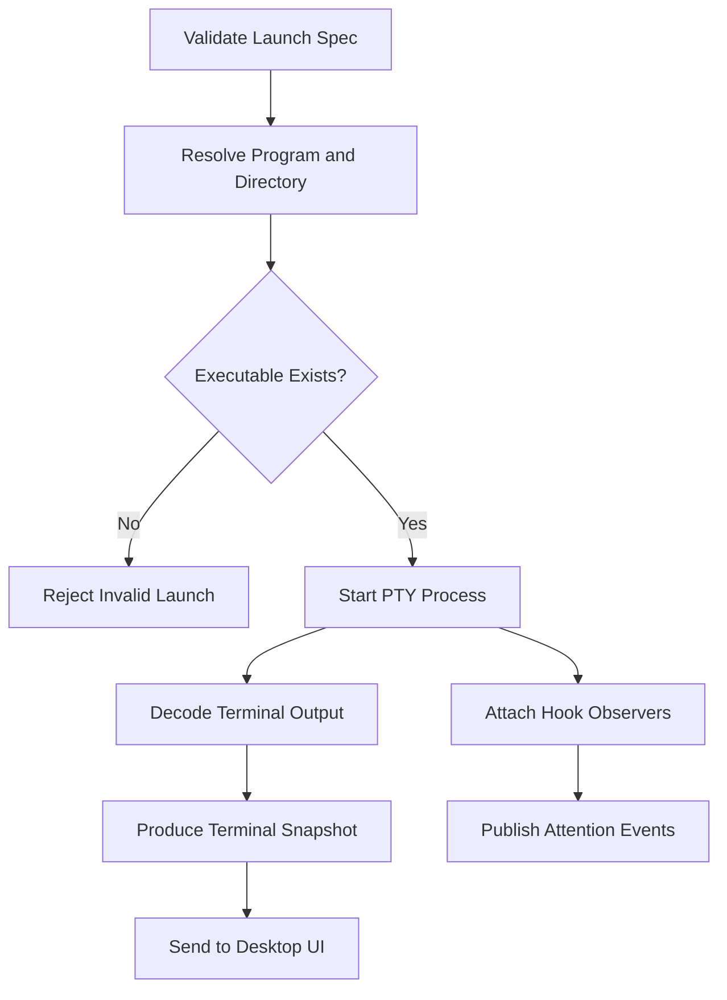

**Diagram sources**
- [launch_spec.cpp:1-144](file://services/session/src/launch_spec.cpp#L1-L144)
- [terminal.hpp:1-200](file://services/session/include/lapis/session/terminal.hpp#L1-L200)

**Section sources**
- [launch_spec.cpp:1-144](file://services/session/src/launch_spec.cpp#L1-L144)
- [terminal.hpp:1-200](file://services/session/include/lapis/session/terminal.hpp#L1-L200)

### Agent Adapter Pattern
The Codex and Claude adapters follow an observer pattern around the shared session attention state. Each adapter owns a QObject-based observer that translates agent-specific protocols into normalized attention events.

Common patterns:
- Observers receive a reference to `session::attention::State`.
- Observers emit `changed` signals on the Qt event loop.
- Observers provide diagnostic strings, thread identity, and bounded detail views.
- Codex exposes binary qualification metadata and decision APIs; Claude supports both local socket and terminal-relayed transport.

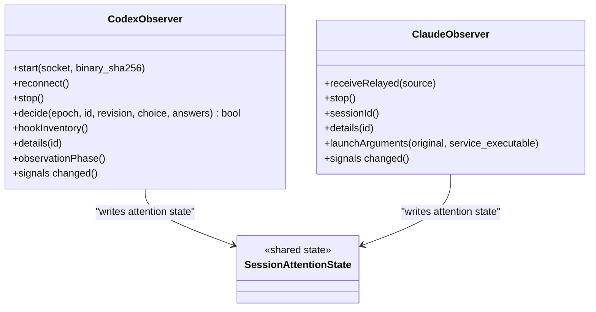

**Diagram sources**
- [observer.hpp:1-55](file://adapters/codex/src/observer.hpp#L1-L55)
- [claude_observer.hpp:1-50](file://adapters/claude/src/claude_observer.hpp#L1-L50)

**Section sources**
- [observer.hpp:1-55](file://adapters/codex/src/observer.hpp#L1-L55)
- [claude_observer.hpp:1-50](file://adapters/claude/src/claude_observer.hpp#L1-L50)

## Dependency Analysis
The build system defines which targets are compiled and how they relate:

- The top-level CMake script requires C++20 and restricts builds to macOS or Linux.
- `LAPIS_BUILD_DESKTOP` enables the desktop app but requires `LAPIS_BUILD_SESSION`.
- `LAPIS_BUILD_ULTRATAB` requires `LAPIS_BUILD_SESSION`.
- When building the session, the top-level build links the Codex and Claude adapters into the session service.
- The supervisor is built conditionally through `LAPIS_BUILD_SUPERVISOR_STATE` or `LAPIS_BUILD_SUPERVISOR_RUNTIME`.
- Shared compiler options enforce warnings-as-errors and optional sanitizers.

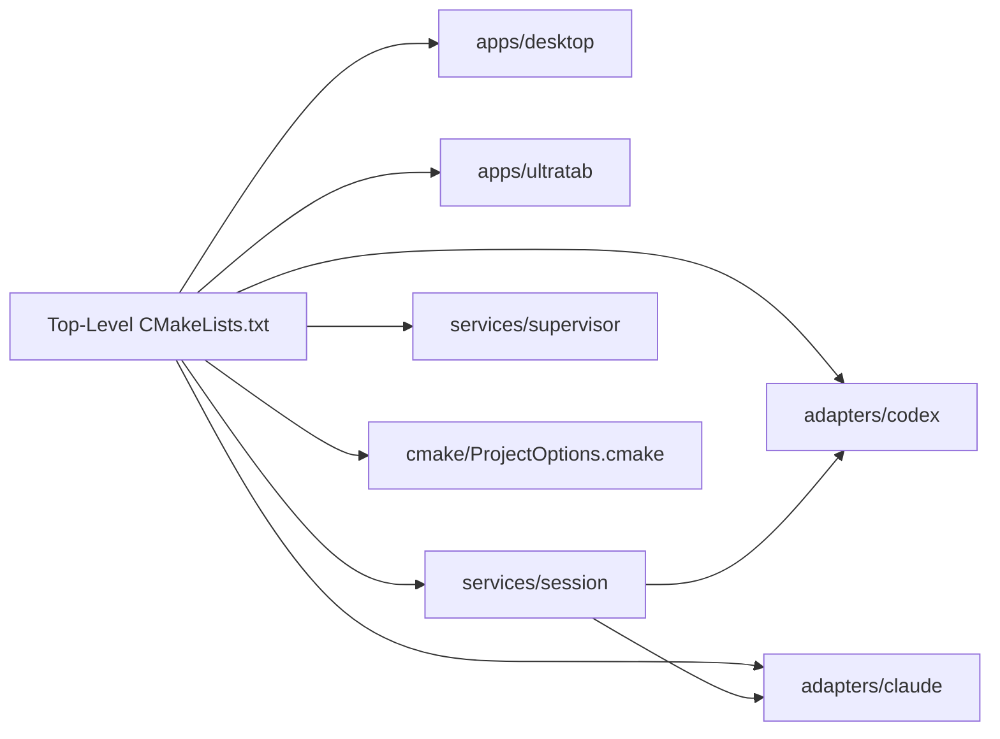

**Diagram sources**
- [CMakeLists.txt:1-65](file://CMakeLists.txt#L1-L65)
- [ProjectOptions.cmake:1-34](file://cmake/ProjectOptions.cmake#L1-L34)

**Section sources**
- [CMakeLists.txt:1-65](file://CMakeLists.txt#L1-L65)
- [ProjectOptions.cmake:1-34](file://cmake/ProjectOptions.cmake#L1-L34)

## Performance Considerations
The README emphasizes speed-first design for switching agents and typing responsiveness on Apple Silicon Macs with high-refresh displays. Several implementation choices support this goal:

- The terminal contract avoids per-cell heap allocations where possible by storing grapheme data contiguously and referencing cells through offsets.
- Terminal snapshots include bounded history and reply sizes.
- The control server and supervisor client use strict frame sizes and timeouts to prevent slow or malformed peers from blocking progress.
- The desktop separates rendering from session I/O by subscribing to snapshot changes rather than driving rendering from terminal threads.
- QML bindings and keymap-driven themes avoid heavy recomputation by computing derived properties once per change.

Recommendations:
- Keep terminal snapshot updates coalesced and bounded.
- Avoid synchronous filesystem work in hot paths; use the supervisor’s owner-only state storage semantics.
- Prefer event-driven Qt signals over polling where possible.
- Test terminal rendering under synthetic scroll, paste, and resize pressure.

[No sources needed since this section provides general guidance]

## Troubleshooting Guide
Common areas to inspect:

| Symptom | Likely Area | What to Check |
|---|---|---|
| Desktop refuses unqualified workspace launches | `main.cpp` option validation | Ensure one of `--codex`, `--claude`, `--development-shell`, or `--smoke-input` is used, or supply an explicit socket/program path |
| Supervisor status fails | `client.cpp` | Verify state directory permissions, file ownership, and JSON schema version |
| Control request hangs | `control_server.cpp` | Check local socket readiness, peer credentials, and bounded frame timeouts |
| Agent cannot start | `launch_spec.cpp` | Confirm program resolution, executable permissions, working directory, argument limits, and agent-mode restrictions |
| Terminal shows no output | `terminal.hpp` and session service | Inspect PTY launch, feed loop, snapshot publication, and synchronization flags |
| QML does not see C++ types | `main.cpp` | Confirm `TerminalSurface` registration under `Lapis 1.0` |
| Phone handover does nothing | `workspace_control.cpp` | Check local IPC listener, request routing, and `handoverRequested` emission |

**Section sources**
- [main.cpp:1-200](file://apps/desktop/src/main.cpp#L1-L200)
- [client.cpp:1-200](file://services/supervisor/src/client.cpp#L1-L200)
- [control_server.cpp:1-200](file://services/supervisor/src/control_server.cpp#L1-L200)
- [launch_spec.cpp:1-144](file://services/session/src/launch_spec.cpp#L1-L144)
- [terminal.hpp:1-200](file://services/session/include/lapis/session/terminal.hpp#L1-L200)
- [workspace_control.cpp:47-331](file://apps/desktop/src/workspace_control.cpp#L47-L331)

## Conclusion
Lapis separates UI and backend logic cleanly: QML composes the desktop experience, while C++ owns workspace state, terminal rendering, session orchestration, and service communication. The supervisor abstracts process lifecycle, and the session service abstracts agent execution and terminal rendering. Adapters translate agent-specific protocols into a shared attention model. This architecture makes the desktop app resilient to agent failures, supports persistent sessions, and keeps rendering responsive even under heavy terminal activity.

[No sources needed since this section summarizes without analyzing specific files]