# Desktop Application

<cite>
**Referenced Files in This Document**
- [main.cpp](file://apps/desktop/src/main.cpp)
- [Main.qml](file://apps/desktop/qml/Main.qml)
- [Commands.qml](file://apps/desktop/qml/Commands.qml)
- [Search.qml](file://apps/desktop/qml/Search.qml)
- [workspace.hpp](file://apps/desktop/src/workspace.hpp)
- [workspace_control.hpp](file://apps/desktop/src/workspace_control.hpp)
- [workspace_control.cpp](file://apps/desktop/src/workspace_control.cpp)
- [terminals.hpp](file://apps/desktop/src/terminals.hpp)
- [tile_layout.hpp](file://apps/desktop/src/tile_layout.hpp)
- [terminal_surface.hpp](file://apps/desktop/src/terminal_surface.hpp)
- [terminal_surface.cpp](file://apps/desktop/src/terminal_surface.cpp)
- [gui_state.hpp](file://apps/desktop/src/gui_state.hpp)
- [gui_state.cpp](file://apps/desktop/src/gui_state.cpp)
- [live_connection.hpp](file://apps/desktop/src/live_connection.hpp)
- [live_connection.cpp](file://apps/desktop/src/live_connection.cpp)
- [interaction_log.hpp](file://apps/desktop/src/interaction_log.hpp)
</cite>

## Table of Contents
1. [Introduction](#introduction)
2. [Project Structure](#project-structure)
3. [Core Components](#core-components)
4. [Architecture Overview](#architecture-overview)
5. [Detailed Component Analysis](#detailed-component-analysis)
6. [Dependency Analysis](#dependency-analysis)
7. [Performance Considerations](#performance-considerations)
8. [Troubleshooting Guide](#troubleshooting-guide)
9. [Conclusion](#conclusion)

## Introduction
This document explains the Lapis desktop application built with Qt Quick and C++. The app provides a workspace for agent sessions, each represented by a terminal-like surface backed by a session service. The user interface is primarily QML, while performance-sensitive and platform-specific logic lives in C++. Key responsibilities include:

- A Qt Quick main window that composes categories, tabs, agent strips, tiles, and dialogs.
- A workspace manager that tracks agent categories, sessions, terminal tiles, and layout state.
- A terminal surface implementation that renders terminal output and handles keyboard input, selection, links, suggestions, and paste operations.
- GUI state persistence and interaction logging for diagnostics and modeling.
- Real-time updates from session services through a local protocol connection.
- A plugin-style harness system for different agent engines.
- macOS-specific behavior including native menu integration, file associations, and system notifications.

## Project Structure
The desktop application lives under `apps/desktop`. Its structure is layered:

- `qml/` contains the QML screens and reusable UI components.
- `src/` contains the C++ backend, including the main entry point, workspace model, terminal rendering, live connections, platform helpers, and utilities.
- `macos/` contains macOS-specific configuration files such as the application bundle info template, entitlements, and update keys.

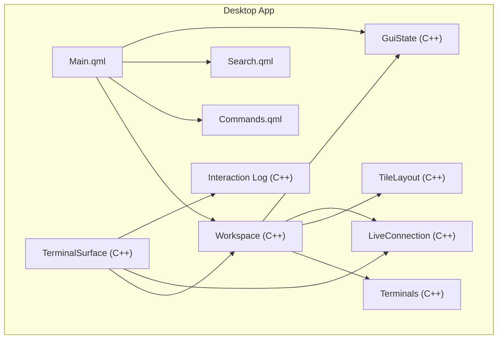

**Diagram sources**
- [main.cpp:1-120](file://apps/desktop/src/main.cpp#L1-L120)
- [Main.qml:1-120](file://apps/desktop/qml/Main.qml#L1-L120)
- [workspace.hpp:1-120](file://apps/desktop/src/workspace.hpp#L1-L120)
- [terminal_surface.hpp:1-120](file://apps/desktop/src/terminal_surface.hpp#L1-L120)
- [gui_state.hpp:1-97](file://apps/desktop/src/gui_state.hpp#L1-L97)
- [interaction_log.hpp:1-142](file://apps/desktop/src/interaction_log.hpp#L1-L142)

**Section sources**
- [main.cpp:1-120](file://apps/desktop/src/main.cpp#L1-L120)
- [Main.qml:1-120](file://apps/desktop/qml/Main.qml#L1-L120)

## Core Components
- **Qt Quick main window**: `ApplicationWindow` in `Main.qml` owns theme properties, keyboard bindings, dialog controls, and the workspace view. It exposes color palettes, font sizes, density modes, and input-blocking rules to child components.
- **Workspace**: C++ model holding sessions, categories, attention state, history, and terminal snapshots. It connects to session services, decodes terminal output, and exposes QML-accessible properties.
- **Terminals**: Manages quick command terminals per machine, separate from agent categories. They are attached to the same session service infrastructure and persisted in a registry.
- **TileLayout**: Represents a binary split tree of terminal tiles within a category stage, supporting placement, resizing, neighbor navigation, and cycle order across tiled and untiled agents.
- **TerminalSurface**: A `QQuickItem` rendering terminal cells, colors, shapes, links, text search, suggestion display, keyboard input, IME composition, and paste handling.
- **LiveConnection**: Connects a session to its endpoint via a local socket, manages attach/handshake, snapshot streaming, resize coordination, history paging, and paste transactions.
- **GuiState**: Persists window choices and sectioned state to an atomically written JSON file with rate-limited writes on a background thread.
- **Interaction log**: Records user interactions, pointer movement samples, and secret-aware key events into a bounded, rotated JSONL file.

**Section sources**
- [Main.qml:1-200](file://apps/desktop/qml/Main.qml#L1-L200)
- [workspace.hpp:1-200](file://apps/desktop/src/workspace.hpp#L1-L200)
- [terminals.hpp:1-93](file://apps/desktop/src/terminals.hpp#L1-L93)
- [tile_layout.hpp:1-90](file://apps/desktop/src/tile_layout.hpp#L1-L90)
- [terminal_surface.hpp:1-200](file://apps/desktop/src/terminal_surface.hpp#L1-L200)
- [live_connection.hpp:1-116](file://apps/desktop/src/live_connection.hpp#L1-L116)
- [gui_state.hpp:1-97](file://apps/desktop/src/gui_state.hpp#L1-L97)
- [interaction_log.hpp:1-142](file://apps/desktop/src/interaction_log.hpp#L1-L142)

## Architecture Overview
The desktop app follows a layered architecture:

- Presentation layer: QML screens (`Main.qml`, `Commands.qml`, `Search.qml`) bound to C++ models.
- Domain layer: `Workspace` manages sessions, categories, attention, history, and tile layouts.
- Rendering layer: `TerminalSurface` consumes decoded terminal snapshots and draws them efficiently using Qt Scene Graph primitives.
- Transport layer: `LiveConnection` communicates with session services over a local protocol, handling attachment, snapshots, history, and paste transactions.
- Persistence layer: `GuiState` persists small window settings; `InteractionWriter` persists interaction telemetry.
- Platform layer: macOS-specific menu, notifications, file association, and native input behaviors are implemented in Objective-C++ and platform headers referenced by the desktop build.

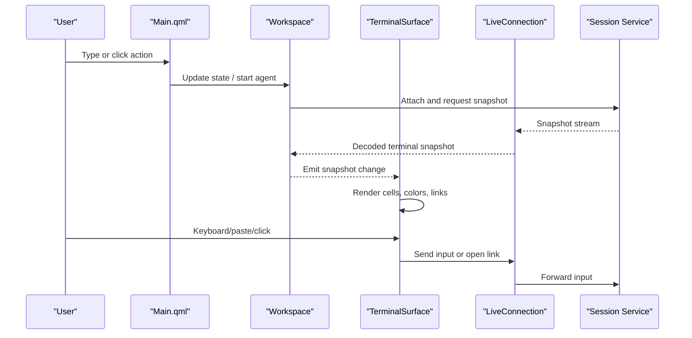

**Diagram sources**
- [Main.qml:1-200](file://apps/desktop/qml/Main.qml#L1-L200)
- [workspace.hpp:120-200](file://apps/desktop/src/workspace.hpp#L120-L200)
- [terminal_surface.hpp:120-200](file://apps/desktop/src/terminal_surface.hpp#L120-L200)
- [live_connection.hpp:1-116](file://apps/desktop/src/live_connection.hpp#L1-L116)

## Detailed Component Analysis

### Qt Quick Main Window and UI Screens
`Main.qml` defines the application window, theme, keyboard shortcuts, dialog visibility, and workspace binding. It computes appearance values from a keymap, sets palette colors, and centralizes shortcut fallbacks for cross-platform compatibility. Dialogs such as commands and search are modal and block input until closed.

`Commands.qml` implements a searchable command palette with keyboard navigation, keycap visualization, and a `requested` signal carrying the selected command ID.

`Search.qml` implements agent discovery with a query field, result list, and a chosen session ID. It binds to a search engine provided by the workspace and displays snippets when available.

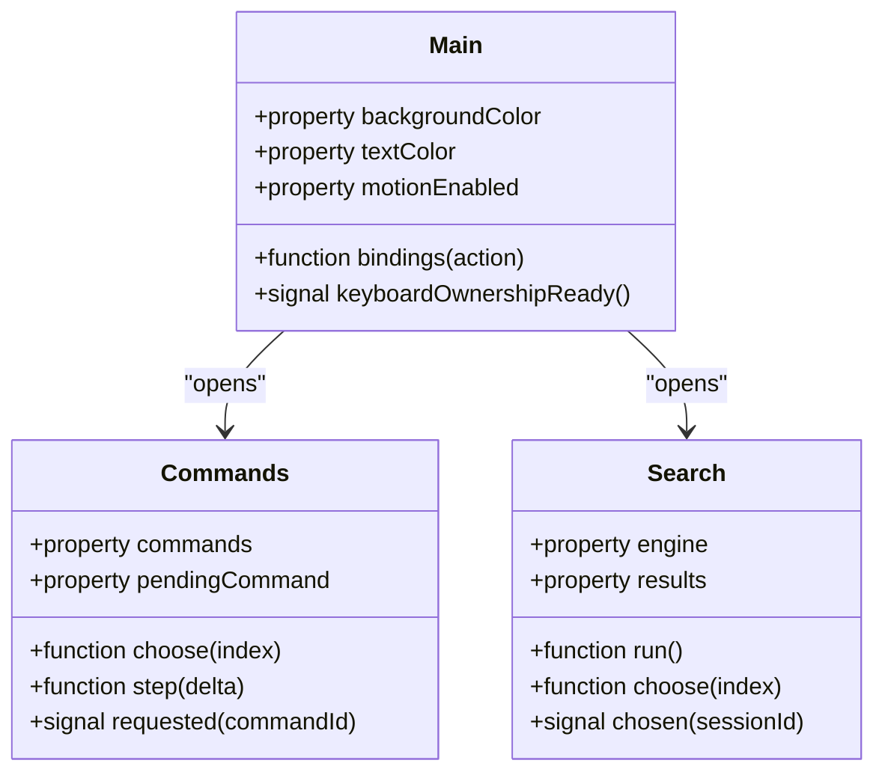

**Diagram sources**
- [Main.qml:1-200](file://apps/desktop/qml/Main.qml#L1-L200)
- [Commands.qml:1-200](file://apps/desktop/qml/Commands.qml#L1-L200)
- [Search.qml:1-187](file://apps/desktop/qml/Search.qml#L1-L187)

**Section sources**
- [Main.qml:1-200](file://apps/desktop/qml/Main.qml#L1-L200)
- [Commands.qml:1-200](file://apps/desktop/qml/Commands.qml#L1-L200)
- [Search.qml:1-187](file://apps/desktop/qml/Search.qml#L1-L187)

### Workspace Manager
The workspace model holds sessions, categories, attention signals, history navigation, and the active category. It integrates with the session service transport, harness catalog, and tab ranker. It exposes session lifecycle methods, terminal snapshot management, and activity updates.

Key responsibilities:
- Start agents with launch specifications and track their identity and status.
- Manage categories and allow creation, renaming, removal, and placement.
- Provide attention state, diagnostic messages, and request handling.
- Drive history browsing and live mode switching.
- Coordinate with `TileLayout` for tiled terminal arrangements.

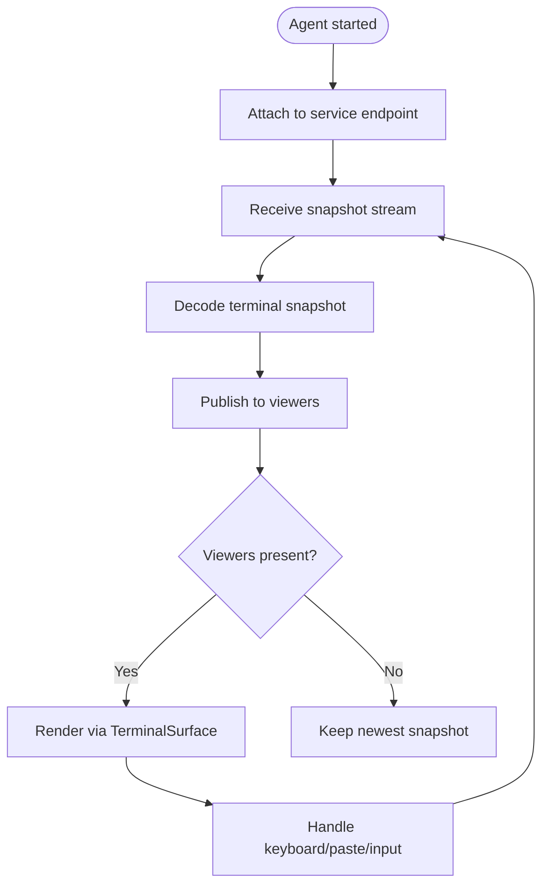

**Diagram sources**
- [workspace.hpp:1-200](file://apps/desktop/src/workspace.hpp#L1-L200)
- [live_connection.cpp:1-200](file://apps/desktop/src/live_connection.cpp#L1-L200)

**Section sources**
- [workspace.hpp:1-200](file://apps/desktop/src/workspace.hpp#L1-L200)

### Terminal Tiles and Layout Management
`TileLayout` represents a binary tree of splits where leaves are agent sessions and internal nodes divide area horizontally or vertically. It supports:
- Placing agents relative to a target edge.
- Replacing one tile with another.
- Removing tiles and adjusting ratios.
- Computing visible tiles and divider geometry.
- Walking next/previous agents across tiled and strip views.

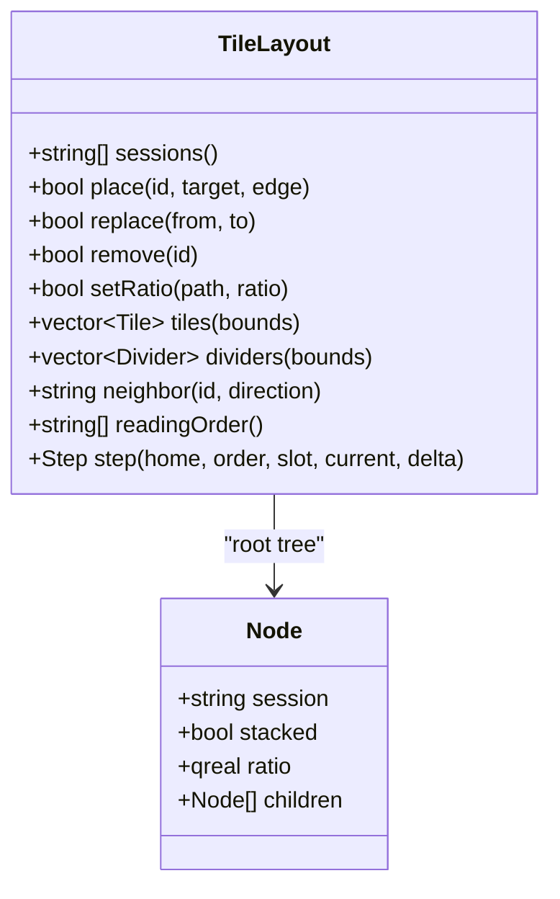

**Diagram sources**
- [tile_layout.hpp:1-90](file://apps/desktop/src/tile_layout.hpp#L1-L90)

**Section sources**
- [tile_layout.hpp:1-90](file://apps/desktop/src/tile_layout.hpp#L1-L90)

### Terminal Surface Implementation
`TerminalSurface` extends `QQuickItem` and renders terminal output using Qt Scene Graph primitives. It decodes cell glyphs, applies styles, draws rectangles and strokes for box-drawing characters, and computes layout based on viewport size, minimum scale, and grid dimensions.

Highlights:
- Font resolution and fixed-width defaults.
- Color extraction from indexed or RGB values.
- OSC 8 link detection and path resolution.
- Text find and match navigation.
- Suggestion display and Tab flow behavior.
- IME composition and paste handling.
- Mouse wheel forwarding for alternate screen programs.

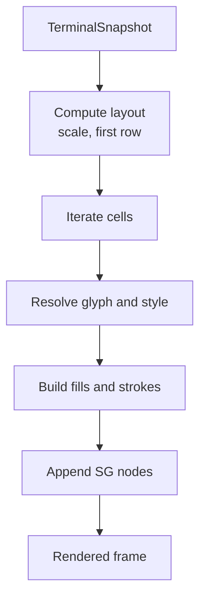

**Diagram sources**
- [terminal_surface.hpp:1-200](file://apps/desktop/src/terminal_surface.hpp#L1-L200)
- [terminal_surface.cpp:1-200](file://apps/desktop/src/terminal_surface.cpp#L1-L200)

**Section sources**
- [terminal_surface.hpp:1-200](file://apps/desktop/src/terminal_surface.hpp#L1-L200)
- [terminal_surface.cpp:1-200](file://apps/desktop/src/terminal_surface.cpp#L1-L200)

### Real-Time Updates and Session Services
`LiveConnection` manages the lifecycle of a local socket connection to a session service. It performs handshake, resizes the terminal, streams snapshots, pages history, and coordinates paste transactions. It coalesces resize requests and tracks outstanding history requests to avoid flooding the service.

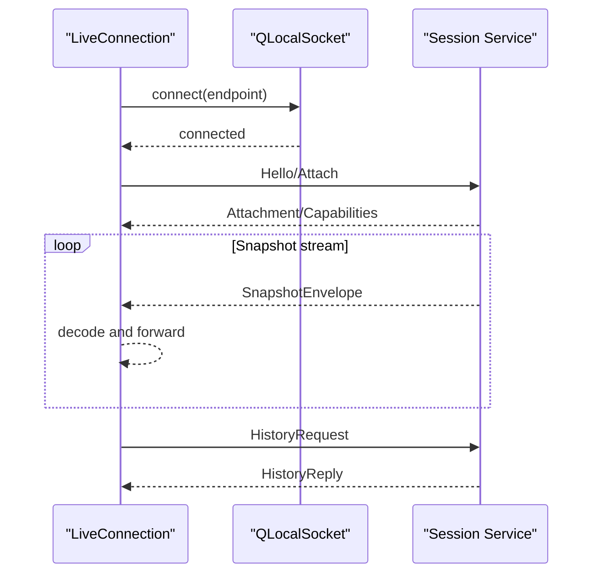

**Diagram sources**
- [live_connection.hpp:1-116](file://apps/desktop/src/live_connection.hpp#L1-L116)
- [live_connection.cpp:1-200](file://apps/desktop/src/live_connection.cpp#L1-L200)

**Section sources**
- [live_connection.hpp:1-116](file://apps/desktop/src/live_connection.hpp#L1-L116)
- [live_connection.cpp:1-200](file://apps/desktop/src/live_connection.cpp#L1-L200)

### GUI State Management
`GuiState` maintains a versioned JSON file containing sections contributed by owners plus a reserved `window` section for QML-owned preferences. Writes are rate-limited, serialized, and performed off the GUI thread using a worker object and global thread pool. Missing, corrupt, oversized, or wrong-version files are ignored safely.

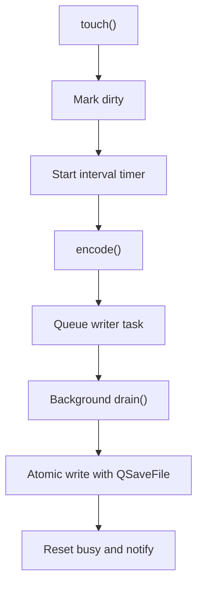

**Diagram sources**
- [gui_state.hpp:1-97](file://apps/desktop/src/gui_state.hpp#L1-L97)
- [gui_state.cpp:1-200](file://apps/desktop/src/gui_state.cpp#L1-L200)

**Section sources**
- [gui_state.hpp:1-97](file://apps/desktop/src/gui_state.hpp#L1-L97)
- [gui_state.cpp:1-200](file://apps/desktop/src/gui_state.cpp#L1-L200)

### Interaction Logging
The interaction log records user actions in a bounded JSONL file. It includes:
- Settings parsing and validation.
- Secret-prompt detection to mask sensitive input.
- Pointer sampling with folding and flush semantics.
- Background writer with queue limits, rotation, and failure counters.

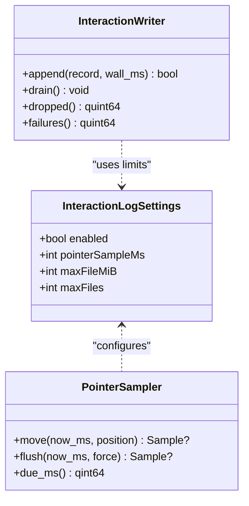

**Diagram sources**
- [interaction_log.hpp:1-142](file://apps/desktop/src/interaction_log.hpp#L1-L142)

**Section sources**
- [interaction_log.hpp:1-142](file://apps/desktop/src/interaction_log.hpp#L1-L142)

### Keyboard Input Handling and Terminal Emulation
Keyboard input flows through:
- `Main.qml` shortcut resolution and input blocking for dialogs and composition.
- `TerminalSurface` mapping key events to terminal keys, handling IME preedit, selection, paste, and suggestion navigation.
- `LiveConnection` forwarding terminal keys to the session service.
- `Workspace` and `SessionPreview` managing input readiness and history overlay states.

For large terminal outputs, the surface uses:
- Grid-based layout computation.
- Efficient scene graph drawing with rectangle and stroke nodes.
- Paced decoding and viewer-controlled redraw intervals.
- Minimum scale and viewport scrolling to keep prompts visible.

**Section sources**
- [Main.qml:1-200](file://apps/desktop/qml/Main.qml#L1-L200)
- [terminal_surface.hpp:1-200](file://apps/desktop/src/terminal_surface.hpp#L1-L200)
- [terminal_surface.cpp:1-200](file://apps/desktop/src/terminal_surface.cpp#L1-L200)
- [live_connection.hpp:1-116](file://apps/desktop/src/live_connection.hpp#L1-L116)

### Plugin Architecture for Agent Engines
The workspace integrates a harness catalog and models to support different agent engines. The desktop process can launch managed agents (e.g., Codex or Claude) and attach to their session services. The `WorkspaceControl` component exposes a JSON line protocol for inter-process control, allowing other lapis processes (such as a phone gateway) to create agents, manage categories, open terminals, and change settings.

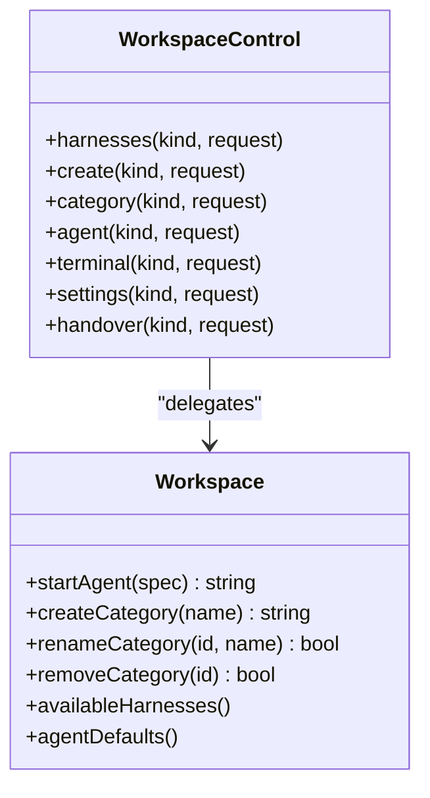

**Diagram sources**
- [workspace.hpp:1-200](file://apps/desktop/src/workspace.hpp#L1-L200)
- [workspace_control.hpp:1-70](file://apps/desktop/src/workspace_control.hpp#L1-L70)
- [workspace_control.cpp:1-200](file://apps/desktop/src/workspace_control.cpp#L1-L200)

**Section sources**
- [workspace_control.hpp:1-70](file://apps/desktop/src/workspace_control.hpp#L1-L70)
- [workspace_control.cpp:1-200](file://apps/desktop/src/workspace_control.cpp#L1-L200)

### Integration with Supervisor and Session Services
The desktop app launches and attaches to session services via the local protocol. The supervisor runtime and daemon are part of the broader Lapis ecosystem and manage service lifecycles. The desktop code focuses on attaching to endpoints, handling attach modes, and maintaining stable connections with retries and capability negotiation.

Key integration points:
- Launch specs describe program, arguments, environment, and working directory.
- Local endpoint preparation ensures unique sockets per workspace registry.
- Attach modes include reconnecting to existing sessions.
- Descriptor stores and tickets coordinate secure descriptor passing.

**Section sources**
- [live_connection.cpp:1-200](file://apps/desktop/src/live_connection.cpp#L1-L200)
- [workspace.hpp:120-200](file://apps/desktop/src/workspace.hpp#L120-L200)

### Platform-Specific Considerations for macOS
The desktop build references macOS-specific files:
- `Info.plist.in`: Bundle metadata and URL schemes.
- `lapis.entitlements`: App sandbox entitlements.
- `update-public-key.txt`: Code signing verification for updates.
- `dev.lapis.desktop.restore.plist`: Development restore configuration.

Behavioral considerations:
- Native menu integration and accelerator conventions are handled in platform layers referenced by the desktop build.
- File associations and URL scheme handlers are declared in the bundle manifest.
- System notifications and chime sounds integrate with macOS APIs.
- Command modifier keys use Meta for link activation on macOS.

**Section sources**
- [terminal_surface.cpp:120-200](file://apps/desktop/src/terminal_surface.cpp#L120-L200)
- [main.cpp:1-120](file://apps/desktop/src/main.cpp#L1-L120)

## Dependency Analysis
The desktop app has clear separation between presentation, domain, rendering, transport, and persistence layers. The main entry point wires up CLI options, initializes the QML engine, and registers types. The workspace depends on session transports and harness catalogs. The terminal surface depends on session snapshot structures and Qt graphics primitives.

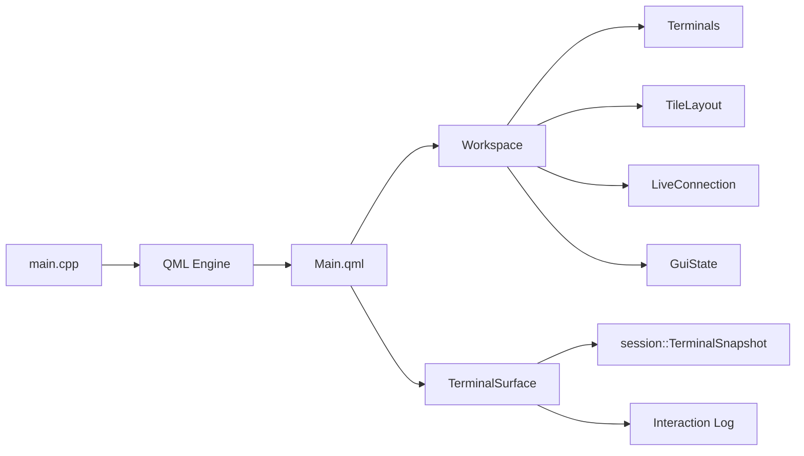

**Diagram sources**
- [main.cpp:1-120](file://apps/desktop/src/main.cpp#L1-L120)
- [Main.qml:1-200](file://apps/desktop/qml/Main.qml#L1-L200)
- [workspace.hpp:1-200](file://apps/desktop/src/workspace.hpp#L1-L200)
- [terminal_surface.hpp:1-200](file://apps/desktop/src/terminal_surface.hpp#L1-L200)

**Section sources**
- [main.cpp:1-120](file://apps/desktop/src/main.cpp#L1-L120)
- [workspace.hpp:1-200](file://apps/desktop/src/workspace.hpp#L1-L200)

## Performance Considerations
- Paced terminal decoding: `SessionPreview` schedules decode attempts based on viewer intervals, replacing bursts with the newest snapshot.
- Viewer gating: Only visible viewers trigger redraws; hidden windows do not flood the renderer.
- Scene graph optimization: `TerminalSurface` uses lightweight `QSGSimpleRectNode` and custom stroke geometry for efficient drawing.
- Resize coalescing: `LiveConnection` avoids sending redundant resize frames and claims sizes only when needed.
- State persistence batching: `GuiState` rate-limits writes and serializes them off the GUI thread.
- Interaction log backpressure: `InteractionWriter` drops excess records when the queue is full and reports failures without blocking input.

[No sources needed since this section provides general guidance]

## Troubleshooting Guide
Common issues and remedies:

- Terminal does not render output:
  - Verify that the session service is reachable and that `LiveConnection` successfully attached.
  - Check for malformed snapshots; decoding errors are logged and the last good screen is preserved.
  - Confirm that viewers are added to `SessionPreview` so snapshots are published.

- Keyboard input not delivered:
  - Ensure no modal dialog or composition/paste operation is blocking input in `Main.qml`.
  - Confirm the session is in input-ready state and not showing history.

- Links not opening:
  - On macOS, use Command-click; on other platforms, use Control-click.
  - Validate OSC 8 URLs and file paths resolved by `terminal_link_at`.

- State not persisting:
  - Inspect `runtime/gui_state.json` for corruption or version mismatch.
  - Verify file permissions and disk space; check background writer logs.

- Interaction log missing data:
  - Check if logging is enabled and pointer sampling interval is configured.
  - Review dropped counts and file rotation limits.

**Section sources**
- [terminal_surface.cpp:120-200](file://apps/desktop/src/terminal_surface.cpp#L120-L200)
- [live_connection.cpp:1-200](file://apps/desktop/src/live_connection.cpp#L1-L200)
- [gui_state.cpp:1-200](file://apps/desktop/src/gui_state.cpp#L1-L200)
- [interaction_log.hpp:1-142](file://apps/desktop/src/interaction_log.hpp#L1-L142)

## Conclusion
The Lapis desktop application combines a responsive QML interface with a robust C++ backend. The workspace orchestrates agent sessions, categories, and terminal tiles, while the terminal surface delivers high-fidelity terminal rendering and input handling. Real-time communication with session services is abstracted behind a resilient local protocol connection. GUI state and interaction telemetry provide durability and observability. The modular design supports multiple agent engines and integrates cleanly with platform features, particularly macOS-native behaviors.

[No sources needed since this section summarizes without analyzing specific files]