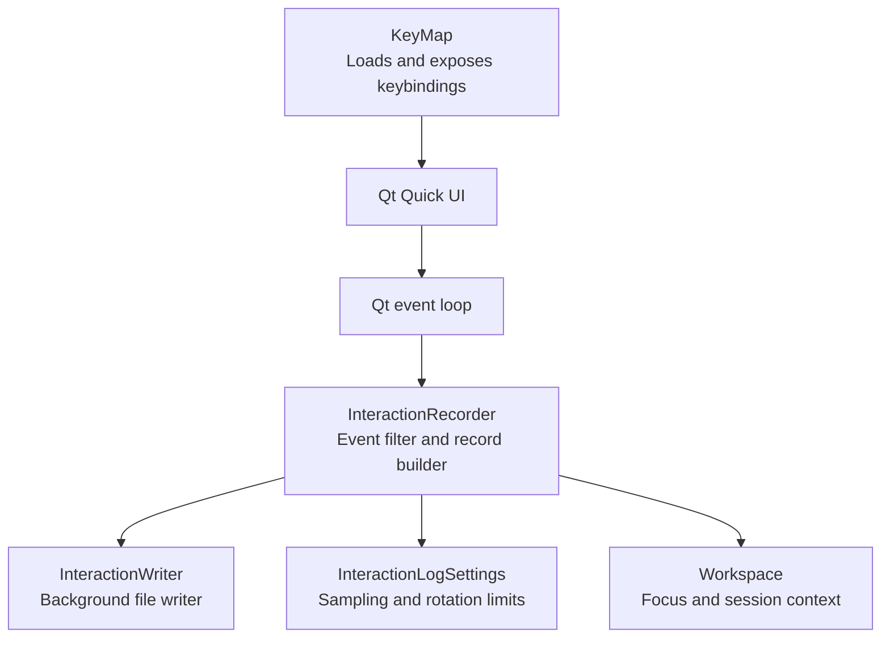
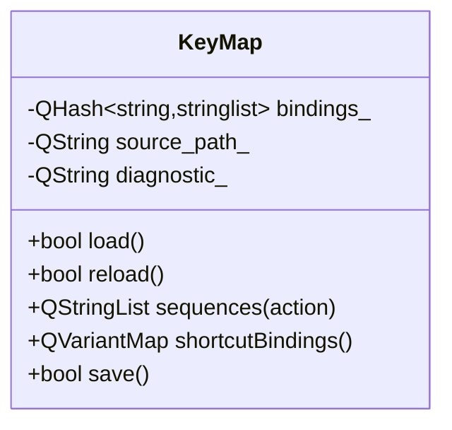
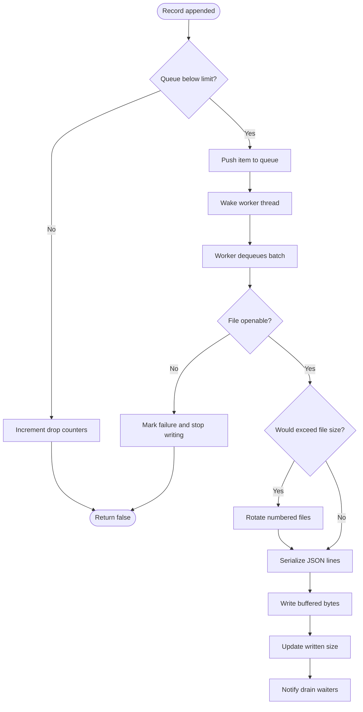
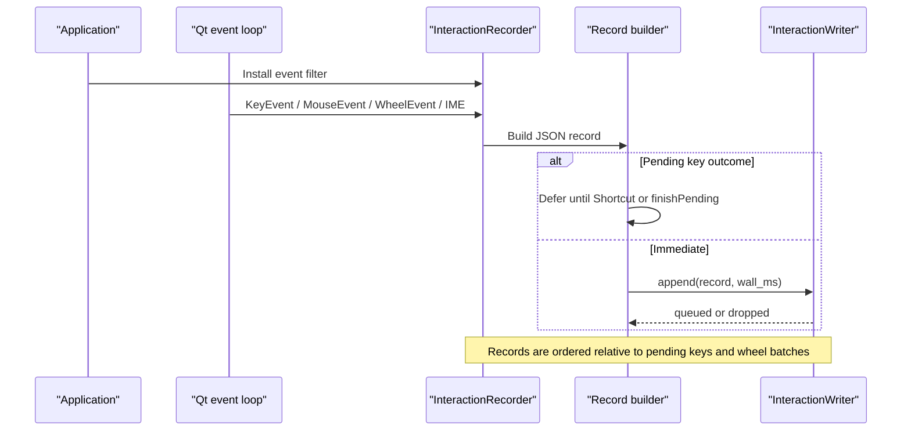
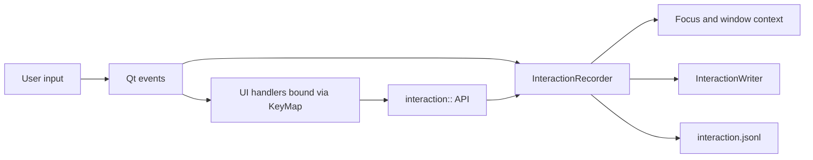
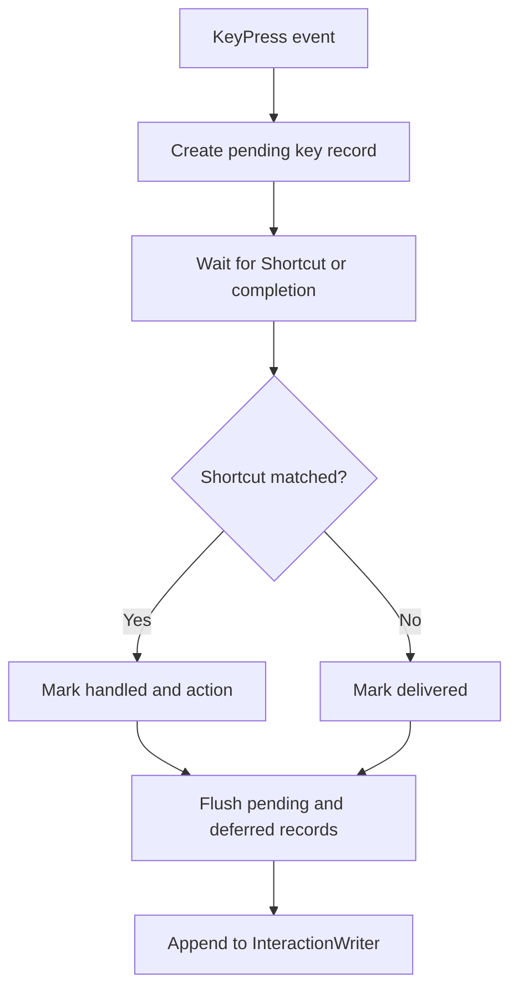
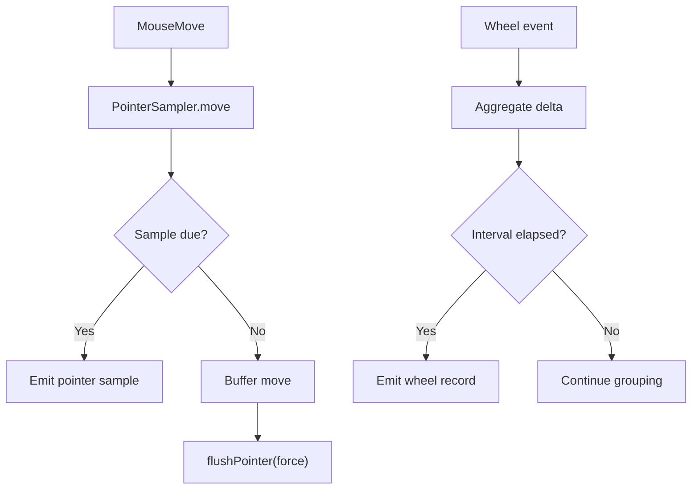
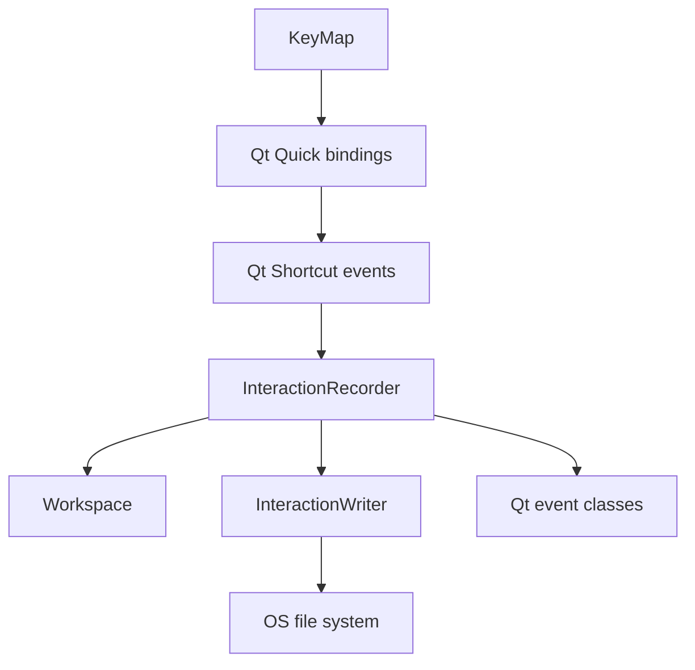

# Input Handling and Interaction Logging

<cite>
**Referenced Files in This Document**
- [keymap.hpp](file://apps/desktop/src/keymap.hpp)
- [keymap.cpp](file://apps/desktop/src/keymap.cpp)
- [interaction_log.hpp](file://apps/desktop/src/interaction_log.hpp)
- [interaction_log.cpp](file://apps/desktop/src/interaction_log.cpp)
- [interaction_recorder.hpp](file://apps/desktop/src/interaction_recorder.hpp)
- [interaction_recorder.cpp](file://apps/desktop/src/interaction_recorder.cpp)
- [keys.md](file://docs/keys.md)
</cite>

## Table of Contents
1. [Introduction](#introduction)
2. [Project Structure](#project-structure)
3. [Core Components](#core-components)
4. [Architecture Overview](#architecture-overview)
5. [Detailed Component Analysis](#detailed-component-analysis)
6. [Dependency Analysis](#dependency-analysis)
7. [Performance Considerations](#performance-considerations)
8. [Troubleshooting Guide](#troubleshooting-guide)
9. [Conclusion](#conclusion)
10. [Appendices](#appendices)

## Introduction
This document explains the desktop application’s input handling and interaction logging system. It covers:

- How keyboard shortcuts, mouse events, wheel gestures, and IME input are observed and recorded.
- The `KeyMap` class that loads user-defined keybindings from configuration and exposes them to the GUI.
- The `InteractionLog` data model and persistence helpers used by the recorder.
- The `InteractionRecorder` component that captures user actions for debugging and analytics.
- The event routing path from Qt input events to application actions and the resulting log records.
- Examples for adding new keyboard shortcuts and recording custom interaction events.

The focus is on how these pieces cooperate so that user input reaches the right handler while preserving a reliable, privacy-aware audit trail.

## Project Structure
The relevant code lives under the desktop application source tree:

| Area | Responsibility |
|---|---|
| `apps/desktop/src/keymap.{hpp,cpp}` | Loads, validates, persists, and exposes keybindings and related appearance/input settings. |
| `apps/desktop/src/interaction_log.{hpp,cpp}` | Defines interaction-log settings, pointer sampling, secret-prompt detection, key classification, and the background writer. |
| `apps/desktop/src/interaction_recorder.{hpp,cpp}` | Installs an application-wide event filter, builds structured JSON records, and routes them to the writer. |
| `docs/keys.md` | Documents the default keybindings shown to users. |

**Diagram sources**
- [keymap.hpp:100-200](file://apps/desktop/src/keymap.hpp#L100-L200)
- [interaction_recorder.hpp:30-180](file://apps/desktop/src/interaction_recorder.hpp#L30-L180)
- [interaction_log.hpp:20-140](file://apps/desktop/src/interaction_log.hpp#L20-L140)

**Section sources**
- [keymap.hpp:100-200](file://apps/desktop/src/keymap.hpp#L100-L200)
- [interaction_recorder.hpp:30-180](file://apps/desktop/src/interaction_recorder.hpp#L30-L180)
- [interaction_log.hpp:20-140](file://apps/desktop/src/interaction_log.hpp#L20-L140)
- [keys.md:1-64](file://docs/keys.md#L1-L64)

## Core Components

### KeyMap: Keyboard Shortcut Definitions and Configuration
`KeyMap` is the central configuration object for appearance and input behavior. For input handling it:

- Stores a mapping from application action names to lists of Qt key sequences.
- Loads bindings from a JSON configuration file with fallback defaults.
- Exposes bindings through properties and helper methods so QML can bind `Shortcut` elements.
- Persists user changes without losing existing binding structure.

Important behaviors:

- Each action may have up to four configured sequences.
- There is a maximum number of actions and a size limit for the configuration file.
- Invalid or missing configuration degrades gracefully to built-in defaults.
- The configuration is watched so external edits apply immediately.

The public API relevant to keybindings includes:

- `sequences(action)` / `actionSequences(action)` — returns all configured sequences for an action.
- `shortcutBindings()` — returns a serializable map of action-to-sequence lists.
- `load()` / `reload()` — reloads the configuration file.
- `save()` / `persist()` — writes current state back to disk safely.

**Diagram sources**
- [keymap.hpp:100-200](file://apps/desktop/src/keymap.hpp#L100-L200)
- [keymap.hpp:201-366](file://apps/desktop/src/keymap.hpp#L201-L366)

**Section sources**
- [keymap.hpp:100-200](file://apps/desktop/src/keymap.hpp#L100-L200)
- [keymap.hpp:201-366](file://apps/desktop/src/keymap.hpp#L201-L366)
- [keymap.cpp:1-60](file://apps/desktop/src/keymap.cpp#L1-L60)

### InteractionLog: Settings, Sampling, and Persistence
`InteractionLog` is not a single class; it is a small subsystem:

| Symbol | Purpose |
|---|---|
| `InteractionLogSettings` | Controls whether recording is enabled, pointer sampling interval, log-file size, and retained file count. |
| `parse_interaction_log(value)` | Parses the nested configuration value with clamping and defaults. |
| `likely_secret_prompt(cursor_row)` | Detects prompts where secrets should be redacted. |
| `key_class(qt_key, text)` | Classifies keys as character, space, enter, backspace, tab, escape, navigation, function, modifier, or other. |
| `PointerSampler` | De-duplicates rapid pointer movement into folded samples. |
| `InteractionWriter` | Serializes and appends JSON lines to a private log file on a background thread. |

The log format is one compact JSON object per line. The writer:

- Creates a private directory when needed.
- Opens files with restrictive permissions.
- Batches serialization and writing.
- Rotates files after reaching the configured byte limit.
- Drops new records when its internal queue is full and emits a dropped-count record once capacity returns.

**Diagram sources**
- [interaction_log.hpp:40-140](file://apps/desktop/src/interaction_log.hpp#L40-L140)
- [interaction_log.cpp:200-318](file://apps/desktop/src/interaction_log.cpp#L200-L318)

**Section sources**
- [interaction_log.hpp:20-140](file://apps/desktop/src/interaction_log.hpp#L20-L140)
- [interaction_log.cpp:1-199](file://apps/desktop/src/interaction_log.cpp#L1-L199)
- [interaction_log.cpp:200-318](file://apps/desktop/src/interaction_log.cpp#L200-L318)

### InteractionRecorder: Event Capture and Record Building
`InteractionRecorder` is the active observer of user input. It:

- Is constructed with the owning `Workspace`, a log file path, and optional test hooks.
- Installs itself as an application-wide event filter when recording is enabled.
- Does not consume events; it only reads them and builds records.
- Writes records asynchronously via `InteractionWriter`.
- Maintains a global `active()` pointer so application code can report outcomes.

It observes:

- Key press and release events.
- Qt `Shortcut` and `ShortcutOverride` events.
- Mouse press, release, double-click, and move events.
- Wheel events.
- IME composition events.
- Window activation and deactivation.

Contextual metadata attached to records includes:

- Application version and run identifier.
- Monotonic microsecond timestamp.
- Wall-clock ISO time.
- Sequence number.
- Focus context such as terminal surface, session ID, harness, and agent.
- Target object name, ancestor path, workspace area, and session association.

Privacy features include:

- Redacting sensitive keystrokes when macOS secure input is active.
- Redacting characters typed into likely secret prompts.
- Suppressing all recording while credential dialogs are visible.
- Capping copied/pasted text length.

**Diagram sources**
- [interaction_recorder.hpp:30-180](file://apps/desktop/src/interaction_recorder.hpp#L30-L180)
- [interaction_recorder.cpp:200-582](file://apps/desktop/src/interaction_recorder.cpp#L200-L582)
- [interaction_log.hpp:80-140](file://apps/desktop/src/interaction_log.hpp#L80-L140)

**Section sources**
- [interaction_recorder.hpp:30-180](file://apps/desktop/src/interaction_recorder.hpp#L30-L180)
- [interaction_recorder.cpp:1-200](file://apps/desktop/src/interaction_recorder.cpp#L1-L200)
- [interaction_recorder.cpp:200-582](file://apps/desktop/src/interaction_recorder.cpp#L200-L582)

## Architecture Overview
The input pipeline has two layers:

1. **Routing and observation:** Qt delivers native input events to the application. `InteractionRecorder` observes them through an event filter.
2. **Application semantics:** The UI layer binds `Shortcut` elements to named actions using `KeyMap`. When a shortcut fires, the application decides what the key did and reports it through the `interaction` namespace.

**Diagram sources**
- [keymap.hpp:100-200](file://apps/desktop/src/keymap.hpp#L100-L200)
- [interaction_recorder.hpp:150-180](file://apps/desktop/src/interaction_recorder.hpp#L150-L180)
- [interaction_recorder.cpp:200-582](file://apps/desktop/src/interaction_recorder.cpp#L200-L582)

## Detailed Component Analysis

### Keyboard Shortcut Lifecycle
A typical keyboard flow is:

1. The user presses a key.
2. `InteractionRecorder::eventFilter` forwards the event to `keyEvent`.
3. A press creates a pending record containing focus context and key identity.
4. If a matching `Shortcut` exists, Qt sends a `Shortcut` event whose object name identifies the action.
5. `shortcutEvent` marks the pending record as handled and associates the action name.
6. `finishPending` flushes the completed key record, any deferred records, pointer samples, and wheel batches.
7. If no shortcut matches, the record is marked as delivered to the focused control.

**Diagram sources**
- [interaction_recorder.cpp:200-582](file://apps/desktop/src/interaction_recorder.cpp#L200-L582)

**Section sources**
- [interaction_recorder.cpp:200-582](file://apps/desktop/src/interaction_recorder.cpp#L200-L582)

### Mouse and Touch-like Gesture Observation
Mouse events are captured but do not directly drive touch gestures. The recorder handles:

- Mouse press, release, and double-click.
- Mouse move, sampled by `PointerSampler` to reduce high-frequency movement logs.
- Wheel events, grouped into scroll gestures based on the configured sample interval.

For each mouse event, the recorder computes a target description:

- Finds the topmost Qt Quick item under the scene point.
- Collects up to four ancestor names.
- Determines workspace area and associated session where possible.
- Includes dialog context when applicable.

Wheel events are aggregated:

- Multiple wheel deltas within the sample interval are summed.
- Each aggregated group becomes one record with a `folded` count.
- Aggregation stops when the timer expires or when another gesture breaks continuity.

**Diagram sources**
- [interaction_recorder.cpp:1-200](file://apps/desktop/src/interaction_recorder.cpp#L1-L200)
- [interaction_log.hpp:60-120](file://apps/desktop/src/interaction_log.hpp#L60-L120)

**Section sources**
- [interaction_recorder.cpp:1-200](file://apps/desktop/src/interaction_recorder.cpp#L1-L200)
- [interaction_log.hpp:60-120](file://apps/desktop/src/interaction_log.hpp#L60-L120)

### Priority System for Conflicting Keybindings
The implementation does not expose a separate numeric priority system for resolving conflicting keybindings. Instead, resolution is driven by Qt’s shortcut mechanism and the recorder’s observation:

- `KeyMap` stores multiple sequences per action.
- QML binds those sequences to `Shortcut` objects.
- Qt decides which shortcut matches a given key combination.
- The recorder records the matched action name when a `Shortcut` event occurs.
- If no shortcut matches, the key is considered delivered to the focused widget.

This means conflict resolution belongs to Qt and the UI binding layer rather than a custom ranking algorithm inside `KeyMap`. Adding a new sequence to an existing action gives it equal precedence with the other sequences already assigned to that action; assigning the same sequence to a different action makes Qt’s normal shortcut-selection rules determine the winner.

**Section sources**
- [keymap.hpp:100-200](file://apps/desktop/src/keymap.hpp#L100-L200)
- [interaction_recorder.cpp:200-582](file://apps/desktop/src/interaction_recorder.cpp#L200-L582)

### Secret Detection and Privacy-Aware Recording
Recording intentionally avoids capturing secrets:

- If macOS secure input is active, keystrokes are labeled redacted instead of including their text.
- If the terminal cursor row looks like a prompt asking for a password, passphrase, PIN, OTP, token, or key, character-like keys are redacted.
- Recording is suppressed while credential-holding dialogs are open.
- Pasted and copied text is capped at a fixed length, with truncation noted in the record.

The secret-prompt detector uses patterns for common secret-related words and suffixes such as “secret:”, “token:”, or “key:”.

**Section sources**
- [interaction_log.hpp:30-80](file://apps/desktop/src/interaction_log.hpp#L30-L80)
- [interaction_log.cpp:100-199](file://apps/desktop/src/interaction_log.cpp#L100-L199)
- [interaction_recorder.cpp:1-200](file://apps/desktop/src/interaction_recorder.cpp#L1-L200)

### Adding New Keyboard Shortcuts
To add a new keyboard shortcut:

1. Decide the application action name.
2. Add one or more Qt key sequences to the configuration mapping for that action.
3. Ensure the UI binds a `Shortcut` element to that action name using `KeyMap.actionSequences(action)` or the exposed `shortcutBindings`.
4. Optionally update the user-facing documentation if this is a primary workflow.
5. Verify the recorder sees the expected `handled` and `action` fields when the shortcut fires.

Default bindings are documented in the project documentation and include commands for creating agents, navigating categories, managing tiles, controlling the terminal, and manipulating windows.

**Section sources**
- [keymap.hpp:100-200](file://apps/desktop/src/keymap.hpp#L100-L200)
- [keys.md:1-64](file://docs/keys.md#L1-L64)

### Recording Custom Interaction Events
Application code can enrich the interaction log through the `interaction` namespace functions:

| Function | Meaning |
|---|---|
| `interaction::key_outcome(handled, detail)` | Reports how a key was handled beyond ordinary delivery. |
| `interaction::paste(surface, text, accepted, source)` | Records paste origin and acceptance. |
| `interaction::wheel_outcome(handled, amount)` | Reports whether wheel input scrolled history or reached the program. |
| `interaction::copy(surface, text, how)` | Records copy origin. |
| `interaction::cause(via)` | Attributes the next focus change to a specific cause. |
| `InteractionRecorder::note(kind, fields)` | Emits a generic note with custom fields. |

These calls are useful when the framework cannot infer the meaning of an event automatically. They attach contextual information such as the source of a paste, the reason a focus change occurred, or a high-level application action.

**Section sources**
- [interaction_recorder.hpp:150-180](file://apps/desktop/src/interaction_recorder.hpp#L150-L180)

## Dependency Analysis
The components form a layered dependency chain:

- `KeyMap` owns configuration and exposes bindings to the UI.
- The UI binds shortcuts through Qt’s `Shortcut` mechanism.
- `InteractionRecorder` depends on `Workspace` for focus and session context.
- `InteractionRecorder` composes `InteractionWriter`.
- `InteractionWriter` depends on OS file operations and JSON serialization.
- `InteractionRecorder` also depends on Qt classes for events, timers, and JSON.

**Diagram sources**
- [keymap.hpp:100-200](file://apps/desktop/src/keymap.hpp#L100-L200)
- [interaction_recorder.hpp:30-180](file://apps/desktop/src/interaction_recorder.hpp#L30-L180)
- [interaction_log.hpp:80-140](file://apps/desktop/src/interaction_log.hpp#L80-L140)

**Section sources**
- [keymap.hpp:100-200](file://apps/desktop/src/keymap.hpp#L100-L200)
- [interaction_recorder.hpp:30-180](file://apps/desktop/src/interaction_recorder.hpp#L30-L180)
- [interaction_log.hpp:80-140](file://apps/desktop/src/interaction_log.hpp#L80-L140)

## Performance Considerations
The design separates fast GUI work from slow disk I/O:

- `InteractionRecorder` builds records on the GUI thread and keeps them lightweight.
- `InteractionWriter` runs on its own thread and processes batches.
- Pointer movement is downsampled through `PointerSampler`.
- Wheel gestures are grouped to avoid excessive records.
- The writer queue has a fixed capacity; excess records are dropped rather than blocking the UI.
- File rotation prevents unbounded growth by keeping a bounded set of numbered files.

Recommended operational guidance:

- Keep pointer sampling intervals reasonable for the intended analytics use case.
- Monitor the dropped and failure counters exposed by `InteractionWriter` when diagnosing storage issues.
- Avoid attaching large payloads through `InteractionRecorder::note`; prefer stable identifiers and small field sets.

[No sources needed since this section provides general guidance]

## Troubleshooting Guide

### No Interaction Log Appears
Likely causes:

- `InteractionLogSettings.enabled` is false.
- The configured log path is not writable or not owned by the current user.
- The parent directory lacks restrictive permissions.

What to check:

- Enable recording in the configuration.
- Confirm the runtime directory is created with owner-only access.
- Inspect whether `InteractionWriter` reports write failures.

**Section sources**
- [interaction_log.hpp:20-80](file://apps/desktop/src/interaction_log.hpp#L20-L80)
- [interaction_log.cpp:1-100](file://apps/desktop/src/interaction_log.cpp#L1-L100)
- [interaction_log.cpp:200-318](file://apps/desktop/src/interaction_log.cpp#L200-L318)

### Keys Are Not Recorded or Appear Redacted
Likely causes:

- macOS secure input is active.
- The terminal cursor row looks like a secret prompt.
- A credential dialog is open.

What to check:

- Look for `redacted` fields indicating secure input or secret-prompt suppression.
- Check whether `suppressed` mode is active because of credential dialogs.
- Review the key classification and whether the key is treated as character-like.

**Section sources**
- [interaction_log.cpp:100-199](file://apps/desktop/src/interaction_log.cpp#L100-L199)
- [interaction_recorder.cpp:1-200](file://apps/desktop/src/interaction_recorder.cpp#L1-L200)

### Shortcut Is Not Recognized
Likely causes:

- The action name in the UI binding does not match the shortcut’s target.
- The key sequence is absent from `KeyMap` for that action.
- Another shortcut consumes the combination before this one matches.

What to check:

- Verify `KeyMap.actionSequences(action)` returns the expected sequences.
- Confirm the QML `Shortcut` object is bound to the correct action name.
- Observe the recorder’s `handled` and `action` fields to see which shortcut Qt selected.

**Section sources**
- [keymap.hpp:100-200](file://apps/desktop/src/keymap.hpp#L100-L200)
- [interaction_recorder.cpp:200-582](file://apps/desktop/src/interaction_recorder.cpp#L200-L582)

### Log File Grows Too Large or Rotates Unexpectedly
Likely causes:

- `maxFileMiB` is too small.
- Many short-lived sessions produce many start/stop records.
- High-frequency pointer or wheel activity increases record volume.

What to check:

- Adjust `InteractionLogSettings.maxFileMiB` and `maxFiles`.
- Reduce pointer sampling frequency if analytics do not require fine-grained movement.
- Inspect the writer’s failure counter for filesystem errors during rotation.

**Section sources**
- [interaction_log.hpp:20-80](file://apps/desktop/src/interaction_log.hpp#L20-L80)
- [interaction_log.cpp:200-318](file://apps/desktop/src/interaction_log.cpp#L200-L318)

## Conclusion
The input handling and interaction logging system separates concerns cleanly:

- `KeyMap` manages configuration and exposes keybindings to the UI.
- Qt’s event loop and shortcut mechanism route native input to application handlers.
- `InteractionRecorder` observes input without consuming it, attaches rich context, enforces privacy rules, and orders records reliably around pending key outcomes and gesture groups.
- `InteractionLog` and `InteractionWriter` provide safe, asynchronous, privacy-aware persistence with bounded memory and automatic rotation.

For new features, define clear action names, bind them consistently in the UI, and use the `interaction` API or `InteractionRecorder::note` when the framework cannot infer the semantic meaning of an event.

[No sources needed since this section summarizes without analyzing specific files]

## Appendices

### Appendix A: Default Keybinding Documentation Reference
Users and maintainers should consult the project’s key documentation for the shipped defaults. These are presented as human-readable mappings between key combinations and actions.

**Section sources**
- [keys.md:1-64](file://docs/keys.md#L1-L64)

### Appendix B: Example Workflows

#### Adding a New Keyboard Shortcut
1. Choose an action name.
2. Add one or more key sequences to the configuration mapping for that action.
3. Bind a `Shortcut` in QML to that action through `KeyMap`.
4. Run the application and verify the recorder emits a record with the expected `handled` and `action` values.

#### Recording a Custom Interaction Event
Use the recorder’s explicit API when the framework cannot infer intent:

- Call `InteractionRecorder::note(kind, fields)` for application-level notes.
- Use `interaction::paste`, `interaction::copy`, `interaction::wheel_outcome`, or `interaction::key_outcome` for domain-specific input semantics.
- Keep payload sizes small and prefer stable identifiers.

**Section sources**
- [interaction_recorder.hpp:150-180](file://apps/desktop/src/interaction_recorder.hpp#L150-L180)