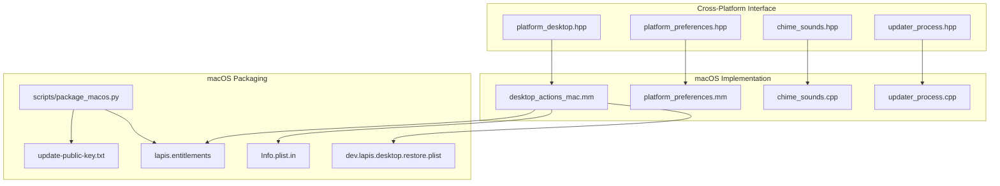
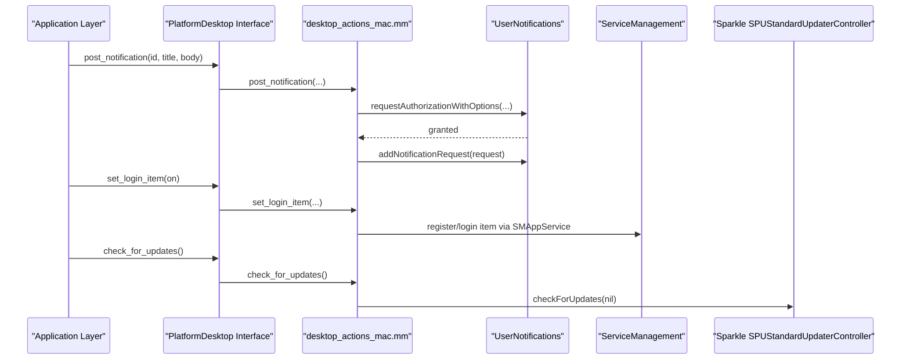
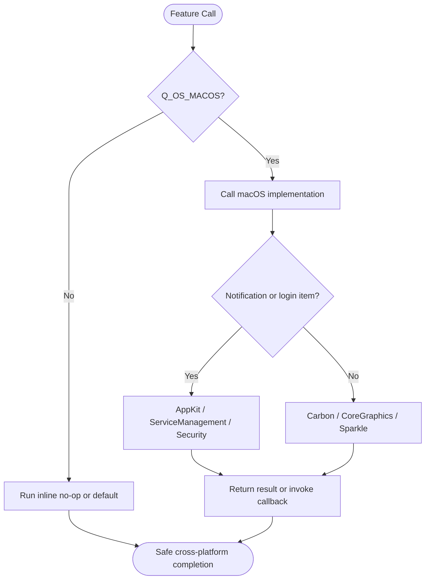
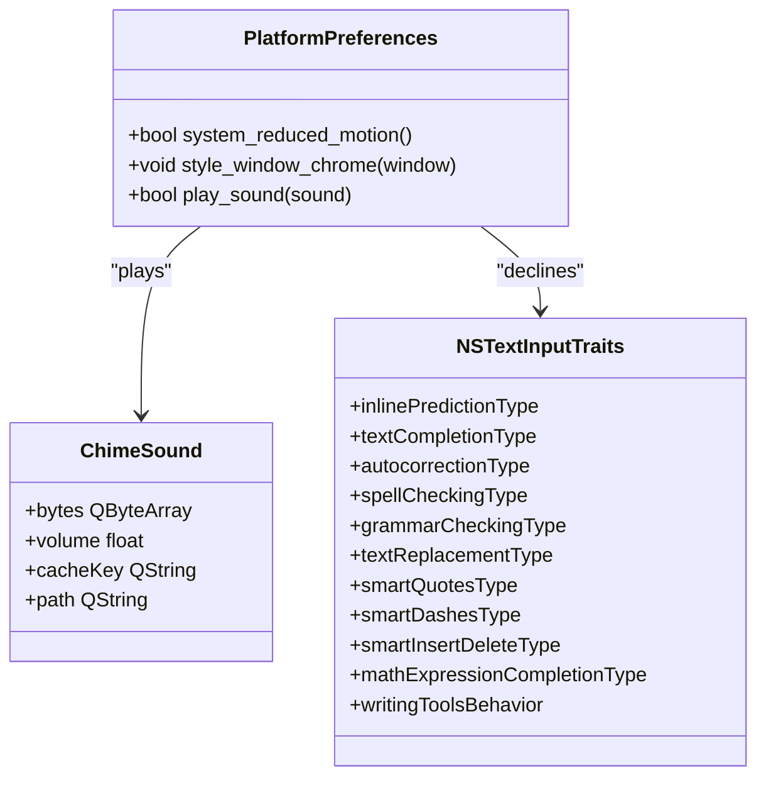
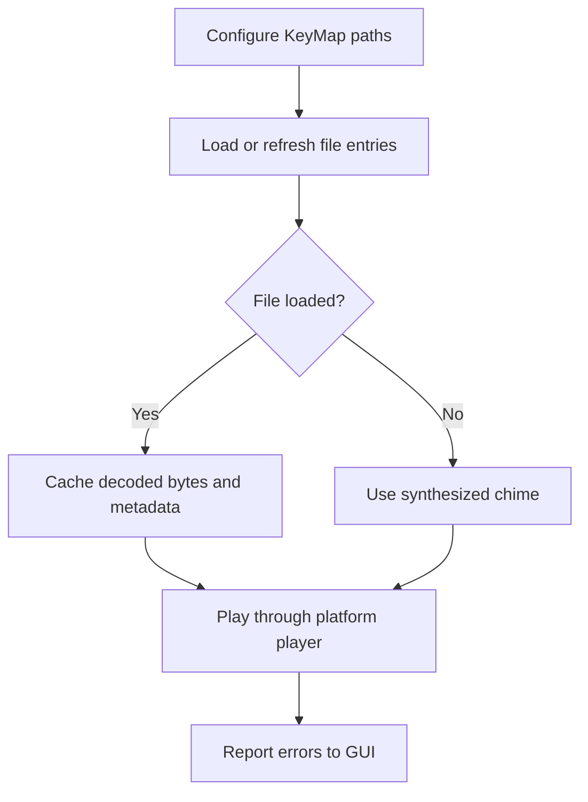
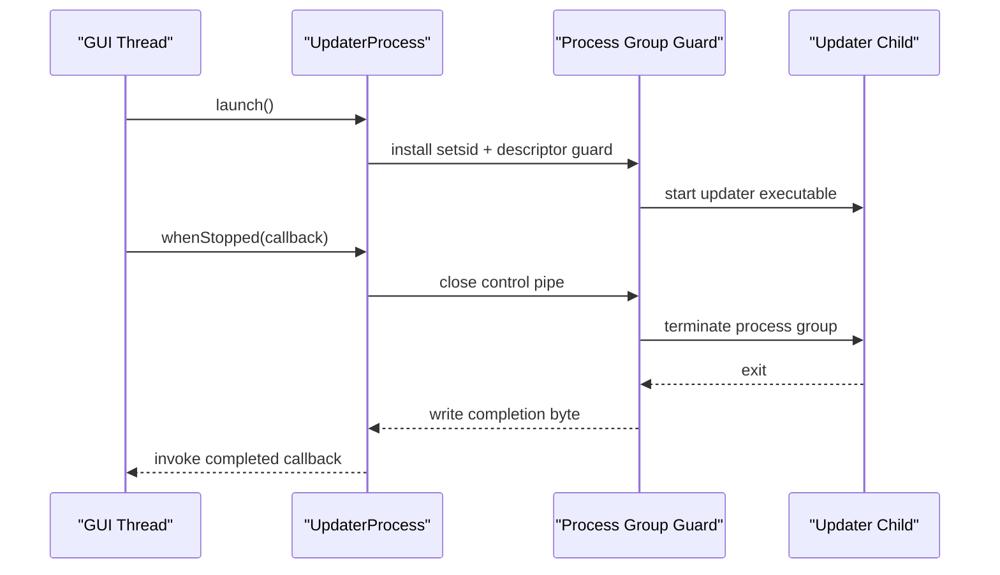
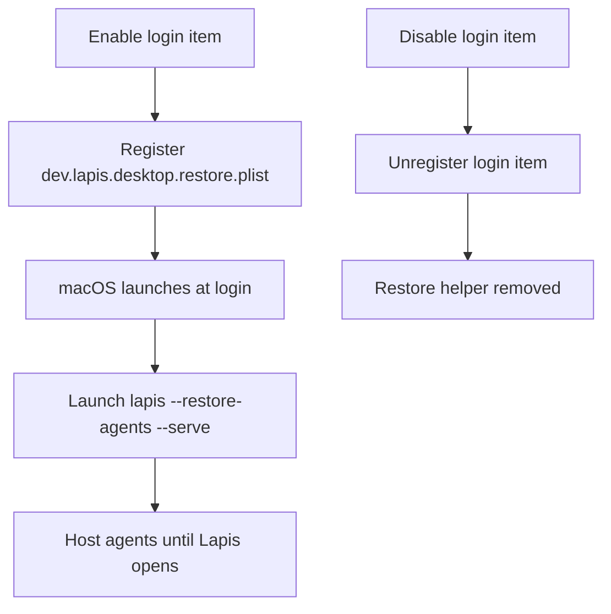
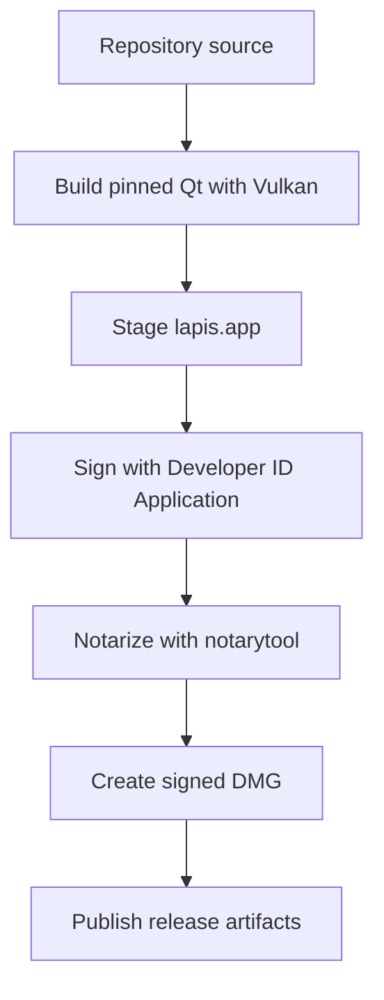
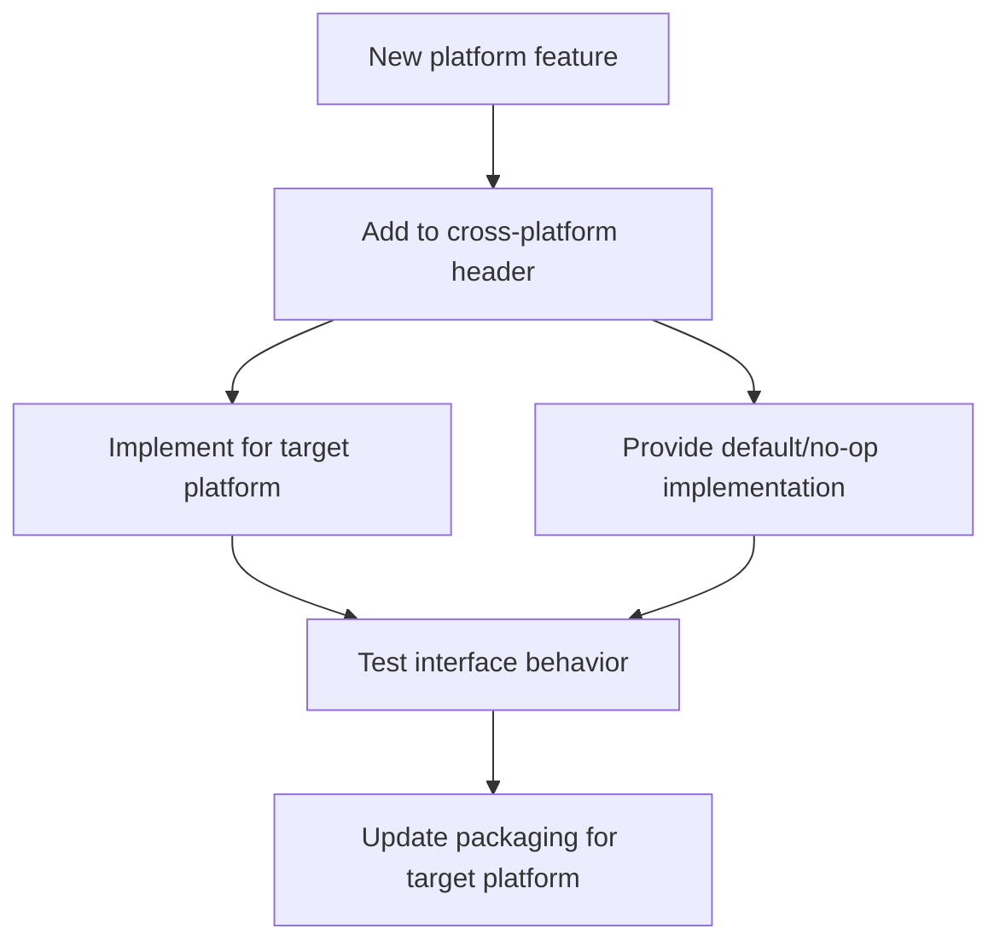
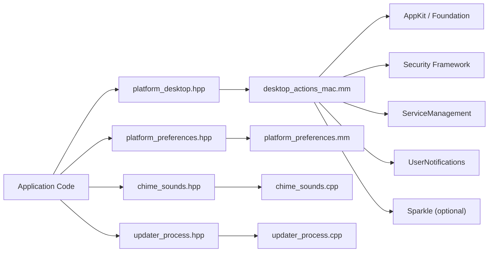

# Platform-Specific Integration

<cite>
**Referenced Files in This Document**
- [platform_desktop.hpp](file://apps/desktop/src/platform_desktop.hpp)
- [desktop_actions_mac.mm](file://apps/desktop/src/desktop_actions_mac.mm)
- [platform_preferences.hpp](file://apps/desktop/src/platform_preferences.hpp)
- [platform_preferences.mm](file://apps/desktop/src/platform_preferences.mm)
- [chime_sounds.hpp](file://apps/desktop/src/chime_sounds.hpp)
- [chime_sounds.cpp](file://apps/desktop/src/chime_sounds.cpp)
- [updater_process.hpp](file://apps/desktop/src/platform/updater_process.hpp)
- [updater_process.cpp](file://apps/desktop/src/platform/updater_process.cpp)
- [lapis.entitlements](file://apps/desktop/macos/lapis.entitlements)
- [Info.plist.in](file://apps/desktop/macos/Info.plist.in)
- [dev.lapis.desktop.restore.plist](file://apps/desktop/macos/dev.lapis.desktop.restore.plist)
- [update-public-key.txt](file://apps/desktop/macos/update-public-key.txt)
- [package_macos.py](file://scripts/package_macos.py)
- [NOTICES.txt](file://third_party/sparkle/NOTICES.txt)
- [build.md](file://docs/build.md)
</cite>

## Table of Contents
1. [Introduction](#introduction)
2. [Project Structure](#project-structure)
3. [Core Components](#core-components)
4. [Architecture Overview](#architecture-overview)
5. [Detailed Component Analysis](#detailed-component-analysis)
6. [Dependency Analysis](#dependency-analysis)
7. [Performance Considerations](#performance-considerations)
8. [Troubleshooting Guide](#troubleshooting-guide)
9. [Conclusion](#conclusion)
10. [Appendices](#appendices)

## Introduction
This document explains the macOS-specific integration layer for the desktop application and how it is abstracted behind cross-platform interfaces. The goal is to let non-macOS builds compile and run without breaking, while giving macOS a richer experience through native notifications, login items, global hot keys, secure input detection, keychain access, Sparkle-based updates, system audio feedback, and macOS-native preference handling.

The primary abstraction is the `PlatformDesktop` interface defined in a header that compiles to real macOS code on macOS and to no-op stubs elsewhere. macOS-specific behavior lives in Objective-C++ files, while shared C++ logic depends only on these stable interfaces.

## Project Structure
The relevant platform integration is concentrated under `apps/desktop/src`, with macOS implementation files using `.mm` extensions:

**Diagram sources**
- [platform_desktop.hpp:1-58](file://apps/desktop/src/platform_desktop.hpp#L1-L58)
- [desktop_actions_mac.mm:1-273](file://apps/desktop/src/desktop_actions_mac.mm#L1-L273)
- [platform_preferences.hpp:1-24](file://apps/desktop/src/platform_preferences.hpp#L1-L24)
- [platform_preferences.mm:1-118](file://apps/desktop/src/platform_preferences.mm#L1-L118)
- [chime_sounds.hpp:1-54](file://apps/desktop/src/chime_sounds.hpp#L1-L54)
- [chime_sounds.cpp:1-272](file://apps/desktop/src/chime_sounds.cpp#L1-L272)
- [updater_process.hpp:1-32](file://apps/desktop/src/platform/updater_process.hpp#L1-L32)
- [updater_process.cpp:1-79](file://apps/desktop/src/platform/updater_process.cpp#L1-L79)
- [lapis.entitlements:1-9](file://apps/desktop/macos/lapis.entitlements#L1-L9)
- [Info.plist.in:1-56](file://apps/desktop/macos/Info.plist.in#L1-L56)
- [dev.lapis.desktop.restore.plist:1-23](file://apps/desktop/macos/dev.lapis.desktop.restore.plist#L1-L23)
- [update-public-key.txt:1-1](file://apps/desktop/macos/update-public-key.txt#L1-L1)
- [package_macos.py:1-200](file://scripts/package_macos.py#L1-L200)

**Section sources**
- [platform_desktop.hpp:1-58](file://apps/desktop/src/platform_desktop.hpp#L1-L58)
- [platform_preferences.hpp:1-24](file://apps/desktop/src/platform_preferences.hpp#L1-L24)

## Core Components
The integration layer has five main responsibilities:

| Area | Cross-Platform Interface | macOS Implementation | Purpose |
|---|---|---|---|
| Desktop services | `lapis::desktop::platform` functions | `desktop_actions_mac.mm` | Notifications, login items, updater entry points, global hot keys, secure input, last-input timing, Claude Code credentials |
| Preference and UI style | `system_reduced_motion`, `style_window_chrome`, `play_sound` | `platform_preferences.mm` | macOS accessibility, Qt window chrome, system sound playback |
| Chime synthesis and delivery | `ChimeSounds`, `ChimeSound`, `chime_wav` | `chime_sounds.cpp` plus macOS sound player | Generate or load chime sounds and play them at configured volume |
| Updater process lifecycle | `UpdaterProcess` | `updater_process.cpp` | Launch and stop an updater process with POSIX process-group cleanup |
| Packaging and signing | Build script and plist/entitlements | `scripts/package_macos.py`, `Info.plist.in`, `lapis.entitlements` | Bundle, sign, notarize, add Sparkle keys, and prepare the downloadable app |

**Section sources**
- [platform_desktop.hpp:1-58](file://apps/desktop/src/platform_desktop.hpp#L1-L58)
- [platform_preferences.hpp:1-24](file://apps/desktop/src/platform_preferences.hpp#L1-L24)
- [chime_sounds.hpp:1-54](file://apps/desktop/src/chime_sounds.hpp#L1-L54)
- [updater_process.hpp:1-32](file://apps/desktop/src/platform/updater_process.hpp#L1-L32)

## Architecture Overview
The architecture separates feature ownership from platform details:

**Diagram sources**
- [platform_desktop.hpp:1-58](file://apps/desktop/src/platform_desktop.hpp#L1-L58)
- [desktop_actions_mac.mm:1-273](file://apps/desktop/src/desktop_actions_mac.mm#L1-L273)

At runtime, the same API surface is available everywhere. On macOS, calls reach AppKit, Carbon/CoreGraphics, ServiceManagement, Security, UserNotifications, and optionally Sparkle. On other platforms, the inline stubs do nothing or return neutral values, so higher layers can call them safely.

## Detailed Component Analysis

### PlatformDesktop Interface and macOS Implementation
The `lapis::desktop::platform` namespace exposes functions for:

- Posting user notifications.
- Receiving notification-click callbacks.
- Checking and enabling the login item.
- Starting and checking for Sparkle updates.
- Intercepting terminal key combinations.
- Registering a global “latest attention” hot key.
- Bringing the application to the foreground.
- Reading Claude Code’s stored credentials from the macOS keychain.
- Detecting secure event input.
- Reading seconds since the last hardware input.

On non-macOS builds, each function is replaced by an inline no-op or default value. This guarantees that the rest of the application does not need conditional compilation around every call site.

Key behaviors:

- **Notifications:** A delegate captures notification responses and forwards agent identifiers back to the application thread. Authorization is requested when needed.
- **Login item:** Uses `SMAppService` for macOS 13+. Errors are logged but do not crash the app.
- **Global hot keys:** Registers Command-Option-L via Carbon’s event handler API; releases it when the handler is cleared.
- **Terminal keys:** Installs a local NSEvent monitor to intercept Command-Backtick and Command-Shift-Backtick before AppKit uses them for window cycling.
- **Secure input:** Uses `IsSecureEventInputEnabled` to detect password fields elsewhere on the system.
- **Last input:** Reads HID-level input timestamps to estimate user activity.
- **Claude Code credentials:** Reads a generic keychain item named for Claude Code credentials and returns its data, or an empty array if missing or inaccessible.

**Diagram sources**
- [platform_desktop.hpp:1-58](file://apps/desktop/src/platform_desktop.hpp#L1-L58)
- [desktop_actions_mac.mm:1-273](file://apps/desktop/src/desktop_actions_mac.mm#L1-L273)

**Section sources**
- [platform_desktop.hpp:1-58](file://apps/desktop/src/platform_desktop.hpp#L1-L58)
- [desktop_actions_mac.mm:1-273](file://apps/desktop/src/desktop_actions_mac.mm#L1-L273)

### macOS Preferences, Window Chrome, and Reduced Motion
The `lapis::desktop` namespace provides:

- `system_reduced_motion`: Checks macOS accessibility settings to honor reduced motion preferences.
- `style_window_chrome`: Customizes the Qt window on macOS by hiding the title bar, making it transparent, setting background color and appearance, and disabling titlebar separators where available.
- `play_sound`: Plays a `ChimeSound` through `NSSound`.

It also monkey-patches Qt’s view class on macOS to decline inline prediction, text completion, autocorrection, spell checking, grammar checking, text replacement, smart quotes/dashes, math expression completion, and writing tools. This prevents unwanted autocompletion in terminal prompts and other input fields.

**Diagram sources**
- [platform_preferences.hpp:1-24](file://apps/desktop/src/platform_preferences.hpp#L1-L24)
- [platform_preferences.mm:1-118](file://apps/desktop/src/platform_preferences.mm#L1-L118)

**Section sources**
- [platform_preferences.hpp:1-24](file://apps/desktop/src/platform_preferences.hpp#L1-L24)
- [platform_preferences.mm:1-118](file://apps/desktop/src/platform_preferences.mm#L1-L118)

### Audio Feedback Through Chime Sounds
Chime support has two parts:

1. **Synthesized WAV generation:** `chime_wav` creates short glass-like chimes in memory using sine waves with attack, decay, shimmer, and strike components. It avoids shipping audio assets.
2. **Runtime selection and playback:** `ChimeSounds` manages configured file paths, loads external chime files asynchronously, caches decoded sounds, reports diagnostics to the GUI, and plays either synthesized or loaded sounds through the platform player.

**Diagram sources**
- [chime_sounds.hpp:1-54](file://apps/desktop/src/chime_sounds.hpp#L1-L54)
- [chime_sounds.cpp:1-272](file://apps/desktop/src/chime_sounds.cpp#L1-L272)
- [platform_preferences.mm:1-118](file://apps/desktop/src/platform_preferences.mm#L1-L118)

Important characteristics:

- Built-in chimes are generated as 16-bit mono WAV files at 44100 Hz.
- External chime files are bounded to a maximum size.
- Background loading is limited to two concurrent jobs.
- Diagnostics are delivered to the owner object through a queued GUI dispatcher.
- Playback is asynchronous and does not block the caller.

**Section sources**
- [chime_sounds.hpp:1-54](file://apps/desktop/src/chime_sounds.hpp#L1-L54)
- [chime_sounds.cpp:1-272](file://apps/desktop/src/chime_sounds.cpp#L1-L272)
- [platform_preferences.mm:1-118](file://apps/desktop/src/platform_preferences.mm#L1-L118)

### Updater Process Integration with Sparkle
There are two related update mechanisms:

1. **Sparkle update controller:** The macOS implementation initializes `SPUStandardUpdaterController` when Sparkle is enabled, exposes `start_updater`, `check_for_updates`, and `updater_available`, and gates Sparkle usage behind a build macro.
2. **Updater process wrapper:** `UpdaterProcess` launches a child process, puts it into its own session and process group, installs a descriptor limit guard, and signals the group to terminate when stopped. Completion is observed through a pipe and `QSocketNotifier`.

**Diagram sources**
- [updater_process.hpp:1-32](file://apps/desktop/src/platform/updater_process.hpp#L1-L32)
- [updater_process.cpp:1-79](file://apps/desktop/src/platform/updater_process.cpp#L1-L79)

Sparkle itself is included in the downloadable app bundle, thinned to arm64, signed with the app, and stripped of XPC services required only by sandboxed apps. The public key used by Sparkle is stored alongside the bundle configuration.

**Section sources**
- [desktop_actions_mac.mm:1-273](file://apps/desktop/src/desktop_actions_mac.mm#L1-L273)
- [updater_process.hpp:1-32](file://apps/desktop/src/platform/updater_process.hpp#L1-L32)
- [updater_process.cpp:1-79](file://apps/desktop/src/platform/updater_process.cpp#L1-L79)
- [NOTICES.txt:1-145](file://third_party/sparkle/NOTICES.txt#L1-L145)

### Login Item and Agent Restoration
The login item allows agents to be restored at login even when Lapis starts without a visible window. On macOS 13+, the app registers or unregisters a login item through `SMAppService` using a specific plist name. The corresponding plist defines the restore helper command line.

**Diagram sources**
- [desktop_actions_mac.mm:201-273](file://apps/desktop/src/desktop_actions_mac.mm#L201-L273)
- [dev.lapis.desktop.restore.plist:1-23](file://apps/desktop/macos/dev.lapis.desktop.restore.plist#L1-L23)

**Section sources**
- [desktop_actions_mac.mm:201-273](file://apps/desktop/src/desktop_actions_mac.mm#L201-L273)
- [dev.lapis.desktop.restore.plist:1-23](file://apps/desktop/macos/dev.lapis.desktop.restore.plist#L1-L23)

### Code Signing, Entitlements, and Distribution Considerations
The macOS application packaging pipeline is driven by `scripts/package_macos.py`. It builds a bundled Qt prefix, stages the app, signs it, creates a DMG, notarizes it, and prepares release artifacts.

Relevant requirements and behaviors:

- **Developer ID Application signing:** Used for distributing the app outside the Mac App Store.
- **Notarization:** Uses a `notarytool` keychain profile.
- **Entitlements:** The app enables JIT because the QML engine compiles JavaScript to machine code.
- **Bundle metadata:** `Info.plist.in` supplies bundle identifiers, version fields, category, high-resolution support, automatic graphics switching, and permission descriptions for desktop, documents, downloads, removable volumes, network volumes, local network access, and Apple Events.
- **Sparkle integration:** The packaging script pins a specific Sparkle version and SHA-256, includes notices, and injects update keys into the bundle.
- **System requirements:** The deployment target is set during packaging, and minimum system version information is placed in the bundle.
- **Distribution notes:** Developer builds differ from downloadable releases; the latter include their own Qt, MoltenVK, dependency notices, signing, and notarization steps.

**Diagram sources**
- [package_macos.py:1-200](file://scripts/package_macos.py#L1-L200)
- [lapis.entitlements:1-9](file://apps/desktop/macos/lapis.entitlements#L1-L9)
- [Info.plist.in:1-56](file://apps/desktop/macos/Info.plist.in#L1-L56)
- [update-public-key.txt:1-1](file://apps/desktop/macos/update-public-key.txt#L1-L1)

**Section sources**
- [package_macos.py:1-200](file://scripts/package_macos.py#L1-L200)
- [lapis.entitlements:1-9](file://apps/desktop/macos/lapis.entitlements#L1-L9)
- [Info.plist.in:1-56](file://apps/desktop/macos/Info.plist.in#L1-L56)
- [update-public-key.txt:1-1](file://apps/desktop/macos/update-public-key.txt#L1-L1)
- [build.md:1-125](file://docs/build.md#L1-L125)

### Guidance for Porting to Other Platforms
To port this integration layer to another platform, follow these principles:

1. **Extend the cross-platform interface first.** Add new methods to `platform_desktop.hpp` and `platform_preferences.hpp` with safe defaults for non-target platforms.
2. **Implement the method on the target platform.** Create a platform-specific source file similar to `desktop_actions_mac.mm` and `platform_preferences.mm`.
3. **Keep no-op stubs for unsupported platforms.** This preserves existing callers and avoids widespread conditional compilation.
4. **Prefer capability checks over hard assumptions.** For example, macOS-only features like `NSSound`, `SMAppService`, `UNUserNotificationCenter`, and Sparkle should remain gated behind platform macros or runtime availability checks.
5. **Match platform semantics rather than copying macOS internals.** A Linux port might use D-Bus for notifications, systemd user services or XDG autostart for login items, ALSA/PulseAudio/PipeWire for audio, and the distribution’s package manager or a custom updater instead of Sparkle.
6. **Update packaging scripts separately.** Do not assume the macOS packaging script applies directly to Linux or Windows.
7. **Expose platform diagnostics clearly.** When a feature is unavailable, report it gracefully rather than failing silently in ways that confuse users.
8. **Write tests against the interface.** Prefer testing the cross-platform API and mocking platform behavior where possible.

[No sources needed since this diagram shows conceptual workflow, not actual code structure]

## Dependency Analysis
The platform layer has clear boundaries:

- High-level application code depends on stable C++ headers.
- macOS implementation depends on AppKit, Foundation, Carbon, CoreGraphics, Security, ServiceManagement, UserNotifications, and optionally Sparkle.
- Chime playback depends on `NSSound` on macOS and falls back gracefully elsewhere.
- Sparkle is optional at compile time and only active when enabled by the build.
- The updater process wrapper depends on POSIX process APIs and Qt’s process/notification machinery.

**Diagram sources**
- [platform_desktop.hpp:1-58](file://apps/desktop/src/platform_desktop.hpp#L1-L58)
- [desktop_actions_mac.mm:1-273](file://apps/desktop/src/desktop_actions_mac.mm#L1-L273)
- [platform_preferences.hpp:1-24](file://apps/desktop/src/platform_preferences.hpp#L1-L24)
- [platform_preferences.mm:1-118](file://apps/desktop/src/platform_preferences.mm#L1-L118)
- [chime_sounds.hpp:1-54](file://apps/desktop/src/chime_sounds.hpp#L1-L54)
- [chime_sounds.cpp:1-272](file://apps/desktop/src/chime_sounds.cpp#L1-L272)
- [updater_process.hpp:1-32](file://apps/desktop/src/platform/updater_process.hpp#L1-L32)
- [updater_process.cpp:1-79](file://apps/desktop/src/platform/updater_process.cpp#L1-L79)

**Section sources**
- [platform_desktop.hpp:1-58](file://apps/desktop/src/platform_desktop.hpp#L1-L58)
- [desktop_actions_mac.mm:1-273](file://apps/desktop/src/desktop_actions_mac.mm#L1-L273)
- [platform_preferences.hpp:1-24](file://apps/desktop/src/platform_preferences.hpp#L1-L24)
- [platform_preferences.mm:1-118](file://apps/desktop/src/platform_preferences.mm#L1-L118)
- [chime_sounds.hpp:1-54](file://apps/desktop/src/chime_sounds.hpp#L1-L54)
- [chime_sounds.cpp:1-272](file://apps/desktop/src/chime_sounds.cpp#L1-L272)
- [updater_process.hpp:1-32](file://apps/desktop/src/platform/updater_process.hpp#L1-L32)
- [updater_process.cpp:1-79](file://apps/desktop/src/platform/updater_process.cpp#L1-L79)

## Performance Considerations
Several design choices reduce platform overhead:

- **Inline no-ops on non-macOS builds:** Avoids branching cost in production paths when platform features are unavailable.
- **Cached NSSound instances:** The macOS sound player caches decoded sounds and bounds retained memory by count and total size.
- **Asynchronous chime loading:** External chime files are loaded in the background with a job limit, so GUI threads do not wait for disk I/O.
- **Synthesized built-in chimes:** No audio asset loading is required for default alerts.
- **Local event monitoring:** Terminal key interception uses a lightweight local monitor rather than heavy global hooks.
- **Graceful degradation:** Missing permissions, unavailable frameworks, or failed native calls return neutral values or warnings rather than crashing.

[No sources needed since this section provides general guidance]

## Troubleshooting Guide
Common issues and their likely causes:

| Symptom | Likely Cause | Recommended Action |
|---|---|---|
| Notifications do not appear | Permission denied or running outside an app bundle | Check authorization flow and ensure the binary runs inside a proper macOS app bundle |
| Login item cannot be toggled | macOS version older than 13 or registration error | Inspect logged login-item errors and verify OS version compatibility |
| Global hot key does not work | Event handler registration failed | Verify the application has focus and inspect event handler installation results |
| Terminal keys still cycle windows | Local event monitor not installed or handler returned false | Confirm the monitor is registered and the handler consumes the key |
| Chime sound does not play | Invalid file path, too-large file, or playback failure | Review diagnostic messages and verify file format and size limits |
| Update checks do nothing | Sparkle disabled at build time | Confirm `LAPIS_SPARKLE` is enabled and the update public key is present |
| App fails to launch after signing | Missing entitlements or invalid signature | Validate Developer ID signing, entitlements, and notarization status |
| Non-macOS build loses functionality | Expected no-op behavior | Treat missing features as unsupported rather than broken |

**Section sources**
- [desktop_actions_mac.mm:1-273](file://apps/desktop/src/desktop_actions_mac.mm#L1-L273)
- [platform_preferences.mm:1-118](file://apps/desktop/src/platform_preferences.mm#L1-L118)
- [chime_sounds.cpp:1-272](file://apps/desktop/src/chime_sounds.cpp#L1-L272)
- [platform_desktop.hpp:1-58](file://apps/desktop/src/platform_desktop.hpp#L1-L58)

## Conclusion
The platform-specific integration layer cleanly isolates macOS capabilities behind stable cross-platform interfaces. On macOS, it delivers native notifications, login items, global hot keys, secure input awareness, keychain access, Sparkle updates, system audio feedback, and macOS-native window styling. On other platforms, it remains compilable and safe by providing no-op defaults. This design makes macOS feel native while keeping the rest of the application portable and easier to maintain.

## Appendices

### macOS API Surface Summary
| Capability | macOS API | Availability Behavior |
|---|---|---|
| Notifications | `UNUserNotificationCenter` | Requests permission; no-op off macOS |
| Login item | `SMAppService` | macOS 13+ only; older versions report unavailable |
| Global hot key | Carbon event handlers | Returns false if registration fails |
| Terminal keys | `NSEvent` local monitor | Returns original event when not handled |
| Secure input | `IsSecureEventInputEnabled` | Boolean flag; no-op elsewhere |
| Last input | CoreGraphics HID state | Negative value when unavailable |
| Credentials | Security framework generic password | Empty result when missing or denied |
| Sound playback | `NSSound` | macOS-only; returns false elsewhere |
| Updates | Sparkle `SPUStandardUpdaterController` | Optional, build-gated |

**Section sources**
- [platform_desktop.hpp:1-58](file://apps/desktop/src/platform_desktop.hpp#L1-L58)
- [desktop_actions_mac.mm:1-273](file://apps/desktop/src/desktop_actions_mac.mm#L1-L273)
- [platform_preferences.hpp:1-24](file://apps/desktop/src/platform_preferences.hpp#L1-L24)
- [platform_preferences.mm:1-118](file://apps/desktop/src/platform_preferences.mm#L1-L118)