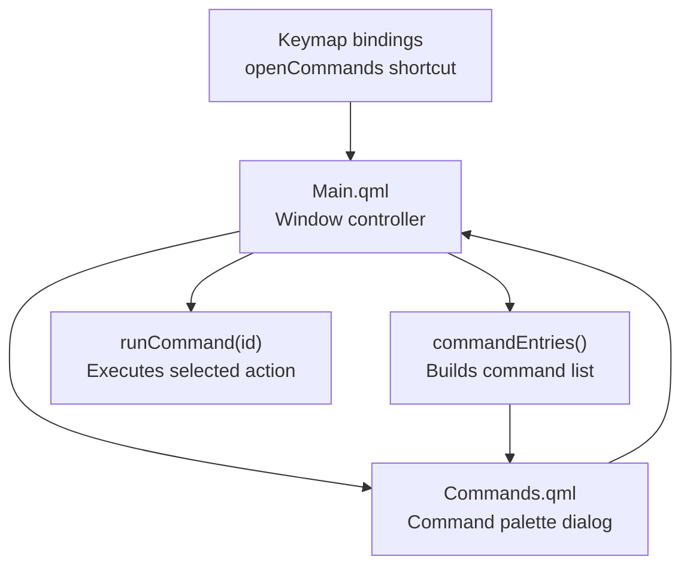
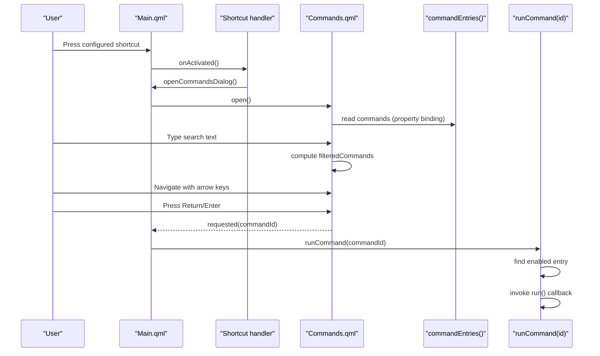
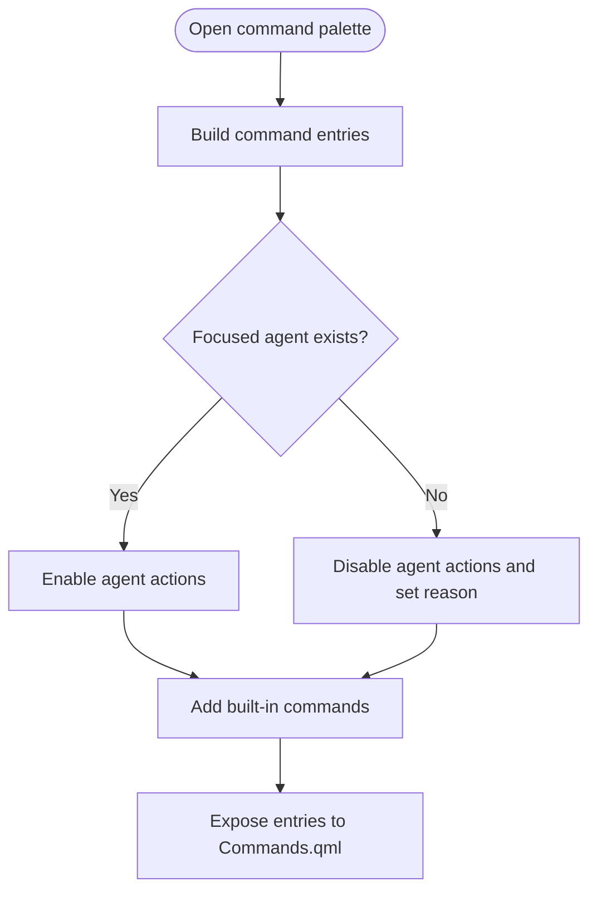
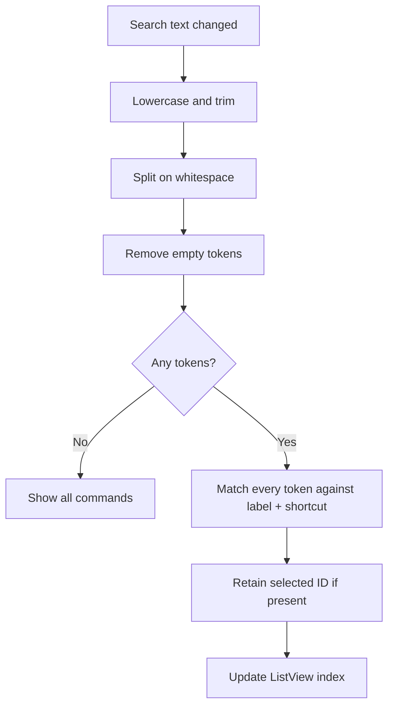
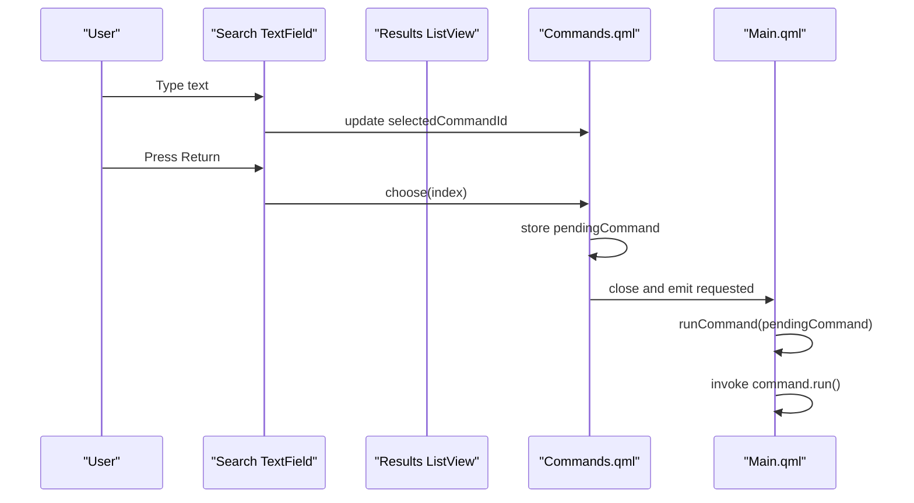
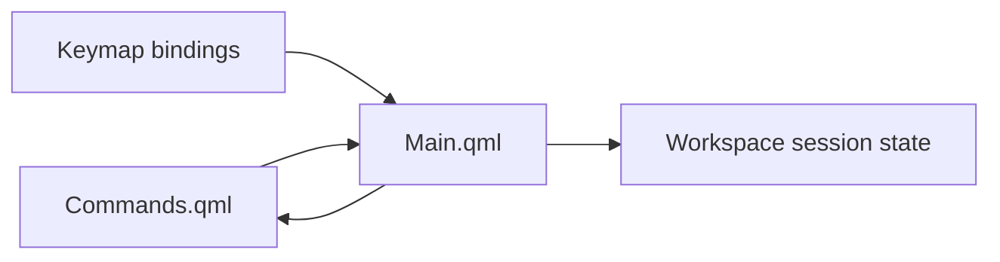

# Command Palette and Quick Actions

<cite>
**Referenced Files in This Document**
- [Commands.qml](file://apps/desktop/qml/Commands.qml)
- [Main.qml](file://apps/desktop/qml/Main.qml)
</cite>

## Table of Contents
1. [Introduction](#introduction)
2. [Project Structure](#project-structure)
3. [Core Components](#core-components)
4. [Architecture Overview](#architecture-overview)
5. [Detailed Component Analysis](#detailed-component-analysis)
6. [Dependency Analysis](#dependency-analysis)
7. [Performance Considerations](#performance-considerations)
8. [Troubleshooting Guide](#troubleshooting-guide)
9. [Conclusion](#conclusion)

## Introduction
This document explains the desktop command palette system centered on `Commands.qml`. It shows how users open the palette, search for commands by name or shortcut, navigate results with the keyboard, and execute actions. It also documents the dynamic command registration model used by `Main.qml`, including how agent-aware commands are built at runtime and how the palette integrates with the application’s global shortcut framework.

The goal is to help developers add new quick actions, understand filtering behavior, and integrate custom commands through the same registration mechanism already used by the application.

## Project Structure
The command palette is implemented as a QML dialog component and integrated into the main desktop window:

**Diagram sources**
- [Main.qml:428-520](file://apps/desktop/qml/Main.qml#L428-L520)
- [Main.qml:1126-1133](file://apps/desktop/qml/Main.qml#L1126-L1133)
- [Main.qml:1233-1250](file://apps/desktop/qml/Main.qml#L1233-L1250)
- [Commands.qml:1-223](file://apps/desktop/qml/Commands.qml#L1-L223)

**Section sources**
- [Commands.qml:1-223](file://apps/desktop/qml/Commands.qml#L1-L223)
- [Main.qml:428-520](file://apps/desktop/qml/Main.qml#L428-L520)
- [Main.qml:1126-1133](file://apps/desktop/qml/Main.qml#L1126-L1133)
- [Main.qml:1233-1250](file://apps/desktop/qml/Main.qml#L1233-L1250)

## Core Components
Two files implement the end-to-end flow:

| Component | Role | Key responsibilities |
|---|---|---|
| `Commands.qml` | Command palette dialog | Renders search input, filtered result list, keyboard navigation, selection state, and emits a requested signal when a user runs a command. |
| `Main.qml` | Window and command registry | Builds the command list dynamically, binds the global shortcut to open the palette, and executes commands after user selection. |

### Command Palette Dialog (`Commands.qml`)
The dialog is a modal `Dialog` that owns:

- A `commands` property holding an array of command entries.
- A computed `filteredCommands` property that filters entries based on the current search text.
- State properties for the pending command ID and currently selected command ID.
- Keyboard handling for up/down navigation, Enter/Return execution, and Escape dismissal.
- A `requested(string)` signal emitted with the chosen command ID when the dialog closes.

The visual design highlights the selected row with an accent edge, supports hover styling, and displays per-command shortcuts as keycaps. Disabled commands show a reason instead of being executable.

**Section sources**
- [Commands.qml:1-223](file://apps/desktop/qml/Commands.qml#L1-L223)

### Command Registry and Execution (`Main.qml`)
`Main.qml` contains:

- The `window.bindings("openCommands")` lookup that resolves the configured keyboard shortcut.
- The `openCommandsDialog()` function guarded by interaction state.
- The `commandEntries()` builder that constructs command objects at runtime.
- The `runCommand(id)` executor that finds and invokes the matching enabled entry.
- A binding from the palette’s `onRequested` signal to the executor.

**Section sources**
- [Main.qml:167-168](file://apps/desktop/qml/Main.qml#L167-L168)
- [Main.qml:267-270](file://apps/desktop/qml/Main.qml#L267-L270)
- [Main.qml:428-520](file://apps/desktop/qml/Main.qml#L428-L520)
- [Main.qml:1126-1133](file://apps/desktop/qml/Main.qml#L1126-L1133)
- [Main.qml:1233-1250](file://apps/desktop/qml/Main.qml#L1233-L1250)

## Architecture Overview
The command palette follows a simple event-driven pipeline:

**Diagram sources**
- [Main.qml:1126-1133](file://apps/desktop/qml/Main.qml#L1126-L1133)
- [Main.qml:267-270](file://apps/desktop/qml/Main.qml#L267-L270)
- [Main.qml:428-520](file://apps/desktop/qml/Main.qml#L428-L520)
- [Main.qml:1233-1250](file://apps/desktop/qml/Main.qml#L1233-L1250)
- [Commands.qml:1-223](file://apps/desktop/qml/Commands.qml#L1-L223)

## Detailed Component Analysis

### Command Registration Model
Commands are not hard-coded UI widgets; they are data structures created by `commandEntries()`. Each entry has:

- An identifier string used to select and execute the command.
- A human-readable label displayed in the list.
- A displayable action string, such as a keyboard shortcut hint.
- An enabled flag controlling whether the item can be executed.
- An optional reason explaining why a disabled command cannot run.
- A `run` callback performing the actual work.

The builder starts with an empty list and appends entries. Agent-related entries check whether there is a focused session before enabling the command. Built-in commands such as quitting the application are always available.

**Diagram sources**
- [Main.qml:428-520](file://apps/desktop/qml/Main.qml#L428-L520)

**Section sources**
- [Main.qml:428-520](file://apps/desktop/qml/Main.qml#L428-L520)

### Search and Filtering Logic
The palette computes its visible list from the raw `commands` property. Filtering works as follows:

1. The search text is lowercased, trimmed, and split on whitespace.
2. Empty tokens are removed.
3. Every remaining token must appear somewhere in the joined lowercase label and shortcut text.
4. If no tokens remain, all commands are shown.
5. When the filter changes, the currently selected command ID is retained if it still appears; otherwise, the first matching command is selected, or none if there are no matches.

This means users can type one or more words, and every word must match part of the command label or its shortcut string.

**Diagram sources**
- [Commands.qml:1-223](file://apps/desktop/qml/Commands.qml#L1-L223)

**Section sources**
- [Commands.qml:1-223](file://apps/desktop/qml/Commands.qml#L1-L223)

### Keyboard Navigation and Execution
The palette supports keyboard-first interaction:

| Action | Behavior |
|---|---|
| Open palette | Triggered by the configured shortcut bound to `openCommands`. |
| Focus search | Automatically focuses the search field when opened. |
| Up / Down | Moves the highlighted result within the filtered list, wrapping around bounds. |
| Return / Enter | Selects the current command and closes the dialog. |
| Escape | Closes the dialog without running a command. |
| Click result | Highlights and executes the clicked command. |

When a command is selected, the dialog stores the command ID in `pendingCommand`, closes itself, and emits `requested(commandId)`. The main window receives this signal asynchronously and calls `runCommand(id)`, which looks up the entry and invokes its `run` callback only if it is enabled.

**Diagram sources**
- [Commands.qml:1-223](file://apps/desktop/qml/Commands.qml#L1-L223)
- [Main.qml:517-520](file://apps/desktop/qml/Main.qml#L517-L520)
- [Main.qml:1249-1250](file://apps/desktop/qml/Main.qml#L1249-L1250)

**Section sources**
- [Commands.qml:1-223](file://apps/desktop/qml/Commands.qml#L1-L223)
- [Main.qml:517-520](file://apps/desktop/qml/Main.qml#L517-L520)
- [Main.qml:1249-1250](file://apps/desktop/qml/Main.qml#L1249-L1250)

### Global Shortcut Integration
The shortcut to open the command palette comes from the application’s keymap. The relevant flow is:

1. `window.bindings("openCommands")` returns the configured sequence.
2. A `Shortcut` object listens for that sequence at the window scope.
3. Activation calls `window.openCommandsDialog()`.
4. The dialog opens and binds its `commands` property to `window.commandEntries()`.

On macOS, the default sequence uses the modifier associated with platform conventions; on other platforms, it uses the documented control-shift combination.

**Section sources**
- [Main.qml:167-168](file://apps/desktop/qml/Main.qml#L167-L168)
- [Main.qml:1126-1133](file://apps/desktop/qml/Main.qml#L1126-L1133)
- [Main.qml:1233-1250](file://apps/desktop/qml/Main.qml#L1233-L1250)

### Example: Implementing a Custom Command
To add a new command through the existing system:

1. Extend `commandEntries()` in `Main.qml`.
2. Call the internal helper used by the builder to append an entry with:
   - A unique `id`.
   - A descriptive `label`.
   - A displayable shortcut string, such as `"Ctrl+K"` or `"View / Toggle"`.
   - An `enabled` value that may depend on application state.
   - A `reason` explaining why the command is disabled when appropriate.
   - A `run` callback implementing the desired behavior.
3. Ensure the command respects interaction guards so it does not run while dialogs or transitions block input.
4. Test search behavior by choosing labels and shortcut strings that are discoverable.

For agent-specific commands, follow the existing pattern that checks whether a focused agent session exists before enabling the entry.

**Section sources**
- [Main.qml:428-520](file://apps/desktop/qml/Main.qml#L428-L520)

### Example: Integrating with the Desktop Action Framework
The command palette is part of the broader desktop action surface. Its integration points include:

- **Shortcut discovery**: Use the same keymap-based binding approach for other window-scoped actions.
- **Interaction guards**: Respect `interactionArmed` and related state so commands do not execute during transitions or while other dialogs are active.
- **Visual consistency**: Follow the palette’s style model—accent edges for selection, muted colors for disabled items, and clear reasons for unavailable actions.
- **Accessibility**: Provide meaningful labels and shortcut hints so screen readers and assistive technologies can describe command options.

The palette also participates in the dialog visibility model, which prevents input from other parts of the interface while it is open.

**Section sources**
- [Main.qml:78-82](file://apps/desktop/qml/Main.qml#L78-L82)
- [Main.qml:608-611](file://apps/desktop/qml/Main.qml#L608-L611)
- [Main.qml:1233-1250](file://apps/desktop/qml/Main.qml#L1233-L1250)

## Dependency Analysis
The following diagram shows how the two QML files collaborate:

- `Commands.qml` depends on `Main.qml` through the `commands` property and the `requested` signal.
- `Main.qml` depends on `Commands.qml` to render the palette and forward user selections.
- Command availability may depend on workspace state, especially agent-focused actions.

**Diagram sources**
- [Commands.qml:1-223](file://apps/desktop/qml/Commands.qml#L1-L223)
- [Main.qml:428-520](file://apps/desktop/qml/Main.qml#L428-L520)
- [Main.qml:1233-1250](file://apps/desktop/qml/Main.qml#L1233-L1250)

**Section sources**
- [Commands.qml:1-223](file://apps/desktop/qml/Commands.qml#L1-L223)
- [Main.qml:428-520](file://apps/desktop/qml/Main.qml#L428-L520)
- [Main.qml:1233-1250](file://apps/desktop/qml/Main.qml#L1233-L1250)

## Performance Considerations
- Filtering is computed in JavaScript each time the search text changes. For small and medium command lists, this is straightforward and responsive.
- The entire `commands` array is rebuilt whenever the dialog becomes visible because the property binding references `window.commandEntries()`. This avoids stale entries but recomputes the list on every open.
- To improve performance for very large command sets:
  - Cache expensive entries outside the reactive property where safe.
  - Debuild entries only when the underlying state actually changes.
  - Keep label and shortcut strings concise so substring matching remains fast.
- Avoid heavy work inside command `run` callbacks; perform long-running operations off the UI thread where possible.

[No sources needed since this section provides general guidance]

## Troubleshooting Guide

| Symptom | Likely cause | Resolution |
|---|---|---|
| Palette does not open with the expected shortcut | The keymap binding for `openCommands` differs from expectations or shortcuts are disabled. | Verify `window.bindings("openCommands")` and ensure `window.shortcutsArmed` allows activation. |
| No commands appear in search results | Search tokens do not match any label or shortcut string. | Try shorter terms or remove extra spaces; remember every token must match. |
| Arrow keys do nothing | There are no filtered results, so the selection index is `-1`. | Clear the search or use a less restrictive query. |
| Command appears grayed out | The entry’s `enabled` flag is false. | Inspect the condition in `commandEntries()` and provide a meaningful `reason`. |
| Command does not execute | The selected entry is disabled, or `runCommand` is blocked by interaction state. | Confirm the command is enabled and that the application is not in a transition or blocked state. |
| Shortcut hint is missing | The entry’s shortcut string is empty or not formatted as expected. | Supply a human-readable shortcut string if the command should display one. |

**Section sources**
- [Commands.qml:1-223](file://apps/desktop/qml/Commands.qml#L1-L223)
- [Main.qml:428-520](file://apps/desktop/qml/Main.qml#L428-L520)
- [Main.qml:1126-1133](file://apps/desktop/qml/Main.qml#L1126-L1133)

## Conclusion
The command palette system combines a lightweight QML dialog with a dynamic command registry. Users open it via a configurable shortcut, type search terms, navigate results with arrow keys, and execute actions with Return or Enter. New commands are added by extending the command entry builder rather than creating additional UI components. This keeps the palette extensible, searchable, and consistent with the rest of the desktop action framework.

[No sources needed since this section summarizes without analyzing specific files]