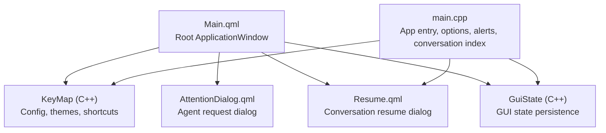
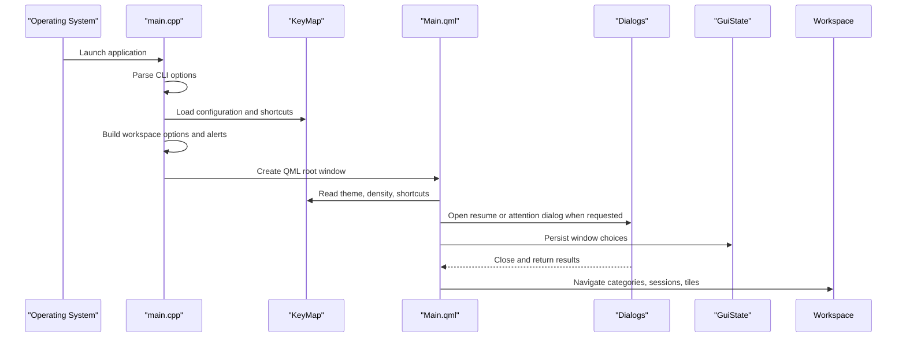
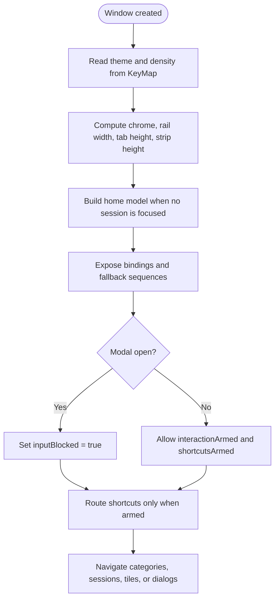
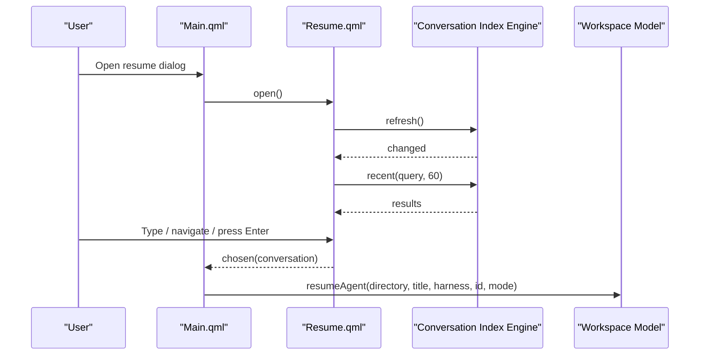
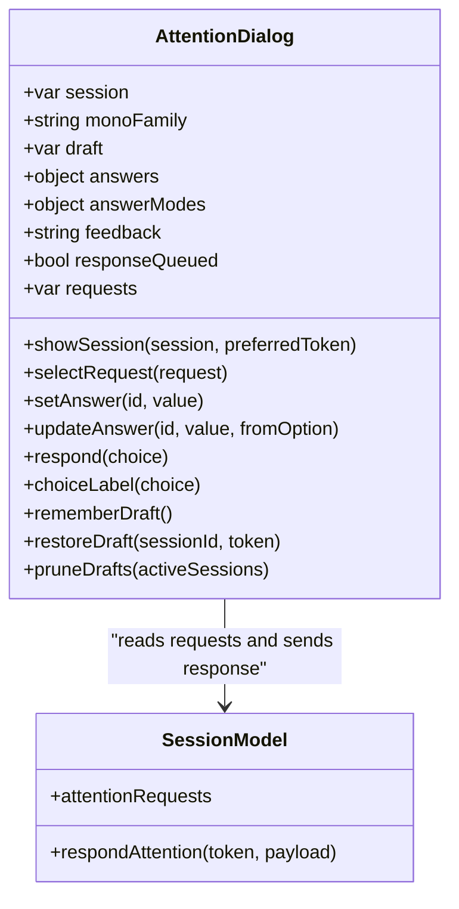
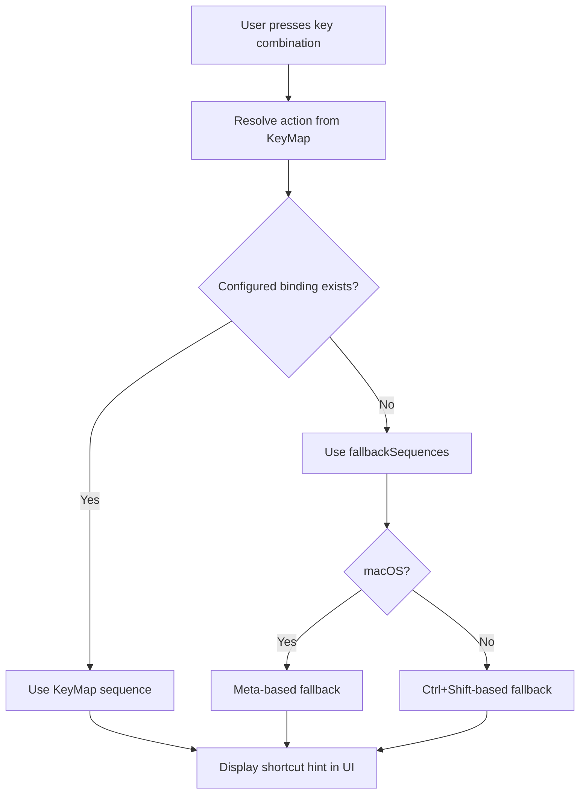
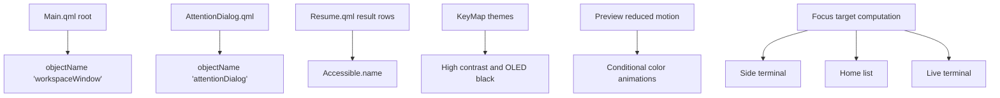
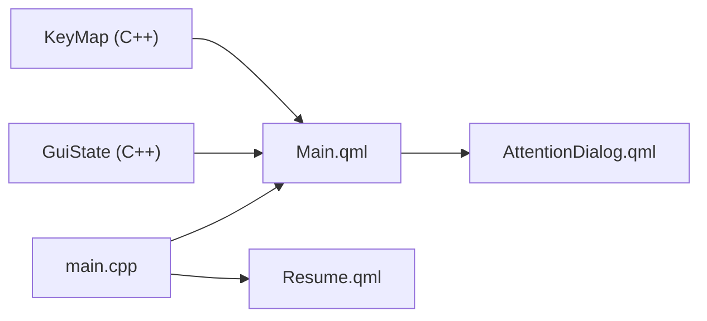

# Main Interface and Navigation

<cite>
**Referenced Files in This Document**
- [Main.qml](file://apps/desktop/qml/Main.qml)
- [AttentionDialog.qml](file://apps/desktop/qml/AttentionDialog.qml)
- [Resume.qml](file://apps/desktop/qml/Resume.qml)
- [main.cpp](file://apps/desktop/src/main.cpp)
- [gui_state.hpp](file://apps/desktop/src/gui_state.hpp)
- [gui_state.cpp](file://apps/desktop/src/gui_state.cpp)
- [keymap.hpp](file://apps/desktop/src/keymap.hpp)
- [keymap.cpp](file://apps/desktop/src/keymap.cpp)
- [keys.md](file://docs/keys.md)
</cite>

## Table of Contents
1. [Introduction](#introduction)
2. [Project Structure](#project-structure)
3. [Core Components](#core-components)
4. [Architecture Overview](#architecture-overview)
5. [Detailed Component Analysis](#detailed-component-analysis)
6. [Dependency Analysis](#dependency-analysis)
7. [Performance Considerations](#performance-considerations)
8. [Troubleshooting Guide](#troubleshooting-guide)
9. [Conclusion](#conclusion)

## Introduction
This document describes the main desktop interface built with QML, focusing on the primary window layout, navigation patterns, resume functionality, attention dialog system, keyboard shortcuts, and accessibility features. The root `ApplicationWindow` in `Main.qml` orchestrates the overall UI flow: it owns theme and density settings, manages modal dialogs, exposes workspace state to the rest of the interface, and coordinates transitions between categories, sessions, tiles, side terminals, command palette, search, usage, tools, and agent management screens.

## Project Structure
The desktop application has two major layers relevant to this document:

| Layer | Responsibility | Key files |
|---|---|---|
| QML user interface | Window layout, dialog orchestration, navigation actions, shortcut text, theme bindings, session home list | `Main.qml`, `AttentionDialog.qml`, `Resume.qml` |
| Desktop host and state services | Command-line parsing, conversation indexing, alerts, keymap loading, GUI state persistence, platform integration | `main.cpp`, `gui_state.hpp`, `gui_state.cpp`, `keymap.hpp`, `keymap.cpp` |
| Keyboard documentation | User-facing default macOS and Linux shortcut reference | `keys.md` |

**Diagram sources**
- [Main.qml:1-200](file://apps/desktop/qml/Main.qml#L1-L200)
- [AttentionDialog.qml:1-200](file://apps/desktop/qml/AttentionDialog.qml#L1-L200)
- [Resume.qml:1-192](file://apps/desktop/qml/Resume.qml#L1-L192)
- [main.cpp:200-512](file://apps/desktop/src/main.cpp#L200-L512)
- [gui_state.hpp:1-97](file://apps/desktop/src/gui_state.hpp#L1-L97)
- [keymap.hpp:1-200](file://apps/desktop/src/keymap.hpp#L1-L200)

**Section sources**
- [Main.qml:1-200](file://apps/desktop/qml/Main.qml#L1-L200)
- [main.cpp:200-512](file://apps/desktop/src/main.cpp#L200-L512)
- [gui_state.hpp:1-97](file://apps/desktop/src/gui_state.hpp#L1-L97)
- [keymap.hpp:1-200](file://apps/desktop/src/keymap.hpp#L1-L200)

## Core Components
- **Main.qml root window**: Defines the primary `ApplicationWindow`, theme-derived colors, density-dependent dimensions, input-blocking rules for modals, shortcut lookup helpers, home screen model, focus target selection, terminal panel control, category/session navigation, and dialog orchestration.
- **AttentionDialog.qml**: Modal dialog that lists an agent’s pending attention requests, displays request summaries, commands, working directories, questions, and answer fields, and sends responses back through the session.
- **Resume.qml**: Modal dialog that scans recent Claude or Codex conversations, filters by title/folder/CLI, supports keyboard navigation, and resumes a selected conversation as a new agent.
- **GuiState**: C++ service that persists window choices and other owner sections to a bounded JSON file with rate-limited writes off the GUI thread.
- **KeyMap**: C++ configuration layer exposing themes, layouts, densities, sidebar/previews visibility, terminal font settings, alert sounds, notifications, editor configuration, and per-action shortcut sequences.
- **main.cpp**: App entry point that parses CLI options, builds workspace options, sets up alerts and notifications, indexes past conversations, routes special terminal keys, and controls whether the app hides to the dock instead of quitting.

**Section sources**
- [Main.qml:1-200](file://apps/desktop/qml/Main.qml#L1-L200)
- [Main.qml:201-469](file://apps/desktop/qml/Main.qml#L201-L469)
- [AttentionDialog.qml:1-200](file://apps/desktop/qml/AttentionDialog.qml#L1-L200)
- [AttentionDialog.qml:201-371](file://apps/desktop/qml/AttentionDialog.qml#L201-L371)
- [Resume.qml:1-192](file://apps/desktop/qml/Resume.qml#L1-L192)
- [gui_state.hpp:1-97](file://apps/desktop/src/gui_state.hpp#L1-L97)
- [keymap.hpp:1-200](file://apps/desktop/src/keymap.hpp#L1-L200)
- [main.cpp:200-512](file://apps/desktop/src/main.cpp#L200-L512)

## Architecture Overview
The main interface is a layered composition:

1. `main.cpp` initializes the Qt application, parses command-line options, constructs workspace options, sets up background alerts, notifications, conversation indexing, and platform-specific behavior such as logging and dock hiding.
2. `KeyMap` loads `lapis.json`, validates it, and exposes QML-accessible properties for themes, layouts, densities, terminal fonts, alerting, and shortcut sequences.
3. `Main.qml` reads theme and density from `KeyMap`, builds the workspace view hierarchy, manages dialog visibility, and delegates navigation and terminal operations to workspace and platform objects.
4. `AttentionDialog.qml` and `Resume.qml` are owned by `Main.qml` as modals; they interact with session models, attention requests, and the conversation index.
5. `GuiState` stores transient window preferences and owner-provided sections, persisting them asynchronously.

**Diagram sources**
- [main.cpp:200-512](file://apps/desktop/src/main.cpp#L200-L512)
- [keymap.hpp:1-200](file://apps/desktop/src/keymap.hpp#L1-L200)
- [Main.qml:1-200](file://apps/desktop/qml/Main.qml#L1-L200)
- [gui_state.hpp:1-97](file://apps/desktop/src/gui_state.hpp#L1-L97)

## Detailed Component Analysis

### Main.qml: Primary Window Layout and Navigation Orchestration
`Main.qml` is the top-level `ApplicationWindow`. It defines:

- **Theme and appearance binding**: Theme colors, corner radius, motion duration, mono family, terminal font size, density mode, and computed chrome sizes come from `KeyMap`. If `KeyMap` is unavailable, defaults keep the window usable.
- **Input gating**: `inputBlocked` is true when any modal dialog is visible or the terminal is composing/pasting. `interactionArmed` and `shortcutsArmed` gate global interactions so dialogs and terminal composition own the keyboard.
- **Title and active category**: The window title includes the active category and the focused session’s agent title.
- **Shortcut helpers**: `bindings(action)` returns configured sequences from `KeyMap`; `fallbackSequences(action)` provides platform-aware defaults. `shortcutText(action)` converts sequences into display-friendly strings.
- **Home screen**: A `ListModel` drives a home list shown when no agent is focused. Entries include New Agent, Resume Conversation, Terminal, Reopen Closed Agent, recent conversations, and other categories.
- **Focus target**: Focus moves between the side terminal surface, home list, and live terminal depending on what is open and active.
- **Side terminal**: Toggle and machine picker logic lives here, including focus deferral to the preview layer.
- **Resume conversation**: Converts a selected conversation into a new agent in the current category using workspace methods.
- **Command palette integration**: Builds command entries dynamically, showing enabled/disabled states and reasons.

**Diagram sources**
- [Main.qml:1-200](file://apps/desktop/qml/Main.qml#L1-L200)
- [Main.qml:201-469](file://apps/desktop/qml/Main.qml#L201-L469)

**Section sources**
- [Main.qml:1-200](file://apps/desktop/qml/Main.qml#L1-L200)
- [Main.qml:201-469](file://apps/desktop/qml/Main.qml#L201-L469)

### Resume Functionality: Restoring Previous Sessions
The resume feature is implemented through `Resume.qml` and coordinated by `Main.qml`:

- `Resume.qml` is a modal `Dialog` bound to a conversation engine provided by the host. It shows a search field and a result list.
- On open, it refreshes the engine, runs an initial scan, focuses the query field, and builds results.
- Typing in the query triggers a filtered scan; Up/Down navigates the list; Enter selects.
- When closed after a selection, it emits a `chosen` signal with the selected conversation.
- `Main.qml` opens the resume dialog via `openResumeDialog()`, then uses `resumeConversation()` to start a new agent in the current category, applying the last chosen approval mode or the workspace default.

**Diagram sources**
- [Resume.qml:1-192](file://apps/desktop/qml/Resume.qml#L1-L192)
- [Main.qml:201-469](file://apps/desktop/qml/Main.qml#L201-L469)
- [main.cpp:200-512](file://apps/desktop/src/main.cpp#L200-L512)

**Section sources**
- [Resume.qml:1-192](file://apps/desktop/qml/Resume.qml#L1-L192)
- [Main.qml:201-469](file://apps/desktop/qml/Main.qml#L201-L469)
- [main.cpp:200-512](file://apps/desktop/src/main.cpp#L200-L512)

### Attention Dialog System: Handling Agent Requests
The attention dialog handles cases where an agent needs user confirmation, answers, or another decision:

- The dialog owns the current session, draft response, answers, answer modes, feedback, and a small cache of drafts keyed by session ID and request token.
- It lists all attention requests for the current session and lets the user select one.
- For each question, it renders either a choice dropdown or a free-text field, supporting secret echo modes.
- It computes whether the user can respond and whether all required answers are complete.
- It calls `session.respondAttention(token, payload)` and updates feedback based on success, rejection, connection issues, or stale requests.
- Drafts survive brief session changes but are pruned when the session disappears.

**Diagram sources**
- [AttentionDialog.qml:1-200](file://apps/desktop/qml/AttentionDialog.qml#L1-L200)
- [AttentionDialog.qml:201-371](file://apps/desktop/qml/AttentionDialog.qml#L201-L371)

**Section sources**
- [AttentionDialog.qml:1-200](file://apps/desktop/qml/AttentionDialog.qml#L1-L200)
- [AttentionDialog.qml:201-371](file://apps/desktop/qml/AttentionDialog.qml#L201-L371)

### Keyboard Shortcuts Integration
Keyboard shortcuts are resolved through `KeyMap` with platform-aware fallbacks:

- `Main.qml` defines `bindings(action)` and `fallbackSequences(action)`. The fallback distinguishes macOS (`Meta+`) from non-macOS (`Ctrl+Shift+`).
- `shortcutText(action)` converts literal modifiers like `Meta` and arrow names into platform-readable symbols.
- Default actions include quit, close agent, next/previous category, numbered categories, open settings, toggle sidebar, commands, new agent, reload config, window switching, new category, search agents, split/tile operations, zoom tile, text scaling, find, reopen agent, resume conversation, and terminal toggles.
- `main.cpp` also routes special terminal keys before platform window cycling takes over, checking whether the current shortcut bindings match.
- `keys.md` documents the macOS defaults and notes that Linux replaces Command with Control-Shift.

**Diagram sources**
- [Main.qml:1-200](file://apps/desktop/qml/Main.qml#L1-L200)
- [Main.qml:201-469](file://apps/desktop/qml/Main.qml#L201-L469)
- [main.cpp:200-512](file://apps/desktop/src/main.cpp#L200-L512)
- [keys.md:1-64](file://docs/keys.md#L1-L64)

**Section sources**
- [Main.qml:1-200](file://apps/desktop/qml/Main.qml#L1-L200)
- [Main.qml:201-469](file://apps/desktop/qml/Main.qml#L201-L469)
- [keymap.hpp:1-200](file://apps/desktop/src/keymap.hpp#L1-L200)
- [keymap.cpp:1-200](file://apps/desktop/src/keymap.cpp#L1-L200)
- [main.cpp:200-512](file://apps/desktop/src/main.cpp#L200-L512)
- [keys.md:1-64](file://docs/keys.md#L1-L64)

### Accessibility Features Built Into the Main Interface
Accessibility is integrated at both the QML and configuration layers:

- **Object names**: The root window uses `objectName: "workspaceWindow"`, and the attention dialog uses `objectName: "attentionDialog"`. Resume results use generated object names like `"resumeResult_" + id`, improving automation and assistive technology identification.
- **Accessible labels**: Resume row items set `Accessible.name` to combine title, place, and time.
- **Focus management**: The root window exposes `keyboardOwnershipReady` and computes a `focusTarget` that prioritizes the side terminal, home list, or live terminal depending on context.
- **Reduced motion**: The window reads `preview.reducedMotion` and applies `motionEnabled`, while the resume list uses motion-enabled color animations.
- **Theme contrast**: `KeyMap` exposes multiple themes, including high-contrast and OLED black, with semantic color roles for activity, attention, fault, plenty, and scarce usage.
- **Terminal readability**: Terminal font family and size are configurable through `KeyMap`, and the UI computes consistent readout and chrome font sizes.

**Diagram sources**
- [Main.qml:1-200](file://apps/desktop/qml/Main.qml#L1-L200)
- [AttentionDialog.qml:1-200](file://apps/desktop/qml/AttentionDialog.qml#L1-L200)
- [Resume.qml:1-192](file://apps/desktop/qml/Resume.qml#L1-L192)
- [keymap.hpp:1-200](file://apps/desktop/src/keymap.hpp#L1-L200)
- [keymap.cpp:1-200](file://apps/desktop/src/keymap.cpp#L1-L200)

**Section sources**
- [Main.qml:1-200](file://apps/desktop/qml/Main.qml#L1-L200)
- [AttentionDialog.qml:1-200](file://apps/desktop/qml/AttentionDialog.qml#L1-L200)
- [Resume.qml:1-192](file://apps/desktop/qml/Resume.qml#L1-L192)
- [keymap.hpp:1-200](file://apps/desktop/src/keymap.hpp#L1-L200)
- [keymap.cpp:1-200](file://apps/desktop/src/keymap.cpp#L1-L200)

## Dependency Analysis
The main interface depends on several cross-cutting services:

| Dependency | Direction | Purpose |
|---|---|---|
| `KeyMap` | `Main.qml` → `KeyMap` | Themes, densities, layout, sidebar/previews visibility, terminal fonts, alerting, shortcuts |
| `GuiState` | `Main.qml` → `GuiState` | Persist window choices and owner sections |
| `Resume.qml` | `Main.qml` → `Resume.qml` | Resume past Claude/Codex conversations |
| `AttentionDialog.qml` | `Main.qml` → `AttentionDialog.qml` | Present and answer agent attention requests |
| `main.cpp` | Host → All QML components | App lifecycle, CLI options, conversation indexing, alerts, notifications, platform routing |

**Diagram sources**
- [main.cpp:200-512](file://apps/desktop/src/main.cpp#L200-L512)
- [Main.qml:1-200](file://apps/desktop/qml/Main.qml#L1-L200)
- [Resume.qml:1-192](file://apps/desktop/qml/Resume.qml#L1-L192)
- [AttentionDialog.qml:1-200](file://apps/desktop/qml/AttentionDialog.qml#L1-L200)
- [gui_state.hpp:1-97](file://apps/desktop/src/gui_state.hpp#L1-L97)
- [keymap.hpp:1-200](file://apps/desktop/src/keymap.hpp#L1-L200)

**Section sources**
- [main.cpp:200-512](file://apps/desktop/src/main.cpp#L200-L512)
- [Main.qml:1-200](file://apps/desktop/qml/Main.qml#L1-L200)
- [Resume.qml:1-192](file://apps/desktop/qml/Resume.qml#L1-L192)
- [AttentionDialog.qml:1-200](file://apps/desktop/qml/AttentionDialog.qml#L1-L200)
- [gui_state.hpp:1-97](file://apps/desktop/src/gui_state.hpp#L1-L97)
- [keymap.hpp:1-200](file://apps/desktop/src/keymap.hpp#L1-L200)

## Performance Considerations
- **Rate-limited GUI state writes**: `GuiState` batches changes with a publish-to-publish timer, writes off the GUI thread, avoids duplicate values, enforces maximum section and window key counts, and limits total file size to 1 MiB.
- **Atomic file writes**: Uses `QSaveFile` and ensures owner-only permissions; errors are logged without crashing the UI.
- **Minimal motion**: `motionEnabled` is derived from preview reduced-motion state and window activity, preventing unnecessary animations.
- **Avoiding binding loops**: `Main.qml` explicitly avoids assigning `font.pixelSize` directly to prevent circular bindings and computes UI font safely.
- **Focused vs decorative colors**: Semantic colors separate focus, activity, attention, and fault so the UI does not rely on redundant visual cues.

**Section sources**
- [gui_state.hpp:1-97](file://apps/desktop/src/gui_state.hpp#L1-L97)
- [gui_state.cpp:1-200](file://apps/desktop/src/gui_state.cpp#L1-L200)
- [Main.qml:1-200](file://apps/desktop/qml/Main.qml#L1-L200)

## Troubleshooting Guide
- **Resume dialog shows no results**: Ensure the conversation engine is available and the scan completes. The dialog reports reading status and empty-state messages.
- **Attention dialog cannot respond**: Check that the request is still current, the connection is available, and all required answers are filled. The dialog explains terminal-only responses and rejected or uncertain responses.
- **Shortcuts do not work**: Confirm that `KeyMap` loaded successfully, that the action has a configured sequence, and that `interactionArmed` is true because no modal dialog or terminal composition is blocking input.
- **Window state not saved**: Look for warnings about unreadable files, invalid JSON, wrong version, symlinked state files, or oversized payloads.
- **Log output missing**: When launched from Finder or Dock on macOS, standard error is redirected to a bounded log file in the runtime directory; rotation keeps a predecessor file.

**Section sources**
- [Resume.qml:1-192](file://apps/desktop/qml/Resume.qml#L1-L192)
- [AttentionDialog.qml:201-371](file://apps/desktop/qml/AttentionDialog.qml#L201-L371)
- [Main.qml:1-200](file://apps/desktop/qml/Main.qml#L1-L200)
- [gui_state.cpp:1-200](file://apps/desktop/src/gui_state.cpp#L1-L200)
- [main.cpp:200-512](file://apps/desktop/src/main.cpp#L200-L512)

## Conclusion
`Main.qml` is the central orchestrator of the Lapis desktop interface. It binds theme and density from `KeyMap`, gates input for modals, builds the home list, manages the side terminal, and delegates navigation to workspace state. The resume dialog restores previous Claude or Codex conversations as new agents, while the attention dialog presents agent requests with draft-safe forms and clear feedback. Keyboard shortcuts are configurable through `KeyMap` with platform-aware fallbacks, and accessibility is supported through object names, accessible labels, focus management, reduced motion, and high-contrast themes. Underneath, `GuiState` and `main.cpp` provide resilient persistence and robust application lifecycle behavior.