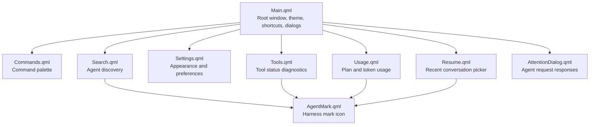
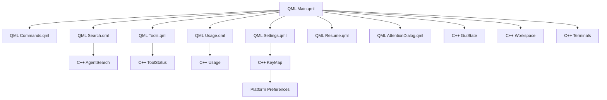
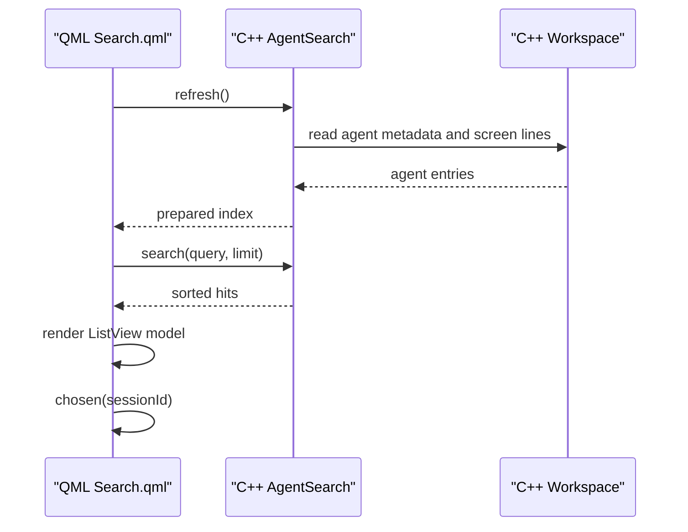
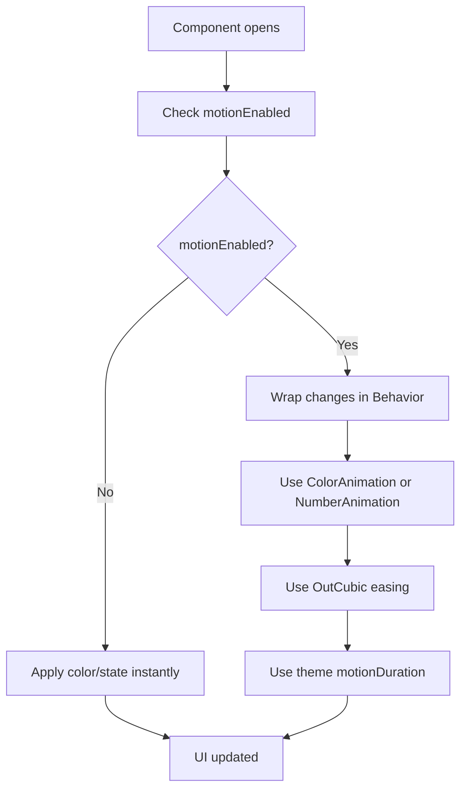
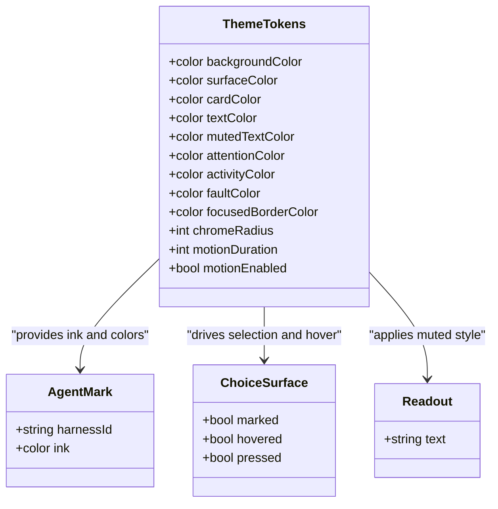
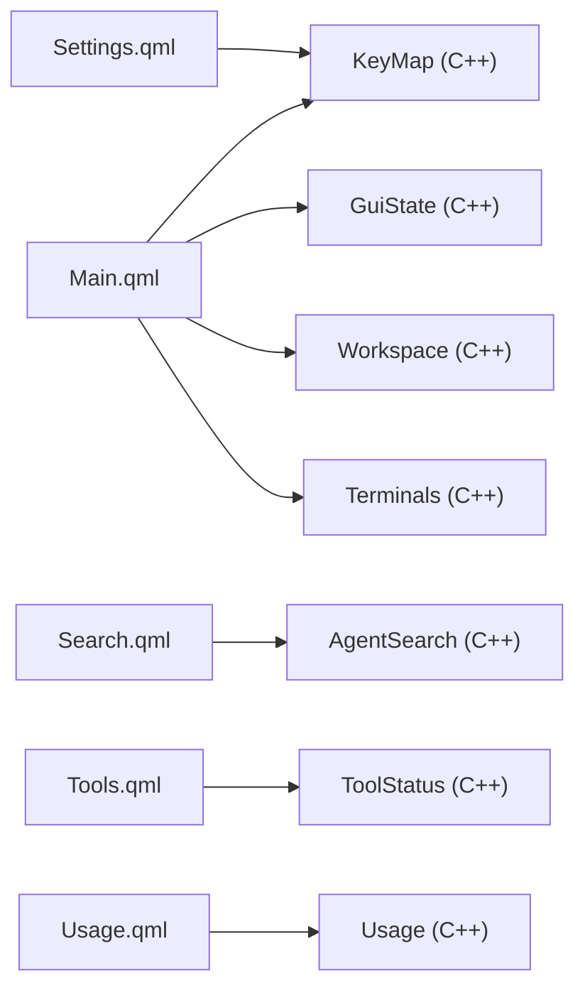

# QML User Interface Components

<cite>
**Referenced Files in This Document**
- [Main.qml](file://apps/desktop/qml/Main.qml)
- [Commands.qml](file://apps/desktop/qml/Commands.qml)
- [Search.qml](file://apps/desktop/qml/Search.qml)
- [Settings.qml](file://apps/desktop/qml/Settings.qml)
- [Tools.qml](file://apps/desktop/qml/Tools.qml)
- [AgentMark.qml](file://apps/desktop/qml/AgentMark.qml)
- [AttentionDialog.qml](file://apps/desktop/qml/AttentionDialog.qml)
- [Resume.qml](file://apps/desktop/qml/Resume.qml)
- [Usage.qml](file://apps/desktop/qml/Usage.qml)
- [main.cpp](file://apps/desktop/src/main.cpp)
- [gui_state.hpp](file://apps/desktop/src/gui_state.hpp)
- [gui_state.cpp](file://apps/desktop/src/gui_state.cpp)
- [keymap.hpp](file://apps/desktop/src/keymap.hpp)
- [agent_search.hpp](file://apps/desktop/src/agent_search.hpp)
- [tool_status.hpp](file://apps/desktop/src/tool_status.hpp)
- [usage.hpp](file://apps/desktop/src/usage.hpp)
- [architecture.md](file://docs/architecture.md)
</cite>

## Table of Contents
1. [Introduction](#introduction)
2. [Project Structure](#project-structure)
3. [Core Components](#core-components)
4. [Architecture Overview](#architecture-overview)
5. [Detailed Component Analysis](#detailed-component-analysis)
6. [Dependency Analysis](#dependency-analysis)
7. [Performance Considerations](#performance-considerations)
8. [Troubleshooting Guide](#troubleshooting-guide)
9. [Conclusion](#conclusion)

## Introduction
This document explains the Lapis desktop application’s QML user interface. It focuses on the root window, command palette, agent discovery dialog, preferences dialog, and utility panes that present status and usage data. It also describes how QML binds to C++ backend objects, how animations and reduced-motion behavior are applied, and how responsive layout choices adapt to different screen sizes. Finally, it provides guidance for extending the UI with new screens or modifying existing component behavior.

The desktop application is built with Qt Quick and exposes C++ services through registered QML types. The main QML entry point composes the workspace, dialogs, terminals, and chrome; the C++ layer owns sessions, configuration, terminal surfaces, search, tool probes, usage dashboards, and platform integration.

**Section sources**
- [architecture.md:1-165](file://docs/architecture.md#L1-L165)
- [main.cpp:1-200](file://apps/desktop/src/main.cpp#L1-L200)

## Project Structure
The desktop QML components live under `apps/desktop/qml`. The most important files for this documentation are:

| File | Responsibility |
| --- | --- |
| `Main.qml` | Root `ApplicationWindow`, theme tokens, keyboard shortcuts, dialog orchestration, workspace coordination, and shared helper functions. |
| `Commands.qml` | Modal command palette for searching and running actions. |
| `Search.qml` | Modal agent finder driven by a C++ search engine. |
| `Settings.qml` | Appearance, density, font, sound, login item, and update controls. |
| `Tools.qml` | Diagnostic pane showing installed harness commands and probe results. |
| `Usage.qml` | Dashboard of plans, accounts, token counts, and reset timing. |
| `AgentMark.qml` | Reusable harness logo component used across result rows. |
| `Resume.qml` | Modal for resuming past Claude or Codex conversations. |
| `AttentionDialog.qml` | Modal for answering agent attention requests. |

**Diagram sources**
- [Main.qml:1-200](file://apps/desktop/qml/Main.qml#L1-L200)
- [Commands.qml:1-223](file://apps/desktop/qml/Commands.qml#L1-L223)
- [Search.qml:1-187](file://apps/desktop/qml/Search.qml#L1-L187)
- [Settings.qml:1-200](file://apps/desktop/qml/Settings.qml#L1-L200)
- [Tools.qml:1-188](file://apps/desktop/qml/Tools.qml#L1-L188)
- [Usage.qml:1-200](file://apps/desktop/qml/Usage.qml#L1-L200)
- [Resume.qml:1-192](file://apps/desktop/qml/Resume.qml#L1-L192)
- [AttentionDialog.qml:1-200](file://apps/desktop/qml/AttentionDialog.qml#L1-L200)
- [AgentMark.qml:1-38](file://apps/desktop/qml/AgentMark.qml#L1-L38)

**Section sources**
- [Main.qml:1-200](file://apps/desktop/qml/Main.qml#L1-L200)
- [commands.qml:1-223](file://apps/desktop/qml/Commands.qml#L1-L223)
- [search.qml:1-187](file://apps/desktop/qml/Search.qml#L1-L187)
- [settings.qml:1-200](file://apps/desktop/qml/Settings.qml#L1-L200)
- [tools.qml:1-188](file://apps/desktop/qml/Tools.qml#L1-L188)
- [usage.qml:1-200](file://apps/desktop/qml/Usage.qml#L1-L200)
- [resume.qml:1-192](file://apps/desktop/qml/Resume.qml#L1-L192)
- [attentiondialog.qml:1-200](file://apps/desktop/qml/AttentionDialog.qml#L1-L200)
- [agentmark.qml:1-38](file://apps/desktop/qml/AgentMark.qml#L1-L38)

## Core Components
This section summarizes the role of each major QML file before diving into implementation details.

### Root Window: `Main.qml`
`Main.qml` is an `ApplicationWindow` that owns the workspace layout, theme-derived color tokens, keyboard shortcuts, input blocking rules, and the open state of every modal dialog. It reads appearance settings from a `keymap` object exposed by the C++ backend and converts them into QML properties such as background, surface, card, text, activity, attention, fault, motion duration, font sizes, sidebar visibility, preview strip visibility, and density mode.

Key responsibilities include:
- Resolving theme colors and motion settings.
- Exposing semantic color properties used throughout the UI.
- Computing readable font sizes and density-dependent widths and heights.
- Preventing keyboard interaction when dialogs, composition, paste, or transitions are active.
- Building dynamic command entries for the command palette.
- Opening and closing child dialogs like commands, search, resume, tools, usage, and attention.
- Coordinating with the workspace, terminals, and other backend services.

**Section sources**
- [Main.qml:1-200](file://apps/desktop/qml/Main.qml#L1-L200)
- [Main.qml:201-469](file://apps/desktop/qml/Main.qml#L201-L469)

### Command Palette: `Commands.qml`
`Commands.qml` is a modal dialog presenting a searchable list of actions. Each action has an identifier, label, optional shortcut display, enabled state, reason, and an optional run callback. The component filters commands by search terms, supports arrow-key navigation, highlights the selected row, and emits a `requested` signal with the chosen command ID.

Important behaviors:
- Multi-term search splits the query and requires all terms to appear in the label or shortcut.
- Selected state uses an accent-colored edge rather than changing the entire row color.
- Hover and selection states use separate visual cues so keyboard and pointer users can distinguish them.
- A small keycap component renders shortcut hints using monospace typography.

**Section sources**
- [Commands.qml:1-223](file://apps/desktop/qml/Commands.qml#L1-L223)

### Agent Discovery: `Search.qml`
`Search.qml` provides a modal for finding agents by name, folder, category, machine, or content on their screen. It receives a C++ `engine` property and calls its `refresh()` and `search(query, limit)` methods. Results are displayed in a scrollable list with harness marks, titles, places, categories, and optional matched snippets.

Important behaviors:
- The index is refreshed once when the dialog opens; typing only searches the prepared index.
- Arrow keys wrap around the result list.
- The dialog returns the selected session identifier through a `chosen` signal.

**Section sources**
- [Search.qml:1-187](file://apps/desktop/qml/Search.qml#L1-L187)
- [agent_search.hpp:1-63](file://apps/desktop/src/agent_search.hpp#L1-L63)

### Preferences: `Settings.qml`
`Settings.qml` is a modal for appearance and system-related preferences. It receives models and values for themes, densities, fonts, motion, sounds, notifications, login items, updates, and shortcuts. It applies a local color palette based on the selected theme, lets the user choose theme and density, adjust terminal font family and size, and toggle features such as finish sounds, keep-awake, usage display, notifications, and launch-at-login.

Important behaviors:
- Theme previews show background, card, border, text, muted text, focused border, activity, attention, and fault colors.
- Density options affect chrome width and tab height but leave terminal text unchanged.
- Shared components such as `ChoiceSurface`, `StepButton`, `SwitchRow`, and `ChoiceRow` keep consistent hover, press, and selection feedback.
- Theme changes apply immediately while the dialog remains open.

**Section sources**
- [Settings.qml:1-200](file://apps/desktop/qml/Settings.qml#L1-L200)
- [Settings.qml:201-450](file://apps/desktop/qml/Settings.qml#L201-L450)

### Utility Status: `Tools.qml`
`Tools.qml` displays diagnostic information about known agent harness commands. It binds to a C++ `engine` whose `rows` property contains one row per canonical harness. Each row reports whether the command resolves, its state, exit code, detail text, last check time, staleness, and whether the harness is offered by the current configuration.

Important behaviors:
- The pane refreshes all probes when opened if an engine is available.
- Users can rerun a single harness probe.
- States include working, failed, timeout, missing, present, and unknown.

**Section sources**
- [Tools.qml:1-188](file://apps/desktop/qml/Tools.qml#L1-L188)
- [tool_status.hpp:1-113](file://apps/desktop/src/tool_status.hpp#L1-L113)

### Usage Dashboard: `Usage.qml`
`Usage.qml` shows plan usage, account summaries, token totals, daily charts, and reset timing for one or more machines. It binds to a C++ `engine` providing a `machines` list. Each machine may have providers such as Codex or Claude, accounts from CLI sign-ins or OMP, windows with percent-used gauges, and monthly token counts.

Important behaviors:
- Multiple machines are selectable through tabs when configured.
- Gauges read remaining budget and change color by threshold.
- Token totals are formatted as K, M, or B.
- Reset timing and pace warnings are shown where available.

**Section sources**
- [Usage.qml:1-200](file://apps/desktop/qml/Usage.qml#L1-L200)
- [Usage.qml:201-386](file://apps/desktop/qml/Usage.qml#L201-L386)
- [usage.hpp:1-200](file://apps/desktop/src/usage.hpp#L1-L200)

### Reusable Icon: `AgentMark.qml`
`AgentMark.qml` renders SVG paths for supported harness identifiers and falls back to two uppercase letters when no path is known. It is reused by search results, tool cards, usage provider cards, and resume results.

**Section sources**
- [AgentMark.qml:1-38](file://apps/desktop/qml/AgentMark.qml#L1-L38)

### Conversation Resume: `Resume.qml`
`Resume.qml` lists recent Claude or Codex conversations and allows the user to resume one as a new agent in the current category. It binds to a C++ engine that supplies `recent(query, limit)` and `refresh()`.

**Section sources**
- [Resume.qml:1-192](file://apps/desktop/qml/Resume.qml#L1-L192)

### Agent Attention: `AttentionDialog.qml`
`AttentionDialog.qml` presents agent attention requests, manages draft answers, caches drafts, validates completion, and submits approved or declined responses. It integrates with a session object to obtain requests and send answers.

**Section sources**
- [AttentionDialog.qml:1-200](file://apps/desktop/qml/AttentionDialog.qml#L1-L200)

## Architecture Overview
The desktop application follows a layered architecture:

- **QML UI**: Dialogs, lists, forms, icons, and layouts.
- **Registered QML types**: C++ classes exposed to QML as service objects.
- **C++ services**: Workspace, keymap, terminal surfaces, search, tool status, usage, platform preferences, and runtime state.
- **Platform integration**: macOS-specific motion, sounds, window styling, and global shortcuts.

**Diagram sources**
- [Main.qml:1-200](file://apps/desktop/qml/Main.qml#L1-L200)
- [Search.qml:1-187](file://apps/desktop/qml/Search.qml#L1-L187)
- [Tools.qml:1-188](file://apps/desktop/qml/Tools.qml#L1-L188)
- [Usage.qml:1-200](file://apps/desktop/qml/Usage.qml#L1-L200)
- [Settings.qml:1-200](file://apps/desktop/qml/Settings.qml#L1-L200)
- [agent_search.hpp:1-63](file://apps/desktop/src/agent_search.hpp#L1-L63)
- [tool_status.hpp:1-113](file://apps/desktop/src/tool_status.hpp#L1-L113)
- [usage.hpp:1-200](file://apps/desktop/src/usage.hpp#L1-L200)
- [keymap.hpp:1-200](file://apps/desktop/src/keymap.hpp#L1-L200)
- [gui_state.hpp:1-97](file://apps/desktop/src/gui_state.hpp#L1-L97)

**Section sources**
- [architecture.md:1-165](file://docs/architecture.md#L1-L165)
- [main.cpp:500-788](file://apps/desktop/src/main.cpp#L500-L788)

## Detailed Component Analysis

### Data Binding Between QML and C++ Backend Objects
QML communicates with C++ through several mechanisms:

1. **Registered QML types**: C++ classes such as `TerminalSurface`, `KeyMap`, `AgentSearch`, `ToolStatus`, and `Usage` are registered so QML can bind to their properties and call `Q_INVOKABLE` methods.
2. **Properties and signals**: Backend objects expose properties like `rows`, `machines`, `themes`, `shortcutBindings`, and `showUsage`. Changes trigger QML updates.
3. **Signals and slots**: Backend services emit signals (for example, configuration changes) that QML connects to, often through `Connections`.
4. **Method calls**: QML invokes backend methods such as `refresh`, `search`, `setTheme`, `setDensity`, `toggleLayout`, and `respondAttention`.

Examples:
- `Search.qml` binds `engine.search(query, 40)` and `engine.refresh()`.
- `Tools.qml` binds `engine.rows` and calls `engine.refresh()` and `engine.refreshTool(id)`.
- `Usage.qml` binds `engine.machines` and calls `engine.refresh()`.
- `Settings.qml` calls `themeChosen`, `densityChosen`, and other signals that the parent or C++ layer translates into configuration updates.
- `Main.qml` reads `keymap.themes`, `keymap.themeName`, `keymap.densityName`, `keymap.shortcutBindings`, and `keymap.showUsage`.

**Diagram sources**
- [Search.qml:1-187](file://apps/desktop/qml/Search.qml#L1-L187)
- [agent_search.hpp:1-63](file://apps/desktop/src/agent_search.hpp#L1-L63)

**Section sources**
- [main.cpp:500-788](file://apps/desktop/src/main.cpp#L500-L788)
- [agent_search.hpp:1-63](file://apps/desktop/src/agent_search.hpp#L1-L63)
- [tool_status.hpp:1-113](file://apps/desktop/src/tool_status.hpp#L1-L113)
- [usage.hpp:1-200](file://apps/desktop/src/usage.hpp#L1-L200)
- [keymap.hpp:1-200](file://apps/desktop/src/keymap.hpp#L1-L200)

### Animation System for Smooth Transitions
Animations are controlled by three related concepts:

- `motionDuration`: a theme-provided duration in milliseconds.
- `motionEnabled`: derived from reduced-motion preference, window activation, visibility, and duration.
- `Behavior` blocks on color and geometry properties, wrapping `ColorAnimation` or `NumberAnimation` with `Easing.OutCubic`.

Components that animate include:
- Command and search result row backgrounds.
- Settings choice surfaces and theme swatches.
- Usage gauge bars.
- Any custom control that respects `motionEnabled`.

Reduced motion is respected at both the platform level and the QML level. On macOS, platform helpers provide a reduced-motion query, and QML derives `motionEnabled` accordingly.

**Diagram sources**
- [Main.qml:1-200](file://apps/desktop/qml/Main.qml#L1-L200)
- [Commands.qml:1-223](file://apps/desktop/qml/Commands.qml#L1-L223)
- [Search.qml:1-187](file://apps/desktop/qml/Search.qml#L1-L187)
- [Settings.qml:201-450](file://apps/desktop/qml/Settings.qml#L201-L450)
- [Usage.qml:201-386](file://apps/desktop/qml/Usage.qml#L201-L386)

**Section sources**
- [Main.qml:1-200](file://apps/desktop/qml/Main.qml#L1-L200)
- [Commands.qml:1-223](file://apps/desktop/qml/Commands.qml#L1-L223)
- [Search.qml:1-187](file://apps/desktop/qml/Search.qml#L1-L187)
- [Settings.qml:201-450](file://apps/desktop/qml/Settings.qml#L201-L450)
- [Usage.qml:201-386](file://apps/desktop/qml/Usage.qml#L201-L386)

### Responsive Design Patterns Across Screen Sizes
Responsive design in these QML components is achieved through:

- **Minimum window constraints**: The root window defines minimum width and height.
- **Narrow detection**: `Main.qml` computes `narrow = width < 860` and adjusts sidebar and preview behavior.
- **Density modes**: Comfortable, compact, and minimal density change rail width, tab height, and spacing without changing terminal text.
- **Adaptive dimensions**: Dialogs clamp width and height to `parent.width - 32` or `parent.height - 32`, with reasonable defaults.
- **Conditional visibility**: Previews and agent strips hide themselves when disabled or empty.
- **Flexible layouts**: `ColumnLayout`, `RowLayout`, `Flow`, and `GridLayout` adapt to available space.
- **Elision and wrapping**: Labels elide long text or wrap prose, keeping readouts compact.

Examples:
- `Settings.qml` switches between two and three columns for theme swatches depending on dialog width.
- `Usage.qml` shows machine tabs only when multiple machines exist.
- `Main.qml` computes `railWidth`, `tabHeight`, `stripHeight`, and `chromeFont` from density and window size.

**Section sources**
- [Main.qml:1-200](file://apps/desktop/qml/Main.qml#L1-L200)
- [Settings.qml:201-450](file://apps/desktop/qml/Settings.qml#L201-L450)
- [Usage.qml:201-386](file://apps/desktop/qml/Usage.qml#L201-L386)

### Styling Approach Using Themes and Custom Components
Styling is centralized through theme-aware properties and reusable components:

- **Theme tokens**: `backgroundColor`, `surfaceColor`, `cardColor`, `textColor`, `mutedTextColor`, `attentionColor`, `activityColor`, `faultColor`, `focusedBorderColor`, and `chromeRadius` come from the active theme.
- **Local palettes**: `Settings.qml` maps theme values to internal palette variables for immediate preview.
- **Custom components**: `AgentMark.qml`, `Keycap`, `ChoiceSurface`, `StepButton`, `SwitchRow`, `ChoiceRow`, and `Readout` encapsulate visual patterns.
- **Consistent interaction feedback**: Selection uses an accent edge; hover uses a lighter wash; pressed states darken the background.
- **Typography**: Monospace fonts are used for machine readouts, paths, shortcuts, and states; human-readable labels use the UI face.

**Diagram sources**
- [Main.qml:1-200](file://apps/desktop/qml/Main.qml#L1-L200)
- [AgentMark.qml:1-38](file://apps/desktop/qml/AgentMark.qml#L1-L38)
- [Settings.qml:201-450](file://apps/desktop/qml/Settings.qml#L201-L450)

**Section sources**
- [Main.qml:1-200](file://apps/desktop/qml/Main.qml#L1-L200)
- [Settings.qml:1-200](file://apps/desktop/qml/Settings.qml#L1-L200)
- [AgentMark.qml:1-38](file://apps/desktop/qml/AgentMark.qml#L1-L38)

### Extending the UI with New Screens
To add a new screen or dialog:

1. Create a new QML file under `apps/desktop/qml`.
2. Use a `Dialog` for modals or a dedicated layout inside `Main.qml` for persistent panels.
3. Bind to a C++ service through a registered QML type or pass required data through properties.
4. Follow existing patterns:
   - Accept an `engine` or data model property.
   - Provide a `refresh()` method call on open.
   - Use `ListView` with delegates for lists.
   - Support arrow-key navigation and Enter/Esc handling.
   - Respect `motionEnabled` and `motionDuration`.
   - Use theme tokens or local palette variables.
5. Add an entry in the command palette if the screen should be reachable via keyboard.
6. Wire opening logic in `Main.qml`, including input blocking and availability checks.

Example extension pattern:
- A new diagnostic screen could follow `Tools.qml` and bind to a C++ `DiagnosticEngine`.
- A new settings page could extend `Settings.qml` by adding another section and emitting a signal handled by the parent.

**Section sources**
- [Commands.qml:1-223](file://apps/desktop/qml/Commands.qml#L1-L223)
- [Tools.qml:1-188](file://apps/desktop/qml/Tools.qml#L1-L188)
- [Settings.qml:1-200](file://apps/desktop/qml/Settings.qml#L1-L200)
- [Main.qml:201-469](file://apps/desktop/qml/Main.qml#L201-L469)

### Modifying Existing Component Behavior
When modifying an existing component:

- Prefer changing shared properties such as `motionEnabled`, `motionDuration`, `chromeRadius`, or palette colors rather than duplicating visuals.
- Keep keyboard accessibility: preserve arrow-key navigation, focus handling, and accessible names.
- Avoid heavy computations in delegates; delegate work belongs in the C++ model or in computed properties outside frequently recreated delegates.
- Preserve translation support by keeping `qsTr` for user-visible strings.
- Validate inputs and disable unavailable actions instead of silently failing.
- Update the command palette and any relevant keyboard shortcuts in `Main.qml`.

**Section sources**
- [Commands.qml:1-223](file://apps/desktop/qml/Commands.qml#L1-L223)
- [Search.qml:1-187](file://apps/desktop/qml/Search.qml#L1-L187)
- [Settings.qml:201-450](file://apps/desktop/qml/Settings.qml#L201-L450)
- [Main.qml:201-469](file://apps/desktop/qml/Main.qml#L201-L469)

## Dependency Analysis
The following diagram shows the primary dependencies between QML components and C++ services.

**Diagram sources**
- [Main.qml:1-200](file://apps/desktop/qml/Main.qml#L1-L200)
- [Search.qml:1-187](file://apps/desktop/qml/Search.qml#L1-L187)
- [Tools.qml:1-188](file://apps/desktop/qml/Tools.qml#L1-L188)
- [Usage.qml:1-200](file://apps/desktop/qml/Usage.qml#L1-L200)
- [Settings.qml:1-200](file://apps/desktop/qml/Settings.qml#L1-L200)
- [keymap.hpp:1-200](file://apps/desktop/src/keymap.hpp#L1-L200)
- [gui_state.hpp:1-97](file://apps/desktop/src/gui_state.hpp#L1-L97)
- [agent_search.hpp:1-63](file://apps/desktop/src/agent_search.hpp#L1-L63)
- [tool_status.hpp:1-113](file://apps/desktop/src/tool_status.hpp#L1-L113)
- [usage.hpp:1-200](file://apps/desktop/src/usage.hpp#L1-L200)

**Section sources**
- [main.cpp:500-788](file://apps/desktop/src/main.cpp#L500-L788)
- [keymap.hpp:1-200](file://apps/desktop/src/keymap.hpp#L1-L200)
- [gui_state.hpp:1-97](file://apps/desktop/src/gui_state.hpp#L1-L97)
- [agent_search.hpp:1-63](file://apps/desktop/src/agent_search.hpp#L1-L63)
- [tool_status.hpp:1-113](file://apps/desktop/src/tool_status.hpp#L1-L113)
- [usage.hpp:1-200](file://apps/desktop/src/usage.hpp#L1-L200)

## Performance Considerations
The project prioritizes responsiveness over visual polish. Relevant characteristics include:

- Terminal glyphs are never animated.
- Motion is short, interruptible, and respects reduced motion.
- Search builds an index once and performs lightweight filtering per keystroke.
- Tool probes and usage scans are throttled, bounded, and run off the GUI thread where possible.
- Window state is rate-limited and written asynchronously.
- Lists use `clip`, `boundsBehavior`, and scroll policies to avoid unnecessary rendering.

Recommendations:
- Avoid recomputing large lists in frequently changing QML properties.
- Keep delegate logic simple and delegate expensive work to C++.
- Reuse components like `AgentMark` and `Readout` instead of recreating icons or styles.
- Respect `motionEnabled` to prevent unnecessary animations on low-power or reduced-motion systems.
- Measure frame and input latency against the documented reference workload.

[No sources needed since this section provides general guidance]

## Troubleshooting Guide
Common issues and remedies:

| Symptom | Likely Cause | Resolution |
| --- | --- | --- |
| Animations feel janky or inconsistent | Reduced motion not detected or motion duration too high | Verify `motionEnabled` and `motionDuration`; check platform reduced-motion settings. |
| Command palette does not filter correctly | Search terms split incorrectly or command data lacks label/shortcut | Inspect `filteredCommands` computation and ensure command entries include required fields. |
| Agent search returns stale results | Index not refreshed after backend update | Call `engine.refresh()` on open and listen for backend changes. |
| Tool status shows “not checked yet” | Probes have not run or are queued | Click “Check all” or rerun the specific harness. |
| Usage dashboard is empty | No signed-in plans or transcripts found | Confirm configuration, CLI installation, and transcript locations. |
| Settings theme preview does not match runtime | Local palette not updated or wrong theme name | Ensure `applyTheme` runs on theme change and palette variables are bound. |
| Window state is not restored | State file missing, corrupt, or oversized | Check the runtime state file location and permissions; invalid files are ignored safely. |

Relevant backend behavior:
- `GuiState` loads, validates, and writes a bounded JSON file off the GUI thread.
- Missing, unreadable, malformed, oversized, or version-mismatched state files are ignored with warnings.
- `ToolStatus` queues probes, limits concurrent output, and reports staleness.
- `Usage` polls limits and token counts on timers and stops work when inactive.

**Section sources**
- [gui_state.cpp:1-213](file://apps/desktop/src/gui_state.cpp#L1-L213)
- [tool_status.hpp:1-113](file://apps/desktop/src/tool_status.hpp#L1-L113)
- [usage.hpp:1-200](file://apps/desktop/src/usage.hpp#L1-L200)

## Conclusion
The Lapis desktop QML interface is organized around a root window that composes workspace chrome, modals, and shared visual tokens. Child components such as the command palette, agent search, settings, tools, usage, resume, and attention dialogs each solve a focused task while sharing styling, animation, and interaction conventions. C++ backend services provide configuration, session state, search, diagnostics, usage data, and platform integration. The design emphasizes responsiveness, accessibility, theme-driven styling, and graceful degradation when optional features are unavailable. Extending the UI is straightforward when new screens follow the established patterns for binding, keyboard navigation, motion, and responsive layout.

[No sources needed since this section summarizes without analyzing specific files]