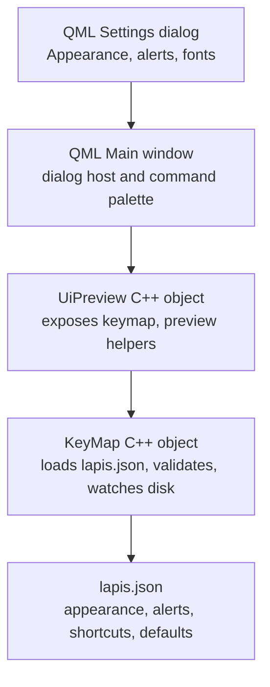
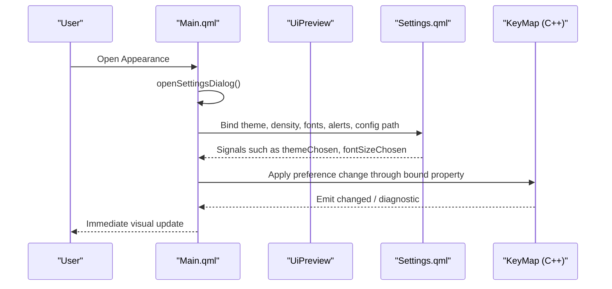
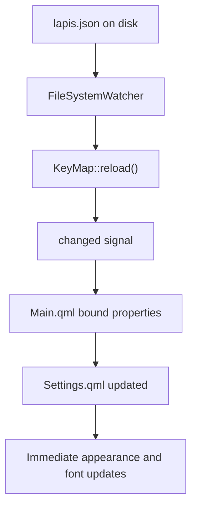
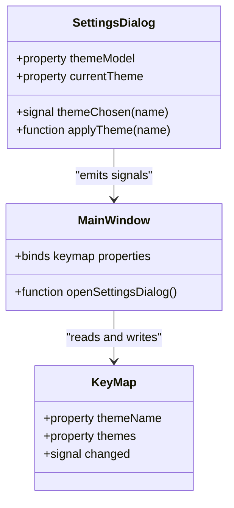
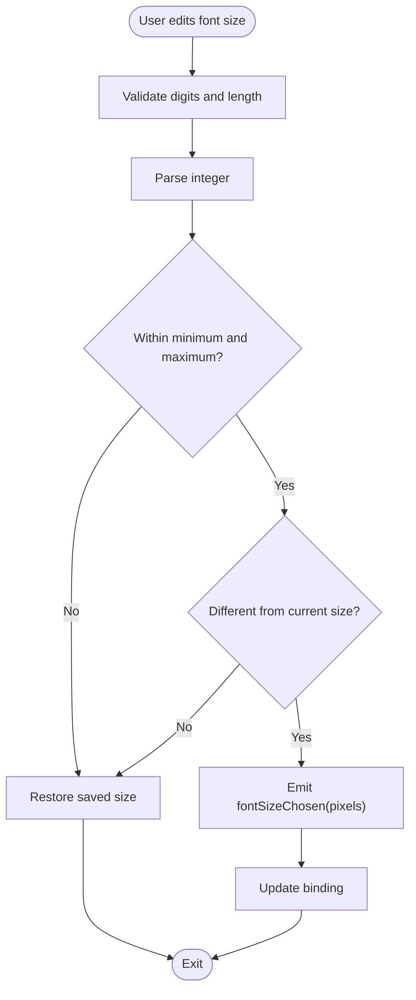
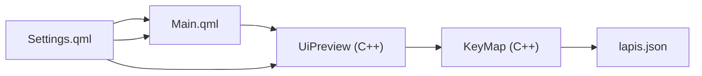

# Settings and Configuration Interface

<cite>
**Referenced Files in This Document**
- [Settings.qml](file://apps/desktop/qml/Settings.qml)
- [Main.qml](file://apps/desktop/qml/Main.qml)
- [config.md](file://docs/config.md)
- [keys.md](file://docs/keys.md)
- [ui_preview.hpp](file://apps/desktop/src/ui_preview.hpp)
- [ui_preview.cpp](file://apps/desktop/src/ui_preview.cpp)
- [keymap.cpp](file://apps/desktop/src/keymap.cpp)
</cite>

## Table of Contents
1. [Introduction](#introduction)
2. [Project Structure](#project-structure)
3. [Core Components](#core-components)
4. [Architecture Overview](#architecture-overview)
5. [Detailed Component Analysis](#detailed-component-analysis)
6. [Dependency Analysis](#dependency-analysis)
7. [Performance Considerations](#performance-considerations)
8. [Troubleshooting Guide](#troubleshooting-guide)
9. [Conclusion](#conclusion)

## Introduction
This document explains the desktop application’s settings interface built in QML. The Appearance dialog, defined in `Settings.qml`, lets users customize appearance, keyboard shortcuts, terminal font behavior, alert sounds, platform-specific login and update options, and usage visibility. It does not provide a full editor for every setting; instead, it exposes configuration values to the user interface and delegates persistence and hot reloading to the C++ preference system.

The primary configuration file is `lapis.json`. Its location is determined by the application data directory or an environment variable, and changes are detected automatically so that most settings apply without restarting the application. Keyboard shortcut editing happens through the same configuration file rather than directly inside the Appearance dialog.

## Project Structure
The settings interface lives at the intersection of three layers:

| Layer | Responsibility | Key files |
|---|---|---|
| QML UI | Dialog layout, theme preview, density controls, font selection, alert switches, and shortcut listing | `apps/desktop/qml/Settings.qml` |
| Application shell | Opens the dialog, binds shared runtime state, and handles app-level shortcuts | `apps/desktop/qml/Main.qml` |
| C++ preferences | Loads `lapis.json`, validates inputs, watches for disk changes, and exposes bindings to QML | `apps/desktop/src/keymap.cpp`, `apps/desktop/src/ui_preview.hpp`, `apps/desktop/src/ui_preview.cpp` |

**Diagram sources**
- [Settings.qml:1-20](file://apps/desktop/qml/Settings.qml#L1-L20)
- [Main.qml:670-680](file://apps/desktop/qml/Main.qml#L670-L680)
- [Main.qml:1757-1775](file://apps/desktop/qml/Main.qml#L1757-L1775)
- [ui_preview.hpp:28-37](file://apps/desktop/src/ui_preview.hpp#L28-L37)
- [ui_preview.cpp:487-507](file://apps/desktop/src/ui_preview.cpp#L487-L507)
- [keymap.cpp:439-475](file://apps/desktop/src/keymap.cpp#L439-L475)

**Section sources**
- [Settings.qml:1-20](file://apps/desktop/qml/Settings.qml#L1-L20)
- [Main.qml:670-680](file://apps/desktop/qml/Main.qml#L670-L680)
- [Main.qml:1757-1775](file://apps/desktop/qml/Main.qml#L1757-L1775)
- [ui_preview.hpp:28-37](file://apps/desktop/src/ui_preview.hpp#L28-L37)
- [ui_preview.cpp:487-507](file://apps/desktop/src/ui_preview.cpp#L487-L507)
- [keymap.cpp:439-475](file://apps/desktop/src/keymap.cpp#L439-L475)

## Core Components

### Settings.qml: the Appearance dialog
`Settings.qml` is a modal dialog that presents grouped sections:

| Section | User-facing purpose | Binding model |
|---|---|---|
| Theme | Choose a color theme from a model supplied by C++. Each card previews surface colors, text, focus, attention, and fault colors. | `themeModel`, `currentTheme`, `themeChosen(name)` |
| Density | Choose between comfortable, compact, and minimal chrome density. | `densityModel`, `currentDensity`, `densityChosen(name)` |
| Terminal font | Select a fixed-width family, adjust pixel size, and preview the result. | `fontFamilies`, `fontFamily`, `resolvedFontFamily`, `fontSize`, `fontSizeMinimum`, `fontSizeMaximum`, `fontSizeDefault`, `fontFamilyChosen`, `fontSizeChosen` |
| Alerts | Toggle finish chimes, background notifications, launch-at-login availability, automatic updates, keep-awake, and plan usage display. | `finishSound`, `notify`, `loginAvailable`, `launchAtLogin`, `updatesAvailable`, `keepAwake`, `showUsage`, plus their signals |
| Keyboard shortcuts | Display current action labels and keys. Editing is delegated to the configuration file. | `shortcutRows`, `shortcutHint` |
| Configuration path | Show the active `lapis.json` path and any diagnostic message about loading. | `configPath`, `configDiagnostic` |

The dialog uses local QML properties for its own theme palette and animations. Animations respect motion settings through `motionEnabled` and `motionDuration`, which come from the main window.

**Section sources**
- [Settings.qml:1-20](file://apps/desktop/qml/Settings.qml#L1-L20)
- [Settings.qml:201-270](file://apps/desktop/qml/Settings.qml#L201-L270)
- [Settings.qml:556-620](file://apps/desktop/qml/Settings.qml#L556-L620)
- [Settings.qml:621-700](file://apps/desktop/qml/Settings.qml#L621-L700)
- [Settings.qml:701-796](file://apps/desktop/qml/Settings.qml#L701-L796)

### Main.qml: dialog owner and shared context
`Main.qml` owns the workspace view and opens the settings dialog through a root function. It also supplies the data binding layer:

- `openSettingsDialog()` guards against opening while a terminal is composing or pasting and while other dialogs are visible.
- The `Settings` component receives values from `keymap`, `preview`, and the live terminal.
- Command palette actions bind to `openSettings` and `reloadConfig`.

**Diagram sources**
- [Main.qml:670-680](file://apps/desktop/qml/Main.qml#L670-L680)
- [Main.qml:1757-1775](file://apps/desktop/qml/Main.qml#L1757-L1775)

**Section sources**
- [Main.qml:670-680](file://apps/desktop/qml/Main.qml#L670-L680)
- [Main.qml:1757-1775](file://apps/desktop/qml/Main.qml#L1757-L1775)

### UiPreview: bridge between C++ runtime and QML
`UiPreview` is the C++ object exposed to QML under the name `preview`. It provides:

- A list of installed monospace font families.
- Reduced-motion and system reduced-motion state.
- Diagnostics for QML load issues.
- The configured shortcut used to open the settings dialog.
- Methods to reload the QML source, assign terminal focus, and open the settings dialog.

It exposes optional objects through `exposeObjects`, including `keymap`, `alerts`, `usage`, `desktop`, `terminals`, and others. This is how QML reads `keymap.actionSequences(...)`, `keymap.themeName`, and related preferences.

**Section sources**
- [ui_preview.hpp:28-37](file://apps/desktop/src/ui_preview.hpp#L28-L37)
- [ui_preview.hpp:40-70](file://apps/desktop/src/ui_preview.hpp#L40-L70)
- [ui_preview.cpp:192-217](file://apps/desktop/src/ui_preview.cpp#L192-L217)
- [ui_preview.cpp:370-389](file://apps/desktop/src/ui_preview.cpp#L370-L389)
- [ui_preview.cpp:487-507](file://apps/desktop/src/ui_preview.cpp#L487-L507)

### KeyMap and lapis.json: preference system
`KeyMap` is the C++ implementation behind the configuration system. It:

- Reads `lapis.json` from a default data directory or from `LAPIS_CONFIG`.
- Emits a diagnostic when the file is missing or invalid.
- Watches the configuration file and its directory.
- Reloads when the file content changes on disk.
- Exposes themes, densities, terminal font family, font size limits, shortcut sequences, and alert-related settings to QML.

The documentation confirms that `lapis.json` holds appearance, key bindings, alerts, new-agent defaults, and related configuration. Changes apply immediately, either because the file watcher triggers a reload or because the application explicitly reloads configuration.

**Section sources**
- [config.md:1-20](file://docs/config.md#L1-L20)
- [config.md:21-60](file://docs/config.md#L21-L60)
- [keymap.cpp:439-475](file://apps/desktop/src/keymap.cpp#L439-L475)
- [keymap.cpp:478-484](file://apps/desktop/src/keymap.cpp#L478-L484)
- [keymap.cpp:543-548](file://apps/desktop/src/keymap.cpp#L543-L548)

## Architecture Overview
The settings interface follows a layered architecture:

1. **QML presentation**: `Settings.qml` renders groups of controls and emits signals when the user changes a value.
2. **Application shell**: `Main.qml` hosts the dialog, guards input, and connects signals to higher-level operations.
3. **C++ preference engine**: `KeyMap` owns the canonical configuration file, validates it, and publishes properties to QML.
4. **Runtime bridge**: `UiPreview` exposes additional runtime state and invokes QML functions from C++.

**Diagram sources**
- [keymap.cpp:439-475](file://apps/desktop/src/keymap.cpp#L439-L475)
- [Main.qml:1757-1775](file://apps/desktop/qml/Main.qml#L1757-L1775)
- [Settings.qml:701-796](file://apps/desktop/qml/Settings.qml#L701-L796)

## Detailed Component Analysis

### Appearance and theme selection
The theme section displays each available theme as a card with its label and representative color swatches. The selected theme has a thicker accent border. Choosing a theme emits `themeChosen`, which flows back through `Main.qml` into the `keymap` binding.

The dialog computes its internal palette from the selected theme, including window, surface, border, text, muted, accent, selected, hover, and fault colors. Motion animations use `Behavior` blocks controlled by `motionEnabled` and `motionDuration`.

**Diagram sources**
- [Settings.qml:1-20](file://apps/desktop/qml/Settings.qml#L1-L20)
- [Settings.qml:201-270](file://apps/desktop/qml/Settings.qml#L201-L270)
- [Main.qml:1757-1775](file://apps/desktop/qml/Main.qml#L1757-L1775)
- [keymap.cpp:543-548](file://apps/desktop/src/keymap.cpp#L543-L548)

**Section sources**
- [Settings.qml:201-270](file://apps/desktop/qml/Settings.qml#L201-L270)
- [Settings.qml:271-350](file://apps/desktop/qml/Settings.qml#L271-L350)

### Density and chrome controls
Density is presented as a choice row with descriptions for comfortable, compact, and minimal modes. The description is generated locally in QML and reflects the current selection. Changing density emits `densityChosen`, which updates the density binding in `Main.qml`.

**Section sources**
- [Settings.qml:271-350](file://apps/desktop/qml/Settings.qml#L271-L350)
- [Main.qml:1757-1775](file://apps/desktop/qml/Main.qml#L1757-L1775)

### Terminal font selection and validation
The terminal font section supports:

- Family selection from installed monospace families.
- Index 0 representing the system default.
- An uninstalled configured family still appearing in the list so the selection remains visible.
- Pixel-size adjustment using smaller/larger buttons and a numeric text field.
- A live preview string showing typical terminal characters.
- A reset button restoring both family and size to defaults.
- A warning label when the configured family does not resolve to the expected fixed-width face.

Input validation is implemented in QML:

- The text field accepts only digits up to three characters.
- On commit, the value is parsed as an integer.
- It must be within `fontSizeMinimum` and `fontSizeMaximum`.
- It must differ from the current value before emitting `fontSizeChosen`.
- The field text is rebound to the saved value so invalid edits do not drift.

**Diagram sources**
- [Settings.qml:556-620](file://apps/desktop/qml/Settings.qml#L556-L620)

**Section sources**
- [Settings.qml:351-420](file://apps/desktop/qml/Settings.qml#L351-L420)
- [Settings.qml:421-555](file://apps/desktop/qml/Settings.qml#L421-L555)
- [Settings.qml:556-620](file://apps/desktop/qml/Settings.qml#L556-L620)

### Alert sound, background notification, and platform-specific options
The alerts section includes:

- A toggle for finishing turn chimes, with a Play button that requests a sound preview through the `chimePlayed` signal.
- A toggle for background notifications.
- A conditional toggle for launching agents at login, visible only when the platform reports availability.
- A conditional update check row, visible only when updates are available.
- A macOS-focused keep-awake toggle.
- A usage visibility toggle that depends on account and machine configuration.

These toggles are local QML state in the dialog unless they correspond to a C++-backed preference. For example, `notify` and `launchAtLogin` are declared as local properties, while values such as `finishSound`, `keepAwake`, and `showUsage` come from the `keymap` binding.

**Section sources**
- [Settings.qml:621-700](file://apps/desktop/qml/Settings.qml#L621-L700)

### Keyboard shortcuts display
The keyboard shortcuts section lists action labels and their current key sequences in two columns. It does not provide inline editing. Instead, it instructs the user to edit the `keybindings` section in the configuration file. The header hint shows the shortcut for opening the Appearance dialog, taken from `window.shortcutText("openSettings")`.

The underlying C++ code defines default bindings and includes a `reloadConfig` action bound to `Command-R` on macOS (or the platform modifier). Documentation also records this reload shortcut.

**Section sources**
- [Settings.qml:701-760](file://apps/desktop/qml/Settings.qml#L701-L760)
- [keys.md:55-64](file://docs/keys.md#L55-L64)
- [keymap.cpp:543-548](file://apps/desktop/src/keymap.cpp#L543-L548)

### Configuration path and diagnostics
The configuration section displays:

- The active `lapis.json` path.
- Any diagnostic produced by loading the configuration.
- A user-facing note explaining that changes are saved immediately and that edits made by the user or an agent apply at once.

The path and diagnostic come from `keymap.sourcePath` and `keymap.diagnostic`. When the file cannot be read or contains invalid values, `KeyMap` populates the diagnostic and emits `changed`, allowing the UI to reflect the problem without crashing.

**Section sources**
- [Settings.qml:761-796](file://apps/desktop/qml/Settings.qml#L761-L796)
- [keymap.cpp:649-658](file://apps/desktop/src/keymap.cpp#L649-L658)

## Dependency Analysis
The following diagram shows the principal dependencies among QML components and C++ objects involved in the settings workflow.

**Diagram sources**
- [Settings.qml:1-20](file://apps/desktop/qml/Settings.qml#L1-L20)
- [Main.qml:1757-1775](file://apps/desktop/qml/Main.qml#L1757-L1775)
- [ui_preview.hpp:28-37](file://apps/desktop/src/ui_preview.hpp#L28-L37)
- [ui_preview.cpp:487-507](file://apps/desktop/src/ui_preview.cpp#L487-L507)
- [keymap.cpp:439-475](file://apps/desktop/src/keymap.cpp#L439-L475)

**Section sources**
- [Settings.qml:1-20](file://apps/desktop/qml/Settings.qml#L1-L20)
- [Main.qml:1757-1775](file://apps/desktop/qml/Main.qml#L1757-L1775)
- [ui_preview.hpp:28-37](file://apps/desktop/src/ui_preview.hpp#L28-L37)
- [ui_preview.cpp:487-507](file://apps/desktop/src/ui_preview.cpp#L487-L507)
- [keymap.cpp:439-475](file://apps/desktop/src/keymap.cpp#L439-L475)

## Performance Considerations
- The Appearance dialog applies theme and motion changes locally where possible, avoiding expensive round trips for transient UI state.
- Font family resolution is delegated to the Qt font system; the UI warns only when the configured family does not match the resolved fixed-width face.
- The configuration watcher debounces rapid file changes through a short timer, preventing repeated reload bursts caused by editors replacing the file.
- QML input validation prevents unnecessary C++ calls for clearly invalid font sizes.

[No sources needed since this section provides general guidance]

## Troubleshooting Guide

### The settings dialog does not open
Possible causes include:

- The terminal is composing or pasting.
- Another dialog or menu is already open.
- The application is shutting down.

`Main.qml` checks for terminal busy state and existing dialogs before opening the settings dialog. `UiPreview::openSettings()` rejects calls during shutdown, when input is blocked, or when no QML root is available.

**Section sources**
- [Main.qml:670-680](file://apps/desktop/qml/Main.qml#L670-L680)
- [ui_preview.cpp:370-389](file://apps/desktop/src/ui_preview.cpp#L370-L389)

### Keyboard shortcuts do not appear
If the `keymap` object is unavailable in a development fixture, the main window falls back to default values. In normal mode, shortcut hints come from `keymap`, while the appearance dialog lists all configured actions.

**Section sources**
- [Main.qml:1757-1775](file://apps/desktop/qml/Main.qml#L1757-L1775)
- [ui_preview.cpp:487-507](file://apps/desktop/src/ui_preview.cpp#L487-L507)

### Font size changes are rejected
Check whether the value:

- Contains non-digits.
- Exceeds three digits.
- Falls outside `fontSizeMinimum` and `fontSizeMaximum`.
- Is equal to the current saved size.

When validation fails, the field restores the saved value.

**Section sources**
- [Settings.qml:556-620](file://apps/desktop/qml/Settings.qml#L556-L620)

### Configuration file errors are shown
Look at the diagnostic displayed in the Configuration section. Common cases include:

- Missing configuration file.
- Path is not a regular file.
- Invalid key sequence or too many sequences per action.
- Unsupported theme, layout, or density name.

`KeyMap` clears diagnostics on reload, accumulates messages, and emits `changed` so the UI updates.

**Section sources**
- [keymap.cpp:318-341](file://apps/desktop/src/keymap.cpp#L318-L341)
- [keymap.cpp:392-428](file://apps/desktop/src/keymap.cpp#L392-L428)
- [keymap.cpp:649-658](file://apps/desktop/src/keymap.cpp#L649-L658)
- [Settings.qml:761-796](file://apps/desktop/qml/Settings.qml#L761-L796)

### Hot reload does not apply
Verify that:

- The configuration file is being watched and its path matches `lapis.json`.
- The file content actually changed.
- The application is running in normal mode, not an isolated fixture where reload may behave differently.
- The explicit reload shortcut was used if manual reload is desired.

The file watcher detects both file and directory changes and triggers reload after a short debounce. The `reloadConfig` action provides a manual reload path.

**Section sources**
- [keymap.cpp:439-475](file://apps/desktop/src/keymap.cpp#L439-L475)
- [keymap.cpp:543-548](file://apps/desktop/src/keymap.cpp#L543-L548)
- [config.md:1-20](file://docs/config.md#L1-L20)

## Conclusion
The settings interface is intentionally focused on appearance, terminal typography, alerts, and platform-specific behavior. Most persistent configuration lives in `lapis.json`, validated and observed by `KeyMap`. The QML dialog communicates through signals and bound properties, allowing immediate visual feedback for supported options. Keyboard shortcuts and broader configuration can be edited directly in the configuration file, with changes applied automatically as the C++ preference system reloads and emits updates.

There is no dedicated export/import dialog in the analyzed files. Sharing configurations therefore means copying or version-controlling `lapis.json` rather than using a built-in import/export feature exposed by the Appearance dialog.

[No sources needed since this section summarizes without analyzing specific files]