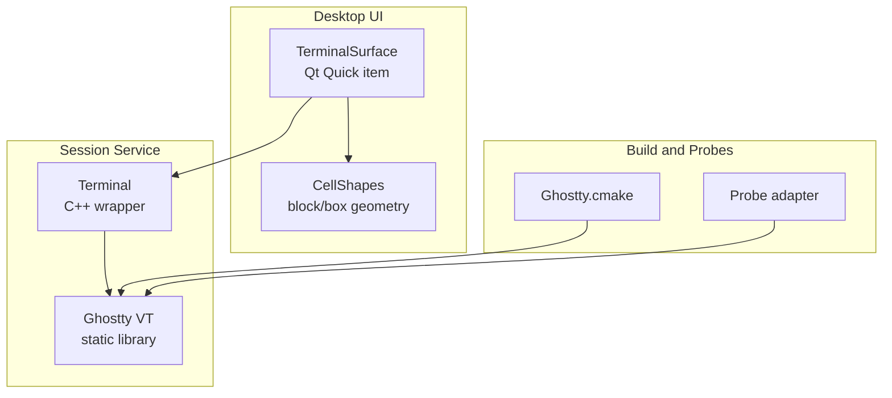
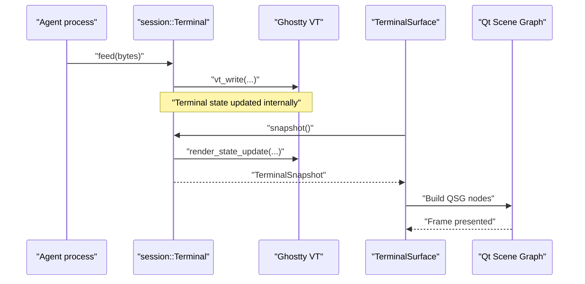
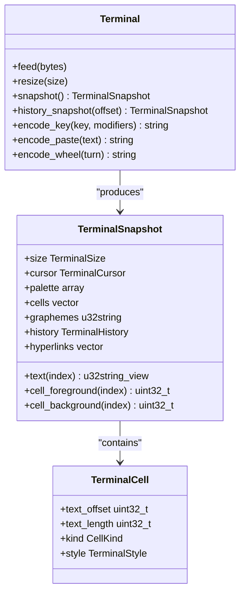
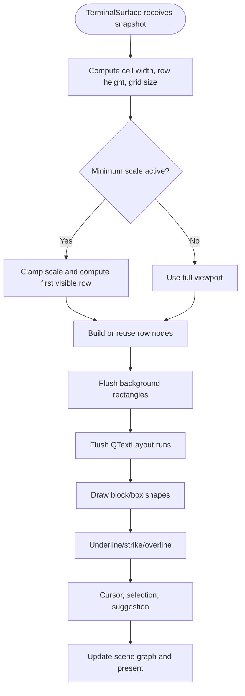
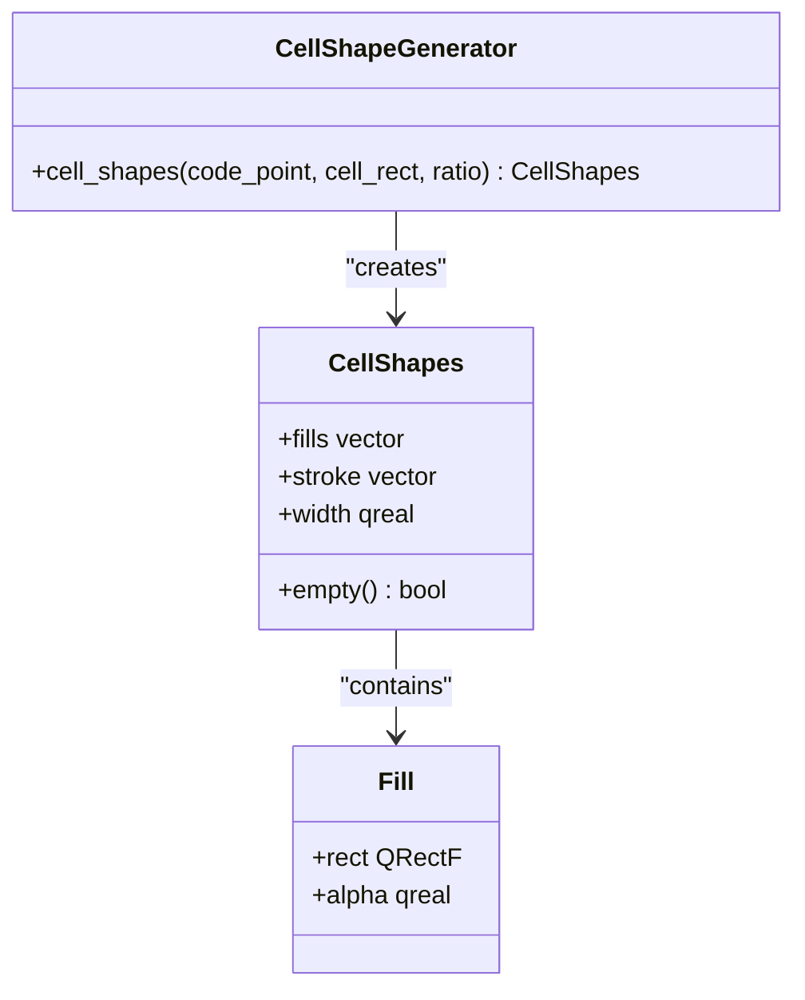
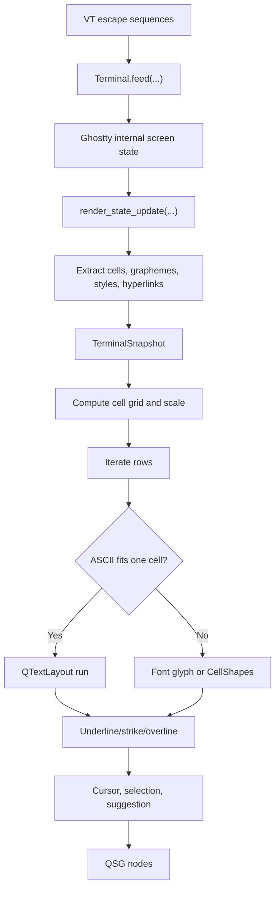
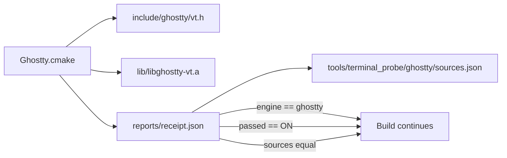
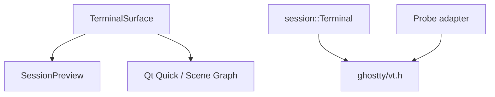

# Terminal Engine and Rendering

<cite>
**Referenced Files in This Document**
- [terminal_surface.hpp](file://apps/desktop/src/terminal_surface.hpp)
- [terminal_surface.cpp](file://apps/desktop/src/terminal_surface.cpp)
- [cell_shapes.hpp](file://apps/desktop/src/cell_shapes.hpp)
- [cell_shapes.cpp](file://apps/desktop/src/cell_shapes.cpp)
- [terminal.hpp](file://services/session/include/lapis/session/terminal.hpp)
- [terminal.cpp](file://services/session/src/terminal/terminal.cpp)
- [Ghostty.cmake](file://cmake/Ghostty.cmake)
- [probe.hpp](file://tools/terminal_probe/probe.hpp)
- [adapter.cpp](file://tools/terminal_probe/ghostty/adapter.cpp)
- [replay.cpp](file://tools/terminal_probe/replay.cpp)
</cite>

## Table of Contents
1. [Introduction](#introduction)
2. [Project Structure](#project-structure)
3. [Core Components](#core-components)
4. [Architecture Overview](#architecture-overview)
5. [Detailed Component Analysis](#detailed-component-analysis)
6. [Dependency Analysis](#dependency-analysis)
7. [Performance Considerations](#performance-considerations)
8. [Troubleshooting Guide](#troubleshooting-guide)
9. [Conclusion](#conclusion)

## Introduction
This document explains the terminal engine integration that uses the Ghostty VT library to emulate a terminal and render its output into the Qt graphics pipeline. The system separates three concerns:

- **Terminal emulation**: A C++ `session::Terminal` wraps the Ghostty C API, parses VT input, manages screen state, and produces an immutable `TerminalSnapshot`.
- **Rendering surface**: A desktop `TerminalSurface` owns the Qt Quick item, converts snapshots into scene-graph nodes, handles user interaction, and manages font metrics, selection, links, suggestions, and frame pacing.
- **Cell shape abstraction**: A lightweight geometry layer draws block elements, shading characters, and box-drawing glyphs directly as rectangles and strokes, avoiding unreliable font glyphs for these characters.

The design is optimized for high-frequency terminal updates and long-running sessions by minimizing allocations, coalescing frames, reusing row nodes, precomputing ASCII advances, and bounding memory through configurable limits.

## Project Structure
The terminal rendering path spans two main layers:

**Diagram sources**
- [terminal_surface.hpp:1-200](file://apps/desktop/src/terminal_surface.hpp#L1-L200)
- [terminal_surface.cpp:1-200](file://apps/desktop/src/terminal_surface.cpp#L1-L200)
- [cell_shapes.hpp:1-30](file://apps/desktop/src/cell_shapes.hpp#L1-L30)
- [terminal.hpp:1-200](file://services/session/include/lapis/session/terminal.hpp#L1-L200)
- [terminal.cpp:1-200](file://services/session/src/terminal/terminal.cpp#L1-L200)
- [Ghostty.cmake:1-57](file://cmake/Ghostty.cmake#L1-L57)
- [adapter.cpp:1-200](file://tools/terminal_probe/ghostty/adapter.cpp#L1-L200)

**Section sources**
- [terminal_surface.hpp:1-200](file://apps/desktop/src/terminal_surface.hpp#L1-L200)
- [terminal_surface.cpp:1-200](file://apps/desktop/src/terminal_surface.cpp#L1-L200)
- [cell_shapes.hpp:1-30](file://apps/desktop/src/cell_shapes.hpp#L1-L30)
- [terminal.hpp:1-200](file://services/session/include/lapis/session/terminal.hpp#L1-L200)
- [terminal.cpp:1-200](file://services/session/src/terminal/terminal.cpp#L1-L200)
- [Ghostty.cmake:1-57](file://cmake/Ghostty.cmake#L1-L57)
- [adapter.cpp:1-200](file://tools/terminal_probe/ghostty/adapter.cpp#L1-L200)

## Core Components
| Component | Responsibility | Key data or behavior |
|---|---|---|
| `session::Terminal` | Owns a Ghostty terminal, decodes input, tracks history, and exports snapshots | `feed`, `resize`, `snapshot`, `history_snapshot`, `encode_key`, `encode_paste`, `encode_wheel` |
| `session::TerminalSnapshot` | Immutable snapshot owned by the renderer | Size, cursor, palette, cells, grapheme buffer, history metadata, hyperlinks |
| `lapis::desktop::TerminalSurface` | Qt Quick item bridging session snapshots to QML and scene-graph rendering | Properties, events, selection, hover, wheel, paste, suggestion flow, frame pacing |
| `CellShapes` | Geometry for non-font block and box-drawing characters | Fills, stroke, device-pixel-snapped rectangles |
| Build probe glue | Ensures a pinned, validated Ghostty VT artifact is used | CMake validation, probe engine contract, replay tests |

**Section sources**
- [terminal.hpp:1-200](file://services/session/include/lapis/session/terminal.hpp#L1-L200)
- [terminal.cpp:201-787](file://services/session/src/terminal/terminal.cpp#L201-L787)
- [terminal_surface.hpp:1-200](file://apps/desktop/src/terminal_surface.hpp#L1-L200)
- [cell_shapes.hpp:1-30](file://apps/desktop/src/cell_shapes.hpp#L1-L30)
- [Ghostty.cmake:1-57](file://cmake/Ghostty.cmake#L1-L57)

## Architecture Overview
The data flow from VT bytes to rendered pixels follows this path:

**Diagram sources**
- [terminal.cpp:501-787](file://services/session/src/terminal/terminal.cpp#L501-L787)
- [terminal_surface.cpp:1101-1494](file://apps/desktop/src/terminal_surface.cpp#L1101-L1494)

## Detailed Component Analysis

### Terminal Emulation Layer
The `session::Terminal` class is the single-threaded owner of a Ghostty terminal instance. It validates configuration, configures scrollback and image storage limits, and exposes an immutable snapshot interface.

Key responsibilities:
- Input handling: `feed`, `encode_key`, `encode_paste`, `encode_wheel`.
- Geometry changes: `resize`, with verification that requested columns and rows are retained.
- History management: bounded scrollback, viewport restoration after extraction, and a `clear_history` implementation that toggles the configured limit.
- Snapshot construction: iterates Ghostty’s render-state row iterator, extracts cells, graphemes, styles, hyperlinks, and cursor information.

Important implementation details:
- All Ghostty handles are wrapped in a template deleter so errors during creation raise runtime exceptions early.
- Reply overflow is detected in the synchronous PTY write callback; once poisoned, further operations throw `overflow_error`.
- Snapshot extraction validates expected cell counts, grapheme length, hyperlink size, and palette indices.
- Colors use `ColorKind` (`default_color`, `indexed`, `rgb`) and support inverse rendering at query time.

**Diagram sources**
- [terminal.hpp:1-200](file://services/session/include/lapis/session/terminal.hpp#L1-L200)
- [terminal.cpp:201-787](file://services/session/src/terminal/terminal.cpp#L201-L787)

**Section sources**
- [terminal.hpp:1-200](file://services/session/include/lapis/session/terminal.hpp#L1-L200)
- [terminal.cpp:201-787](file://services/session/src/terminal/terminal.cpp#L201-L787)

### Rendering Surface and Qt Graphics Pipeline Integration
`TerminalSurface` is a `QQuickItem` that binds a `SessionPreview` (the application-side view of a session) to the Qt scene graph. It does not implement VT parsing itself; instead, it consumes `TerminalSnapshot` objects and turns them into efficient scene-graph primitives.

Major responsibilities:
- **Layout and scaling**: Computes logical cell width and height from the selected font, applies optional minimum scale, and derives viewport-first-row offset when zooming out.
- **Row rendering**: Builds one row node per visible row, grouping backgrounds, text layouts, decorations, and shapes.
- **Font and style resolution**: Chooses a fixed-width family, disables ligatures and kerning for safe ASCII runs, and maps terminal styles to Qt character formats.
- **Cursor and suggestion overlays**: Draws cursors, selection highlights, link underlines, and next-prompt suggestions.
- **Input and interaction**: Handles focus, IME composition, mouse selection, double-click word selection, clipboard copy, hover-based link detection, and wheel scrolling for both program-mode and history-mode terminals.
- **Frame pacing**: Coalesces frequent output bursts using a throttle timer and presents warm frames after typing pauses.

**Diagram sources**
- [terminal_surface.cpp:201-600](file://apps/desktop/src/terminal_surface.cpp#L201-L600)
- [terminal_surface.cpp:1101-1494](file://apps/desktop/src/terminal_surface.cpp#L1101-L1494)

**Section sources**
- [terminal_surface.hpp:1-200](file://apps/desktop/src/terminal_surface.hpp#L1-L200)
- [terminal_surface.cpp:201-600](file://apps/desktop/src/terminal_surface.cpp#L201-L600)
- [terminal_surface.cpp:1101-1494](file://apps/desktop/src/terminal_surface.cpp#L1101-L1494)

### Cell Shape Abstraction
The `CellShapes` abstraction exists because some terminal characters should be drawn as precise geometric fills rather than relying on font glyphs. Font glyphs often leave unwanted line spacing, while block elements, shading characters, and box-drawing glyphs need seams-free joins across adjacent cells.

Key points:
- `CellShapes` stores filled rectangles with alpha and a rounded-corner stroke path.
- Device-pixel snapping ensures neighboring cells share edges without gaps.
- Box-drawing arms are matched against Unicode code points and converted into horizontal/vertical fills and strokes.
- Shading and quadrant blocks are computed from ranges and bit patterns.
- Characters that do not require special geometry fall back to normal font rendering.

**Diagram sources**
- [cell_shapes.hpp:1-30](file://apps/desktop/src/cell_shapes.hpp#L1-L30)
- [cell_shapes.cpp:1-200](file://apps/desktop/src/cell_shapes.cpp#L1-L200)

**Section sources**
- [cell_shapes.hpp:1-30](file://apps/desktop/src/cell_shapes.hpp#L1-L30)
- [cell_shapes.cpp:1-200](file://apps/desktop/src/cell_shapes.cpp#L1-L200)

### Text Processing Pipeline: VT Escape Sequences to Rendered Pixels
The pipeline has two stages:

1. **Emulation stage** (`session::Terminal`):
   - VT bytes are written to Ghostty via `ghostty_terminal_vt_write`.
   - Ghostty updates internal screen state, cursor position, modes, palette, and history.
   - On demand, `ghostty_render_state_update` materializes a renderable state.
   - The snapshot builder walks rows and cells, extracting:
     - Grapheme codepoints into a contiguous `u32string`.
     - Cell kind: narrow, wide, wide tail, or wrap spacer.
     - Style: foreground/background colors, underline style, bold, italic, faint, blink, inverse, invisible, strikethrough, overline.
     - Hyperlinks: OSC 8 destinations stored as spans with URI bounds.
     - Cursor: position, visibility, blinking, shape, and wide-tail status.

2. **Rendering stage** (`TerminalSurface`):
   - Converts effective colors and styles into Qt color and text format values.
   - Groups printable ASCII into fast paths where glyph advances match exactly one cell.
   - Flushes text runs through `QTextLayout`, applying per-run formatting.
   - Draws decorations aligned to ascent, strikeout, and overline positions.
   - Renders block/box glyphs as geometry before text so they overlay cleanly.
   - Adds overlays: cursor, selection highlight, hovered link underline, and suggested prompt.

**Diagram sources**
- [terminal.cpp:501-787](file://services/session/src/terminal/terminal.cpp#L501-L787)
- [terminal_surface.cpp:201-600](file://apps/desktop/src/terminal_surface.cpp#L201-L600)

**Section sources**
- [terminal.cpp:501-787](file://services/session/src/terminal/terminal.cpp#L501-L787)
- [terminal_surface.cpp:201-600](file://apps/desktop/src/terminal_surface.cpp#L201-L600)

### Font Rendering
Font behavior is controlled by `TerminalSurface`:

- Preferred family comes from the `fontFamily` property.
- If the requested family is unavailable or not monospaced, the platform fixed-width system font is used.
- `fontPixelSize` is clamped to a supported range.
- Resolved family is exposed through `resolvedFontFamily`.
- Rendering disables kerning and common ligatures for ASCII runs to ensure stable widths.
- Bold and italic are applied per terminal style, not just globally.

Optimization highlights:
- `AsciiAdvances` caches horizontal advances for printable ASCII across four style combinations.
- Safe ASCII runs avoid expensive layout and keep each run aligned to the terminal baseline.
- Row nodes are reused when content and font have not changed.

**Section sources**
- [terminal_surface.cpp:201-600](file://apps/desktop/src/terminal_surface.cpp#L201-L600)
- [terminal_surface.cpp:1101-1494](file://apps/desktop/src/terminal_surface.cpp#L1101-L1494)

### Color Schemes
Colors are resolved from `TerminalSnapshot`:

- Default color falls back to the snapshot’s foreground or background depending on whether foreground or background is being resolved.
- Indexed colors use the snapshot’s 256-entry palette.
- RGB colors are passed through as `0xRRGGBB`.
- Inverse mode swaps foreground and background at query time.
- Faint and invisible flags affect rendering but are not part of the snapshot color value.

On the rendering side:
- Backgrounds are flushed as solid rectangles whenever the background color changes.
- Foreground text uses `QTextCharFormat` with adjusted alpha for faint/invisible.
- Decoration lines inherit the effective foreground color and can use an explicit underline color.

**Section sources**
- [terminal_surface.cpp:201-600](file://apps/desktop/src/terminal_surface.cpp#L201-L600)
- [terminal.cpp:201-500](file://services/session/src/terminal/terminal.cpp#L201-L500)

### Cursor Animations
Cursor representation is driven by the snapshot:

- Visibility and viewport presence determine whether the cursor is drawn.
- Shapes include block, bar, underline, and hollow block.
- Wide cells span two logical columns.
- A block cursor redraws the covered grapheme in the cell background color to avoid obscuring underlying text, unless the cell is empty, invisible, or a wide tail.
- Blinking is captured in the snapshot; animation timing is delegated to the upstream emulator and presentation state rather than recomputed here.

**Section sources**
- [terminal_surface.cpp:601-990](file://apps/desktop/src/terminal_surface.cpp#L601-L990)
- [terminal.cpp:201-500](file://services/session/src/terminal/terminal.cpp#L201-L500)

### Hyperlinks and Link Detection
Two mechanisms cooperate:

1. **Explicit OSC 8 hyperlinks**:
   - Captured as `TerminalHyperlink` spans with a first-cell index, count, and URI.
   - Validated UTF-8 URIs are stored; invalid or oversized URIs are dropped.
   - Adjacent spans with the same URI are merged.

2. **Visible URL/path inference**:
   - For selection, hover, and find operations, the renderer joins wrapping rows and detects HTTP(S) URLs and local file paths.
   - Hover opens browser URLs or resolves local files/folders when allowed.

**Section sources**
- [terminal.cpp:1-200](file://services/session/src/terminal/terminal.cpp#L1-L200)
- [terminal.cpp:501-787](file://services/session/src/terminal/terminal.cpp#L501-L787)
- [terminal_surface.cpp:1701-2058](file://apps/desktop/src/terminal_surface.cpp#L1701-L2058)

## Dependency Analysis
The build system requires a pinned Ghostty VT artifact and verifies receipt integrity before importing the static library.

**Diagram sources**
- [Ghostty.cmake:1-57](file://cmake/Ghostty.cmake#L1-L57)

Runtime dependencies:
- `TerminalSurface` depends on Qt Quick, fonts, scene-graph nodes, and the session preview model.
- `session::Terminal` depends on the Ghostty C API through `<ghostty/vt.h>`.
- The probe adapter shares the same Ghostty render-state iteration pattern for experimental validation.

**Diagram sources**
- [terminal_surface.hpp:1-200](file://apps/desktop/src/terminal_surface.hpp#L1-L200)
- [terminal.cpp:1-200](file://services/session/src/terminal/terminal.cpp#L1-L200)
- [adapter.cpp:1-200](file://tools/terminal_probe/ghostty/adapter.cpp#L1-L200)

**Section sources**
- [Ghostty.cmake:1-57](file://cmake/Ghostty.cmake#L1-L57)
- [terminal_surface.hpp:1-200](file://apps/desktop/src/terminal_surface.hpp#L1-L200)
- [terminal.cpp:1-200](file://services/session/src/terminal/terminal.cpp#L1-L200)
- [adapter.cpp:1-200](file://tools/terminal_probe/ghostty/adapter.cpp#L1-L200)

## Performance Considerations
The codebase implements several techniques for high-frequency terminal updates and long-running sessions:

### Memory Limits
- Maximum cells, input bytes, grapheme codepoints, reply bytes, and scrollback history bytes are configurable through `TerminalLimits`.
- Snapshot extraction reserves capacity for cells and graphemes based on viewport size and limits.
- Hyperlink storage is bounded by maximum URI length, maximum span count, and total hyperlink byte budget.
- Reply overflow permanently poisons the terminal instance to prevent unbounded growth.

### Allocation Strategy
- Cells store offsets and lengths into a contiguous grapheme buffer, avoiding per-cell heap strings.
- Scratch buffers are reused during cell extraction.
- Reply output is copied into a pre-sized vector rather than growing dynamically.
- Handoff between GUI and render threads uses shared pointers to immutable snapshots.

### Rendering Optimizations
- `AsciiAdvances` caches ASCII glyph advances for four style combinations.
- Safe ASCII runs avoid repeated font measurement and complex shaping.
- Row nodes are reused when row content and font have not changed.
- Background rectangles are flushed only when background color changes.
- Block and box characters are drawn as geometry, reducing reliance on font metrics.
- Ligatures and kerning are disabled for safe ASCII runs.

### Frame Pacing
- `frameInterval` throttles output-driven redraws for noisy agents.
- Preview pacing uses a precise timer and coalesces updates until the interval elapses.
- Warm frames continue briefly after typing to reduce perceived latency.
- Window visibility and activity are tracked to avoid unnecessary work.

### Scrollback and History
- Scrollback is bounded by `history_bytes`.
- History extraction scrolls to the requested row, builds the snapshot, then restores the original viewport.
- Alternate-screen mode affects wheel behavior and history access.

**Section sources**
- [terminal.hpp:1-200](file://services/session/include/lapis/session/terminal.hpp#L1-L200)
- [terminal.cpp:201-787](file://services/session/src/terminal/terminal.cpp#L201-L787)
- [terminal_surface.cpp:201-600](file://apps/desktop/src/terminal_surface.cpp#L201-L600)
- [terminal_surface.cpp:1101-1494](file://apps/desktop/src/terminal_surface.cpp#L1101-L1494)

## Troubleshooting Guide

### Ghostty Build Artifact Missing or Invalid
Symptoms:
- CMake fails early with a message about `LAPIS_GHOSTTY_PREFIX`.
- Required header, static library, or receipt file is missing.
- Receipt engine name, pass status, or source manifest differs from the pinned probe manifest.

Resolution:
- Rebuild the pinned Ghostty VT artifact using the documented probe command.
- Set `LAPIS_GHOSTTY_PREFIX` to the printed run prefix.
- Verify that the receipt contains the correct engine, pass status, and sources.

**Section sources**
- [Ghostty.cmake:1-57](file://cmake/Ghostty.cmake#L1-L57)

### Terminal Reply Overflow
Symptoms:
- Operations throw `overflow_error`.
- The terminal instance becomes unusable after excessive PTY output.

Cause:
- The synchronous PTY write callback received more data than the pre-sized reply buffer could hold.
- The instance is poisoned to avoid undefined behavior.

Resolution:
- Recreate the terminal instance and resynchronize.
- Investigate runaway agent output or malformed feedback loops.

**Section sources**
- [terminal.cpp:201-500](file://services/session/src/terminal/terminal.cpp#L201-L500)

### Snapshot Dimensions Mismatch
Symptoms:
- Runtime errors stating that Ghostty returned more or fewer cells than expected.
- Errors that render-state dimensions disagree with viewport dimensions.

Cause:
- The number of extracted cells did not match `columns × rows`.

Resolution:
- Treat this as a protocol or upstream consistency failure.
- Check terminal resize operations and alternate-screen transitions.

**Section sources**
- [terminal.cpp:501-787](file://services/session/src/terminal/terminal.cpp#L501-L787)

### Invalid Palette Index
Symptoms:
- Runtime error reporting an invalid palette index.

Cause:
- Ghostty returned a palette index outside the current palette size.

Resolution:
- Validate palette updates and ensure consistent color configuration.

**Section sources**
- [terminal.cpp:201-500](file://services/session/src/terminal/terminal.cpp#L201-L500)

### High CPU Usage During Agent Output
Symptoms:
- Renderer burns CPU when an agent emits large bursts.

Likely causes:
- `frameInterval` is zero, causing every snapshot to trigger an immediate publish.
- No window visibility or activity gating is preventing unnecessary redraws.

Mitigations:
- Configure a non-zero `frameInterval` for previews or noisy agents.
- Ensure the terminal surface is hidden when not visible.
- Rely on the built-in frame-coalescing and warm-frame logic.

**Section sources**
- [terminal_surface.cpp:1101-1494](file://apps/desktop/src/terminal_surface.cpp#L1101-L1494)

### Incorrect Underline or Decoration Appearance
Symptoms:
- Underlines, strikes, or overlines look misplaced or missing.

Likely causes:
- Decoration coordinates depend on font ascent and style flags.
- Faint or invisible styles suppress decoration.
- Dotted/dashed underlines use a simplified rectangle fallback.

Resolution:
- Verify the terminal style for the affected cells.
- Confirm that the font metrics match the resolved family and pixel size.

**Section sources**
- [terminal_surface.cpp:201-600](file://apps/desktop/src/terminal_surface.cpp#L201-L600)

### Wheel Scrolling Not Working as Expected
Symptoms:
- Wheel events scroll history instead of the program, or vice versa.

Behavior:
- In alternate-screen mode without history scrolling, wheel events are forwarded to the program.
- Otherwise, wheel events scroll the primary-history viewport.
- Mouse-wheel encoding respects the terminal’s mouse-tracking mode.

Resolution:
- Check `alternate_screen`, `accepts_wheel`, and `historyActive`.
- Validate `WheelTurn` conversion and column/row placement.

**Section sources**
- [terminal_surface.cpp:1701-2058](file://apps/desktop/src/terminal_surface.cpp#L1701-L2058)
- [terminal.cpp:501-787](file://services/session/src/terminal/terminal.cpp#L501-L787)

## Conclusion
The terminal engine integrates Ghostty VT through a clean separation of concerns:

- `session::Terminal` encapsulates VT emulation, history, input encoding, and snapshot production.
- `TerminalSurface` owns the Qt Quick rendering pipeline, optimizing text runs, geometry, overlays, and frame pacing.
- `CellShapes` provides a deterministic fallback for block and box-drawing characters.
- Build and probe artifacts ensure a pinned, validated Ghostty dependency.

For performance-critical usage, tune `frameInterval`, configure `TerminalLimits`, monitor scrollback growth, and rely on the existing optimizations for ASCII runs, row reuse, device-pixel snapping, and bounded memory. When troubleshooting, start with the Ghostty build receipt, check terminal health, validate snapshot dimensions, and inspect style and interaction flows.