# Agent Lifecycle and Session Management

<cite>
**Referenced Files in This Document**
- [launch_spec.hpp](file://services/session/src/launch_spec.hpp)
- [launch_spec.cpp](file://services/session/src/launch_spec.cpp)
- [session_descriptor.hpp](file://services/session/src/session_descriptor.hpp)
- [session_descriptor.cpp](file://services/session/src/session_descriptor.cpp)
- [session_service.cpp](file://services/session/src/session_service.cpp)
- [session_service_launcher.cpp](file://services/supervisor/src/session_service_launcher.cpp)
- [runtime.cpp](file://services/supervisor/src/runtime.cpp)
- [workspace_control.cpp](file://apps/desktop/src/workspace_control.cpp)
- [workspace.hpp](file://apps/desktop/src/workspace.hpp)
- [workspace.cpp](file://apps/desktop/src/workspace.cpp)
</cite>

## Table of Contents
1. [Introduction](#introduction)
2. [Project Structure](#project-structure)
3. [Core Components](#core-components)
4. [Architecture Overview](#architecture-overview)
5. [Detailed Component Analysis](#detailed-component-analysis)
6. [Dependency Analysis](#dependency-analysis)
7. [Performance Considerations](#performance-considerations)
8. [Troubleshooting Guide](#troubleshooting-guide)
9. [Conclusion](#conclusion)

## Introduction
This document explains how the desktop application manages the complete lifecycle of agent sessions: creation, launch, monitoring, connection to session services, response handling, termination, and recovery. The implementation spans three layers:

- **Desktop UI layer**: exposes user actions such as creating, renaming, restarting, and closing agents, and synchronizes UI state with live sessions.
- **Supervisor layer**: owns long-lived session service processes, validates their payloads, adopts surviving peers, handles restarts, and terminates children safely.
- **Session service layer**: binds a Unix-domain socket, launches an actual agent process (terminal, Codex, or Claude), streams terminal output, observes attention hooks, and manages history and resume state.

The key configuration model is `LaunchSpec`, which describes what program to run, where, with which arguments, terminal geometry, and integration mode. The runtime identity model is represented by `wire::SessionIdentity` plus descriptor files that bind a process endpoint to a fingerprint and session epoch.

## Project Structure
Agent lifecycle management is primarily implemented in these modules:

| Layer | Responsibility | Key Files |
|---|---|---|
| Desktop UI | User actions, workspace control protocol, live session preview | [workspace_control.cpp](file://apps/desktop/src/workspace_control.cpp), [workspace.hpp](file://apps/desktop/src/workspace.hpp), [workspace.cpp](file://apps/desktop/src/workspace.cpp) |
| Supervisor | Process ownership, adoption, restart admission, termination | [session_service_launcher.cpp](file://services/supervisor/src/session_service_launcher.cpp), [runtime.cpp](file://services/supervisor/src/runtime.cpp) |
| Session Service | Socket binding, agent launching, terminal I/O, attention observation | [session_service.cpp](file://services/session/src/session_service.cpp) |
| Launch Model | Validation, canonicalization, shell helper, fingerprinting | [launch_spec.hpp](file://services/session/src/launch_spec.hpp), [launch_spec.cpp](file://services/session/src/launch_spec.cpp) |
| Descriptor Store | Safe persistence of endpoint-to-session mapping | [session_descriptor.hpp](file://services/session/src/session_descriptor.hpp), [session_descriptor.cpp](file://services/session/src/session_descriptor.cpp) |

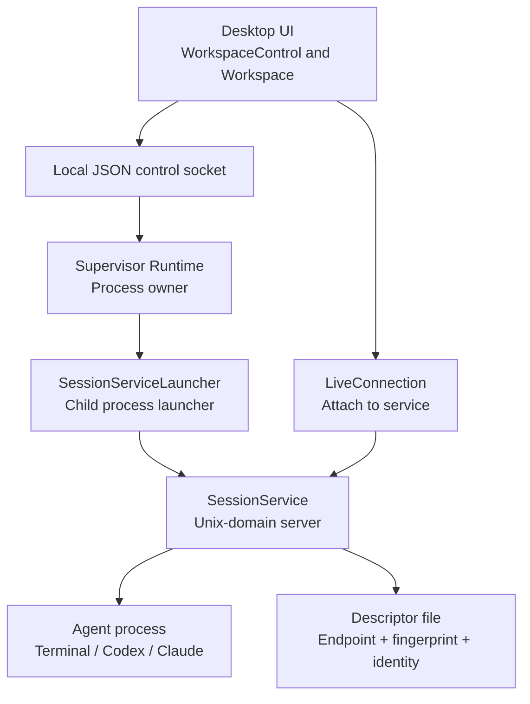

**Diagram sources**
- [workspace_control.cpp:1-100](file://apps/desktop/src/workspace_control.cpp#L1-L100)
- [session_service_launcher.cpp:201-350](file://services/supervisor/src/session_service_launcher.cpp#L201-L350)
- [runtime.cpp:300-560](file://services/supervisor/src/runtime.cpp#L300-L560)
- [session_service.cpp:201-517](file://services/session/src/session_service.cpp#L201-L517)

**Section sources**
- [workspace_control.cpp:1-100](file://apps/desktop/src/workspace_control.cpp#L1-L100)
- [session_service_launcher.cpp:201-350](file://services/supervisor/src/session_service_launcher.cpp#L201-L350)
- [runtime.cpp:300-560](file://services/supervisor/src/runtime.cpp#L300-L560)
- [session_service.cpp:201-517](file://services/session/src/session_service.cpp#L201-L517)

## Core Components

### LaunchSpec: Agent Configuration Model
`LaunchSpec` is the internal contract for launching an agent. It contains:

- `program`: resolved executable path.
- `arguments`: literal arguments passed directly to the agent; not interpreted by a shell.
- `directory`: canonical working directory.
- `size`: initial terminal width and height.
- `agent`: integration mode — terminal, Codex, or Claude.

Validation enforces safety and bounds:

- Agent-mode-specific argument restrictions.
- No NUL characters.
- Maximum 64 KiB of text across program and arguments.
- Maximum 256 arguments.
- Program and directory are required.
- Terminal size must be nonzero and bounded by the wire maximum cell count.
- Working directory must exist and is canonicalized.
- Program must resolve to an executable file.
- Symlinks are preserved because some programs depend on `argv[0]`.

A SHA-256 fingerprint is computed from program, arguments, directory, and agent mode. This fingerprint is used to prevent replay or mismatched attachment.

There is also a shell-launch helper that resolves the user’s login shell and constructs an interactive shell launch specification.

**Section sources**
- [launch_spec.hpp:1-32](file://services/session/src/launch_spec.hpp#L1-L32)
- [launch_spec.cpp:1-144](file://services/session/src/launch_spec.cpp#L1-L144)

### SessionDescriptor Models: Endpoint Identity Persistence
The descriptor system binds a Unix-domain endpoint to a session identity and launch fingerprint without granting access merely by reading the file.

Key types and functions:

- `read_descriptor(endpoint, fingerprint)`: reads a private `.session` file only when its contents match the expected fingerprint. Returns no identity if absent; throws on malformed or unsafe descriptors.
- `write_descriptor(endpoint, fingerprint, identity)`: writes a durable descriptor through `DescriptorStore`.
- `DescriptorTicket`: represents a staged write with atomic commit semantics.
- `DescriptorStore`: coordinates per-endpoint ordering, cancellation, and replacement.

Security properties include:

- Owner-only `.session` files with mode `0600`.
- Non-link validation.
- Foreign-file rejection.
- Exact fixed-size descriptor format.
- Atomic rename from a temporary file after `fsync`.
- Per-endpoint serial numbers so newer tickets can replace older ones while canceling still-in-flight tickets.

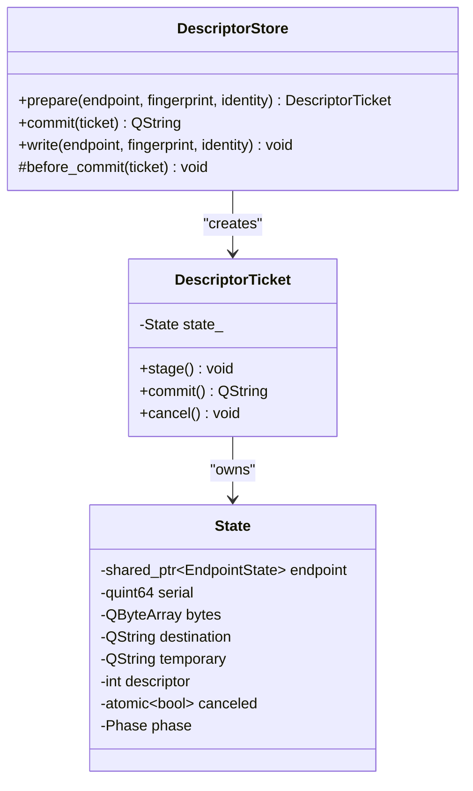

**Diagram sources**
- [session_descriptor.hpp:1-58](file://services/session/src/session_descriptor.hpp#L1-L58)
- [session_descriptor.cpp:1-200](file://services/session/src/session_descriptor.cpp#L1-L200)
- [session_descriptor.cpp:201-330](file://services/session/src/session_descriptor.cpp#L201-L330)

**Section sources**
- [session_descriptor.hpp:1-58](file://services/session/src/session_descriptor.hpp#L1-L58)
- [session_descriptor.cpp:1-200](file://services/session/src/session_descriptor.cpp#L1-L200)
- [session_descriptor.cpp:201-330](file://services/session/src/session_descriptor.cpp#L201-L330)

### SessionService: Agent Runtime Container
`SessionService` is the core runtime container. It:

1. Computes a launch fingerprint from `LaunchSpec`.
2. Generates or accepts a session identity.
3. Opens history storage keyed by session ID.
4. Resumes endpoint state when available.
5. Acquires an exclusive lock on the endpoint.
6. Starts a local Unix-domain server.
7. Connects to the underlying PTY or remote transport.
8. Streams terminal output with pacing and admission control.
9. Observes attention hooks for Codex and Claude.
10. Manages client attachments, paste transactions, and status reporting.

It handles agent-specific startup paths:

- **Codex**: permission parsing, remote endpoint cleanup, thread resumption/fork detection, approval policy translation.
- **Claude**: observer-based hook relay and conversation tracking.
- **Terminal**: direct PTY launch, optional SSH hook relaying.

On process failure it reports crash exit codes, normal exits, and attention state changes.

**Section sources**
- [session_service.cpp:201-517](file://services/session/src/session_service.cpp#L201-L517)

### WorkspaceControl: Desktop Control Protocol
`WorkspaceControl` exposes a local JSON-over-localsocket API for the Mac window host. Supported requests include:

- `harnesses`
- `createAgent`
- `renameCategory`
- `removeCategory`
- `placeCategory`
- `closeAgent`
- `renameAgent`
- `placeAgent`
- `restartAgent`
- `openTerminal`
- `closeTerminal`
- `settings`
- `changeSettings`
- `handover`

Each request is parsed, validated, routed to a handler, and returned as a compact JSON object. Errors use a uniform `{ok: false, error: message}` shape.

**Section sources**
- [workspace_control.cpp:1-100](file://apps/desktop/src/workspace_control.cpp#L1-L100)
- [workspace_control.cpp:201-341](file://apps/desktop/src/workspace_control.cpp#L201-L341)

## Architecture Overview

### End-to-End Agent Creation Flow
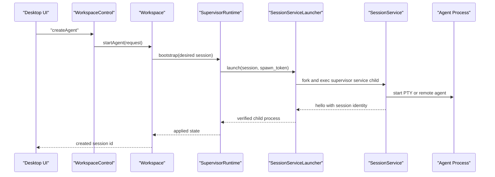

**Diagram sources**
- [workspace_control.cpp:100-200](file://apps/desktop/src/workspace_control.cpp#L100-L200)
- [session_service_launcher.cpp:509-710](file://services/supervisor/src/session_service_launcher.cpp#L509-L710)
- [runtime.cpp:300-560](file://services/supervisor/src/runtime.cpp#L300-L560)
- [session_service.cpp:201-517](file://services/session/src/session_service.cpp#L201-L517)

### Connection and Attachment Flow
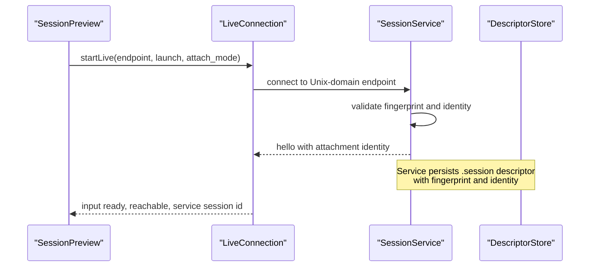

**Diagram sources**
- [session_descriptor.cpp:1-200](file://services/session/src/session_descriptor.cpp#L1-L200)
- [session_service.cpp:201-517](file://services/session/src/session_service.cpp#L201-L517)
- [workspace.hpp:1-200](file://apps/desktop/src/workspace.hpp#L1-L200)

## Detailed Component Analysis

### LaunchSpec Validation and Fingerprinting
Validation rejects unsafe or inconsistent launch requests before any process is created. This includes:

- Rejecting managed Claude options that conflict with hooks.
- Rejecting managed Codex options that override its owned remote endpoint.
- Enforcing size and argument limits.
- Canonicalizing the working directory.
- Resolving executables through standard search rules.
- Computing a cryptographic fingerprint tied to the effective launch, not a PID.

The fingerprint is critical because later stages compare it against attached clients and persisted descriptors.

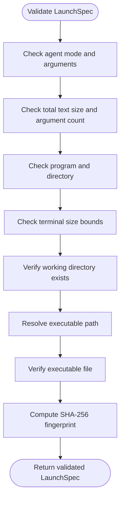

**Diagram sources**
- [launch_spec.cpp:1-144](file://services/session/src/launch_spec.cpp#L1-L144)

**Section sources**
- [launch_spec.cpp:1-144](file://services/session/src/launch_spec.cpp#L1-L144)

### Descriptor Commit Semantics
Descriptor commits are designed to be safe under concurrent UI updates and background workers:

1. `prepare` allocates a ticket and assigns a per-endpoint serial number.
2. `stage` creates an exclusive temporary file, writes and syncs the descriptor, then marks it ready.
3. `commit` checks cancellation, serial freshness, and existing descriptor safety before atomically renaming the temporary file.
4. `cancel` marks the ticket canceled and releases endpoint ownership when appropriate.

This prevents partial descriptors, symlink races, permission leaks, and stale replacements.

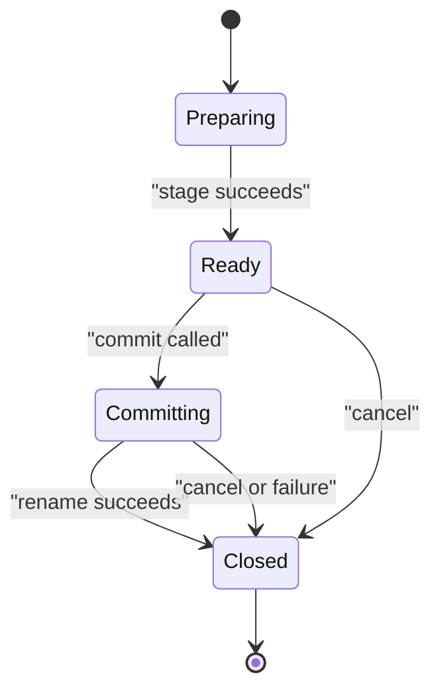

**Diagram sources**
- [session_descriptor.cpp:201-330](file://services/session/src/session_descriptor.cpp#L201-L330)

**Section sources**
- [session_descriptor.cpp:201-330](file://services/session/src/session_descriptor.cpp#L201-L330)

### Supervisor Launch and Adoption
The supervisor does not trust raw command-line payloads. It re-validates them using the same logic as the session layer, computes the expected fingerprint, and refuses mismatches.

Key responsibilities:

- Validate service program, agent program, working directory, and terminal size.
- Ensure at most one integration mode is selected.
- Create an ownership record with a rotating spawn token.
- Use a pipe barrier to synchronize ownership file creation and process execution.
- Adopt a surviving peer only when the PID, program path, and spawn token match.
- Handshake with the running service before treating it as controlled.
- Terminate unverified retained services instead of signaling arbitrary peers.

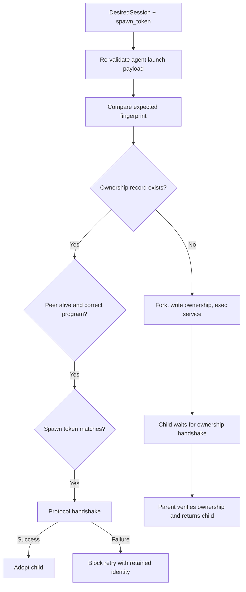

**Diagram sources**
- [session_service_launcher.cpp:201-509](file://services/supervisor/src/session_service_launcher.cpp#L201-L509)
- [runtime.cpp:201-560](file://services/supervisor/src/runtime.cpp#L201-L560)

**Section sources**
- [session_service_launcher.cpp:201-509](file://services/supervisor/src/session_service_launcher.cpp#L201-L509)
- [runtime.cpp:201-560](file://services/supervisor/src/runtime.cpp#L201-L560)

### Automatic Recovery and Restart Admission
`SupervisorRuntime` maintains convergence between desired state and actual child process:

- If the tracked child dies, it releases ownership and resets state.
- On boot or state change, it attempts adoption first.
- If adoption fails but a peer is alive without verification, it blocks retries rather than orphaning the process.
- After the first successful admission, restarts use a rotating spawn token and bounded restart-window admission.
- If restart admissions are exhausted, it stops the desired session.
- Failed launches persist as blocked stopped state rather than silently disappearing.

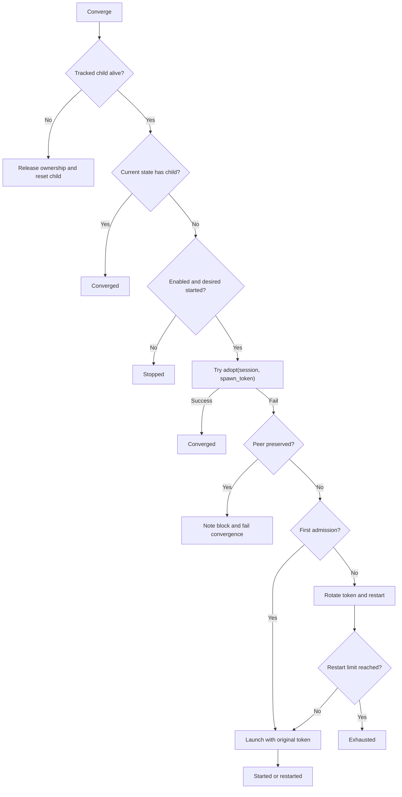

**Diagram sources**
- [runtime.cpp:300-560](file://services/supervisor/src/runtime.cpp#L300-L560)

**Section sources**
- [runtime.cpp:300-560](file://services/supervisor/src/runtime.cpp#L300-L560)

### Desktop Session Preview and UI Synchronization
`SessionPreview` is the bridge between UI state and a live session service. Its important responsibilities include:

- Starting a live connection to an endpoint.
- Discovering an existing descriptor when reconnecting.
- Starting a new session when needed.
- Managing history pages and live scrolling.
- Handling attention snapshots and decisions.
- Sending terminal input, paste operations, keys, and wheel events.
- Tracking reachability, connection state, and service session identity.
- Terminating the agent by asking the service to end it.

The UI does not directly manage PIDs. Instead, it tracks whether the connection is input-ready and reachable, and it shows states such as updating, closing, unseen, and activity source.

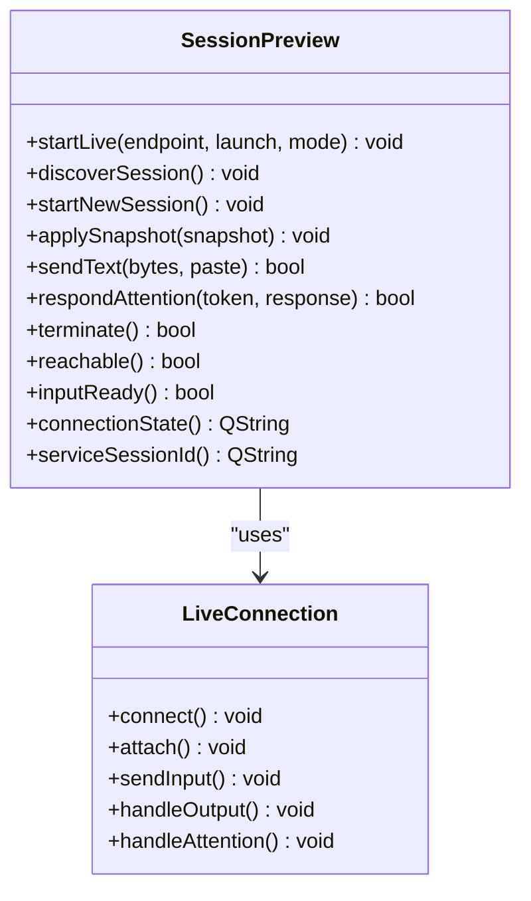

**Diagram sources**
- [workspace.hpp:1-200](file://apps/desktop/src/workspace.hpp#L1-L200)
- [workspace.cpp:1-300](file://apps/desktop/src/workspace.cpp#L1-L300)

**Section sources**
- [workspace.hpp:1-200](file://apps/desktop/src/workspace.hpp#L1-L200)
- [workspace.cpp:1-300](file://apps/desktop/src/workspace.cpp#L1-L300)

### Creating New Agents
The desktop creates an agent through the workspace control protocol:

1. The UI sends `createAgent` with category, harness, directory, machine, program, title, model, mode, and optional resume information.
2. `WorkspaceControl` validates fields and calls `workspace_.startAgent`.
3. The workspace builds an agent request and starts the session.
4. If the session exists immediately, the response includes whether it is updating.
5. The UI then attaches via `LiveConnection` using the returned session identity and endpoint.

For multiple concurrent sessions, each session gets its own endpoint, identity, descriptor, and live connection. The workspace maps session IDs to `SessionPreview` objects, enabling independent UI cards for each agent.

**Section sources**
- [workspace_control.cpp:100-200](file://apps/desktop/src/workspace_control.cpp#L100-L200)
- [workspace.hpp:1-200](file://apps/desktop/src/workspace.hpp#L1-L200)

### Handling Agent Responses
Agent responses flow from the backend process through several layers:

1. The PTY or remote transport produces output.
2. `SessionService` receives output and applies pacing and admission limits.
3. Output is forwarded to connected clients as terminal snapshots.
4. For Codex and Claude, hook observers translate structured events into attention snapshots.
5. `SessionPreview.applyAttention` updates pending attention, reason, diagnostic, and request list.
6. The UI asks the preview to respond to an attention decision, which is sent back to the service.

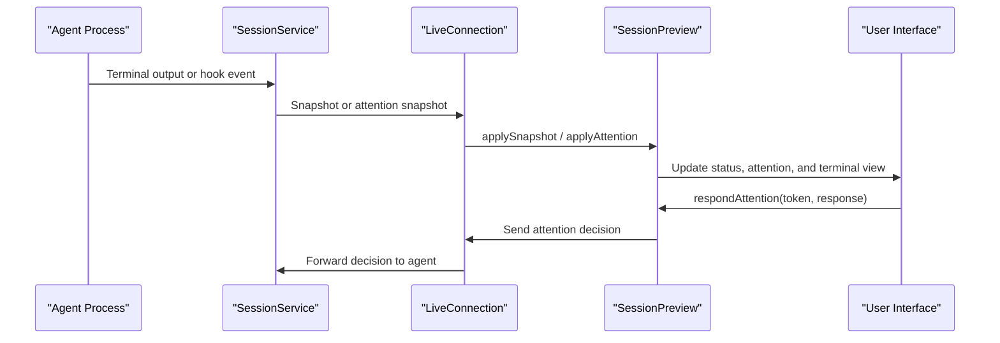

**Diagram sources**
- [session_service.cpp:201-517](file://services/session/src/session_service.cpp#L201-L517)
- [workspace.hpp:1-200](file://apps/desktop/src/workspace.hpp#L1-L200)

**Section sources**
- [session_service.cpp:201-517](file://services/session/src/session_service.cpp#L201-L517)
- [workspace.hpp:1-200](file://apps/desktop/src/workspace.hpp#L1-L200)

### Managing Multiple Concurrent Sessions
Concurrency is handled by isolating each session:

- Each session has a unique endpoint.
- Each endpoint has its own descriptor file.
- Each descriptor is bound to a fingerprint and identity.
- The supervisor tracks one child process per runtime slot.
- The desktop workspace maintains separate `SessionPreview` entries per session ID.
- Terminal output and attention are scoped to the active client attachment.

There is no shared mutable process state between sessions; sharing occurs only through explicit workspace-level concepts like categories and tabs.

**Section sources**
- [session_descriptor.cpp:1-200](file://services/session/src/session_descriptor.cpp#L1-L200)
- [runtime.cpp:300-560](file://services/supervisor/src/runtime.cpp#L300-L560)
- [workspace.hpp:1-200](file://apps/desktop/src/workspace.hpp#L1-L200)

### Termination and Cleanup
Termination paths are layered:

- The desktop asks the workspace to close or restart a session.
- The supervisor terminates the child process group and waits for termination.
- If termination times out, it escalates to kill.
- Ownership records are released.
- The session service disconnects clients and stops observers.
- Descriptor files remain only as metadata; they do not grant access without a matching fingerprint.

**Section sources**
- [workspace_control.cpp:201-341](file://apps/desktop/src/workspace_control.cpp#L201-L341)
- [runtime.cpp:300-560](file://services/supervisor/src/runtime.cpp#L300-L560)
- [session_service.cpp:201-517](file://services/session/src/session_service.cpp#L201-L517)

## Dependency Analysis

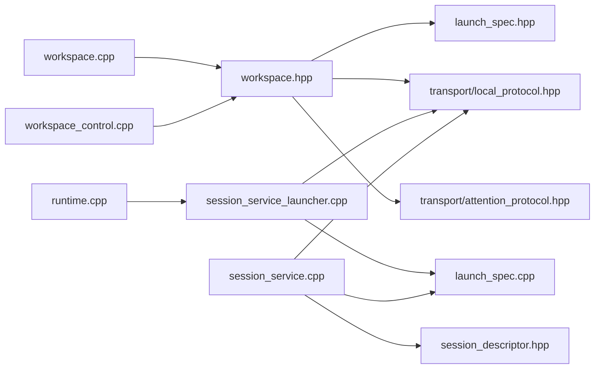

**Diagram sources**
- [workspace.hpp:1-200](file://apps/desktop/src/workspace.hpp#L1-L200)
- [workspace.cpp:1-300](file://apps/desktop/src/workspace.cpp#L1-L300)
- [workspace_control.cpp:1-100](file://apps/desktop/src/workspace_control.cpp#L1-L100)
- [launch_spec.hpp:1-32](file://services/session/src/launch_spec.hpp#L1-L32)
- [launch_spec.cpp:1-144](file://services/session/src/launch_spec.cpp#L1-L144)
- [session_descriptor.hpp:1-58](file://services/session/src/session_descriptor.hpp#L1-L58)
- [session_service.cpp:201-517](file://services/session/src/session_service.cpp#L201-L517)
- [session_service_launcher.cpp:201-509](file://services/supervisor/src/session_service_launcher.cpp#L201-L509)
- [runtime.cpp:300-560](file://services/supervisor/src/runtime.cpp#L300-L560)

### Coupling and Cohesion
- `LaunchSpec` is a low-level value type reused by both the desktop and supervisor.
- `SessionService` depends heavily on platform PTY, local sockets, history, attention, and terminal hook infrastructure.
- `SupervisorRuntime` is cohesive around process lifecycle and state convergence.
- `WorkspaceControl` is cohesive around the desktop JSON control protocol.
- `SessionPreview` is cohesive around one session’s UI state and live connection behavior.

### External Integration Points
- Unix-domain sockets for local IPC.
- POSIX process groups, `fork`, `exec`, `waitpid`, `kill`.
- Filesystem descriptors for ownership and session discovery.
- Platform helpers for shell lookup and process path inspection.

**Section sources**
- [launch_spec.cpp:1-144](file://services/session/src/launch_spec.cpp#L1-L144)
- [session_service.cpp:201-517](file://services/session/src/session_service.cpp#L201-L517)
- [session_service_launcher.cpp:201-509](file://services/supervisor/src/session_service_launcher.cpp#L201-L509)
- [runtime.cpp:300-560](file://services/supervisor/src/runtime.cpp#L300-L560)
- [workspace_control.cpp:1-100](file://apps/desktop/src/workspace_control.cpp#L1-L100)

## Performance Considerations
- **Output pacing and admission**: The session service batches terminal output and admits bursts up to a bounded limit to avoid retaining too much data during sustained pressure.
- **History decoupling**: History writing runs off the main UI rendering path, reducing latency for terminal display.
- **Terminal decode cost**: Screens are decoded lazily per viewer, avoiding expensive decoding for hidden or inactive windows.
- **Supervisor polling budget**: The handshake loop shares a time budget and sleeps between retries, preventing tight polling loops.
- **Restart admission window**: Restart attempts are rate-limited to avoid flapping loops after repeated failures.

These choices favor predictable memory retention and responsiveness under heavy terminal output.

## Troubleshooting Guide

### Common Launch Failures
| Symptom | Likely Cause | Where to Inspect |
|---|---|---|
| Invalid program or missing working directory | `validate_launch` rejected inputs | [launch_spec.cpp:1-144](file://services/session/src/launch_spec.cpp#L1-L144) |
| Managed Claude flags conflict | Hooks required but conflicting options present | [launch_spec.cpp:1-60](file://services/session/src/launch_spec.cpp#L1-L60) |
| Managed Codex overrides remote endpoint | Managed Codex owns its remote | [launch_spec.cpp:1-60](file://services/session/src/launch_spec.cpp#L1-L60) |
| Endpoint already in use | Another service owns the Unix-domain socket | [session_service.cpp:201-350](file://services/session/src/session_service.cpp#L201-L350) |
| Descriptor mismatch | Fingerprint or identity does not match persisted descriptor | [session_descriptor.cpp:1-200](file://services/session/src/session_descriptor.cpp#L1-L200) |
| Supervisor handshake timeout | Service did not respond within the budget or reported overload | [session_service_launcher.cpp:201-509](file://services/supervisor/src/session_service_launcher.cpp#L201-L509) |
| Restart limit exceeded | Too many restarts within the admission window | [runtime.cpp:300-560](file://services/supervisor/src/runtime.cpp#L300-L560) |

### Recovering from Crashes
- If the supervisor detects a dead child, it releases ownership and allows recovery.
- If a peer is alive but cannot be adopted, the runtime blocks retries until the next explicit action.
- On subsequent restarts, the spawn token rotates and restart admission is counted.
- The desktop should treat a session as unavailable if its connection becomes unreachable, and allow discovery or recreation.

### Diagnosing UI-State Drift
If the UI shows a session as closed but the process remains:

1. Check whether the supervisor still owns the endpoint.
2. Verify the spawn token and PID in the ownership record.
3. Confirm whether the supervisor successfully terminated the child.
4. Re-create or restart the agent through the workspace control API.

If the UI shows a session as open but the process is gone:

1. Let the supervisor converge and attempt adoption.
2. If adoption fails, expect the runtime to stop or block depending on restart state.
3. Trigger a fresh agent creation.

**Section sources**
- [session_service_launcher.cpp:201-509](file://services/supervisor/src/session_service_launcher.cpp#L201-L509)
- [runtime.cpp:300-560](file://services/supervisor/src/runtime.cpp#L300-L560)
- [session_descriptor.cpp:1-200](file://services/session/src/session_descriptor.cpp#L1-L200)

## Conclusion
Agent lifecycle management in this desktop application is built around strict validation, isolated endpoints, and layered ownership:

- `LaunchSpec` defines safe, validated agent configuration.
- `SessionService` owns the agent process, terminal stream, and session identity.
- `DescriptorStore` safely binds endpoints to identities without granting access.
- The supervisor owns long-lived service processes, adopts survivors, and controls restarts.
- The desktop UI communicates through a small, typed control protocol and keeps UI state synchronized with live connections.

The design favors security and recoverability: fingerprints protect against replay, ownership records protect against accidental signaling, and restart admission protects against runaway recovery loops. For new agents, create a validated launch, let the supervisor launch and adopt the service, attach through the endpoint, and drive all user actions through the workspace control interface.