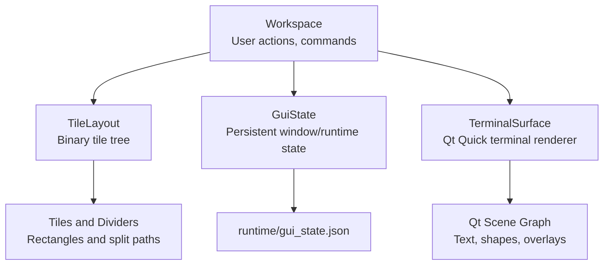
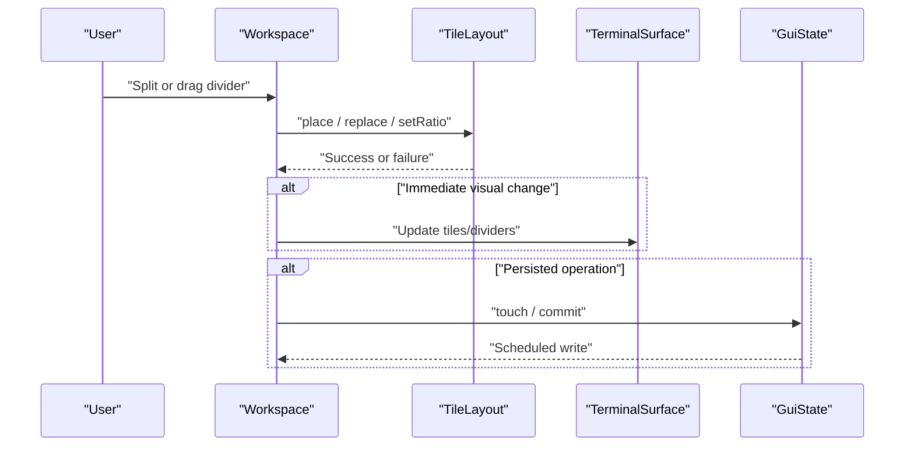
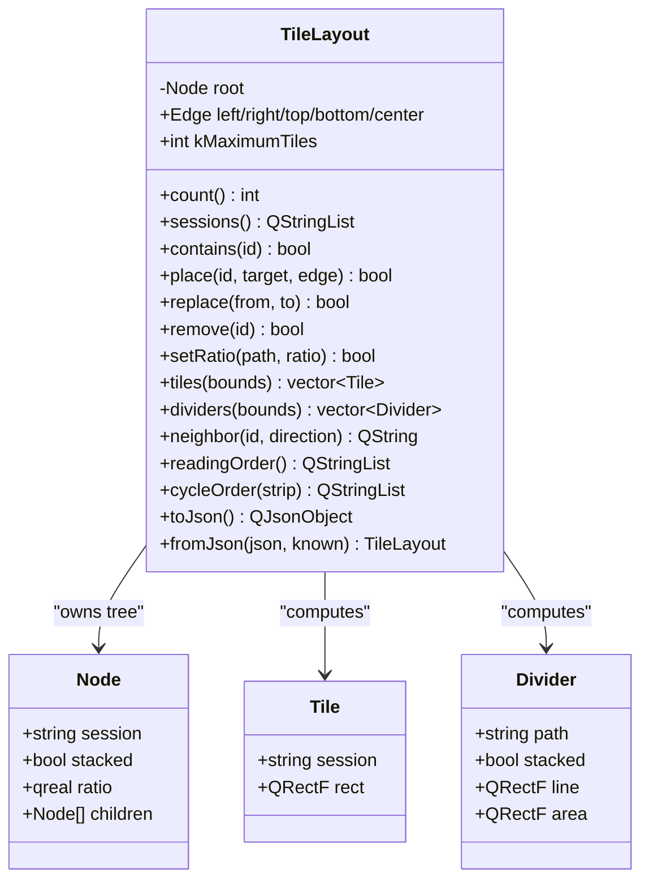
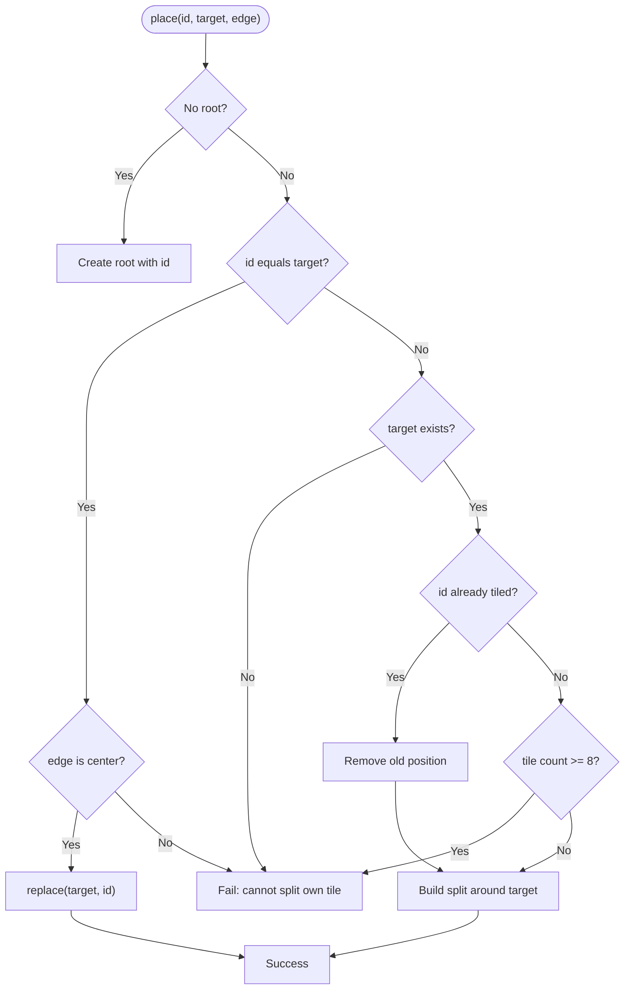
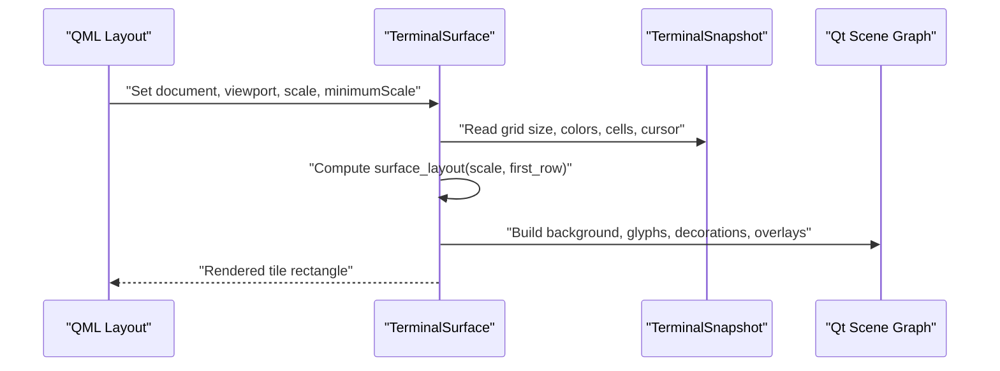
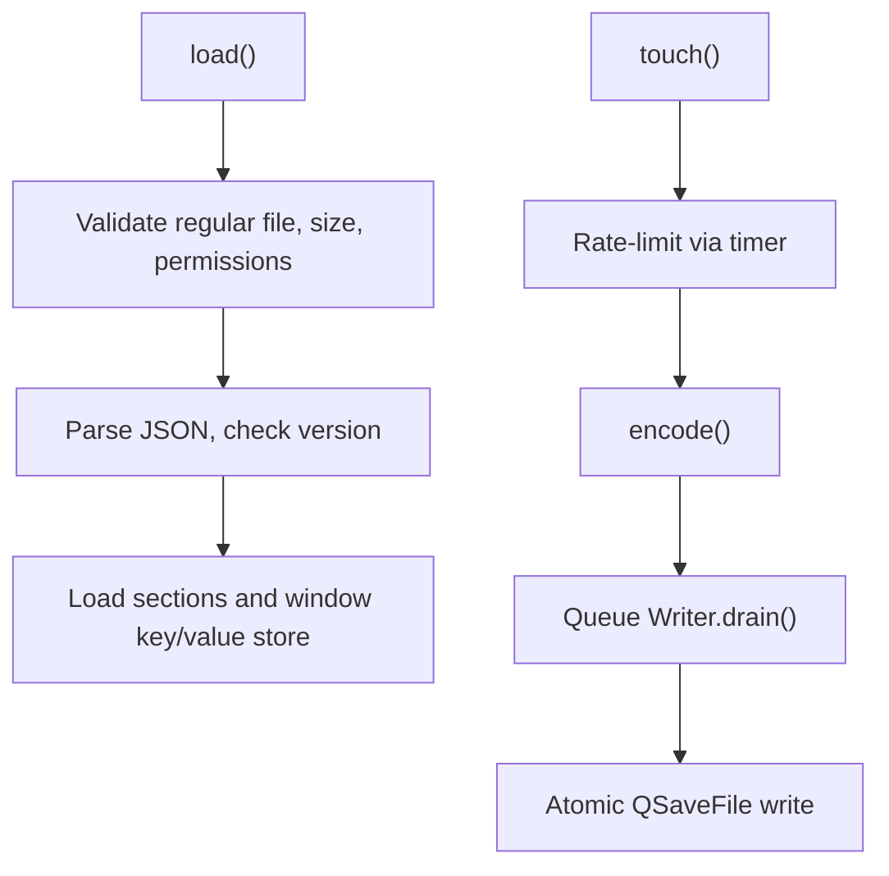
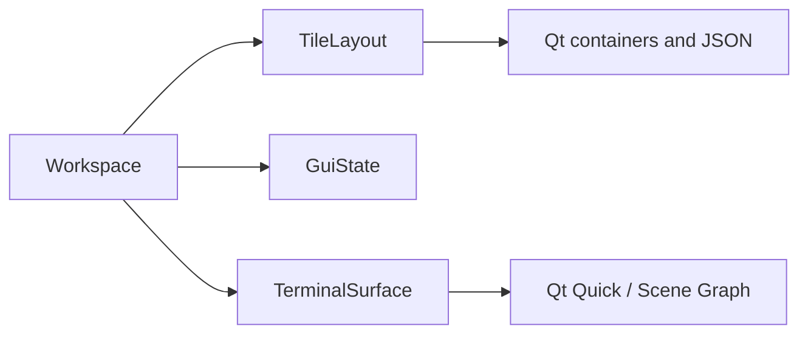

# Layout System and Terminal Tiles

<cite>
**Referenced Files in This Document**
- [tile_layout.hpp](file://apps/desktop/src/tile_layout.hpp)
- [tile_layout.cpp](file://apps/desktop/src/tile_layout.cpp)
- [tile_layout_test.cpp](file://apps/desktop/tests/tile_layout_test.cpp)
- [terminal_surface.hpp](file://apps/desktop/src/terminal_surface.hpp)
- [terminal_surface.cpp](file://apps/desktop/src/terminal_surface.cpp)
- [gui_state.hpp](file://apps/desktop/src/gui_state.hpp)
- [gui_state.cpp](file://apps/desktop/src/gui_state.cpp)
- [workspace.cpp](file://apps/desktop/src/workspace.cpp)
- [architecture.md](file://docs/architecture.md)
</cite>

## Table of Contents
1. [Introduction](#introduction)
2. [Project Structure](#project-structure)
3. [Core Components](#core-components)
4. [Architecture Overview](#architecture-overview)
5. [Detailed Component Analysis](#detailed-component-analysis)
6. [Dependency Analysis](#dependency-analysis)
7. [Performance Considerations](#performance-considerations)
8. [Troubleshooting Guide](#troubleshooting-guide)
9. [Conclusion](#conclusion)

## Introduction
This document explains the desktop layout system that organizes multiple terminal surfaces into tiles, split views, and navigable arrangements. The central component is `TileLayout`, a binary-tree model representing how agents are tiled on a category stage. It provides algorithms for placing, removing, swapping, resizing, navigating, serializing, and deserializing layouts. The rendering and interaction layer is provided by `TerminalSurface`, which scales terminal content to available space, throttles redraws, supports selection and links, and cooperates with layout drag-and-drop through workspace commands. State persistence uses `GuiState` to save window and runtime choices atomically and asynchronously across application restarts.

## Project Structure
The relevant code lives under the desktop application:

- `apps/desktop/src/tile_layout.{hpp,cpp}` — Binary tree layout model and geometry queries.
- `apps/desktop/src/terminal_surface.{hpp,cpp}` — Qt Quick terminal renderer, input, selection, scaling, and viewport logic.
- `apps/desktop/src/gui_state.{hpp,cpp}` — Versioned JSON persistence for GUI state.
- `apps/desktop/src/workspace.cpp` — Workspace controller wiring user actions to `TileLayout` operations and exposing divider data.
- `apps/desktop/tests/tile_layout_test.cpp` — Unit tests covering placement, navigation, limits, reading order, serialization, and round-trip behavior.
- `docs/architecture.md` — High-level architecture and ownership boundaries.

**Diagram sources**
- [workspace.cpp:3341-3437](file://apps/desktop/src/workspace.cpp#L3341-L3437)
- [tile_layout.hpp:12-89](file://apps/desktop/src/tile_layout.hpp#L12-L89)
- [terminal_surface.hpp:50-200](file://apps/desktop/src/terminal_surface.hpp#L50-L200)
- [gui_state.hpp:18-96](file://apps/desktop/src/gui_state.hpp#L18-L96)

**Section sources**
- [tile_layout.hpp:1-90](file://apps/desktop/src/tile_layout.hpp#L1-L90)
- [tile_layout.cpp:1-381](file://apps/desktop/src/tile_layout.cpp#L1-L381)
- [terminal_surface.hpp:1-200](file://apps/desktop/src/terminal_surface.hpp#L1-L200)
- [terminal_surface.cpp:1-200](file://apps/desktop/src/terminal_surface.cpp#L1-L200)
- [gui_state.hpp:1-97](file://apps/desktop/src/gui_state.hpp#L1-L97)
- [gui_state.cpp:1-200](file://apps/desktop/src/gui_state.cpp#L1-L200)
- [workspace.cpp:3341-3437](file://apps/desktop/src/workspace.cpp#L3341-L3437)
- [architecture.md:1-165](file://docs/architecture.md#L1-L165)

## Core Components
- `TileLayout`: A plain-value binary tree whose leaves are agent sessions and whose internal nodes are side-by-side or stacked splits. It exposes placement, replacement, removal, ratio adjustment, neighbor finding, reading-order traversal, cycle walking, and JSON persistence.
- `TerminalSurface`: A `QQuickItem` rendering terminal snapshots at an appropriate scale, managing viewport scrolling, selection, link detection, suggestion hints, font configuration, frame throttling, and resize holding during interactive layout changes.
- `GuiState`: A versioned, rate-limited, single-writer JSON file manager used to persist window and runtime state. It bounds size, validates structure, writes atomically, and runs off the GUI thread.
- `Workspace`: The controller connecting UI commands such as splitting, dragging dividers, focusing neighbors, and restoring saved layouts.

Key responsibilities:
- Layout modeling and geometry computation: `TileLayout`.
- Rendering and per-terminal interactivity: `TerminalSurface`.
- Persistent state: `GuiState`.
- User command integration: `Workspace`.

**Section sources**
- [tile_layout.hpp:12-89](file://apps/desktop/src/tile_layout.hpp#L12-L89)
- [terminal_surface.hpp:50-200](file://apps/desktop/src/terminal_surface.hpp#L50-L200)
- [gui_state.hpp:18-96](file://apps/desktop/src/gui_state.hpp#L18-L96)
- [workspace.cpp:3341-3437](file://apps/desktop/src/workspace.cpp#L3341-L3437)

## Architecture Overview
The layout system separates concerns cleanly:

1. `Workspace` receives user commands such as “place session beside target,” “drag divider,” or “next/previous agent.”
2. For layout mutations, it calls `TileLayout::place`, `replace`, `remove`, or `setRatio`.
3. `TileLayout` computes a new tree and returns either success or failure based on constraints such as maximum tile count and known session IDs.
4. `Workspace` persists layout changes when required and emits signals so QML can render updated tiles and dividers.
5. `TerminalSurface` renders each active session inside its computed rectangle, applying scale, row offset, fonts, and viewport constraints.
6. Divider drags update ratios immediately for responsiveness; the final state is committed only when the drag ends.
7. `GuiState` stores layout and other window/runtime preferences in a bounded JSON file.

**Diagram sources**
- [workspace.cpp:3387-3437](file://apps/desktop/src/workspace.cpp#L3387-L3437)
- [tile_layout.cpp:201-381](file://apps/desktop/src/tile_layout.cpp#L201-L381)
- [terminal_surface.cpp:1074-1079](file://apps/desktop/src/terminal_surface.cpp#L1074-L1079)
- [gui_state.cpp:150-213](file://apps/desktop/src/gui_state.cpp#L150-L213)

**Section sources**
- [workspace.cpp:3341-3437](file://apps/desktop/src/workspace.cpp#L3341-L3437)
- [tile_layout.cpp:201-381](file://apps/desktop/src/tile_layout.cpp#L201-L381)
- [terminal_surface.cpp:1074-1079](file://apps/desktop/src/terminal_surface.cpp#L1074-L1079)
- [gui_state.cpp:150-213](file://apps/desktop/src/gui_state.cpp#L150-L213)

## Detailed Component Analysis

### TileLayout Model and Algorithms
`TileLayout` represents the stage as a binary tree:

- Leaves hold a session identifier.
- Internal nodes have two children and describe whether the split is stacked vertically or laid out horizontally, plus a ratio indicating how much area the first child receives.
- Paths identify specific splits using `'0'` and `'1'` indices from the root.

**Diagram sources**
- [tile_layout.hpp:12-89](file://apps/desktop/src/tile_layout.hpp#L12-L89)

Key behaviors:

| Operation | Behavior | Constraints |
|---|---|---|
| `place` | Inserts a session beside a target, replacing the target when the edge is center. | Maximum eight tiles; target must exist; cannot split itself. |
| `replace` | Swaps one session with another; if the destination is untiled, it takes that tile. | Both identifiers must be valid. |
| `remove` | Removes a leaf and promotes its sibling. | Must be present. |
| `setRatio` | Adjusts a split’s proportional area. | Path must point to a split; ratio clamped to safe minimum and maximum. |
| `tiles` | Recursively divides the bounding rectangle into leaf rectangles. | Uses half-split logic per node. |
| `dividers` | Produces divider lines and their local areas for hit testing. | Each internal split contributes one divider. |
| `neighbor` | Finds the closest adjacent tile in a given direction without wrapping. | Requires overlapping span along the perpendicular axis. |
| `readingOrder` | Sorts tiles by top edge then left edge. | Uses rounded row buckets for stability. |
| `cycleOrder` | Combines visible tiles in reading order with untiled agents from the strip. | Used by next/previous navigation. |
| `step` | Advances focus through the cycle, temporarily replacing a shown tile when moving between tiles and strip entries. | Preserves home layout after full wrap. |
| `toJson` / `fromJson` | Serializes and reconstructs the tree. | Drops unknown or repeated sessions; rejects malformed trees. |

Complexity characteristics:

- Tree search functions such as finding a node or parent are linear in the number of tiles because they traverse the binary tree.
- `tiles` and `dividers` visit every node once, so they are linear in the tree size.
- `neighbor` enumerates all tiles and compares distances, making it approximately quadratic in the number of tiles, but the eight-tile limit keeps this constant-time in practice.
- `readingOrder` sorts all tiles, so it is O(n log n), again bounded by the small maximum tile count.

Responsive layout algorithm:
- `halfes` computes child rectangles based on `stacked` and `ratio`.
- Horizontal splits divide width; vertical splits divide height.
- Ratio values are clamped during JSON reconstruction to prevent zero-width or zero-height tiles.

Drag-and-drop support:
- `dividers` returns the dividing line and the local area used for drag hit testing.
- `setRatio` accepts a path string identifying the split being dragged.
- Workspace updates ratios continuously during drag while deferring persistent commits until the drag ends.

Persistence:
- `toJson` produces a compact tree representation.
- `fromJson` validates structure, depth, children count, finite ratio, and known session identities.
- Repeated or unknown sessions are dropped, and excessively deep or malformed trees are rejected.

**Section sources**
- [tile_layout.hpp:12-89](file://apps/desktop/src/tile_layout.hpp#L12-L89)
- [tile_layout.cpp:1-381](file://apps/desktop/src/tile_layout.cpp#L1-L381)
- [tile_layout_test.cpp:1-295](file://apps/desktop/tests/tile_layout_test.cpp#L1-L295)

#### Placement Flowchart

**Diagram sources**
- [tile_layout.cpp:201-259](file://apps/desktop/src/tile_layout.cpp#L201-L259)

### TerminalSurface Rendering and Interaction
`TerminalSurface` is the Qt Quick item responsible for drawing a terminal snapshot into its allocated tile. Important aspects:

- **Scaling and viewport**: Computes scale from viewport dimensions and cell size, optionally enforcing a minimum scale so prompts remain readable. When zoomed below the minimum, it scrolls to keep the cursor visible.
- **Frame throttling**: Supports a configurable frame interval so noisy output does not flood the renderer.
- **Resize holding**: During divider drags, terminals can defer resizing until the drag ends, reducing layout churn.
- **Selection and links**: Tracks selected text and detects URLs or file paths for Command-click or Control-click opening.
- **Suggestion overlay**: Draws next-prompt suggestions near the cursor with confidence-based brightness.
- **Input handling**: Supports paste, IME composition, keyboard navigation, wheel scrolling, and platform-specific modifier keys.

Rendering optimizations:

- ASCII advances are cached per character and style combination to avoid repeated font measurement.
- Background rectangles and glyph runs are batched to reduce scene-graph node creation.
- Decoration lines are drawn as compact geometry rather than per-cell strings.
- Text layout is reused where possible and flushed only when style or run boundaries change.

**Diagram sources**
- [terminal_surface.cpp:56-77](file://apps/desktop/src/terminal_surface.cpp#L56-L77)
- [terminal_surface.cpp:708-749](file://apps/desktop/src/terminal_surface.cpp#L708-L749)
- [terminal_surface.cpp:1074-1079](file://apps/desktop/src/terminal_surface.cpp#L1074-L1079)

**Section sources**
- [terminal_surface.hpp:50-200](file://apps/desktop/src/terminal_surface.hpp#L50-L200)
- [terminal_surface.cpp:56-77](file://apps/desktop/src/terminal_surface.cpp#L56-L77)
- [terminal_surface.cpp:708-749](file://apps/desktop/src/terminal_surface.cpp#L708-L749)
- [terminal_surface.cpp:1074-1079](file://apps/desktop/src/terminal_surface.cpp#L1074-L1079)

### Persistence and State Management
`GuiState` manages the application’s private runtime state file:

- Stores versioned sections, including a reserved `window` section for QML-owned settings.
- Reads and writes a bounded JSON document, ignoring symlinks, oversized files, corrupt JSON, or incompatible versions.
- Rate-limits writes using a timer and publishes-to-publish semantics so rapid changes coalesce.
- Uses a single background writer with mutex and condition variable synchronization.
- On destruction or explicit flush, waits briefly for writes to complete.

Integration with layout:
- `Workspace` restores saved tile trees per category from persisted state.
- Divider drag operations may commit intermediate states depending on the command path, while final layout changes are persisted through the normal workspace checkpoint mechanism.

**Diagram sources**
- [gui_state.cpp:30-53](file://apps/desktop/src/gui_state.cpp#L30-L53)
- [gui_state.cpp:91-122](file://apps/desktop/src/gui_state.cpp#L91-L122)
- [gui_state.cpp:150-213](file://apps/desktop/src/gui_state.cpp#L150-L213)

**Section sources**
- [gui_state.hpp:18-96](file://apps/desktop/src/gui_state.hpp#L18-L96)
- [gui_state.cpp:30-53](file://apps/desktop/src/gui_state.cpp#L30-L53)
- [gui_state.cpp:91-122](file://apps/desktop/src/gui_state.cpp#L91-L122)
- [gui_state.cpp:150-213](file://apps/desktop/src/gui_state.cpp#L150-L213)
- [workspace.cpp:3341-3437](file://apps/desktop/src/workspace.cpp#L3341-L3437)

## Dependency Analysis
High-level dependencies:

- `Workspace` depends on `TileLayout` for layout mutation and on `GuiState` for persistence.
- `TerminalSurface` depends on terminal snapshots and Qt Quick primitives.
- `TileLayout` is self-contained except for Qt containers and JSON types.
- Tests verify layout invariants without requiring the full GUI.

**Diagram sources**
- [workspace.cpp:3341-3437](file://apps/desktop/src/workspace.cpp#L3341-L3437)
- [tile_layout.hpp:1-11](file://apps/desktop/src/tile_layout.hpp#L1-L11)
- [terminal_surface.hpp:1-49](file://apps/desktop/src/terminal_surface.hpp#L1-L49)

**Section sources**
- [workspace.cpp:3341-3437](file://apps/desktop/src/workspace.cpp#L3341-L3437)
- [tile_layout.hpp:1-11](file://apps/desktop/src/tile_layout.hpp#L1-L11)
- [terminal_surface.hpp:1-49](file://apps/desktop/src/terminal_surface.hpp#L1-L49)

## Performance Considerations
The repository implements several performance-oriented practices relevant to terminal tiling and rendering:

- **Bounded tile count**: `TileLayout::kMaximumTiles` limits the layout to eight tiles, keeping neighbor lookup and tree traversal constant-time in practice.
- **Safe ratio bounds**: Ratios are clamped to prevent vanishingly small tiles, avoiding extreme subdivision and floating-point instability.
- **Depth guard**: JSON reconstruction enforces a maximum recursion depth, protecting against deeply nested malformed layouts.
- **Throttled rendering**: `TerminalSurface` supports a frame interval so high-output terminals do not overwhelm the renderer.
- **Resize holding**: During divider drags, terminals can hold resize updates and apply them once at the end.
- **Cached ASCII metrics**: `AsciiAdvances` caches advance widths for printable ASCII characters across bold and italic styles.
- **Batched drawing**: Background rectangles and text runs are flushed in batches to minimize scene-graph node creation.
- **Background persistence**: `GuiState` writes asynchronously and merges rapid changes, preventing UI stalls from frequent disk writes.
- **Architecture guidance**: The architecture document emphasizes responsiveness, bounded previews, and renderer isolation from parser/PTY state.

Memory considerations:

- `GuiState` caps file size and value sizes, rejecting oversized or excessive window keys.
- `TerminalSurface` consumes immutable terminal snapshots and avoids mutating parser state.
- `TileLayout` is a plain value type that rolls back with the surrounding workspace registry, reducing shared mutable state.

[No sources needed since this section provides general guidance]

## Troubleshooting Guide
Common issues and their likely causes:

| Symptom | Likely Cause | Recommended Action |
|---|---|---|
| Splitting fails when adding a new tile | Stage already has eight tiles | Close or remove a tile before splitting further. |
| Placing an agent beside itself fails | Target equals source with a non-center edge | Use center placement to replace, or choose a different target. |
| Neighbor navigation returns no result | No tile shares the expected span or direction | Move focus within the same column or row; navigation does not wrap. |
| Dragging a divider does nothing | Path points to a leaf instead of a split | Only internal splits expose a draggable ratio. |
| Saved layout disappears after restart | Session ID unknown, repeated, or malformed JSON | Ensure the session still exists and the layout contains unique, valid identifiers. |
| Window state not saved | Corrupt, symlinked, oversized, or permission-restricted file | Check `runtime/gui_state.json`, file permissions, and disk availability. |
| Terminal flickers during divider drag | Resize updates happening too frequently | Enable resize-holding mode while dragging. |
| Very large terminal history slows rendering | Full-screen reflows or unthrottled output | Use frame interval throttling and ensure snapshots are immutable. |

**Section sources**
- [tile_layout.cpp:201-381](file://apps/desktop/src/tile_layout.cpp#L201-L381)
- [terminal_surface.cpp:1088-1139](file://apps/desktop/src/terminal_surface.cpp#L1088-L1139)
- [gui_state.cpp:91-122](file://apps/desktop/src/gui_state.cpp#L91-L122)
- [gui_state.cpp:150-213](file://apps/desktop/src/gui_state.cpp#L150-L213)

## Conclusion
The layout system combines a simple but robust binary-tree model with responsive Qt Quick rendering and durable state persistence. `TileLayout` handles arrangement logic, constraints, and navigation, while `TerminalSurface` adapts terminal content to available screen space and user interactions. `GuiState` ensures that window and runtime preferences survive restarts safely. Together, these components provide a scalable, testable foundation for multi-terminal workspaces with split views, drag-resizable dividers, and predictable focus flow.

[No sources needed since this section summarizes without analyzing specific files]