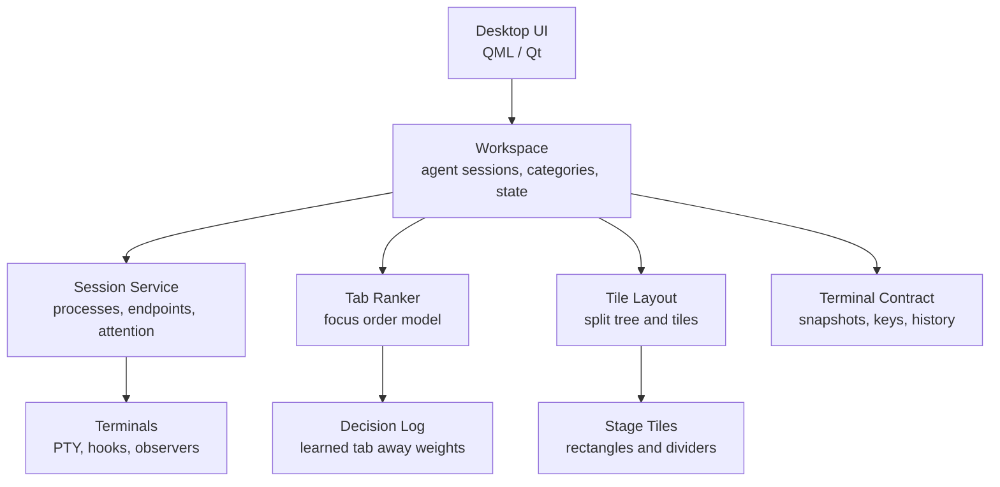
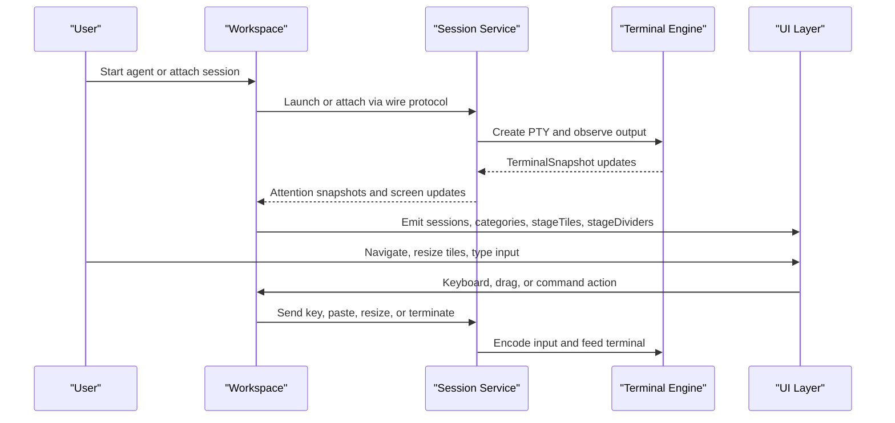
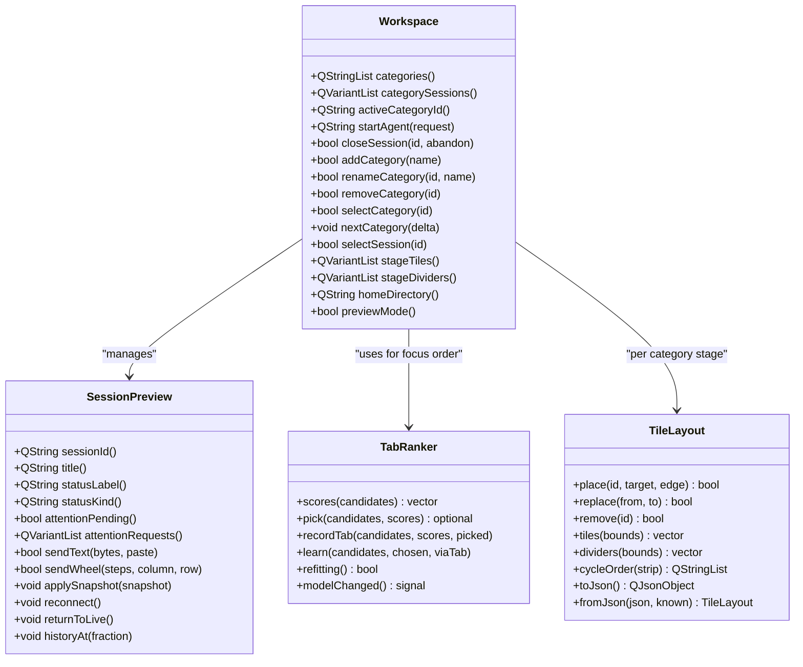
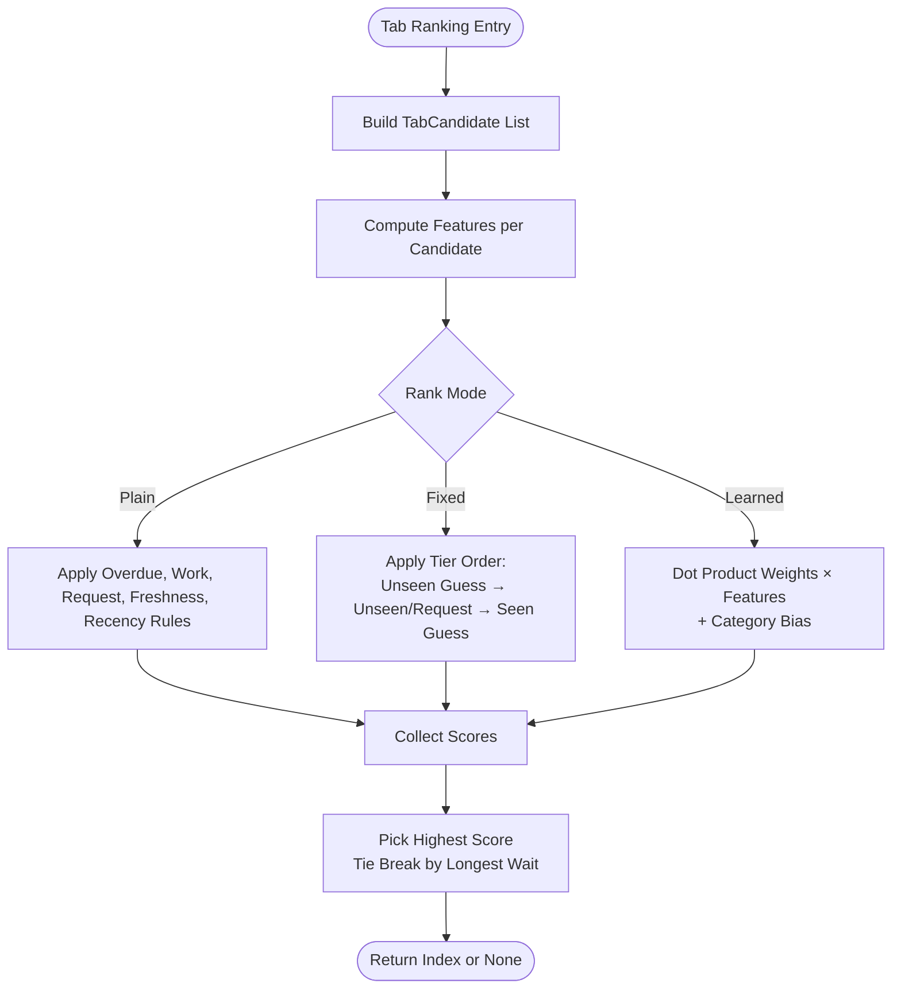
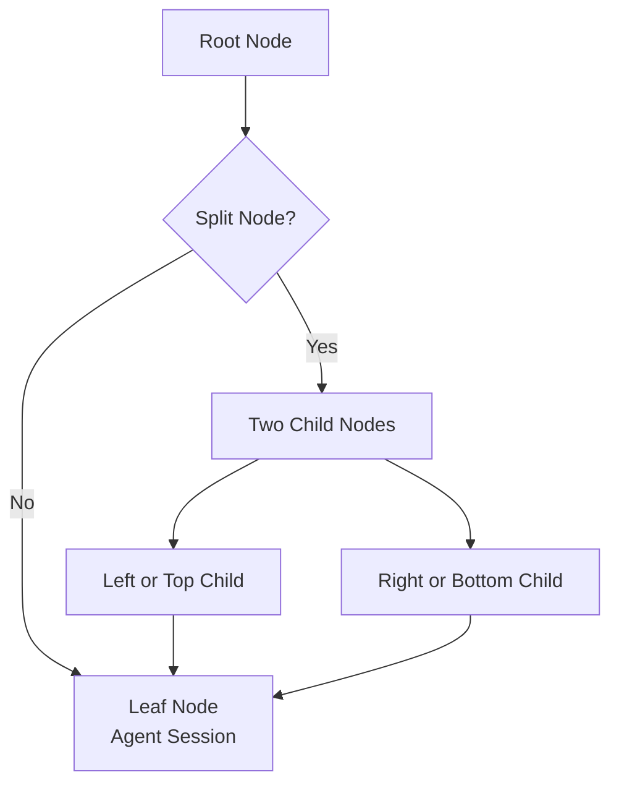
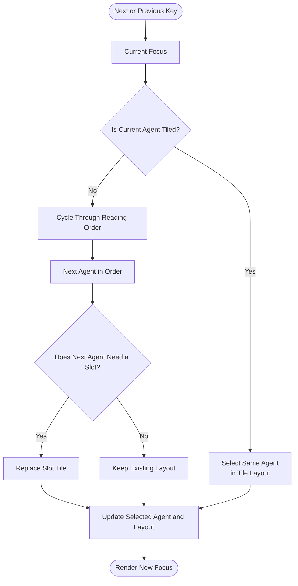
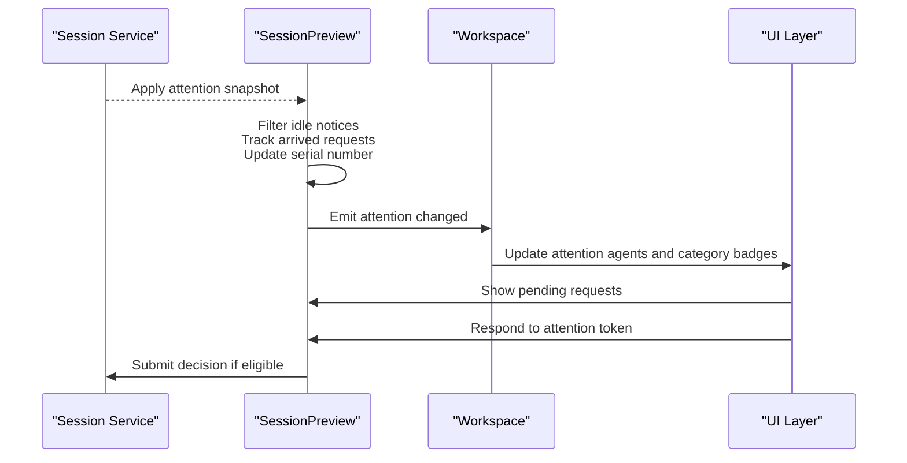
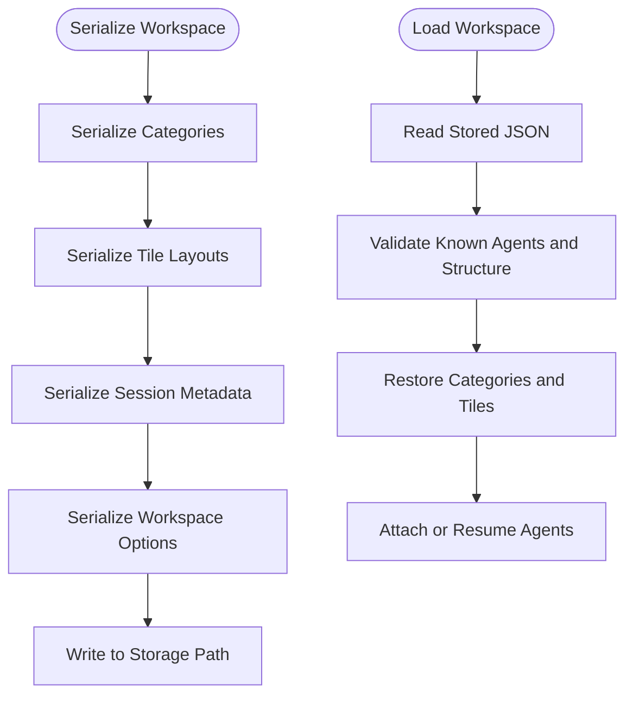
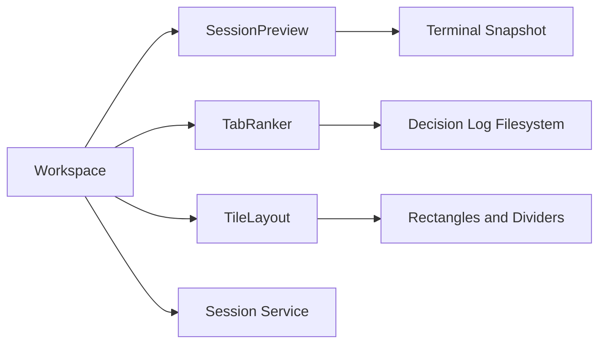

# Workspace and Agent Management

<cite>
**Referenced Files in This Document**
- [workspace.hpp](file://apps/desktop/src/workspace.hpp)
- [workspace.cpp](file://apps/desktop/src/workspace.cpp)
- [tab_ranker.hpp](file://apps/desktop/src/tab_ranker.hpp)
- [tab_ranker.cpp](file://apps/desktop/src/tab_ranker.cpp)
- [tile_layout.hpp](file://apps/desktop/src/tile_layout.hpp)
- [tile_layout.cpp](file://apps/desktop/src/tile_layout.cpp)
- [attention_order.hpp](file://apps/desktop/src/attention_order.hpp)
- [attention_view.cpp](file://apps/desktop/src/attention_view.cpp)
- [terminal.hpp](file://services/session/include/lapis/session/terminal.hpp)
- [session_service.cpp](file://services/session/src/session_service.cpp)
- [workspace.md](file://docs/workspace.md)
</cite>

## Table of Contents
1. [Introduction](#introduction)
2. [Project Structure](#project-structure)
3. [Core Components](#core-components)
4. [Architecture Overview](#architecture-overview)
5. [Detailed Component Analysis](#detailed-component-analysis)
6. [Dependency Analysis](#dependency-analysis)
7. [Performance Considerations](#performance-considerations)
8. [Troubleshooting Guide](#troubleshooting-guide)
9. [Conclusion](#conclusion)

## Introduction
This document explains the workspace management system that organizes agent sessions, terminal tiles, categories, attention signals, and layout state for the desktop application. The primary responsibilities are:

- Maintain all active agent sessions and their lifecycle through the session service.
- Present agents as cards in a category strip and as a focused terminal stage.
- Organize multiple agent terminals into resizable split layouts within a category stage.
- Compute focus order using attention signals, waiting time, and learned preferences.
- Provide keyboard navigation, drag-and-drop reorganization, and command palette operations.
- Serialize workspace state for persistence and recovery across restarts.

The workspace is designed so that UI code stays separate from session process management and terminal rendering, while still being able to react to real-time attention requests, screen updates, and history navigation.

## Project Structure
The relevant implementation lives under the desktop app and the shared session service:

| Area | Purpose | Key Files |
|---|---|---|
| Desktop workspace model | Manages sessions, categories, launch options, serialization, and UI properties | `workspace.hpp`, `workspace.cpp` |
| Tab ranking algorithm | Orders waiting agents by attention signals and learned weights | `tab_ranker.hpp`, `tab_ranker.cpp` |
| Tile layout system | Represents multi-agent splits and computes tile rectangles | `tile_layout.hpp`, `tile_layout.cpp` |
| Attention ordering | Computes priority tiers for agents that need attention | `attention_order.hpp` |
| Session presentation | Derives status labels, attention requests, and diagnostic text | `attention_view.cpp` |
| Terminal contract | Defines snapshots, keys, wheel input, and history metadata | `terminal.hpp` |
| Session service | Launches processes, manages endpoints, handles attention and history | `session_service.cpp` |
| User documentation | Explains stages, strips, tiles, commands, and navigation | `workspace.md` |

**Diagram sources**
- [workspace.hpp:300-420](file://apps/desktop/src/workspace.hpp#L300-L420)
- [tab_ranker.hpp:1-134](file://apps/desktop/src/tab_ranker.hpp#L1-L134)
- [tile_layout.hpp:1-90](file://apps/desktop/src/tile_layout.hpp#L1-L90)
- [terminal.hpp:1-200](file://services/session/include/lapis/session/terminal.hpp#L1-L200)
- [session_service.cpp:1-250](file://services/session/src/session_service.cpp#L1-L250)

**Section sources**
- [workspace.hpp:1-897](file://apps/desktop/src/workspace.hpp#L1-L897)
- [workspace.cpp:1-600](file://apps/desktop/src/workspace.cpp#L1-L600)
- [workspace.md:1-105](file://docs/workspace.md#L1-L105)

## Core Components

### Workspace
The `Workspace` class is the central coordinator for all agent sessions in the current desktop window. It exposes:

- **Categories**: names, selected agent, and per-category session lists.
- **Sessions**: a list of `SessionPreview` objects representing each agent’s visible state.
- **Focus state**: active category ID, focused index, and focused session pointer.
- **Stage visualization**: serialized tile rectangles and divider positions.
- **Lifecycle operations**: create, resume, select, close, reopen, and attach to existing sessions.
- **Serialization hooks**: QML-accessible properties such as `sessions`, `categories`, `stageTiles`, and `stageDividers`.

The workspace also owns launch configuration, including harness selection, approval mode, SSH machine handling, and whether agents should be restored after a crash or reboot.

#### Key Responsibilities
- Manage `AgentRequest` structures describing where an agent runs, which harness it uses, and how it should start.
- Coordinate with `LiveConnection` and the session service to attach to running agents or launch new ones.
- Track preview-only vs live modes.
- Expose attention-related counts and errors to the UI layer.
- Persist workspace settings such as storage path, restore behavior, and harness update policy.

#### Important Data Shapes
- `SessionPreview`: per-session visual state, attention snapshot, connection state, history scrubbing, and terminal input helpers.
- `AgentRequest`: category, directory, harness, model, mode, machine, resume conversation, and selection preference.
- `WorkspaceOptions`: endpoint, launch spec, attach mode, storage path, restore flag, update policy, headless mode, and account defaults.

**Section sources**
- [workspace.hpp:250-420](file://apps/desktop/src/workspace.hpp#L250-L420)
- [workspace.cpp:201-495](file://apps/desktop/src/workspace.cpp#L201-L495)

### SessionPreview
`SessionPreview` represents one agent’s user-facing state. It is not the terminal engine itself; it wraps connection state, attention snapshots, history strip position, and decoded terminal snapshots for display.

Important behaviors include:

- Starting a live connection with a launch specification and attach mode.
- Applying attention snapshots from the session service.
- Managing unseen marks when an agent needs attention while another session is selected.
- Handling history navigation, scroll-back debt for full-screen programs, and wheel events.
- Decoding terminal snapshots lazily only for active viewers to avoid unnecessary work.
- Exposing status labels, attention reasons, request choices, and diagnostics to QML.

**Section sources**
- [workspace.hpp:1-250](file://apps/desktop/src/workspace.hpp#L1-L250)
- [attention_view.cpp:1-200](file://apps/desktop/src/attention_view.cpp#L1-L200)

### Tab Ranker
The `TabRanker` determines which waiting agent should receive focus next. It supports three ranking modes:

| Mode | Behavior |
|---|---|
| Plain | Uses fixed rules: overdue agents first, then work categories, pending requests, unseen turns, and newest agents. |
| Fixed | Uses a strict tier order based on guess visibility, unseen turns, and requests, breaking ties by wait time. |
| Learned | Uses a fitted linear model over features like work, request, unseen, guess, wait time, recency, staleness, turn frequency, and minutes since last turn. |

It records decisions, persists them in a JSON lines log, fits a regularized model on a background thread, and emits model changes back to the GUI thread.

**Section sources**
- [tab_ranker.hpp:1-134](file://apps/desktop/src/tab_ranker.hpp#L1-L134)
- [tab_ranker.cpp:1-200](file://apps/desktop/src/tab_ranker.cpp#L1-L200)
- [tab_ranker.cpp:201-504](file://apps/desktop/src/tab_ranker.cpp#L201-L504)

### Tile Layout
`TileLayout` models a binary split tree similar to iTerm2 panes. Leaves are agents; internal nodes represent horizontal or vertical splits with a ratio between 0.15 and 0.85.

Operations include:

- Placing an agent beside a target or replacing a target.
- Removing an agent and collapsing its sibling.
- Computing tile rectangles and divider geometry for a given bounding rectangle.
- Finding neighboring tiles in left, right, top, bottom directions.
- Generating reading order and cycle order for keyboard navigation.
- Serializing and deserializing the layout while dropping unknown or repeated agents.

**Section sources**
- [tile_layout.hpp:1-90](file://apps/desktop/src/tile_layout.hpp#L1-L90)
- [tile_layout.cpp:1-200](file://apps/desktop/src/tile_layout.cpp#L1-L200)
- [tile_layout.cpp:201-381](file://apps/desktop/src/tile_layout.cpp#L201-L381)

### Attention Ordering
The attention ordering helper assigns priority tiers to agents that need attention:

1. A next-prompt guess that has not yet been seen.
2. An unseen finished turn or a pending request.
3. A guessed prompt already seen.
4. No waiting tier.

Within each tier, older waiting agents come first. This is used alongside `SessionPreview` status logic and the workspace’s attention aggregation.

**Section sources**
- [attention_order.hpp:1-33](file://apps/desktop/src/attention_order.hpp#L1-L33)
- [attention_view.cpp:1-200](file://apps/desktop/src/attention_view.cpp#L1-L200)

### Terminal Contract and Session Service Integration
The workspace does not directly render raw terminal bytes. Instead, it works with `TerminalSnapshot`, which contains cells, graphemes, cursor state, history metadata, colors, hyperlinks, and size information. The session service owns process lifecycles, local endpoints, hook relays, and observer integration, while the workspace consumes snapshots and sends keys or paste data.

Key aspects:

- Snapshots have bounded cell and history sizes.
- Wheel input is encoded either as mouse events for programs that request it or as arrow keys on alternate screens.
- History can be queried at absolute offsets without modifying the live terminal state.
- The session service enforces output admission limits and pacing under pressure.

**Section sources**
- [terminal.hpp:1-200](file://services/session/include/lapis/session/terminal.hpp#L1-L200)
- [session_service.cpp:1-250](file://services/session/src/session_service.cpp#L1-L250)

## Architecture Overview

**Diagram sources**
- [workspace.hpp:300-420](file://apps/desktop/src/workspace.hpp#L300-L420)
- [workspace.cpp:201-495](file://apps/desktop/src/workspace.cpp#L201-L495)
- [terminal.hpp:120-200](file://services/session/include/lapis/session/terminal.hpp#L120-L200)
- [session_service.cpp:1-250](file://services/session/src/session_service.cpp#L1-L250)

## Detailed Component Analysis

### Workspace State Model
The workspace maintains:

- A collection of `SessionPreview` instances keyed by session identifiers.
- Categories that group agents.
- Active category and focused session state.
- Per-category `TileLayout` instances.
- Launch defaults, SSH machine discovery, and harness catalog integration.
- Error state and closed-agent reopening capability.

The workspace exposes both QML property bindings and `Q_INVOKABLE` methods so UI actions can invoke workspace operations without direct coupling to internal implementation details.

**Diagram sources**
- [workspace.hpp:300-897](file://apps/desktop/src/workspace.hpp#L300-L897)
- [tab_ranker.hpp:1-134](file://apps/desktop/src/tab_ranker.hpp#L1-L134)
- [tile_layout.hpp:1-90](file://apps/desktop/src/tile_layout.hpp#L1-L90)

**Section sources**
- [workspace.hpp:250-897](file://apps/desktop/src/workspace.hpp#L250-L897)

### Tab Ranking Algorithm
The ranking algorithm converts agent states into numeric features and applies either deterministic rules or a learned linear model.

#### Feature Set
Features include:

| Feature | Meaning |
|---|---|
| Work category | Whether the agent belongs to a configured work category. |
| Request | Whether the agent has a pending request. |
| Unseen | Whether the agent finished a turn or asked for help while not shown. |
| Guess | Whether a next-prompt guess is offered. |
| Log wait | Log-transformed wait time in minutes. |
| Newest | Indicator for the most recently started candidate. |
| Stale | Indicator for long-waiting candidates. |
| Turns last hour | Log-transformed count of recent turns. |
| Minutes since last turn | Capped log-transformed time since last turn. |

#### Ranking Modes
- **Plain ranking**: overdue agents get very high scores; otherwise, work, requests, fresh unseen/guess, and recency combine with a penalty for short waits.
- **Fixed ranking**: hard tiers based on guess visibility and unseen/request status, with tie-breaking by longest wait.
- **Learned ranking**: softmax-style scoring using weights and per-category biases, refitted asynchronously from recorded decisions.

**Diagram sources**
- [tab_ranker.hpp:20-134](file://apps/desktop/src/tab_ranker.hpp#L20-L134)
- [tab_ranker.cpp:1-200](file://apps/desktop/src/tab_ranker.cpp#L1-L200)
- [tab_ranker.cpp:201-504](file://apps/desktop/src/tab_ranker.cpp#L201-L504)

**Section sources**
- [tab_ranker.hpp:1-134](file://apps/desktop/src/tab_ranker.hpp#L1-L134)
- [tab_ranker.cpp:1-504](file://apps/desktop/src/tab_ranker.cpp#L1-L504)

### Tile Layout System
The tile layout is a recursive binary tree. Each node is either:

- A leaf containing one agent session.
- A split with two children, a stacking direction, and a ratio.

The layout system guarantees:

- Maximum eight tiles per category stage.
- Minimum and maximum split ratios.
- Depth protection during deserialization.
- Rejection of duplicate or unknown sessions.
- Stable reading order based on top-left positioning.

**Diagram sources**
- [tile_layout.hpp:10-90](file://apps/desktop/src/tile_layout.hpp#L10-L90)
- [tile_layout.cpp:1-200](file://apps/desktop/src/tile_layout.cpp#L1-L200)

#### Drag-and-Drop Reorganization
Drag behavior follows these rules:

- Dragging a card onto an edge places the agent beside the target tile.
- Dragging onto the center replaces the target tile with the dragged agent.
- Dividers can be dragged to adjust split ratios.
- Agents are resized once when dragging ends rather than continuously.
- Moving an agent off the stage keeps the underlying session running.

These behaviors are reflected in the layout operations `place`, `replace`, `remove`, and `setRatio`.

**Section sources**
- [tile_layout.hpp:1-90](file://apps/desktop/src/tile_layout.hpp#L1-L90)
- [tile_layout.cpp:1-381](file://apps/desktop/src/tile_layout.cpp#L1-L381)
- [workspace.md:1-105](file://docs/workspace.md#L1-L105)

### Keyboard Navigation Patterns
Keyboard navigation combines three layers:

1. **Category navigation**: moving between categories.
2. **Strip navigation**: moving between agents within the active category.
3. **Tile navigation**: moving between tiled agents and untiled agents in the strip.

The `TileLayout::step` function computes the next agent when cycling through focus. If the current agent is tiled, the step may replace a slot tile with the next untiled agent so the strip remains navigable.

**Diagram sources**
- [tile_layout.cpp:300-381](file://apps/desktop/src/tile_layout.cpp#L300-L381)

**Section sources**
- [tile_layout.hpp:40-90](file://apps/desktop/src/tile_layout.hpp#L40-L90)
- [tile_layout.cpp:250-381](file://apps/desktop/src/tile_layout.cpp#L250-L381)
- [workspace.md:1-105](file://docs/workspace.md#L1-L105)

### Attention and Real-Time Updates
Attention flows from the session service to the workspace through snapshots. Each `SessionPreview` tracks:

- Pending attention requests with tokens, reasons, summaries, choices, and details.
- Observation phase, readiness, and connection state.
- Unseen marks when an agent needs attention while another is selected.
- Diagnostic messages when attention cannot be resolved.

The workspace aggregates attention across categories and exposes counts and categories to the UI. Status labels derive from connection state, attention activity, and estimated output timing.

**Diagram sources**
- [attention_view.cpp:1-200](file://apps/desktop/src/attention_view.cpp#L1-L200)
- [workspace.hpp:1-250](file://apps/desktop/src/workspace.hpp#L1-L250)

**Section sources**
- [attention_view.cpp:1-200](file://apps/desktop/src/attention_view.cpp#L1-L200)
- [attention_order.hpp:1-33](file://apps/desktop/src/attention_order.hpp#L1-L33)
- [workspace.hpp:1-250](file://apps/desktop/src/workspace.hpp#L1-L250)

### Command Palette and Agent Operations
The command palette provides search-based access to workspace operations. From the workspace perspective, it triggers actions such as:

- Creating categories.
- Creating or resuming agents.
- Opening agent folders or editor locations.
- Reloading or updating harnesses.
- Renaming, moving, or reordering agents.

The documentation describes the command palette as accessible through a global shortcut and notes that it includes agent card actions and reload/update actions.

**Section sources**
- [workspace.md:1-105](file://docs/workspace.md#L1-L105)

### Workspace State Serialization
The workspace state includes several serializable pieces:

- Category definitions and selected agents.
- Per-category tile layouts.
- Agent launch defaults and account configuration.
- Attention and history state exposed through `SessionPreview`.
- Terminal snapshot timing and decoding metrics for diagnostics.

Tile layouts serialize as either a single agent object or a split object with stacked direction, ratio, and two children. Unknown or repeated agents are removed during deserialization, and excessively deep or wide layouts are rejected.

**Diagram sources**
- [tile_layout.hpp:60-90](file://apps/desktop/src/tile_layout.hpp#L60-L90)
- [tile_layout.cpp:300-381](file://apps/desktop/src/tile_layout.cpp#L300-L381)
- [workspace.hpp:300-420](file://apps/desktop/src/workspace.hpp#L300-L420)

**Section sources**
- [tile_layout.hpp:1-90](file://apps/desktop/src/tile_layout.hpp#L1-L90)
- [tile_layout.cpp:300-381](file://apps/desktop/src/tile_layout.cpp#L300-L381)
- [workspace.hpp:300-420](file://apps/desktop/src/workspace.hpp#L300-L420)

## Dependency Analysis

**Diagram sources**
- [workspace.hpp:300-897](file://apps/desktop/src/workspace.hpp#L300-L897)
- [tab_ranker.cpp:400-504](file://apps/desktop/src/tab_ranker.cpp#L400-L504)
- [tile_layout.cpp:1-381](file://apps/desktop/src/tile_layout.cpp#L1-L381)
- [terminal.hpp:120-200](file://services/session/include/lapis/session/terminal.hpp#L120-L200)

### Coupling and Cohesion
- `Workspace` is highly cohesive around agent lifecycle and UI-visible state but depends on several subsystems.
- `TabRanker` is self-contained and communicates with the rest of the system through explicit feature vectors and decision logs.
- `TileLayout` is stateless except for its internal root node and exposes pure operations for geometry and navigation.
- `SessionPreview` couples UI concerns with session transport and terminal snapshot decoding.

### External Dependencies
- Qt types and signals drive UI binding and asynchronous model updates.
- The session service provides process supervision, attention observation, and terminal encoding.
- The filesystem is used for decision logs, workspace storage, and model persistence.
- Platform-specific helpers handle SSH, local endpoints, hook relays, and process groups.

**Section sources**
- [workspace.hpp:1-200](file://apps/desktop/src/workspace.hpp#L1-L200)
- [workspace.cpp:1-200](file://apps/desktop/src/workspace.cpp#L1-L200)
- [tab_ranker.cpp:1-200](file://apps/desktop/src/tab_ranker.cpp#L1-L200)
- [tile_layout.cpp:1-200](file://apps/desktop/src/tile_layout.cpp#L1-L200)
- [session_service.cpp:1-250](file://services/session/src/session_service.cpp#L1-L250)

## Performance Considerations

### Many Concurrent Terminals
Managing many concurrent terminals requires careful separation of expensive work:

- Terminal snapshot decoding is deferred until a viewer needs it.
- Decode attempts are rate-limited by viewer intervals.
- Only the newest screen is retained when no view is actively showing an agent.
- History scrolling avoids decoding every page unless needed.

### Memory Optimization Strategies
- Terminal snapshots use contiguous grapheme storage and slices into cells to reduce allocations.
- History budgets cap total rows and viewport extraction cost.
- Input, paste, reply, and hyperlink sizes are bounded.
- The session service uses output admission limits and pacing to prevent memory spikes under sustained pressure.
- Tab ranker decisions and models are bounded in size, and old logs are archived rather than growing indefinitely.

### CPU and Rendering Costs
- Tab ranking computes a small fixed-size feature vector per candidate.
- Learned ranking uses lightweight dot products and caches category weights.
- Tile layout traversal is proportional to the number of tiles, capped at eight per category.
- Status and attention computations avoid heavy processing by caching connection state and activity indicators.

### Background Processing
- Tab ranker refits on a thread pool and posts model adoption back to the owner thread.
- Only one refit runs at a time; additional decisions queue exactly one more refit.
- Workspace launch helpers and remote command construction run synchronously but are bounded by validation and shell-word parsing.

**Section sources**
- [workspace.hpp:100-250](file://apps/desktop/src/workspace.hpp#L100-L250)
- [terminal.hpp:1-200](file://services/session/include/lapis/session/terminal.hpp#L1-L200)
- [session_service.cpp:1-250](file://services/session/src/session_service.cpp#L1-L250)
- [tab_ranker.cpp:201-504](file://apps/desktop/src/tab_ranker.cpp#L201-L504)
- [tile_layout.cpp:1-200](file://apps/desktop/src/tile_layout.cpp#L1-L200)

## Troubleshooting Guide

### Attention Requests Not Appearing
Check:

- Whether the session has an active attention source.
- Whether the connection is ready and synchronized.
- Whether the attention snapshot has actionable requests.
- Whether the request token matches the current snapshot epoch and revision.
- Whether the request is stale due to a lost connection.

Use `attentionDiagnostic`, `attentionReady`, and `connectionState` to diagnose connection and synchronization problems.

**Section sources**
- [attention_view.cpp:1-200](file://apps/desktop/src/attention_view.cpp#L1-L200)
- [workspace.hpp:1-250](file://apps/desktop/src/workspace.hpp#L1-L250)

### Terminal Output Stops Updating
Possible causes:

- The session service endpoint is unavailable.
- The terminal is in history mode.
- The program is on an alternate screen and wheel debt is unresolved.
- Output pacing or admission limits are throttling updates.

Verify connection state, history mode, and whether the latest snapshot is being offered to viewers.

**Section sources**
- [workspace.hpp:100-250](file://apps/desktop/src/workspace.hpp#L100-L250)
- [session_service.cpp:1-250](file://services/session/src/session_service.cpp#L1-L250)

### Tile Layout Becomes Invalid
If a stored layout refers to unknown or repeated agents, the deserializer drops those entries. If the layout exceeds the maximum depth or tile count, it is reset to empty. Use `fromJson` with a known agent set to safely recover partial layouts.

**Section sources**
- [tile_layout.cpp:1-200](file://apps/desktop/src/tile_layout.cpp#L1-L200)
- [tile_layout.cpp:300-381](file://apps/desktop/src/tile_layout.cpp#L300-L381)

### Tab Ranking Does Not Learn
For learned ranking to improve:

- Ensure the workspace is not in plain or fixed mode.
- Confirm decisions are being recorded.
- Verify the decision log file exists and is readable.
- Check that the model file is valid and not corrupted.
- Allow background refitting to complete before expecting new weights.

**Section sources**
- [tab_ranker.cpp:201-504](file://apps/desktop/src/tab_ranker.cpp#L201-L504)

## Conclusion
The workspace management system separates concerns cleanly:

- `Workspace` coordinates sessions, categories, and UI state.
- `SessionPreview` encapsulates per-agent visual and interaction state.
- `TabRanker` computes focus order using deterministic rules and learned preferences.
- `TileLayout` provides a robust, bounded split-tree representation for multi-terminal stages.
- The session service and terminal contract keep process and rendering complexity out of the workspace model.

Together, they support real-time attention handling, responsive resizing, keyboard navigation, drag-and-drop organization, command-driven operations, and safe serialization. For large numbers of concurrent agents, the design favors lazy decoding, bounded buffers, background fitting, and strict limits to preserve responsiveness and memory usage.