# Development Guide

<cite>
**Referenced Files in This Document**   
- [README.md](file://README.md)
- [CONTRIBUTING.md](file://CONTRIBUTING.md)
- [docs/build.md](file://docs/build.md)
- [justfile](file://justfile)
- [CMakePresets.json](file://CMakePresets.json)
- [CMakeLists.txt](file://CMakeLists.txt)
- [cmake/ProjectOptions.cmake](file://cmake/ProjectOptions.cmake)
- [scripts/lapis.py](file://scripts/lapis.py)
- [scripts/check_quality.py](file://scripts/check_quality.py)
- [Brewfile](file://Brewfile)
- [.clang-tidy](file://.clang-tidy)
- [ruff.toml](file://ruff.toml)
- [apps/desktop/CMakeLists.txt](file://apps/desktop/CMakeLists.txt)
- [services/session/CMakeLists.txt](file://services/session/CMakeLists.txt)
- [services/supervisor/CMakeLists.txt](file://services/supervisor/CMakeLists.txt)
- [apps/android/app/build.gradle.kts](file://apps/android/app/build.gradle.kts)
- [apps/android/gradle/libs.versions.toml](file://apps/android/gradle/libs.versions.toml)
- [.github/PULL_REQUEST_TEMPLATE.md](file://.github/PULL_REQUEST_TEMPLATE.md)
- [.github/workflows/site.yml](file://.github/workflows/site.yml)
</cite>

## Table of Contents
1. [Introduction](#introduction)
2. [Development Environment Setup](#development-environment-setup)
3. [Build System Architecture](#build-system-architecture)
4. [Testing Framework](#testing-framework)
5. [Code Quality Gates](#code-quality-gates)
6. [Pull Requests and Review Process](#pull-requests-and-review-process)
7. [Continuous Integration](#continuous-integration)
8. [Debugging and Performance Analysis](#debugging-and-performance-analysis)
9. [Release and Packaging](#release-and-packaging)
10. [Platform-Specific Development](#platform-specific-development)
11. [Troubleshooting Guide](#troubleshooting-guide)
12. [Conclusion](#conclusion)

## Introduction
Lapis is a multi-agent desktop application that runs coding agents such as Claude Code, Codex, Grok, OpenCode, OMP, Kimi, and Antigravity in separate live terminals grouped by categories. The repository contains:
- A C++/Qt desktop application under `apps/desktop`.
- A session service with terminal, transport, history, and attention logic under `services/session`.
- An experimental supervisor runtime under `services/supervisor`.
- Platform clients for Android (Kotlin/Gradle) and iOS (Swift/Xcode).
- Adapters for external agent toolchains under `adapters`.
- Python tooling, quality scripts, probes, fixtures, and documentation.

The development model emphasizes small reviewable changes, reproducible receipts, explicit ownership, and platform-aware qualification rather than treating every pass as full acceptance.

**Section sources**
- [README.md:1-100](file://README.md#L1-L100)
- [CONTRIBUTING.md:1-60](file://CONTRIBUTING.md#L1-L60)

## Development Environment Setup
### Required Tools
| Tool | Purpose | Notes |
|---|---|---|
| macOS Xcode or command-line tools | Compiler, SDK, signing, and system frameworks | Required on macOS; must provide an SDK. |
| Python 3.11+ | Runs verification scripts, Ruff, and generated helpers | No extra packages are required to run the repository scripts. |
| CMake ≥ 3.25 | Top-level build configuration | Enforced by `cmake_minimum_required` and presets. |
| Ninja | Generator used by all CMake presets | Installed via Homebrew or the Linux package manager. |
| Clang or GCC | Supported compilers on macOS and Linux | AppleClang and Clang are preferred; Linux uses an LLVM bundle when available. |
| Qt 6.11.2 exactly | Desktop UI, QML, Quick, and controls | Newer Qt installations are deliberately rejected until evaluated. |
| Vulkan headers/loader | Graphics and renderer discovery | Installed through Homebrew or the Linux package manager. |
| MoltenVK 1.4.2 | Vulkan-to-Metal bridge on macOS | Required for the packaged desktop app. |
| Ghostty VT library (bootstrapped) | Pinned terminal engine dependency | Built once from pinned source; no network download during normal CMake configuration. |
| Just (optional) | Shortcut wrapper around `scripts/lapis.py` | Not mandatory; most commands also work directly through Python. |
| Ruff | Python linting and formatting baseline | Missing Ruff fails the common quality command. |

On macOS, install the developer toolchain with the provided Brewfile:

```sh
brew bundle --file Brewfile
```

On Linux, install LLVM, Cppcheck, CMake, Ninja, a C++ standard library, and Python through the platform package manager. Headless engine build and replay have been exercised in an Ubuntu 24.04 ARM64 container; session, desktop, and GPU behavior remain unqualified there.

### Dependency Bootstrapping
The normal desktop build includes the production terminal adapter. Bootstrap the pinned Ghostty dependency once before running checks:

```sh
python3 scripts/lapis.py bootstrap
python3 scripts/lapis.py check
```

The launcher discovers the bootstrapped prefix automatically. If you need another verified prefix, set `LAPIS_GHOSTTY_PREFIX` or pass `-DLAPIS_GHOSTTY_PREFIX=...` to CMake.

### IDE Configuration
- CMake exports compile commands so editors can use `clangd`.
- Use the same LLVM installation for `clang++`, `clang-tidy`, `clang-format`, and `clangd`; override it with `LAPIS_LLVM_BIN` when needed.
- The desktop preview target builds a macOS bundle or a Linux executable depending on the host.
- Keep CMake caches per checkout; do not copy compilation databases between worktrees.

**Section sources**
- [CONTRIBUTING.md:362-441](file://CONTRIBUTING.md#L362-L441)
- [docs/build.md:1-60](file://docs/build.md#L1-L60)
- [scripts/lapis.py:1-206](file://scripts/lapis.py#L1-L206)
- [Brewfile:1-13](file://Brewfile#L1-L13)

## Build System Architecture
### Top-Level Layout
The root `CMakeLists.txt` defines the project version, enforces macOS/Linux targets, enables C++20, and toggles major feature groups:
- `LAPIS_BUILD_DESKTOP`: builds the live desktop preview and local session service.
- `LAPIS_BUILD_SESSION`: builds the session service and terminal dependency.
- `LAPIS_BUILD_ULTRATAB`: builds Ultra Tab separately from the downloadable app.
- `LAPIS_BUILD_SUPERVISOR_STATE` / `LAPIS_BUILD_SUPERVISOR_RUNTIME`: focused supervisor state and one-session runtime.

Desktop depends on the session layer, and Ultra Tab requires the session layer. When testing, the root adds a toolchain smoke test and optional subdirectories for desktop and Ultra Tab.

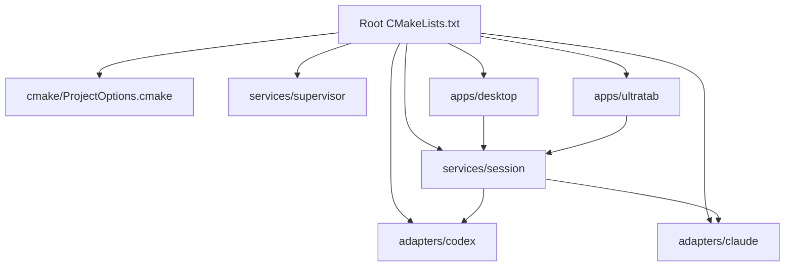

**Diagram sources**
- [CMakeLists.txt:1-65](file://CMakeLists.txt#L1-L65)
- [cmake/ProjectOptions.cmake:1-34](file://cmake/ProjectOptions.cmake#L1-L34)
- [services/session/CMakeLists.txt:1-120](file://services/session/CMakeLists.txt#L1-L120)
- [services/supervisor/CMakeLists.txt:1-118](file://services/supervisor/CMakeLists.txt#L1-L118)
- [apps/desktop/CMakeLists.txt:1-150](file://apps/desktop/CMakeLists.txt#L1-L150)

### CMake Presets
`CMakePresets.json` defines configure, build, and test presets based on Ninja. Key presets include:
- `base`: shared generator, binary directory, compile-command export, testing enabled, warnings-as-errors, and sanitizer default.
- `dev`: Debug build.
- `asan`: AddressSanitizer + UndefinedBehaviorSanitizer preset.
- `tsan`: ThreadSanitizer preset.
- `profile`: RelWithDebInfo optimized build with debug symbols.
- `desktop`: Desktop preview build.
- `r1-runtime`: Focused session plus supervisor runtime build without the desktop.

Test presets require tests to exist and fail if none are found, making missing test registration visible early.

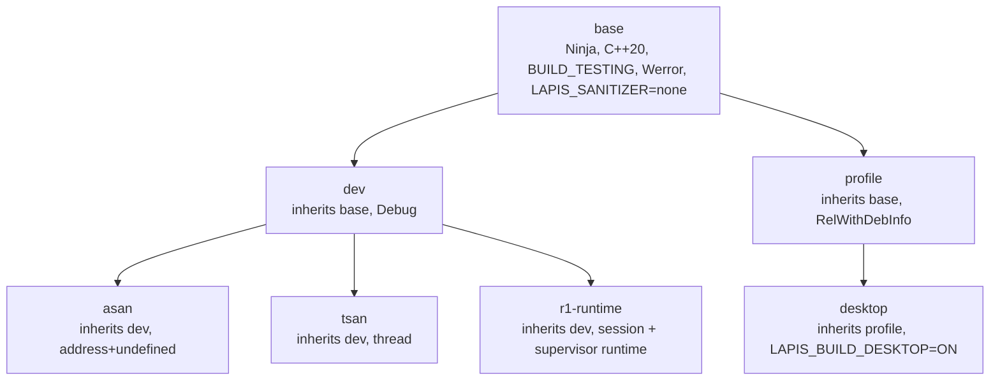

**Diagram sources**
- [CMakePresets.json:1-60](file://CMakePresets.json#L1-L60)

### Target Configurations
| Preset | Build Type | Sanitizer | Primary Use |
|---|---|---|---|
| `dev` | Debug | None | Fast iteration and unit testing. |
| `asan` | Debug | Address + undefined behavior | Memory errors and invalid memory access. |
| `tsan` | Debug | Thread | Data-race detection. |
| `profile` | RelWithDebInfo | None | Profiling and performance analysis. |
| `desktop` | RelWithDebInfo | None | Full desktop build and GUI-related checks. |
| `r1-runtime` | Debug | None | Focused supervisor runtime and headless client. |

### Project Options
All first-party targets link the `lapis_project_options` interface target, which applies:
- Warning flags: conversion, shadowing, virtual functions, casts, pedantic checks, and frame-pointer retention.
- Optional warnings-as-errors.
- Sanitizer flags for both compile and link steps when `LAPIS_SANITIZER` is `address` or `thread`.

**Section sources**
- [CMakeLists.txt:1-65](file://CMakeLists.txt#L1-L65)
- [CMakePresets.json:1-60](file://CMakePresets.json#L1-L60)
- [cmake/ProjectOptions.cmake:1-34](file://cmake/ProjectOptions.cmake#L1-L34)

## Testing Framework
### Test Categories
| Category | Scope | Typical Entry Point |
|---|---|---|
| Toolchain smoke | C++ compiler, threading, minimal execution | `toolchain-smoke` CTest |
| Session core | Attention policy, POSIX descriptors, launch spec, checkpoint, protocol | `services/session/tests` |
| Terminal adapter | Ghostty VT replay contract and terminal behavior | `services/session/tests/terminal` |
| History and persistence | History store, audit journal, agent checkpoints | `services/session/tests` |
| Supervisor state/runtime | State storage, JSON codec, daemon, CLI client, session launcher | `services/supervisor/tests` |
| Desktop UI | Window state, QML integration, capture-based UI checks | `apps/desktop/tests` |
| Native input | macOS AppKit keyboard, clipboard, IME, native events | Contribution guide probe |
| Python tooling | Repository scripts and quality runners | `scripts/tests` |
| Android gateway | Kotlin gateway, models, SSE parser, terminal utilities | `apps/android/app/src/test` |

### CTest and Preset Tests
The root CMake file registers a toolchain smoke test. Session and supervisor modules register named tests under their own `CMakeLists.txt`. Desktop tests include window-state and optional native GUI tests gated by `LAPIS_NATIVE_GUI_TESTS`.

Key test properties include timeouts and skip codes for environment-dependent suites. For example, some supervisor tests return a specific skip code when dependencies such as a real session service are unavailable.

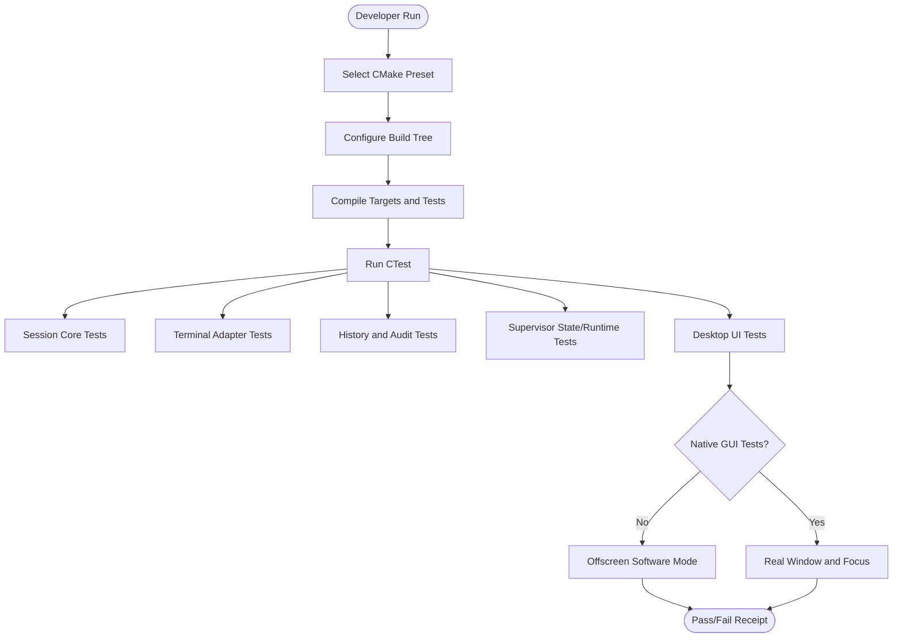

**Diagram sources**
- [CMakeLists.txt:35-65](file://CMakeLists.txt#L35-L65)
- [services/session/CMakeLists.txt:1-120](file://services/session/CMakeLists.txt#L1-L120)
- [services/supervisor/CMakeLists.txt:1-118](file://services/supervisor/CMakeLists.txt#L1-L118)
- [apps/desktop/CMakeLists.txt:120-150](file://apps/desktop/CMakeLists.txt#L120-L150)

### Python Tests
Python tests live under `scripts/tests` and are discovered by the quality runner. The runner rejects empty Python test suites and validates focused selectors against repository paths.

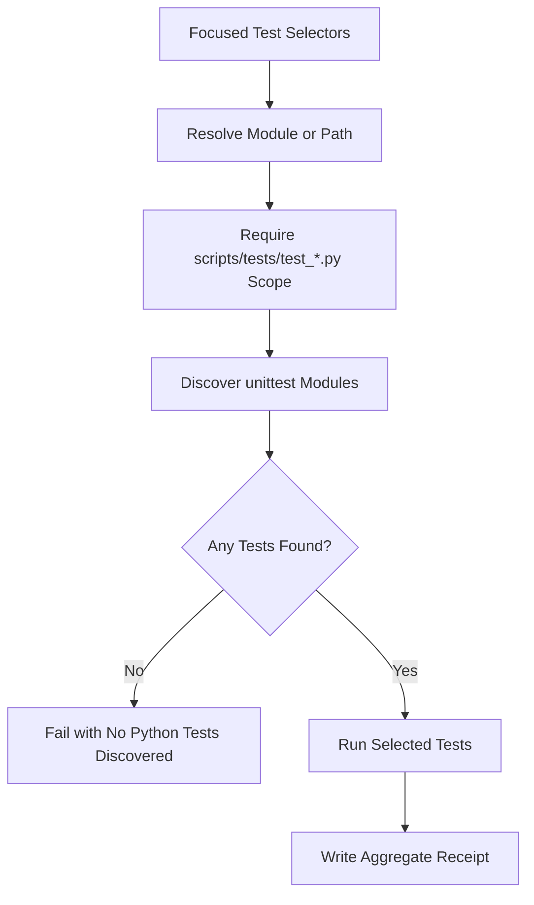

**Diagram sources**
- [scripts/check_quality.py:1-60](file://scripts/check_quality.py#L1-L60)

### Android Tests
Android has its own Gradle module and test directories under `apps/android/app/src/test/kotlin/dev/lapis/remote`. These cover gateway URLs, SSE parsing, workspace/repository state, terminal wrapping, and command-bar stores.

**Section sources**
- [services/session/CMakeLists.txt:1-120](file://services/session/CMakeLists.txt#L1-L120)
- [services/supervisor/CMakeLists.txt:1-118](file://services/supervisor/CMakeLists.txt#L1-L118)
- [apps/desktop/CMakeLists.txt:120-150](file://apps/desktop/CMakeLists.txt#L120-L150)
- [scripts/check_quality.py:1-60](file://scripts/check_quality.py#L1-L60)
- [apps/android/app/src/test/kotlin/dev/lapis/remote/gateway/LapisGatewayTest.kt](file://apps/android/app/src/test/kotlin/dev/lapis/remote/gateway/LapisGatewayTest.kt)

## Code Quality Gates
### C++ Standards
- Language: C++20.
- Indentation, width, include layout, and style rules are owned by `.clang-format`.
- Analyzer and warning policies are owned by `.clang-tidy` and `cmake/ProjectOptions.cmake`.
- Every first-party target links `lapis_project_options`.
- Vendor flags stay local; sanitizers belong in separate builds.

### Clang-Tidy Rules
`.clang-tidy` enables:
- All Clang static analyzer checks.
- Bug-prone patterns.
- Performance checks.
- Portability checks.
- Modernize null pointer, override, and nodiscard modernizations.
- Cognitive-complexity readability with a threshold of 25.
- Warnings as errors.

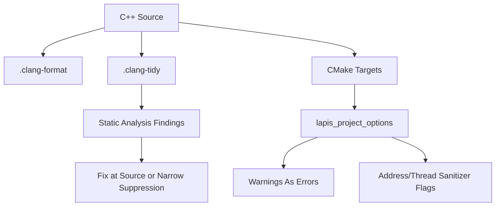

**Diagram sources**
- [.clang-tidy:1-16](file://.clang-tidy#L1-L16)
- [cmake/ProjectOptions.cmake:1-34](file://cmake/ProjectOptions.cmake#L1-L34)

### Python Linting
Ruff owns Python linting and formatting:
- Target Python 3.11.
- 88-column line length.
- Explicit rule selection: E4/E7/E9/F category rules.
- The quality runner records HEAD and whether the source tree has local changes.

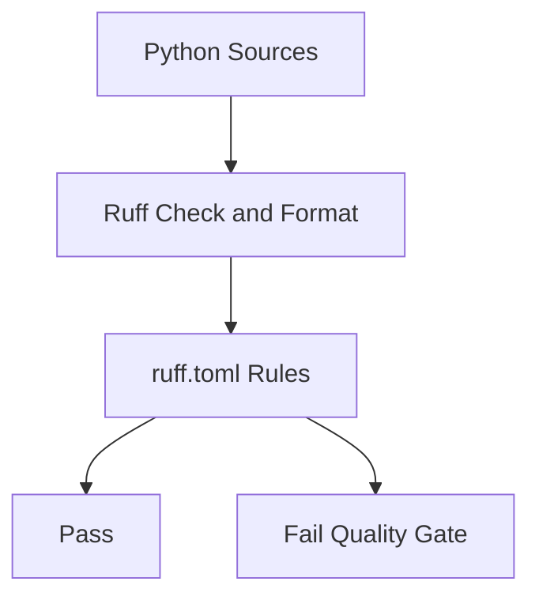

**Diagram sources**
- [ruff.toml:1-6](file://ruff.toml#L1-L6)
- [scripts/check_quality.py:1-60](file://scripts/check_quality.py#L1-L60)

### Repository-Wide Quality Command
`just quality` (or `python3 scripts/lapis.py quality`) runs repository-wide checks without compiling C++ or starting a GUI. It covers instruction symlinks, diff whitespace, Ruff, and Python unit discovery.

**Section sources**
- [.clang-tidy:1-16](file://.clang-tidy#L1-L16)
- [ruff.toml:1-6](file://ruff.toml#L1-L6)
- [cmake/ProjectOptions.cmake:1-34](file://cmake/ProjectOptions.cmake#L1-L34)
- [scripts/check_quality.py:1-60](file://scripts/check_quality.py#L1-L60)

## Pull Requests and Review Process
### PR Template
PRs should follow `.github/PULL_REQUEST_TEMPLATE.md`, including:
- Change: problem, result, design choices, and linked issue.
- Validation: exact commands, platforms, evidence paths, and skipped checks with reasons.
- Risks and follow-up: compatibility, recovery, limitations, and related documentation updates.

### Review Requirements
- Changes should be opened against `main`.
- Contributors collect reviewer coverage for the actual PR head.
- Valid findings must be fixed, affected checks rerun, and evidence provided before resolving threads.
- Merge requires satisfied CI, repository protection rules, and human approvals.
- Large or coupled changes require explicit contracts, migration plans, and integration verification.

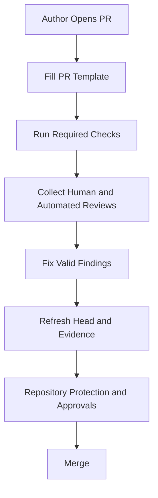

**Diagram sources**
- [.github/PULL_REQUEST_TEMPLATE.md:1-18](file://.github/PULL_REQUEST_TEMPLATE.md#L1-L18)
- [CONTRIBUTING.md:279-321](file://CONTRIBUTING.md#L279-L321)

**Section sources**
- [.github/PULL_REQUEST_TEMPLATE.md:1-18](file://.github/PULL_REQUEST_TEMPLATE.md#L1-L18)
- [CONTRIBUTING.md:279-321](file://CONTRIBUTING.md#L279-L321)

## Continuous Integration
The repository currently exposes a GitHub Pages site deployment workflow. The `site.yml` workflow publishes the `site/` directory when files under `site/` or `.github/workflows/site.yml` change on `main`. It uses GitHub Actions, Pages permissions, concurrency control, and the Pages deployment action.

This workflow is distinct from the desktop release packaging process described in the contribution guide. The contribution guide documents Mac app signing, notarization, Sparkle update keys, candidate gates, and release artifacts, but those procedures are manual or scripted rather than represented by the visible workflow file.

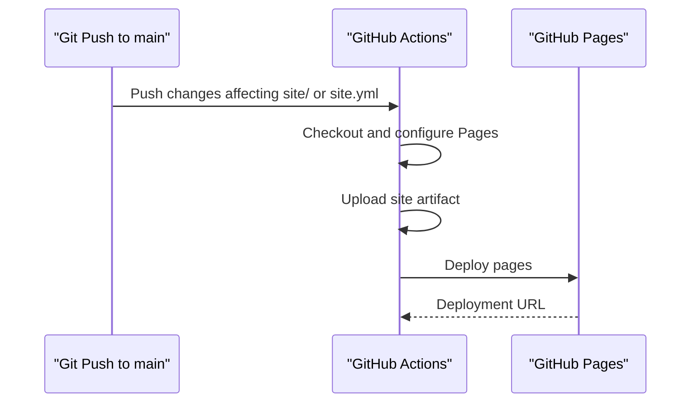

**Diagram sources**
- [.github/workflows/site.yml:1-34](file://.github/workflows/site.yml#L1-L34)

**Section sources**
- [.github/workflows/site.yml:1-34](file://.github/workflows/site.yml#L1-L34)

## Debugging and Performance Analysis
### Multi-Process Architecture
Lapis uses multiple processes:
- Desktop application.
- Session service for each agent session.
- Agent CLIs launched through PTYs.
- Optional supervisor daemon and client.
- Remote gateway or helper processes invoked by Python scripts.

The launcher script manages the runtime directory, socket path, and desktop binary location. The session service owns terminal lifecycle and process-group management.

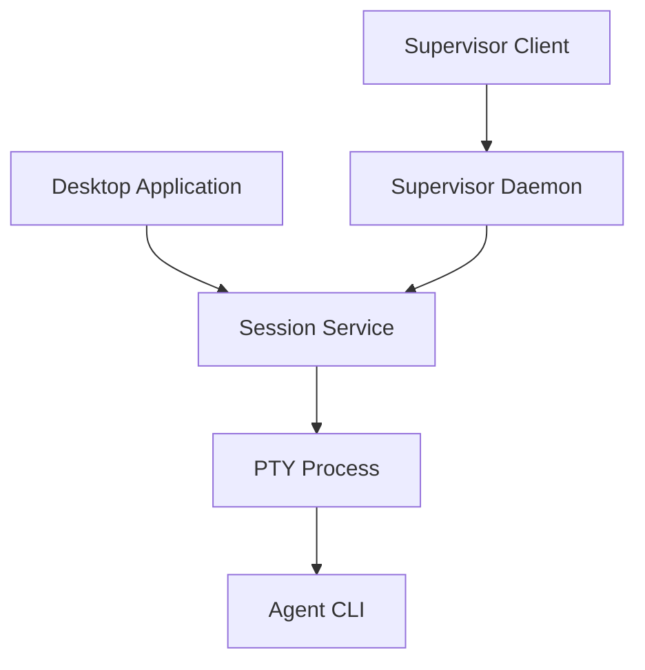

**Diagram sources**
- [scripts/lapis.py:1-206](file://scripts/lapis.py#L1-L206)
- [services/session/CMakeLists.txt:1-120](file://services/session/CMakeLists.txt#L1-L120)
- [services/supervisor/CMakeLists.txt:1-118](file://services/supervisor/CMakeLists.txt#L1-L118)

### Debugging Techniques
| Technique | When to Use | How |
|---|---|---|
| Desktop preview | UI/QML iteration | `python3 scripts/lapis.py ui` or `just ui` |
| Native debugger launch | macOS debugging of the preview | `python3 scripts/lapis.py ui-debug` or `just ui-debug` |
| Smoke capture | Functional UI validation | `python3 scripts/lapis.py smoke` |
| AddressSanitizer | Memory corruption, leaks, invalid access | `python3 scripts/lapis.py asan` or `just asan` |
| ThreadSanitizer | Data races and concurrency issues | `python3 scripts/lapis.py tsan` or `just tsan` |
| Profile build | CPU profiling and performance analysis | `python3 scripts/lapis.py profile` or `just profile` |
| Runtime diagnosis | Installed runtime inspection | `python3 scripts/lapis.py diagnose` |
| Native input probe | Keyboard, clipboard, IME, and OS event delivery | Contribution guide native-input procedure |

### Memory Profiling
Use the `profile` preset for an optimized build with debug symbols. Avoid reusing sanitizer timings as release performance measurements. The contribution guide warns that vendor libraries such as Qt, MoltenVK, and Ghostty are not instrumented by these C++ presets, so a passing sanitizer test is not coverage of those implementations.

### Performance Analysis
The repository tracks provisional responsiveness budgets for warm session switches, controlled local echo, and active animations. Latency measurement is done through dedicated probes and CTest scenarios rather than ad hoc timing.

**Section sources**
- [docs/build.md:1-125](file://docs/build.md#L1-L125)
- [CONTRIBUTING.md:547-711](file://CONTRIBUTING.md#L547-L711)
- [CONTRIBUTING.md:1513-1575](file://CONTRIBUTING.md#L1513-L1575)
- [CONTRIBUTING.md:1619-1716](file://CONTRIBUTING.md#L1619-L1716)
- [scripts/lapis.py:1-206](file://scripts/lapis.py#L1-L206)

## Release and Packaging
### Versioning
The project version is defined in the root CMake file. The desktop bundle metadata copies this version into the macOS bundle identifier, bundle name, bundle version, and short version string.

### Mac App Packaging
Packaging is driven by `scripts/package_macos.py` and produces:
- A signed `lapis.app`.
- A DMG.
- Optional notarized artifacts.
- A Sparkle appcast XML bound to the release tag.

Steps include:
1. Install Qt from pinned source.
2. Build, bundle, and sign the app.
3. Verify architecture, deployment target, linkage, and runtime behavior.
4. Optionally notarize using a notarytool keychain profile.
5. Generate and attach the deterministic appcast.
6. Create the GitHub release with the DMG, appcast, and Qt source archives.

Ad hoc signing with `LAPIS_SIGN_IDENTITY=-` is supported for local qualification but does not establish distribution signing or notarization.

### Distribution
The downloadable DMG is distributed from GitHub releases. The website index is published through the GitHub Pages workflow when `site/` changes on `main`.

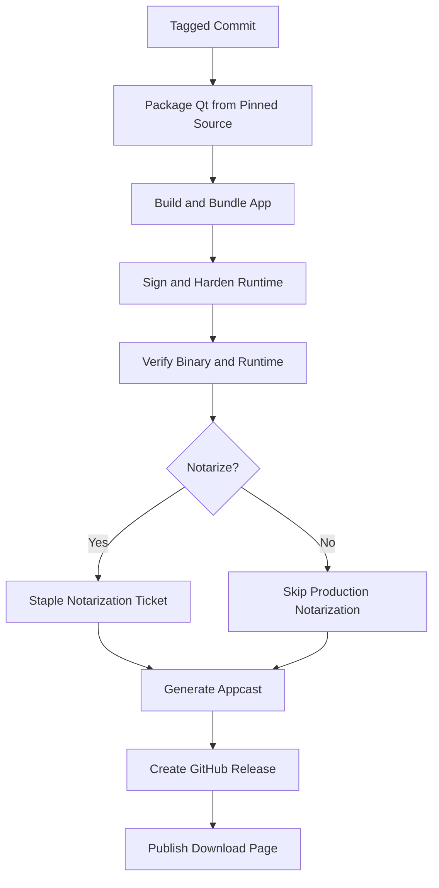

**Diagram sources**
- [CONTRIBUTING.md:712-785](file://CONTRIBUTING.md#L712-L785)
- [.github/workflows/site.yml:1-34](file://.github/workflows/site.yml#L1-L34)

**Section sources**
- [CMakeLists.txt:1-10](file://CMakeLists.txt#L1-L10)
- [apps/desktop/CMakeLists.txt:120-150](file://apps/desktop/CMakeLists.txt#L120-L150)
- [CONTRIBUTING.md:712-785](file://CONTRIBUTING.md#L712-L785)
- [.github/workflows/site.yml:1-34](file://.github/workflows/site.yml#L1-L34)

## Platform-Specific Development
### macOS
- Uses Qt 6.11.2, Vulkan headers/loader, and MoltenVK.
- Supports native input, notifications, login items, and Sparkle updates.
- Requires an Apple silicon Mac for the documented downloadable app flow.
- Signing and notarization use Developer ID identities and notarytool profiles.

### Android
The Android client lives under `apps/android` and uses Gradle with Kotlin. It includes:
- Gateway transport and SSE parsing.
- Session, disk cache, and workspace repository logic.
- Terminal screen, glyph, metrics, and wrap utilities.
- UI screens for activity, settings, workspace, and command bar.
- Unit tests under `apps/android/app/src/test/kotlin`.

The Gradle version catalog is managed by `libs.versions.toml`, and the module build configuration is under `apps/android/app/build.gradle.kts`.

### iOS
iOS development uses Xcode projects and Swift sources under `apps/ios`. The project contains:
- Lapis and UltraTab applications.
- Views, models, gateway, and terminal screens.
- App Store Test and UI test targets.
- A project YAML file describing Xcode project structure.

### Linux
Linux supports headless engine build and replay. Desktop, GPU, and native-input qualification remain deferred. The launcher attempts to locate a local Qt SDK and may add `/usr/lib/llvm-22/bin` to the LLVM environment when the expected clang tools are present.

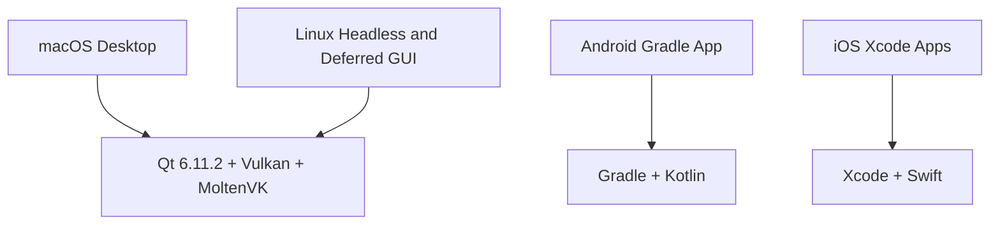

**Diagram sources**
- [CONTRIBUTING.md:362-441](file://CONTRIBUTING.md#L362-L441)
- [apps/android/app/build.gradle.kts](file://apps/android/app/build.gradle.kts)
- [apps/android/gradle/libs.versions.toml](file://apps/android/gradle/libs.versions.toml)

**Section sources**
- [CONTRIBUTING.md:362-441](file://CONTRIBUTING.md#L362-L441)
- [scripts/lapis.py:140-206](file://scripts/lapis.py#L140-L206)
- [apps/android/app/build.gradle.kts](file://apps/android/app/build.gradle.kts)
- [apps/android/gradle/libs.versions.toml](file://apps/android/gradle/libs.versions.toml)

## Troubleshooting Guide
### Common Setup Issues
| Symptom | Likely Cause | Resolution |
|---|---|---|
| Ghostty prefix is not found | Pinned dependency was not bootstrapped | Run `python3 scripts/lapis.py bootstrap`. |
| Qt version mismatch | Installed Qt is newer than 6.11.2 | Install or select Qt 6.11.2 exactly. |
| Ruff is missing | Python quality toolchain incomplete | Install Ruff and ensure `ruff.toml` is read. |
| CMake fails on unsupported platform | Building on Windows or another OS | Target macOS or Linux only. |
| Sanitizer build fails | Unsupported sanitizer value or incompatible toolchain | Use `address` or `thread` with a supported Clang/GCC setup. |
| Desktop binary not found | Desktop target was not built | Run `python3 scripts/lapis.py build` or `just desktop`. |
| Runtime directory permission error | Socket parent is not user-owned with restricted mode | Ensure `runtime/` is created with mode `0700`. |

### Quality Failures
- Empty Python test suites fail quality.
- Focused test selectors must resolve to `scripts/tests/test_*.py`.
- C++ analyzer findings should be fixed at source; suppressions must be narrow and justified.
- Reused receipts must preserve original revision and explain applicability.

### GUI and Input Failures
- GUI checks must run serially across worktrees.
- Offscreen results do not qualify native display behavior.
- Native input probes require macOS Accessibility permissions and installed input sources.

**Section sources**
- [scripts/lapis.py:1-206](file://scripts/lapis.py#L1-L206)
- [scripts/check_quality.py:1-60](file://scripts/check_quality.py#L1-L60)
- [CONTRIBUTING.md:406-451](file://CONTRIBUTING.md#L406-L451)
- [CONTRIBUTING.md:654-711](file://CONTRIBUTING.md#L654-L711)

## Conclusion
Contributing to Lapis centers on reproducible environments, layered builds, scoped tests, and explicit platform qualification. Developers should:
- Install the documented toolchain and bootstrap Ghostty once.
- Prefer focused `just` recipes and CMake presets over monolithic rebuilds.
- Treat CI, repository protection, and human approval as merge gates.
- Keep evidence, receipts, and logs separate from behavior changes.
- Respect macOS, Android, and Linux boundaries rather than assuming cross-platform equivalence.
- Use sanitizers, profiler builds, and dedicated latency probes for correctness and performance work.