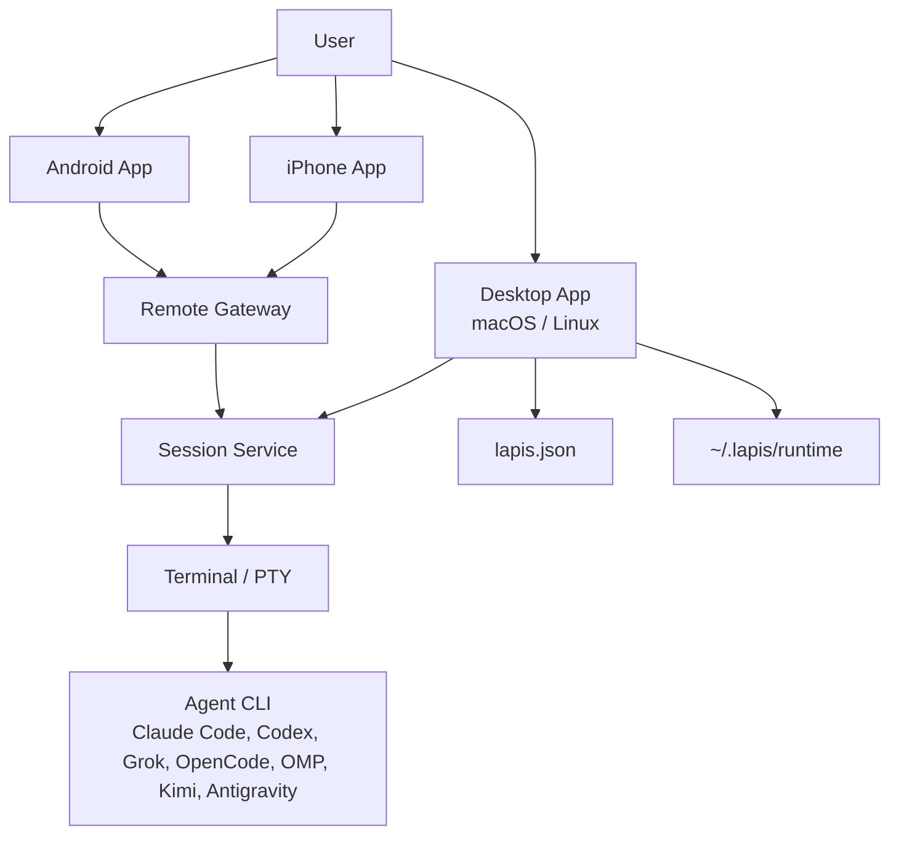

# Getting Started

<cite>
**Referenced Files in This Document**
- [README.md](file://README.md)
- [lapis.json](file://lapis.json)
- [justfile](file://justfile)
- [docs/install.md](file://docs/install.md)
- [docs/agents.md](file://docs/agents.md)
- [docs/workspace.md](file://docs/workspace.md)
- [docs/keys.md](file://docs/keys.md)
- [docs/config.md](file://docs/config.md)
- [docs/usage.md](file://docs/usage.md)
- [docs/build.md](file://docs/build.md)
- [docs/phone.md](file://docs/phone.md)
</cite>

## Table of Contents
1. [Introduction](#introduction)
2. [Project Structure](#project-structure)
3. [Installation](#installation)
4. [Core Concepts and Terminology](#core-concepts-and-terminology)
5. [Quick Tour](#quick-tour)
6. [Common Workflows](#common-workflows)
7. [Initial Configuration](#initial-configuration)
8. [Android App Overview](#android-app-overview)
9. [Troubleshooting](#troubleshooting)
10. [Next Steps](#next-steps)

## Introduction
Lapis is a terminal dashboard for running multiple coding agents at once. Each supported agent — Claude Code, Codex, Grok, OpenCode, OMP, Kimi, or Antigravity — runs in its own live terminal session with attention-driven navigation and conversation persistence. You group agents into categories, watch the latest lines from every agent in a strip beneath the active one, and jump instantly to whichever agent needs your attention.

At a high level:
- Agents run concurrently inside their own session services.
- A normal window close hides Lapis but keeps agents running.
- Closing Lapis with Command-Q detaches without stopping agents.
- Categories organize agents; the strip under the stage shows each card’s latest output.
- Attention keys like Command-J and Command-L navigate to agents that need you.
- Settings live in `lapis.json`, which can be edited live and reloaded with Command-R.

This guide focuses on getting you up and running quickly, then points to deeper documentation as you grow comfortable.

**Section sources**
- [README.md:1-40](file://README.md#L1-L40)
- [docs/agents.md:1-40](file://docs/agents.md#L1-L40)
- [docs/workspace.md:1-30](file://docs/workspace.md#L1-L30)

## Project Structure
The repository combines desktop and mobile clients, native service code, adapters for specific agents, build scripts, and user-facing documentation.

**Diagram sources**
- [README.md:1-40](file://README.md#L1-L40)
- [docs/install.md:10-25](file://docs/install.md#L10-L25)
- [docs/phone.md:1-30](file://docs/phone.md#L1-L30)
- [docs/agents.md:40-120](file://docs/agents.md#L40-L120)

Key areas you will interact with:
- **Desktop app**: main workspace, categories, strips, tiles, commands, settings, and keyboard shortcuts.
- **Session service**: owns each agent process, terminal I/O, history, checkpoints, and local transport.
- **Adapters**: agent-specific observation and import logic, especially for Claude Code and Codex.
- **Mobile apps**: phone and Android interfaces that connect through a gateway to the same agents.
- **Configuration**: `lapis.json` controls defaults, alerts, editor, usage, keybindings, and other behaviors.

**Section sources**
- [docs/build.md:1-30](file://docs/build.md#L1-L30)
- [docs/phone.md:1-25](file://docs/phone.md#L1-L25)

## Installation

### macOS via Homebrew or Downloaded App
The easiest path is to use the released Mac app. It requires an Apple Silicon Mac running macOS 14 or later and uses the agent CLIs already installed in your login shell.

Steps:
1. Download the latest release DMG from the releases page.
2. Open `lapis-macos-arm64.dmg`.
3. Drag Lapis into Applications.
4. Launch Lapis. It starts agents using your login shell environment so they find the same tools and keys as your normal terminal.

Where Lapis keeps things:
- Default configuration and runtime state are stored under `~/.lapis`, or `$LAPIS_HOME` if set.
- Private workspace metadata, window placement, and attention logs live under `~/.lapis/runtime/`.
- A development build keeps those locations under the checkout’s ignored `runtime/` and `build/` folders.

Updates:
- The app checks for updates daily and installs them after asking through Sparkle.
- Closing the window does not quit Lapis; it only hides it. Use Command-Q to quit while leaving agents running.
- On newer macOS versions, background-running behavior may require allowing Lapis under system login-item settings when agents remain active.

Closing and quitting:
- Close button, Command-Shift-W, or Command-W with no agent left hides the window.
- Command-Q quits Lapis and detaches from agents.
- Reopening reconnects agents and restores category selection and window placement.
- Command-W on an individual agent closes that agent; it does not stop all agents.

**Section sources**
- [docs/install.md:1-25](file://docs/install.md#L1-L25)
- [docs/install.md:25-58](file://docs/install.md#L25-L58)
- [README.md:15-35](file://README.md#L15-L35)

### Manual Build from Source
Use this path if you want to build Lapis yourself. The repository provides CMake-based builds and a `justfile` wrapper for common tasks.

Recommended development workflow:
1. Check prerequisites: `uv run --no-project python scripts/lapis.py doctor`
2. Bootstrap pinned dependencies such as the terminal engine: `uv run --no-project python scripts/lapis.py bootstrap`
3. Build and run checks: `uv run --no-project python scripts/lapis.py build`
4. Run the desktop preview: `uv run --no-project python scripts/lapis.py run`

You can also use `just`:
- `just doctor` reports which local dependencies are ready.
- `just bootstrap` builds the pinned Ghostty dependency.
- `just desktop` builds and checks the runnable desktop preview.
- `just run` opens the retained workspace.

For routine checks:
- `just check` runs compiler warnings, formatting, linting, and tests.
- `just ui-review` runs offscreen UI and input fixtures without opening native windows.
- `just asan` and `just tsan` check memory errors and data races.

A developer build is different from the downloadable app: it does not bundle Qt, MoltenVK, and dependency notices the same way a signed release does.

**Section sources**
- [README.md:55-75](file://README.md#L55-L75)
- [docs/build.md:1-30](file://docs/build.md#L1-L30)
- [justfile:1-40](file://justfile#L1-L40)

### Android App Installation
The Android app connects to Lapis over a remote gateway. Unlike the iPhone setup, the repository documents a separate Android testing and inspection script rather than a single install command.

Typical steps:
1. Keep the remote gateway available on your host machine.
2. Use the repository’s Android-related scripts to inspect, test, or package the Android client where applicable.
3. Follow the Android-specific documentation and scripts referenced by the repository rather than assuming a direct Homebrew-style install.

The phone documentation explains how the gateway admits connections through Tailscale or ZeroTier, how categories and agents are displayed, and how typing and scrolling work across devices.

**Section sources**
- [docs/phone.md:1-30](file://docs/phone.md#L1-L30)
- [docs/phone.md:30-70](file://docs/phone.md#L30-L70)

## Core Concepts and Terminology
These terms match the Lapis interface and documentation:

| Term | Meaning |
| --- | --- |
| Agent | A running instance of a coding agent CLI such as Claude Code, Codex, Grok, OpenCode, OMP, Kimi, or Antigravity. |
| Category | A named group of agents; each remembers its selected agent. |
| Stage | The main terminal area showing the currently selected agent. |
| Strip | The row beneath the stage showing cards for every agent in the current category. |
| Card | One entry in the strip representing an agent, with its latest lines. |
| Tile | An agent split beside the stage; drag cards onto edges to tile, and resize dividers to share space. |
| Session service | The per-agent backend that owns the terminal, history, checkpoint, and transport. |
| Request | A prompt from an agent asking for permission, approval, or a decision. |
| Turn | A completed exchange; “turn finished” means the agent’s turn ended, not necessarily that the task is done. |
| Workspace | The collection of categories, agents, selection state, and runtime metadata managed by Lapis. |
| Attention | Events that indicate an agent needs you, such as a request, a finished turn, or an unseen update. |
| Harness | Lapis’s internal name for an agent CLI, such as `claude`, `codex`, `grok`, `opencode`, `omp`, `kimi`, or `anty`. |

**Section sources**
- [docs/workspace.md:1-40](file://docs/workspace.md#L1-L40)
- [docs/agents.md:40-100](file://docs/agents.md#L40-L100)
- [docs/keys.md:1-30](file://docs/keys.md#L1-L30)

## Quick Tour

### Launch Your First Agent with Command-T
1. Press Command-T to open the new-agent form.
2. Choose a CLI. Installed CLIs appear first; unavailable ones are marked.
3. Choose a folder. Recent and frequently used folders appear near the top.
4. Choose a model and approval mode. Common modes include Accept edits, Auto, and Full access, depending on the CLI.
5. Start the agent. It appears as a card in the current category and becomes the stage’s agent.

The next agent defaults to the same CLI, mode, and model unless you change them.

**Section sources**
- [docs/agents.md:1-40](file://docs/agents.md#L1-L40)
- [docs/keys.md:1-20](file://docs/keys.md#L1-L20)

### Switch Between Agents with Command-J and Command-L
- Command-J jumps to the next agent that needs you, across any category.
- Command-L jumps to the most recent agent that needed you; repeat to go further back.
- Command-Option-L performs the same action from another app and brings Lapis to the front.
- Command-K finds agents by name, folder, category, CLI, machine, or screen text.

Chimes and notifications signal attention even when Lapis is not focused.

**Section sources**
- [README.md:20-40](file://README.md#L20-L40)
- [docs/keys.md:10-25](file://docs/keys.md#L10-L25)

### Organize Agents into Categories
- Create a new category with Command-N or by dragging a card onto the rail’s plus area.
- Move cards between categories by dragging them onto the category rail.
- Rename, reorder, or move agents through Commands or a card menu.
- Each category remembers its selected agent and tile arrangement.

**Section sources**
- [docs/workspace.md:30-70](file://docs/workspace.md#L30-L70)
- [docs/keys.md:10-20](file://docs/keys.md#L10-L20)

### Understand the Terminal Strip Interface
- The strip sits below the stage and shows every agent in the current category.
- Each card displays the agent’s latest lines up to its cursor.
- Cards pulse when their agent needs you or has finished a turn since you last looked.
- The rightmost card is always a plus to start a new agent in that category.
- Drag a card onto the stage edge to tile it; drag a tile back to the strip to remove it from the stage while keeping it running.

**Section sources**
- [docs/workspace.md:1-30](file://docs/workspace.md#L1-L30)

## Common Workflows

### Starting a New Coding Session
1. Press Command-T.
2. Select your preferred CLI, folder, model, and approval mode.
3. If you need a second agent doing similar work, press Command-D to tile it to the right, or Command-Shift-D to tile it below.
4. Arrange tiles by dragging dividers and moving between tiles with Control-arrow keys.
5. When done with a tile, drag it back to the strip or click its close control.

**Section sources**
- [docs/agents.md:1-40](file://docs/agents.md#L1-L40)
- [docs/workspace.md:30-60](file://docs/workspace.md#L30-L60)
- [docs/keys.md:20-40](file://docs/keys.md#L20-L40)

### Responding to Agent Requests
Agents may ask for permission, approval, or clarification. In Lapis:
- A request pings once and marks the agent as needing you.
- Answer the request directly in the agent’s terminal.
- For supported agents such as Codex, use the Requests panel to review, approve, decline, cancel, or send answers explicitly.
- Opening or selecting a request does not approve it automatically.

**Section sources**
- [docs/agents.md:40-100](file://docs/agents.md#L40-L100)

### Managing Multiple Concurrent Agents
- Use categories to separate projects, models, or machines.
- Watch the strip for attention indicators; Command-J takes you to the next agent that needs you.
- Use Command-O to resume a past Claude Code or Codex conversation.
- Use Command-Shift-T to reopen the last closed agent, resuming its conversation where possible.
- Reload tabs, categories, or windows to restart agents without losing workspace organization.

**Section sources**
- [docs/agents.md:120-197](file://docs/agents.md#L120-L197)
- [docs/keys.md:10-25](file://docs/keys.md#L10-L25)

## Initial Configuration
Lapis reads `lapis.json`. In the app, this lives under `~/.lapis/lapis.json`; in a development build, the checkout’s `lapis.json` is used. Changes apply immediately, and you can reload manually with Command-R.

A minimal default file contains basic version and keybinding placeholders. You will usually add settings such as:

- `newAgent`: defaults for the new-agent form, including harness, starting folder, approval mode, models, and per-machine folders.
- `harnessArguments`: extra flags passed to every new agent of a given CLI.
- `alerts`: chimes, background notifications, away detection, reminders, and sound files.
- `editor`: preferred editor for opening agent folders.
- `keepAwake`: whether Lapis should keep the machine awake while agents run.
- `usage`: whether to show plan usage meters and which CLIs or machines to track.
- `limitResets`: automatic spending of saved limit resets, minimum blocked minutes, credits to retain, and salvage hours.
- `interactionLog`: optional recording of Lapis input events for analysis.
- `tabAway`: how Tab chooses the next agent when nothing else is typed.

Example configuration themes:
- Set a default harness and folder for faster new-agent creation.
- Restrict or enable automatic CLI updates per harness.
- Tune alert sounds, notification timing, and away thresholds.
- Enable usage meters for CLIs you have accounts with.
- Disable automatic limit-reset spending if you prefer manual control.

Important notes:
- Paths in configuration support `~` and are relative to `lapis.json`.
- Some features, such as shared plans, provider limits, and remote phone usage, extend beyond the early-access slice.
- Private runtime logs, attention records, and credentials are owner-only and should not be shared.

**Section sources**
- [docs/config.md:1-60](file://docs/config.md#L1-L60)
- [docs/config.md:60-120](file://docs/config.md#L60-L120)
- [docs/usage.md:1-40](file://docs/usage.md#L1-L40)
- [lapis.json:1-4](file://lapis.json#L1-L4)

## Android App Overview
The Android client shares the same concepts as the desktop app: categories, agents, cards, terminals, and the remote gateway.

Highlights:
- The phone app talks to a gateway on the host machine over encrypted networks such as Tailscale or ZeroTier.
- Categories mirror the Mac’s order, and agents show CLI marks, folders, and machine context.
- Typing, scrolling, and switching agents work similarly to the desktop experience.
- The gateway admits requests only from trusted owners or private networks.

For Android-specific installation and inspection, follow the repository’s Android-related scripts and documentation rather than assuming a generic package manager install.

**Section sources**
- [docs/phone.md:1-30](file://docs/phone.md#L1-L30)
- [docs/phone.md:30-70](file://docs/phone.md#L30-L70)

## Troubleshooting

### Lapis Quits but Agents Disappear
On some macOS versions, agents started from the window count as background processes. Ensure Lapis is allowed to run in the background under system login-item settings. Also keep the old L.app until old windows fully exit.

**Section sources**
- [docs/install.md:25-58](file://docs/install.md#L25-L58)

### Agent Is Stuck or Needs a Restart
- Use **Restart agent** in Commands to relaunch it in the same card.
- Use **Reload tab**, **Reload category**, or **Reload window** to restart running agents and reread settings.
- Use Command-Shift-T to reopen the last closed agent.
- Use Command-O to resume a past Claude Code or Codex conversation.

**Section sources**
- [docs/agents.md:120-197](file://docs/agents.md#L120-L197)
- [docs/keys.md:10-20](file://docs/keys.md#L10-L20)

### Nothing Happens When I Edit lapis.json
Settings reload automatically. If needed, press Command-R to reload the configuration. Make sure the file is valid JSON and located where Lapis expects it: `~/.lapis/lapis.json` for the app, or the checkout’s `lapis.json` for a development build.

**Section sources**
- [docs/config.md:1-20](file://docs/config.md#L1-L20)
- [docs/keys.md:55-64](file://docs/keys.md#L55-L64)

### Phone or Remote Connection Fails
Ensure the gateway is reachable and trusted:
- The gateway accepts requests only from trusted owners or private networks.
- Keep Tailscale active on both sides when using HTTP.
- Verify the configured gateway address and network membership.

**Section sources**
- [docs/phone.md:1-30](file://docs/phone.md#L1-L30)

## Next Steps
After launching your first agent:
- Explore categories and strip navigation.
- Try tiling agents with Command-D and Command-Shift-D.
- Review every shortcut in the keys reference.
- Customize defaults and alerts in `lapis.json`.
- Read the agents guide for requests, restarts, full-screen agents, and CLI updates.
- Use the workspace guide for tiles, finding, links, and history.
- Explore usage meters and shared plans if you manage multiple accounts.

**Section sources**
- [docs/agents.md:1-40](file://docs/agents.md#L1-L40)
- [docs/workspace.md:1-40](file://docs/workspace.md#L1-L40)
- [docs/keys.md:1-64](file://docs/keys.md#L1-L64)
- [docs/config.md:1-60](file://docs/config.md#L1-L60)
- [docs/usage.md:1-40](file://docs/usage.md#L1-L40)