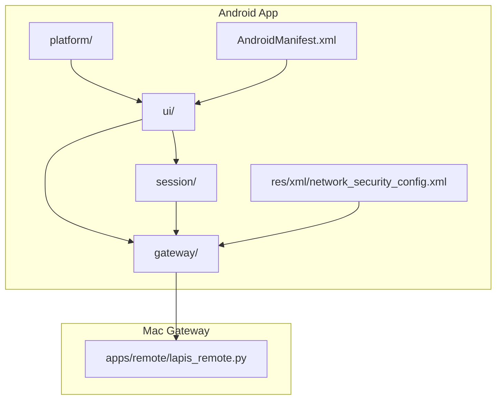
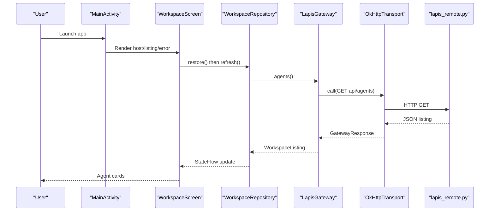
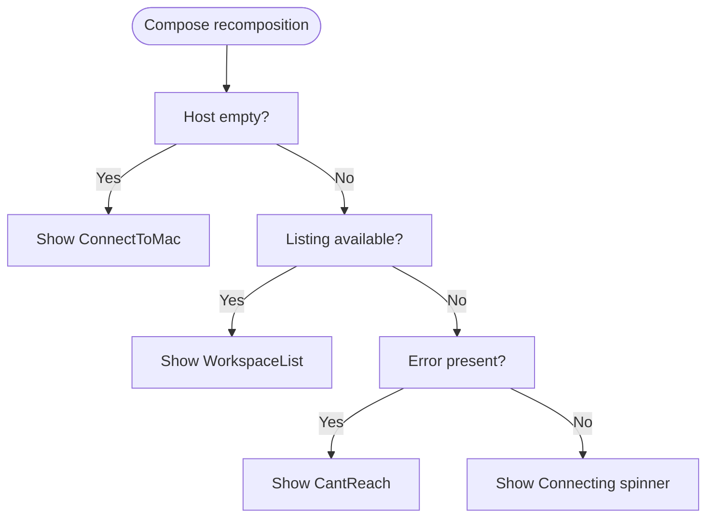
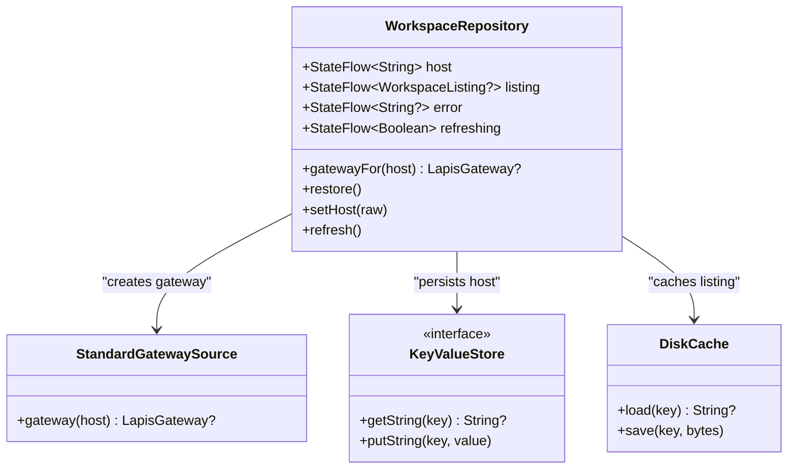
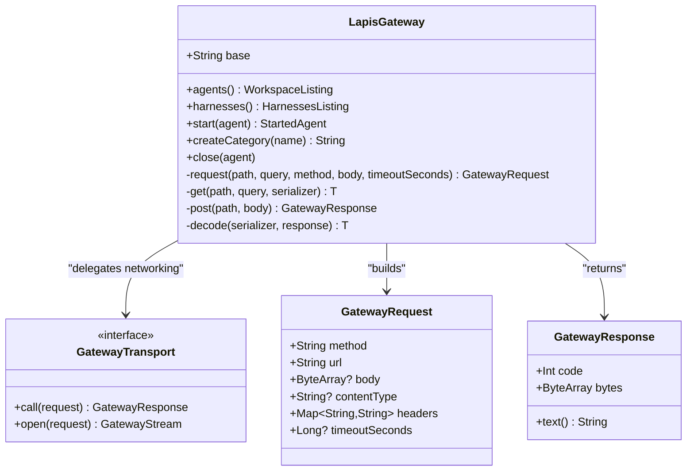
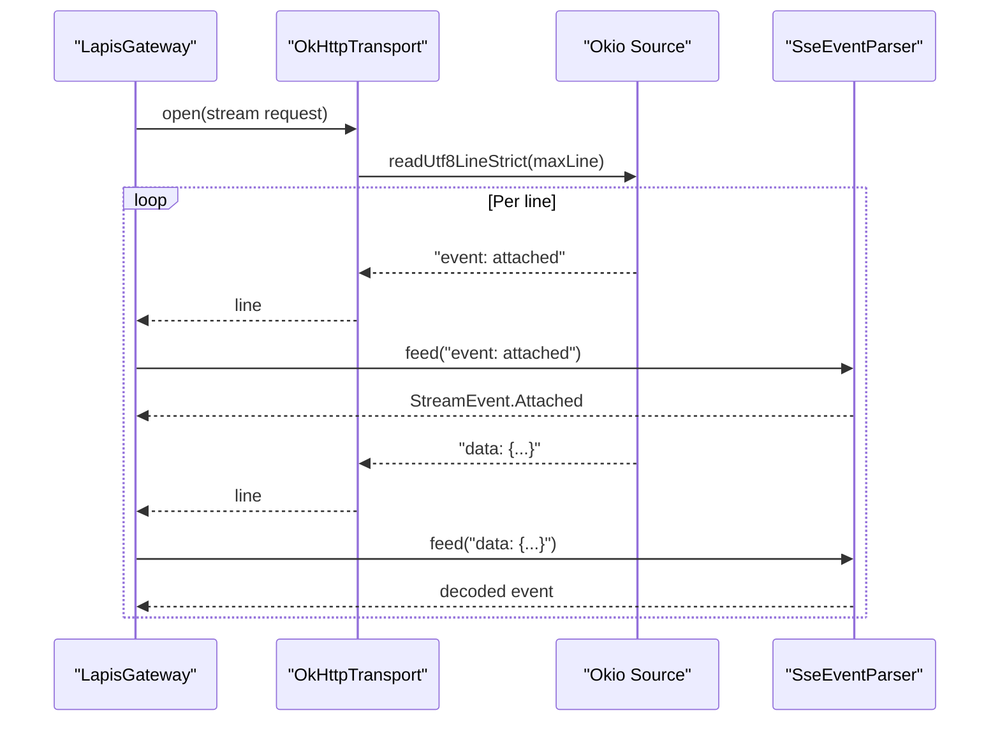
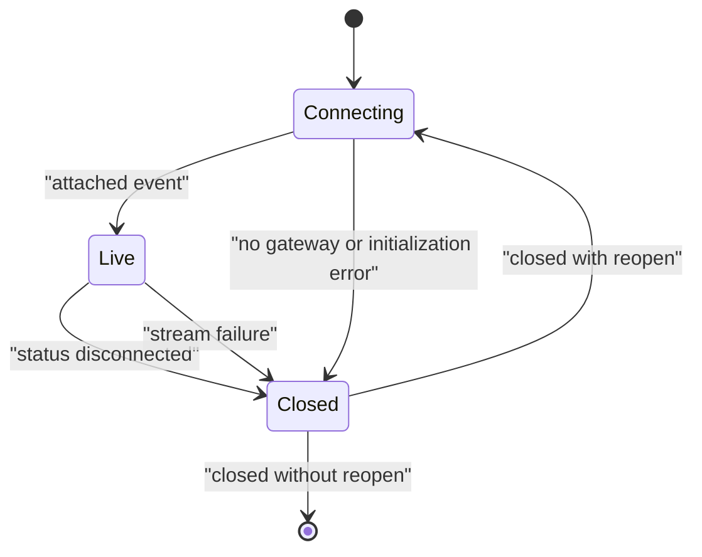
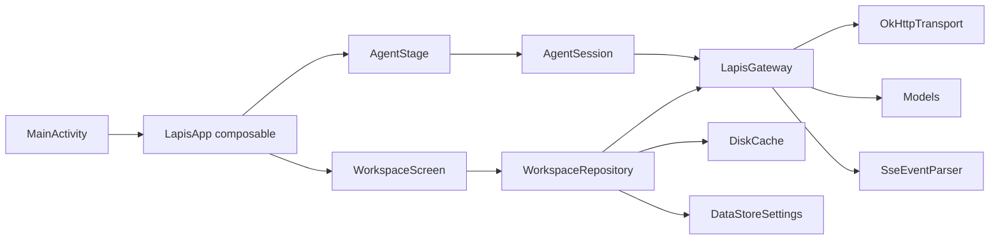

# Android Client

<cite>
**Referenced Files in This Document**
- [MainActivity.kt](file://apps/android/app/src/main/kotlin/dev/lapis/remote/ui/MainActivity.kt)
- [WorkspaceScreen.kt](file://apps/android/app/src/main/kotlin/dev/lapis/remote/ui/WorkspaceScreen.kt)
- [AgentStage.kt](file://apps/android/app/src/main/kotlin/dev/lapis/remote/ui/AgentStage.kt)
- [LapisGateway.kt](file://apps/android/app/src/main/kotlin/dev/lapis/remote/gateway/LapisGateway.kt)
- [Models.kt](file://apps/android/app/src/main/kotlin/dev/lapis/remote/gateway/Models.kt)
- [SseParser.kt](file://apps/android/app/src/main/kotlin/dev/lapis/remote/gateway/SseParser.kt)
- [Transport.kt](file://apps/android/app/src/main/kotlin/dev/lapis/remote/gateway/Transport.kt)
- [GatewayError.kt](file://apps/android/app/src/main/kotlin/dev/lapis/remote/gateway/GatewayError.kt)
- [WorkspaceRepository.kt](file://apps/android/app/src/main/kotlin/dev/lapis/remote/session/WorkspaceRepository.kt)
- [Settings.kt](file://apps/android/app/src/main/kotlin/dev/lapis/remote/platform/Settings.kt)
- [AndroidManifest.xml](file://apps/android/app/src/main/AndroidManifest.xml)
- [network_security_config.xml](file://apps/android/app/src/main/res/xml/network_security_config.xml)
- [android-client-design.md](file://docs/superpowers/specs/2026-09-27-android-client-design.md)
</cite>

## Table of Contents
1. [Introduction](#introduction)
2. [Project Structure](#project-structure)
3. [Core Components](#core-components)
4. [Architecture Overview](#architecture-overview)
5. [Detailed Component Analysis](#detailed-component-analysis)
6. [Dependency Analysis](#dependency-analysis)
7. [Performance Considerations](#performance-considerations)
8. [Setup and Device Configuration](#setup-and-device-configuration)
9. [Testing Procedures](#testing-procedures)
10. [Android-Specific Concerns](#android-specific-concerns)
11. [Troubleshooting Guide](#troubleshooting-guide)
12. [Conclusion](#conclusion)

## Introduction
The Lapis Android client is a native Kotlin and Jetpack Compose companion application that connects to the local `lapis_remote.py` gateway running on a Mac over Tailscale or ZeroTier. It lists available agents, starts new ones, joins live terminal sessions, sends user input, and renders real-time terminal output streamed from the Mac. The phone does not run terminal emulators; it only displays screen frames produced by the Mac service and forwards user input back through the same connection.

At a high level, the app owns:
- A workspace repository that manages the configured gateway host, cached agent listings, and error state.
- A gateway layer that performs HTTP requests and streams server-sent events.
- An agent session that opens a live terminal session, archives history, and synchronizes state with the UI.
- Compose screens for connecting to the Mac, listing agents, configuring settings, and operating an agent terminal.

The design intentionally avoids background network work: refreshes happen while the app is started, and no background push or background processing is implemented. Authentication is delegated to the overlay network (Tailscale or ZeroTier); the gateway refuses clients without the expected platform header.

## Project Structure
The Android module lives under `apps/android`. The relevant source tree for this documentation is:

**Diagram sources**
- [MainActivity.kt:1-214](file://apps/android/app/src/main/kotlin/dev/lapis/remote/ui/MainActivity.kt#L1-L214)
- [WorkspaceScreen.kt:1-385](file://apps/android/app/src/main/kotlin/dev/lapis/remote/ui/WorkspaceScreen.kt#L1-L385)
- [AgentStage.kt:1-652](file://apps/android/app/src/main/kotlin/dev/lapis/remote/ui/AgentStage.kt#L1-L652)
- [LapisGateway.kt:1-300](file://apps/android/app/src/main/kotlin/dev/lapis/remote/gateway/LapisGateway.kt#L1-L300)
- [WorkspaceRepository.kt:1-190](file://apps/android/app/src/main/kotlin/dev/lapis/remote/session/WorkspaceRepository.kt#L1-L190)
- [Settings.kt:1-76](file://apps/android/app/src/main/kotlin/dev/lapis/remote/platform/Settings.kt#L1-L76)
- [AndroidManifest.xml:1-24](file://apps/android/app/src/main/AndroidManifest.xml#L1-L24)
- [network_security_config.xml:1-12](file://apps/android/app/src/main/res/xml/network_security_config.xml#L1-L12)

**Section sources**
- [android-client-design.md:1-120](file://docs/superpowers/specs/2026-09-27-android-client-design.md#L1-L120)

## Core Components
This section summarizes the primary runtime components and their responsibilities.

| Component | Responsibility | Key files |
|---|---|---|
| `LapisApplication` | Application-scoped settings, repository, long-lived coroutine scope, debug launch helpers. | [MainActivity.kt](file://apps/android/app/src/main/kotlin/dev/lapis/remote/ui/MainActivity.kt) |
| `MainActivity` | Android entry point, debug-launch overrides, theme setup, navigation state. | [MainActivity.kt](file://apps/android/app/src/main/kotlin/dev/lapis/remote/ui/MainActivity.kt) |
| `WorkspaceScreen` | Category/agent list, connect-to-Mac prompt, error display, settings access. | [WorkspaceScreen.kt](file://apps/android/app/src/main/kotlin/dev/lapis/remote/ui/WorkspaceScreen.kt) |
| `AgentStage` | Live terminal stage, command bar, snippet editor, resize handling, session lifecycle. | [AgentStage.kt](file://apps/android/app/src/main/kotlin/dev/lapis/remote/ui/AgentStage.kt) |
| `WorkspaceRepository` | Host persistence, listing refresh, disk cache, generation-based invalidation, gateway factory. | [WorkspaceRepository.kt](file://apps/android/app/src/main/kotlin/dev/lapis/remote/session/WorkspaceRepository.kt) |
| `LapisGateway` | Base URL normalization, HTTP request building, JSON serialization, streaming API. | [LapisGateway.kt](file://apps/android/app/src/main/kotlin/dev/lapis/remote/gateway/LapisGateway.kt) |
| `OkHttpTransport` | Blocking HTTP calls and SSE line stream via OkHttp. | [Transport.kt](file://apps/android/app/src/main/kotlin/dev/lapis/remote/gateway/Transport.kt) |
| `SseEventParser` | Decodes `event:` / `data:` lines into `StreamEvent` values. | [SseParser.kt](file://apps/android/app/src/main/kotlin/dev/lapis/remote/gateway/SseParser.kt) |
| `AgentSession` | Agent attachment, live frame stream, history paging, input queue, state flows. | [AgentSession.kt](file://apps/android/app/src/main/kotlin/dev/lapis/remote/session/AgentSession.kt) |
| `DataStoreSettings` | Persistent key-value storage for host, font size, command bar visibility, snippets. | [Settings.kt](file://apps/android/app/src/main/kotlin/dev/lapis/remote/platform/Settings.kt) |
| Models | Type-safe DTOs for agents, categories, screen frames, runs, modes, machines, and more. | [Models.kt](file://apps/android/app/src/main/kotlin/dev/lapis/remote/gateway/Models.kt) |

**Section sources**
- [MainActivity.kt:1-214](file://apps/android/app/src/main/kotlin/dev/lapis/remote/ui/MainActivity.kt#L1-L214)
- [WorkspaceScreen.kt:1-385](file://apps/android/app/src/main/kotlin/dev/lapis/remote/ui/WorkspaceScreen.kt#L1-L385)
- [AgentStage.kt:1-652](file://apps/android/app/src/main/kotlin/dev/lapis/remote/ui/AgentStage.kt#L1-L652)
- [WorkspaceRepository.kt:1-190](file://apps/android/app/src/main/kotlin/dev/lapis/remote/session/WorkspaceRepository.kt#L1-L190)
- [LapisGateway.kt:1-300](file://apps/android/app/src/main/kotlin/dev/lapis/remote/gateway/LapisGateway.kt#L1-L300)
- [Transport.kt:1-137](file://apps/android/app/src/main/kotlin/dev/lapis/remote/gateway/Transport.kt#L1-L137)
- [SseParser.kt:1-40](file://apps/android/app/src/main/kotlin/dev/lapis/remote/gateway/SseParser.kt#L1-L40)
- [AgentSession.kt:1-200](file://apps/android/app/src/main/kotlin/dev/lapis/remote/session/AgentSession.kt#L1-L200)
- [Settings.kt:1-76](file://apps/android/app/src/main/kotlin/dev/lapis/remote/platform/Settings.kt#L1-L76)
- [Models.kt:1-327](file://apps/android/app/src/main/kotlin/dev/lapis/remote/gateway/Models.kt#L1-L327)

## Architecture Overview
The Android client follows a layered architecture:

- **UI Layer**: Compose screens render state from repositories and sessions.
- **Session Layer**: `AgentSession` owns one live agent connection and exposes typed state flows.
- **Repository Layer**: `WorkspaceRepository` owns the gateway host, cached listing, and per-host disk cache.
- **Gateway Layer**: `LapisGateway` builds URLs, serializes models, and delegates transport to `GatewayTransport`.
- **Transport Layer**: `OkHttpTransport` provides blocking HTTP and bounded SSE line streams.
- **Platform Layer**: `DataStoreSettings` persists configuration; `describe()` maps exceptions to user-facing messages.

**Diagram sources**
- [MainActivity.kt:120-214](file://apps/android/app/src/main/kotlin/dev/lapis/remote/ui/MainActivity.kt#L120-L214)
- [WorkspaceScreen.kt:1-200](file://apps/android/app/src/main/kotlin/dev/lapis/remote/ui/WorkspaceScreen.kt#L1-L200)
- [WorkspaceRepository.kt:60-190](file://apps/android/app/src/main/kotlin/dev/lapis/remote/session/WorkspaceRepository.kt#L60-L190)
- [LapisGateway.kt:130-210](file://apps/android/app/src/main/kotlin/dev/lapis/remote/gateway/LapisGateway.kt#L130-L210)
- [Transport.kt:60-137](file://apps/android/app/src/main/kotlin/dev/lapis/remote/gateway/Transport.kt#L60-L137)

## Detailed Component Analysis

### Main Application and Entry Point
`LapisApplication` creates:
- A `DataStoreSettings` instance for persistent preferences.
- A `WorkspaceRepository` backed by the settings store and a disk cache directory.
- An application-scoped coroutine supervisor used by long-lived sessions.
- Debug helpers for clearing caches and overriding font size or command-bar visibility.

`MainActivity` is the Android launcher. On first creation, it applies debug-launch extras such as `gatewayHost`, `resetCache`, `terminalFontSize`, and `commandBarEnabled`. It then sets up the Compose theme and hosts `LapisApp`, which observes the repository’s host, listing, error, and refreshing state.

Key behaviors:
- Cache wiping waits for completion before any listing restoration begins.
- Foreground polling uses `repeatOnLifecycle(Lifecycle.State.STARTED)` so network work stops when the app is stopped.
- Back navigation closes Settings or the agent stage rather than leaving them open.

**Section sources**
- [MainActivity.kt:1-119](file://apps/android/app/src/main/kotlin/dev/lapis/remote/ui/MainActivity.kt#L1-L119)
- [MainActivity.kt:120-214](file://apps/android/app/src/main/kotlin/dev/lapis/remote/ui/MainActivity.kt#L120-L214)

### Workspace Screen
`WorkspaceScreen` is the milestone-A workspace list. It shows:
- A connect-to-Mac prompt when no host is configured.
- A spinner plus status text while connecting.
- A reachable listing with category cards.
- An error view with retry and settings actions.

It receives its data from `WorkspaceRepository` and delegates opening an agent to a callback consumed by `LapisApp`.

**Diagram sources**
- [WorkspaceScreen.kt:60-180](file://apps/android/app/src/main/kotlin/dev/lapis/remote/ui/WorkspaceScreen.kt#L60-L180)

**Section sources**
- [WorkspaceScreen.kt:1-200](file://apps/android/app/src/main/kotlin/dev/lapis/remote/ui/WorkspaceScreen.kt#L1-L200)

### Agent Stage
`AgentStage` owns the live terminal experience. It:
- Creates or reuses an `AgentSession` keyed by agent identity.
- Reads saved font size, command-bar visibility, and snippet list.
- Handles IME visibility and terminal resize.
- Sends user input through the session.
- Disposes the session when the composable leaves the composition.

The stage deliberately uses the application-scoped coroutine scope for persistence writes so activity recreation does not cancel DataStore operations.

**Section sources**
- [AgentStage.kt:1-200](file://apps/android/app/src/main/kotlin/dev/lapis/remote/ui/AgentStage.kt#L1-L200)

### Workspace Repository
`WorkspaceRepository` is the state owner for the workspace surface. Its important properties include:
- A monotonically increasing generation counter used to invalidate stale network results when the host changes.
- A persisted host value stored through `KeyValueStore`.
- A disk cache for previously fetched `WorkspaceListing` values.
- A `refresh()` method that fetches from the gateway, updates listing state, saves the cache, and reports errors.
- A `gatewayFor(host)` method that constructs a `LapisGateway`; tests can inject a fake `GatewaySource`.

**Diagram sources**
- [WorkspaceRepository.kt:1-190](file://apps/android/app/src/main/kotlin/dev/lapis/remote/session/WorkspaceRepository.kt#L1-L190)

**Section sources**
- [WorkspaceRepository.kt:1-190](file://apps/android/app/src/main/kotlin/dev/lapis/remote/session/WorkspaceRepository.kt#L1-L190)

### Gateway Layer
`LapisGateway` encapsulates:
- Base URL normalization matching the iOS client’s behavior.
- Request construction with `X-Lapis-Client: android` and `Cache-Control: no-cache`.
- JSON decoding through kotlinx.serialization with unknown keys ignored.
- Non-200 responses converted to `GatewayError.Refused`.
- Deserialization failures mapped to `GatewayError.Unreadable`.
- Endpoints for listing agents, starting agents, creating categories, closing agents, and streaming terminal output.

**Diagram sources**
- [LapisGateway.kt:1-210](file://apps/android/app/src/main/kotlin/dev/lapis/remote/gateway/LapisGateway.kt#L1-L210)
- [Transport.kt:1-60](file://apps/android/app/src/main/kotlin/dev/lapis/remote/gateway/Transport.kt#L1-L60)

**Section sources**
- [LapisGateway.kt:1-210](file://apps/android/app/src/main/kotlin/dev/lapis/remote/gateway/LapisGateway.kt#L1-L210)

### Transport and Streaming
`OkHttpTransport` implements `GatewayTransport` with two OkHttpClient instances:
- One for normal 15-second request/response calls.
- One for SSE streams with a 40-second read timeout and no overall call timeout.

The stream reader enforces a maximum line length equal to the gateway’s maximum frame size plus envelope slack. If a line exceeds that limit but the stream still has buffered bytes, it is treated as a protocol violation rather than a clean end.

**Diagram sources**
- [Transport.kt:60-137](file://apps/android/app/src/main/kotlin/dev/lapis/remote/gateway/Transport.kt#L60-L137)
- [SseParser.kt:1-40](file://apps/android/app/src/main/kotlin/dev/lapis/remote/gateway/SseParser.kt#L1-L40)

**Section sources**
- [Transport.kt:1-137](file://apps/android/app/src/main/kotlin/dev/lapis/remote/gateway/Transport.kt#L1-L137)
- [SseParser.kt:1-40](file://apps/android/app/src/main/kotlin/dev/lapis/remote/gateway/SseParser.kt#L1-L40)

### SSE Parser
`SseEventParser` processes lines from the gateway’s `api/agents/{id}/stream`:
- Lines beginning with `event:` set the current event name.
- Lines beginning with `data:` are decoded according to the last event name.
- Comment lines, blank separators, and unknown event names are ignored.
- Known payloads decode `Attached`, `Frame`, and `Status` events.

This mirrors the Swift client’s line loop and treats malformed known-event payloads as stream failures.

**Section sources**
- [SseParser.kt:1-40](file://apps/android/app/src/main/kotlin/dev/lapis/remote/gateway/SseParser.kt#L1-L40)

### Agent Session
`AgentSession` represents one agent shown on the phone. Its responsibilities include:
- Managing attachment state: `Connecting`, `Live`, or `Closed(reason, reopen)`.
- Exposing state flows for frame, notice, shared mode, archived history, scrollback bounds, input pending, last frame JSON, grid size, and jump state.
- Opening a stream through the gateway, collecting `StreamEvent` values, and applying them to internal state.
- Storing the latest screen frame in `ScreenCache`.
- Prefetching older history after the first live frame.
- Handling connection closure and failure with a generation identifier so old streams cannot overwrite newer ones.

**Diagram sources**
- [AgentSession.kt:1-200](file://apps/android/app/src/main/kotlin/dev/lapis/remote/session/AgentSession.kt#L1-L200)

**Section sources**
- [AgentSession.kt:1-200](file://apps/android/app/src/main/kotlin/dev/lapis/remote/session/AgentSession.kt#L1-L200)

### Models
The models define the type-safe contract between the Android client and the Mac gateway. Important types include:

| Model | Purpose | Notes |
|---|---|---|
| `WorkspaceListing` | Top-level agent listing | Contains categories and active category. |
| `AgentCategory` | Group of agents | Includes id, name, and agent list. |
| `Agent` | Running agent record | Includes id, title, harness, directory, machine, place, and flags. |
| `Harness` | Available CLI | Includes id, name, installation status, models, and modes. |
| `ModelChoice` | Model selection metadata | Includes default flag. |
| `AgentMode` | Mode selection metadata | Includes id and name. |
| `NewAgent` | Start request | Includes harness, directory, category, optional machine/model/mode. |
| `StartedAgent` | Start response | Includes id and updating flag. |
| `ScreenFrame` | Terminal screen snapshot | Includes revision, dimensions, cursor, colors, and styled lines. |
| `Run` | Styled text segment | Supports bold, italic, faint, underline, strike, cursor flags. |
| `StreamEvent` | SSE event union | Attached, Frame, Status. |
| `Input` | User input payload | Resize, paste, text, named key. |

The shared `gatewayJson` ignores unknown keys and omits null defaults, matching Swift Codable and JSONEncoder behavior.

**Section sources**
- [Models.kt:1-327](file://apps/android/app/src/main/kotlin/dev/lapis/remote/gateway/Models.kt#L1-L327)

## Dependency Analysis
The main dependency relationships are:

**Diagram sources**
- [MainActivity.kt:120-214](file://apps/android/app/src/main/kotlin/dev/lapis/remote/ui/MainActivity.kt#L120-L214)
- [WorkspaceScreen.kt:1-200](file://apps/android/app/src/main/kotlin/dev/lapis/remote/ui/WorkspaceScreen.kt#L1-L200)
- [AgentStage.kt:1-200](file://apps/android/app/src/main/kotlin/dev/lapis/remote/ui/AgentStage.kt#L1-L200)
- [WorkspaceRepository.kt:1-190](file://apps/android/app/src/main/kotlin/dev/lapis/remote/session/WorkspaceRepository.kt#L1-L190)
- [AgentSession.kt:1-200](file://apps/android/app/src/main/kotlin/dev/lapis/remote/session/AgentSession.kt#L1-L200)
- [LapisGateway.kt:1-210](file://apps/android/app/src/main/kotlin/dev/lapis/remote/gateway/LapisGateway.kt#L1-L210)
- [Transport.kt:1-137](file://apps/android/app/src/main/kotlin/dev/lapis/remote/gateway/Transport.kt#L1-L137)
- [SseParser.kt:1-40](file://apps/android/app/src/main/kotlin/dev/lapis/remote/gateway/SseParser.kt#L1-L40)
- [Models.kt:1-327](file://apps/android/app/src/main/kotlin/dev/lapis/remote/gateway/Models.kt#L1-L327)

Coupling observations:
- UI depends on repository and session abstractions rather than directly on OkHttp.
- Gateway isolates networking behind `GatewayTransport`, enabling deterministic tests.
- `WorkspaceRepository` centralizes host switching and caching, reducing duplication across screens.
- `AgentSession` owns connection lifecycle and guards against race conditions using a generation UUID.

**Section sources**
- [WorkspaceRepository.kt:1-190](file://apps/android/app/src/main/kotlin/dev/lapis/remote/session/WorkspaceRepository.kt#L1-L190)
- [LapisGateway.kt:1-210](file://apps/android/app/src/main/kotlin/dev/lapis/remote/gateway/LapisGateway.kt#L1-L210)
- [AgentSession.kt:1-200](file://apps/android/app/src/main/kotlin/dev/lapis/remote/session/AgentSession.kt#L1-L200)

## Performance Considerations
- **Foreground-only refresh**: Listing refresh runs inside `repeatOnLifecycle(Lifecycle.State.STARTED)`, avoiding background network use.
- **Throttled polling**: The repository refresh loop delays eight seconds between polls.
- **Off-main I/O**: Gateway calls execute on `Dispatchers.IO`; repository parsing and cache writes also use IO dispatchers.
- **Bounded stream lines**: SSE line reads enforce a maximum line length to prevent memory exhaustion from oversized terminal frames.
- **Connection generation**: `AgentSession` discards events from retired connections, preventing slow streams from publishing stale frames.
- **History prefetch**: Older pages begin loading after the first live frame, improving early scrollback responsiveness.
- **Serialization safety**: Unknown JSON keys are ignored and malformed answers are converted to readable gateway errors instead of crashing the UI.

[No sources needed since this section provides general guidance based on already analyzed files]

## Setup and Device Configuration

### Android Development Environment
Prerequisites align with the project’s stated stack:
- Kotlin 2.0+ environment.
- Android SDK suitable for minSdk 29 and current target/compile versions.
- Gradle wrapper and Android Studio for running the `:app` module.
- OkHttp, kotlinx.serialization, kotlinx.coroutines, Jetpack DataStore, Material 3, and window/posture APIs as declared by the design document.

Build and run the Android module through the standard Gradle commands provided by the repository’s Gradle setup.

**Section sources**
- [android-client-design.md:120-200](file://docs/superpowers/specs/2026-09-27-android-client-design.md#L120-L200)

### Device Configuration for Local Network Access
The phone must be able to reach the Mac’s `lapis_remote.py` gateway:
- Join the same Tailscale tailnet as the Mac, or join the same ZeroTier private network.
- Configure the gateway host in the app’s Settings screen, or pass `gatewayHost` through a debug launch intent.
- Use either a Tailscale hostname or a raw ZeroTier address. Port 7349 is the default.
- Ensure the Mac gateway is running and admitting Android devices through its Tailnet or ZeroTier authorization rules.

Cleartext HTTP is permitted in the Android manifest’s network security configuration because all requests target the user-configured Mac gateway, and the gateway rejects non-lapis clients.

**Section sources**
- [AndroidManifest.xml:1-24](file://apps/android/app/src/main/AndroidManifest.xml#L1-L24)
- [network_security_config.xml:1-12](file://apps/android/app/src/main/res/xml/network_security_config.xml#L1-L12)
- [android-client-design.md:200-382](file://docs/superpowers/specs/2026-09-27-android-client-design.md#L200-L382)

## Testing Procedures

### Unit Tests
The Android module includes JVM unit tests under `app/src/test/kotlin`. Relevant test packages cover:
- Gateway URL normalization and request behavior.
- SSE parsing.
- Model serialization.
- Workspace repository state transitions.
- Agent session state management.
- Command bar keys and snippet store persistence.
- Terminal wrap logic.

These tests exercise the gateway seam through fakes rather than requiring a live Mac.

**Section sources**
- [WorkspaceRepositoryTest.kt](file://apps/android/app/src/test/kotlin/dev/lapis/remote/session/WorkspaceRepositoryTest.kt)
- [AgentSessionTest.kt](file://apps/android/app/src/test/kotlin/dev/lapis/remote/session/AgentSessionTest.kt)
- [SseParserTest.kt](file://apps/android/app/src/test/kotlin/dev/lapis/remote/gateway/SseParserTest.kt)
- [LapisGatewayTest.kt](file://apps/android/app/src/test/kotlin/dev/lapis/remote/gateway/LapisGatewayTest.kt)
- [ModelsTest.kt](file://apps/android/app/src/test/kotlin/dev/lapis/remote/gateway/ModelsTest.kt)
- [GatewayUrlTest.kt](file://apps/android/app/src/test/kotlin/dev/lapis/remote/gateway/GatewayUrlTest.kt)

### Device Verification
Device verification should confirm:
- Listing appears when the Mac gateway is reachable.
- Starting an agent attaches to the live session.
- Typing, resizing, and back/return behavior keep the phone and Mac synchronized.
- Scrollback paging loads older history.
- Snippets persist through process death via DataStore.
- The command bar controls send the expected input.

The design document describes verification using the fake-agent harness through `adb reverse`, which exercises the production transport path without a real agent.

**Section sources**
- [android-client-design.md:1-120](file://docs/superpowers/specs/2026-09-27-android-client-design.md#L1-L120)

## Android-Specific Concerns

### Permissions
The app declares `INTERNET` because every request targets the user-configured Mac gateway. No additional internet permission is required beyond that.

**Section sources**
- [AndroidManifest.xml:1-24](file://apps/android/app/src/main/AndroidManifest.xml#L1-L24)

### Background Processing Limitations
The app explicitly avoids background network work:
- Listing refresh runs only while the app is started.
- No background push or background processing is implemented.
- Long-lived coroutine scopes are scoped to the application or repository, not to short-lived Compose effects.

**Section sources**
- [MainActivity.kt:120-214](file://apps/android/app/src/main/kotlin/dev/lapis/remote/ui/MainActivity.kt#L120-L214)
- [android-client-design.md:1-120](file://docs/superpowers/specs/2026-09-27-android-client-design.md#L1-L120)

### UI Threading Requirements
- Gateway network calls run off the main thread through `Dispatchers.IO`.
- Repository parsing and cache writes use an IO dispatcher.
- Compose state is observed through `collectAsStateWithLifecycle`, ensuring lifecycle-aware collection.
- DataStore reads are wrapped in resilient error handling so file corruption does not crash the process.
- Input and terminal rendering stay confined to the coroutine scope where state mutations occur.

**Section sources**
- [LapisGateway.kt:160-210](file://apps/android/app/src/main/kotlin/dev/lapis/remote/gateway/LapisGateway.kt#L160-L210)
- [WorkspaceRepository.kt:60-190](file://apps/android/app/src/main/kotlin/dev/lapis/remote/session/WorkspaceRepository.kt#L60-L190)
- [Settings.kt:1-76](file://apps/android/app/src/main/kotlin/dev/lapis/remote/platform/Settings.kt#L1-L76)

### Cleartext HTTP and Network Security
Cleartext HTTP is allowed because the app contacts only the user-configured Mac gateway over private overlay networks. The gateway itself enforces admission through Tailscale or ZeroTier rules and requires the `X-Lapis-Client` header.

**Section sources**
- [network_security_config.xml:1-12](file://apps/android/app/src/main/res/xml/network_security_config.xml#L1-L12)
- [LapisGateway.kt:20-120](file://apps/android/app/src/main/kotlin/dev/lapis/remote/gateway/LapisGateway.kt#L20-L120)
- [android-client-design.md:200-382](file://docs/superpowers/specs/2026-09-27-android-client-design.md#L200-L382)

## Troubleshooting Guide

### Common Issues

| Symptom | Likely Cause | Resolution |
|---|---|---|
| “Set the Mac's Tailscale name or ZeroTier address” | No host configured or invalid host normalization. | Open Settings and enter a valid Tailscale hostname or ZeroTier address. |
| “Unsupported gateway URL scheme” | Host string uses a scheme other than `http` or `https`. | Use `http://` or `https://`. |
| “The secure connection to the Mac failed” | TLS handshake failure. | Verify certificate trust and overlay connectivity. |
| “The Mac did not answer” | No network route to the Mac or gateway offline. | Confirm Tailscale or ZeroTier membership and that the Mac is awake. |
| “The Mac's answer could not be read” | Malformed JSON response. | Check gateway version compatibility and logs. |
| “The Mac answered N” | Gateway returned a non-200 status. | Inspect the gateway’s `error` field if present. |
| Listing never updates | App is not in the foreground or host changed during request. | Bring app to foreground; check host consistency. |
| Terminal freezes or crashes | Oversized SSE line or broken stream. | Restart the agent; verify gateway frame limits. |

### Error Mapping
`describe()` maps platform and gateway exceptions to user-friendly strings:
- `GatewayError` values reuse their existing messages.
- `SSLException` becomes a secure connection failure message.
- `IOException` becomes a connectivity hint about Tailscale or ZeroTier.
- Other exceptions fall back to exception message or type.

**Section sources**
- [Settings.kt:45-76](file://apps/android/app/src/main/kotlin/dev/lapis/remote/platform/Settings.kt#L45-L76)
- [GatewayError.kt:1-21](file://apps/android/app/src/main/kotlin/dev/lapis/remote/gateway/GatewayError.kt#L1-L21)

## Conclusion
The Lapis Android client cleanly separates concerns between Compose UI, session management, repository state, gateway abstraction, and platform persistence. It mirrors the iOS client’s contract with `lapis_remote.py` while adapting to Android threading, lifecycle, DataStore, and network security requirements. The most important operational boundaries are:
- The phone renders terminal output produced by the Mac.
- Real-time communication uses HTTP and SSE.
- Connection ownership belongs to `AgentSession`, not individual screens.
- Listing state belongs to `WorkspaceRepository`, with generation-based invalidation.
- Networking is isolated behind `GatewayTransport`, making both unit testing and debugging practical.

Future extensions should preserve these boundaries: add new endpoints through `LapisGateway`, expose new state through `AgentSession`, and compose UI on top of repository and session flows rather than calling OkHttp directly.