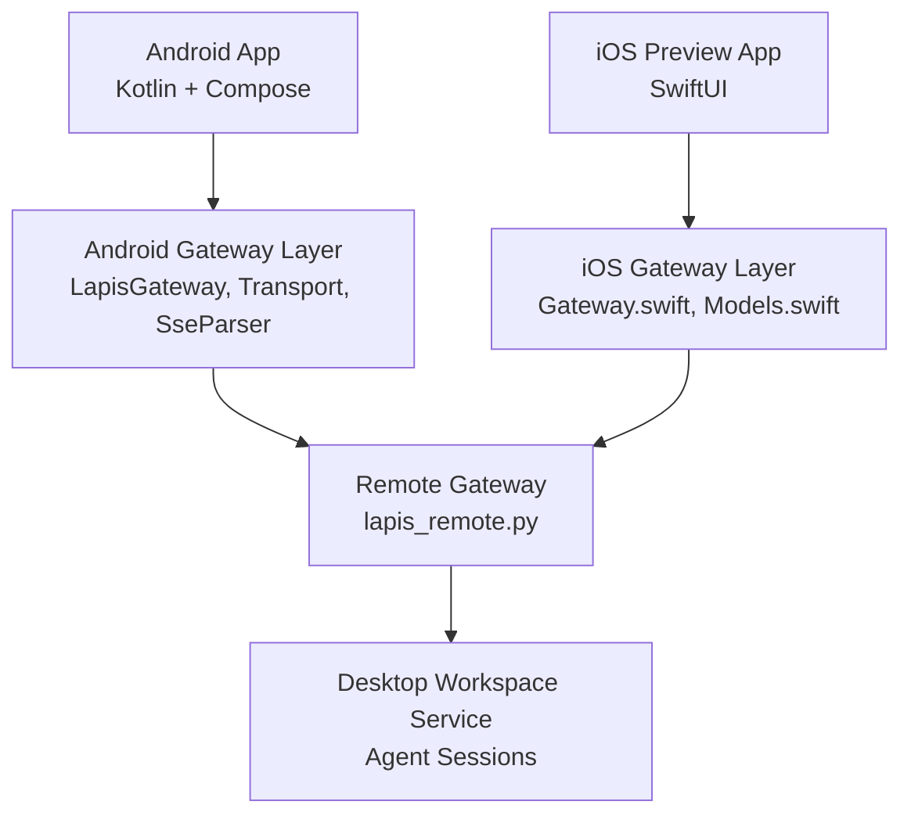
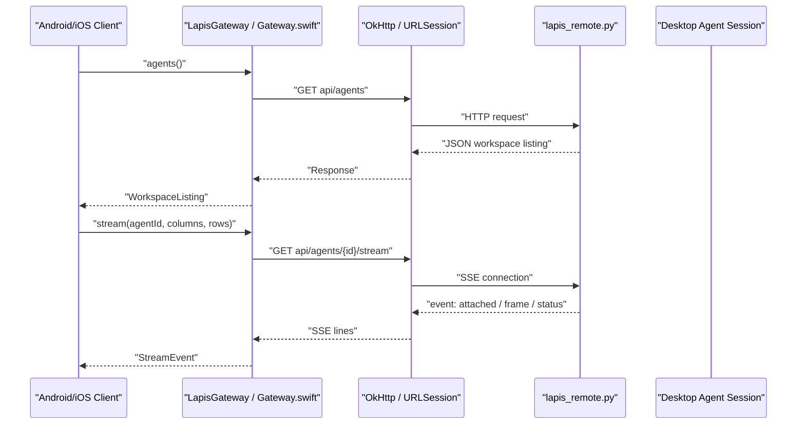
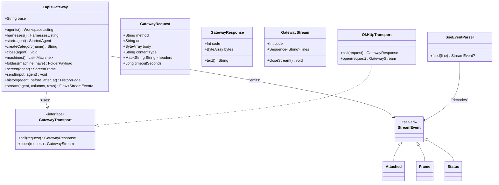
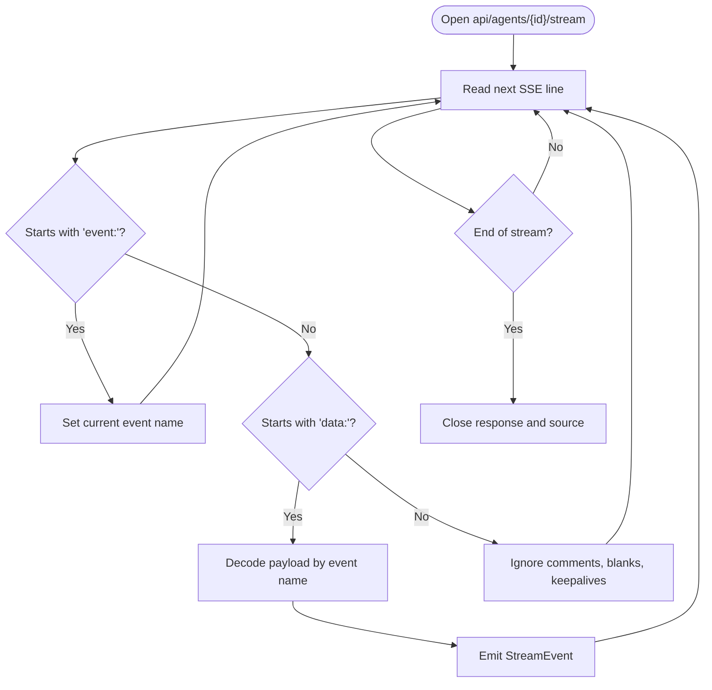
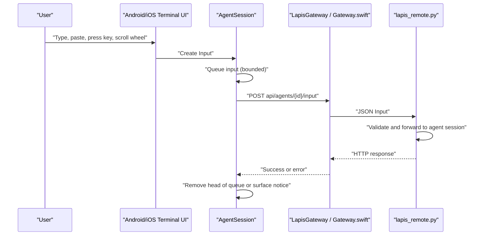
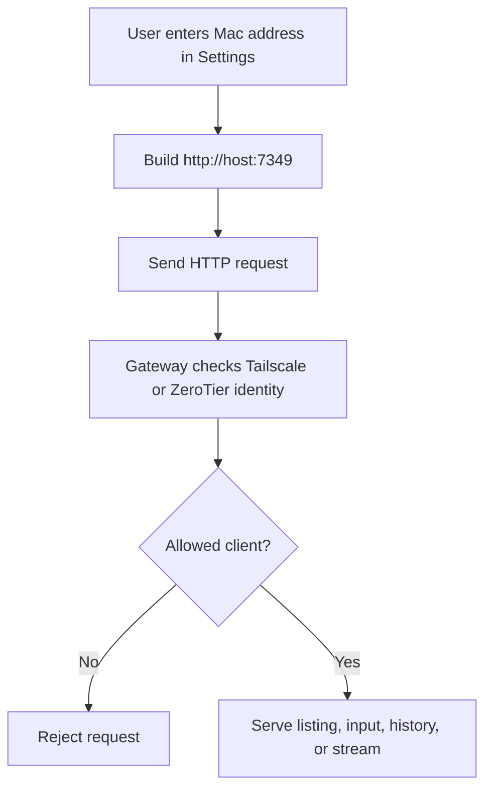
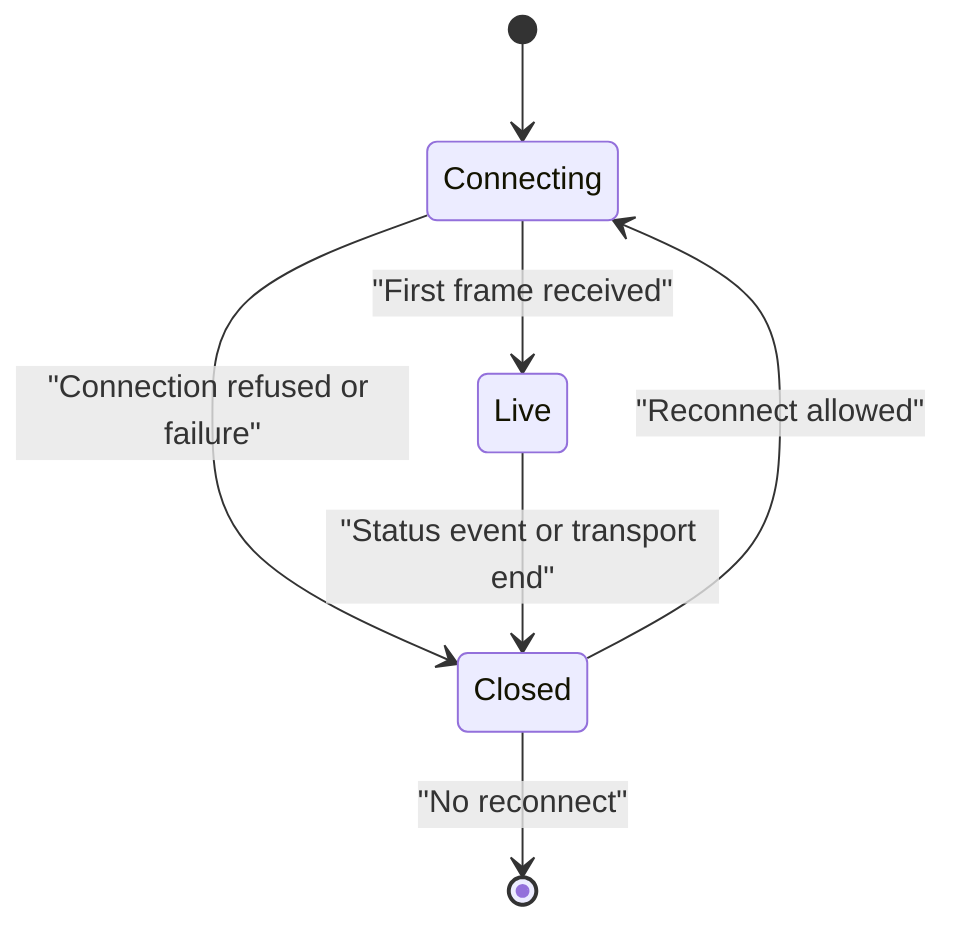
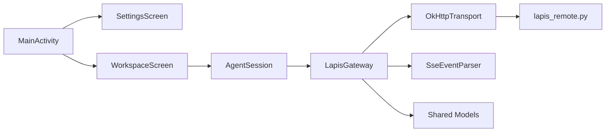

# Mobile Clients

<cite>
**Referenced Files in This Document**
- [LapisGateway.kt](file://apps/android/app/src/main/kotlin/dev/lapis/remote/gateway/LapisGateway.kt)
- [SseParser.kt](file://apps/android/app/src/main/kotlin/dev/lapis/remote/gateway/SseParser.kt)
- [Transport.kt](file://apps/android/app/src/main/kotlin/dev/lapis/remote/gateway/Transport.kt)
- [Models.kt](file://apps/android/app/src/main/kotlin/dev/lapis/remote/gateway/Models.kt)
- [AgentSession.kt](file://apps/android/app/src/main/kotlin/dev/lapis/remote/session/AgentSession.kt)
- [MainActivity.kt](file://apps/android/app/src/main/kotlin/dev/lapis/remote/ui/MainActivity.kt)
- [SettingsScreen.kt](file://apps/android/app/src/main/kotlin/dev/lapis/remote/ui/SettingsScreen.kt)
- [WorkspaceScreen.kt](file://apps/android/app/src/main/kotlin/dev/lapis/remote/ui/WorkspaceScreen.kt)
- [Settings.kt](file://apps/android/app/src/main/kotlin/dev/lapis/remote/platform/Settings.kt)
- [network_security_config.xml](file://apps/android/app/src/main/res/xml/network_security_config.xml)
- [AndroidManifest.xml](file://apps/android/app/src/main/AndroidManifest.xml)
- [Gateway.swift](file://apps/ios/Lapis/Gateway.swift)
- [Models.swift](file://apps/ios/Lapis/Models.swift)
- [TerminalScreen.swift](file://apps/ios/Lapis/TerminalScreen.swift)
- [AgentView.swift](file://apps/ios/Lapis/AgentView.swift)
- [SettingsView.swift](file://apps/ios/Lapis/SettingsView.swift)
- [lapis_remote.py](file://apps/remote/lapis_remote.py)
</cite>

## Table of Contents
1. [Introduction](#introduction)
2. [Project Structure](#project-structure)
3. [Core Components](#core-components)
4. [Architecture Overview](#architecture-overview)
5. [Detailed Component Analysis](#detailed-component-analysis)
6. [Dependency Analysis](#dependency-analysis)
7. [Performance Considerations](#performance-considerations)
8. [Setup Instructions](#setup-instructions)
9. [Troubleshooting Guide](#troubleshooting-guide)
10. [Security Considerations](#security-considerations)
11. [Conclusion](#conclusion)

## Introduction
Lapis mobile clients provide remote access to agents running on a local machine. An Android application built with Kotlin and Jetpack Compose, and an iOS preview built in Swift, connect over the user’s private overlay network to a Python gateway process running on the Mac. The gateway exposes HTTP endpoints for listing agents and sending input, plus Server-Sent Events for live terminal output. The mobile apps display agent sessions, send keyboard or paste input, resize the terminal, navigate archived history, and observe real-time screen updates.

The system is intentionally designed for trusted owner networks: there is no login flow between the phone and the Mac. Instead, the gateway restricts connections to devices recognized by Tailscale or ZeroTier and rejects ordinary web browsers.

## Project Structure
The mobile client code is split into three layers:

| Layer | Responsibility | Android | iOS |
|---|---|---|---|
| Gateway layer | HTTP requests, SSE streaming, JSON models | `dev.lapis.remote.gateway` package | `Gateway.swift`, `Models.swift` |
| Session layer | Live attachment lifecycle, input queue, archived history | `dev.lapis.remote.session.AgentSession` | Embedded in Swift session state |
| UI layer | Workspace listing, settings, terminal rendering | `dev.lapis.remote.ui.*` | SwiftUI views under `apps/ios/Lapis` |
| Remote gateway | Python HTTP/SSE server bridging phones to the desktop workspace | `apps/remote/lapis_remote.py` | Same backend |

**Diagram sources**
- [LapisGateway.kt:1-200](file://apps/android/app/src/main/kotlin/dev/lapis/remote/gateway/LapisGateway.kt#L1-L200)
- [Transport.kt:1-137](file://apps/android/app/src/main/kotlin/dev/lapis/remote/gateway/Transport.kt#L1-L137)
- [SseParser.kt:1-40](file://apps/android/app/src/main/kotlin/dev/lapis/remote/gateway/SseParser.kt#L1-L40)
- [Gateway.swift:1-200](file://apps/ios/Lapis/Gateway.swift#L1-L200)
- [lapis_remote.py:1-150](file://apps/remote/lapis_remote.py#L1-L150)

**Section sources**
- [LapisGateway.kt:1-200](file://apps/android/app/src/main/kotlin/dev/lapis/remote/gateway/LapisGateway.kt#L1-L200)
- [Transport.kt:1-137](file://apps/android/app/src/main/kotlin/dev/lapis/remote/gateway/Transport.kt#L1-L137)
- [SseParser.kt:1-40](file://apps/android/app/src/main/kotlin/dev/lapis/remote/gateway/SseParser.kt#L1-L40)
- [Gateway.swift:1-200](file://apps/ios/Lapis/Gateway.swift#L1-L200)
- [lapis_remote.py:1-150](file://apps/remote/lapis_remote.py#L1-L150)

## Core Components

### Android Gateway Layer
The Android gateway layer is a thin protocol adapter around OkHttp. Its main responsibilities are:

- Normalizing the gateway host URL.
- Building authenticated HTTP requests with platform identification.
- Serializing and deserializing shared JSON models.
- Opening SSE streams for live terminal frames.
- Returning typed errors when the gateway refuses a request.

Key classes:

| Class | Purpose |
|---|---|
| `LapisGateway` | High-level API for agents, harnesses, machines, folders, screens, input, history, and SSE streams. |
| `OkHttpTransport` | Blocking HTTP calls and bounded SSE line reading. |
| `SseEventParser` | Decodes `attached`, `frame`, and `status` events from the gateway stream. |
| `Models` | Shared data types such as `Agent`, `ScreenFrame`, `Run`, `Input`, `HistoryPage`, and `StreamEvent`. |

**Section sources**
- [LapisGateway.kt:1-200](file://apps/android/app/src/main/kotlin/dev/lapis/remote/gateway/LapisGateway.kt#L1-L200)
- [LapisGateway.kt:201-300](file://apps/android/app/src/main/kotlin/dev/lapis/remote/gateway/LapisGateway.kt#L201-L300)
- [Transport.kt:1-137](file://apps/android/app/src/main/kotlin/dev/lapis/remote/gateway/Transport.kt#L1-L137)
- [SseParser.kt:1-40](file://apps/android/app/src/main/kotlin/dev/lapis/remote/gateway/SseParser.kt#L1-L40)
- [Models.kt:1-200](file://apps/android/app/src/main/kotlin/dev/lapis/remote/gateway/Models.kt#L1-L200)
- [Models.kt:201-327](file://apps/android/app/src/main/kotlin/dev/lapis/remote/gateway/Models.kt#L201-L327)

### iOS Gateway Layer
The iOS preview mirrors the same connectivity patterns:

- A `Gateway` struct builds URLs, sends HTTP requests, and opens SSE-style streams through URLSession.
- Shared data models describe agents, categories, screen frames, runs, inputs, and history pages.
- The model layer caches listings, harness defaults, machines, folder catalogs, and recent agent screens.
- Views use these models to list agents, open sessions, render terminals, and configure the Mac address.

**Section sources**
- [Gateway.swift:1-200](file://apps/ios/Lapis/Gateway.swift#L1-L200)
- [Models.swift:1-200](file://apps/ios/Lapis/Models.swift#L1-L200)

### Android Session and UI Layers
`AgentSession` owns one visible agent. It manages:

- Connection state: connecting, live, or closed with a reason.
- Live frame updates from the SSE stream.
- Archived history loading before, after, or at a specific row.
- Input queuing, resizing, wheel input, and connection retirement on reconnection.
- A small in-memory cache of the last known screen so the UI can show something immediately while reconnecting.

`MainActivity` and related UI composable screens own the workspace repository, refresh the agent listing, open settings, and launch agent sessions.

**Section sources**
- [AgentSession.kt:1-200](file://apps/android/app/src/main/kotlin/dev/lapis/remote/session/AgentSession.kt#L1-L200)
- [AgentSession.kt:201-559](file://apps/android/app/src/main/kotlin/dev/lapis/remote/session/AgentSession.kt#L201-L559)
- [MainActivity.kt:1-200](file://apps/android/app/src/main/kotlin/dev/lapis/remote/ui/MainActivity.kt#L1-L200)
- [SettingsScreen.kt:1-200](file://apps/android/app/src/main/kotlin/dev/lapis/remote/ui/SettingsScreen.kt#L1-L200)
- [WorkspaceScreen.kt:1-200](file://apps/android/app/src/main/kotlin/dev/lapis/remote/ui/WorkspaceScreen.kt#L1-L200)

### Remote Gateway Layer
The Python gateway bridges mobile clients to the desktop workspace service. It:

- Listens on port 7349 by default.
- Accepts only owner devices over Tailscale or ZeroTier.
- Rejects browser-like requests lacking the required client header.
- Exposes REST endpoints for agents, harnesses, machines, folders, screens, input, and history.
- Streams terminal output via Server-Sent Events.
- Joins the agent session beside the desktop so both the phone and the Mac see the same terminal.

**Section sources**
- [lapis_remote.py:1-150](file://apps/remote/lapis_remote.py#L1-L150)

## Architecture Overview
At runtime, the mobile app does not talk directly to the underlying agent processes. Instead, it talks to the local gateway over HTTP. Live terminal output uses SSE; all other operations use normal JSON responses.

**Diagram sources**
- [LapisGateway.kt:201-300](file://apps/android/app/src/main/kotlin/dev/lapis/remote/gateway/LapisGateway.kt#L201-L300)
- [Transport.kt:1-137](file://apps/android/app/src/main/kotlin/dev/lapis/remote/gateway/Transport.kt#L1-L137)
- [SseParser.kt:1-40](file://apps/android/app/src/main/kotlin/dev/lapis/remote/gateway/SseParser.kt#L1-L40)
- [lapis_remote.py:1-150](file://apps/remote/lapis_remote.py#L1-L150)

## Detailed Component Analysis

### Android Gateway Class Model
The Android gateway separates request construction, transport behavior, and event parsing.

**Diagram sources**
- [LapisGateway.kt:1-200](file://apps/android/app/src/main/kotlin/dev/lapis/remote/gateway/LapisGateway.kt#L1-L200)
- [LapisGateway.kt:201-300](file://apps/android/app/src/main/kotlin/dev/lapis/remote/gateway/LapisGateway.kt#L201-L300)
- [Transport.kt:1-137](file://apps/android/app/src/main/kotlin/dev/lapis/remote/gateway/Transport.kt#L1-L137)
- [SseParser.kt:1-40](file://apps/android/app/src/main/kotlin/dev/lapis/remote/gateway/SseParser.kt#L1-L40)
- [Models.kt:201-327](file://apps/android/app/src/main/kotlin/dev/lapis/remote/gateway/Models.kt#L201-L327)

### Terminal Streaming Protocol
The terminal stream uses Server-Sent Events with one complete JSON payload per `data:` line. The supported events are:

| Event | Meaning |
|---|---|
| `attached` | The phone has joined the agent session. |
| `frame` | A new terminal screen frame. |
| `status` | Lifecycle information such as replaced, ended, released, or overloaded. |

**Diagram sources**
- [SseParser.kt:1-40](file://apps/android/app/src/main/kotlin/dev/lapis/remote/gateway/SseParser.kt#L1-L40)
- [Transport.kt:1-137](file://apps/android/app/src/main/kotlin/dev/lapis/remote/gateway/Transport.kt#L1-L137)
- [LapisGateway.kt:201-300](file://apps/android/app/src/main/kotlin/dev/lapis/remote/gateway/LapisGateway.kt#L201-L300)

### Command Execution Flow
User input is sent as JSON over HTTP. Supported input includes plain text, pasted text, named keys, modifiers, terminal resize, and wheel scrolling.

**Diagram sources**
- [AgentSession.kt:201-559](file://apps/android/app/src/main/kotlin/dev/lapis/remote/session/AgentSession.kt#L201-L559)
- [Models.kt:201-327](file://apps/android/app/src/main/kotlin/dev/lapis/remote/gateway/Models.kt#L201-L327)
- [lapis_remote.py:1-150](file://apps/remote/lapis_remote.py#L1-L150)

### Authentication and Connection Establishment
Authentication is implicit through network identity rather than credentials in the app:

1. The user enters a Tailscale hostname or ZeroTier address in Settings.
2. The app constructs an HTTP URL pointing to port 7349 on that host.
3. The gateway verifies the request origin using Tailscale identity or ZeroTier membership.
4. Requests without the required client header are rejected.
5. Successful requests receive the agent listing or open a live terminal stream.

On Android, the manifest grants internet access and permits cleartext HTTP because traffic is intended for the owner’s private overlay network. On iOS, the preview follows the same pattern through its Swift gateway implementation.

**Diagram sources**
- [SettingsScreen.kt:1-200](file://apps/android/app/src/main/kotlin/dev/lapis/remote/ui/SettingsScreen.kt#L1-L200)
- [SettingsView.swift:1-149](file://apps/ios/Lapis/SettingsView.swift#L1-L149)
- [AndroidManifest.xml:1-24](file://apps/android/app/src/main/AndroidManifest.xml#L1-L24)
- [network_security_config.xml:1-12](file://apps/android/app/src/main/res/xml/network_security_config.xml#L1-L12)
- [lapis_remote.py:1-150](file://apps/remote/lapis_remote.py#L1-L150)

### Android Session Lifecycle
`AgentSession` coordinates connection retries, history prefetching, input ordering, and state transitions.

**Diagram sources**
- [AgentSession.kt:1-200](file://apps/android/app/src/main/kotlin/dev/lapis/remote/session/AgentSession.kt#L1-L200)
- [AgentSession.kt:201-559](file://apps/android/app/src/main/kotlin/dev/lapis/remote/session/AgentSession.kt#L201-L559)

### iOS Preview Connectivity Patterns
The iOS preview demonstrates the same connectivity concepts:

- `WorkspaceModel` holds the configured host, cached listing, harness defaults, machines, and catalog state.
- `Gateway.swift` constructs requests against the same endpoint shape.
- `AgentView.swift` opens a session, resizes the terminal based on screen size and keyboard state, handles wheel gestures, and captures screenshots for debugging.
- `TerminalScreen.swift` renders terminal rows, wraps wide lines, and navigates archived history.
- `SettingsView.swift` lets the user configure the Mac address, test connectivity, adjust font size, and toggle some Mac-side behaviors.

**Section sources**
- [Models.swift:1-200](file://apps/ios/Lapis/Models.swift#L1-L200)
- [Gateway.swift:1-200](file://apps/ios/Lapis/Gateway.swift#L1-L200)
- [AgentView.swift:1-200](file://apps/ios/Lapis/AgentView.swift#L1-L200)
- [TerminalScreen.swift:1-200](file://apps/ios/Lapis/TerminalScreen.swift#L1-L200)
- [SettingsView.swift:1-149](file://apps/ios/Lapis/SettingsView.swift#L1-L149)

## Dependency Analysis
The Android client has clear boundaries between protocol, transport, and UI:

**Diagram sources**
- [MainActivity.kt:1-200](file://apps/android/app/src/main/kotlin/dev/lapis/remote/ui/MainActivity.kt#L1-L200)
- [WorkspaceScreen.kt:1-200](file://apps/android/app/src/main/kotlin/dev/lapis/remote/ui/WorkspaceScreen.kt#L1-L200)
- [AgentSession.kt:1-200](file://apps/android/app/src/main/kotlin/dev/lapis/remote/session/AgentSession.kt#L1-L200)
- [LapisGateway.kt:1-200](file://apps/android/app/src/main/kotlin/dev/lapis/remote/gateway/LapisGateway.kt#L1-L200)
- [Transport.kt:1-137](file://apps/android/app/src/main/kotlin/dev/lapis/remote/gateway/Transport.kt#L1-L137)
- [SseParser.kt:1-40](file://apps/android/app/src/main/kotlin/dev/lapis/remote/gateway/SseParser.kt#L1-L40)
- [lapis_remote.py:1-150](file://apps/remote/lapis_remote.py#L1-L150)

Cohesion is high within each layer, and coupling is mostly one-directional from UI to session to gateway to transport. The main integration point with the outside world is the Python gateway.

**Section sources**
- [MainActivity.kt:1-200](file://apps/android/app/src/main/kotlin/dev/lapis/remote/ui/MainActivity.kt#L1-L200)
- [WorkspaceScreen.kt:1-200](file://apps/android/app/src/main/kotlin/dev/lapis/remote/ui/WorkspaceScreen.kt#L1-L200)
- [AgentSession.kt:1-200](file://apps/android/app/src/main/kotlin/dev/lapis/remote/session/AgentSession.kt#L1-L200)
- [LapisGateway.kt:1-200](file://apps/android/app/src/main/kotlin/dev/lapis/remote/gateway/LapisGateway.kt#L1-L200)
- [Transport.kt:1-137](file://apps/android/app/src/main/kotlin/dev/lapis/remote/gateway/Transport.kt#L1-L137)

## Performance Considerations
- **Streaming timeouts:** The Android SSE stream uses a longer read timeout than normal HTTP calls because the gateway sends periodic keepalive pings.
- **Bounded lines:** Each streamed line is limited to roughly 8 MiB plus envelope overhead to prevent unbounded memory growth.
- **Connection limits:** The gateway caps concurrent HTTP connections to protect the desktop process.
- **Input backpressure:** The Android session queues up to a bounded number of pending inputs and surfaces a notice if the queue fills.
- **History pagination:** History is loaded in pages, with retry loops for busy services and limits on how many pages are fetched per operation.
- **Caching:** Both platforms cache recent workspace data and the last known terminal frame so the UI remains responsive after configuration changes or brief network interruptions.

[No sources needed since this section provides general guidance]

## Setup Instructions

### Prerequisites
- A Mac running the Lapis desktop workspace and the gateway process.
- The mobile device connected to the same private overlay network as the Mac.
- For Tailscale: both devices must be logged into the same account and reachable through the tailnet.
- For ZeroTier: the Mac and device must be members of the same ZeroTier network.

### Android Setup
1. Install the Lapis Android application.
2. Open Settings and enter the Mac’s Tailscale hostname or ZeroTier address.
3. Tap “Check connection” to verify reachability.
4. Return to the main screen to view the agent listing.
5. Open an agent to attach to its terminal session.

Required Android configuration:
- Internet permission is declared.
- Cleartext HTTP is permitted for the configured gateway host.
- The app uses DataStore for persisted settings.

**Section sources**
- [AndroidManifest.xml:1-24](file://apps/android/app/src/main/AndroidManifest.xml#L1-L24)
- [network_security_config.xml:1-12](file://apps/android/app/src/main/res/xml/network_security_config.xml#L1-L12)
- [Settings.kt:1-76](file://apps/android/app/src/main/kotlin/dev/lapis/remote/platform/Settings.kt#L1-L76)
- [SettingsScreen.kt:1-200](file://apps/android/app/src/main/kotlin/dev/lapis/remote/ui/SettingsScreen.kt#L1-L200)

### iOS Preview Setup
1. Build and run the iOS preview target in Xcode.
2. Open Settings and enter the Mac’s Tailscale hostname or ZeroTier address.
3. Tap “Check connection” to verify reachability.
4. Open an agent to attach to its terminal session.
5. Use the agent menu to adjust text size, capture the screen, or navigate between agents.

The iOS preview shares the same gateway contract and network expectations as the Android client.

**Section sources**
- [SettingsView.swift:1-149](file://apps/ios/Lapis/SettingsView.swift#L1-L149)
- [AgentView.swift:1-200](file://apps/ios/Lapis/AgentView.swift#L1-L200)
- [TerminalScreen.swift:1-200](file://apps/ios/Lapis/TerminalScreen.swift#L1-L200)

## Troubleshooting Guide

| Symptom | Likely Cause | Action |
|---|---|---|
| “Can’t reach lapis” | The Mac is unreachable over Tailscale or ZeroTier. | Verify overlay network connectivity and that the Mac is awake. |
| “Secure connection failed” | TLS handshake problem when HTTPS is used. | Confirm certificate trust and gateway configuration. |
| No agents listed | Gateway refused the request or returned an empty listing. | Use “Check connection” and inspect the gateway’s error message. |
| Terminal disconnects after typing | Agent session was replaced, ended, released, or overloaded. | Reopen the agent or return to the Mac to continue. |
| Input stalls | Input queue is full or the gateway is slow. | Wait for the pending input notice; avoid rapid repeated input. |
| History loads slowly | Service is busy or history is large. | Let pagination retries finish; avoid excessive simultaneous scrolls. |
| Android always shows cleartext warning | Network security config allows HTTP for the gateway. | This is expected because traffic goes through the owner’s private overlay. |

Error messages are normalized into user-friendly strings. On Android, SSL failures, IO failures, and gateway-specific errors are mapped to readable notices.

**Section sources**
- [Settings.kt:1-76](file://apps/android/app/src/main/kotlin/dev/lapis/remote/platform/Settings.kt#L1-L76)
- [AgentSession.kt:201-559](file://apps/android/app/src/main/kotlin/dev/lapis/remote/session/AgentSession.kt#L201-L559)
- [WorkspaceScreen.kt:1-200](file://apps/android/app/src/main/kotlin/dev/lapis/remote/ui/WorkspaceScreen.kt#L1-L200)

## Security Considerations
The gateway is not a public-facing API:

- It requires a client header identifying the mobile client.
- It accepts only requests from recognized Tailscale identities or ZeroTier members.
- Ordinary web browsers are rejected even if they can reach the port.
- Android permits cleartext HTTP only because the intended path is through encrypted overlay networks.
- The mobile apps do not collect passwords for the Mac; authentication is delegated to the overlay network and the gateway’s ownership check.

Recommended operational practices:

- Keep Tailscale or ZeroTier accounts private to the device owner.
- Avoid exposing port 7349 to untrusted networks.
- Treat the gateway as equivalent to direct shell access to the Mac’s workspace.
- Be cautious when sharing devices or overlay memberships.
- Use HTTPS only if the deployment explicitly supports it; otherwise rely on the overlay encryption.

**Section sources**
- [AndroidManifest.xml:1-24](file://apps/android/app/src/main/AndroidManifest.xml#L1-L24)
- [network_security_config.xml:1-12](file://apps/android/app/src/main/res/xml/network_security_config.xml#L1-L12)
- [LapisGateway.kt:1-200](file://apps/android/app/src/main/kotlin/dev/lapis/remote/gateway/LapisGateway.kt#L1-L200)
- [lapis_remote.py:1-150](file://apps/remote/lapis_remote.py#L1-L150)

## Conclusion
Lapis mobile clients provide a focused remote-access experience: discover agents on a trusted local machine, attach to their terminal sessions, type commands, and watch live output. The Android client implements the full production-oriented gateway layer, while the iOS preview demonstrates the same connectivity and terminal interaction patterns. The Python gateway centralizes authentication, session joining, and streaming, allowing both platforms to share the same wire contract. Proper overlay-network setup is essential, and the security model relies on private network membership rather than application-level sign-in.