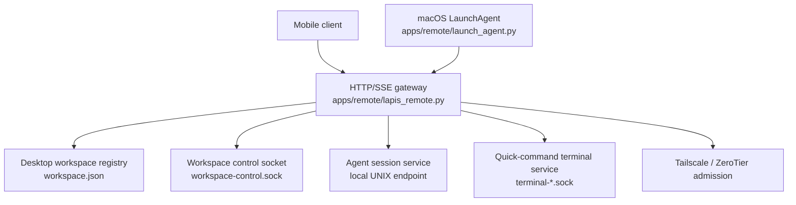
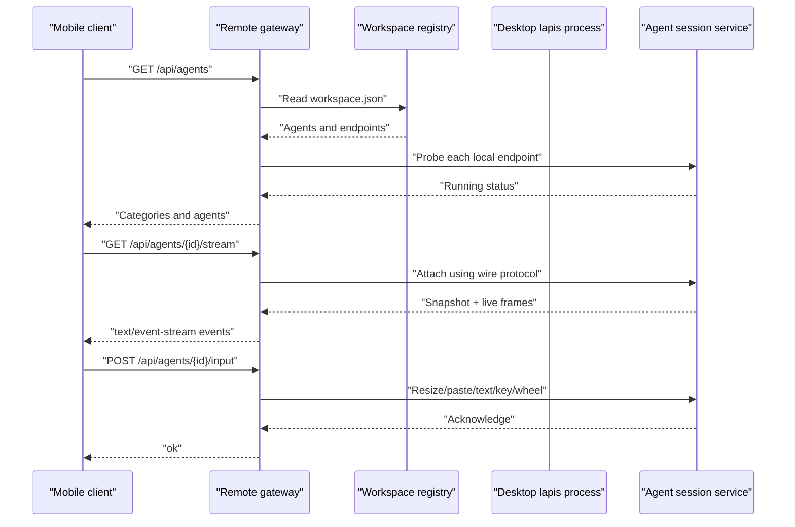
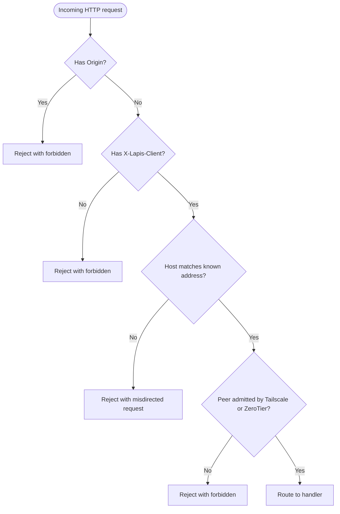
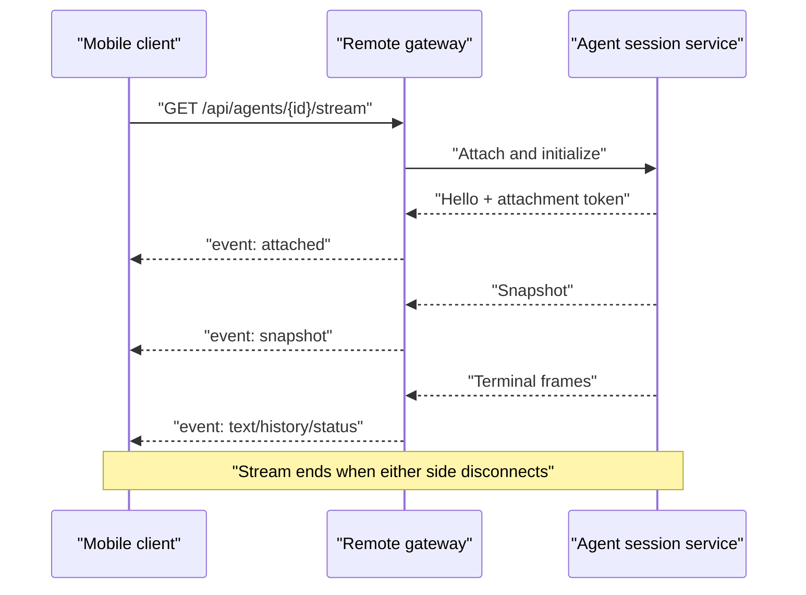
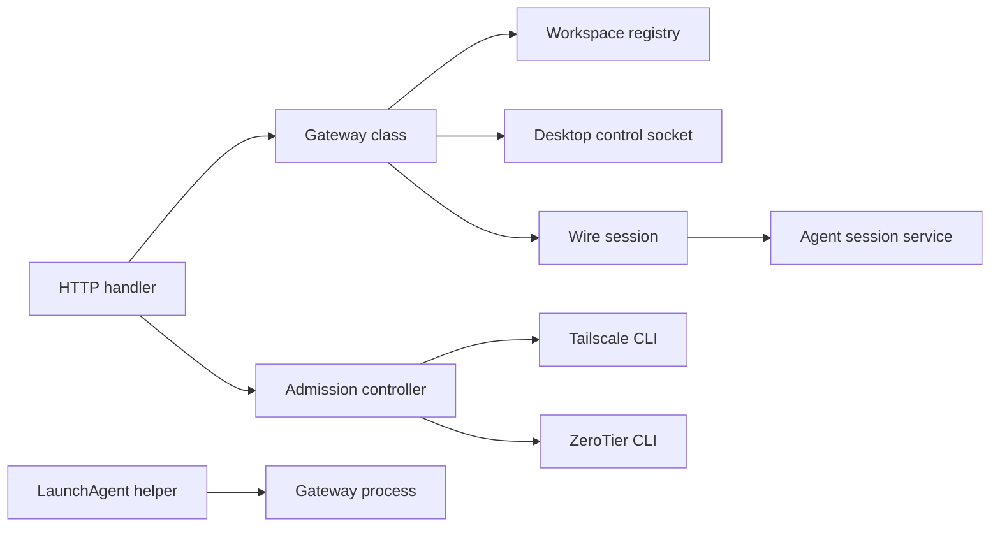
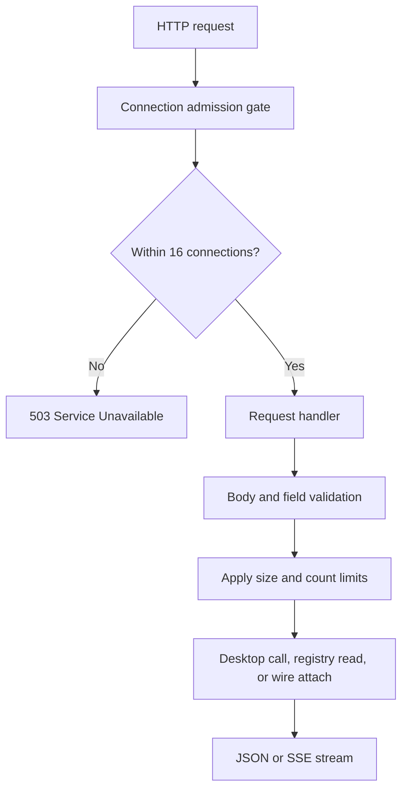

# Remote Gateway API

<cite>
**Referenced Files in This Document**
- [lapis_remote.py](file://apps/remote/lapis_remote.py)
- [launch_agent.py](file://apps/remote/launch_agent.py)
- [architecture.md](file://docs/architecture.md)
</cite>

## Table of Contents
1. [Introduction](#introduction)
2. [Project Structure](#project-structure)
3. [Core Components](#core-components)
4. [Architecture Overview](#architecture-overview)
5. [Detailed Component Analysis](#detailed-component-analysis)
6. [Dependency Analysis](#dependency-analysis)
7. [Performance Considerations](#performance-considerations)
8. [Troubleshooting Guide](#troubleshooting-guide)
9. [Conclusion](#conclusion)
10. [Appendices](#appendices)

## Introduction
This document describes the Lapis Remote Gateway implemented in Python. It exposes HTTP and Server-Sent Events (SSE) endpoints that mobile clients use to discover agents, manage sessions, capture terminal snapshots, browse folders and machines, and interact with live terminals. The gateway does not run agents itself; it reads a desktop workspace registry, probes local agent session services, and attaches to them over a private wire protocol. Clients authenticate through overlay-network membership checks and strict header validation.

The gateway is intended for local network exposure between trusted devices: it accepts connections from the Mac owner’s Tailscale identity or members of an authorized ZeroTier private network, rejects browser-originated requests, and refuses unknown `Host` values.

**Section sources**
- [lapis_remote.py:1-30](file://apps/remote/lapis_remote.py#L1-L30)
- [lapis_remote.py:2083-2320](file://apps/remote/lapis_remote.py#L2083-L2320)
- [architecture.md:1-30](file://docs/architecture.md#L1-L30)

## Project Structure
The remote gateway consists of two Python programs under `apps/remote`:

| File | Responsibility |
| --- | --- |
| `lapis_remote.py` | HTTP/SSE server, request routing, authentication, agent discovery, terminal streaming, folder/machine indexing, and forwarding to the desktop process. |
| `launch_agent.py` | macOS LaunchAgent helper that installs, starts, restarts, and reports the status of the gateway process at login. |



**Diagram sources**
- [lapis_remote.py:2321-2480](file://apps/remote/lapis_remote.py#L2321-L2480)
- [lapis_remote.py:3292-3409](file://apps/remote/lapis_remote.py#L3292-L3409)
- [launch_agent.py:1-87](file://apps/remote/launch_agent.py#L1-L87)

**Section sources**
- [lapis_remote.py:1-120](file://apps/remote/lapis_remote.py#L1-L120)
- [launch_agent.py:1-87](file://apps/remote/launch_agent.py#L1-L87)

## Core Components

### Gateway Process
The main entry point parses CLI arguments, resolves the workspace registry path, builds an admission controller based on available overlay tools, binds the HTTP server, and runs it forever. On macOS, it also starts a background keep-alive thread.

Key behaviors:
- Default port is 7349.
- Binding defaults to the Tailscale IPv4 address unless ZeroTier is active or `--bind` is supplied.
- Workspace registry defaults to `~/.lapis/runtime/workspace.json`.
- The process sets a restrictive umask before starting.

**Section sources**
- [lapis_remote.py:3292-3409](file://apps/remote/lapis_remote.py#L3292-L3409)

### Admission Controller
Authentication happens in three layers:
1. **Origin check:** Requests carrying an `Origin` header are rejected.
2. **Client header check:** Every request must include `X-Lapis-Client`; otherwise it is rejected.
3. **Host and peer check:** The `Host` header must match one of the gateway’s advertised addresses, and the TCP source address must be admitted by either Tailscale or ZeroTier logic.

| Mechanism | Behavior |
| --- | --- |
| `Origin` header | Any presence causes immediate rejection. |
| `X-Lapis-Client` header | Required; missing requests are rejected. |
| `Host` header | Must resolve to an address returned by the selected overlay admission system. |
| Tailscale | Uses `tailscale whois` to verify the peer belongs to the same owner login. |
| ZeroTier | Checks whether the peer is connected to a currently joined private network. |
| Local loopback | Not accepted by default; `--allow-local` exists only for tests. |

**Section sources**
- [lapis_remote.py:2401-2434](file://apps/remote/lapis_remote.py#L2401-L2434)
- [lapis_remote.py:2083-2320](file://apps/remote/lapis_remote.py#L2083-L2320)

### Bounded HTTP Server
The gateway uses a threading HTTP server with an explicit connection admission gate:
- Maximum concurrent connections: 16.
- Backlog queue size: 32.
- Excess connections receive a bounded 503 response.
- Connection slots are held for the entire HTTP request, including long-lived SSE streams.

This design prevents an attacker from exhausting handler threads or doing heavy work per connection.

**Section sources**
- [lapis_remote.py:133-200](file://apps/remote/lapis_remote.py#L133-L200)

### Request Routing
All routes start with `/api`. GET handlers return data; POST handlers mutate state. Agent-specific routes embed the agent identifier as part of the path.

| Method | Route Pattern | Purpose |
| --- | --- | --- |
| `GET` | `/api/health` | Returns gateway version and DNS name. |
| `GET` | `/api/agents` | Lists workspace agents with running status. |
| `GET` | `/api/harnesses` | Returns supported harness metadata from the desktop. |
| `GET` | `/api/folders` | Returns a cached or refreshed folder index. |
| `GET` | `/api/machines` | Lists SSH-discovered machines. |
| `GET` | `/api/terminals` | Lists quick-command terminals. |
| `GET` | `/api/conversations` | Lists conversation history. |
| `GET` | `/api/settings` | Reads settings through the desktop. |
| `GET` | `/api/deck` | Returns Ultra Tab deck data. |
| `GET` | `/api/agents/{id}/screen` | Captures current terminal screen without taking ownership. |
| `GET` | `/api/agents/{id}/stream` | Opens real-time terminal output via SSE. |
| `GET` | `/api/agents/{id}/history` | Streams terminal history. |
| `POST` | `/api/agents/{id}/input` | Sends resize, paste, text, key, or wheel input. |
| `POST` | `/api/agents/{id}/submit` | Submits an Ultra Tab answer through join-only paste. |
| `POST` | `/api/agents/{id}/skip` | Logs an Ultra Tab skip without sending to the agent. |
| `POST` | `/api/agents` | Starts a new agent. |
| `POST` | `/api/agents/{id}/close` | Closes an agent or terminal. |
| `POST` | `/api/agents/{id}/rename` | Renames an agent. |
| `POST` | `/api/agents/{id}/place` | Moves an agent to another category. |
| `POST` | `/api/agents/{id}/restart` | Forwards restart to the desktop. |
| `POST` | `/api/categories` | Creates a category. |
| `POST` | `/api/categories/{id}/rename` | Renames a category. |
| `POST` | `/api/categories/{id}/remove` | Removes a category. |
| `POST` | `/api/categories/{id}/place` | Reorders categories. |
| `POST` | `/api/settings` | Changes settings. |
| `POST` | `/api/terminals` | Opens a quick-command terminal. |
| `POST` | `/api/captures` | Saves a PNG debug capture. |

**Section sources**
- [lapis_remote.py:2461-2560](file://apps/remote/lapis_remote.py#L2461-L2560)

## Architecture Overview



**Diagram sources**
- [lapis_remote.py:2461-2560](file://apps/remote/lapis_remote.py#L2461-L2560)
- [lapis_remote.py:2956-3053](file://apps/remote/lapis_remote.py#L2956-L3053)
- [lapis_remote.py:3115-3170](file://apps/remote/lapis_remote.py#L3115-L3170)

## Detailed Component Analysis

### Authentication and Security Model

#### Header-Based Protection
Every request must pass `admitted()` before routing:
- Reject if `Origin` is present.
- Reject if `X-Lapis-Client` is absent.
- Reject if `Host` does not match the expected host list.
- Reject if the TCP source address is not admitted by overlay authorization.

#### Overlay Authorization
- **Tailscale mode:** Resolves the gateway’s own login name and uses `whois` to confirm the peer belongs to the same owner.
- **ZeroTier mode:** Confirms the peer is connected to a private network whose status is `OK`.
- If neither overlay is available, the gateway exits during startup.

#### Network Exposure Recommendations
- Do not expose the gateway directly to the public internet.
- Prefer binding to the Tailscale interface rather than `0.0.0.0`.
- Use ZeroTier only when the private network membership is trusted.
- Keep `--allow-local` disabled outside test fixtures.



**Diagram sources**
- [lapis_remote.py:2401-2434](file://apps/remote/lapis_remote.py#L2401-L2434)
- [lapis_remote.py:2083-2320](file://apps/remote/lapis_remote.py#L2083-L2320)

**Section sources**
- [lapis_remote.py:2401-2434](file://apps/remote/lapis_remote.py#L2401-L2434)
- [lapis_remote.py:2083-2320](file://apps/remote/lapis_remote.py#L2083-L2320)

### REST Endpoints

#### Health Endpoint

| Field | Type | Description |
| --- | --- | --- |
| `ok` | boolean | Always true for a healthy gateway. |
| `version` | integer | Gateway protocol version constant. |
| `host` | string | DNS name derived from overlay configuration. |

**Example curl command:**
```bash
curl --header "X-Lapis-Client: mobile" \
     --header "Host: tailscale-hostname-or-ip" \
     http://gateway-address:7349/api/health
```

**Status codes:**
- `200 OK`: Gateway is reachable.

**Section sources**
- [lapis_remote.py:2461-2480](file://apps/remote/lapis_remote.py#L2461-L2480)

#### Agent Discovery

`GET /api/agents` returns workspace agents grouped by category. It optionally waits for a newer registry version if the client sends `after=<registry-version>`.

| Query Parameter | Type | Description |
| --- | --- | --- |
| `after` | string | Registry version to wait for before responding. |

Response fields per agent:
| Field | Type | Description |
| --- | --- | --- |
| `id` | string | Agent identifier. |
| `title` | string | Human-readable title. |
| `harness` | string | Agent harness such as `codex` or `claude`. |
| `directory` | string | Working directory. |
| `machine` | string | Display place or machine label. |
| `place` | string | Category or placement metadata. |
| `running` | object | Running status returned by the agent’s local service probe. |
| `onPhone` | boolean | Whether the phone currently owns the attachment. |

**Example curl command:**
```bash
curl --header "X-Lapis-Client: mobile" \
     --header "Host: tailscale-hostname-or-ip" \
     "http://gateway-address:7349/api/agents?after=registry-version"
```

**Status codes:**
- `200 OK`: Listing returned.
- `503 Service Unavailable`: Too many listings, listing timed out, or too many agents to list safely.
- `503 Service Unavailable`: Workspace cannot be read.

**Section sources**
- [lapis_remote.py:2560-2660](file://apps/remote/lapis_remote.py#L2560-L2660)
- [lapis_remote.py:233-320](file://apps/remote/lapis_remote.py#L233-L320)

#### Harness Metadata

`GET /api/harnesses` forwards to the desktop and returns harness definitions and defaults.

**Example curl command:**
```bash
curl --header "X-Lapis-Client: mobile" \
     --header "Host: tailscale-hostname-or-ip" \
     http://gateway-address:7349/api/harnesses
```

**Status codes:**
- `200 OK`: Returns `harnesses` and `defaults`.
- `503 Service Unavailable`: Desktop unavailable.
- `422 Unprocessable Entity`: Desktop returned an error.

**Section sources**
- [lapis_remote.py:2660-2700](file://apps/remote/lapis_remote.py#L2660-L2700)

#### Folder Index

`GET /api/folders` returns a cached folder index. When `machine` is provided, it returns a remote machine’s folder index instead of this Mac’s.

| Query Parameter | Type | Description |
| --- | --- | --- |
| `machine` | string | Optional SSH machine name. |
| `have` | string | Version already held by the client. |

Response fields:
| Field | Type | Description |
| --- | --- | --- |
| `version` | string | Folder index version. |
| `unchanged` | boolean | Present when `have` matches the current version. |
| Other fields | object | Full folder index payload. |

**Example curl commands:**
```bash
curl --header "X-Lapis-Client: mobile" \
     --header "Host: tailscale-hostname-or-ip" \
     "http://gateway-address:7349/api/folders?have=current-version"

curl --header "X-Lapis-Client: mobile" \
     --header "Host: tailscale-hostname-or-ip" \
     "http://gateway-address:7349/api/folders?machine=ssh-machine-name&have=current-version"
```

**Status codes:**
- `200 OK`: Folder index returned.
- `400 Bad Request`: Invalid machine name.
- `503 Service Unavailable`: Still reading or no cache available.

**Section sources**
- [lapis_remote.py:2700-2760](file://apps/remote/lapis_remote.py#L2700-L2760)

#### Machine List

`GET /api/machines` returns discovered SSH machines.

**Example curl command:**
```bash
curl --header "X-Lapis-Client: mobile" \
     --header "Host: tailscale-hostname-or-ip" \
     http://gateway-address:7349/api/machines
```

**Status codes:**
- `200 OK`: Returns `machines`.
- `503 Service Unavailable`: Still discovering SSH machines.

**Section sources**
- [lapis_remote.py:2700-2720](file://apps/remote/lapis_remote.py#L2700-L2720)

#### Terminal List

`GET /api/terminals` lists quick-command terminals defined beside the workspace registry.

**Example curl command:**
```bash
curl --header "X-Lapis-Client: mobile" \
     --header "Host: tailscale-hostname-or-ip" \
     http://gateway-address:7349/api/terminals
```

**Status codes:**
- `200 OK`: Returns `terminals`.

**Section sources**
- [lapis_remote.py:2881-2898](file://apps/remote/lapis_remote.py#L2881-L2898)

#### Conversation List

`GET /api/conversations` delegates to the desktop.

**Example curl command:**
```bash
curl --header "X-Lapis-Client: mobile" \
     --header "Host: tailscale-hostname-or-ip" \
     http://gateway-address:7349/api/conversations
```

**Status codes:**
- `200 OK`: Desktop response forwarded.
- `503 Service Unavailable`: Desktop unavailable.
- `422 Unprocessable Entity`: Desktop error.

**Section sources**
- [lapis_remote.py:2480-2560](file://apps/remote/lapis_remote.py#L2480-L2560)

#### Settings

| Method | Route | Purpose |
| --- | --- | --- |
| `GET` | `/api/settings` | Read settings from the desktop. |
| `POST` | `/api/settings` | Change settings through the desktop. |

**Example curl commands:**
```bash
curl --header "X-Lapis-Client: mobile" \
     --header "Host: tailscale-hostname-or-ip" \
     http://gateway-address:7349/api/settings

curl --header "X-Lapis-Client: mobile" \
     --header "Host: tailscale-hostname-or-ip" \
     -X POST \
     --data '{"key":"value"}' \
     http://gateway-address:7349/api/settings
```

**Status codes:**
- `200 OK`: Settings returned or acknowledged.
- `503 Service Unavailable`: Desktop unavailable.
- `422 Unprocessable Entity`: Desktop error.

**Section sources**
- [lapis_remote.py:2480-2560](file://apps/remote/lapis_remote.py#L2480-L2560)

#### Deck Data

`GET /api/deck` returns Ultra Tab deck data. Like agent listing, it can wait for a newer registry version when `after` is supplied.

**Example curl command:**
```bash
curl --header "X-Lapis-Client: mobile" \
     --header "Host: tailscale-hostname-or-ip" \
     "http://gateway-address:7349/api/deck?after=deck-version"
```

**Status codes:**
- `200 OK`: Deck data returned.
- `503 Service Unavailable`: No workspace.

**Section sources**
- [lapis_remote.py:3170-3210](file://apps/remote/lapis_remote.py#L3170-L3210)

#### Terminal Snapshot

`GET /api/agents/{id}/screen` captures the current terminal screen by briefly joining the session in view-only mode. It does not take the agent away from the desktop.

**Example curl command:**
```bash
curl --header "X-Lapis-Client: mobile" \
     --header "Host: tailscale-hostname-or-ip" \
     http://gateway-address:7349/api/agents/agent-id/screen
```

**Status codes:**
- `200 OK`: Screen snapshot returned.
- `404 Not Found`: Agent identifier not found.
- `409 Conflict`: Cannot view without taking the agent.
- `502 Bad Gateway`: Attachment failed.

**Section sources**
- [lapis_remote.py:2760-2820](file://apps/remote/lapis_remote.py#L2760-L2820)

#### Terminal Input

`POST /api/agents/{id}/input` sends terminal interaction to the currently owned session.

| Body Field | Type | Description |
| --- | --- | --- |
| `resize` | `[number, number]` | Terminal columns and rows. |
| `paste` | string | Text pasted into the agent input. |
| `text` | string | Raw text sent to the agent. |
| `key` | string | Named key such as `enter`, `tab`, `escape`. |
| `modifiers` | integer | Keyboard modifier flags. |
| `wheel` | `[number, number, number]` | Wheel steps, column, row. |
| `submit` | boolean | Optional flag indicating submit intent. |

**Example curl command:**
```bash
curl --header "X-Lapis-Client: mobile" \
     --header "Host: tailscale-hostname-or-ip" \
     -H "Content-Type: application/json" \
     -d '{"key":"enter","submit":true}' \
     http://gateway-address:7349/api/agents/agent-id/input
```

**Status codes:**
- `200 OK`: Input accepted.
- `409 Conflict`: Agent is not open on the phone.
- `400 Bad Request`: Invalid size, body, field type, or value.

**Section sources**
- [lapis_remote.py:3115-3170](file://apps/remote/lapis_remote.py#L3115-L3170)

#### Ultra Tab Submit and Skip

| Method | Route | Purpose |
| --- | --- | --- |
| `POST` | `/api/agents/{id}/submit` | Sends one paste-and-return through a join-only attachment. |
| `POST` | `/api/agents/{id}/skip` | Logs a skip decision without sending to the agent. |

**Example curl commands:**
```bash
curl --header "X-Lapis-Client: mobile" \
     --header "Host: tailscale-hostname-or-ip" \
     -H "Content-Type: application/json" \
     -d '{"text":"answer text"}' \
     http://gateway-address:7349/api/agents/agent-id/submit

curl --header "X-Lapis-Client: mobile" \
     --header "Host: tailscale-hostname-or-ip" \
     -H "Content-Type: application/json" \
     -d '{"key":"decision-key"}' \
     http://gateway-address:7349/api/agents/agent-id/skip
```

**Status codes:**
- `200 OK`: Accepted or logged.
- `400 Bad Request`: Missing or invalid body.
- `404 Not Found`: Agent not found.
- `409 Conflict`: Session refused the paste.

**Section sources**
- [lapis_remote.py:3210-3290](file://apps/remote/lapis_remote.py#L3210-L3290)

#### Debug Capture

`POST /api/captures` saves a PNG image and associated JSON metadata under the workspace’s `phone-captures` directory.

| Field | Type | Description |
| --- | --- | --- |
| `png` | base64 string | PNG-encoded image bytes. |

**Example curl command:**
```bash
curl --header "X-Lapis-Client: mobile" \
     --header "Host: tailscale-hostname-or-ip" \
     -H "Content-Type: application/json" \
     -d '{"png":"base64-png-data"}' \
     http://gateway-address:7349/api/captures
```

**Status codes:**
- `200 OK`: Returns `saved` file name.
- `400 Bad Request`: Invalid size, missing PNG, or non-PNG content.

**Section sources**
- [lapis_remote.py:3100-3115](file://apps/remote/lapis_remote.py#L3100-L3115)

### SSE Terminal Streaming Protocol

#### Stream Lifecycle

`GET /api/agents/{id}/stream` opens an SSE stream:
1. The gateway validates terminal dimensions.
2. It attaches to the agent session service using the internal wire protocol.
3. It sends an `attached` event.
4. It forwards terminal frames until the client disconnects or the session ends.
5. It sends a final `status` event describing termination.

#### SSE Message Formats

| Event | Payload | Meaning |
| --- | --- | --- |
| `attached` | `{ "shared": boolean }` | Connection established; shared indicates whether the phone took ownership. |
| `snapshot` | Binary attachment followed by styled terminal frame data | Initial full terminal state. |
| `history` | Styled terminal history chunk | Historical terminal output. |
| `status` | `{ "state": string, "message": string }` | Session lifecycle change. |

Supported status states include:
| State | Meaning |
| --- | --- |
| `rejected` | Agent rejected the attachment. |
| `ended` | Session ended. |
| `replaced` | Another client replaced this attachment. |
| `overloaded` | Agent service was overloaded. |
| `disconnected` | Wire connection lost. |
| `released` | Agent opened elsewhere. |

#### Connection Handling Rules
- The stream has no `Content-Length`.
- The connection remains open until either side closes it.
- Invalid wire data is reported as a disconnected status.
- A session opened elsewhere triggers a released status.
- The stream reader thread is responsible for delivering frames and errors.



**Diagram sources**
- [lapis_remote.py:2956-3053](file://apps/remote/lapis_remote.py#L2956-L3053)
- [lapis_remote.py:1655-1783](file://apps/remote/lapis_remote.py#L1655-L1783)

**Section sources**
- [lapis_remote.py:2956-3053](file://apps/remote/lapis_remote.py#L2956-L3053)
- [lapis_remote.py:1655-1783](file://apps/remote/lapis_remote.py#L1655-L1783)

### Error Handling Patterns

| Scenario | Status Code | Response Shape | Notes |
| --- | --- | --- | --- |
| Browser origin detected | `403 Forbidden` | `{ "error": string }` | Immediate refusal. |
| Missing client header | `403 Forbidden` | `{ "error": string }` | Immediate refusal. |
| Unknown host | `421 Misdirected Request` | `{ "error": string }` | Host mismatch. |
| Unauthorized peer | `403 Forbidden` | `{ "error": string }` | Not admitted by overlay. |
| Not found route | `404 Not Found` | `{ "error": string }` | Invalid API path. |
| Invalid request body | `400 Bad Request` | `{ "error": string }` | Size, type, or format validation failure. |
| Agent not open on phone | `409 Conflict` | `{ "error": string }` | Input submitted without an active attachment. |
| Desktop unavailable | `503 Service Unavailable` | `{ "error": string }` | Desktop process not running. |
| Desktop error | `422 Unprocessable Entity` | `{ "error": string }` | Desktop returned `ok: false`. |
| Gateway busy | `503 Service Unavailable` | `{ "error": string }` | Connection limit reached. |
| Listing timeout | `503 Service Unavailable` | `{ "error": string }` | Agent probing exceeded deadline. |
| Attachment failure | `502 Bad Gateway` | `{ "error": string }` | Wire protocol or service error. |

**Section sources**
- [lapis_remote.py:2401-2480](file://apps/remote/lapis_remote.py#L2401-L2480)
- [lapis_remote.py:2560-2820](file://apps/remote/lapis_remote.py#L2560-L2820)
- [lapis_remote.py:3115-3290](file://apps/remote/lapis_remote.py#L3115-L3290)

## Dependency Analysis



**Diagram sources**
- [lapis_remote.py:2321-2480](file://apps/remote/lapis_remote.py#L2321-L2480)
- [lapis_remote.py:2083-2320](file://apps/remote/lapis_remote.py#L2083-L2320)
- [lapis_remote.py:1655-1783](file://apps/remote/lapis_remote.py#L1655-L1783)
- [launch_agent.py:1-87](file://apps/remote/launch_agent.py#L1-L87)

**Section sources**
- [lapis_remote.py:2321-2480](file://apps/remote/lapis_remote.py#L2321-L2480)
- [lapis_remote.py:2083-2320](file://apps/remote/lapis_remote.py#L2083-L2320)

## Performance Considerations

### Connection Pooling and Concurrency
- The server uses a threaded HTTP server with keep-alive enabled (`HTTP/1.1`).
- Maximum concurrent connections: 16.
- Each connection holds an admission slot for its entire lifetime, including SSE streams.
- Idle connections close after approximately one minute.
- The backlog queue allows bursts beyond the hard connection limit.

### Rate Limiting
There is no per-client rate limiter. Instead, the gateway applies capacity controls:
- Global connection limit prevents handler thread exhaustion.
- Agent listing is limited to 128 agents.
- Concurrent listing workers are capped at 32.
- At most four listings may be in flight simultaneously.
- Busy responses are short-circuited at the accept thread.

### Throughput Optimizations
- JSON responses are compressed with gzip when the client advertises `Accept-Encoding: gzip`.
- Folder and deck responses may be gzipped server-side.
- Agent listing waits for registry changes so clients do not poll unnecessarily.
- Desktop control requests are line-delimited JSON with timeouts.
- Terminal input and paste sizes are bounded.

### Memory and I/O Bounds
- Maximum paste size: 960 KiB.
- Maximum terminal input size: 32 KiB per text or paste field.
- Maximum captured image: 12 MiB.
- Maximum request body: 8 KiB.
- Terminal frame size limit: 8 MiB.
- Terminal cell buffer limit: 32,768 cells.
- History read limits protect against large log files.



**Diagram sources**
- [lapis_remote.py:133-200](file://apps/remote/lapis_remote.py#L133-L200)
- [lapis_remote.py:233-320](file://apps/remote/lapis_remote.py#L233-L320)
- [lapis_remote.py:3100-3170](file://apps/remote/lapis_remote.py#L3100-L3170)

**Section sources**
- [lapis_remote.py:133-200](file://apps/remote/lapis_remote.py#L133-L200)
- [lapis_remote.py:233-320](file://apps/remote/lapis_remote.py#L233-L320)
- [lapis_remote.py:3100-3170](file://apps/remote/lapis_remote.py#L3100-L3170)

## Troubleshooting Guide

### Common Networking Issues

| Symptom | Likely Cause | Resolution |
| --- | --- | --- |
| `Browsers are not served` | Request includes `Origin`. | Send requests from a native mobile client, not a web page. |
| `Missing client header` | `X-Lapis-Client` is absent. | Add the required header. |
| `Unknown host` | `Host` does not match expected address. | Use the Tailscale hostname or configured bind address. |
| `Not one of this Mac owner's devices` | Source IP not admitted by Tailscale or ZeroTier. | Connect from a trusted device on the overlay network. |
| `lapis is not running on the Mac` | Desktop workspace control socket unavailable. | Start the desktop lapis process or install the login helper. |
| `No overlay answered` | Neither Tailscale nor ZeroTier is available. | Sign in to Tailscale or authorize the Mac on a private ZeroTier network. |
| `Gateway is busy; try again` | All 16 connection slots are used. | Retry later or reduce concurrent terminal streams. |
| `Agents did not finish loading; try again` | Agent listing timed out. | Retry; ensure agent services respond quickly. |
| `Still looking for ssh machines` | Machine discovery is incomplete. | Wait and retry. |

### Logging and Diagnostics
- The gateway logs timestamp, client IP, and formatted message to standard error.
- The LaunchAgent helper writes request paths and status codes to `~/Library/Logs/lapis-remote.log`.
- Debug PNG captures are saved under the workspace’s `phone-captures` directory with restricted permissions.

### Deployment Options

#### Manual Invocation
Run the gateway directly with Python:
```bash
python apps/remote/lapis_remote.py
```

Common options:
| Option | Default | Description |
| --- | --- | --- |
| `--registry` | `~/.lapis/runtime/workspace.json` | Workspace registry path. |
| `--config` | `~/.lapis/lapis.json` | Lapis settings file. |
| `--bind` | Tailscale IPv4 or `0.0.0.0` with ZeroTier | Bind address. |
| `--port` | 7349 | Listening port. |
| `--tailscale` | `tailscale` | Tailscale executable path. |
| `--zerotier` | `zerotier-cli` | ZeroTier executable path. |
| `--allow-local` | Disabled | Allow loopback for tests only. |

#### macOS LaunchAgent
The helper manages installation and lifecycle:
```bash
uv run --no-project python apps/remote/launch_agent.py install
uv run --no-project python apps/remote/launch_agent.py status
uv run --no-project python apps/remote/launch_agent.py uninstall
```

It creates a LaunchAgent plist, enables `KeepAlive`, throttles restarts to 10 seconds, and logs to `~/Library/Logs/lapis-remote.log`.

**Section sources**
- [lapis_remote.py:3292-3409](file://apps/remote/lapis_remote.py#L3292-L3409)
- [launch_agent.py:1-87](file://apps/remote/launch_agent.py#L1-L87)

## Conclusion
The Lapis Remote Gateway provides a secure, bounded HTTP/SSE interface for mobile clients to discover and interact with local agent sessions. Its security model relies on overlay-network admission and strict header validation rather than credentials. Performance is controlled through connection limits, request-size bounds, and capped concurrency rather than per-client rate limiting. For production use, expose the gateway only over trusted overlay networks, avoid public binding, and monitor logs and attachment failures for troubleshooting.

## Appendices

### Practical Client Integration Checklist

- Always send `X-Lapis-Client`.
- Never set `Origin`.
- Set `Host` to the expected Tailscale or configured address.
- Use HTTPS only if terminated by a reverse proxy that preserves these headers.
- Treat `503 Service Unavailable` as transient and retry with backoff.
- Close SSE connections promptly when switching agents.
- Validate terminal dimensions before attaching.
- Respect paste and input size limits.
- Cache folder and agent listings using `have` and `after` parameters.
- Log only request paths and status codes; never log request bodies or terminal transcripts.

[No sources needed since this section summarizes integration guidance without analyzing specific files]