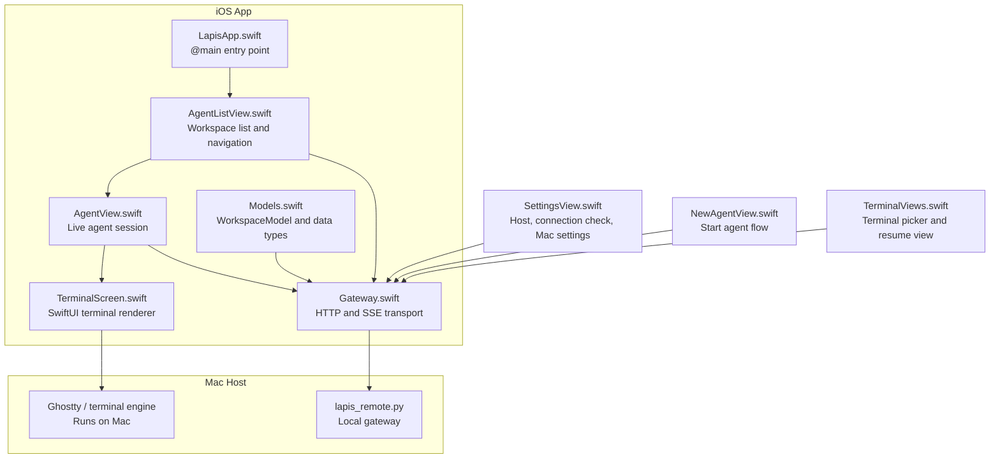
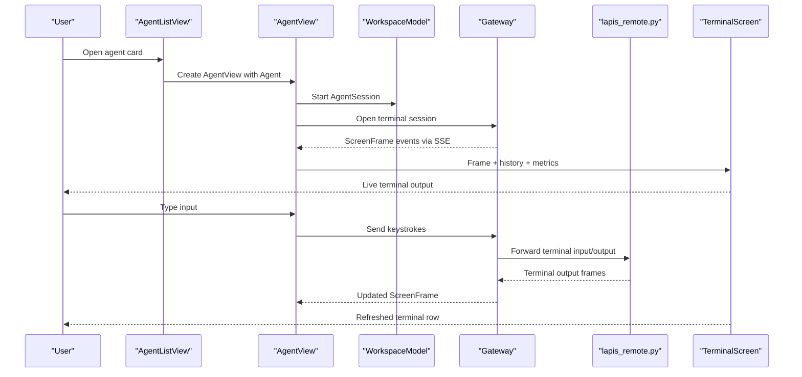
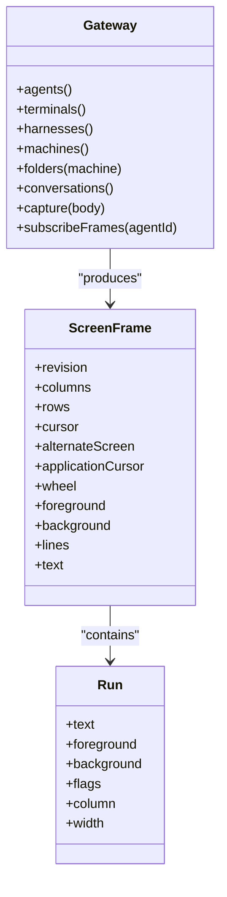
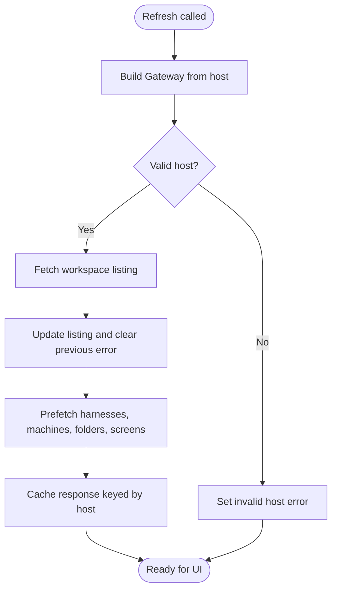
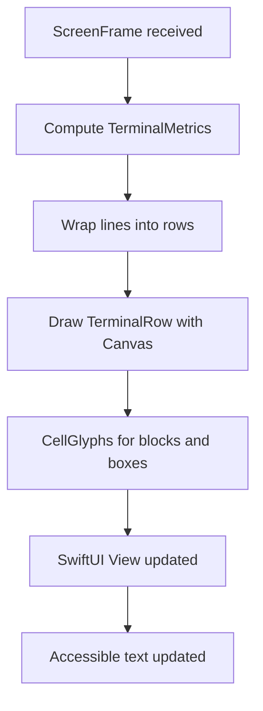
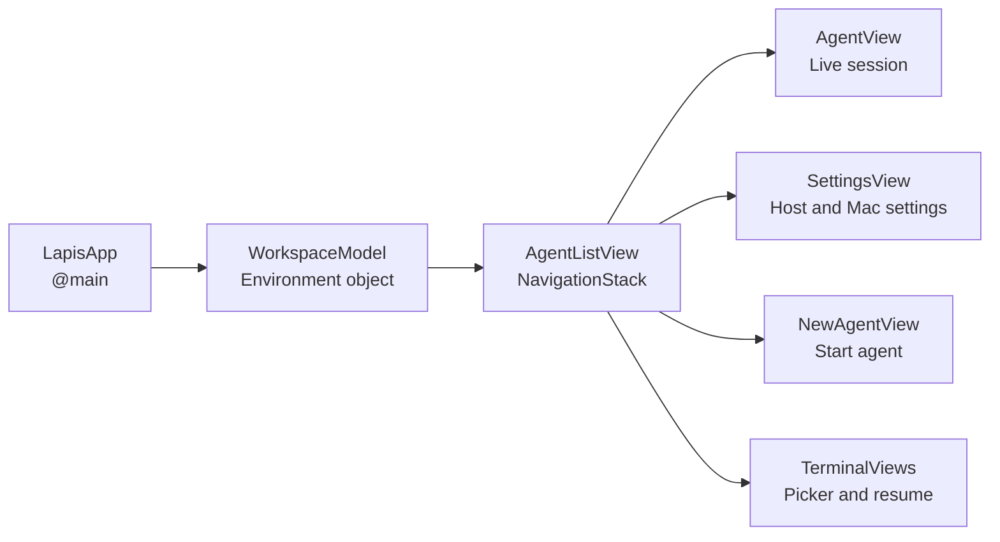
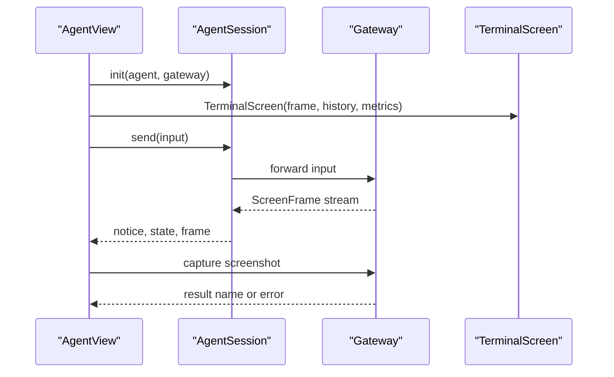
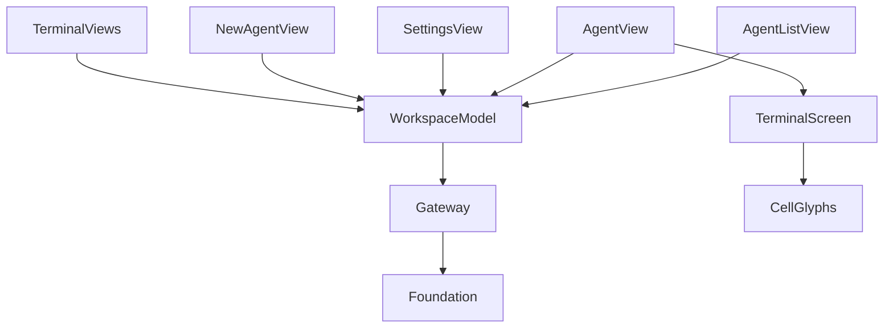

# iOS Preview Targets

<cite>
**Referenced Files in This Document**
- [Gateway.swift](file://apps/ios/Lapis/Gateway.swift)
- [Models.swift](file://apps/ios/Lapis/Models.swift)
- [TerminalScreen.swift](file://apps/ios/Lapis/TerminalScreen.swift)
- [LapisApp.swift](file://apps/ios/Lapis/LapisApp.swift)
- [AgentView.swift](file://apps/ios/Lapis/AgentView.swift)
- [AgentListView.swift](file://apps/ios/Lapis/AgentListView.swift)
- [TerminalViews.swift](file://apps/ios/Lapis/TerminalViews.swift)
- [SettingsView.swift](file://apps/ios/Lapis/SettingsView.swift)
- [NewAgentView.swift](file://apps/ios/Lapis/NewAgentView.swift)
- [CategoriesView.swift](file://apps/ios/Lapis/CategoriesView.swift)
- [FolderSearch.swift](file://apps/ios/Lapis/FolderSearch.swift)
- [CellGlyphs.swift](file://apps/ios/Lapis/CellGlyphs.swift)
- [Info.plist](file://apps/ios/Lapis/Info.plist)
- [project.yml](file://apps/ios/project.yml)
- [phone.md](file://docs/phone.md)
</cite>

## Table of Contents
1. [Introduction](#introduction)
2. [Project Structure](#project-structure)
3. [Core Components](#core-components)
4. [Architecture Overview](#architecture-overview)
5. [Detailed Component Analysis](#detailed-component-analysis)
6. [Dependency Analysis](#dependency-analysis)
7. [Performance Considerations](#performance-considerations)
8. [Troubleshooting Guide](#troubleshooting-guide)
9. [Conclusion](#conclusion)

## Introduction
This document explains the iOS preview targets that demonstrate remote agent connectivity to a local Lapis gateway running on a Mac. The iOS app is a SwiftUI application whose primary job is to:

- Connect to a Mac-hosted gateway over Tailscale or ZeroTier using plain HTTP inside an encrypted overlay.
- Mirror the workspace, agents, categories, terminals, and conversation history exposed by the gateway.
- Render live terminal output sent from the Mac’s terminal engine.
- Provide user flows for starting new agents, resuming conversations, opening quick shell terminals, and managing categories.

The implementation mirrors the Android client’s type-safety approach through Swift models that directly represent the gateway’s JSON payloads, while keeping network transport, state caching, and UI rendering in separate layers.

## Project Structure
The iOS preview code lives under `apps/ios`. It contains two main applications:

| Target | Purpose | Entry point | Key files |
|---|---|---|---|
| `Lapis` | Remote agent preview connected to a Mac gateway | `LapisApp.swift` | `Gateway.swift`, `Models.swift`, `AgentListView.swift`, `AgentView.swift`, `TerminalScreen.swift`, `TerminalViews.swift`, `SettingsView.swift`, `NewAgentView.swift`, `CategoriesView.swift`, `FolderSearch.swift`, `CellGlyphs.swift` |
| `UltraTab` | Read-only agent deck for iPhone with a simplified workflow | `UltraTabApp.swift` | `CardView.swift`, `Deck.swift`, `DeckGateway.swift`, `DeckView.swift` |

The Xcode project is generated by XcodeGen from `project.yml`. Both apps share the same gateway admission model: only devices owned by the Mac owner (Tailscale) or peers on the Mac’s ZeroTier networks may connect.

**Diagram sources**
- [LapisApp.swift:1-49](file://apps/ios/Lapis/LapisApp.swift#L1-L49)
- [AgentListView.swift:1-200](file://apps/ios/Lapis/AgentListView.swift#L1-L200)
- [AgentView.swift:1-200](file://apps/ios/Lapis/AgentView.swift#L1-L200)
- [TerminalScreen.swift:1-200](file://apps/ios/Lapis/TerminalScreen.swift#L1-L200)
- [Gateway.swift:1-200](file://apps/ios/Lapis/Gateway.swift#L1-L200)
- [Models.swift:1-200](file://apps/ios/Lapis/Models.swift#L1-L200)

**Section sources**
- [project.yml:1-153](file://apps/ios/project.yml#L1-L153)
- [phone.md:1-130](file://docs/phone.md#L1-L130)

## Core Components
The iOS preview is built around four core responsibilities:

1. **Gateway transport:** HTTP requests and Server-Sent Events streams to the Mac gateway.
2. **Workspace model:** A MainActor observable state manager that caches listings, harnesses, machines, folders, and screen frames.
3. **Terminal rendering:** SwiftUI drawing of rows, runs, cell glyphs, scrolling history, and live frame updates.
4. **UI composition:** SwiftUI views for the agent list, agent session, settings, new-agent flow, terminal picker, and category management.

These components are intentionally layered so that network logic does not leak into SwiftUI, and SwiftUI does not parse raw JSON.

**Section sources**
- [Gateway.swift:1-200](file://apps/ios/Lapis/Gateway.swift#L1-L200)
- [Models.swift:1-200](file://apps/ios/Lapis/Models.swift#L1-L200)
- [TerminalScreen.swift:1-200](file://apps/ios/Lapis/TerminalScreen.swift#L1-L200)
- [LapisApp.swift:1-49](file://apps/ios/Lapis/LapisApp.swift#L1-L49)

## Architecture Overview
At runtime, the iOS app follows this sequence when displaying an agent:

**Diagram sources**
- [AgentListView.swift:1-200](file://apps/ios/Lapis/AgentListView.swift#L1-L200)
- [AgentView.swift:1-200](file://apps/ios/Lapis/AgentView.swift#L1-L200)
- [Gateway.swift:1-200](file://apps/ios/Lapis/Gateway.swift#L1-L200)
- [TerminalScreen.swift:1-200](file://apps/ios/Lapis/TerminalScreen.swift#L1-L200)

## Detailed Component Analysis

### Gateway Transport Layer
`Gateway.swift` defines the data structures exchanged with the Mac gateway and exposes methods for listing agents, fetching harness configuration, enumerating SSH machines, loading folder catalogs, capturing screenshots, and subscribing to live terminal frames.

Key responsibilities:

- **Data modeling:** Types such as `WorkspaceListing`, `AgentCategory`, `Agent`, `Harness`, `ModelChoice`, `AgentMode`, `AgentDefaults`, `NewAgent`, `TerminalInfo`, `Conversation`, `Machine`, `FrequentFolder`, `FolderPayload`, `MacSettings`, `StartedAgent`, `ScreenFrame`, and `Run` mirror the gateway’s JSON contract.
- **HTTP transport:** The gateway is constructed from a host string and used by higher-level components to call endpoints like agents, terminals, harnesses, machines, folder catalogs, conversations, and captures.
- **SSE integration:** Live terminal output arrives as `ScreenFrame` objects containing grid dimensions, cursor state, colors, and styled text runs.
- **Error surface:** Errors are propagated up to `WorkspaceModel`, which surfaces them as UI notices rather than crashing the app.

**Diagram sources**
- [Gateway.swift:1-200](file://apps/ios/Lapis/Gateway.swift#L1-L200)

Important behaviors:

- Plain HTTP is acceptable because traffic goes through Tailscale or ZeroTier; ATS exceptions allow local networking and `.ts.net` domains.
- Older gateways may omit optional fields such as version, machine names, folder activity, or wheel support. The iOS side handles missing data gracefully.
- The gateway is trusted per configured host; it does not implement its own authentication beyond the network-layer admission controlled by Tailscale or ZeroTier.

**Section sources**
- [Gateway.swift:1-200](file://apps/ios/Lapis/Gateway.swift#L1-L200)
- [project.yml:1-153](file://apps/ios/project.yml#L1-L153)
- [Info.plist:1-56](file://apps/ios/Lapis/Info.plist#L1-L56)
- [phone.md:1-130](file://docs/phone.md#L1-L130)

### Workspace Model and Data Structures
`Models.swift` implements the Android-style type safety pattern by defining Swift structs that correspond one-to-one with the gateway’s JSON schema. It also provides `WorkspaceModel`, a `@MainActor @Observable` state container.

Highlights:

- **Type-safe payload mapping:** All JSON responses are represented as decodable structs, including agents, categories, harnesses, modes, folder catalogs, and terminal frames.
- **State ownership:** `WorkspaceModel` owns the gateway host, workspace listing, errors, cached catalog data, machines, terminals, and Mac settings.
- **Background prefetching:** After refreshing the agent listing, the model prefetches harness defaults, SSH machines, recent folder catalogs, and screen frames so the UI can open agents quickly.
- **Caching strategy:** Disk-backed cache entries are keyed by a digest of the gateway host, so data from different Macs does not collide.
- **Versioned refreshes:** When the gateway supports waiting for changes, the app uses `after` semantics to keep the listing current without polling aggressively.

**Diagram sources**
- [Models.swift:1-200](file://apps/ios/Lapis/Models.swift#L1-L200)

The model also constructs a `DiskCache` instance and restores previously cached state immediately, improving perceived responsiveness when switching hosts or reopening the app.

**Section sources**
- [Models.swift:1-200](file://apps/ios/Lapis/Models.swift#L1-L200)

### Terminal Rendering
`TerminalScreen.swift` renders terminal output produced by the Mac’s terminal engine. The phone does not run the terminal; it draws cells based on received `ScreenFrame` data.

Rendering pipeline:

1. `TerminalMetrics` computes monospaced font size, cell width, line height, and the number of columns and rows that fit the device size.
2. `TerminalRow` draws each row using SwiftUI’s `Canvas`. It fills background spans, handles cursor inversion, applies style flags, and delegates special block characters and box-drawing glyphs to `CellGlyphs`.
3. `TerminalScreen` manages history pages, live frame merging, accessibility text, wrapping for narrow phones, and navigation across older output.
4. `CellGlyphs.swift` draws Unicode block elements and box-drawing characters as precise rectangles and paths so borders join cleanly across rows and columns.

**Diagram sources**
- [TerminalScreen.swift:1-200](file://apps/ios/Lapis/TerminalScreen.swift#L1-L200)
- [CellGlyphs.swift:1-162](file://apps/ios/Lapis/CellGlyphs.swift#L1-L162)

Special handling includes:

- Emoji-capable text characters are forced to non-emoji presentation where needed so they occupy exactly one cell.
- Background colors span full row height so shaded blocks join without seams between rows.
- History navigation loads older pages while preserving live scrolling behavior.
- Full-screen programs use wheel events instead of scrolling the archive.

**Section sources**
- [TerminalScreen.swift:1-200](file://apps/ios/Lapis/TerminalScreen.swift#L1-L200)
- [CellGlyphs.swift:1-162](file://apps/ios/Lapis/CellGlyphs.swift#L1-L162)

### SwiftUI Integration and App Entry Point
`LapisApp.swift` is the `@main` entry point. It creates a single `WorkspaceModel`, injects it into the SwiftUI environment, sets dark mode, and applies a consistent accent color.

The top-level view is `AgentListView`, which drives:

- Workspace listing refresh.
- Navigation to agent sessions.
- Sheets for new agents, resumed conversations, quick terminals, and settings.
- Category management.

**Diagram sources**
- [LapisApp.swift:1-49](file://apps/ios/Lapis/LapisApp.swift#L1-L49)
- [AgentListView.swift:1-200](file://apps/ios/Lapis/AgentListView.swift#L1-L200)

Lifecycle considerations:

- The app keeps the agent list alive and active while on screen and in the foreground.
- Agent sessions close when the app backgrounds and reopen when it becomes active again.
- Keyboard appearance adjusts terminal height but preserves column count when possible.
- Theme colors and harness-specific accents are centralized.

**Section sources**
- [LapisApp.swift:1-49](file://apps/ios/Lapis/LapisApp.swift#L1-L49)
- [AgentView.swift:1-200](file://apps/ios/Lapis/AgentView.swift#L1-L200)
- [AgentListView.swift:1-200](file://apps/ios/Lapis/AgentListView.swift#L1-L200)

### Agent Session Flow
`AgentView` owns an `AgentSession` tied to a specific `Agent`. It handles:

- Opening, resizing, and closing the terminal session.
- Sending typed input back to the gateway.
- Rendering the live terminal screen.
- Handling wheel input for full-screen programs.
- Capturing a screenshot plus exact frame data for debugging.
- Managing background lifecycle and keyboard geometry.

**Diagram sources**
- [AgentView.swift:1-200](file://apps/ios/Lapis/AgentView.swift#L1-L200)
- [Gateway.swift:1-200](file://apps/ios/Lapis/Gateway.swift#L1-L200)

**Section sources**
- [AgentView.swift:1-200](file://apps/ios/Lapis/AgentView.swift#L1-L200)

### Quick Terminals and Conversation Resume
`TerminalViews.swift` provides:

- `TerminalPickerView`: pick the Mac or an SSH machine and open a plain shell terminal.
- `ResumeView`: search and resume past Claude or Codex conversations from the Mac.

Both views depend on `WorkspaceModel.gateway` and present progress, errors, and confirmation flows.

**Section sources**
- [TerminalViews.swift:1-200](file://apps/ios/Lapis/TerminalViews.swift#L1-L200)

### Settings and Host Configuration
`SettingsView.swift` lets users:

- Enter a Tailscale name or ZeroTier address.
- Test connectivity to the gateway.
- Adjust terminal text size.
- Browse categories.
- Toggle Mac-side preferences such as keep-awake, alert sounds, finish sounds, background notifications, and usage display.

It binds changes to `MacSettings` and persists them through the gateway to the Mac’s `lapis.json`.

**Section sources**
- [SettingsView.swift:1-149](file://apps/ios/Lapis/SettingsView.swift#L1-L149)

### New Agent Flow
`NewAgentView.swift` guides the user through:

- Choosing a machine (this Mac or SSH target).
- Selecting a harness.
- Selecting a model and approval mode.
- Choosing a category.
- Picking or searching a folder.
- Starting the agent and navigating to it once launched.

It relies on prefetched `harnesses`, `machines`, and `FolderCatalog` data so the sheet does not wait on the network until the user taps Start.

**Section sources**
- [NewAgentView.swift:1-200](file://apps/ios/Lapis/NewAgentView.swift#L1-L200)

### Categories and Folder Search
`CategoriesView.swift` allows reordering, renaming, adding, and removing categories. Deletions and moves are optimistic and reconciled against the Mac’s workspace listing.

`FolderSearch.swift` builds an in-memory `FolderCatalog` from the gateway’s folder payload, enabling fast fuzzy search and hierarchical browsing on the device without repeated network calls.

**Section sources**
- [CategoriesView.swift:1-124](file://apps/ios/Lapis/CategoriesView.swift#L1-L124)
- [FolderSearch.swift:1-138](file://apps/ios/Lapis/FolderSearch.swift#L1-L138)

## Dependency Analysis
The iOS preview has a clear dependency direction:

- Views depend on `WorkspaceModel`.
- `WorkspaceModel` depends on `Gateway`.
- `Gateway` depends on Foundation networking and JSON decoding.
- Terminal rendering depends on `ScreenFrame` and `Run` from the gateway model layer.
- `CellGlyphs` is a pure rendering helper with no network or state dependencies.

**Diagram sources**
- [AgentListView.swift:1-200](file://apps/ios/Lapis/AgentListView.swift#L1-L200)
- [AgentView.swift:1-200](file://apps/ios/Lapis/AgentView.swift#L1-L200)
- [SettingsView.swift:1-149](file://apps/ios/Lapis/SettingsView.swift#L1-L149)
- [NewAgentView.swift:1-200](file://apps/ios/Lapis/NewAgentView.swift#L1-L200)
- [TerminalViews.swift:1-200](file://apps/ios/Lapis/TerminalViews.swift#L1-L200)
- [Models.swift:1-200](file://apps/ios/Lapis/Models.swift#L1-L200)
- [Gateway.swift:1-200](file://apps/ios/Lapis/Gateway.swift#L1-L200)
- [TerminalScreen.swift:1-200](file://apps/ios/Lapis/TerminalScreen.swift#L1-L200)
- [CellGlyphs.swift:1-162](file://apps/ios/Lapis/CellGlyphs.swift#L1-L162)

Potential coupling concerns:

- `WorkspaceModel` centralizes many responsibilities (host management, caching, prefetching, settings). Future refactors could split out a dedicated session manager for live terminal connections.
- `AgentView` owns both session lifecycle and some screenshot capture logic; this is acceptable for a preview but could be extracted if screenshot handling grows.

No circular dependencies were identified among the analyzed files.

**Section sources**
- [Models.swift:1-200](file://apps/ios/Lapis/Models.swift#L1-L200)
- [Gateway.swift:1-200](file://apps/ios/Lapis/Gateway.swift#L1-L200)
- [AgentView.swift:1-200](file://apps/ios/Lapis/AgentView.swift#L1-L200)

## Performance Considerations

### Network and Caching
- Workspace listing refresh uses waiting semantics when supported by the gateway, reducing polling overhead.
- Prefetch runs after listing refresh and fetches frequently used data: harness defaults, machines, recent folder catalogs, and screen frames.
- Catalogs are versioned and only downloaded when changed.
- Disk cache keys include a hash of the gateway host to avoid cross-machine pollution.

### Terminal Rendering
- Rendering uses SwiftUI `Canvas` and precomputed metrics to minimize layout churn.
- Background spans are drawn at row height to avoid visual seams.
- Special Unicode block and box-drawing characters are drawn as paths rather than relying solely on fonts, improving fidelity.
- History is paginated and wrapped to phone width, reducing memory pressure compared to holding every character as a full-width row.

### Memory Management for Long Sessions
- Terminal frames arrive incrementally; the renderer merges live frames with immutable history pages.
- `HistoryCache` rebuilds only when page IDs or width change.
- Agent sessions close when the app backgrounds and reopen on return, limiting long-lived connections during inactivity.
- Screenshot capture is event-driven and not part of the normal render loop.

### Background Task Limitations
- iOS suspends or terminates background work when the app is inactive. The app avoids assuming long-running background SSE streams.
- Instead, it closes sessions on background and reopens them when the app becomes active.
- The gateway connection itself remains lightweight until a terminal session is opened.

[No sources needed since this section provides general guidance derived from the analyzed files]

## Troubleshooting Guide

### Cannot Connect to the Gateway
Common causes:

- The host field points to an unreachable Tailscale name or ZeroTier address.
- The iOS device is not signed into the same Tailscale account or not joined to the Mac’s ZeroTier network.
- ATS blocks plain HTTP to unexpected domains.
- The Mac gateway is not running.

Actions:

- Use Settings to enter the correct gateway host and tap Check Connection.
- Verify Tailscale or ZeroTier status on both devices.
- Confirm the gateway log exists and shows expected activity.
- Ensure the Xcode-generated project includes ATS configuration for local networking and `.ts.net`.

**Section sources**
- [SettingsView.swift:1-149](file://apps/ios/Lapis/SettingsView.swift#L1-L149)
- [project.yml:1-153](file://apps/ios/project.yml#L1-L153)
- [Info.plist:1-56](file://apps/ios/Lapis/Info.plist#L1-L56)
- [phone.md:1-130](file://docs/phone.md#L1-L130)

### Terminal Output Looks Incorrect
Possible issues:

- Font size is too small or too large.
- Block characters or box-drawing glyphs do not align.
- Emoji-style characters take two cells.
- Rotation or keyboard changes resized the terminal unexpectedly.

Actions:

- Adjust text size in Settings or within the agent menu.
- Inspect captured screenshots and frame data using “Send screen to Mac”.
- Check whether the agent is running in full-screen mode, which scrolls the program itself rather than the archive.

**Section sources**
- [TerminalScreen.swift:1-200](file://apps/ios/Lapis/TerminalScreen.swift#L1-L200)
- [CellGlyphs.swift:1-162](file://apps/ios/Lapis/CellGlyphs.swift#L1-L162)
- [AgentView.swift:1-200](file://apps/ios/Lapis/AgentView.swift#L1-L200)

### Agent Fails to Start or Resume
Likely reasons:

- No harness found on the selected machine.
- Folder path is invalid or unavailable.
- Category selection is empty.
- The Mac requires lapis to be running or the login helper installed.

Actions:

- Verify harness availability in the new-agent flow.
- Choose a valid folder from the frequent or browsed lists.
- Confirm the Mac’s lapis service is installed and running.
- Review notices surfaced by `WorkspaceModel`.

**Section sources**
- [NewAgentView.swift:1-200](file://apps/ios/Lapis/NewAgentView.swift#L1-L200)
- [phone.md:1-130](file://docs/phone.md#L1-L130)

### Category Changes Do Not Persist
Expected behavior:

- Moves, renames, and deletions are optimistic and applied locally before the gateway confirms them.
- If the Mac rejects a change, a notice appears through `MacNotice`.

Actions:

- Wait for the next refresh cycle.
- Check the workspace error message.
- Reorder or rename again if necessary.

**Section sources**
- [CategoriesView.swift:1-124](file://apps/ios/Lapis/CategoriesView.swift#L1-L124)

## Conclusion
The iOS preview targets provide a focused, type-safe interface to a Mac-hosted Lapis gateway. The architecture separates transport (`Gateway.swift`), state (`Models.swift`), rendering (`TerminalScreen.swift` and `CellGlyphs.swift`), and SwiftUI composition (`LapisApp.swift`, `AgentListView.swift`, `AgentView.swift`, and supporting views). 

For development:

- Generate the Xcode project with `xcodegen` in `apps/ios`.
- Configure your default gateway host and signing identity through XcodeGen config.
- Install and run the Mac gateway before testing on a simulator or physical device.
- Prefer Tailscale or ZeroTier for secure access, and rely on ATS configuration for plain HTTP inside those overlays.
- Treat long-running terminal sessions as foreground-only on iOS and expect session reopen behavior after backgrounding.

This design mirrors the Android client’s commitment to strict data contracts while adapting to iOS constraints around networking, background execution, and SwiftUI rendering.