# Attention Tracking System

<cite>
**Referenced Files in This Document**
- [attention.hpp](file://services/session/include/lapis/session/attention.hpp)
- [attention_journal.hpp](file://services/session/src/attention_journal.hpp)
- [attention_journal.cpp](file://services/session/src/attention_journal.cpp)
- [attention_audit.hpp](file://services/session/src/attention_audit.hpp)
- [attention_audit.cpp](file://services/session/src/attention_audit.cpp)
- [attention_protocol.hpp](file://services/session/src/transport/attention_protocol.hpp)
- [attention_protocol.cpp](file://services/session/src/transport/attention_protocol.cpp)
- [attention.cpp](file://services/session/src/attention.cpp)
- [attention_view.cpp](file://apps/desktop/src/attention_view.cpp)
- [tab_ranker.hpp](file://apps/desktop/src/tab_ranker.hpp)
- [tab_ranker.cpp](file://apps/desktop/src/tab_ranker.cpp)
- [alerts.hpp](file://apps/desktop/src/alerts.hpp)
- [alerts.cpp](file://apps/desktop/src/alerts.cpp)
- [interaction_recorder.hpp](file://apps/desktop/src/interaction_recorder.hpp)
- [interaction_recorder.cpp](file://apps/desktop/src/interaction_recorder.cpp)
- [architecture.md](file://docs/architecture.md)
</cite>

## Table of Contents
1. [Introduction](#introduction)
2. [Project Structure](#project-structure)
3. [Core Components](#core-components)
4. [Architecture Overview](#architecture-overview)
5. [Detailed Component Analysis](#detailed-component-analysis)
6. [Dependency Analysis](#dependency-analysis)
7. [Performance Considerations](#performance-considerations)
8. [Troubleshooting Guide](#troubleshooting-guide)
9. [Conclusion](#conclusion)

## Introduction
This document explains the attention tracking system that normalizes agent interactions across different agent adapters and presents them consistently to users. The system separates three concerns:

- **Protocol normalization**: Agent-specific prompts, responses, tool calls, approvals, and rejections are mapped into a shared event model.
- **Durable audit trail**: Every user question and its outcome is recorded in an append-only journal with crash-safe recovery.
- **Attention ranking and notification**: Desktop components decide which sessions need immediate attention, rank candidates, and deliver alerts and notifications based on user preferences.

The service-side state machine validates source epochs, revisions, aging, and limits. The desktop side consumes normalized snapshots, renders pending requests, and logs human decisions for policy and usability analysis.

## Project Structure
The attention tracking system spans two main areas:

| Area | Responsibility | Key files |
| --- | --- | --- |
| Session service protocol | Normalized request types, state transitions, durability, and wire encoding | `services/session/include/lapis/session/attention.hpp`, `services/session/src/attention.cpp`, `services/session/src/attention_journal.{hpp,cpp}`, `services/session/src/attention_audit.{hpp,cpp}`, `services/session/src/transport/attention_protocol.{hpp,cpp}` |
| Desktop presentation and alerting | Request display, attention eligibility, ranking, chimes, and notifications | `apps/desktop/src/attention_view.cpp`, `apps/desktop/src/tab_ranker.{hpp,cpp}`, `apps/desktop/src/alerts.{hpp,cpp}`, `apps/desktop/src/interaction_recorder.{hpp,cpp}` |
| Product architecture context | Ownership boundaries and production priorities | `docs/architecture.md` |

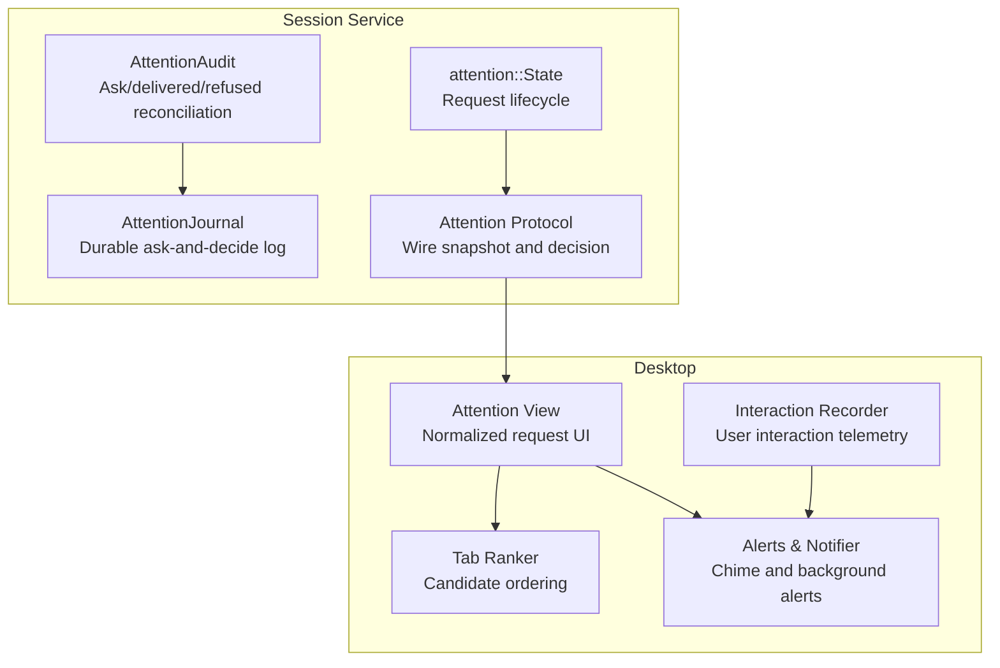

**Diagram sources**
- [attention.hpp:1-136](file://services/session/include/lapis/session/attention.hpp#L1-L136)
- [attention_journal.hpp:1-99](file://services/session/src/attention_journal.hpp#L1-L99)
- [attention_audit.hpp:1-51](file://services/session/src/attention_audit.hpp#L1-L51)
- [attention_protocol.hpp:1-41](file://services/session/src/transport/attention_protocol.hpp#L1-L41)
- [attention_view.cpp:1-200](file://apps/desktop/src/attention_view.cpp#L1-L200)
- [tab_ranker.hpp:1-134](file://apps/desktop/src/tab_ranker.hpp#L1-L134)
- [alerts.hpp:1-200](file://apps/desktop/src/alerts.hpp#L1-L200)
- [interaction_recorder.hpp:1-181](file://apps/desktop/src/interaction_recorder.hpp#L1-L181)

**Section sources**
- [attention.hpp:1-136](file://services/session/include/lapis/session/attention.hpp#L1-L136)
- [attention_journal.hpp:1-99](file://services/session/src/attention_journal.hpp#L1-L99)
- [attention_audit.hpp:1-51](file://services/session/src/attention_audit.hpp#L1-L51)
- [attention_protocol.hpp:1-41](file://services/session/src/transport/attention_protocol.hpp#L1-L41)
- [attention_view.cpp:1-200](file://apps/desktop/src/attention_view.cpp#L1-L200)
- [tab_ranker.hpp:1-134](file://apps/desktop/src/tab_ranker.hpp#L1-L134)
- [alerts.hpp:1-200](file://apps/desktop/src/alerts.hpp#L1-L200)
- [interaction_recorder.hpp:1-181](file://apps/desktop/src/interaction_recorder.hpp#L1-L181)
- [architecture.md:1-165](file://docs/architecture.md#L1-L165)

## Core Components
The attention system is built around five core components:

| Component | Purpose | Important behaviors |
| --- | --- | --- |
| `attention::State` | Central state machine for one source connection | Validates epochs, sequence, revisions, aging, pending/retired limits, blocking behavior, snoozes, acknowledgements, and ordered delivery. |
| `attention::Request` / `Pending` | Normalized event shape | Identifies thread, turn, item, reason, summary, choices, priority, arrival time, submission status, and source identity. |
| `AttentionJournal` | Durable audit trail | Append-only records with CRC-checked records, rotation, exclusive writer lock, replay, and open-question handling. |
| `AttentionAudit` | Policy reconciliation | Maps service state to journal entries for asked, decided, delivered, refused, and resolved events. |
| Wire `AttentionSnapshot` / `AttentionDecision` | Cross-process protocol | Bounded JSON payload carrying attachment identity, activity, observation phase, requests, and user decisions. |

**Section sources**
- [attention.hpp:1-136](file://services/session/include/lapis/session/attention.hpp#L1-L136)
- [attention_journal.hpp:1-99](file://services/session/src/attention_journal.hpp#L1-L99)
- [attention_audit.hpp:1-51](file://services/session/src/attention_audit.hpp#L1-L51)
- [attention_protocol.hpp:1-41](file://services/session/src/transport/attention_protocol.hpp#L1-L41)

## Architecture Overview
The attention flow has four stages:

1. **Event capture**: Agent adapters observe prompts, tool calls, approvals, or rejections and produce normalized requests.
2. **State validation**: `attention::State` enforces epoch monotonicity, sequence gaps, pending limits, retired ID reuse rules, and revision exhaustion.
3. **Durable recording**: `AttentionAudit` records asks and intended decisions; `AttentionJournal` guarantees crash-safe persistence and recovery.
4. **Presentation and alerting**: The desktop receives `AttentionSnapshot`, filters observation-only idle notices, displays actionable requests, ranks candidates, and emits alerts.

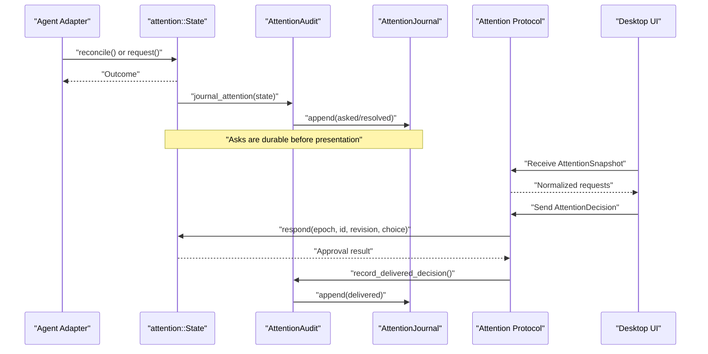

**Diagram sources**
- [attention.cpp:1-200](file://services/session/src/attention.cpp#L1-L200)
- [attention_audit.cpp:1-82](file://services/session/src/attention_audit.cpp#L1-L82)
- [attention_protocol.cpp:1-200](file://services/session/src/transport/attention_protocol.cpp#L1-L200)
- [attention_view.cpp:1-200](file://apps/desktop/src/attention_view.cpp#L1-L200)

## Detailed Component Analysis

### Attention Event Model
The normalized event model unifies heterogeneous agent interactions:

| Field | Meaning |
| --- | --- |
| `id` | Stable request identifier, either numeric or string. |
| `thread_id` | Conversation or execution thread. |
| `turn_id` | Turn boundary within the session. |
| `item_id` | Item-level identity inside a turn. |
| `reason` | Human-readable reason for attention. |
| `summary` | Short summary of the action or decision. |
| `choices` | Allowed options; empty means observation-only notice. |
| `priority` | Priority from zero through three, used by aging and ranking. |
| `status` | Pending, responding, or stale. |
| `submitted` | Whether the desktop already sent a decision. |
| `source_epoch` | Source connection identity for replay and deduplication. |
| `revision` | Revision assigned by the state machine. |

Special cases include:

- **Idle notice**: An observation-only notice after a finished turn carries a specific idle reason and no choices.
- **Blocking**: Decision-capable and stale requests block new input; synchronized observation-only idle notices do not.
- **Aging**: Requests have arrival and scheduling timestamps that allow older items to outrank newer ones over time.

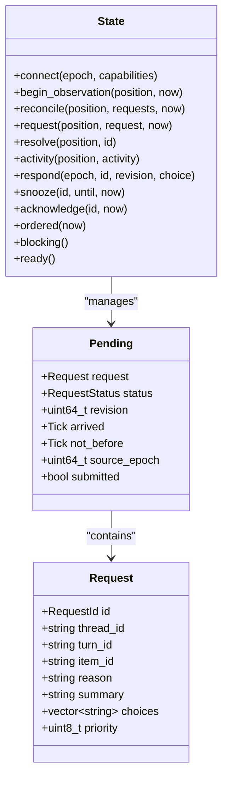

**Diagram sources**
- [attention.hpp:1-136](file://services/session/include/lapis/session/attention.hpp#L1-L136)
- [attention.cpp:1-200](file://services/session/src/attention.cpp#L1-L200)

**Section sources**
- [attention.hpp:1-136](file://services/session/include/lapis/session/attention.hpp#L1-L136)
- [attention.cpp:1-200](file://services/session/src/attention.cpp#L1-L200)

### Attention Journal
The attention journal is a durable, append-only audit trail. Its design emphasizes recoverability rather than fast random access:

- Each entry has a kind: asked, decided, resolved, or delivered.
- Entries record epoch, revision, request ID, choice, origin, and optionally the full request.
- Records are serialized with CRC verification and bounded field sizes.
- Journals rotate when they exceed a configurable byte threshold, but only when no question is open.
- Recovery replays records in bounded chunks, truncates torn tails, and keeps dense sequence numbers.
- Open questions are detected by matching IDs, epochs, and revisions across asked, resolved, and delivered records.

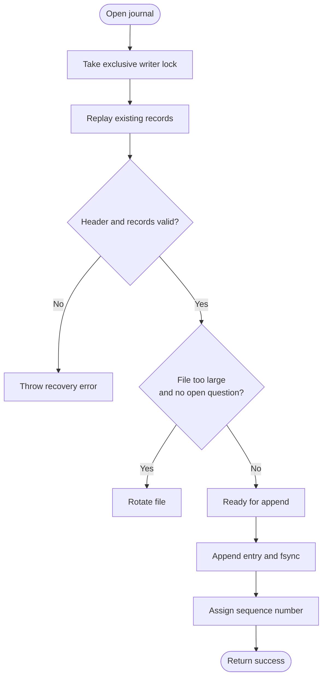

**Diagram sources**
- [attention_journal.hpp:1-99](file://services/session/src/attention_journal.hpp#L1-L99)
- [attention_journal.cpp:1-200](file://services/session/src/attention_journal.cpp#L1-L200)

**Section sources**
- [attention_journal.hpp:1-99](file://services/session/src/attention_journal.hpp#L1-L99)
- [attention_journal.cpp:1-200](file://services/session/src/attention_journal.cpp#L1-L200)

### Attention Audit
The audit layer bridges normalized state and durable journal entries:

- `journal_attention` scans pending requests, records new or re-derived asks, and writes resolved entries for requests no longer present.
- `record_intended_decision` validates that the decision matches the current ready state, epoch, revision, pending status, and allowed choice before writing a decided entry.
- `record_delivered_decision` confirms adapter acceptance.
- `record_refused_decision` compensates for locally valid decisions the adapter could not deliver, closing the ask without implying approval.

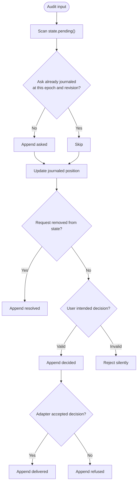

**Diagram sources**
- [attention_audit.hpp:1-51](file://services/session/src/attention_audit.hpp#L1-L51)
- [attention_audit.cpp:1-82](file://services/session/src/attention_audit.cpp#L1-L82)

**Section sources**
- [attention_audit.hpp:1-51](file://services/session/src/attention_audit.hpp#L1-L51)
- [attention_audit.cpp:1-82](file://services/session/src/attention_audit.cpp#L1-L82)

### Attention Protocol
The wire protocol standardizes how service-side attention reaches the desktop:

- `AttentionSnapshot` carries attachment identity, availability, connection readiness, activity, observation phase, diagnostics, and a list of normalized requests.
- `AttentionDecision` carries the source epoch, request ID, revision, chosen option, and optional answers.
- Message sizes are bounded, UTF-8 strings are validated, JSON metadata is round-trip verified, and duplicate request IDs in a snapshot are rejected.
- The observation phase supports backward compatibility: legacy clients receive the existing snapshot body, while negotiated clients also see the trailing phase byte.

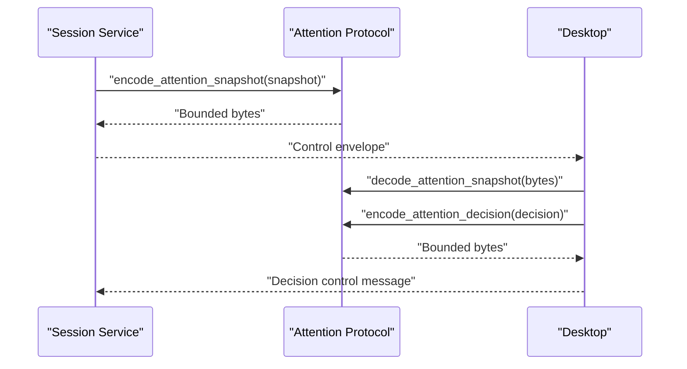

**Diagram sources**
- [attention_protocol.hpp:1-41](file://services/session/src/transport/attention_protocol.hpp#L1-L41)
- [attention_protocol.cpp:1-200](file://services/session/src/transport/attention_protocol.cpp#L1-L200)

**Section sources**
- [attention_protocol.hpp:1-41](file://services/session/src/transport/attention_protocol.hpp#L1-L41)
- [attention_protocol.cpp:1-200](file://services/session/src/transport/attention_protocol.cpp#L1-L200)

### Desktop Attention View
The desktop attention view translates normalized protocol data into UI tokens, status labels, and request lists:

- It derives stable tokens from session identity, generation, source epoch, revision, and request ID.
- Idle notices are filtered out because they do not require user action.
- Eligible requests must be connected, ready, pending, not yet submitted, and have non-empty choices.
- Status labels distinguish connecting, disconnected, working, idle, waiting, finished, ended, and unavailable states.
- When the connection becomes invalid, pending requests are marked stale and a diagnostic is shown.

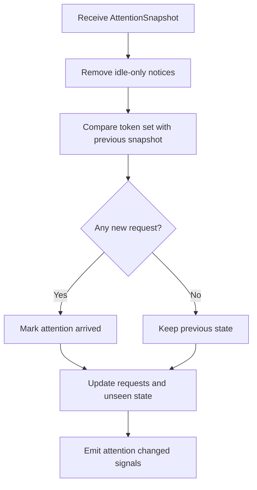

**Diagram sources**
- [attention_view.cpp:1-200](file://apps/desktop/src/attention_view.cpp#L1-L200)
- [attention_protocol.hpp:1-41](file://services/session/src/transport/attention_protocol.hpp#L1-L41)

**Section sources**
- [attention_view.cpp:1-200](file://apps/desktop/src/attention_view.cpp#L1-L200)

### Ranking Algorithms
Ranking determines which sessions deserve immediate attention. There are two related systems:

1. **Service-side aging and blocking**:
   - `State::ordered` returns pending requests in delivery order.
   - `State::blocking` prevents new input when authoritative or stale requests are waiting, except for synchronized observation-only idle notices.
   - `Limits` controls pending count, retired count, aging interval, and cooldown delay.

2. **Desktop Tab Ranker**:
   - Produces candidate features such as work category, request presence, unseen turns, guess availability, wait duration, staleness, recent turns, and time since last turn.
   - Supports plain, learned, and fixed ranking modes.
   - Learned mode fits a regularized linear softmax model to recorded human choices.
   - Fixed mode prioritizes overdue work, then categories, requests, unseen turns, and newest sessions.
   - Plain mode applies an overdue threshold and conventional ordering.

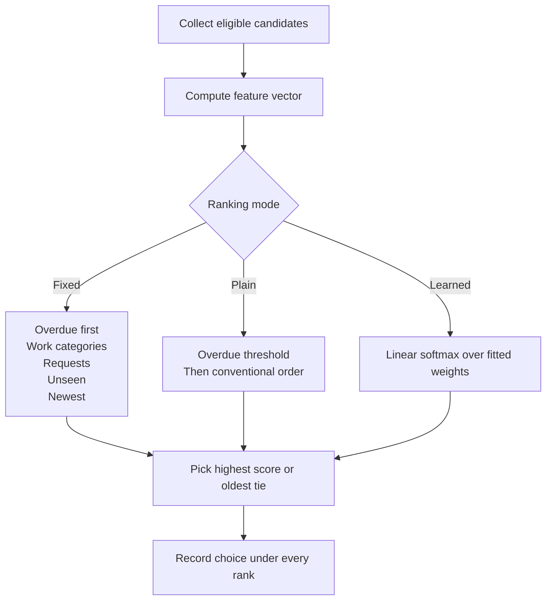

**Diagram sources**
- [tab_ranker.hpp:1-134](file://apps/desktop/src/tab_ranker.hpp#L1-L134)
- [tab_ranker.cpp:1-200](file://apps/desktop/src/tab_ranker.cpp#L1-L200)
- [attention.hpp:1-136](file://services/session/include/lapis/session/attention.hpp#L1-L136)

**Section sources**
- [attention.hpp:1-136](file://services/session/include/lapis/session/attention.hpp#L1-L136)
- [tab_ranker.hpp:1-134](file://apps/desktop/src/tab_ranker.hpp#L1-L134)
- [tab_ranker.cpp:1-200](file://apps/desktop/src/tab_ranker.cpp#L1-L200)

### Real-Time Notification Delivery
Notifications and alerts operate at two levels:

- **Chime-based foreground alerts**: `Alerts` plays sounds, suppresses rapid repeats, and distinguishes between “needs you” and “finished” cues. It integrates with `SeenScreens` to avoid repeating alerts for unchanged terminal screens.
- **Background notifications**: `Notifier` posts system-style notifications when the user is away or not looking at the relevant agent, including reminders after a configured period.

Key configuration points:

- Repeat intervals and quiet periods are configurable.
- Chime selection can be customized.
- Presence detection affects whether reminders wait for the user to return.
- Screen fingerprints ignore terminal borders and status lines to reduce false positives.
- Finished turns may be judged by `PingJudge`, allowing quieter handling for steer or informational outcomes.

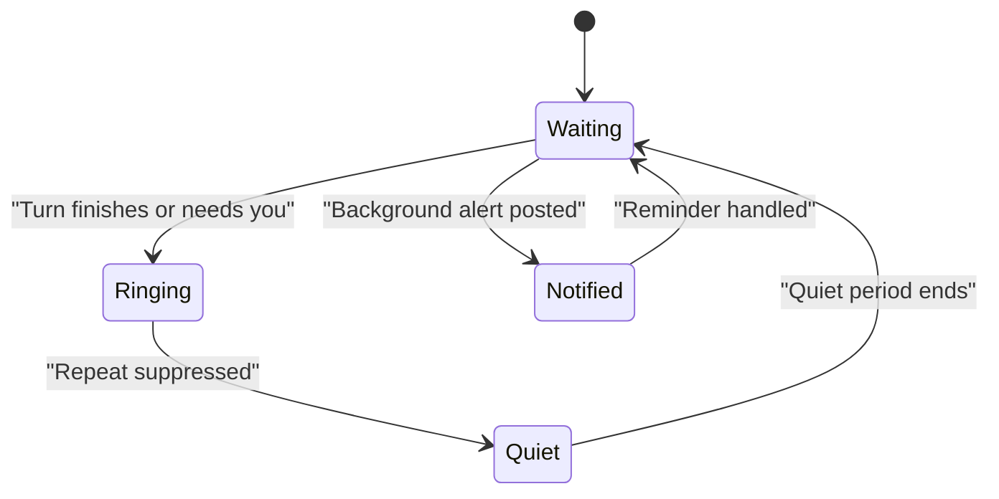

**Diagram sources**
- [alerts.hpp:1-200](file://apps/desktop/src/alerts.hpp#L1-L200)
- [alerts.cpp:1-200](file://apps/desktop/src/alerts.cpp#L1-L200)

**Section sources**
- [alerts.hpp:1-200](file://apps/desktop/src/alerts.hpp#L1-L200)
- [alerts.cpp:1-200](file://apps/desktop/src/alerts.cpp#L1-L200)

### Privacy Controls and Interaction Recording
The `InteractionRecorder` captures user interaction telemetry for debugging and analysis, with explicit privacy safeguards:

- It records key outcomes, paste/copy actions, wheel events, focus changes, window events, and IME input.
- Text size is capped.
- Credential-holding dialogs suppress recording.
- Secure input hooks indicate when macOS secure event input is active.
- Terminal text near password fields is redacted.
- Output is written asynchronously on a separate writer thread.
- Run identifiers help group related events without tying them directly to sensitive content.

Privacy-sensitive behavior includes:

- No recording while credential dialogs are open.
- Truncation of pasted or copied text.
- Redaction of terminal rows where passwords may appear.
- Classification of UI areas to avoid capturing unnecessary workspace details.
- Optional hooks for secure input awareness.

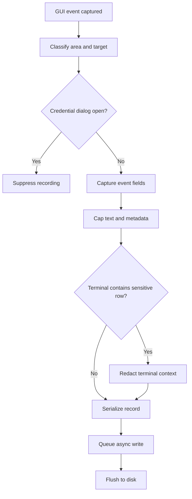

**Diagram sources**
- [interaction_recorder.hpp:1-181](file://apps/desktop/src/interaction_recorder.hpp#L1-L181)
- [interaction_recorder.cpp:1-200](file://apps/desktop/src/interaction_recorder.cpp#L1-L200)

**Section sources**
- [interaction_recorder.hpp:1-181](file://apps/desktop/src/interaction_recorder.hpp#L1-L181)
- [interaction_recorder.cpp:1-200](file://apps/desktop/src/interaction_recorder.cpp#L1-L200)

## Dependency Analysis
The attention system has clear ownership boundaries:

- The **session service** owns PTYs, terminal state, adapter connections, snapshots, and session lifecycle.
- The **desktop** owns layout, keyboard focus, rendering, and attention presentation, but never owns PTY handles or service lifecycle.
- The **attention policy** lives in the service: source pending requests, ordering, aging, and reconciliation are enforced there.
- The desktop combines and presents requests but does not change response authority.

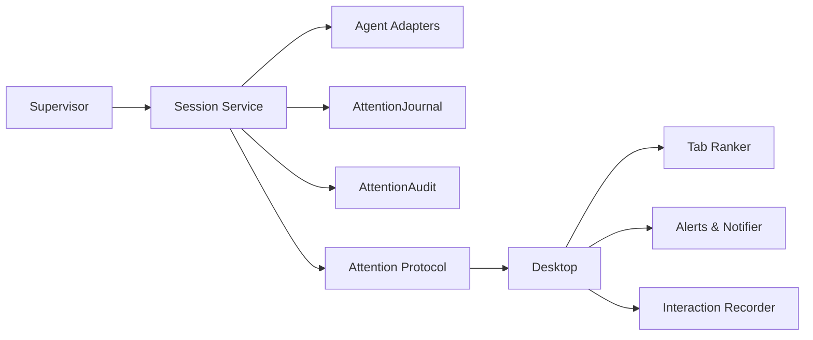

**Diagram sources**
- [architecture.md:1-165](file://docs/architecture.md#L1-L165)
- [attention.hpp:1-136](file://services/session/include/lapis/session/attention.hpp#L1-L136)
- [attention_journal.hpp:1-99](file://services/session/src/attention_journal.hpp#L1-L99)
- [attention_audit.hpp:1-51](file://services/session/src/attention_audit.hpp#L1-L51)
- [attention_protocol.hpp:1-41](file://services/session/src/transport/attention_protocol.hpp#L1-L41)
- [tab_ranker.hpp:1-134](file://apps/desktop/src/tab_ranker.hpp#L1-L134)
- [alerts.hpp:1-200](file://apps/desktop/src/alerts.hpp#L1-L200)
- [interaction_recorder.hpp:1-181](file://apps/desktop/src/interaction_recorder.hpp#L1-L181)

**Section sources**
- [architecture.md:1-165](file://docs/architecture.md#L1-L165)
- [attention.hpp:1-136](file://services/session/include/lapis/session/attention.hpp#L1-L136)
- [attention_journal.hpp:1-99](file://services/session/src/attention_journal.hpp#L1-L99)
- [attention_audit.hpp:1-51](file://services/session/src/attention_audit.hpp#L1-L51)
- [attention_protocol.hpp:1-41](file://services/session/src/transport/attention_protocol.hpp#L1-L41)
- [tab_ranker.hpp:1-134](file://apps/desktop/src/tab_ranker.hpp#L1-L134)
- [alerts.hpp:1-200](file://apps/desktop/src/alerts.hpp#L1-L200)
- [interaction_recorder.hpp:1-181](file://apps/desktop/src/interaction_recorder.hpp#L1-L181)

## Performance Considerations
The attention system balances correctness, durability, and responsiveness:

- **State machine complexity**: Operations iterate over pending requests and retired IDs. Pending and retired collections are bounded by `Limits`, preventing unbounded growth.
- **Revision exhaustion**: Revisions wrap through overflow protection; exhausted revision space desynchronizes state rather than silently evicting old requests.
- **Journal I/O**: Records are appended and fsynced; replay reads bounded chunks. Rotation avoids locking during open questions.
- **Wire limits**: Snapshots, decisions, metadata, summaries, diagnostics, choices, and JSON payloads are all bounded to prevent oversized IPC traffic.
- **Desktop ranking**: Scoring uses dot products over a small feature vector; refitting runs off the GUI thread and publishes results incrementally.
- **Alert throttling**: Repeat timers and quiet periods prevent alert storms.

[No sources needed since this section provides general guidance]

## Troubleshooting Guide

| Symptom | Likely cause | Diagnostic path |
| --- | --- | --- |
| Requests remain waiting after restart | Unknown outcome from a crash | Check whether `outcome_unknown_for` was applied and whether `delivered` or `resolved` exists. |
| Decisions disappear or are rejected | Mismatched epoch, revision, pending status, or choice | Verify `record_intended_decision` inputs against current `State`. |
| Connection shows unknown or stale | Lost connection or invalid snapshot | Inspect `invalidateAttention` behavior and `ObservationPhase`. |
| Too many pending requests | Adapter or upstream produced more than `Limits.pending` | Review `State::reconcile` and `State::request` overflow paths. |
| Alert repeats excessively | `SeenScreens` fingerprint mismatch or missing seen state | Check screen fingerprinting and saved state restoration. |
| Interaction logs contain sensitive data | Credential suppression disabled or bypassed | Review secure input hook, credential dialog detection, and terminal redaction. |

**Section sources**
- [attention_journal.hpp:1-99](file://services/session/src/attention_journal.hpp#L1-L99)
- [attention_audit.cpp:1-82](file://services/session/src/attention_audit.cpp#L1-L82)
- [attention_view.cpp:1-200](file://apps/desktop/src/attention_view.cpp#L1-L200)
- [attention.cpp:1-200](file://services/session/src/attention.cpp#L1-L200)
- [alerts.cpp:1-200](file://apps/desktop/src/alerts.cpp#L1-L200)
- [interaction_recorder.cpp:1-200](file://apps/desktop/src/interaction_recorder.cpp#L1-L200)

## Conclusion
The attention tracking system provides a clean separation between normalized agent events, durable audit records, and desktop-facing attention workflows. The service-side `attention::State` ensures correctness under reconnects, revisions, and limits. The journal and audit layers make user intent durable and auditable. The desktop side delivers consistent status, meaningful rankings, and controlled alerts. Privacy-aware interaction recording complements the audit trail by capturing user behavior without exposing credentials. Together, these components form a robust foundation for supervising live CLI agents safely and responsively.

[No sources needed since this section summarizes without analyzing specific files]