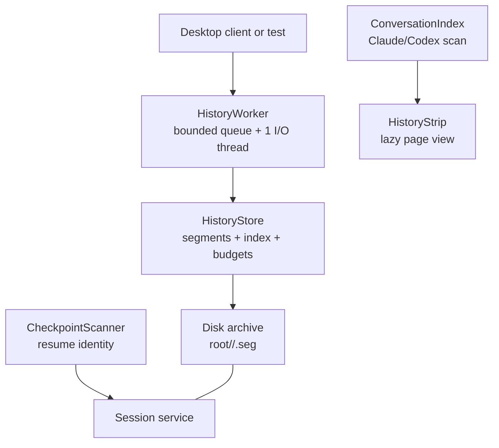
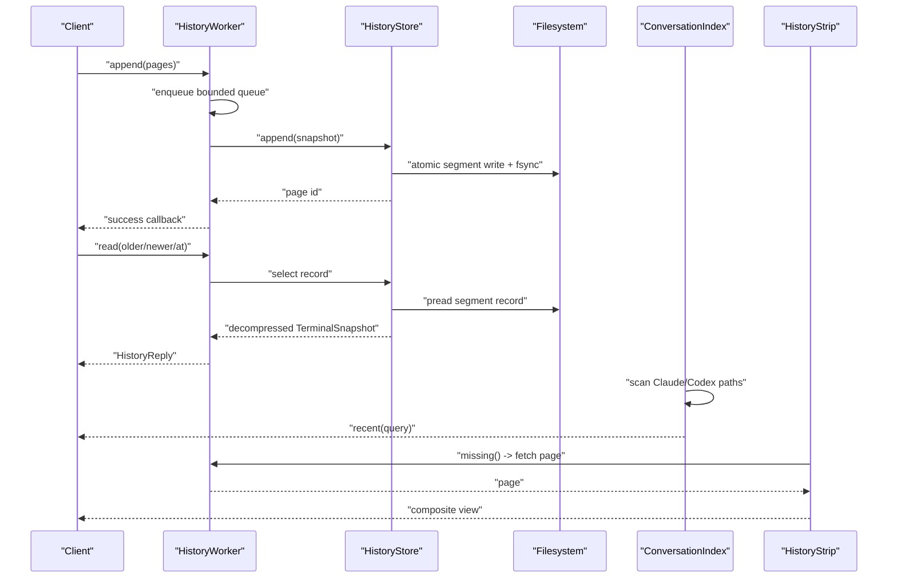
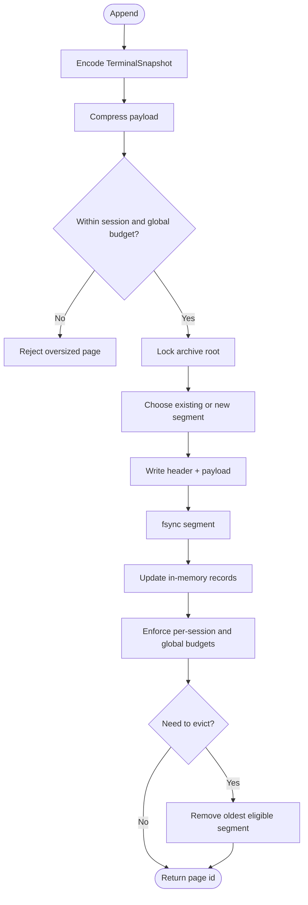
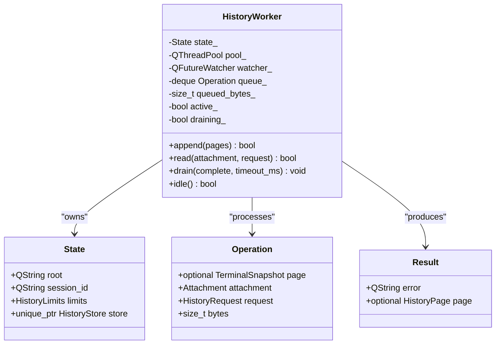
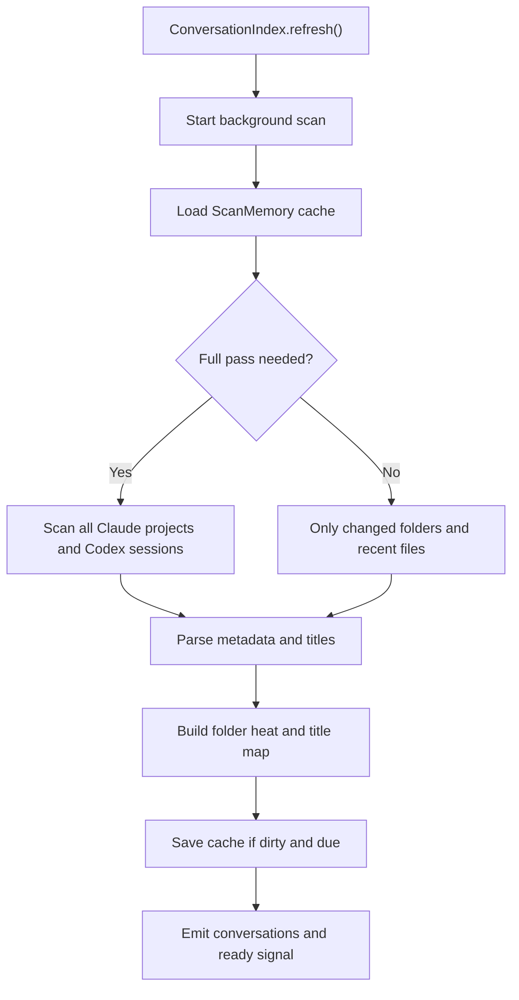
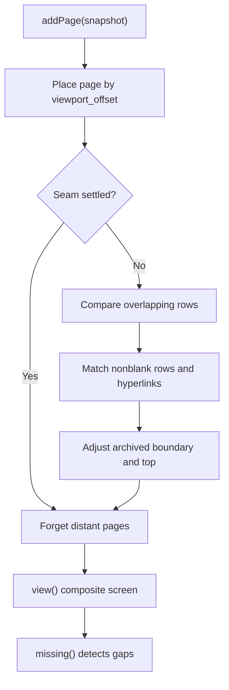
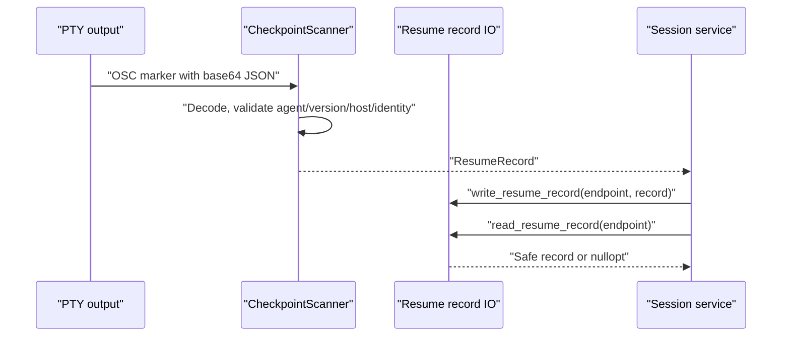
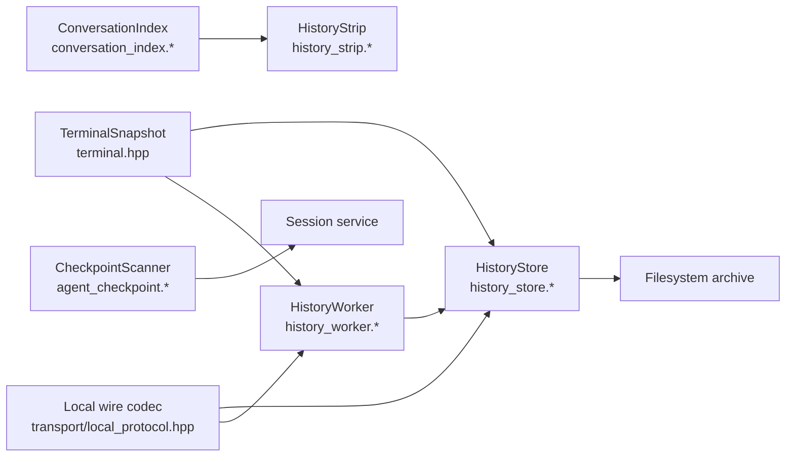

# History Storage System

<cite>
**Referenced Files in This Document**
- [history_store.hpp](file://services/session/src/history_store.hpp)
- [history_store.cpp](file://services/session/src/history_store.cpp)
- [history_worker.hpp](file://services/session/src/history_worker.hpp)
- [history_worker.cpp](file://services/session/src/history_worker.cpp)
- [terminal.hpp](file://services/session/include/lapis/session/terminal.hpp)
- [conversation_index.hpp](file://apps/desktop/src/conversation_index.hpp)
- [conversation_index.cpp](file://apps/desktop/src/conversation_index.cpp)
- [history_strip.hpp](file://apps/desktop/src/history_strip.hpp)
- [history_strip.cpp](file://apps/desktop/src/history_strip.cpp)
- [agent_checkpoint.hpp](file://services/session/src/agent_checkpoint.hpp)
- [agent_checkpoint.cpp](file://services/session/src/agent_checkpoint.cpp)
- [history_store_test.cpp](file://services/session/tests/history_store_test.cpp)
- [check_history.py](file://scripts/check_history.py)
</cite>

## Table of Contents
1. [Introduction](#introduction)
2. [Project Structure](#project-structure)
3. [Core Components](#core-components)
4. [Architecture Overview](#architecture-overview)
5. [Detailed Component Analysis](#detailed-component-analysis)
6. [Dependency Analysis](#dependency-analysis)
7. [Performance Considerations](#performance-considerations)
8. [Troubleshooting Guide](#troubleshooting-guide)
9. [Backup and Restore](#backup-and-restore)
10. [Conclusion](#conclusion)

## Introduction
This document describes the history storage system that persists agent conversation data across sessions. It covers:

- The disk-backed archive format for terminal snapshots.
- In-memory caching and lazy loading through a worker process boundary.
- Background scanning and indexing of conversations from agent implementations.
- The checkpoint mechanism that captures agent state at specific points during execution.
- Data compression, versioning, integrity checks, and eviction strategies.
- Performance optimizations including batched writes, bounded queues, background I/O, and memory management.
- Testing and operational diagnostics for history durability and recovery.

The system is split between the session service (persistence and transport), the desktop application (indexing and UI rendering), and supporting checkpoint utilities.

## Project Structure
The history subsystem spans three main areas:

| Area | Responsibility | Key files |
|---|---|---|
| Session service persistence | Disk archive, segment files, quotas, atomic writes, read selection | `history_store.hpp`, `history_store.cpp` |
| Service-side queue and worker | Bounded enqueue, single-threaded I/O worker, request/response mapping | `history_worker.hpp`, `history_worker.cpp` |
| Desktop indexing and view | Conversation discovery, cache, scrolling strip, missing-page detection | `conversation_index.hpp`, `conversation_index.cpp`, `history_strip.hpp`, `history_strip.cpp` |
| Agent checkpoint support | Resume identity parsing, local-host validation, resume record IO | `agent_checkpoint.hpp`, `agent_checkpoint.cpp` |
| Data model | Terminal snapshot, cells, graphemes, hyperlinks, history metadata | `terminal.hpp` |
| Tests and scripts | Unit tests, end-to-end history exercise, disk-full scenarios | `history_store_test.cpp`, `check_history.py` |



**Diagram sources**
- [history_worker.cpp:1-126](file://services/session/src/history_worker.cpp#L1-L126)
- [history_store.cpp:1-200](file://services/session/src/history_store.cpp#L1-L200)
- [conversation_index.cpp:1-200](file://apps/desktop/src/conversation_index.cpp#L1-L200)
- [history_strip.cpp:1-200](file://apps/desktop/src/history_strip.cpp#L1-L200)
- [agent_checkpoint.cpp:1-200](file://services/session/src/agent_checkpoint.cpp#L1-L200)

**Section sources**
- [history_store.hpp:1-74](file://services/session/src/history_store.hpp#L1-L74)
- [history_worker.hpp:1-54](file://services/session/src/history_worker.hpp#L1-L54)
- [conversation_index.hpp:1-101](file://apps/desktop/src/conversation_index.hpp#L1-L101)
- [history_strip.hpp:1-48](file://apps/desktop/src/history_strip.hpp#L1-L48)
- [agent_checkpoint.hpp:1-66](file://services/session/src/agent_checkpoint.hpp#L1-L66)
- [terminal.hpp:1-200](file://services/session/include/lapis/session/terminal.hpp#L1-L200)

## Core Components
- **HistoryStore**: An append-only, compressed segment archive under `<root>/<session>/`. Each segment file is named by its first page ID, such as `<id>.seg`. The store keeps an in-memory index of records with per-record offsets, lengths, row positions, and SHA-256 digests.
- **HistoryWorker**: A Qt object that accepts append and read operations on the calling thread, enqueues them into a bounded queue, and executes them one at a time on a dedicated I/O thread using `QThreadPool`.
- **HistoryStrip**: A desktop-side viewer that composes archived pages and the live screen into a scrollable strip, keeping only nearby pages in memory.
- **ConversationIndex**: A background scanner that indexes Claude and Codex conversations, caches results, and exposes recent searches and folder ordering.
- **CheckpointScanner and resume helpers**: Utilities that parse agent-provided checkpoint markers, validate identities, and atomically write/read resume records beside the session endpoint.
- **TerminalSnapshot**: The persistent representation of a terminal viewport, including cells, grapheme text, hyperlinks, colors, cursor state, and history metadata.

**Section sources**
- [history_store.hpp:1-74](file://services/session/src/history_store.hpp#L1-L74)
- [history_worker.hpp:1-54](file://services/session/src/history_worker.hpp#L1-L54)
- [history_strip.hpp:1-48](file://apps/desktop/src/history_strip.hpp#L1-L48)
- [conversation_index.hpp:1-101](file://apps/desktop/src/conversation_index.hpp#L1-L101)
- [agent_checkpoint.hpp:1-66](file://services/session/src/agent_checkpoint.hpp#L1-L66)
- [terminal.hpp:1-200](file://services/session/include/lapis/session/terminal.hpp#L1-L200)

## Architecture Overview
The architecture separates high-frequency UI and protocol calls from filesystem work:



**Diagram sources**
- [history_worker.cpp:40-126](file://services/session/src/history_worker.cpp#L40-L126)
- [history_store.cpp:201-521](file://services/session/src/history_store.cpp#L201-L521)
- [conversation_index.cpp:450-585](file://apps/desktop/src/conversation_index.cpp#L450-L585)
- [history_strip.cpp:1-234](file://apps/desktop/src/history_strip.cpp#L1-L234)

## Detailed Component Analysis

### HistoryStore: Disk Archive Format and Persistence
The archive stores compressed terminal snapshots in append-only segments.

Key design elements:
- **Segment naming**: Each segment starts with a zero-padded 20-digit page ID followed by `.seg`.
- **Record layout**: A fixed-size header precedes each compressed payload. The header contains the page ID, first-row offset, row count, payload length, and a SHA-256 digest of the payload.
- **Atomicity**: Writes use a pending-file pattern, `fsync`, and rename to avoid partial records. Interrupted writes are truncated or removed on load.
- **Integrity**: Every read verifies header magic, bounds, ID order, length, and payload digest. Corrupt or truncated records raise errors.
- **Quotas**: Per-session and global byte limits trigger eviction of closed segments, least recently modified first. The newest open segment is never evicted by another session.
- **Compatibility**: Legacy `.page` files are scanned and counted but not read; they contribute to quota enforcement.
- **Concurrency**: Filesystem operations are serialized through a root-level lock file. The class documents that it must be used on the dedicated history I/O worker.



**Diagram sources**
- [history_store.cpp:201-521](file://services/session/src/history_store.cpp#L201-L521)

Important constants and behaviors:
- Maximum uncompressed page size: 8 MiB.
- Maximum global archive size: 64 GiB.
- Header size: 72 bytes, prefixed by an 8-byte magic marker.
- Sequence counter: stored alongside each session directory and protected by checksum.
- Record length bound: enforced both before and after compression.

**Section sources**
- [history_store.hpp:1-74](file://services/session/src/history_store.hpp#L1-L74)
- [history_store.cpp:1-200](file://services/session/src/history_store.cpp#L1-L200)
- [history_store.cpp:201-521](file://services/session/src/history_store.cpp#L201-L521)

### HistoryWorker: Background Worker Processing
The worker isolates blocking filesystem operations from the caller:

- **Queue bounds**: At most 128 queued pages and 16 MiB of queued page data.
- **Single I/O thread**: The internal pool is limited to one thread so each operation runs sequentially.
- **Operation types**: Append pages or read one archived page by older/newer/at semantics.
- **Drain mode**: Accepts no new work while draining; notifies completion when the queue empties or a timeout fires.
- **Failure propagation**: Exceptions from the store are turned into error replies through callbacks.
- **Progress and received hooks**: Callers observe progress and receive either a page or an error message.



**Diagram sources**
- [history_worker.hpp:1-54](file://services/session/src/history_worker.hpp#L1-L54)
- [history_worker.cpp:1-126](file://services/session/src/history_worker.cpp#L1-L126)

**Section sources**
- [history_worker.hpp:1-54](file://services/session/src/history_worker.hpp#L1-L54)
- [history_worker.cpp:1-126](file://services/session/src/history_worker.cpp#L1-L126)

### Data Model: Conversations, Messages, Checkpoints, and Terminal Snapshots
The primary persisted unit is the `TerminalSnapshot`, which represents a terminal viewport plus optional history metadata.

| Field group | Meaning | Notes |
|---|---|---|
| Size and cursor | Columns, rows, cursor position, shape, visibility | Used to reconstruct viewport geometry. |
| Display attributes | Foreground/background/cursor RGB, palette, styles | Enables faithful rendering. |
| Cells and graphemes | Row-major cell array plus contiguous Unicode grapheme buffer | Avoids per-cell string allocation. |
| Hyperlinks | OSC 8 links with start cell, span, and URI | Stored separately to limit memory growth. |
| History metadata | Total rows, viewport offset, viewport rows, availability flag | Used to place archived pages relative to the kept timeline. |
| Flags | Alternate screen, bracketed paste, wheel acceptance, synchronization hints | Control input behavior and rendering assumptions. |

Conversations are indexed separately from the archive:
- `Conversation` holds harness type, identifier, directory, title, and modification time.
- Claude and Codex sessions are parsed from their native log formats.
- Titles are extracted from early user messages and updated titles where available.

Checkpoints capture a resumption identity:
- `ResumeRecord` includes agent name, session identifier, and source.
- Checkpoints arrive via terminal output markers and are validated against known agents, host locality, and identity rules.
- Resume records are written atomically beside the session endpoint and only accepted if permissions and ownership are safe.

```mermaid
erDiagram
  TERMINAL_SNAPSHOT {
    uint64 revision
    uint16 columns
    uint16 rows
    uint32 foreground_rgb
    uint32 background_rgb
    vector cells
    u32string graphemes
    vector hyperlinks
    uint32 hyperlink_uri_limit
    uint32 hyperlink_span_limit
    uint32 hyperlink_byte_limit
    uint64 total_rows
    uint64 viewport_offset
    uint64 viewport_rows
    bool primary_available
  }

  CONVERSATION {
    string harness
    string id
    string directory
    string title
    int64 modified
  }

  RESUME_RECORD {
    string agent
    string session_id
    enum source
  }

  HISTORY_PAGE {
    uint64 id
    TerminalSnapshot snapshot
  }

  HISTORY_SEGMENT {
    uint64 first_page_id
    uint64 offset
    uint64 length
    uint64 first_row
    uint64 rows
    sha256 digest
  }

  HISTORY_STRIP {
    uint64 archived
    uint64 top
    map first_row_to_snapshot pages
  }

  TERMINAL_SNAPSHOT ||--o{ HISTORY_PAGE : "content"
  HISTORY_SEGMENT ||--o{ HISTORY_PAGE : "contains"
  CONVERSATION ||--o{ HISTORY_PAGE : "discovered by index"
  RESUME_RECORD ||--o{ HISTORY_PAGE : "used to resume"
```

**Diagram sources**
- [terminal.hpp:1-200](file://services/session/include/lapis/session/terminal.hpp#L1-L200)
- [conversation_index.hpp:1-101](file://apps/desktop/src/conversation_index.hpp#L1-L101)
- [agent_checkpoint.hpp:1-66](file://services/session/src/agent_checkpoint.hpp#L1-L66)
- [history_store.hpp:1-74](file://services/session/src/history_store.hpp#L1-L74)
- [history_strip.hpp:1-48](file://apps/desktop/src/history_strip.hpp#L1-L48)

**Section sources**
- [terminal.hpp:1-200](file://services/session/include/lapis/session/terminal.hpp#L1-L200)
- [conversation_index.hpp:1-101](file://apps/desktop/src/conversation_index.hpp#L1-L101)
- [agent_checkpoint.hpp:1-66](file://services/session/src/agent_checkpoint.hpp#L1-L66)
- [history_store.hpp:1-74](file://services/session/src/history_store.hpp#L1-L74)

### Indexing System: Fast Search and Retrieval of Historical Sessions
The desktop indexing layer scans two agent implementations:

- **Claude**: Scans project directories for JSONL session files, filters interactive CLI sessions, extracts entrypoint, current working directory, initial user text, and AI-assigned titles.
- **Codex**: Scans rollout files, skips automation and subagent threads, validates identifiers and working directories, and enriches titles from thread names when available.

The index uses a cache file to avoid rescanning unchanged files:
- Cache entries track file size and modification time.
- Full passes run every 30 minutes; incremental passes check changed folders and recent conversations every minute.
- Cache saving is throttled to once per 15 minutes.
- Results are sorted newest first and exposed through a query API that requires all words to appear in title, folder, or harness.



**Diagram sources**
- [conversation_index.cpp:1-200](file://apps/desktop/src/conversation_index.cpp#L1-L200)
- [conversation_index.cpp:201-568](file://apps/desktop/src/conversation_index.cpp#L201-L568)
- [conversation_index.cpp:569-585](file://apps/desktop/src/conversation_index.cpp#L569-L585)

**Section sources**
- [conversation_index.hpp:1-101](file://apps/desktop/src/conversation_index.hpp#L1-L101)
- [conversation_index.cpp:1-200](file://apps/desktop/src/conversation_index.cpp#L1-L200)
- [conversation_index.cpp:201-568](file://apps/desktop/src/conversation_index.cpp#L201-L568)
- [conversation_index.cpp:569-585](file://apps/desktop/src/conversation_index.cpp#L569-L585)

### View Layer: Lazy Loading and Memory Management for Large Conversations
`HistoryStrip` renders a continuous view composed of:
- Archived pages placed by their `viewport_offset`.
- The live screen for rows newer than the archived region.
- A seam-setting algorithm that aligns the archived region with the live screen by comparing nonblank rows.

Memory management highlights:
- Only pages within a configurable number of screens around the viewport are retained.
- Missing rows are detected so the UI can request additional pages.
- Hyperlinks are copied conservatively, respecting maximum URI length, span count, and total hyperlink byte budget.
- Wide characters and cut edges are handled to avoid malformed text slices.



**Diagram sources**
- [history_strip.cpp:1-234](file://apps/desktop/src/history_strip.cpp#L1-L234)

**Section sources**
- [history_strip.hpp:1-48](file://apps/desktop/src/history_strip.hpp#L1-L48)
- [history_strip.cpp:1-234](file://apps/desktop/src/history_strip.cpp#L1-L234)

### Checkpoint Mechanism: Capturing Agent State at Specific Points
Checkpoints allow resuming a conversation when the agent reports its identity:

- **Parsing**: The scanner looks for a terminal marker containing base64-encoded JSON. It handles partial sequences across read boundaries and keeps a bounded carry buffer.
- **Validation**: The decoded record must have version 1, a known agent, a valid printable resume identity, and a local host.
- **Storage**: Resume records are written atomically beside the session endpoint and only read from owner-only regular files with strict permissions.
- **Integration**: The checkpoint layer identifies observer-backed agents and maps launch specifications to canonical agent names.



**Diagram sources**
- [agent_checkpoint.cpp:1-200](file://services/session/src/agent_checkpoint.cpp#L1-L200)
- [agent_checkpoint.hpp:1-66](file://services/session/src/agent_checkpoint.hpp#L1-L66)

**Section sources**
- [agent_checkpoint.hpp:1-66](file://services/session/src/agent_checkpoint.hpp#L1-L66)
- [agent_checkpoint.cpp:1-200](file://services/session/src/agent_checkpoint.cpp#L1-L200)

## Dependency Analysis
The main dependency relationships are:



**Diagram sources**
- [terminal.hpp:1-200](file://services/session/include/lapis/session/terminal.hpp#L1-L200)
- [history_store.hpp:1-74](file://services/session/src/history_store.hpp#L1-L74)
- [history_worker.hpp:1-54](file://services/session/src/history_worker.hpp#L1-L54)
- [conversation_index.hpp:1-101](file://apps/desktop/src/conversation_index.hpp#L1-L101)
- [history_strip.hpp:1-48](file://apps/desktop/src/history_strip.hpp#L1-L48)
- [agent_checkpoint.hpp:1-66](file://services/session/src/agent_checkpoint.hpp#L1-L66)

Coupling and cohesion observations:
- `HistoryStore` is tightly coupled to filesystem semantics, atomic IO primitives, and the wire encoding of `TerminalSnapshot`.
- `HistoryWorker` decouples the UI/protocol layer from blocking IO by encapsulating lifetime, queueing, and threading.
- `ConversationIndex` depends on agent-specific log formats but remains isolated from the archive format.
- `HistoryStrip` depends on `TerminalSnapshot` and coordinates with the worker indirectly through higher-level UI logic.
- Checkpoint logic is independent of the archive but integrates with the session lifecycle through resume records.

**Section sources**
- [history_store.hpp:1-74](file://services/session/src/history_store.hpp#L1-L74)
- [history_worker.hpp:1-54](file://services/session/src/history_worker.hpp#L1-L54)
- [conversation_index.hpp:1-101](file://apps/desktop/src/conversation_index.hpp#L1-L101)
- [history_strip.hpp:1-48](file://apps/desktop/src/history_strip.hpp#L1-L48)
- [agent_checkpoint.hpp:1-66](file://services/session/src/agent_checkpoint.hpp#L1-L66)

## Performance Considerations
- **Batched writes**: The worker accepts a vector of snapshots per append call and enqueues them together, reducing per-operation overhead.
- **Bounded queue**: Limits prevent unbounded memory growth when the service cannot keep up with producer rate.
- **Single I/O thread**: Serializes filesystem access, avoiding concurrent writes and simplifying segment mutation.
- **Append-only segments**: Reduces locking and fragmentation; eviction removes whole closed segments rather than mutating live ones.
- **Compression**: Payloads are compressed before hashing and writing, keeping archives small while preserving fidelity.
- **Lazy loading**: The archive index enables random access by page ID or row without loading the entire history.
- **View-side caching**: `HistoryStrip` retains only pages near the current viewport, dropping distant pages automatically.
- **Index cache**: `ConversationIndex` avoids rescanning unchanged files and throttles cache writes.
- **Memory caps**: Terminal limits constrain cells, input, graphemes, and reply sizes; hyperlink counts and byte totals are bounded in rendering paths.

[No sources needed since this section provides general guidance]

## Troubleshooting Guide
Common failure modes and how the system responds:

| Symptom | Likely cause | System behavior | Diagnostic action |
|---|---|---|---|
| Append rejected immediately | Queue full or page too large | `append` returns false | Reduce burst size or inspect page dimensions. |
| History read fails with corruption message | Truncated segment, bad digest, or interrupted write | Error propagated through `received`; retry may recover after reload | Inspect `.seg` files and restore from backup if necessary. |
| No archived pages returned | All pages evicted or archive cleared | `older()` returns empty; stats show reduced page count | Check quota settings and eviction logs. |
| History grows beyond expected size | Global quota exceeded by other sessions | Oldest closed segments evicted globally | Review per-session vs global limits. |
| Desktop view shows blank rows | Missing archived page seams or asynchronous page arrival | `missing()` returns row; UI should request page | Verify worker drain and page delivery. |
| Resume identity ignored | Unknown agent, invalid identity, wrong host, or malformed JSON | `decode` returns nullopt | Validate checkpoint marker and agent configuration. |
| Disk-full scenario pauses history | Underlying filesystem returns ENOSPC | Service reports paused/storage error; resumes when space returns | Test with constrained volume and verify recovery. |

Operational checks:
- Use the history unit tests to verify append order, retrieval, quota eviction, truncation recovery, symlink rejection, and permission validation.
- Use the end-to-end script to exercise paging, reattachment, corruption handling, and disk-full recovery.
- Inspect the archive directory for `.seg` files, counters, and pending files.

**Section sources**
- [history_store_test.cpp:1-200](file://services/session/tests/history_store_test.cpp#L1-L200)
- [check_history.py:1-200](file://scripts/check_history.py#L1-L200)
- [check_history.py:201-263](file://scripts/check_history.py#L201-L263)

## Backup and Restore
Backup and restore are supported primarily through the structure of the archive itself and through checkpoint/resume mechanisms:

- **Archive contents**: Each session has a directory under the configured history root, containing one or more `.seg` segment files. These files contain compressed, checksummed snapshots.
- **Counter file**: A per-session counter protects sequence numbering and is checksummed.
- **Pending files**: `.pending` and `.unfinished.tmp` indicate interrupted writes; these are cleaned up safely on startup.
- **Permissions**: Root, session directories, and segment files are restricted to the owning user with no world-readable bits.
- **Restore strategy**: Copy the configured history root and session directories to another location or machine. Open a new `HistoryStore` against the same root and session identifier to rebuild the in-memory index from the segments.
- **Resume integration**: For agents backed by observers, resume identity is recorded atomically beside the session endpoint and can be used to reconnect to the correct conversation.

Caveats:
- Do not copy partial or corrupted segments; integrity checks will reject them.
- Cross-machine resume is intentionally blocked unless the checkpoint declares a matching local host.
- Eviction may remove old segments; backups should be taken proactively if long-term retention is required.

**Section sources**
- [history_store.cpp:1-200](file://services/session/src/history_store.cpp#L1-L200)
- [history_store.cpp:201-521](file://services/session/src/history_store.cpp#L201-L521)
- [agent_checkpoint.cpp:1-200](file://services/session/src/agent_checkpoint.cpp#L1-L200)

## Conclusion
The history storage system combines a robust, append-only disk archive with a lightweight in-memory index, a single-threaded background worker, and a responsive desktop view. It prioritizes safety through atomic writes, checksum verification, permission checks, and quota-driven eviction, while optimizing performance through compression, batching, lazy loading, and scoped caching. The indexing layer independently tracks conversation metadata for fast search, and the checkpoint subsystem provides secure, localized resume capabilities. Together, these components enable durable, scalable persistence of agent conversations across crashes, reconnections, and long-running sessions.

[No sources needed since this section summarizes without analyzing specific files]