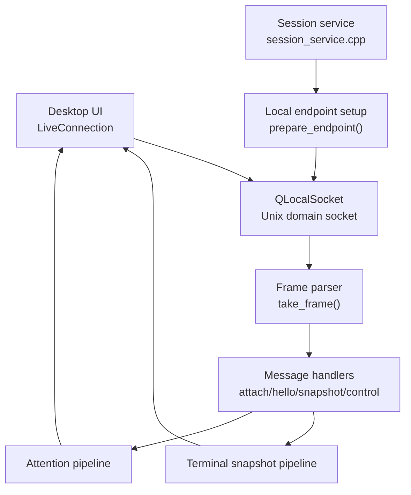
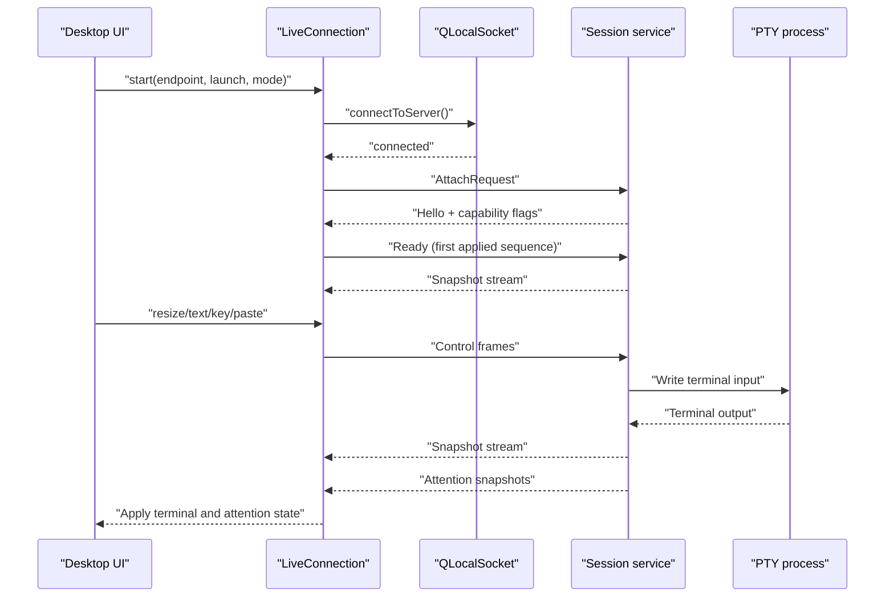
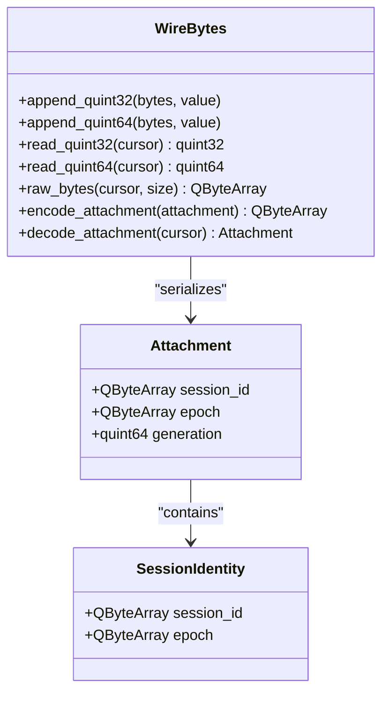
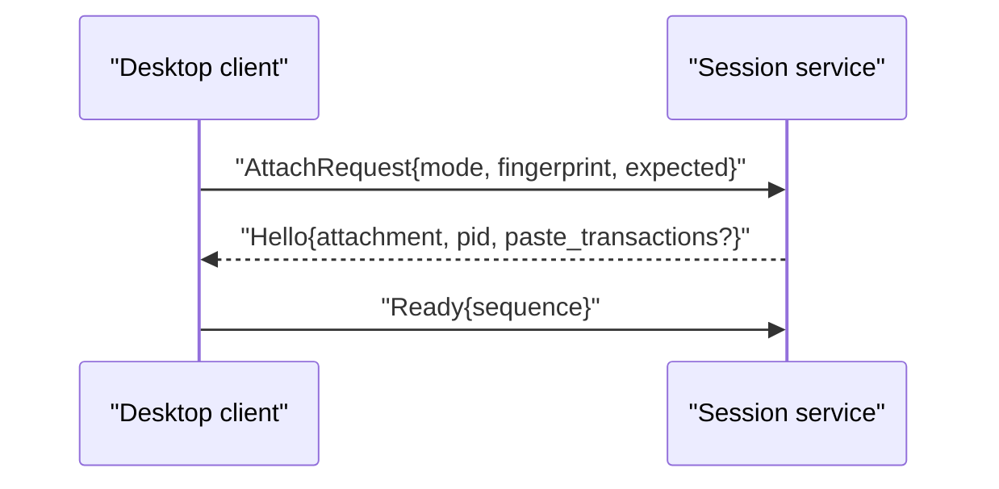
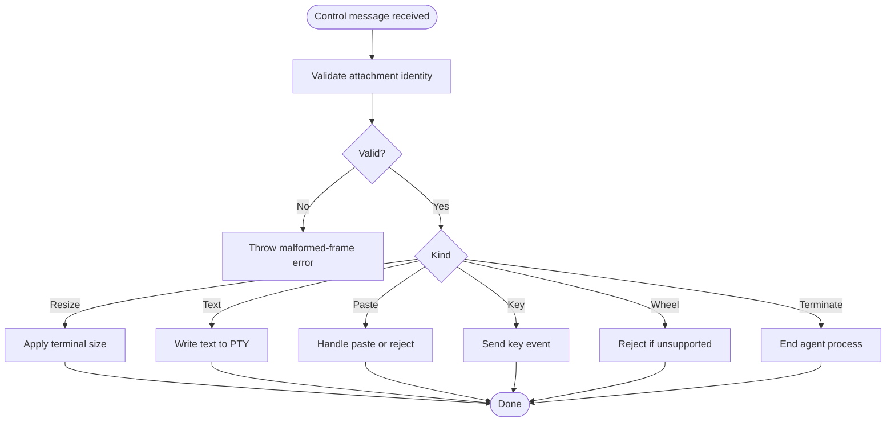
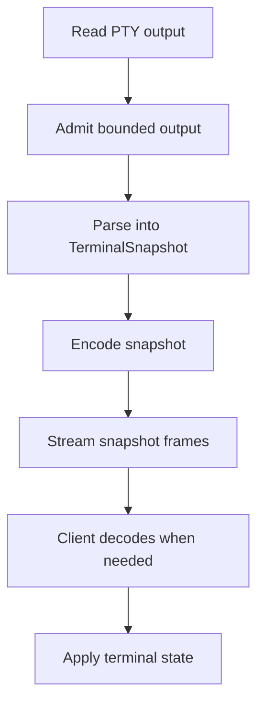
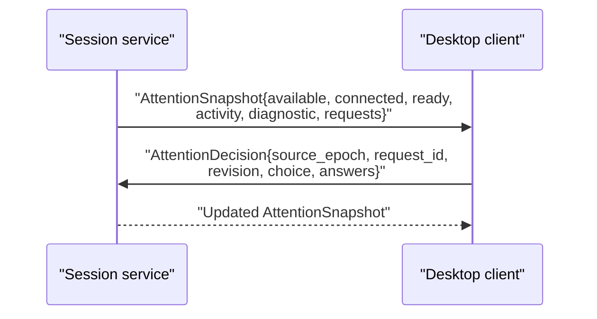
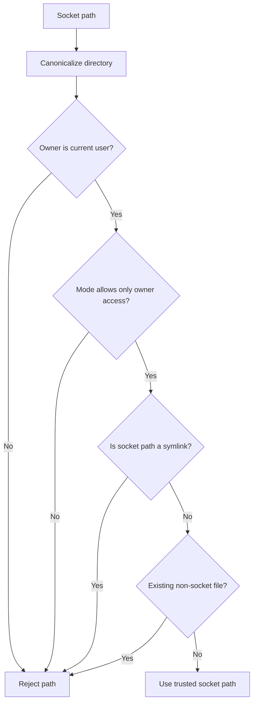
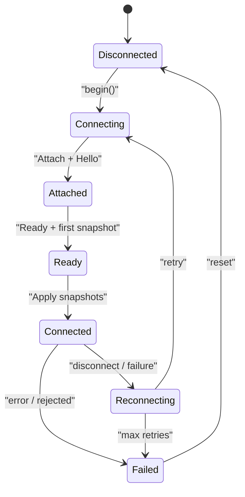
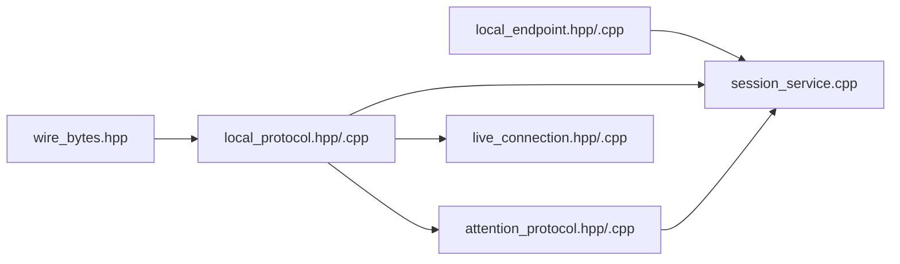

# IPC Protocols and Communication

<cite>
**Referenced Files in This Document**
- [local_protocol.hpp](file://services/session/src/transport/local_protocol.hpp)
- [local_protocol.cpp](file://services/session/src/transport/local_protocol.cpp)
- [wire_bytes.hpp](file://services/session/src/transport/wire_bytes.hpp)
- [attention_protocol.hpp](file://services/session/src/transport/attention_protocol.hpp)
- [attention_protocol.cpp](file://services/session/src/transport/attention_protocol.cpp)
- [local_endpoint.hpp](file://services/session/src/platform/posix/local_endpoint.hpp)
- [local_endpoint.cpp](file://services/session/src/platform/posix/local_endpoint.cpp)
- [session_service.cpp](file://services/session/src/session_service.cpp)
- [terminal_hooks.cpp](file://services/session/src/terminal_hooks.cpp)
- [live_connection.hpp](file://apps/desktop/src/live_connection.hpp)
- [live_connection.cpp](file://apps/desktop/src/live_connection.cpp)
- [local_protocol_test.cpp](file://services/session/tests/local_protocol_test.cpp)
</cite>

## Table of Contents
1. [Introduction](#introduction)
2. [Project Structure](#project-structure)
3. [Core Components](#core-components)
4. [Architecture Overview](#architecture-overview)
5. [Detailed Component Analysis](#detailed-component-analysis)
6. [Dependency Analysis](#dependency-analysis)
7. [Performance Considerations](#performance-considerations)
8. [Troubleshooting Guide](#troubleshooting-guide)
9. [Conclusion](#conclusion)

## Introduction
This document describes the inter-process communication protocols used by the session service, focusing on the local socket-based connection between the desktop UI and the session service. It explains:

- The transport framing and binary wire format for all session messages.
- Versioning and capability negotiation.
- Request-response patterns for terminal control operations such as attach, resize, paste, history, and attention decisions.
- Streaming protocols for terminal snapshots and attention events.
- Connection lifecycle management, error handling, retry behavior, and security constraints around Unix domain sockets.
- Debugging and logging strategies for troubleshooting IPC failures.

The protocol is implemented in C++ with Qt primitives and uses a private Unix domain socket under POSIX environments. The desktop client owns connection establishment, retries, and UI state synchronization; the session service owns process supervision, PTY I/O, terminal snapshot generation, attention observation, and history paging.

## Project Structure
The relevant IPC implementation spans three areas:

- Transport layer: frame framing, message encoding/decoding, version constants, limits, and attachment identity.
- Session service: server endpoint preparation, connection acceptance, request dispatch, process lifecycle, terminal output streaming, and attention event routing.
- Desktop client: connection startup, attach handshake, live snapshot processing, input sending, paste transactions, history requests, and retry logic.

**Diagram sources**
- [local_protocol.cpp:450-535](file://services/session/src/transport/local_protocol.cpp#L450-L535)
- [session_service.cpp:1-120](file://services/session/src/session_service.cpp#L1-L120)
- [live_connection.cpp:1-120](file://apps/desktop/src/live_connection.cpp#L1-L120)

**Section sources**
- [local_protocol.hpp:1-196](file://services/session/src/transport/local_protocol.hpp#L1-L196)
- [local_protocol.cpp:1-200](file://services/session/src/transport/local_protocol.cpp#L1-L200)
- [session_service.cpp:1-200](file://services/session/src/session_service.cpp#L1-L200)
- [live_connection.hpp:1-116](file://apps/desktop/src/live_connection.hpp#L1-L116)
- [live_connection.cpp:1-200](file://apps/desktop/src/live_connection.cpp#L1-L200)

## Core Components
The IPC system consists of these primary components:

| Component | Responsibility | Key file |
|---|---|---|
| Wire frame format | Length-prefixed frames carrying a message kind and payload | `local_protocol.hpp`, `local_protocol.cpp` |
| Attachment identity | 16-byte session UUID, 16-byte epoch, and monotonic generation | `wire_bytes.hpp` |
| Attach and hello handshake | Capability negotiation, view joining, and child PID reporting | `local_protocol.hpp`, `local_protocol.cpp` |
| Control messages | Resize, text, paste, key, status, wheel, terminate | `local_protocol.hpp`, `local_protocol.cpp` |
| Snapshot streaming | Terminal screen snapshots with optional hyperlinks and timing metadata | `local_protocol.hpp`, `local_protocol.cpp` |
| History protocol | Page-based terminal history requests and replies | `local_protocol.hpp`, `local_protocol.cpp` |
| Attention protocol | Pending attention snapshots and user decisions | `attention_protocol.hpp`, `attention_protocol.cpp` |
| Local endpoint security | Trusted directory validation, symlink rejection, buffer widening | `local_endpoint.hpp`, `local_endpoint.cpp` |
| Desktop client lifecycle | Connect, retry, attach, apply snapshots, send inputs, handle errors | `live_connection.hpp`, `live_connection.cpp` |
| Session service entry point | Server setup, connection dispatch, process supervision, pacing | `session_service.cpp` |

**Section sources**
- [local_protocol.hpp:10-196](file://services/session/src/transport/local_protocol.hpp#L10-L196)
- [wire_bytes.hpp:10-55](file://services/session/src/transport/wire_bytes.hpp#L10-L55)
- [attention_protocol.hpp:10-41](file://services/session/src/transport/attention_protocol.hpp#L10-L41)
- [local_endpoint.hpp:5-17](file://services/session/src/platform/posix/local_endpoint.hpp#L5-L17)
- [live_connection.hpp:20-116](file://apps/desktop/src/live_connection.hpp#L20-L116)

## Architecture Overview
The session service exposes a local Unix domain socket. A desktop client connects, negotiates capabilities, attaches to an existing or new session, receives streaming terminal snapshots, sends user input, and optionally manages large paste payloads through transactional requests. Attention events flow as a separate stream of structured snapshots containing pending agent requests and diagnostic state.

**Diagram sources**
- [live_connection.cpp:40-120](file://apps/desktop/src/live_connection.cpp#L40-L120)
- [local_protocol.cpp:450-535](file://services/session/src/transport/local_protocol.cpp#L450-L535)
- [session_service.cpp:1-120](file://services/session/src/session_service.cpp#L1-L120)

## Detailed Component Analysis

### Frame Framing and Wire Format
All session messages are wrapped in length-prefixed frames. Each frame contains:

- A 4-byte big-endian length field indicating the total frame size including the kind byte.
- A 1-byte message kind.
- A variable-length payload whose structure depends on the kind.

The maximum frame size is fixed at 8 MiB. Malformed frames, oversized payloads, unknown kinds, and incomplete reads cause parsing failures rather than silent truncation.

#### Frame Layout
| Field | Size | Encoding | Notes |
|---|---:|---|---|
| Frame length | 4 bytes | Big-endian uint32 | Includes kind byte and payload |
| Kind | 1 byte | Unsigned integer | Enumerated message type |
| Payload | Variable | Protocol-specific | Bounded by `max_frame_bytes` |

#### Message Kinds
| Kind | Direction | Purpose |
|---|---|---|
| `hello` | Service to client | Reports child process PID and negotiated capabilities |
| `snapshot` | Service to client | Streams terminal screen updates |
| `text` | Client to service | Sends UTF-8 terminal text |
| `paste` | Client to service | Legacy inline paste payload |
| `key` | Client to service | Sends terminal keystrokes |
| `resize` | Client to service | Requests terminal size change |
| `status` | Service to client | Reports rejected, ended, replaced, or overloaded conditions |
| `attach` | Client to service | Initiates session attach and capability negotiation |
| `ready` | Client to service | Acknowledges first applied snapshot sequence |
| `history_request` | Client to service | Asks for older, newer, or page-at-row history |
| `history_page` | Service to client | Returns a terminal history page |
| `attention_snapshot` | Service to client | Streams pending attention state |
| `attention_decision` | Client to service | Submits a user decision for an attention request |
| `attention_retry` | Client to service | Retries observation after reconnect |
| `terminate` | Client to service | Requests end of the agent process |
| `wheel` | Client to service | Full-screen program mouse wheel input |
| `paste_request` | Client to service | Transactional paste start/submit |
| `paste_result` | Service to client | Confirms paste admission or reports result |

**Section sources**
- [local_protocol.cpp:450-535](file://services/session/src/transport/local_protocol.cpp#L450-L535)
- [local_protocol.hpp:18-100](file://services/session/src/transport/local_protocol.hpp#L18-L100)

### Binary Serialization Primitives
Low-level serialization uses explicit big-endian helpers:

- `append_quint32` / `read_quint32`: 32-bit integers.
- `append_quint64` / `read_quint64`: 64-bit integers.
- `raw_bytes`: Copy raw bytes from a cursor position.
- `encode_attachment` / `decode_attachment`: Serialize and validate session identity plus generation.

These helpers enforce strict bounds and throw on invalid input, avoiding undefined behavior when reading untrusted IPC data.

**Diagram sources**
- [wire_bytes.hpp:10-55](file://services/session/src/transport/wire_bytes.hpp#L10-L55)
- [local_protocol.hpp:60-80](file://services/session/src/transport/local_protocol.hpp#L60-L80)

**Section sources**
- [wire_bytes.hpp:10-55](file://services/session/src/transport/wire_bytes.hpp#L10-L55)
- [local_protocol.cpp:1-80](file://services/session/src/transport/local_protocol.cpp#L1-L80)

### Versioning and Compatibility
The protocol declares a single numeric version constant used by major wire-format fields such as attach and attention snapshots. The current version is 6. Decoders reject payloads with unexpected versions for those fields, ensuring forward compatibility is handled explicitly rather than silently accepting unknown layouts.

Compatibility mechanisms include:

- **Capability bits**: Attach carries optional capability flags for hyperlinks, attention phase support, and paste transactions.
- **Optional fields**: Hello may include an extra paste-transaction flag only when present.
- **Extension blocks**: Snapshot encoding supports an optional hyperlink extension that legacy readers ignore.
- **Negotiated behavior**: Clients must not send features like wheel input or attention-phase snapshots unless the service advertises support.

Version checks appear in attach and attention encoders/decoders. Unknown capability bits outside the defined set are rejected during attach decoding.

**Section sources**
- [local_protocol.hpp:12-18](file://services/session/src/transport/local_protocol.hpp#L12-L18)
- [local_protocol.cpp:80-160](file://services/session/src/transport/local_protocol.cpp#L80-L160)
- [attention_protocol.cpp:260-343](file://services/session/src/transport/attention_protocol.cpp#L260-L343)
- [local_protocol_test.cpp:120-190](file://services/session/tests/local_protocol_test.cpp#L120-L190)

### Attach Handshake and Session Identity
Attach establishes a view’s relationship to a session. Modes include:

| Mode | Expected identity | Purpose |
|---|---|---|
| `discover` | Zero session and epoch | Find an existing session without claiming ownership |
| `join` | Zero session and epoch | Add another view to an existing session |
| `create` | Nonzero session, zero epoch | Create a new session with a chosen session ID |
| `reconnect` | Nonzero session and nonzero epoch | Reattach to a known session with both identifiers |

After attach, the service responds with `hello`, which includes:

- The negotiated attachment identity.
- The child process PID.
- Optional paste-transaction support.

The client then sends `ready` with the first applied snapshot sequence number.

**Diagram sources**
- [local_protocol.hpp:80-140](file://services/session/src/transport/local_protocol.hpp#L80-L140)
- [local_protocol.cpp:100-160](file://services/session/src/transport/local_protocol.cpp#L100-L160)

**Section sources**
- [local_protocol.hpp:60-140](file://services/session/src/transport/local_protocol.hpp#L60-L140)
- [local_protocol.cpp:80-160](file://services/session/src/transport/local_protocol.cpp#L80-L160)
- [local_protocol_test.cpp:140-200](file://services/session/tests/local_protocol_test.cpp#L140-L200)

### Control Messages and Session Operations
Control messages share a common envelope: a 40-byte attachment header followed by a protocol-specific payload. The following operations are supported:

| Operation | Direction | Wire details | Behavior |
|---|---|---|---|
| Resize | Client → Service | Attachment + serialized `TerminalSize` | Changes terminal columns and rows |
| Text | Client → Service | Attachment + bounded UTF-8 text | Sends typed characters |
| Paste | Client → Service | Attachment + legacy paste payload | Inline paste; limited by paste size |
| Key | Client → Service | Attachment + key payload | Sends terminal key events |
| Wheel | Client → Service | Serialized wheel struct | Full-screen program scrolling |
| Terminate | Client → Service | Attachment-bound control | Requests process termination |
| Status | Service → Client | Code + bounded UTF-8 message | Reports lifecycle or error state |

Important constraints:

- Control payload size is bounded by `max_codepoints`.
- Wheel payload is exactly 6 bytes: signed 16-bit steps, unsigned 16-bit column, unsigned 16-bit row.
- Status codes include rejected, ended, replaced, and overloaded.

**Diagram sources**
- [local_protocol.cpp:320-420](file://services/session/src/transport/local_protocol.cpp#L320-L420)
- [local_protocol.hpp:18-120](file://services/session/src/transport/local_protocol.hpp#L18-L120)

**Section sources**
- [local_protocol.cpp:200-420](file://services/session/src/transport/local_protocol.cpp#L200-L420)
- [local_protocol.hpp:18-120](file://services/session/src/transport/local_protocol.hpp#L18-L120)

### Snapshot Streaming and Terminal Output
Terminal output is streamed as snapshots. Each snapshot includes:

- Screen revision.
- Terminal dimensions.
- Cursor position, shape, visibility, blinking, and wide-character tail.
- Alternate screen flag and whether wheel input is accepted.
- Bracketed paste and application cursor-key modes.
- Foreground and background colors.
- Optional cursor color.
- History metadata: total rows kept, viewport offset, viewport row count.
- Palette entries.
- Grapheme code points.
- Cell array with text offsets, lengths, cell kinds, styles, and underline information.
- Optional hyperlink extension.

Two snapshot encodings exist:

1. **Full snapshot message**: Contains the complete encoded terminal snapshot.
2. **Snapshot envelope**: Contains attachment, sequence, timing, screen size, and encoded bytes. The desktop client can defer full decoding until the screen is displayed.

Timing metadata records nanosecond timestamps for PTY read completion, parsing completion, and publication time. Zero timing indicates no observed PTY output yet.

**Diagram sources**
- [local_protocol.cpp:200-320](file://services/session/src/transport/local_protocol.cpp#L200-L320)
- [session_service.cpp:1-120](file://services/session/src/session_service.cpp#L1-L120)
- [live_connection.cpp:80-160](file://apps/desktop/src/live_connection.cpp#L80-L160)

**Section sources**
- [local_protocol.cpp:200-420](file://services/session/src/transport/local_protocol.cpp#L200-L420)
- [local_protocol.hpp:100-170](file://services/session/src/transport/local_protocol.hpp#L100-L170)
- [live_connection.cpp:80-160](file://apps/desktop/src/live_connection.cpp#L80-L160)

### History Protocol
History enables browsing terminal output beyond the live viewport. The client sends a history request with:

- A unique request ID.
- A reference row.
- A direction: older, newer, or at.

The service replies with:

- Attachment and request ID.
- Page ID (zero when no page is returned).
- Optional message.
- Optional terminal snapshot for the requested page.

Direction semantics:

- `older`: Reference zero means newest; older pages move backward.
- `newer`: Requires a page ID.
- `at`: Requests the page holding a specific row counted from the oldest kept row.

Clients should use the history response placement fields to decide whether to prepend, append, or place pages relative to the live screen.

**Section sources**
- [local_protocol.hpp:140-190](file://services/session/src/transport/local_protocol.hpp#L140-L190)
- [local_protocol.cpp:240-320](file://services/session/src/transport/local_protocol.cpp#L240-L320)
- [live_connection.hpp:50-116](file://apps/desktop/src/live_connection.hpp#L50-L116)

### Attention Protocol
Attention events describe pending agent requests that need user interaction. The protocol streams two main message types:

1. **Attention snapshot**: Current attention state, including availability, connection readiness, activity, observation phase, diagnostics, and pending requests.
2. **Attention decision**: User choice and optional answers for a pending request.

Each attention item contains:

- A pending request with identifier, thread ID, turn ID, item ID, reason, summary, choices, priority, status, revision, arrival timestamp, not-before timestamp, source epoch, and submission flag.
- Structured JSON details.

Validation rules include:

- Maximum snapshot size.
- Maximum decision size.
- Maximum number of requests.
- Maximum sizes for metadata strings, summaries, diagnostics, choices, and JSON bodies.
- Unique request identities within a snapshot.
- Consistency between ready state, available/connected flags, and source epoch.

**Diagram sources**
- [attention_protocol.hpp:10-41](file://services/session/src/transport/attention_protocol.hpp#L10-L41)
- [attention_protocol.cpp:200-343](file://services/session/src/transport/attention_protocol.cpp#L200-L343)

**Section sources**
- [attention_protocol.hpp:10-41](file://services/session/src/transport/attention_protocol.hpp#L10-L41)
- [attention_protocol.cpp:1-200](file://services/session/src/transport/attention_protocol.cpp#L1-L200)
- [attention_protocol.cpp:200-343](file://services/session/src/transport/attention_protocol.cpp#L200-L343)

### Paste Transactions
Large paste payloads use a transactional protocol negotiated through attach and hello:

1. Client sends `paste_request` with a request ID, submit flag, and bounded text.
2. Service responds with `paste_result` confirming whether the payload was queued into the PTY queue.
3. Submit semantics distinguish between staging a paste and actually submitting it to the agent.

Constraints:

- Paste payload is bounded by `max_paste_bytes`.
- Result message is bounded by 4096 bytes.
- Paste results report PTY queue admission, not application-level acknowledgment.

**Section sources**
- [local_protocol.hpp:100-140](file://services/session/src/transport/local_protocol.hpp#L100-L140)
- [local_protocol.cpp:160-220](file://services/session/src/transport/local_protocol.cpp#L160-L220)
- [local_protocol_test.cpp:190-240](file://services/session/tests/local_protocol_test.cpp#L190-L240)

### Security and Local Socket Permissions
Local endpoint security is enforced before creating or using the Unix domain socket:

- The trusted directory must be absolute and canonicalizable.
- Existing directories must be owned by the current user.
- Endpoint parent directories must have mode `0700`.
- Ancestor traversal rejects writable directories owned by other users unless sticky-bit semantics allow safe isolation.
- Symlinks at the socket path are rejected.
- Existing non-socket files at the socket path are rejected.
- Codex stale symlinks are cleaned up when they point to dead endpoints.

Buffer sizing also has security implications: widened socket buffers reduce round-trip fragmentation but must avoid shrinking below kernel defaults.

**Diagram sources**
- [local_endpoint.cpp:10-93](file://services/session/src/platform/posix/local_endpoint.cpp#L10-L93)
- [session_service.cpp:60-120](file://services/session/src/session_service.cpp#L60-L120)

**Section sources**
- [local_endpoint.hpp:5-17](file://services/session/src/platform/posix/local_endpoint.hpp#L5-L17)
- [local_endpoint.cpp:10-93](file://services/session/src/platform/posix/local_endpoint.cpp#L10-L93)
- [session_service.cpp:60-120](file://services/session/src/session_service.cpp#L60-L120)

### Error Handling and Validation
The protocol favors strict validation:

- Invalid attachments throw errors.
- Malformed frames throw errors.
- Oversized payloads throw errors.
- Unknown message kinds throw errors.
- Invalid UTF-8 strings throw errors.
- Invalid JSON structures throw errors.
- Inconsistent attention state throws errors.
- Invalid history requests throw errors.
- Invalid attach modes or capability combinations throw errors.

Errors propagate as exceptions from decoder functions. On the client side, malformed screens are logged and the last valid screen may be retained rather than crashing the UI.

**Section sources**
- [local_protocol.cpp:1-80](file://services/session/src/transport/local_protocol.cpp#L1-L80)
- [local_protocol.cpp:450-535](file://services/session/src/transport/local_protocol.cpp#L450-L535)
- [attention_protocol.cpp:1-120](file://services/session/src/transport/attention_protocol.cpp#L1-L120)
- [live_connection.cpp:120-200](file://apps/desktop/src/live_connection.cpp#L120-L200)

### Retry and Connection Lifecycle
The desktop client manages connection lifecycle:

- It attempts to connect up to a bounded number of times.
- It resets the socket on failure.
- It tracks capability negotiation and may retry with adjusted capabilities.
- It persists attachment identity across reconnections.
- It cancels outstanding history requests on failure.
- It abandons pending pastes on disconnect.
- It coalesces resize requests and replays wanted size when another device resizes the agent.
- It handles history timeouts and invalidates history state when needed.

The session service manages backend probing, terminal sync timeouts, output admission limits, and pacing to avoid overwhelming the UI or PTY subsystem.

**Diagram sources**
- [live_connection.hpp:20-116](file://apps/desktop/src/live_connection.hpp#L20-L116)
- [live_connection.cpp:1-120](file://apps/desktop/src/live_connection.cpp#L1-L120)
- [session_service.cpp:1-120](file://services/session/src/session_service.cpp#L1-L120)

**Section sources**
- [live_connection.hpp:20-116](file://apps/desktop/src/live_connection.hpp#L20-L116)
- [live_connection.cpp:1-200](file://apps/desktop/src/live_connection.cpp#L1-L200)
- [session_service.cpp:1-120](file://services/session/src/session_service.cpp#L1-L120)

### Terminal Hook Events
Terminal hook events are embedded in PTY output using a marker format. The session service filters hooks safely:

- It recognizes a marker prefix.
- It discards oversized sequences with a bounded quarantine budget.
- It validates a nonce and subject during initialization.
- It accepts base64-encoded JSON events only after successful initialization.
- It maps agent turn completion to attention observation state transitions.

This mechanism lets agent implementations emit structured attention events without breaking ordinary terminal output.

**Section sources**
- [terminal_hooks.cpp:1-200](file://services/session/src/terminal_hooks.cpp#L1-L200)

## Dependency Analysis
The IPC components have clear boundaries:

- The transport layer depends only on Qt containers and the session terminal model.
- The attention protocol depends on the local protocol’s attachment identity.
- The desktop client depends on the transport layer and Qt networking primitives.
- The session service depends on platform-specific local endpoint utilities and process supervision.

**Diagram sources**
- [wire_bytes.hpp:10-55](file://services/session/src/transport/wire_bytes.hpp#L10-L55)
- [local_protocol.hpp:1-196](file://services/session/src/transport/local_protocol.hpp#L1-L196)
- [attention_protocol.hpp:10-41](file://services/session/src/transport/attention_protocol.hpp#L10-L41)
- [local_endpoint.hpp:5-17](file://services/session/src/platform/posix/local_endpoint.hpp#L5-L17)
- [session_service.cpp:1-120](file://services/session/src/session_service.cpp#L1-L120)
- [live_connection.hpp:1-116](file://apps/desktop/src/live_connection.hpp#L1-L116)

**Section sources**
- [local_protocol.hpp:1-196](file://services/session/src/transport/local_protocol.hpp#L1-L196)
- [attention_protocol.hpp:10-41](file://services/session/src/transport/attention_protocol.hpp#L10-L41)
- [session_service.cpp:1-120](file://services/session/src/session_service.cpp#L1-L120)
- [live_connection.hpp:1-116](file://apps/desktop/src/live_connection.hpp#L1-L116)

## Performance Considerations
Several design choices optimize local IPC performance:

- **Frame framing avoids string delimiters**: Length-prefixed binary frames are efficient and parseable incrementally.
- **Snapshot envelopes defer decoding**: The desktop client can decode a screen only when it is visible, reducing unnecessary work.
- **Output admission limits bound memory pressure**: The service admits bounded PTY output and opens larger windows only under sustained pressure.
- **Socket buffer widening reduces round trips**: macOS default socket buffers split large writes; widening improves throughput for full-screen snapshots.
- **Paste transactions avoid blocking input pipelines**: Large pastes are staged and admitted atomically.
- **Pacing controls terminal update frequency**: The desktop client paces decodes based on viewer intervals.

[No sources needed since this section provides general guidance]

## Troubleshooting Guide
Common IPC issues and recommended diagnostics:

| Symptom | Likely cause | Diagnostic action |
|---|---|---|
| Connection refused | Wrong socket path, stale file, or permission issue | Check `prepare_endpoint()` validation and directory permissions |
| Attach rejected | Unknown mode, invalid identity, or capability mismatch | Inspect attach payload and capability flags |
| Snapshot decoding fails | Corrupted or truncated screen data | Log the error and keep the last valid screen |
| History timeout | Service did not return a page | Cancel outstanding history request and invalidate history |
| Paste rejected | Payload too large or transaction not negotiated | Verify `paste_transactions` capability and payload size |
| Attention snapshot malformed | Excessive JSON, invalid request IDs, or inconsistent state | Check attention validation limits and source epoch consistency |
| Terminal output missing hooks | Marker not recognized or nonce mismatch | Inspect terminal hook filtering and initialization |

Recommended debugging practices:

- Enable service logs through the desktop launcher’s log path.
- Capture failed frame payloads for offline analysis.
- Validate attach fingerprints and session identities.
- Monitor retry counts and connection state transitions.
- Use unit tests for wire-format regression validation.
- Check terminal hook markers and nonce validation paths.

**Section sources**
- [live_connection.cpp:120-200](file://apps/desktop/src/live_connection.cpp#L120-L200)
- [local_protocol_test.cpp:1-200](file://services/session/tests/local_protocol_test.cpp#L1-L200)
- [terminal_hooks.cpp:1-200](file://services/session/src/terminal_hooks.cpp#L1-L200)

## Conclusion
The session service IPC protocol is a carefully bounded, capability-negotiated, binary protocol over a secure local Unix domain socket. Its design emphasizes strict validation, explicit versioning, streaming terminal output, transactional paste handling, and robust attention event delivery. The desktop client manages connection resilience while the service manages process lifecycle, terminal rendering, and agent attention coordination. For reliable operation, clients should respect all size limits, negotiate capabilities correctly, handle malformed frames defensively, and rely on the documented lifecycle states for recovery.