# Session Lifecycle Management

<cite>
**Referenced Files in This Document**
- [launch_spec.hpp](file://services/session/src/launch_spec.hpp)
- [launch_spec.cpp](file://services/session/src/launch_spec.cpp)
- [pty_process.hpp](file://services/session/src/platform/posix/pty_process.hpp)
- [pty_process.cpp](file://services/session/src/platform/posix/pty_process.cpp)
- [process_group_guard.hpp](file://services/session/src/platform/posix/process_group_guard.hpp)
- [process_group_guard.cpp](file://services/session/src/platform/posix/process_group_guard.cpp)
- [session_descriptor.hpp](file://services/session/src/session_descriptor.hpp)
- [session_descriptor.cpp](file://services/session/src/session_descriptor.cpp)
- [agent_checkpoint.hpp](file://services/session/src/agent_checkpoint.hpp)
- [agent_checkpoint.cpp](file://services/session/src/agent_checkpoint.cpp)
- [terminal_hooks.hpp](file://services/session/src/terminal_hooks.hpp)
- [terminal_hooks.cpp](file://services/session/src/terminal_hooks.cpp)
- [history_store.hpp](file://services/session/src/history_store.hpp)
- [history_store.cpp](file://services/session/src/history_store.cpp)
- [history_worker.hpp](file://services/session/src/history_worker.hpp)
- [history_worker.cpp](file://services/session/src/history_worker.cpp)
- [local_endpoint.hpp](file://services/session/src/platform/posix/local_endpoint.hpp)
- [local_endpoint.cpp](file://services/session/src/platform/posix/local_endpoint.cpp)
- [local_protocol.hpp](file://services/session/src/transport/local_protocol.hpp)
- [local_protocol.cpp](file://services/session/src/transport/local_protocol.cpp)
- [terminal.hpp](file://services/session/include/lapis/session/terminal.hpp)
</cite>

## Table of Contents
1. [Introduction](#introduction)
2. [Project Structure](#project-structure)
3. [Core Components](#core-components)
4. [Architecture Overview](#architecture-overview)
5. [Detailed Component Analysis](#detailed-component-analysis)
6. [Dependency Analysis](#dependency-analysis)
7. [Performance Considerations](#performance-considerations)
8. [Troubleshooting Guide](#troubleshooting-guide)
9. [Conclusion](#conclusion)

## Introduction
This document explains how the session lifecycle management system creates, monitors, checkpoints, and cleans up isolated agent processes. A session starts from a validated launch specification, runs inside a POSIX pseudo-terminal with its own process group, exchanges terminal snapshots over a local protocol, optionally records durable history, and emits checkpoint data that allows later clients to resume or reconnect to an existing conversation. The system is designed so failures, unexpected termination, permission issues, and resource constraints are bounded, observed, and cleaned up without leaving orphaned processes or insecure temporary files.

## Project Structure
The relevant implementation lives under `services/session`, with platform-specific PTY and endpoint helpers under `platform/posix`, wire protocol and transport helpers under `transport`, and shared terminal model types under `include/lapis/session`.

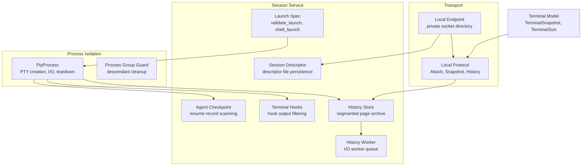

**Diagram sources**
- [launch_spec.hpp:10-32](file://services/session/src/launch_spec.hpp#L10-L32)
- [pty_process.hpp:20-75](file://services/session/src/platform/posix/pty_process.hpp#L20-L75)
- [process_group_guard.hpp:1-34](file://services/session/src/platform/posix/process_group_guard.hpp#L1-L34)
- [session_descriptor.hpp:1-58](file://services/session/src/session_descriptor.hpp#L1-L58)
- [agent_checkpoint.hpp:1-66](file://services/session/src/agent_checkpoint.hpp#L1-L66)
- [terminal_hooks.hpp:1-82](file://services/session/src/terminal_hooks.hpp#L1-L82)
- [history_store.hpp:1-74](file://services/session/src/history_store.hpp#L1-L74)
- [history_worker.hpp:1-54](file://services/session/src/history_worker.hpp#L1-L54)
- [local_endpoint.hpp:1-17](file://services/session/src/platform/posix/local_endpoint.hpp#L1-L17)
- [local_protocol.hpp:1-196](file://services/session/src/transport/local_protocol.hpp#L1-L196)
- [terminal.hpp:1-200](file://services/session/include/lapis/session/terminal.hpp#L1-L200)

**Section sources**
- [launch_spec.hpp:10-32](file://services/session/src/launch_spec.hpp#L10-L32)
- [pty_process.hpp:20-75](file://services/session/src/platform/posix/pty_process.hpp#L20-L75)
- [session_descriptor.hpp:1-58](file://services/session/src/session_descriptor.hpp#L1-L58)
- [agent_checkpoint.hpp:1-66](file://services/session/src/agent_checkpoint.hpp#L1-L66)
- [terminal_hooks.hpp:1-82](file://services/session/src/terminal_hooks.hpp#L1-L82)
- [history_store.hpp:1-74](file://services/session/src/history_store.hpp#L1-L74)
- [history_worker.hpp:1-54](file://services/session/src/history_worker.hpp#L1-L54)
- [local_endpoint.hpp:1-17](file://services/session/src/platform/posix/local_endpoint.hpp#L1-L17)
- [local_protocol.hpp:1-196](file://services/session/src/transport/local_protocol.hpp#L1-L196)
- [terminal.hpp:1-200](file://services/session/include/lapis/session/terminal.hpp#L1-L200)

## Core Components
- Launch specification: validates program, arguments, working directory, initial terminal size, and agent mode; computes a stable fingerprint for identity and resume policy.
- PTY process: owns the child process, master/slave PTY descriptors, nonblocking I/O, pause/resume behavior, and safe process-group termination.
- Process group guard: detached helper that kills all descendants when the service loses ownership of the control pipe.
- Session descriptor: owner-only `.session` file carrying session identity and launch fingerprint; written atomically through staged tickets.
- Agent checkpoint: scans terminal output for checkpoint markers, decodes resume records, and persists `.resume` metadata beside the endpoint.
- Terminal hooks: strips authenticated lapis hook sequences from output, extracts turn completion events, and supports remote shells behind SSH.
- History store and worker: append-only compressed page segments under a private session directory, backed by a single-threaded I/O worker.
- Local endpoint and protocol: secure Unix socket directory preparation, widened socket buffers, and a framed protocol for attach, snapshot, paste, history, attention, and termination.

**Section sources**
- [launch_spec.cpp:14-144](file://services/session/src/launch_spec.cpp#L14-L144)
- [pty_process.cpp:68-200](file://services/session/src/platform/posix/pty_process.cpp#L68-L200)
- [process_group_guard.cpp:14-97](file://services/session/src/platform/posix/process_group_guard.cpp#L14-L97)
- [session_descriptor.cpp:20-200](file://services/session/src/session_descriptor.cpp#L20-L200)
- [agent_checkpoint.cpp:1-200](file://services/session/src/agent_checkpoint.cpp#L1-L200)
- [terminal_hooks.cpp:1-200](file://services/session/src/terminal_hooks.cpp#L1-L200)
- [history_store.cpp:1-200](file://services/session/src/history_store.cpp#L1-L200)
- [history_worker.cpp:1-126](file://services/session/src/history_worker.cpp#L1-L126)
- [local_endpoint.cpp:1-93](file://services/session/src/platform/posix/local_endpoint.cpp#L1-L93)
- [local_protocol.hpp:1-196](file://services/session/src/transport/local_protocol.hpp#L1-L196)

## Architecture Overview
The session lifecycle is driven by three cooperating layers:

1. **Specification and isolation layer:** `validate_launch` resolves and constrains the executable, arguments, working directory, and terminal geometry. `PtyProcess::start` then creates a PTY, installs a new session and process group, binds standard streams to the slave, and launches the child.
2. **Observation and persistence layer:** Child output flows through `TerminalHookChannel` and `CheckpointScanner` into the terminal renderer, while snapshots are published via the local protocol. History pages are queued on `HistoryWorker` and persisted by `HistoryStore`.
3. **Identity and recovery layer:** When the child reports a conversation identity, the service writes a `.resume` record and a `.session` descriptor. Clients use the descriptor and fingerprint to discover, reconnect, create, or join sessions.

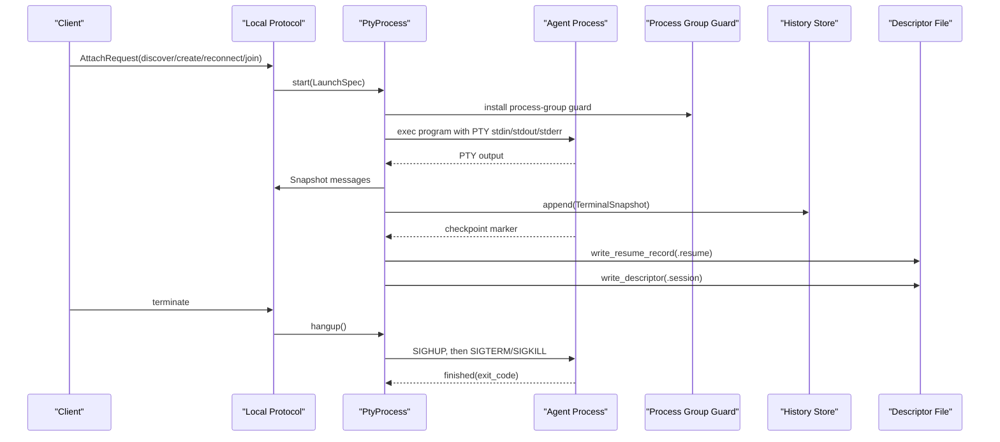

**Diagram sources**
- [local_protocol.hpp:80-196](file://services/session/src/transport/local_protocol.hpp#L80-L196)
- [pty_process.cpp:107-200](file://services/session/src/platform/posix/pty_process.cpp#L107-L200)
- [process_group_guard.cpp:14-97](file://services/session/src/platform/posix/process_group_guard.cpp#L14-L97)
- [agent_checkpoint.cpp:150-200](file://services/session/src/agent_checkpoint.cpp#L150-L200)
- [session_descriptor.cpp:120-200](file://services/session/src/session_descriptor.cpp#L120-L200)
- [history_store.cpp:1-200](file://services/session/src/history_store.cpp#L1-L200)

## Detailed Component Analysis

### Launch Specification Validation and Fingerprinting
A `LaunchSpec` carries the program path, arguments, working directory, initial `TerminalSize`, and `AgentMode`. Validation enforces:
- No null characters in text fields.
- Total launch value size below 64 KiB.
- Argument count below 256.
- Program and directory present.
- Initial terminal size nonzero and within the wire cell budget.
- Working directory exists and is canonicalized.
- Program resolves to an existing executable file; symlinks are preserved intentionally.
- Agent-mode-specific argument restrictions: managed Claude rejects settings flags that conflict with hooks, and managed Codex rejects remote endpoints because the launcher controls them.

After validation, `launch_fingerprint` hashes program, arguments, directory, and agent kind to produce a 32-byte SHA-256 identity tied to the launch contract rather than the child PID.

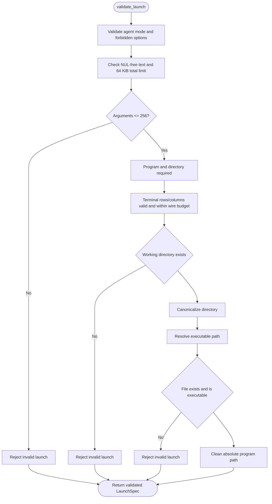

**Diagram sources**
- [launch_spec.cpp:14-113](file://services/session/src/launch_spec.cpp#L14-L113)

**Section sources**
- [launch_spec.hpp:10-32](file://services/session/src/launch_spec.hpp#L10-L32)
- [launch_spec.cpp:14-144](file://services/session/src/launch_spec.cpp#L14-L144)

### Process Isolation with PTY Creation and Environment Setup
`PtyProcess::start` performs the following isolation steps:
1. Reuses only one instance per object; concurrent or duplicate starts emit failure.
2. Calls `validate_launch` before any OS resources are allocated.
3. Creates a master PTY with `posix_openpt`, grants access, and unlocks it.
4. Resolves the `/dev/pts/*` name using platform-specific APIs.
5. Opens the slave side and makes the master nonblocking.
6. Sets the initial window size via `TIOCSWINSZ`.
7. Creates a process-group guard pipe and bounds the inherited descriptor table.
8. Installs Qt `QSocketNotifier`s for asynchronous read/write.
9. Copies the system environment and sets `TERM=xterm-256color` and `COLORTERM=truecolor`.
10. Configures the child working directory, program, and arguments.
11. Uses a child-process modifier to create a new session with `setsid`, install the guard, claim the slave as controlling TTY, redirect file descriptors 0-2 to the slave, and close the master/slave if they exceed standard descriptors.
12. Starts the child without `UseVFork`, giving the modifier its own address space.

The child process group is isolated because the leader becomes its own session leader and the guard observes the whole group.

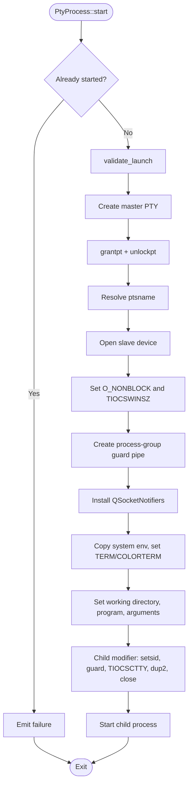

**Diagram sources**
- [pty_process.cpp:107-199](file://services/session/src/platform/posix/pty_process.cpp#L107-L199)

**Section sources**
- [pty_process.hpp:20-75](file://services/session/src/platform/posix/pty_process.hpp#L20-L75)
- [pty_process.cpp:68-200](file://services/session/src/platform/posix/pty_process.cpp#L68-L200)
- [process_group_guard.hpp:1-34](file://services/session/src/platform/posix/process_group_guard.hpp#L1-L34)
- [process_group_guard.cpp:14-97](file://services/session/src/platform/posix/process_group_guard.cpp#L14-L97)

### State Transitions: Pending, Running, Paused, Stopped, Terminated
The runtime state is best understood as a combination of internal process state and higher-level session semantics:

- **Pending:** The launcher has not yet created the PTY or started the child.
- **Running:** The child process is alive, the PTY reader/writer is active, and snapshots may be flowing.
- **Paused:** Output reading is suspended to bound retained bytes during backpressure. A watchdog still probes whether the leader exited.
- **Stopped:** The leader exited normally or was terminated; final drain is in progress.
- **Terminated:** Final drain completed, terminal descriptors closed, and `finished` emitted.

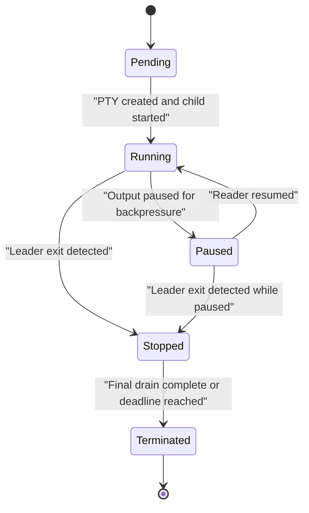

**Diagram sources**
- [pty_process.cpp:68-200](file://services/session/src/platform/posix/pty_process.cpp#L68-L200)
- [pty_process.cpp:201-431](file://services/session/src/platform/posix/pty_process.cpp#L201-L431)

**Section sources**
- [pty_process.cpp:201-431](file://services/session/src/platform/posix/pty_process.cpp#L201-L431)

### Monitoring, Unexpected Termination, and Recovery
Monitoring occurs at several levels:

- **Process health:** `QProcess::finished` and `errorOccurred` drive state transitions. When paused, `schedulePausedLeaderWatchdog` polls `waitpid` until the leader exits, avoiding reliance solely on `QProcess`, which can delay notification while PTY writers remain open.
- **Unexpected termination:** The destructor signals the verified process group with `SIGKILL`; if the child remains running after a short wait, it calls `kill`. On explicit shutdown, `hangup` sends `SIGHUP`, escalates to `SIGTERM` after 1.5 seconds, and `SIGKILL` after 3 seconds.
- **Automatic recovery:** The service itself does not restart failed agents automatically in these files. Instead, recovery is exposed through durable identities:
  - `.resume` records carry agent and session identity discovered from terminal output or observers.
  - `.session` descriptors expose the current attachment identity and launch fingerprint.
  - Clients can choose to reconnect, recreate, or join based on `AttachMode`.
- **Observer-backed agents:** For Codex and Claude, observer logic recognizes the agent and applies resume policies appropriate to those integrations.

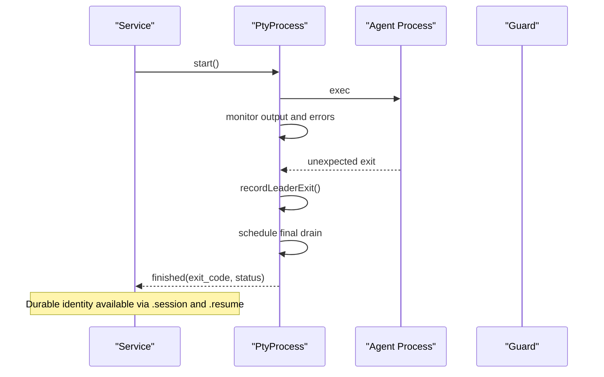

**Diagram sources**
- [pty_process.cpp:68-106](file://services/session/src/platform/posix/pty_process.cpp#L68-L106)
- [pty_process.cpp:201-431](file://services/session/src/platform/posix/pty_process.cpp#L201-L431)
- [agent_checkpoint.cpp:150-200](file://services/session/src/agent_checkpoint.cpp#L150-L200)
- [session_descriptor.cpp:120-200](file://services/session/src/session_descriptor.cpp#L120-L200)

**Section sources**
- [pty_process.cpp:68-431](file://services/session/src/platform/posix/pty_process.cpp#L68-L431)
- [agent_checkpoint.hpp:1-66](file://services/session/src/agent_checkpoint.hpp#L1-L66)
- [agent_checkpoint.cpp:150-200](file://services/session/src/agent_checkpoint.cpp#L150-L200)
- [session_descriptor.hpp:1-58](file://services/session/src/session_descriptor.hpp#L1-L58)

### Checkpoint Creation and Restoration
Checkpoints allow surviving restarts by recording a conversation identity rather than a transient process ID.

- **Creation:** As PTY output flows, `CheckpointScanner.scan` searches for OSC-style checkpoint markers, keeps a bounded carry buffer across reads, decodes base64 JSON, validates agent name, session identity format, host locality, and version, and returns the newest valid `ResumeRecord`.
- **Storage:** `write_resume_record` writes `<endpoint>.resume` next to the private endpoint. Existing records must be regular files owned by the effective user, have link count one, permissions no more restrictive than world-writable bits cleared, and size within limits.
- **Discovery:** `read_resume_record` returns `nullopt` for absent, unsafe, or malformed files.
- **Policy:** `checkpoint_agent_for_launch` maps `LaunchSpec` to an untrusted agent string used to scope resume data. Observer-backed agents such as Codex and Claude receive special handling through `observer_backed_agent`.
- **Codex thread discovery:** For some workflows, open rollout files are inspected to identify the active Codex thread.

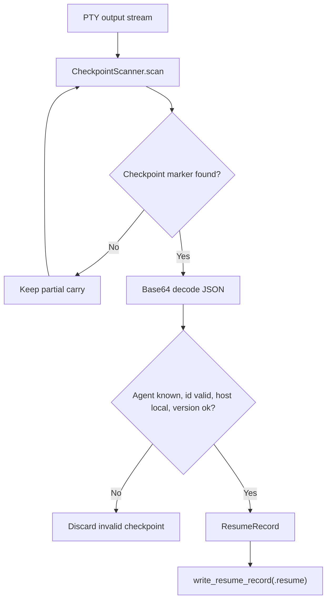

**Diagram sources**
- [agent_checkpoint.cpp:1-200](file://services/session/src/agent_checkpoint.cpp#L1-L200)

**Section sources**
- [agent_checkpoint.hpp:1-66](file://services/session/src/agent_checkpoint.hpp#L1-L66)
- [agent_checkpoint.cpp:1-200](file://services/session/src/agent_checkpoint.cpp#L1-L200)

### Session Descriptor and Endpoint Security
The descriptor file is a compact, owner-only hint of liveness:
- Format begins with a magic header, followed by 16-byte session ID, 16-byte epoch, and 32-byte launch fingerprint.
- Discovery reads the file without following symlinks, validates ownership, link count, exact mode `0600`, and exact size.
- Writing uses a staging ticket that creates a random temporary file, serializes the descriptor, renames it atomically, and cancels safely on destruction.
- Only the newest ticket for a canonical endpoint may rename; cancellation is ordered with the commit guard.

Endpoint preparation enforces:
- Socket path cannot be empty, contain null bytes, be too long, or be a symlink.
- Parent directory is created as `0700` when absent and never chmodded when present.
- Trusted ancestors are validated against shared writable directories unless sticky.
- Existing non-socket files at the socket path are rejected.

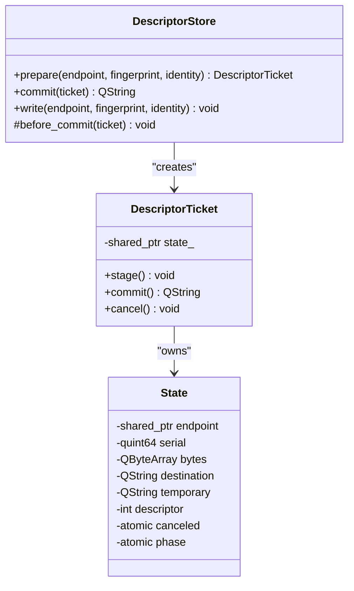

**Diagram sources**
- [session_descriptor.hpp:18-58](file://services/session/src/session_descriptor.hpp#L18-L58)
- [session_descriptor.cpp:20-200](file://services/session/src/session_descriptor.cpp#L20-L200)

**Section sources**
- [session_descriptor.hpp:1-58](file://services/session/src/session_descriptor.hpp#L1-L58)
- [session_descriptor.cpp:20-200](file://services/session/src/session_descriptor.cpp#L20-L200)
- [local_endpoint.hpp:1-17](file://services/session/src/platform/posix/local_endpoint.hpp#L1-L17)
- [local_endpoint.cpp:1-93](file://services/session/src/platform/posix/local_endpoint.cpp#L1-L93)

### Terminal Hook Filtering and Turn Observability
For agents that print their own hooks to the terminal instead of using a local socket, `TerminalHookChannel` filters authenticated sequences:
- An init sequence binds a 32-hex-digit nonce to a CLI identifier such as `claude` or `codex`.
- Subsequent event sequences must match the nonce and carry base64-encoded JSON.
- Malformed, oversized, or unauthorized candidates are quarantined with bounded discard budgets.
- Lapis sequences are removed from displayed output.
- `NotifyTurns` tracks turn boundaries and updates attention state when a turn completes.

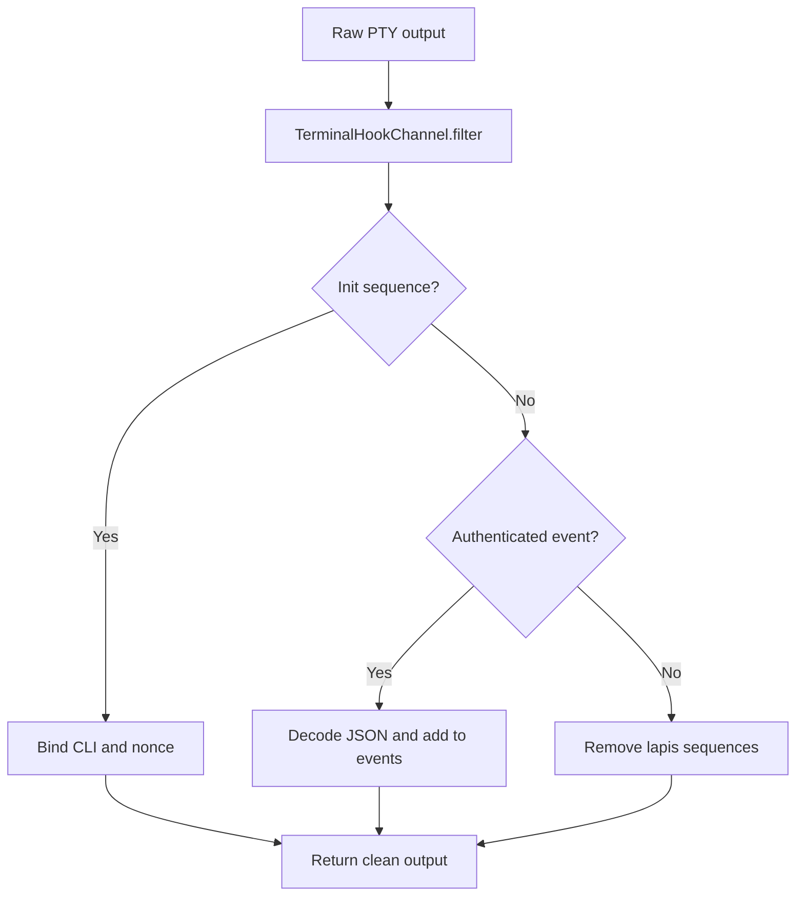

**Diagram sources**
- [terminal_hooks.cpp:1-200](file://services/session/src/terminal_hooks.cpp#L1-L200)

**Section sources**
- [terminal_hooks.hpp:1-82](file://services/session/src/terminal_hooks.hpp#L1-L82)
- [terminal_hooks.cpp:1-200](file://services/session/src/terminal_hooks.cpp#L1-L200)

### History Persistence and Recovery
History provides durable replay of terminal pages:
- `HistoryStore` maintains compressed page segments under a private session directory.
- Pages are appended sequentially; older pages are evicted according to per-session and global byte budgets.
- Indexes are kept in memory; legacy `.page` files are counted and evicted but not read.
- Atomic writes use a `.pending` file, `fsync`, and `rename`.
- `HistoryWorker` queues operations on a dedicated single-thread pool, caps queued bytes and pages, and exposes `drain` for graceful shutdown.

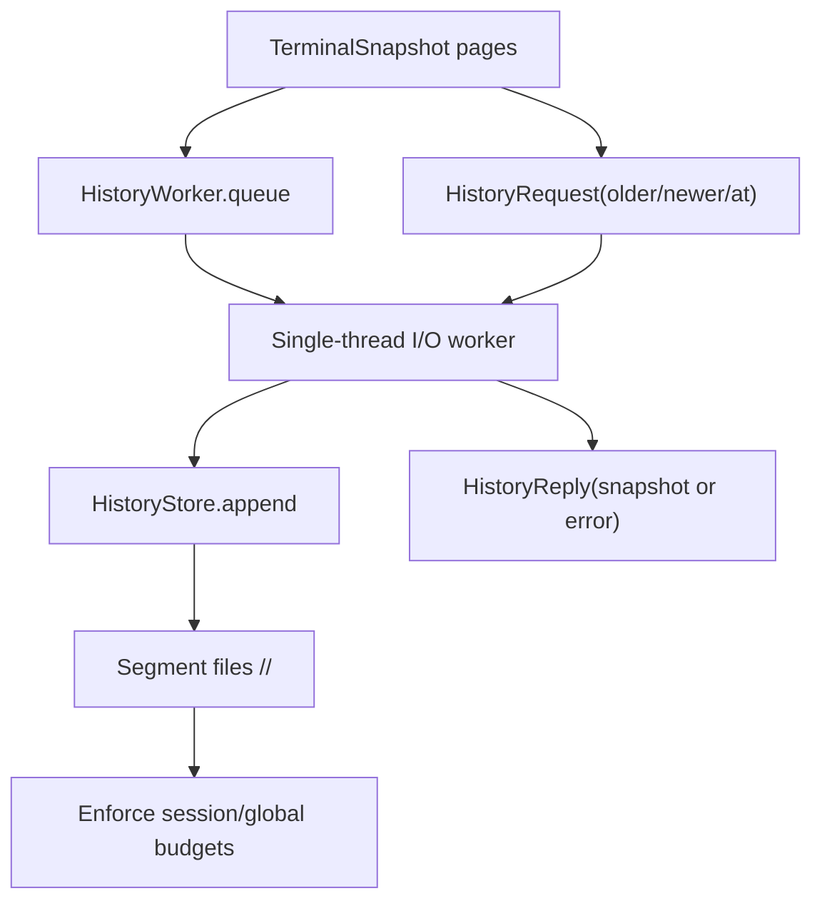

**Diagram sources**
- [history_store.cpp:1-200](file://services/session/src/history_store.cpp#L1-L200)
- [history_worker.cpp:1-126](file://services/session/src/history_worker.cpp#L1-L126)

**Section sources**
- [history_store.hpp:1-74](file://services/session/src/history_store.hpp#L1-L74)
- [history_store.cpp:1-200](file://services/session/src/history_store.cpp#L1-L200)
- [history_worker.hpp:1-54](file://services/session/src/history_worker.hpp#L1-L54)
- [history_worker.cpp:1-126](file://services/session/src/history_worker.cpp#L1-L126)

### Error Handling Strategies
The codebase favors early validation, bounded allocation, strict file permissions, and explicit failure paths:

| Failure Category | Strategy | Relevant Implementation |
|---|---|---|
| Invalid launch inputs | Reject null characters, oversized values, excessive arguments, missing program/directory, nonexistent directory, nonexecutable program, invalid terminal size | `validate_launch` |
| Permission issues | Require owner-only directories and files (`0700`/`0600`), reject symlinks, verify effective user ownership and link counts | `prepare_endpoint`, `read_descriptor`, `safe_existing`, `private_file` |
| Resource constraints | Limit launch payload size, PTY read batch size, pending write queue, history page size, segment size, global history bytes, queued history bytes and pages | `max_read_batch`, `queue_limit`, `max_page_bytes`, `max_segment_bytes`, `max_global_bytes`, `max_queue_pages` |
| Unexpected termination | Leader watchdog, bounded final drain, wall-clock deadlines, process-group signal escalation, destructor fallback kill | `schedulePausedLeaderWatchdog`, `finishWhenDrained`, `hangup`, destructor |
| Network/socket safety | Validate trusted directory ancestors, widen socket buffers only when beneficial, reject non-socket paths | `canonical_trusted_directory`, `widen_socket_buffers` |
| Protocol safety | Frame size limits, identity validation, hyperlink bounds, bounded paste sizes, strict enum decoding | `max_frame_bytes`, `valid_identity`, `validate_links` |

**Section sources**
- [launch_spec.cpp:14-113](file://services/session/src/launch_spec.cpp#L14-L113)
- [local_endpoint.cpp:1-93](file://services/session/src/platform/posix/local_endpoint.cpp#L1-L93)
- [session_descriptor.cpp:20-200](file://services/session/src/session_descriptor.cpp#L20-L200)
- [history_store.cpp:1-200](file://services/session/src/history_store.cpp#L1-L200)
- [pty_process.cpp:201-431](file://services/session/src/platform/posix/pty_process.cpp#L201-L431)
- [local_protocol.hpp:1-196](file://services/session/src/transport/local_protocol.hpp#L1-L196)

### Cleanup Procedures
Cleanup is layered to avoid leaks even when normal flow is interrupted:

1. **Terminal resources:** `PtyProcess::~PtyProcess` disconnects Qt objects, resets readers/writers and guard pipes, closes master/slave descriptors, clears pending writes, and waits briefly for the child before forcing `kill`.
2. **Child processes:** Destruction first attempts to terminate the verified process group; if the process is still running, `QProcess::kill` is used. Explicit `hangup` uses SIGHUP, then timed SIGTERM and SIGKILL.
3. **Descendants:** The detached guard process watches the control pipe; when the parent closes it or dies, it closes inherited descriptors and kills the entire process group.
4. **Temporary files:** Descriptor tickets unlink their temporary files in `close_locked` and `~DescriptorTicket`. History writes remove `.pending` files and use RAII helpers to delete pending paths.
5. **Process group ownership:** Once the leader is reaped, the service stops treating the numeric PID as a safe signaling target and relies on the guard for descendant cleanup.

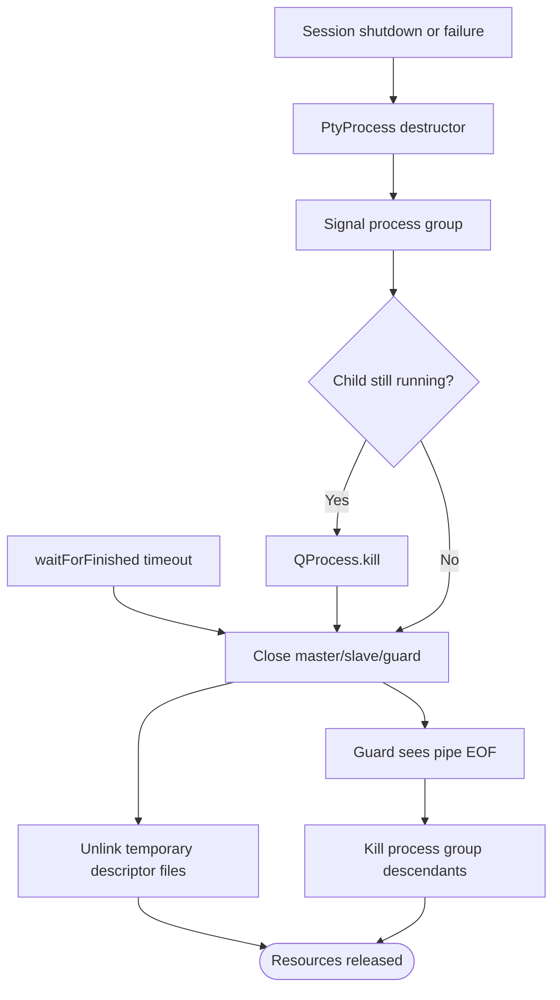

**Diagram sources**
- [pty_process.cpp:68-106](file://services/session/src/platform/posix/pty_process.cpp#L68-L106)
- [pty_process.cpp:201-431](file://services/session/src/platform/posix/pty_process.cpp#L201-L431)
- [process_group_guard.cpp:14-97](file://services/session/src/platform/posix/process_group_guard.cpp#L14-L97)
- [session_descriptor.cpp:60-120](file://services/session/src/session_descriptor.cpp#L60-L120)
- [history_store.cpp:100-160](file://services/session/src/history_store.cpp#L100-L160)

**Section sources**
- [pty_process.cpp:68-431](file://services/session/src/platform/posix/pty_process.cpp#L68-L431)
- [process_group_guard.cpp:14-97](file://services/session/src/platform/posix/process_group_guard.cpp#L14-L97)
- [session_descriptor.cpp:60-120](file://services/session/src/session_descriptor.cpp#L60-L120)
- [history_store.cpp:100-160](file://services/session/src/history_store.cpp#L100-L160)

## Dependency Analysis
Key dependencies and coupling:

- `PtyProcess` depends on `LaunchSpec` for validated launch parameters and on `TerminalSize` for geometry.
- `PtyProcess` depends on `process_group_guard` for descendant cleanup and on Qt concurrency primitives for nonblocking I/O.
- `CheckpointScanner` and `TerminalHookChannel` consume raw PTY output and produce structured events.
- `HistoryStore` depends on POSIX filesystem semantics and atomicity guarantees; `HistoryWorker` isolates blocking I/O from the event loop.
- `session_descriptor` and `local_endpoint` share trust assumptions about ownership and directory permissions.
- `local_protocol` defines the client-facing frame contract and is used throughout attach, snapshot, paste, history, and termination flows.

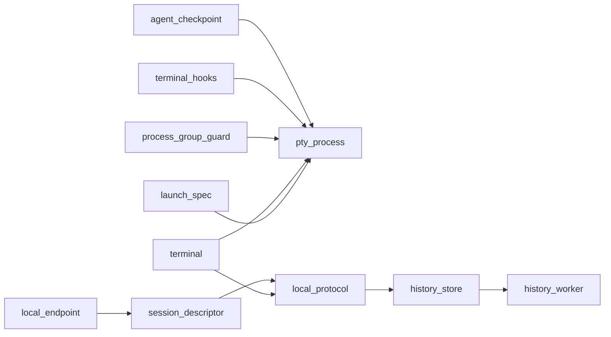

**Diagram sources**
- [launch_spec.hpp:10-32](file://services/session/src/launch_spec.hpp#L10-L32)
- [pty_process.hpp:20-75](file://services/session/src/platform/posix/pty_process.hpp#L20-L75)
- [process_group_guard.hpp:1-34](file://services/session/src/platform/posix/process_group_guard.hpp#L1-L34)
- [terminal_hooks.hpp:1-82](file://services/session/src/terminal_hooks.hpp#L1-L82)
- [agent_checkpoint.hpp:1-66](file://services/session/src/agent_checkpoint.hpp#L1-L66)
- [history_store.hpp:1-74](file://services/session/src/history_store.hpp#L1-L74)
- [history_worker.hpp:1-54](file://services/session/src/history_worker.hpp#L1-L54)
- [local_endpoint.hpp:1-17](file://services/session/src/platform/posix/local_endpoint.hpp#L1-L17)
- [session_descriptor.hpp:1-58](file://services/session/src/session_descriptor.hpp#L1-L58)
- [local_protocol.hpp:1-196](file://services/session/src/transport/local_protocol.hpp#L1-L196)
- [terminal.hpp:1-200](file://services/session/include/lapis/session/terminal.hpp#L1-L200)

**Section sources**
- [pty_process.cpp:107-200](file://services/session/src/platform/posix/pty_process.cpp#L107-L200)
- [history_worker.cpp:1-126](file://services/session/src/history_worker.cpp#L1-L126)
- [session_descriptor.cpp:20-200](file://services/session/src/session_descriptor.cpp#L20-L200)

## Performance Considerations
- **PTY output batching:** Reads are limited to a fixed maximum batch size so a fast producer cannot starve the consumer indefinitely.
- **Write queueing:** Writes are buffered in memory with a 1 MiB queue limit and drained asynchronously through `QSocketNotifier`.
- **Final drain budgeting:** After the leader exits, the terminal drain is bounded both by iteration budget and a 3-second wall-clock deadline.
- **History quotas:** Per-session and global byte limits prevent runaway disk usage; the newest segment per session is protected from eviction by other sessions.
- **I/O isolation:** History operations run on a single-threaded worker, preventing blocking filesystem calls from stalling the main event loop.
- **Socket buffering:** Socket send and receive buffers are widened to reduce round trips for large screen frames.

[No sources needed since this section provides general guidance]

## Troubleshooting Guide
Common symptoms and where to look:

| Symptom | Likely Cause | Evidence and Resolution |
|---|---|---|
| Launch fails immediately | Invalid program, arguments, directory, terminal size, or agent flag | Check `validate_launch` rejection paths; inspect program resolution and directory existence. |
| PTY open or configure error | Missing `/dev/pts`, insufficient privileges, or invalid ioctl | Inspect failure messages from PTY creation and `TIOCSWINSZ`. |
| No output reaches client | Reader disabled, output paused, or EIO on PTY read | Verify reader enablement, pause state, and PTY read path. |
| Child survives parent death | Guard pipe still open or guard failed | Ensure parent closes control pipe after startup success; check guard installation. |
| Resume fails after restart | Missing or unsafe `.resume`/`.session` file | Verify file ownership, permissions, symlink protection, and content validity. |
| History unavailable or slow | Disk full, lock contention, or blocked worker | Check history root permissions, free disk space, and worker queue status. |
| Client cannot connect | Socket path too long, symlink, or insecure parent directory | Validate endpoint path and trusted directory ancestry. |

**Section sources**
- [launch_spec.cpp:14-113](file://services/session/src/launch_spec.cpp#L14-L113)
- [pty_process.cpp:68-200](file://services/session/src/platform/posix/pty_process.cpp#L68-L200)
- [pty_process.cpp:201-431](file://services/session/src/platform/posix/pty_process.cpp#L201-L431)
- [process_group_guard.cpp:14-97](file://services/session/src/platform/posix/process_group_guard.cpp#L14-L97)
- [session_descriptor.cpp:20-200](file://services/session/src/session_descriptor.cpp#L20-L200)
- [local_endpoint.cpp:1-93](file://services/session/src/platform/posix/local_endpoint.cpp#L1-L93)
- [history_store.cpp:1-200](file://services/session/src/history_store.cpp#L1-L200)

## Conclusion
The session lifecycle management system separates concerns cleanly: launch validation and fingerprinting define immutable session identity; PTY-based process isolation ensures children run with proper terminals and process groups; observation and checkpointing capture enough information for clients to recover or reconnect; history provides durable replay; and robust cleanup paths protect against leaked processes, stale descriptors, and insecure temporary files. Errors are bounded by explicit size, permission, and timing limits, making the system resilient to malformed input, unexpected termination, and resource pressure.

[No sources needed since this section summarizes without analyzing specific files]