# Session Service

<cite>
**Referenced Files in This Document**
- [session_service.cpp](file://services/session/src/session_service.cpp)
- [launch_spec.hpp](file://services/session/src/launch_spec.hpp)
- [launch_spec.cpp](file://services/session/src/launch_spec.cpp)
- [pty_process.hpp](file://services/session/src/platform/posix/pty_process.hpp)
- [pty_process.cpp](file://services/session/src/platform/posix/pty_process.cpp)
- [process_group_guard.hpp](file://services/session/src/platform/posix/process_group_guard.hpp)
- [process_group_guard.cpp](file://services/session/src/platform/posix/process_group_guard.cpp)
- [local_protocol.hpp](file://services/session/src/transport/local_protocol.hpp)
- [local_protocol.cpp](file://services/session/src/transport/local_protocol.cpp)
- [attention_protocol.hpp](file://services/session/src/transport/attention_protocol.hpp)
- [attention_protocol.cpp](file://services/session/src/transport/attention_protocol.cpp)
- [terminal_hooks.hpp](file://services/session/src/terminal_hooks.hpp)
- [terminal_hooks.cpp](file://services/session/src/terminal_hooks.cpp)
- [attention_journal.hpp](file://services/session/src/attention_journal.hpp)
- [attention_journal.cpp](file://services/session/src/attention_journal.cpp)
- [attention_audit.hpp](file://services/session/src/attention_audit.hpp)
- [attention_audit.cpp](file://services/session/src/attention_audit.cpp)
- [history_store.hpp](file://services/session/src/history_store.hpp)
- [history_store.cpp](file://services/session/src/history_store.cpp)
- [history_worker.hpp](file://services/session/src/history_worker.hpp)
- [history_worker.cpp](file://services/session/src/history_worker.cpp)
- [agent_checkpoint.hpp](file://services/session/src/agent_checkpoint.hpp)
- [agent_checkpoint.cpp](file://services/session/src/agent_checkpoint.cpp)
- [session_descriptor.hpp](file://services/session/src/session_descriptor.hpp)
- [session_descriptor.cpp](file://services/session/src/session_descriptor.cpp)
- [terminal.hpp](file://services/session/include/lapis/session/terminal.hpp)
- [attention.hpp](file://services/session/include/lapis/session/attention.hpp)
- [CMakeLists.txt](file://services/session/CMakeLists.txt)
</cite>

## Table of Contents
1. [Introduction](#introduction)
2. [Project Structure](#project-structure)
3. [Core Components](#core-components)
4. [Architecture Overview](#architecture-overview)
5. [Detailed Component Analysis](#detailed-component-analysis)
6. [Dependency Analysis](#dependency-analysis)
7. [Performance Considerations](#performance-considerations)
8. [Troubleshooting Guide](#troubleshooting-guide)
9. [Security Considerations](#security-considerations)
10. [Conclusion](#conclusion)

## Introduction
The session service is the core runtime component that owns individual agent processes and exposes them to the desktop UI, supervisor, and other local clients. It transforms a validated launch specification into an isolated POSIX process running inside a pseudo-terminal, streams terminal output through a bounded local IPC protocol, persists conversation history and checkpoints, and maintains a durable attention journal for user-approved agent actions. It also provides terminal hooks so agents such as Claude Code or Codex can signal structured events through their own terminal output.

This document explains the complete lifecycle from launch validation through process creation, PTY I/O streaming, attention handling, history persistence, cleanup, and security boundaries.

## Project Structure
The session service lives under `services/session` and is composed of several cooperating libraries:

| Area | Responsibility |
|---|---|
| Launch configuration | Validates agent modes, arguments, working directory, and executable resolution |
| PTY and process isolation | Creates pseudo-terminals, manages process groups, and monitors child termination |
| Local IPC | Encodes and decodes terminal snapshots, input, paste, resize, wheel, status, and attach messages |
| Attention system | Normalizes agent requests, tracks pending decisions, and records durable audit entries |
| History storage | Persists compressed terminal pages with per-session and global quotas |
| Terminal hooks | Filters private sequences from agent output and turns them into normalized events |
| Agent checkpoints | Extracts resume metadata from trusted agent output and open files |
| Session descriptors | Publishes owner-only endpoint hints for discovery and reconnection |

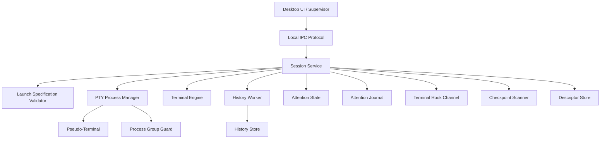

**Diagram sources**
- [session_service.cpp:1-120](file://services/session/src/session_service.cpp#L1-L120)
- [launch_spec.hpp:10-32](file://services/session/src/launch_spec.hpp#L10-L32)
- [pty_process.hpp:17-75](file://services/session/src/platform/posix/pty_process.hpp#L17-L75)
- [local_protocol.hpp:12-196](file://services/session/src/transport/local_protocol.hpp#L12-L196)
- [history_worker.hpp:12-54](file://services/session/src/history_worker.hpp#L12-L54)
- [attention_journal.hpp:18-99](file://services/session/src/attention_journal.hpp#L18-L99)
- [terminal_hooks.hpp:12-82](file://services/session/src/terminal_hooks.hpp#L12-L82)
- [agent_checkpoint.hpp:12-66](file://services/session/src/agent_checkpoint.hpp#L12-L66)
- [session_descriptor.hpp:7-58](file://services/session/src/session_descriptor.hpp#L7-L58)

**Section sources**
- [CMakeLists.txt:1-130](file://services/session/CMakeLists.txt#L1-L130)

## Core Components
The session service composes several layers:

1. **Launch specification** validates the agent mode, program path, working directory, argument count, size limits, and executable permissions before any process is created.
2. **PTY process manager** creates a new session leader, assigns a controlling terminal, binds standard streams to the slave side, starts a detached process-group guard, and reports output through Qt signals.
3. **Local IPC protocol** serializes frames between the service and clients with bounded sizes, attachment identities, and negotiation bits for hyperlinks, attention phases, and paste transactions.
4. **Terminal engine** parses VT/terminal control sequences into owned snapshots containing cells, graphemes, cursor state, palette, and optional hyperlinks.
5. **History worker and store** persist terminal snapshots as compressed page segments with per-session and global byte budgets, plus an index allowing older/newer/at-row queries.
6. **Attention state and journal** normalize agent interaction requests, enforce epoch/revision ordering, and append durable asked/decided/delivered/resolved entries.
7. **Terminal hooks** extract authenticated hook events from OSC sequences printed by supported agents.
8. **Agent checkpointing** recognizes resume markers in untrusted output and reads safe resume records next to the agent endpoint.
9. **Session descriptor store** writes owner-only `.session` files using atomic staged replacement.

**Section sources**
- [launch_spec.cpp:1-144](file://services/session/src/launch_spec.cpp#L1-L144)
- [pty_process.cpp:1-200](file://services/session/src/platform/posix/pty_process.cpp#L1-L200)
- [local_protocol.hpp:12-196](file://services/session/src/transport/local_protocol.hpp#L12-L196)
- [terminal.hpp:10-201](file://services/session/include/lapis/session/terminal.hpp#L10-L201)
- [history_store.hpp:12-74](file://services/session/src/history_store.hpp#L12-L74)
- [attention_journal.hpp:18-99](file://services/session/src/attention_journal.hpp#L18-L99)
- [terminal_hooks.hpp:12-82](file://services/session/src/terminal_hooks.hpp#L12-L82)
- [agent_checkpoint.hpp:12-66](file://services/session/src/agent_checkpoint.hpp#L12-L66)
- [session_descriptor.hpp:7-58](file://services/session/src/session_descriptor.hpp#L7-L58)

## Architecture Overview
The session service is not a single monolithic function. Its responsibilities are split across libraries whose build-time dependencies are explicit:

- `lapis_attention`: pure attention state without GUI, protocol, or terminal dependency.
- `lapis_session_platform`: POSIX lifetime primitives such as file descriptor ownership and process-group guards.
- `lapis_attention_journal`: durable attention audit backed by platform file operations.
- `lapis_terminal`: in-process terminal parser over Ghostty.
- `lapis_session_launch`: launch specification and POSIX local endpoint bootstrap.
- `lapis_local_protocol`: wire format, attach/hello/snapshot/status, attention transport, session identity, agent checkpoint, and terminal hooks.
- `lapis_pty_process`: POSIX PTY process management.
- `lapis_history`: history store and background worker.
- `lapis_session_service`: production binary combining all layers.

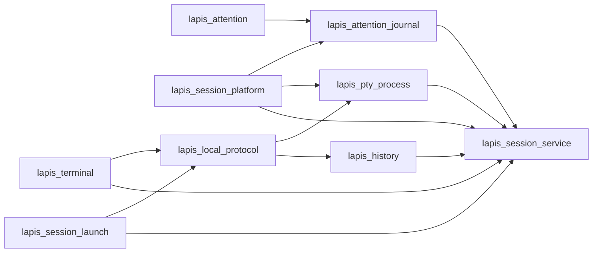

**Diagram sources**
- [CMakeLists.txt:1-130](file://services/session/CMakeLists.txt#L1-L130)

**Section sources**
- [CMakeLists.txt:1-130](file://services/session/CMakeLists.txt#L1-L130)

## Detailed Component Analysis

### Launch Specification Lifecycle
The launch pipeline begins with a client-provided request describing the agent type, program, arguments, working directory, and initial terminal size. Validation rejects unknown agent modes, unsafe CLI flags, remote-endpoint overrides for managed agents, null characters, oversized payloads, too many arguments, invalid sizes, nonexistent directories, and non-executable programs. The canonicalized program path preserves symlinks because some multicall binaries depend on `argv[0]`. A fingerprint is then derived from the resolved program, arguments, working directory, and agent mode; it identifies equivalent launches rather than volatile process identifiers.

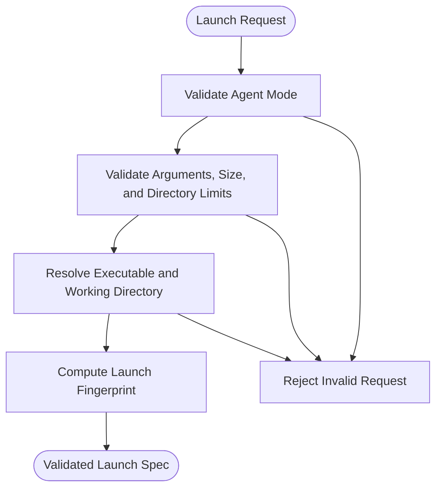

**Diagram sources**
- [launch_spec.hpp:10-32](file://services/session/src/launch_spec.hpp#L10-L32)
- [launch_spec.cpp:1-144](file://services/session/src/launch_spec.cpp#L1-L144)

**Section sources**
- [launch_spec.hpp:10-32](file://services/session/src/launch_spec.hpp#L10-L32)
- [launch_spec.cpp:1-144](file://services/session/src/launch_spec.cpp#L1-L144)

### PTY Process Creation and Isolation
`PtyProcess` owns the master and slave ends of a pseudo-terminal. On start, it opens the PTY master, grants and unlocks it, resolves the slave device name, opens the slave, configures nonblocking I/O, sets the initial window size, creates a process-group guard pipe, installs socket notifiers, and applies environment variables such as `TERM` and `COLORTERM`.

In the child modifier, the process creates a new session with `setsid`, starts the detached group guard, claims the slave as the controlling terminal, duplicates the slave onto standard input, output, and error, and closes the original master and slave descriptors. After exec, the parent observes `started`, enables reading unless paused, and emits the first output batch.

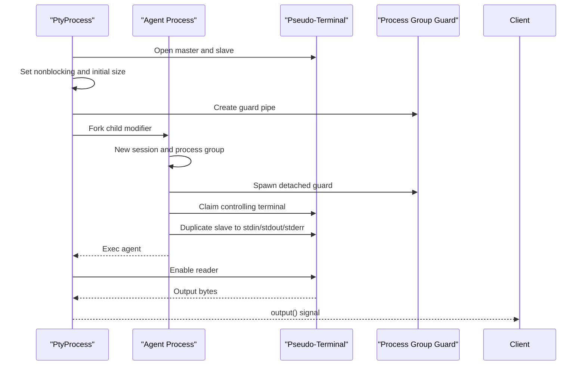

**Diagram sources**
- [pty_process.hpp:17-75](file://services/session/src/platform/posix/pty_process.hpp#L17-L75)
- [pty_process.cpp:1-200](file://services/session/src/platform/posix/pty_process.cpp#L1-L200)
- [process_group_guard.hpp:12-34](file://services/session/src/platform/posix/process_group_guard.hpp#L12-L34)
- [process_group_guard.cpp:1-97](file://services/session/src/platform/posix/process_group_guard.cpp#L1-L97)

**Section sources**
- [pty_process.hpp:17-75](file://services/session/src/platform/posix/pty_process.hpp#L17-L75)
- [pty_process.cpp:1-200](file://services/session/src/platform/posix/pty_process.cpp#L1-L200)

### Process Groups and Cleanup
The process-group guard is critical for cleanup. It is double-forked and detached so the agent cannot inherit a hidden intermediate process. The guard closes every inherited file descriptor except its control pipe, waits for EOF, then kills its entire process group with `SIGKILL`. If the parent closes the write end after the leader exits, the guard detects EOF and terminates descendants. If the service destructor runs while the process is still alive, it escalates to `SIGKILL`, waits briefly, kills again if needed, and then releases file descriptors.

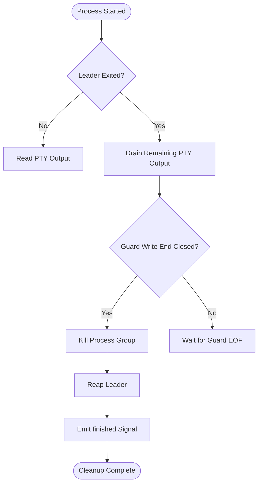

**Diagram sources**
- [pty_process.cpp:1-200](file://services/session/src/platform/posix/pty_process.cpp#L1-L200)
- [process_group_guard.cpp:1-97](file://services/session/src/platform/posix/process_group_guard.cpp#L1-L97)

**Section sources**
- [pty_process.cpp:1-200](file://services/session/src/platform/posix/pty_process.cpp#L1-L200)
- [process_group_guard.cpp:1-97](file://services/session/src/platform/posix/process_group_guard.cpp#L1-L97)

### Local IPC Protocol
The local IPC protocol defines a frame-based wire format with a version number, bounded payload sizes, attachment identities, and capability negotiation. Key message kinds include:

| Message | Direction | Purpose |
|---|---|---|
| `hello` | Agent to service | Reports child PID and negotiated capabilities |
| `snapshot` | Service to client | Sends terminal screen state with timing metadata |
| `text`, `paste`, `key`, `resize` | Client to service | Sends user input |
| `wheel` | Client to service | Scrolls full-screen application content |
| `status` | Bidirectional | Reports rejected, ended, replaced, or overloaded sessions |
| `attach` | Client to service | Discovers, reconnects, creates, or joins a session |
| `ready` | Service to client | Acknowledges the first applied snapshot sequence |
| `history_request`, `history_page` | Client/service | Navigates archived terminal pages |
| `attention_snapshot`, `attention_decision`, `attention_retry` | Service/client | Carries attention state and user decisions |
| `terminate` | Client to service | Requests graceful process termination |

Bounded constants protect against memory pressure: maximum frame bytes, cell counts, codepoints, input bytes, paste bytes, hyperlink spans, hyperlink URI length, and hyperlink byte totals.

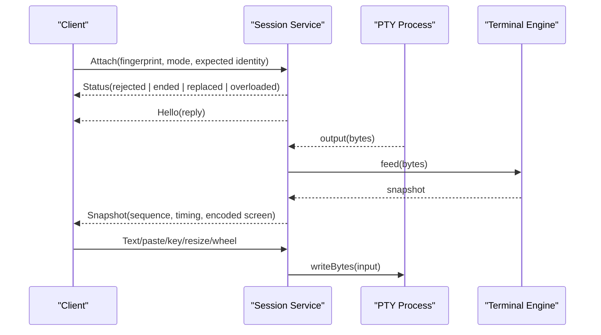

**Diagram sources**
- [local_protocol.hpp:12-196](file://services/session/src/transport/local_protocol.hpp#L12-L196)
- [local_protocol.cpp:1-200](file://services/session/src/transport/local_protocol.cpp#L1-L200)
- [pty_process.hpp:17-75](file://services/session/src/platform/posix/pty_process.hpp#L17-L75)
- [terminal.hpp:10-201](file://services/session/include/lapis/session/terminal.hpp#L10-L201)

**Section sources**
- [local_protocol.hpp:12-196](file://services/session/src/transport/local_protocol.hpp#L12-L196)
- [local_protocol.cpp:1-200](file://services/session/src/transport/local_protocol.cpp#L1-L200)

### Terminal I/O Streaming
Terminal output flows from the PTY master into the in-process terminal engine, which produces an owned `TerminalSnapshot`. The snapshot contains row-major cells, a contiguous grapheme buffer, cursor position and shape, alternate-screen flag, hyperlink spans, palette, and history metadata. Input from the client is encoded back into terminal-safe sequences and written to the PTY slave. Paste data may be split into multiple bounded messages and admitted only when the PTY queue remains under one MiB.

The terminal class enforces strict ownership rules: it runs on a single owner thread, performs no I/O, and throws well-defined exceptions for invalid geometry, input limits, reply overflow, and upstream errors.

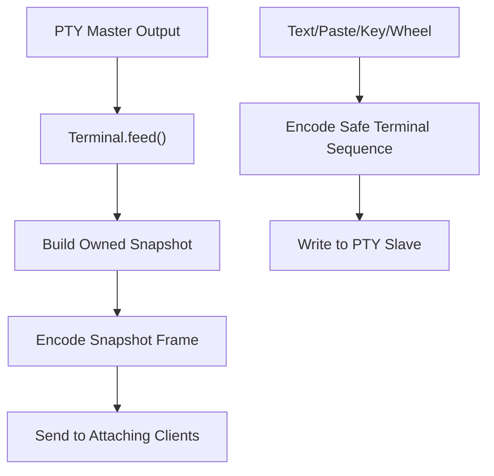

**Diagram sources**
- [pty_process.cpp:1-200](file://services/session/src/platform/posix/pty_process.cpp#L1-L200)
- [terminal.hpp:10-201](file://services/session/include/lapis/session/terminal.hpp#L10-L201)
- [local_protocol.hpp:12-196](file://services/session/src/transport/local_protocol.hpp#L12-L196)

**Section sources**
- [terminal.hpp:10-201](file://services/session/include/lapis/session/terminal.hpp#L10-L201)
- [pty_process.cpp:1-200](file://services/session/src/platform/posix/pty_process.cpp#L1-L200)
- [local_protocol.hpp:12-196](file://services/session/src/transport/local_protocol.hpp#L12-L196)

### History Storage System
History storage persists terminal snapshots as compressed page segments under `<root>/<session>/`. Each segment is identified by its first page ID, and an in-memory index maps absolute row positions to segment records. Quotas are enforced at both per-session and global levels. The newest segment of each session is marked open and protected from eviction by other sessions.

Storage uses blocking filesystem APIs and must run on a dedicated worker. Atomic writes use a `.pending` file, flush, fsync, and rename. Directories and files are validated as private regular files owned by the current user with restrictive permissions.

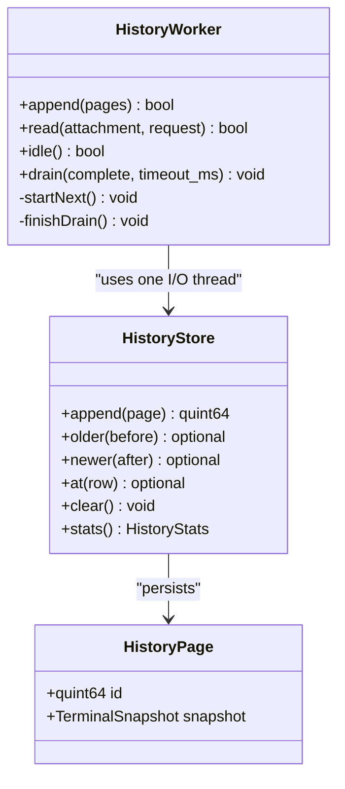

**Diagram sources**
- [history_store.hpp:12-74](file://services/session/src/history_store.hpp#L12-L74)
- [history_store.cpp:1-200](file://services/session/src/history_store.cpp#L1-L200)
- [history_worker.hpp:12-54](file://services/session/src/history_worker.hpp#L12-L54)
- [history_worker.cpp:1-126](file://services/session/src/history_worker.cpp#L1-L126)

**Section sources**
- [history_store.hpp:12-74](file://services/session/src/history_store.hpp#L12-L74)
- [history_store.cpp:1-200](file://services/session/src/history_store.cpp#L1-L200)
- [history_worker.hpp:12-54](file://services/session/src/history_worker.hpp#L12-L54)
- [history_worker.cpp:1-126](file://services/session/src/history_worker.cpp#L1-L126)

### Attention Journal and Audit System
The attention system models agent interactions as requests with IDs, threads, turns, items, reasons, summaries, choices, priorities, epochs, revisions, and timestamps. The service normalizes these through `attention::State`, which supports connection, observation, authoritative reconciliation, activity updates, snoozing, acknowledgment, and ordered presentation.

The durable attention journal stores asked, decided, delivered, and resolved entries with CRC-32 checksums, bounded record sizes, rotation thresholds, exclusive writer locks, replay, and crash recovery. An entry is considered durable only after `append` returns successfully, so decision delivery is gated behind persistence.

The audit layer bridges the live attention state and the journal: it records new asks, agent-resolved questions, intended user decisions, confirmed deliveries, and refused decisions.

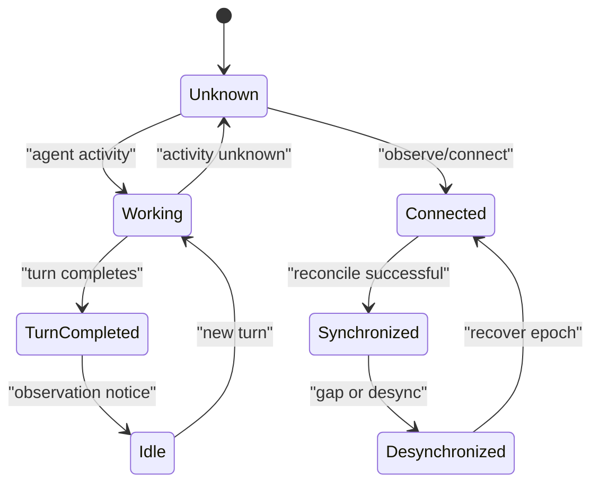

**Diagram sources**
- [attention.hpp:10-136](file://services/session/include/lapis/session/attention.hpp#L10-L136)
- [attention_journal.hpp:18-99](file://services/session/src/attention_journal.hpp#L18-L99)
- [attention_audit.hpp:10-51](file://services/session/src/attention_audit.hpp#L10-L51)
- [attention_audit.cpp:1-82](file://services/session/src/attention_audit.cpp#L1-L82)

**Section sources**
- [attention.hpp:10-136](file://services/session/include/lapis/session/attention.hpp#L10-L136)
- [attention_journal.hpp:18-99](file://services/session/src/attention_journal.hpp#L18-L99)
- [attention_journal.cpp:1-200](file://services/session/src/attention_journal.cpp#L1-L200)
- [attention_audit.hpp:10-51](file://services/session/src/attention_audit.hpp#L10-L51)
- [attention_audit.cpp:1-82](file://services/session/src/attention_audit.cpp#L1-L82)

### Attention Transport
Attention data travels inside the existing attachment-bound control envelope. Snapshots carry availability, connection state, readiness, source epoch, activity, observation phase, diagnostics, and a bounded list of pending requests. Decisions carry source epoch, request ID, revision, choice, and answers. When negotiation allows, the snapshot includes an extra observation-phase byte; legacy clients receive the normal v6 snapshot body.

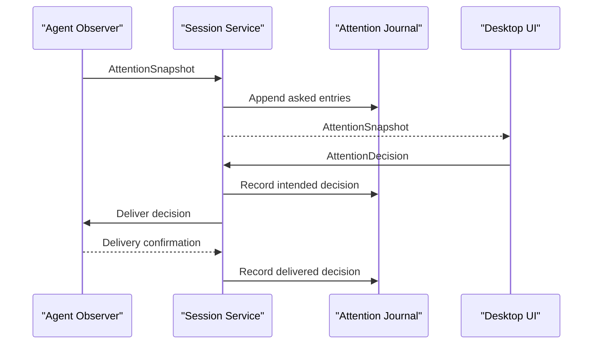

**Diagram sources**
- [attention_protocol.hpp:10-41](file://services/session/src/transport/attention_protocol.hpp#L10-L41)
- [attention_protocol.cpp:1-200](file://services/session/src/transport/attention_protocol.cpp#L1-L200)
- [attention_journal.hpp:18-99](file://services/session/src/attention_journal.hpp#L18-L99)
- [attention_audit.cpp:1-82](file://services/session/src/attention_audit.cpp#L1-L82)

**Section sources**
- [attention_protocol.hpp:10-41](file://services/session/src/transport/attention_protocol.hpp#L10-L41)
- [attention_protocol.cpp:1-200](file://services/session/src/transport/attention_protocol.cpp#L1-L200)

### Terminal Hooks System
Terminal hooks allow agents that run behind SSH or in environments where the service’s local hook socket is unreachable to emit structured events through their own terminal output. The protocol uses a private marker sequence carrying an initialization event and subsequent base64-encoded JSON events. Lapis filters these sequences out of displayed terminal output and converts accepted events into normalized `TerminalHookEvent` records.

A nonce bound during initialization authenticates later events. Oversized candidates are quarantined up to a bounded discard limit, preventing a malformed stream from suppressing the terminal forever.

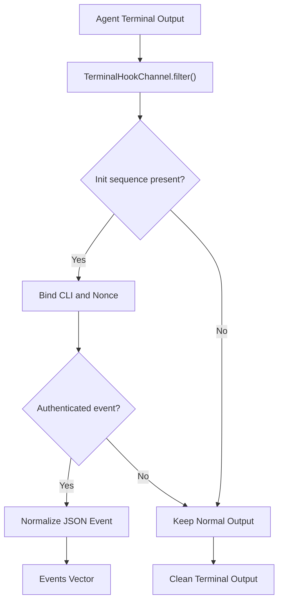

**Diagram sources**
- [terminal_hooks.hpp:12-82](file://services/session/src/terminal_hooks.hpp#L12-L82)
- [terminal_hooks.cpp:1-200](file://services/session/src/terminal_hooks.cpp#L1-L200)

**Section sources**
- [terminal_hooks.hpp:12-82](file://services/session/src/terminal_hooks.hpp#L12-L82)
- [terminal_hooks.cpp:1-200](file://services/session/src/terminal_hooks.cpp#L1-L200)

### Agent Checkpoints and Resume Records
Agents may print a checkpoint marker containing base64-encoded JSON with the agent name, session identifier, and host information. The scanner tolerates read boundaries and keeps only the newest valid local checkpoint. Resume records are stored beside the agent endpoint in an owner-only JSON file. Additional resume logic for Codex inspects open rollout files and excludes subagent threads.

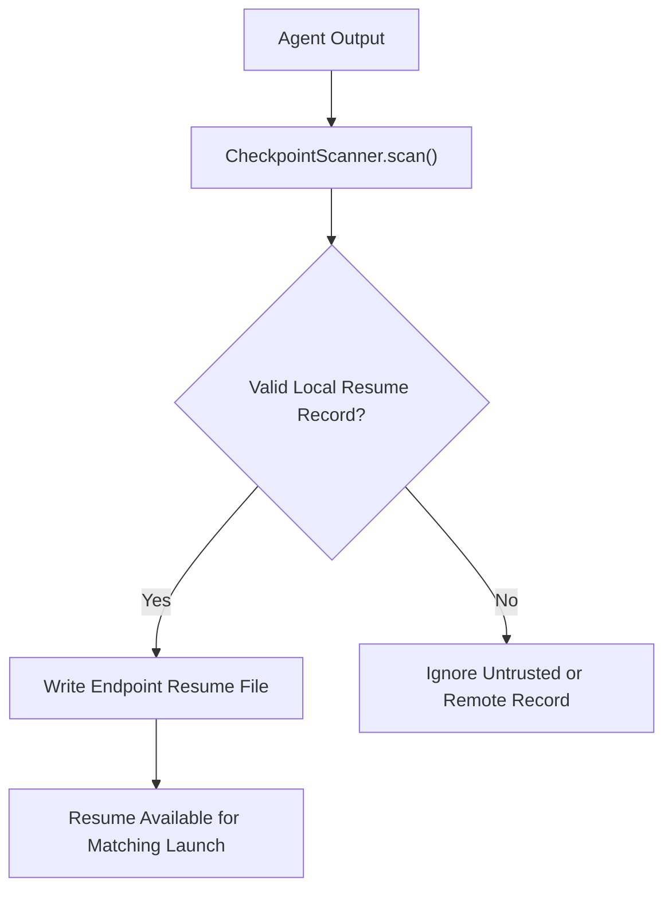

**Diagram sources**
- [agent_checkpoint.hpp:12-66](file://services/session/src/agent_checkpoint.hpp#L12-L66)
- [agent_checkpoint.cpp:1-200](file://services/session/src/agent_checkpoint.cpp#L1-L200)

**Section sources**
- [agent_checkpoint.hpp:12-66](file://services/session/src/agent_checkpoint.hpp#L12-L66)
- [agent_checkpoint.cpp:1-200](file://services/session/src/agent_checkpoint.cpp#L1-L200)

### Session Descriptors
A session descriptor is a compact, owner-only hint attached to the agent’s private endpoint. It contains a fixed-size header, session identity, epoch, and launch fingerprint. Reading requires exact size, correct magic, valid identity, matching fingerprint, and strict file checks. Writing uses a staged temporary file and an endpoint-scoped serial to ensure only the newest ticket commits.

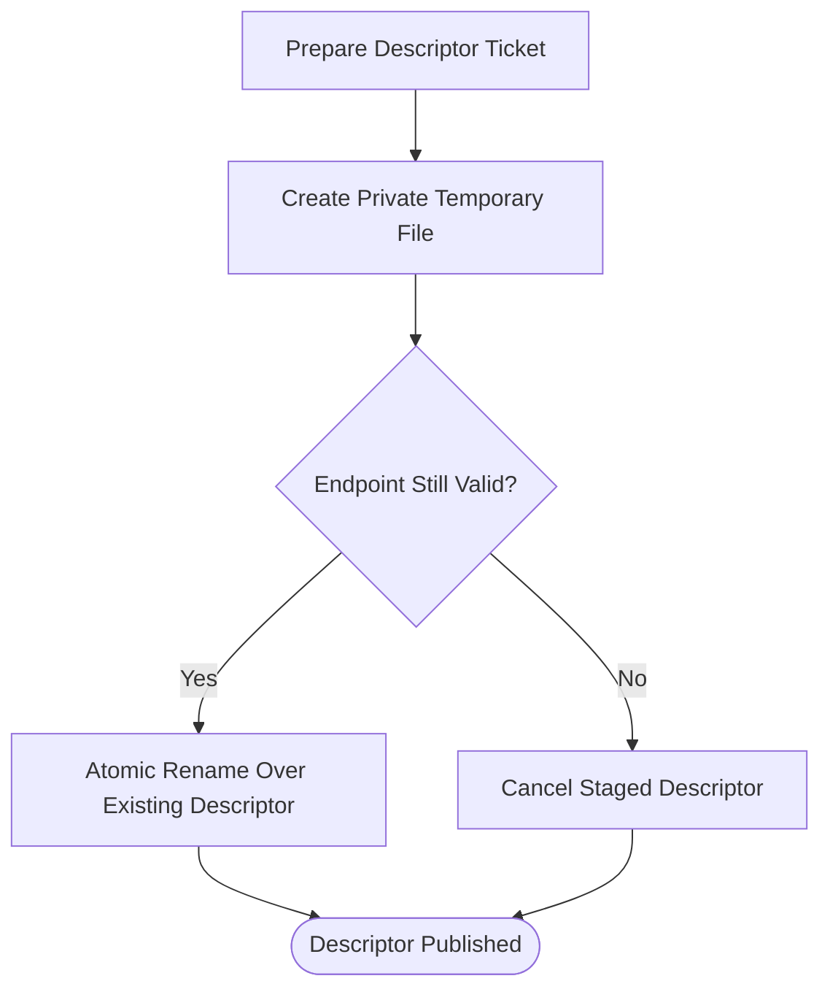

**Diagram sources**
- [session_descriptor.hpp:7-58](file://services/session/src/session_descriptor.hpp#L7-L58)
- [session_descriptor.cpp:1-200](file://services/session/src/session_descriptor.cpp#L1-L200)

**Section sources**
- [session_descriptor.hpp:7-58](file://services/session/src/session_descriptor.hpp#L7-L58)
- [session_descriptor.cpp:1-200](file://services/session/src/session_descriptor.cpp#L1-L200)

## Dependency Analysis
The service builds a layered dependency graph. Low-level platform primitives are reused by higher components, while protocols depend on terminal parsing and platform types. The attention subsystem is intentionally decoupled from GUI and transport concerns.

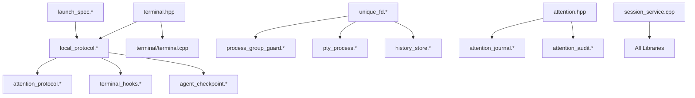

**Diagram sources**
- [terminal.hpp:10-201](file://services/session/include/lapis/session/terminal.hpp#L10-L201)
- [local_protocol.hpp:12-196](file://services/session/src/transport/local_protocol.hpp#L12-L196)
- [pty_process.hpp:17-75](file://services/session/src/platform/posix/pty_process.hpp#L17-L75)
- [history_store.hpp:12-74](file://services/session/src/history_store.hpp#L12-L74)
- [attention.hpp:10-136](file://services/session/include/lapis/session/attention.hpp#L10-L136)
- [attention_journal.hpp:18-99](file://services/session/src/attention_journal.hpp#L18-L99)
- [session_service.cpp:1-120](file://services/session/src/session_service.cpp#L1-L120)

**Section sources**
- [CMakeLists.txt:1-130](file://services/session/CMakeLists.txt#L1-L130)
- [session_service.cpp:1-120](file://services/session/src/session_service.cpp#L1-L120)

## Performance Considerations
The session service applies several bounded mechanisms to prevent uncontrolled memory growth:

| Mechanism | Limit | Purpose |
|---|---:|---|
| PTY output admission | 64 KiB sustained pressure threshold | Prevents one burst from retaining unlimited service-side output |
| PTY read batch | 64 KiB maximum per `output` signal | Batches output into bounded notifications |
| PTY write queue | 1 MiB pending write limit | Prevents slow agents from growing client-side input buffers |
| Local IPC frame size | 8 MiB | Rejects oversized frames early |
| Local IPC input | 64 KiB per text/paste/key message | Bounds per-message allocations |
| Local IPC paste | 960 KiB per complete paste transaction | Keeps pastes bounded even when the agent reads slowly |
| History page | 8 MiB uncompressed page size | Matches wire bounds and avoids huge in-memory pages |
| History segment | 16 MiB | Keeps disk segments manageable |
| History global budget | 64 GiB default | Caps total archive growth |
| History worker queue | 16 MiB and 128 pages | Backpressures history persistence |
| Attention snapshot JSON | 32 KiB per JSON object | Bounds attention metadata |
| Attention requests | 128 pending entries | Limits attention backlog |
| Attention choices | 32 choices per request | Bounds interactive prompts |

These limits appear in the session service constants, wire protocol headers, terminal engine limits, and history worker/store implementations.

**Section sources**
- [session_service.cpp:1-120](file://services/session/src/session_service.cpp#L1-L120)
- [local_protocol.hpp:12-196](file://services/session/src/transport/local_protocol.hpp#L12-L196)
- [pty_process.cpp:1-200](file://services/session/src/platform/posix/pty_process.cpp#L1-L200)
- [history_worker.cpp:1-126](file://services/session/src/history_worker.cpp#L1-L126)
- [history_store.cpp:1-200](file://services/session/src/history_store.cpp#L1-L200)
- [attention_protocol.cpp:1-200](file://services/session/src/transport/attention_protocol.cpp#L1-L200)

## Troubleshooting Guide
Common failure points and their observable behavior:

| Symptom | Likely Cause | Resolution |
|---|---|---|
| PTY fails to start | Invalid launch spec, missing executable, invalid directory, or PTY setup failure | Inspect the `failure` signal and validate the launch specification |
| Agent hangs after exit | PTY drain timeout or process group not terminated | Verify leader exit handling and guard pipe lifecycle |
| Terminal output stalls | Output paused, oversized paste, or blocked history worker | Check pause state, paste queue, and history worker queue limits |
| History query fails | Corrupt segment, permission error, quota exceeded, or busy archive lock | Run on the history worker thread and inspect filesystem permissions |
| Attention decision lost | Journal append failed or epoch/revision mismatch | Treat journal errors as hard failures; do not deliver decisions until durability succeeds |
| Hook event ignored | Missing init sequence, wrong nonce, oversized sequence, or malformed JSON | Confirm the agent prints the lapis init sequence and the CLI matches |
| Resume record rejected | Remote host, unknown agent, invalid identity, symlink, or insecure permissions | Use a trusted local agent and verify the `.resume` file ownership |
| Descriptor collision | Old stale endpoint or concurrent update | Remove dead endpoints and ensure only one descriptor ticket commits |

**Section sources**
- [pty_process.cpp:1-200](file://services/session/src/platform/posix/pty_process.cpp#L1-L200)
- [history_store.cpp:1-200](file://services/session/src/history_store.cpp#L1-L200)
- [attention_journal.cpp:1-200](file://services/session/src/attention_journal.cpp#L1-L200)
- [terminal_hooks.cpp:1-200](file://services/session/src/terminal_hooks.cpp#L1-L200)
- [agent_checkpoint.cpp:1-200](file://services/session/src/agent_checkpoint.cpp#L1-L200)
- [session_descriptor.cpp:1-200](file://services/session/src/session_descriptor.cpp#L1-L200)

## Security Considerations
The session service applies defense-in-depth around process isolation and privilege management:

1. **Executable and directory validation**: Rejects empty programs, non-directories, non-executables, null characters, oversized values, too many arguments, and unsafe agent-specific flags.
2. **Canonicalized paths**: Resolves programs and working directories to canonical forms while preserving executable symlinks for multicall behavior.
3. **Process isolation**: Uses `setsid` to create a new session, a new process group, a controlling terminal, and a detached process-group guard that kills all descendants on EOF.
4. **Privileged cleanup**: Escalates from hangup to SIGTERM and SIGKILL during destruction, ensuring orphaned process groups do not survive service teardown.
5. **Private filesystem access**: History directories and files are created and verified as owner-only regular files with restrictive permissions. Symlinks are rejected where appropriate, and atomic writes use pending files followed by fsync and rename.
6. **Owner-only descriptors**: Session descriptors require exact size, correct magic, valid identity, matching fingerprint, and strict file metadata checks.
7. **Untrusted output handling**: Agent checkpoints and terminal hooks treat raw output as untrusted, applying bounded scanning, nonce authentication, maximum sequence lengths, quarantine discard limits, and strict JSON decoding.
8. **IPC bounds**: Every frame, input, paste, hyperlink, attention JSON, and attention request field has explicit size limits.
9. **Durable decision barrier**: Attention decisions are not forwarded until the journal append is durable, preventing partial approvals after crashes.
10. **Stale endpoint cleanup**: Dead Codex symlinks are removed before binding, and descriptor updates use staged atomic replacement.

**Section sources**
- [launch_spec.cpp:1-144](file://services/session/src/launch_spec.cpp#L1-L144)
- [pty_process.cpp:1-200](file://services/session/src/platform/posix/pty_process.cpp#L1-L200)
- [process_group_guard.cpp:1-97](file://services/session/src/platform/posix/process_group_guard.cpp#L1-L97)
- [history_store.cpp:1-200](file://services/session/src/history_store.cpp#L1-L200)
- [session_descriptor.cpp:1-200](file://services/session/src/session_descriptor.cpp#L1-L200)
- [terminal_hooks.cpp:1-200](file://services/session/src/terminal_hooks.cpp#L1-L200)
- [agent_checkpoint.cpp:1-200](file://services/session/src/agent_checkpoint.cpp#L1-L200)
- [attention_journal.cpp:1-200](file://services/session/src/attention_journal.cpp#L1-L200)

## Conclusion
The session service is a tightly scoped runtime that connects three domains: external agent processes, a bounded terminal representation, and local clients. Its design emphasizes explicit validation, bounded I/O, deterministic cleanup, durable auditing, and secure filesystem handling. The most important operational guarantees are:

- Never trust launch inputs or agent output directly.
- Always validate before creating a process.
- Treat PTY output as a stream that must be parsed, bounded, and drained.
- Persist attention decisions before delivering them.
- Run history I/O on a dedicated worker.
- Enforce owner-only permissions on descriptors, resumes, and archives.
- Terminate process groups explicitly rather than relying on leaked PIDs.