# Terminal Hooks System

<cite>
**Referenced Files in This Document**   
- [terminal_hooks.hpp](file://services/session/src/terminal_hooks.hpp)
- [terminal_hooks.cpp](file://services/session/src/terminal_hooks.cpp)
- [terminal_hooks_test.cpp](file://services/session/tests/terminal_hooks_test.cpp)
- [session_service.cpp](file://services/session/src/session_service.cpp)
- [hook_relay.hpp](file://adapters/claude/src/hook_relay.hpp)
- [hook_relay.cpp](file://adapters/claude/src/hook_relay.cpp)
- [observer.hpp](file://adapters/codex/src/observer.hpp)
- [observer.cpp](file://adapters/codex/src/observer.cpp)
- [remote_hook_relay.py](file://apps/desktop/src/remote_hook_relay.py)
- [check_claude_hooks.py](file://scripts/check_claude_hooks.py)
- [probe_claude_failure_hooks.py](file://scripts/probe_claude_failure_hooks.py)
- [architecture.md](file://docs/architecture.md)
</cite>

## Table of Contents
1. [Introduction](#introduction)
2. [Project Structure](#project-structure)
3. [Core Components](#core-components)
4. [Architecture Overview](#architecture-overview)
5. [Detailed Component Analysis](#detailed-component-analysis)
6. [Dependency Analysis](#dependency-analysis)
7. [Performance Considerations](#performance-considerations)
8. [Security Model](#security-model)
9. [Troubleshooting Guide](#troubleshooting-guide)
10. [Conclusion](#conclusion)
11. [Appendices](#appendices)

## Introduction
This document explains the terminal hooks system that intercepts, validates, and transforms terminal output to carry agent hook events into Lapis’ attention and observation subsystems. It focuses on how built-in terminal output filtering works, how Claude Code and Codex adapters participate, and how remote agents report hooks through an SSH terminal without compromising system integrity.

The repository does not expose a generic “register custom terminal processors” API with arbitrary chain priorities. Instead, it provides:

- A bounded terminal output filter that strips private hook sequences and emits validated hook events.
- Adapter-specific observers that translate those events into attention requests or diagnostic inventory.
- Relay helpers for Claude Code and a Python helper for remote execution environments.
- Test-driven validation of sequence removal, authentication, oversized-quarantine recovery, and turn-state synchronization.

## Project Structure
The terminal hooks system spans three layers:

| Layer | Responsibility | Key files |
|---|---|---|
| Session service terminal layer | Parses PTY output, removes hook sequences, and forwards hook events to adapter logic | [terminal_hooks.hpp](file://services/session/src/terminal_hooks.hpp), [terminal_hooks.cpp](file://services/session/src/terminal_hooks.cpp), [session_service.cpp](file://services/session/src/session_service.cpp) |
| Agent adapters | Register or consume hook metadata, run relay commands, and expose audit data | [hook_relay.hpp](file://adapters/claude/src/hook_relay.hpp), [hook_relay.cpp](file://adapters/claude/src/hook_relay.cpp), [observer.hpp](file://adapters/codex/src/observer.hpp), [observer.cpp](file://adapters/codex/src/observer.cpp) |
| Desktop and scripts | Provide a trusted bridge from remote agent processes back to Lapis and qualification probes | [remote_hook_relay.py](file://apps/desktop/src/remote_hook_relay.py), [check_claude_hooks.py](file://scripts/check_claude_hooks.py), [probe_claude_failure_hooks.py](file://scripts/probe_claude_failure_hooks.py) |

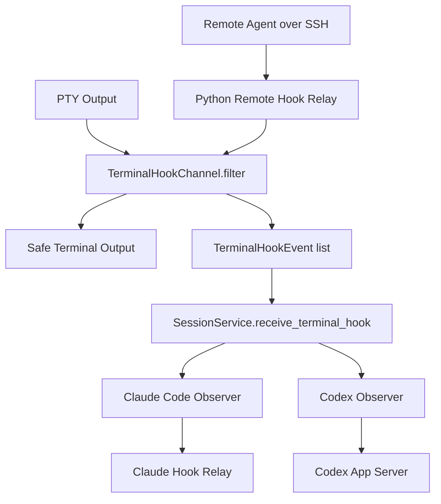

**Diagram sources**
- [terminal_hooks.cpp:93-172](file://services/session/src/terminal_hooks.cpp#L93-L172)
- [session_service.cpp:524-535](file://services/session/src/session_service.cpp#L524-L535)
- [hook_relay.cpp:92-138](file://adapters/claude/src/hook_relay.cpp#L92-L138)
- [observer.cpp:201-450](file://adapters/codex/src/observer.cpp#L201-L450)
- [remote_hook_relay.py:1-94](file://apps/desktop/src/remote_hook_relay.py#L1-L94)

**Section sources**
- [architecture.md:1-165](file://docs/architecture.md#L1-L165)
- [terminal_hooks.hpp:15-82](file://services/session/src/terminal_hooks.hpp#L15-L82)
- [session_service.cpp:445-535](file://services/session/src/session_service.cpp#L445-L535)

## Core Components

### TerminalHookChannel
`TerminalHookChannel` is the core output filter. Its job is to scan terminal output for private OSC 7717 sequences, remove them before the terminal sees them, and collect authenticated hook events.

Key responsibilities:

| Capability | Behavior |
|---|---|
| Sequence recognition | Looks for `ESC ] 7717 ; lapis-init` and `ESC ] 7717 ; lapis-event`. |
| Sequence removal | Returns only non-hook output; hook sequences are never drawn by the terminal. |
| Authentication | Only accepts an event whose subject matches the nonce bound by the first valid init sequence. |
| Quarantine | If a candidate exceeds the maximum sequence length, it is quarantined until its terminator or a discard budget is exhausted. |
| Carry handling | Handles sequences split across multiple reads. |
| Turn tracking | `NotifyTurns` tracks Codex’s completion-only signal model. |

#### Public Interface Summary

| Member | Purpose |
|---|---|
| `filter(output, events)` | Scans output, removes hook sequences, appends decoded events. |
| `bound()` | Reports whether a valid init has been received. |
| `cli()` | Reports the bound CLI identity (`claude` or `codex`). |
| `completed(source, now)` | Applies a completed-turn notification to attention state. |
| `submitted()` | Marks user input submission and resets activity. |

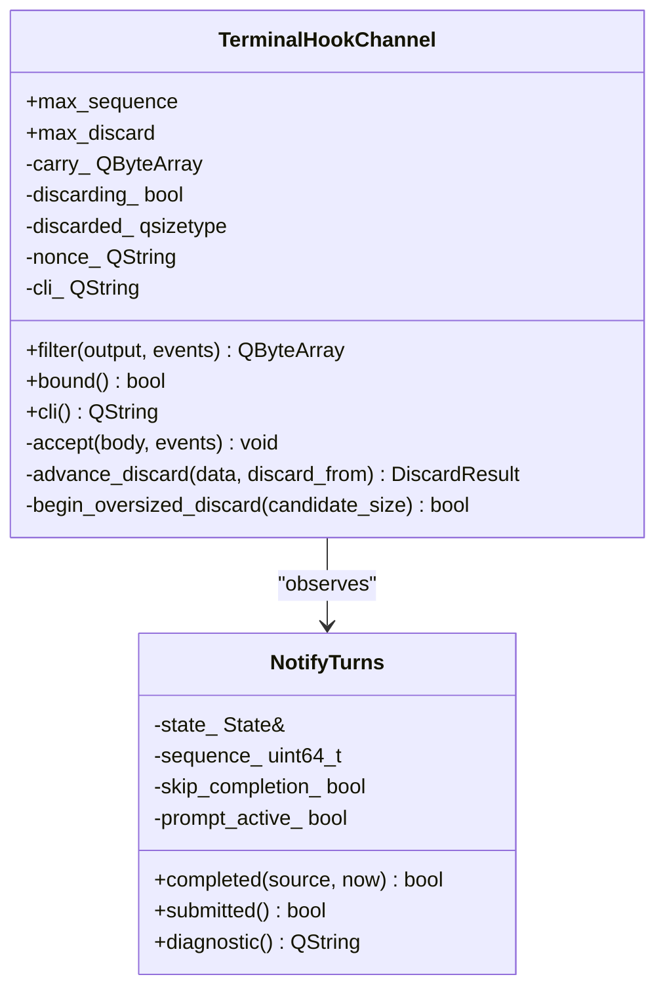

**Diagram sources**
- [terminal_hooks.hpp:15-82](file://services/session/src/terminal_hooks.hpp#L15-L82)

**Section sources**
- [terminal_hooks.hpp:15-82](file://services/session/src/terminal_hooks.hpp#L15-L82)
- [terminal_hooks.cpp:1-237](file://services/session/src/terminal_hooks.cpp#L1-L237)
- [terminal_hooks_test.cpp:1-213](file://services/session/tests/terminal_hooks_test.cpp#L1-L213)

### Session Service Integration
The session service owns the PTY and feeds raw output into `TerminalHookChannel::filter`. When events are produced, they are forwarded to adapter-specific handlers.

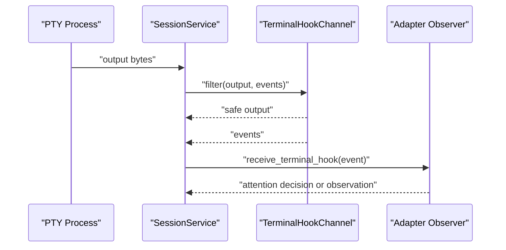

**Diagram sources**
- [session_service.cpp:524-535](file://services/session/src/session_service.cpp#L524-L535)
- [session_service.cpp:445-450](file://services/session/src/session_service.cpp#L445-L450)

**Section sources**
- [session_service.cpp:445-535](file://services/session/src/session_service.cpp#L445-L535)
- [session_service.cpp:2172-2178](file://services/session/src/session_service.cpp#L2172-L2178)

### Claude Code Hook Relay
Claude Code registers command-based hooks through settings generated by the adapter. The relay reads JSON from standard input, validates it, derives bounded metadata, sends a frame to a local Unix socket, and never returns control decisions to Claude.

Key constants and contracts:

| Constant | Meaning |
|---|---|
| `relay_deadline_ms` | 1000 ms deadline for reading, parsing, serializing, connecting, and writing. |
| `relay_frame_limit` | 16 KiB limit for the outgoing JSON frame. |
| `input_limit` | 1 MiB limit for stdin payload. |
| `relay_contract` | Versioned contract string controlling derived field inclusion. |
| `hook_event_names` | Registered Claude events such as `SessionStart`, `UserPromptSubmit`, `PermissionRequest`, `Notification`, `PreToolUse`, `PostToolUse`, `PostToolUseFailure`, `Stop`, `SessionEnd`. |

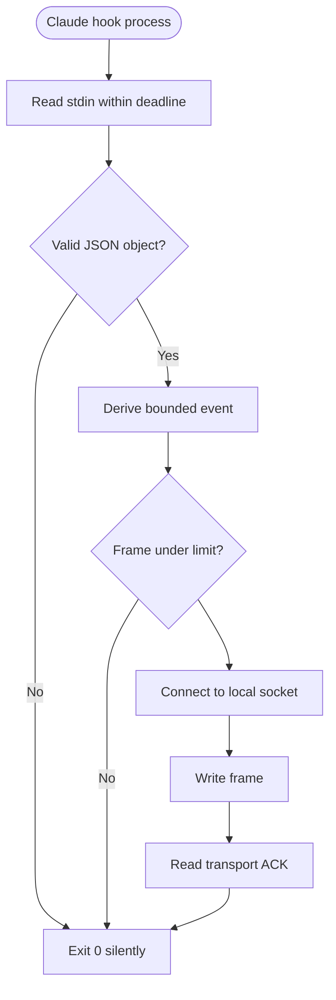

**Diagram sources**
- [hook_relay.cpp:1-138](file://adapters/claude/src/hook_relay.cpp#L1-L138)
- [hook_relay.hpp:1-62](file://adapters/claude/src/hook_relay.hpp#L1-L62)

**Section sources**
- [hook_relay.hpp:10-62](file://adapters/claude/src/hook_relay.hpp#L10-L62)
- [hook_relay.cpp:92-138](file://adapters/claude/src/hook_relay.cpp#L92-L138)

### Codex Observer
The Codex observer connects to the Codex app server via a Unix WebSocket, discovers hook inventory, observes hook runs, parses approval and question requests, and exposes bounded diagnostic information.

Important characteristics:

| Area | Implementation detail |
|---|---|
| Message limits | 64 KiB per message, 16 KiB per details snapshot, 512 KiB aggregate details budget. |
| RPC timeout | 10 seconds. |
| Request parsing | Validates request ID, thread ID, method, context IDs, questions, and answers. |
| Hook inventory parsing | Limits entries, diagnostics, hooks, fields, and values. |
| Hook run classification | Enumerates allowed event names, handler types, execution modes, scopes, sources, statuses, and entry kinds. |
| Audit exposure | Aggregated inventory and run summaries are exposed without raw prompt content. |

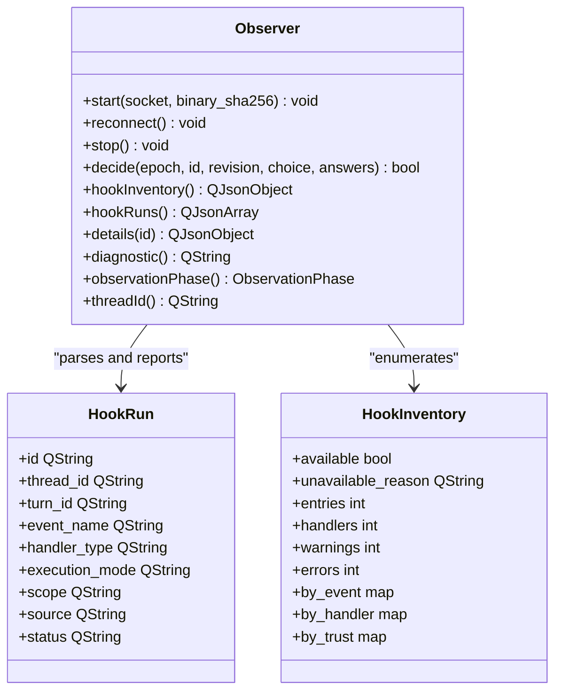

**Diagram sources**
- [observer.hpp:1-55](file://adapters/codex/src/observer.hpp#L1-L55)
- [observer.cpp:201-450](file://adapters/codex/src/observer.cpp#L201-L450)

**Section sources**
- [observer.hpp:12-55](file://adapters/codex/src/observer.hpp#L12-L55)
- [observer.cpp:201-450](file://adapters/codex/src/observer.cpp#L201-L450)

### Remote Hook Relay (Python)
When an agent runs behind SSH, Lapis cannot reach its local hook socket directly. The remote relay writes a bounded OSC 7717 frame to a character device path supplied through environment variables. It also supports invoking a configured notify program for Codex.

Security properties:

| Property | Detail |
|---|---|
| Nonce validation | Requires exactly 32 lowercase hexadecimal characters. |
| Allowed fields | Only a fixed set of keys is copied into the relayed event. |
| String length limit | Relayed string values are limited to 256 bytes after encoding. |
| TTY validation | The target must be under `/dev/`, resolved to itself, and is a character device opened read-only. |
| Background task redaction | For Claude, cron schedules and full task identities are replaced with status-only structures. |

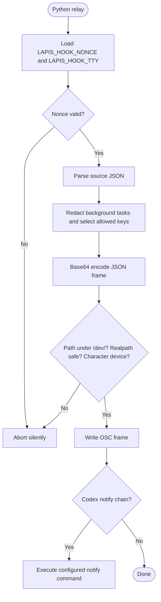

**Diagram sources**
- [remote_hook_relay.py:1-94](file://apps/desktop/src/remote_hook_relay.py#L1-L94)

**Section sources**
- [remote_hook_relay.py:1-94](file://apps/desktop/src/remote_hook_relay.py#L1-L94)

## Architecture Overview
The terminal hooks architecture separates trust boundaries clearly:

1. **Terminal output** is untrusted agent text.
2. **`TerminalHookChannel`** strips private hook sequences and decodes only authenticated events.
3. **Session service** owns lifecycle and routes events to adapters.
4. **Adapters** validate payloads, enforce budgets, and present attention or diagnostic surfaces.
5. **Relays** run outside the main application where needed, but still apply strict bounds.

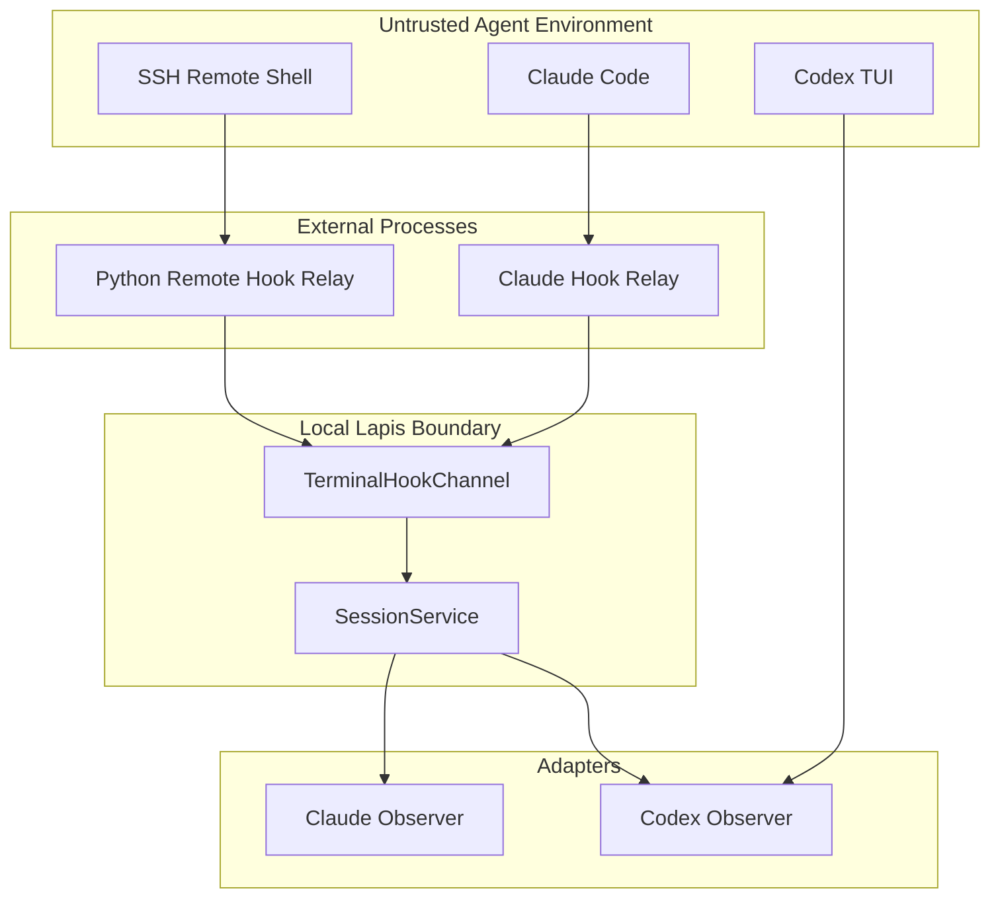

**Diagram sources**
- [terminal_hooks.cpp:93-172](file://services/session/src/terminal_hooks.cpp#L93-L172)
- [hook_relay.cpp:92-138](file://adapters/claude/src/hook_relay.cpp#L92-L138)
- [observer.cpp:201-450](file://adapters/codex/src/observer.cpp#L201-L450)
- [remote_hook_relay.py:1-94](file://apps/desktop/src/remote_hook_relay.py#L1-L94)

**Section sources**
- [architecture.md:1-165](file://docs/architecture.md#L1-L165)
- [terminal_hooks.hpp:15-82](file://services/session/src/terminal_hooks.hpp#L15-L82)

## Detailed Component Analysis

### Built-In Terminal Output Filtering
The built-in hook mechanism is implemented as a single-pass parser that recognizes two private OSC sequences:

- Initialization: binds CLI identity and a 32-hex-digit nonce.
- Event: carries a base64-encoded JSON object identified by the same nonce.

The parser handles:

- Multiple terminators: bell (`\x07`) and escaped backslash (`\x1b\\`).
- Partial sequences split across reads.
- False-positive markers followed by other OSC sequences.
- Oversized candidates quarantined through their terminator.
- Rejection of malformed JSON, wrong CLI identity, invalid nonce format, and missing authentication.

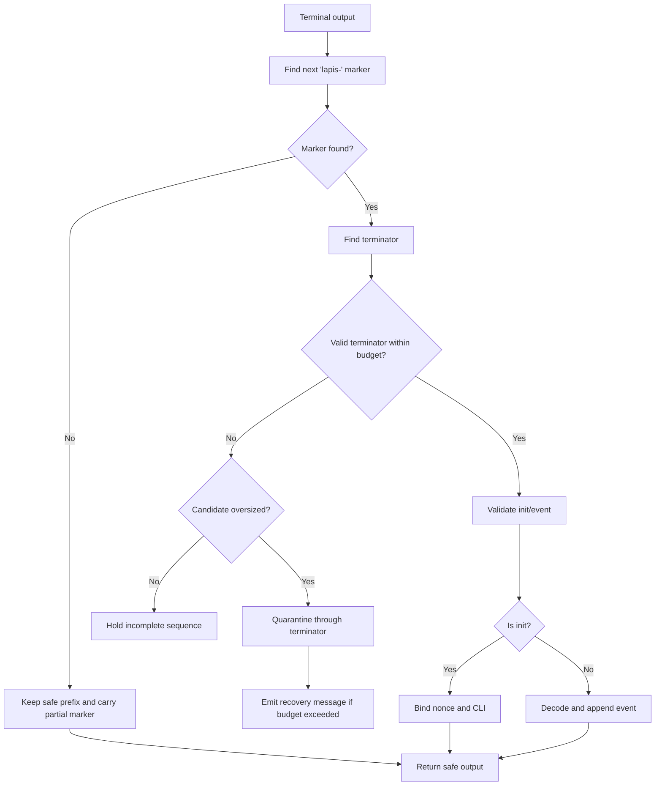

**Diagram sources**
- [terminal_hooks.cpp:1-172](file://services/session/src/terminal_hooks.cpp#L1-L172)

**Section sources**
- [terminal_hooks.cpp:1-172](file://services/session/src/terminal_hooks.cpp#L1-L172)
- [terminal_hooks_test.cpp:24-120](file://services/session/tests/terminal_hooks_test.cpp#L24-L120)

### Command Interception and Attention Requests
Command interception is not implemented as a generic hook priority chain. Instead, each adapter defines its own request surface:

- **Claude**: Uses hook events to observe prompts, permissions, tool use, and session boundaries. The relay restricts forwarded fields and derived metadata.
- **Codex**: Exposes `hooks/list` inventory and `hook/started`/`hook/completed` notifications, plus explicit approval and user-input requests handled by the observer.

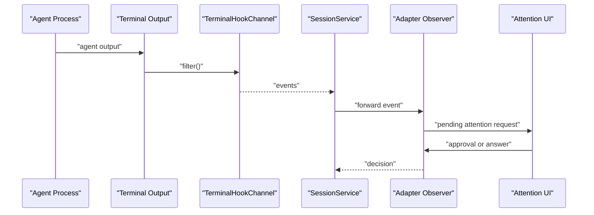

**Diagram sources**
- [terminal_hooks.cpp:93-172](file://services/session/src/terminal_hooks.cpp#L93-L172)
- [hook_relay.cpp:92-138](file://adapters/claude/src/hook_relay.cpp#L92-L138)
- [observer.cpp:201-450](file://adapters/codex/src/observer.cpp#L201-L450)

**Section sources**
- [check_claude_hooks.py:1-200](file://scripts/check_claude_hooks.py#L1-L200)
- [observer.cpp:201-450](file://adapters/codex/src/observer.cpp#L201-L450)

### Hook Chain Execution Model
There is no pluggable hook chain with configurable priorities. The current execution model is deterministic:

1. Raw PTY output enters the session service.
2. `TerminalHookChannel::filter` scans once and produces safe output plus zero or more events.
3. The session service forwards events to registered adapters.
4. Adapters parse, validate, and publish attention or diagnostics.

If future extension adds a chain, it should preserve the existing property that the terminal output stream remains ordered and that private sequences are removed before rendering.

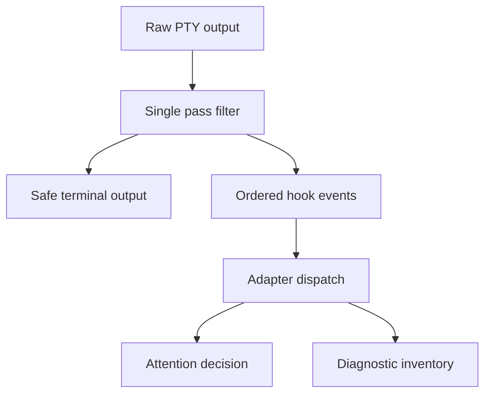

[No sources needed since this diagram shows conceptual workflow, not actual code structure]

### Security Model
The security model relies on layered validation rather than trusting agent-controlled output:

| Layer | Protection |
|---|---|
| Private sequence ownership | Only sequences starting with the expected marker are considered hooks. |
| Nonce binding | An init sequence binds a 32-hex-digit nonce; later events must match it. |
| CLI identity check | Init accepts only recognized CLI identifiers. |
| Payload decoding | Base64 decoding aborts on errors; JSON must be a valid object. |
| Field selection | Remote relay copies only allowed keys and enforces string length limits. |
| Background task redaction | Cron schedules and task identities are replaced with status-only data. |
| TTY destination validation | Remote relay requires a canonical `/dev/*` character device. |
| Budgets | Maximum sequence length, discard budget, frame size, RPC timeout, and message sizes. |
| Fail-open relay behavior | Claude relay exits silently on any exception so Claude neither receives a decision nor injected prompt text. |

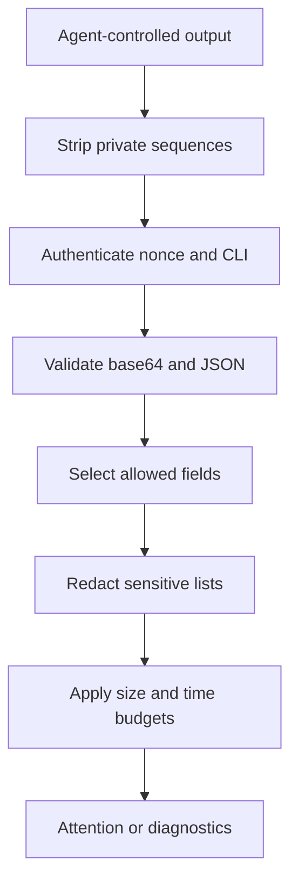

**Diagram sources**
- [terminal_hooks.cpp:1-172](file://services/session/src/terminal_hooks.cpp#L1-L172)
- [remote_hook_relay.py:1-94](file://apps/desktop/src/remote_hook_relay.py#L1-L94)
- [hook_relay.cpp:92-138](file://adapters/claude/src/hook_relay.cpp#L92-L138)

**Section sources**
- [terminal_hooks_test.cpp:44-120](file://services/session/tests/terminal_hooks_test.cpp#L44-L120)
- [remote_hook_relay.py:1-94](file://apps/desktop/src/remote_hook_relay.py#L1-L94)

### Performance Characteristics
Performance considerations are expressed as hard bounds rather than profiling hooks:

| Component | Limit or behavior |
|---|---|
| Max hook sequence | 24 KiB per candidate. |
| Max discard budget | Up to four times the max sequence length before recovery. |
| Claude relay input | 1 MiB stdin limit. |
| Claude relay frame | 16 KiB JSON frame limit. |
| Claude relay deadline | 1 second total deadline. |
| Codex message limit | 64 KiB per message. |
| Codex details limit | 16 KiB per details snapshot. |
| Codex aggregate details | 512 KiB budget. |
| Codex RPC timeout | 10 seconds. |
| Parser model | Single-pass scan with bounded carry storage. |

The design avoids per-cell allocation for normal terminal cells and keeps hook metadata small. There is no asynchronous hook executor inside the filter; expensive work is delegated to external relays or adapters.

**Section sources**
- [terminal_hooks.hpp:32-38](file://services/session/src/terminal_hooks.hpp#L32-L38)
- [hook_relay.hpp:10-17](file://adapters/claude/src/hook_relay.hpp#L10-L17)
- [hook_relay.cpp:26-46](file://adapters/claude/src/hook_relay.cpp#L26-L46)
- [observer.cpp:214-224](file://adapters/codex/src/observer.cpp#L214-L224)

### Debugging and Profiling
Debugging support is primarily diagnostic strings and bounded inspection APIs:

| Capability | Location |
|---|---|
| Hook event test vectors | Unit tests verify sequence removal, authentication, quarantine recovery, and split-read behavior. |
| Claude failure probe | Generates synthetic hook payloads and verifies type safety and event coverage. |
| Claude qualification probe | Runs a real service and checks attention notices without leaking private content. |
| Codex observer diagnostics | Provides diagnostic messages, observation phase, thread ID, hook inventory, hook runs, and request details. |
| Notify turns diagnostic | Reports synchronization state, epoch, and sequence position. |

Recommended debugging steps:

1. Inspect `TerminalHookChannel::filter` behavior using the unit tests as reference inputs.
2. Verify that private sequences do not appear in visible terminal output.
3. Confirm that oversized candidates recover and emit the documented recovery message.
4. For Claude, inspect relay deadlines, frame sizes, and stdout/stdin limits.
5. For Codex, use `hookInventory()` and `hookRuns()` for aggregated diagnostics and `details(requestId)` for bounded per-request inspection.

**Section sources**
- [terminal_hooks_test.cpp:1-213](file://services/session/tests/terminal_hooks_test.cpp#L1-L213)
- [probe_claude_failure_hooks.py:1-200](file://scripts/probe_claude_failure_hooks.py#L1-L200)
- [check_claude_hooks.py:1-200](file://scripts/check_claude_hooks.py#L1-L200)
- [observer.hpp:12-55](file://adapters/codex/src/observer.hpp#L12-L55)
- [terminal_hooks.cpp:220-237](file://services/session/src/terminal_hooks.cpp#L220-L237)

## Dependency Analysis

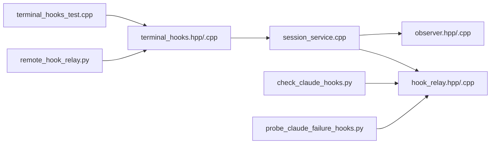

**Diagram sources**
- [terminal_hooks.cpp:1-237](file://services/session/src/terminal_hooks.cpp#L1-L237)
- [session_service.cpp:445-535](file://services/session/src/session_service.cpp#L445-L535)
- [hook_relay.cpp:92-138](file://adapters/claude/src/hook_relay.cpp#L92-L138)
- [observer.cpp:201-450](file://adapters/codex/src/observer.cpp#L201-L450)
- [remote_hook_relay.py:1-94](file://apps/desktop/src/remote_hook_relay.py#L1-L94)

**Section sources**
- [session_service.cpp:445-535](file://services/session/src/session_service.cpp#L445-L535)
- [terminal_hooks_test.cpp:1-213](file://services/session/tests/terminal_hooks_test.cpp#L1-L213)

## Performance Considerations
- Prefer small, bounded hook payloads. Large JSON objects increase parsing, serialization, network, and memory pressure.
- Avoid heavy computation inside the filter path. The filter is synchronous and operates on every byte of terminal output.
- Use the adapter observers for structured inspection rather than printing large debug traces to the terminal.
- Respect relay deadlines and frame limits when integrating with Claude Code hooks.
- Treat the 1-second Claude relay deadline and 10-second Codex RPC timeout as hard latency expectations.
- Remember that oversized candidates can suppress output temporarily while quarantined; keep payloads well under the 24 KiB sequence limit.

[No sources needed since this section provides general guidance]

## Troubleshooting Guide

### Hook Events Never Appear
Check:

1. Whether a valid init sequence was emitted.
2. Whether the nonce matches between init and event.
3. Whether the CLI identity is `claude` or `codex`.
4. Whether the event body is valid base64 JSON.
5. Whether the event exceeds the maximum sequence length and is being quarantined.

Relevant evidence:

**Section sources**
- [terminal_hooks_test.cpp:44-120](file://services/session/tests/terminal_hooks_test.cpp#L44-L120)
- [terminal_hooks.cpp:131-172](file://services/session/src/terminal_hooks.cpp#L131-L172)

### Terminal Output Is Suppressed Temporarily
An oversized candidate is quarantined until its terminator or discard budget is reached. During quarantine, output may be suppressed. Recovery emits a short marker message and resumes normal filtering.

**Section sources**
- [terminal_hooks.cpp:48-92](file://services/session/src/terminal_hooks.cpp#L48-L92)
- [terminal_hooks_test.cpp:122-160](file://services/session/tests/terminal_hooks_test.cpp#L122-L160)

### Claude Relay Fails Silently
The relay intentionally fails open: exceptions, malformed input, timeouts, connection failures, and oversized frames cause exit code 0 without sending a decision to Claude.

Verify:

1. Stdin is under 1 MiB.
2. JSON parses successfully.
3. Derived event is under 16 KiB.
4. Local socket connects within 1 second.
5. All bytes are written and the ACK is read.

**Section sources**
- [hook_relay.cpp:26-46](file://adapters/claude/src/hook_relay.cpp#L26-L46)
- [hook_relay.cpp:92-138](file://adapters/claude/src/hook_relay.cpp#L92-L138)

### Codex Observer Shows Unsupported or Unknown Phase
Check:

1. Whether the Codex binary hash is qualified.
2. Whether the observer is connected.
3. Whether the observation phase is awaiting first prompt, reconciling, or unknown.
4. Whether RPC timed out or failed.

**Section sources**
- [observer.cpp:320-410](file://adapters/codex/src/observer.cpp#L320-L410)

### Remote Relay Writes Nothing
Inspect:

1. `LAPIS_HOOK_NONCE` environment variable.
2. `LAPIS_HOOK_TTY` environment variable.
3. Whether the TTY path resolves safely.
4. Whether the descriptor is a character device.
5. Whether the JSON payload is valid and redacted correctly.

**Section sources**
- [remote_hook_relay.py:1-94](file://apps/desktop/src/remote_hook_relay.py#L1-L94)

## Conclusion
The terminal hooks system is a carefully bounded integration point between untrusted agent terminal output and Lapis’ attention and observation subsystems. It does not provide a generic customizable hook pipeline with user-defined priorities; instead, it implements secure, tested, and budgeted processing for Claude Code and Codex.

For new integrations, the recommended pattern is:

- Emit private OSC sequences only from trusted launch paths.
- Bind a random nonce at initialization.
- Keep event payloads small and schema-validated.
- Redact sensitive fields before crossing process or transport boundaries.
- Use the adapter observers for structured auditing rather than ad hoc terminal logging.
- Treat all relay and observer timeouts as hard limits.

[No sources needed since this section summarizes without analyzing specific files]

## Appendices

### Hook Lifecycle Reference

| Stage | Owner | Action |
|---|---|---|
| Initialization | Launch path or remote relay | Emits `lapis-init` with CLI and nonce. |
| Event emission | Agent or adapter | Emits `lapis-event` with base64 JSON and matching nonce. |
| Filtering | `TerminalHookChannel` | Removes sequences and decodes events. |
| Routing | Session service | Forwards events to Claude or Codex adapters. |
| Decision | Adapter observer | Presents attention request or performs observation. |
| Completion | Adapter observer | Publishes completion or diagnostic state. |

**Section sources**
- [terminal_hooks.cpp:93-172](file://services/session/src/terminal_hooks.cpp#L93-L172)
- [hook_relay.cpp:92-138](file://adapters/claude/src/hook_relay.cpp#L92-L138)
- [observer.cpp:201-450](file://adapters/codex/src/observer.cpp#L201-L450)