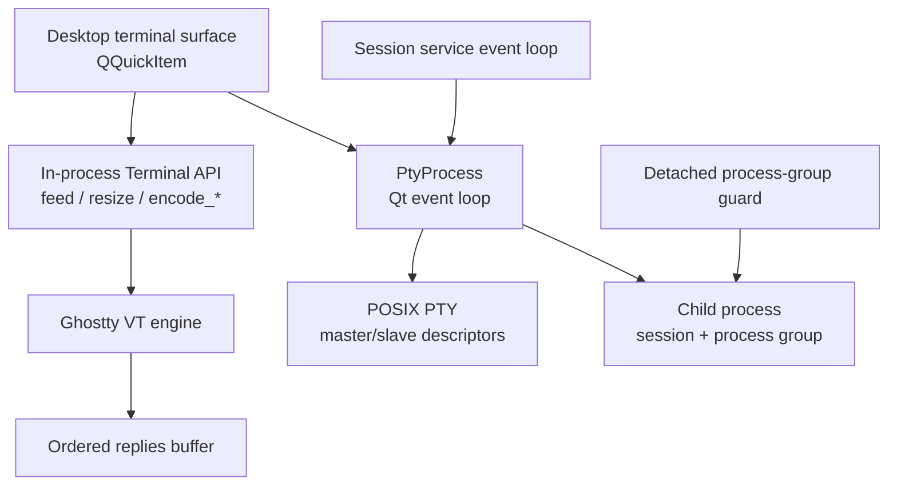
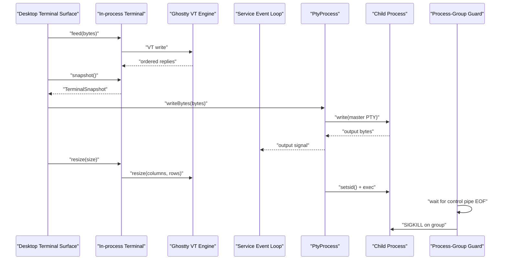
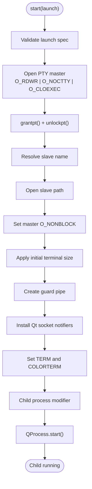
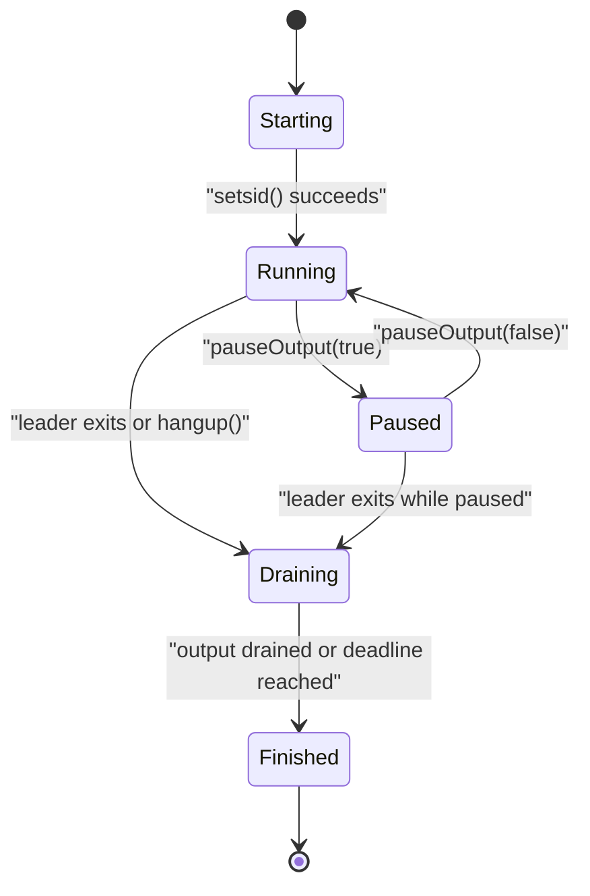
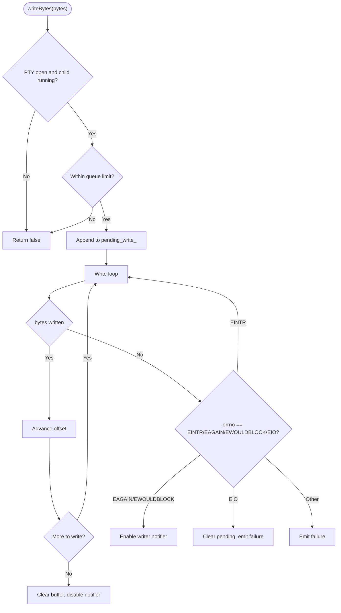
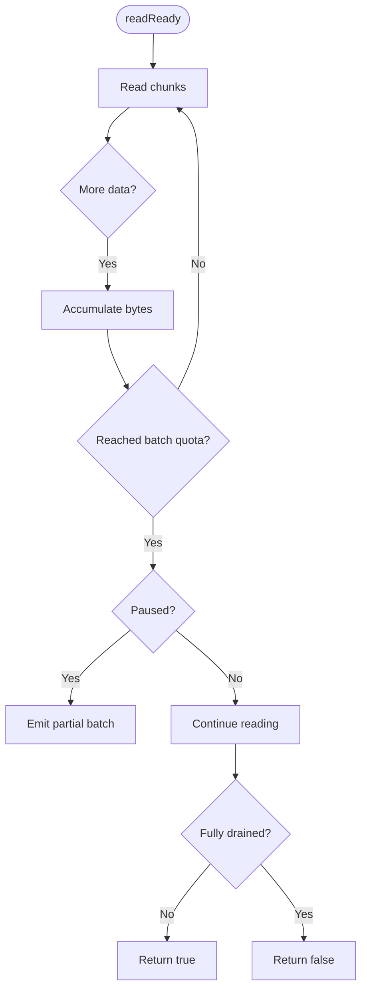
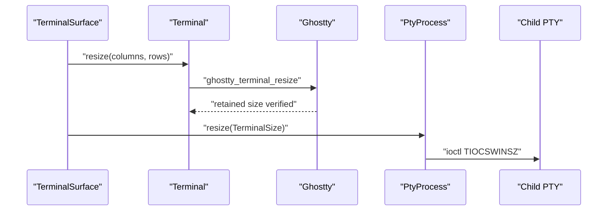
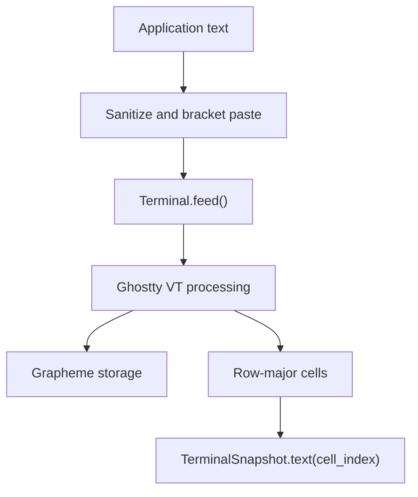
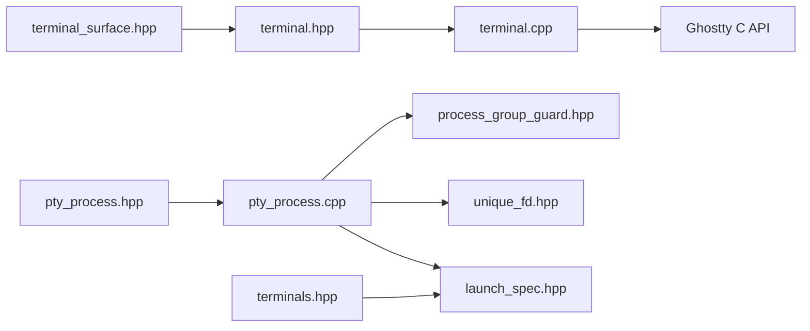

# Terminal and PTY Management

<cite>
**Referenced Files in This Document**
- [terminal.hpp](file://services/session/include/lapis/session/terminal.hpp)
- [terminal.cpp](file://services/session/src/terminal/terminal.cpp)
- [pty_process.hpp](file://services/session/src/platform/posix/pty_process.hpp)
- [pty_process.cpp](file://services/session/src/platform/posix/pty_process.cpp)
- [process_group_guard.hpp](file://services/session/src/platform/posix/process_group_guard.hpp)
- [process_group_guard.cpp](file://services/session/src/platform/posix/process_group_guard.cpp)
- [unique_fd.hpp](file://services/session/src/platform/posix/unique_fd.hpp)
- [unique_fd.cpp](file://services/session/src/platform/posix/unique_fd.cpp)
- [launch_spec.hpp](file://services/session/src/launch_spec.hpp)
- [launch_spec.cpp](file://services/session/src/launch_spec.cpp)
- [terminal_surface.hpp](file://apps/desktop/src/terminal_surface.hpp)
- [terminals.hpp](file://apps/desktop/src/terminals.hpp)
</cite>

## Table of Contents
1. [Introduction](#introduction)
2. [Project Structure](#project-structure)
3. [Core Components](#core-components)
4. [Architecture Overview](#architecture-overview)
5. [Detailed Component Analysis](#detailed-component-analysis)
6. [Dependency Analysis](#dependency-analysis)
7. [Performance Considerations](#performance-considerations)
8. [Troubleshooting Guide](#troubleshooting-guide)
9. [Conclusion](#conclusion)

## Introduction
This document explains how the project manages terminal emulation, pseudo-terminals, child process isolation, input/output streams, window sizing, encoding, and security boundaries. It is organized for both readers who need implementation details and readers who only need to understand the overall lifecycle and failure behavior.

At a high level:
- The in-process `Terminal` class renders VT output into structured snapshots using the Ghostty engine.
- On POSIX systems, `PtyProcess` owns a real PTY, launches a child under its own session and process group, and bridges Qt signals with non-blocking reads and writes.
- A detached process-group guard ensures that orphaned or stuck descendants are terminated when the service loses control.
- The desktop UI layer consumes terminal snapshots, translates user input, and drives terminal size changes.

## Project Structure
The relevant code is split across three layers:

| Layer | Responsibility | Key files |
|---|---|---|
| In-process terminal abstraction | VT rendering, snapshot creation, key/wheel/paste encoding, reply draining | `terminal.hpp`, `terminal.cpp` |
| POSIX PTY backend | PTY creation, non-blocking I/O, process launch, signal handling, cleanup | `pty_process.hpp`, `pty_process.cpp`, `process_group_guard.hpp`, `process_group_guard.cpp`, `unique_fd.hpp`, `unique_fd.cpp` |
| Launch and desktop integration | Program validation, environment setup, UI event bridging | `launch_spec.hpp`, `launch_spec.cpp`, `terminal_surface.hpp`, `terminals.hpp` |

**Diagram sources**
- [terminal.hpp:1-200](file://services/session/include/lapis/session/terminal.hpp#L1-L200)
- [terminal.cpp:240-567](file://services/session/src/terminal/terminal.cpp#L240-L567)
- [pty_process.hpp:1-75](file://services/session/src/platform/posix/pty_process.hpp#L1-L75)
- [pty_process.cpp:40-180](file://services/session/src/platform/posix/pty_process.cpp#L40-L180)
- [process_group_guard.hpp:1-34](file://services/session/src/platform/posix/process_group_guard.hpp#L1-L34)

**Section sources**
- [terminal.hpp:1-200](file://services/session/include/lapis/session/terminal.hpp#L1-L200)
- [pty_process.hpp:1-75](file://services/session/src/platform/posix/pty_process.hpp#L1-L75)
- [launch_spec.hpp:1-32](file://services/session/src/launch_spec.hpp#L1-L32)

## Core Components

### In-process Terminal abstraction
The `Terminal` type is a single-owner, single-thread contract around the Ghostty VT engine. It exposes:
- `feed`: pushes bytes into the emulator.
- `resize`: changes columns and rows.
- `snapshot` / `history_snapshot`: extracts row-major cells, grapheme storage, cursor state, palette, history metadata, and OSC 8 hyperlink spans.
- `encode_key`, `encode_paste`, `encode_wheel`: convert application-facing events into terminal protocols.
- `take_replies`: drains ordered output generated by the emulator.

Important constraints:
- No concurrent access.
- No I/O, threads, timers, or callbacks directly inside `Terminal`.
- Invalid geometry throws `invalid_argument`; input/snapshot limit violations throw `length_error`; reply overflow permanently poisons the instance and throws `overflow_error`.
- Upstream C-API failures throw `runtime_error`.

The internal `Impl` owns Ghostty handles, configures scrollback budget, disables image storage backends, wires a write callback into a preallocated reply buffer, and validates that requested sizes and budgets are retained.

**Section sources**
- [terminal.hpp:1-200](file://services/session/include/lapis/session/terminal.hpp#L1-L200)
- [terminal.cpp:240-567](file://services/session/src/terminal/terminal.cpp#L240-L567)

### POSIX PTY lifecycle
`PtyProcess` is owned by the service’s Qt event loop and owns:
- Master and slave PTY file descriptors wrapped in `UniqueFd`.
- Qt socket notifiers for non-blocking read/write readiness.
- A `QProcess` child.
- Read/write buffers and pause/drain state.
- Guards for process-group teardown.

Startup performs:
1. Validate the launch specification.
2. Open the PTY master with `O_NOCTTY` and `O_CLOEXEC`.
3. Grant and unlock the slave.
4. Resolve the slave path.
5. Open the slave descriptor.
6. Set the master to non-blocking mode.
7. Apply the initial terminal size.
8. Create a process-group guard pipe.
9. Install Qt socket notifiers.
10. Configure environment variables such as `TERM=xterm-256color` and `COLORTERM=truecolor`.
11. Use a Unix process modifier to create a new session, start the guard, set the controlling terminal on the slave, redirect standard streams, and close unused descriptors before `exec`.

Teardown uses a staged signal sequence:
- Send `SIGHUP` to the process group.
- Schedule `SIGTERM` after 1.5 seconds.
- Schedule `SIGKILL` after 3 seconds.
- If that fails, fall back to killing the `QProcess`.

**Section sources**
- [pty_process.cpp:40-180](file://services/session/src/platform/posix/pty_process.cpp#L40-L180)
- [pty_process.cpp:201-431](file://services/session/src/platform/posix/pty_process.cpp#L201-L431)
- [pty_process.hpp:1-75](file://services/session/src/platform/posix/pty_process.hpp#L1-L75)

### Process-group guard mechanism
The guard exists so that if the parent service disappears or stops holding the control pipe, any remaining descendant processes in the same process group receive `SIGKILL`.

Implementation highlights:
- A double-fork creates a detached intermediate and then a final guard process.
- Signals are blocked during fork and wait operations to avoid races.
- The guard closes every inherited file descriptor except the control pipe ends.
- It waits until the parent closes the control pipe writer; EOF triggers `kill(0, SIGKILL)` on its process group.
- The parent keeps only the write end alive while descendants may run.
- An optional completion pipe lets the caller observe when startup has completed or failed.

This design avoids storing or reusing a PID after the leader is reaped.

**Section sources**
- [process_group_guard.hpp:1-34](file://services/session/src/platform/posix/process_group_guard.hpp#L1-L34)
- [process_group_guard.cpp:1-97](file://services/session/src/platform/posix/process_group_guard.cpp#L1-L97)

### File descriptor ownership
`UniqueFd` is a small RAII wrapper around an integer descriptor:
- Move-only.
- Closes the previous descriptor on assignment/reset.
- Provides `get()`, boolean conversion, and `release()` for ownership transfer.
- Destruction ignores `close` errors because resource cleanup cannot safely report them without risking race conditions on reused numbers.

It is used for PTY master/slave descriptors and guard pipes.

**Section sources**
- [unique_fd.hpp:1-30](file://services/session/src/platform/posix/unique_fd.hpp#L1-L30)
- [unique_fd.cpp:1-39](file://services/session/src/platform/posix/unique_fd.cpp#L1-L39)

### Launch validation and environment
`LaunchSpec` carries program, arguments, working directory, initial terminal size, and agent mode. Validation:
- Rejects NUL bytes in text fields.
- Bounds total launch value size.
- Limits argument count.
- Requires an existing executable and working directory.
- Canonicalizes paths.
- Resolves executables through the current directory or system search path.
- Enforces initial terminal size limits.

For shell sessions, the login shell is resolved from the password database when `SHELL` is unset, falling back to `/bin/sh`.

Environment injected into the child includes `TERM=xterm-256color` and `COLORTERM=truecolor`.

**Section sources**
- [launch_spec.hpp:1-32](file://services/session/src/launch_spec.hpp#L1-L32)
- [launch_spec.cpp:1-144](file://services/session/src/launch_spec.cpp#L1-L144)
- [pty_process.cpp:120-180](file://services/session/src/platform/posix/pty_process.cpp#L120-L180)

### Desktop terminal surface integration
The desktop `TerminalSurface` is a QML-backed widget that:
- Owns font metrics and viewport geometry.
- Translates key events and paste requests into terminal input.
- Reads `TerminalSnapshot` data for rendering.
- Supports link detection, selection, search, and suggestion interaction.
- Exposes grid size and frame-rate controls to prevent renderer flooding.

It does not own PTY or process lifecycle; those remain in the session service.

**Section sources**
- [terminal_surface.hpp:1-200](file://apps/desktop/src/terminal_surface.hpp#L1-L200)

## Architecture Overview

**Diagram sources**
- [terminal.cpp:240-567](file://services/session/src/terminal/terminal.cpp#L240-L567)
- [pty_process.cpp:40-180](file://services/session/src/platform/posix/pty_process.cpp#L40-L180)
- [pty_process.cpp:201-431](file://services/session/src/platform/posix/pty_process.cpp#L201-L431)
- [process_group_guard.cpp:1-97](file://services/session/src/platform/posix/process_group_guard.cpp#L1-L97)

## Detailed Component Analysis

### PTY creation and file descriptor management

#### POSIX PTY creation flow

**Diagram sources**
- [pty_process.cpp:60-180](file://services/session/src/platform/posix/pty_process.cpp#L60-L180)

Key behaviors:
- Master and slave descriptors are opened with `O_CLOEXEC`.
- The slave becomes the controlling terminal via `TIOCSCTTY`.
- Standard streams 0, 1, and 2 are duplicated onto the slave.
- Unused descriptors are closed in the child.

#### Descriptor lifecycle
- `UniqueFd` owns each descriptor.
- Ownership moves through construction, reset, and release.
- Destruction silently closes descriptors; callers must drain I/O first.
- The guard pipe is created with `FD_CLOEXEC`.

**Section sources**
- [pty_process.cpp:60-180](file://services/session/src/platform/posix/pty_process.cpp#L60-L180)
- [unique_fd.cpp:1-39](file://services/session/src/platform/posix/unique_fd.cpp#L1-L39)

### Process group setup and signal handling

#### Process group lifecycle

**Diagram sources**
- [pty_process.cpp:201-431](file://services/session/src/platform/posix/pty_process.cpp#L201-L431)

Signal policy:
- `hangup()` sends `SIGHUP`, then schedules `SIGTERM` after 1.5 seconds and `SIGKILL` after 3 seconds.
- `terminateProcessGroup()` sends `SIGKILL` immediately.
- Signal targeting uses negative PID semantics against the process group ID returned by `getsid(child)`.
- The PID is validated and checked to be a session leader before signaling.

Guard behavior:
- The detached guard survives parent death.
- When the control pipe writer is closed, it kills its entire process group.
- Double-forking prevents a hidden intermediate process from interfering with `waitpid` or `SIGCHLD`.

**Section sources**
- [pty_process.cpp:201-431](file://services/session/src/platform/posix/pty_process.cpp#L201-L431)
- [process_group_guard.cpp:1-97](file://services/session/src/platform/posix/process_group_guard.cpp#L1-L97)

### Input stream management

#### Writing to the PTY
`writeBytes`:
- Rejects writes when the PTY is not open or the child is not running.
- Enforces a queue limit based on pending write size.
- Appends to a buffered `QByteArray`.
- Writes incrementally using `::write` on the non-blocking master descriptor.
- Handles `EINTR`, `EAGAIN`, `EWOULDBLOCK`, and `EIO`.
- Enables/disables the Qt write notifier according to readiness.

**Diagram sources**
- [pty_process.cpp:240-290](file://services/session/src/platform/posix/pty_process.cpp#L240-L290)

**Section sources**
- [pty_process.cpp:240-290](file://services/session/src/platform/posix/pty_process.cpp#L240-L290)

#### Reading from the PTY
`readReady`:
- Accumulates up to `max_read_batch` (64 KiB) per notification.
- Uses 16 KiB chunks to avoid large contiguous allocations per read.
- Emits one `output` signal per batch.
- Honors `pauseOutput`.
- Treats `EAGAIN`/`EWOULDBLOCK` as drained only when no more bytes were read.
- Emits failure for non-`EIO` read errors.

Backpressure model:
- Consumers can pause output synchronously inside the signal handler.
- While paused, the reader is disabled and a watchdog periodically probes whether the leader has exited.
- Final-drain logic prevents indefinite stalls even when a sink remains paused.

**Section sources**
- [pty_process.cpp:300-431](file://services/session/src/platform/posix/pty_process.cpp#L300-L431)

### Output buffering and backpressure

| Phase | Behavior |
|---|---|
| Normal operation | Batched reads up to 64 KiB; one signal per batch. |
| Consumer pause | Reader disabled; watchdog polls leader exit every ~20 ms. |
| Leader exit while paused | Starts bounded final-drain loop. |
| Sink stays paused too long | After 3 seconds, forcibly closes PTY descriptors and emits finish. |
| Too much tail output | After exhausting a drain budget or exceeding 16 MiB, logs a warning and closes. |

**Diagram sources**
- [pty_process.cpp:340-390](file://services/session/src/platform/posix/pty_process.cpp#L340-L390)

**Section sources**
- [pty_process.cpp:300-431](file://services/session/src/platform/posix/pty_process.cpp#L300-L431)

### Terminal size negotiation and window resize

Two resize paths exist:

1. **In-process terminal resize**: `Terminal::resize` calls into Ghostty and verifies that the engine retained the requested columns and rows.
2. **PTY-level resize**: `PtyProcess::resize` applies `TIOCSWINSZ` on the master descriptor.

The desktop UI exposes `gridSize`, allowing the renderer to request a specific column/row layout. The service layer is responsible for propagating that size to both the emulator and the underlying PTY where applicable.

**Diagram sources**
- [terminal.cpp:380-430](file://services/session/src/terminal/terminal.cpp#L380-L430)
- [pty_process.cpp:180-210](file://services/session/src/platform/posix/pty_process.cpp#L180-L210)

**Section sources**
- [terminal.cpp:380-430](file://services/session/src/terminal/terminal.cpp#L380-L430)
- [pty_process.cpp:180-210](file://services/session/src/platform/posix/pty_process.cpp#L180-L210)
- [terminal_surface.hpp:1-200](file://apps/desktop/src/terminal_surface.hpp#L1-L200)

### Character encoding support

Encoding responsibilities are split:

| Area | Encoding behavior |
|---|---|
| In-process emulator | Operates over UTF-8 byte streams and maintains a separate `u32string` grapheme buffer for efficient cell-to-text slicing. |
| Snapshot text extraction | Returns `std::u32string_view` backed by the grapheme slice rather than copying per cell. |
| Hyperlink URIs | Extracted as raw bytes but validated as UTF-8; invalid URIs are omitted instead of causing transport failures. |
| Paste encoding | `encode_paste` sanitizes unsafe control bytes and respects bracketed-paste mode. |
| Key encoding | Converts application keys and modifiers into terminal key sequences. |
| PTY environment | Sets `TERM=xterm-256color` and `COLORTERM=truecolor` for color-aware applications. |

**Diagram sources**
- [terminal.cpp:1-200](file://services/session/src/terminal/terminal.cpp#L1-L200)
- [terminal.cpp:567-787](file://services/session/src/terminal/terminal.cpp#L567-L787)

**Section sources**
- [terminal.cpp:1-200](file://services/session/src/terminal/terminal.cpp#L1-L200)
- [terminal.cpp:567-787](file://services/session/src/terminal/terminal.cpp#L567-L787)

### Security considerations

#### Process isolation
- Each child process is placed in its own session via `setsid`.
- The child inherits a dedicated process group.
- Standard streams are redirected to the PTY slave.
- Unused descriptors are closed in the child.
- The parent does not retain the slave descriptor after launching.

#### Privilege escalation prevention
- Launch validation rejects empty programs, missing directories, invalid sizes, NUL bytes, excessive arguments, and non-executable targets.
- Executables are canonicalized and searched through controlled resolution paths.
- Managed agent modes reject conflicting flags for Claude and Codex integrations.
- Shell discovery falls back to `/bin/sh` only when no usable login shell is available.

#### Resource limits
- In-process terminal input is bounded by `max_input_bytes`.
- Reply output is bounded by `max_reply_bytes`; overflow poisons the terminal.
- History scrolling is bounded by `history_bytes`.
- Cell counts are bounded by `max_cells`.
- Grapheme and hyperlink counts/bytes are bounded.
- PTY write queue is limited by `queue_limit`.
- PTY read batches are limited by `max_read_batch`.
- Final-drain output is bounded by time and cumulative budget.

#### Resource cleanup
- All POSIX descriptors use `UniqueFd`.
- Guard pipes have `FD_CLOEXEC`.
- The guard terminates the process group when its control pipe closes.
- `PtyProcess` destructor explicitly signals the group and attempts forced termination.
- Final-drain timeouts prevent sinks from blocking shutdown indefinitely.

**Section sources**
- [launch_spec.cpp:1-144](file://services/session/src/launch_spec.cpp#L1-L144)
- [pty_process.cpp:40-180](file://services/session/src/platform/posix/pty_process.cpp#L40-L180)
- [pty_process.cpp:201-431](file://services/session/src/platform/posix/pty_process.cpp#L201-L431)
- [process_group_guard.cpp:1-97](file://services/session/src/platform/posix/process_group_guard.cpp#L1-L97)
- [unique_fd.cpp:1-39](file://services/session/src/platform/posix/unique_fd.cpp#L1-L39)
- [terminal.hpp:1-200](file://services/session/include/lapis/session/terminal.hpp#L1-L200)

## Dependency Analysis

**Diagram sources**
- [terminal.hpp:1-200](file://services/session/include/lapis/session/terminal.hpp#L1-L200)
- [terminal.cpp:240-567](file://services/session/src/terminal/terminal.cpp#L240-L567)
- [pty_process.hpp:1-75](file://services/session/src/platform/posix/pty_process.hpp#L1-L75)
- [pty_process.cpp:40-180](file://services/session/src/platform/posix/pty_process.cpp#L40-L180)
- [process_group_guard.hpp:1-34](file://services/session/src/platform/posix/process_group_guard.hpp#L1-L34)
- [unique_fd.hpp:1-30](file://services/session/src/platform/posix/unique_fd.hpp#L1-L30)
- [launch_spec.hpp:1-32](file://services/session/src/launch_spec.hpp#L1-L32)
- [terminal_surface.hpp:1-200](file://apps/desktop/src/terminal_surface.hpp#L1-L200)
- [terminals.hpp:1-93](file://apps/desktop/src/terminals.hpp#L1-L93)

Coupling observations:
- `Terminal` depends only on the Ghostty C API and the shared `TerminalSize`/`TerminalLimits` types.
- `PtyProcess` depends on Qt event-loop primitives, POSIX system calls, and the internal launch/validation utilities.
- The process-group guard is intentionally minimal and async-signal-safe.
- Desktop components depend on the public terminal abstraction and launch spec, not directly on PTY internals.

Potential risks:
- The in-process terminal and PTY backend are decoupled; size synchronization between them must be coordinated at the service layer.
- Failure propagation differs: the in-process terminal throws exceptions, while `PtyProcess` emits Qt signals and failure strings.

**Section sources**
- [terminal.hpp:1-200](file://services/session/include/lapis/session/terminal.hpp#L1-L200)
- [pty_process.hpp:1-75](file://services/session/src/platform/posix/pty_process.hpp#L1-L75)
- [process_group_guard.hpp:1-34](file://services/session/src/platform/posix/process_group_guard.hpp#L1-L34)

## Performance Considerations

- **Batched reads**: 64 KiB admission batches reduce signal overhead while keeping memory bounded.
- **Chunked reads**: 16 KiB chunks avoid allocating huge arrays for each `read` call.
- **Preallocated replies**: The in-process terminal reserves a fixed reply buffer to avoid allocations inside the VT write callback.
- **Zero-copy text slices**: `TerminalSnapshot::text` returns a view into the grapheme buffer.
- **Hyperlink span merging**: Adjacent hyperlinks with identical URIs are merged to reduce metadata overhead.
- **Image storage disabled**: Ghostty’s Kitty image medium storage is disabled to avoid unbounded file-backed or shared-memory image growth.
- **Non-blocking I/O**: Both read and write paths use Qt socket notifiers to avoid busy loops.
- **Backpressure deadlines**: Final-drain timeouts protect against sinks that never resume.
- **History budget verification**: The terminal asserts that the configured scrollback budget is retained.

[No sources needed since this section provides general guidance]

## Troubleshooting Guide

| Symptom | Likely cause | Recommended action |
|---|---|---|
| Child never starts | Invalid launch spec, missing executable, or PTY open/grant/unlock failure | Inspect launch validation and PTY error signals. |
| Child starts but no output | Slave not opened, controlling terminal not set, or notifiers disabled | Verify slave descriptor creation and `TIOCSCTTY`. |
| Stuck output during shutdown | Sink paused or slow consumer | Check `pauseOutput`, final-drain warnings, and whether the control pipe writer is still held. |
| Orphaned processes remain | Guard pipe not closed or guard startup failed | Confirm `guard_control_` lifetime and guard startup return value. |
| Terminal reports reply overflow | VT produced more output than `max_reply_bytes` | Recreate the terminal and resynchronize the screen. |
| Window resize has no effect | Requested dimensions rejected or not propagated to PTY | Verify `TerminalSize`, `max_cells`, and `TIOCSWINSZ` success. |
| Colors or encodings look wrong | Missing `TERM`/`COLORTERM`, broken UTF-8 hyperlink, or invalid palette index | Check environment setup, URI validation, and palette bounds. |
| Desktop freezes while rendering | Noisy output or frame interval too low | Increase frame interval and verify backpressure handling. |

**Section sources**
- [pty_process.cpp:40-180](file://services/session/src/platform/posix/pty_process.cpp#L40-L180)
- [pty_process.cpp:201-431](file://services/session/src/platform/posix/pty_process.cpp#L201-L431)
- [terminal.cpp:240-567](file://services/session/src/terminal/terminal.cpp#L240-L567)
- [terminal.cpp:567-787](file://services/session/src/terminal/terminal.cpp#L567-L787)

## Conclusion
The terminal subsystem separates concerns cleanly:

- The in-process `Terminal` focuses on VT rendering, snapshot generation, and safe input encoding.
- `PtyProcess` manages the full POSIX PTY lifecycle, non-blocking I/O, and child process lifecycle.
- The process-group guard provides strong cleanup guarantees even when the parent process disappears.
- Launch validation and environment setup reduce privilege and resource risks.
- Backpressure, quotas, and timeouts prevent runaway output from stalling the service.

When extending this system, preserve the invariant that PTY ownership, process-group membership, and file descriptor lifetimes are explicit, bounded, and observable through well-defined signals and exceptions.