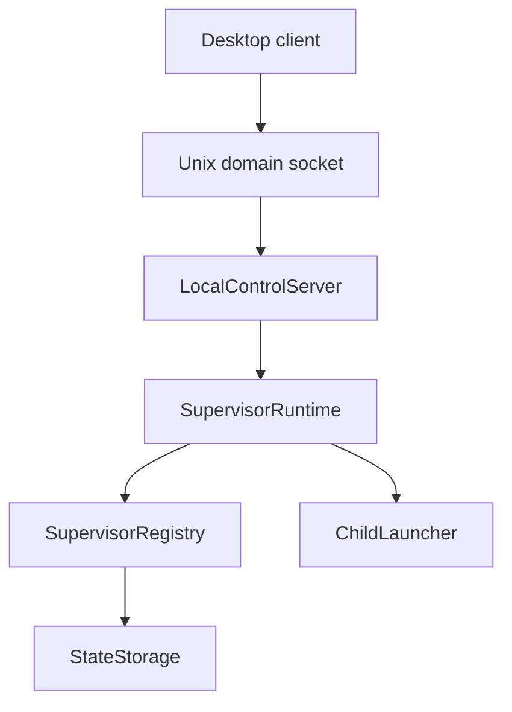
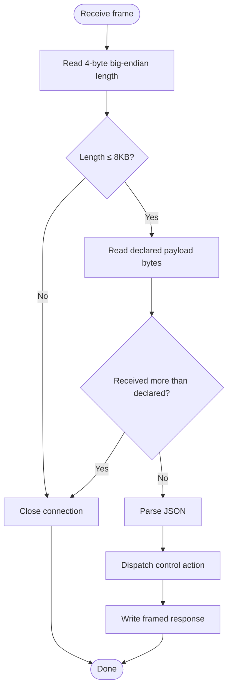
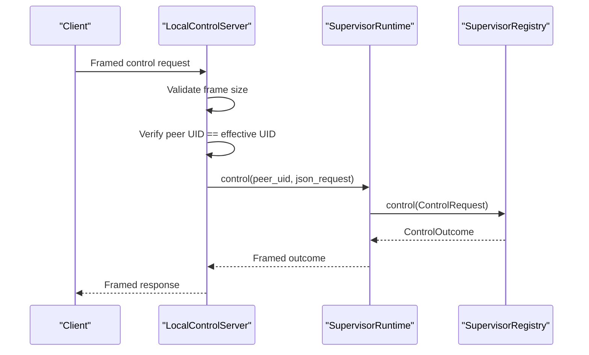
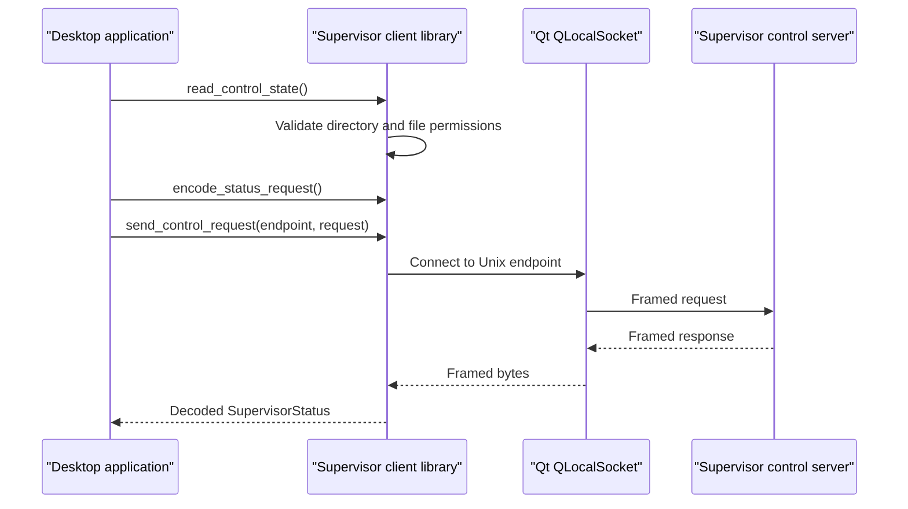
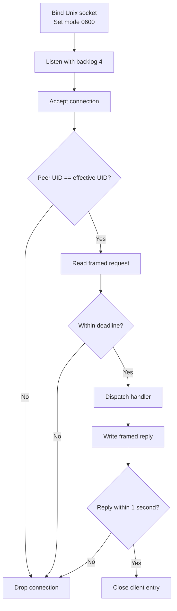
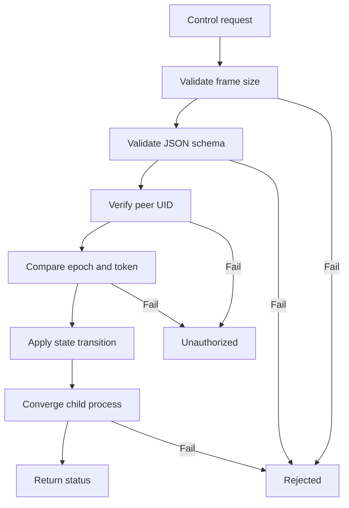
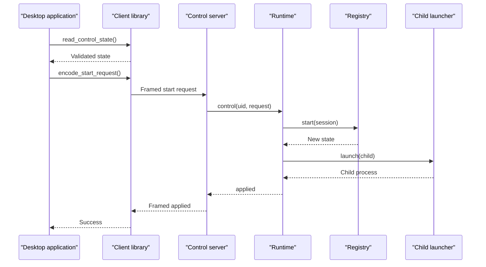

# Control API

<cite>
**Referenced Files in This Document**
- [control_server.hpp](file://services/supervisor/include/lapis/supervisor/control_server.hpp)
- [control_server.cpp](file://services/supervisor/src/control_server.cpp)
- [client.hpp](file://services/supervisor/include/lapis/supervisor/client.hpp)
- [client.cpp](file://services/supervisor/src/client.cpp)
- [runtime.hpp](file://services/supervisor/include/lapis/supervisor/runtime.hpp)
- [runtime.cpp](file://services/supervisor/src/runtime.cpp)
- [state.hpp](file://services/supervisor/include/lapis/supervisor/state.hpp)
- [json_state_codec.cpp](file://services/supervisor/src/json_state_codec.cpp)
</cite>

## Table of Contents
1. [Introduction](#introduction)
2. [Project Structure](#project-structure)
3. [Binary Protocol](#binary-protocol)
4. [Control Actions and Request Schema](#control-actions-and-request-schema)
5. [Authentication Model](#authentication-model)
6. [Response Model and Status Codes](#response-model-and-status-codes)
7. [Client Library](#client-library)
8. [Connection Lifecycle and Timeouts](#connection-lifecycle-and-timeouts)
9. [Security Considerations](#security-considerations)
10. [Error Handling](#error-handling)
11. [Operational Flow](#operational-flow)
12. [Conclusion](#conclusion)

## Introduction
This document describes the supervisor’s Unix domain socket control interface. It is a local-only, authenticated control channel used by desktop applications to manage a supervised session service. Clients send framed JSON requests and receive framed JSON responses. The server enforces strict message sizes, peer identity checks, constant-time token comparison, endpoint ownership validation, and bounded connection lifetimes.

The control surface is separate from the session service transport: it controls whether a session service may start, stop, or be disabled, while the session service itself exposes its own runtime endpoint under supervision.

## Project Structure
The control API spans several tightly coupled components:

| Component | Responsibility |
|---|---|
| `LocalControlServer` | Accepts Unix domain socket connections, reads framed frames, validates peer UID, and dispatches one request per client. |
| `SupervisorRuntime` | Translates decoded control requests into state transitions, child process lifecycle actions, and convergence behavior. |
| `SupervisorRegistry` | Authoritative state owner with atomic transitions, persistence, restart accounting, and authorization boundaries. |
| `JsonStateCodec` | Parses and validates JSON for both persisted state and control messages. |
| Client library | Encodes status/stop requests, sends them over a Qt-local Unix socket, and decodes status replies. |

**Diagram sources**
- [control_server.hpp:1-32](file://services/supervisor/include/lapis/supervisor/control_server.hpp#L1-L32)
- [control_server.cpp:201-327](file://services/supervisor/src/control_server.cpp#L201-L327)
- [runtime.hpp:1-151](file://services/supervisor/include/lapis/supervisor/runtime.hpp#L1-L151)
- [state.hpp:1-232](file://services/supervisor/include/lapis/supervisor/state.hpp#L1-L232)

**Section sources**
- [control_server.hpp:1-32](file://services/supervisor/include/lapis/supervisor/control_server.hpp#L1-L32)
- [runtime.hpp:1-151](file://services/supervisor/include/lapis/supervisor/runtime.hpp#L1-L151)
- [state.hpp:1-232](file://services/supervisor/include/lapis/supervisor/state.hpp#L1-L232)

## Binary Protocol
The wire format uses a length-prefixed framing layer over a Unix domain stream socket.

### Frame Layout
Each frame consists of:

| Field | Size | Encoding | Meaning |
|---|---:|---|---|
| Length header | 4 bytes | Big-endian unsigned integer | JSON payload byte length |
| Payload | Variable | UTF-8 JSON | Control request or response |

Constraints:

| Constraint | Value |
|---|---|
| Maximum payload size | 8 KB (`max_control_bytes`) |
| Maximum frame size | 8 KB plus 4-byte header |
| Transport | Unix domain stream socket |
| Default server reply timeout | 1 second (`control_reply_timeout_ms`) |
| Default client connection/request timeout | 5 seconds (`supervisor_client_timeout_ms`) |

### Framing Rules
- The server reads exactly the declared payload length.
- If the declared length exceeds 8 KB, the frame is rejected and the connection is closed.
- If more than the declared length is received, the frame is rejected.
- The server writes replies using the same framing format.
- Partial writes are retried until the deadline expires.

**Diagram sources**
- [control_server.cpp:28-119](file://services/supervisor/src/control_server.cpp#L28-L119)
- [state.hpp:1-80](file://services/supervisor/include/lapis/supervisor/state.hpp#L1-L80)

**Section sources**
- [control_server.cpp:28-119](file://services/supervisor/src/control_server.cpp#L28-L119)
- [client.cpp:201-249](file://services/supervisor/src/client.cpp#L201-L249)
- [state.hpp:1-40](file://services/supervisor/include/lapis/supervisor/state.hpp#L1-L40)

## Control Actions and Request Schema
A valid control request is a JSON object with these fields:

| Field | Type | Required | Validation |
|---|---|---:|---|
| `version` | Integer | Yes | Must be `1` |
| `action` | String | Yes | Must be `"start"`, `"stop"`, or `"disable"` |
| `supervisor_epoch` | Hex string | Yes | Exactly 32 lowercase hexadecimal characters |
| `token` | Hex string | Yes | Exactly 64 lowercase hexadecimal characters |
| `session` | Object or null | Yes | Present for `start`; must be null for `stop` and `disable` |

### Start Action
For `start`, the `session` object contains:

| Field | Type | Required | Validation |
|---|---|---:|---|
| `endpoint` | String | Yes | Non-empty, bounded by 4096 bytes |
| `fingerprint` | Hex string | Yes | Exactly 64 lowercase hexadecimal characters |
| `identity` | Object | Yes | Contains `session_id` and `epoch`, each exactly 32 lowercase hexadecimal characters |

The registry assigns a fresh `spawn_token` and canonical launch metadata; the client does not supply it.

### Stop Action
For `stop`:

- `session` must be null.
- The client should use the current `instance_epoch` and the spawn token associated with the active session when building higher-level requests.
- The server authenticates using the supplied epoch/token pair.

### Disable Action
For `disable`:

- `session` must be null.
- Disabling prevents future sessions from being started through the supervisor.

### Schema Validation
Malformed JSON, unsupported version, unknown action, invalid hex identifiers, oversized strings, or incorrect field presence cause the request to be rejected before authorization is evaluated.

**Section sources**
- [json_state_codec.cpp:270-339](file://services/supervisor/src/json_state_codec.cpp#L270-L339)
- [state.hpp:80-140](file://services/supervisor/include/lapis/supervisor/state.hpp#L80-L140)

## Authentication Model
Authorization is based on an `(instance_epoch, spawn_token)` credential pair.

### Credential Semantics
- `instance_epoch` identifies the supervisor instance lifetime.
- `spawn_token` identifies the current session identity.
- Tokens are 64-character lowercase hexadecimal values.
- Epochs and identities are 32-character lowercase hexadecimal values.
- Fingerprints are 64-character lowercase hexadecimal values.

### Constant-Time Comparison
Token equality is implemented with a constant-time comparison function to prevent timing-based leakage. This protects against attackers inferring partial token matches by measuring response latency.

### Authorization Boundaries
- The server rejects connections whose peer UID does not match the supervisor process effective UID.
- The runtime additionally rejects control calls where the peer UID differs from the effective UID.
- A stale `supervisor_epoch` produces `stale_epoch`.
- Missing or invalid credentials produce `unauthorized`.
- Malformed or disallowed requests produce `rejected`.

**Diagram sources**
- [control_server.cpp:201-327](file://services/supervisor/src/control_server.cpp#L201-L327)
- [runtime.cpp:430-505](file://services/supervisor/src/runtime.cpp#L430-L505)
- [state.hpp:140-200](file://services/supervisor/include/lapis/supervisor/state.hpp#L140-L200)

**Section sources**
- [control_server.cpp:120-199](file://services/supervisor/src/control_server.cpp#L120-L199)
- [runtime.cpp:430-505](file://services/supervisor/src/runtime.cpp#L430-L505)
- [state.hpp:1-80](file://services/supervisor/include/lapis/supervisor/state.hpp#L1-L80)

## Response Model and Status Codes
Every response is a framed JSON object containing:

| Field | Type | Meaning |
|---|---|---|
| `version` | Integer | Always `1` |
| `status` | String | One of `applied`, `unauthorized`, `stale_epoch`, or `rejected` |

### Status Codes

| Status | Meaning | Typical Cause |
|---|---|---|
| `applied` | The requested transition succeeded and the supervisor converged to the desired state | Valid authentication and allowed action |
| `unauthorized` | Peer identity or credentials were invalid | Wrong peer UID, wrong epoch, wrong token |
| `stale_epoch` | The supervisor instance has changed since the client obtained its epoch | Supervisor restarted or reinitialized |
| `rejected` | Request was malformed, disallowed, or failed during convergence | Invalid schema, missing session slot, launch failure, unexpected internal error |

### Current State Snapshot
While the control response envelope currently carries only the status code, the broader supervisor state model includes:

| Field | Type | Description |
|---|---|---|
| `version` | Integer | State schema version |
| `enabled` | Boolean | Whether the supervisor permits starting sessions |
| `instance_epoch` | Hex string | Instance identifier |
| `session` | Optional object | Current desired session, including endpoint, fingerprint, identity, spawn token, blocked reason, and optional launch metadata |

Higher-level clients read the authoritative state from the supervisor state file rather than trusting the control response body alone.

**Section sources**
- [runtime.cpp:398-429](file://services/supervisor/src/runtime.cpp#L398-L429)
- [state.hpp:100-200](file://services/supervisor/include/lapis/supervisor/state.hpp#L100-L200)

## Client Library
The client library provides a high-level interface for desktop applications.

### Public Interface

| Function | Purpose |
|---|---|
| `encode_status_request()` | Produces a status query request |
| `encode_stop_request(state)` | Produces a stop request bound to the current supervisor epoch and spawn token |
| `decode_status_reply(bytes)` | Validates and converts a status reply into `SupervisorStatus` |
| `read_control_state(directory)` | Reads and validates the supervisor’s persisted state file |
| `send_control_request(endpoint, request)` | Sends a framed request and returns the framed response |

### Status Request and Reply
The status request uses a different internal structure from control requests:

- Status request fields: `version`, `action`.
- Status reply fields: `version`, `status`, `schema_version`, `instance_epoch`, `slot`, `enabled`, `service_live`, `blocked_reason`, `endpoint`, `reconstructable`.

The client validates:

- Exact required fields.
- Version compatibility.
- `slot` values: `empty`, `started`, or `stopped`.
- Boolean fields.
- Consistency rules such as `service_live` implying `slot == started` and an endpoint being present only when the service is live.

### State File Reading
`read_control_state` enforces:

- Absolute directory path.
- Directory owned by the calling user.
- Directory mode restricted to owner permissions.
- State file is a regular file.
- State file owned by the calling user.
- State file mode restricted to owner permissions.
- Single hard link.
- No special permission bits.
- Non-zero size within the state size bound.
- Valid schema version.

### Control Endpoint Validation
`send_control_request` requires:

- Absolute endpoint path.
- Non-empty request.
- Request size within the 8 KB limit.

It connects using Qt’s local socket, writes the framed request, drains partial writes, and reads the framed response with timeouts.

**Diagram sources**
- [client.hpp:1-34](file://services/supervisor/include/lapis/supervisor/client.hpp#L1-L34)
- [client.cpp:1-199](file://services/supervisor/src/client.cpp#L1-L199)
- [client.cpp:201-249](file://services/supervisor/src/client.cpp#L201-L249)

**Section sources**
- [client.hpp:1-34](file://services/supervisor/include/lapis/supervisor/client.hpp#L1-L34)
- [client.cpp:1-199](file://services/supervisor/src/client.cpp#L1-L199)
- [client.cpp:201-249](file://services/supervisor/src/client.cpp#L201-L249)

## Connection Lifecycle and Timeouts
The server and client enforce strict timeouts to prevent resource exhaustion.

### Server-Side Limits
- Maximum concurrent control clients: 4.
- Per-client deadline: 5 seconds.
- Reply write deadline: 1 second.
- Each client handles at most one strict frame and one reply.
- Incomplete or slow clients are dropped.

### Client-Side Limits
- Connection timeout: 5 seconds (`supervisor_client_timeout_ms`).
- Read/write operations wait up to the remaining time budget.
- Responses larger than 8 KB are rejected.
- Trailing bytes after the declared response are rejected.

### Socket Setup
The control server:

1. Validates the endpoint path.
2. Removes or probes any existing endpoint.
3. Creates a Unix domain socket.
4. Binds and listens.
5. Sets socket mode to owner-only.
6. Verifies the bound socket is a socket, owned by the effective UID, and mode-restricted.

**Diagram sources**
- [control_server.cpp:201-327](file://services/supervisor/src/control_server.cpp#L201-L327)
- [runtime.hpp:1-40](file://services/supervisor/include/lapis/supervisor/runtime.hpp#L1-L40)

**Section sources**
- [control_server.cpp:201-327](file://services/supervisor/src/control_server.cpp#L201-L327)
- [runtime.hpp:1-40](file://services/supervisor/include/lapis/supervisor/runtime.hpp#L1-L40)
- [client.cpp:201-249](file://services/supervisor/src/client.cpp#L201-L249)

## Security Considerations
The control interface implements defense-in-depth against malicious local control attempts.

### Peer Identity Verification
The server verifies that the connecting process has the same UID as the supervisor process. Platform-specific mechanisms are used:

| Platform Family | Mechanism | Behavior on Failure |
|---|---|---|
| BSD/macOS | `getpeereid` | Rejects connection if peer identity cannot be retrieved |
| Linux | `SO_PEERCRED` | Rejects connection if credentials cannot be retrieved |
| Other platforms | No peer UID mechanism available | Returns no UID and rejects the connection |

Additionally, the runtime rejects control calls where the provided peer UID differs from the effective UID.

### Endpoint Path Validation
- Control endpoints must be absolute paths.
- Child endpoints must reside in a directory owned by the effective UID with owner-only permissions.
- The control socket is created with mode `0600`.
- The server verifies the final socket is private after binding.
- The client validates the state directory and state file ownership and permissions.

### Token Security
- Spawn tokens are 64-character lowercase hexadecimal values.
- Tokens are compared using constant-time comparison.
- Tokens are stored only in validated state files and passed to children through explicit arguments and ownership records.

### Malicious Request Protection
- Frames exceeding 8 KB are rejected.
- JSON payloads are strictly parsed with exact field sets.
- Unknown actions are rejected.
- Invalid hex identifiers are rejected.
- Oversized strings are rejected.
- Requests with inconsistent fields (for example, a session payload on `stop` or `disable`) are rejected.
- Internal exceptions during control processing map to `rejected`.

### Ownership and Process Safety
- Child ownership records are written atomically via rename after fsync.
- Ownership records validate PID, spawn token, size, permissions, and hard links.
- Launch fails if another process already owns the spawn token.
- Live endpoint probing strengthens trust in the adopted child.
- Termination uses process-group signaling followed by kill-on-refusal.

**Diagram sources**
- [control_server.cpp:28-199](file://services/supervisor/src/control_server.cpp#L28-L199)
- [runtime.cpp:398-505](file://services/supervisor/src/runtime.cpp#L398-L505)
- [client.cpp:1-199](file://services/supervisor/src/client.cpp#L1-L199)

**Section sources**
- [control_server.cpp:28-199](file://services/supervisor/src/control_server.cpp#L28-L199)
- [runtime.cpp:398-505](file://services/supervisor/src/runtime.cpp#L398-L505)
- [client.cpp:1-199](file://services/supervisor/src/client.cpp#L1-L199)
- [state.hpp:1-80](file://services/supervisor/include/lapis/supervisor/state.hpp#L1-L80)

## Error Handling
Errors are categorized by their likely consumer interpretation.

| Category | Server/Client Behavior | Consumer Interpretation |
|---|---|---|
| Protocol error | Reject frame, close connection | Malformed client or network issue |
| JSON parsing error | Throw during decode | Invalid request schema |
| Validation error | Throw during decoding | Client sent unsupported or inconsistent data |
| Authentication failure | Return `unauthorized` | Wrong peer, wrong epoch, or wrong token |
| Stale epoch | Return `stale_epoch` | Supervisor restarted; client should refresh epoch |
| Internal exception | Return `rejected` | Unexpected server-side failure |
| Launch failure | Persist blocked state and return `rejected` | Session could not be started |
| Restart exhaustion | Persist blocked state | Too many rapid restarts |

### Error Sources
- System call failures raise system-aware exceptions.
- Invalid filesystem state raises descriptive errors.
- Invalid JSON raises parser-aware errors.
- Control outcomes explicitly distinguish authentication, staleness, and rejection.

**Section sources**
- [control_server.cpp:28-119](file://services/supervisor/src/control_server.cpp#L28-L119)
- [runtime.cpp:430-560](file://services/supervisor/src/runtime.cpp#L430-L560)
- [json_state_codec.cpp:270-339](file://services/supervisor/src/json_state_codec.cpp#L270-L339)

## Operational Flow
The normal flow for starting a session through the supervisor is:

1. Desktop application reads the supervisor state directory and validates ownership.
2. Application queries the current status and obtains `instance_epoch`, `enabled`, `service_live`, and endpoint information.
3. Application decides whether to start a new session.
4. Application constructs a `start` control request with endpoint, fingerprint, identity, epoch, and token.
5. Client sends the framed request to the control endpoint.
6. Server verifies peer UID and forwards the request to the runtime.
7. Registry applies the start transition and persists state.
8. Runtime launches or adopts the session child process.
9. Server responds with `applied` if convergence succeeds.

For stopping:

1. Application reads the current state to obtain the active spawn token.
2. Application constructs a `stop` request with the current epoch and token.
3. Server authenticates the request.
4. Runtime terminates the current child process and updates state.
5. Server responds with `applied` if termination and convergence succeed.

For disabling:

1. Application constructs a `disable` request with the current epoch and token.
2. Server authenticates the request.
3. Registry marks the supervisor as disabled.
4. Existing session is stopped if applicable.
5. Server responds with `applied`.

**Diagram sources**
- [client.cpp:1-199](file://services/supervisor/src/client.cpp#L1-L199)
- [control_server.cpp:201-327](file://services/supervisor/src/control_server.cpp#L201-L327)
- [runtime.cpp:430-560](file://services/supervisor/src/runtime.cpp#L430-L560)

**Section sources**
- [client.cpp:1-199](file://services/supervisor/src/client.cpp#L1-L199)
- [control_server.cpp:201-327](file://services/supervisor/src/control_server.cpp#L201-L327)
- [runtime.cpp:430-560](file://services/supervisor/src/runtime.cpp#L430-L560)

## Conclusion
The supervisor control API is a small, strongly constrained, local-only control plane. Its security model relies on Unix domain socket peer identity, strict JSON schema validation, constant-time token comparison, endpoint ownership checks, and bounded connection lifetimes. Clients should treat `unauthorized`, `stale_epoch`, and `rejected` distinctly: refresh credentials on `stale_epoch`, inspect request construction on `unauthorized`, and log diagnostics on `rejected`. For production integration, always validate the state directory and file permissions, respect the 8 KB message bound, and handle timeout failures gracefully.