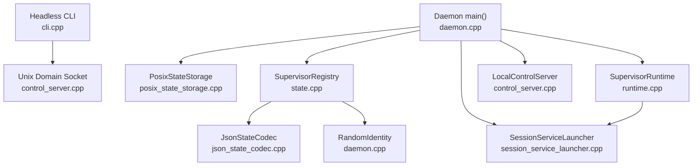
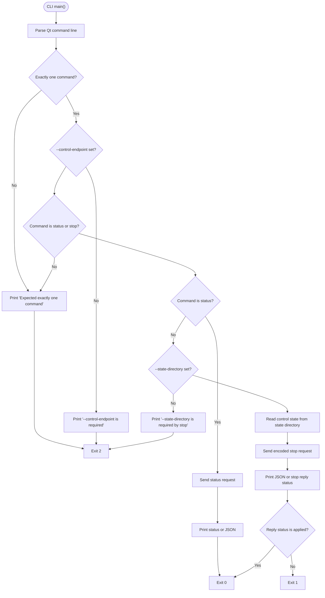
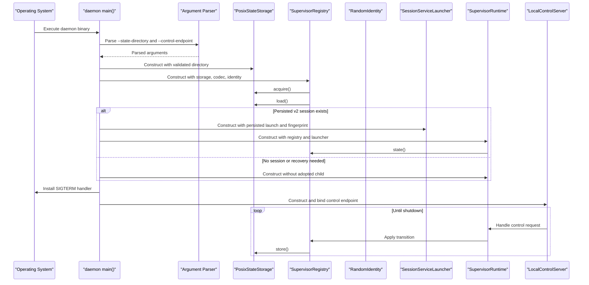
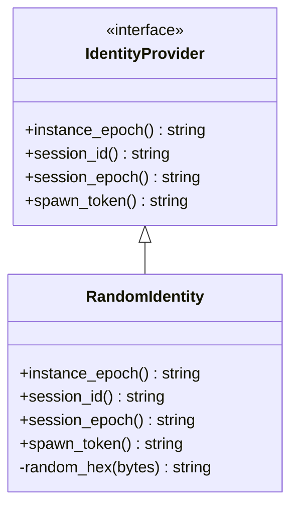
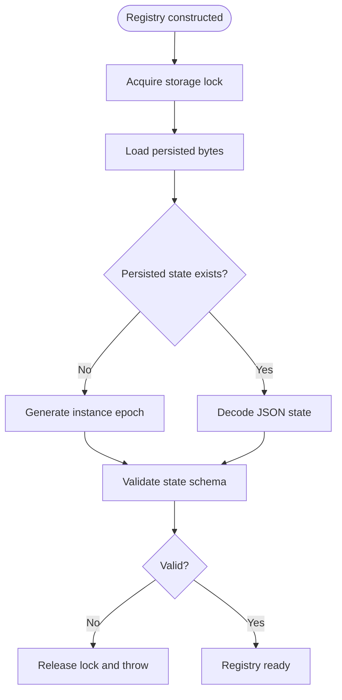
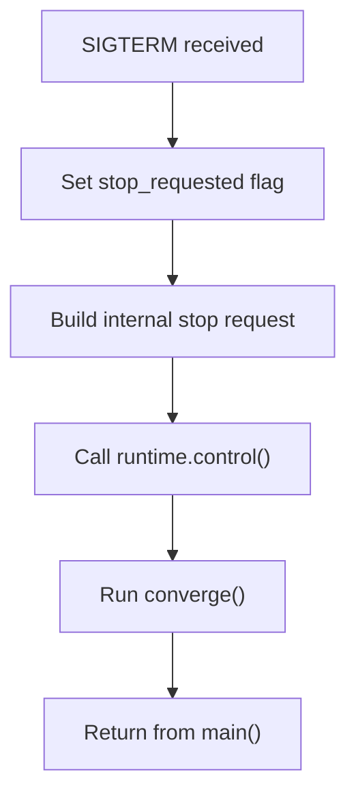
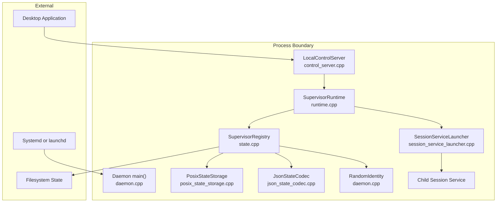
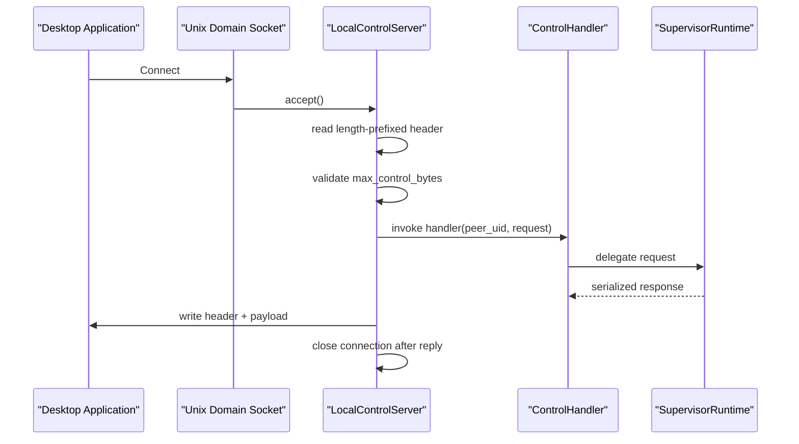
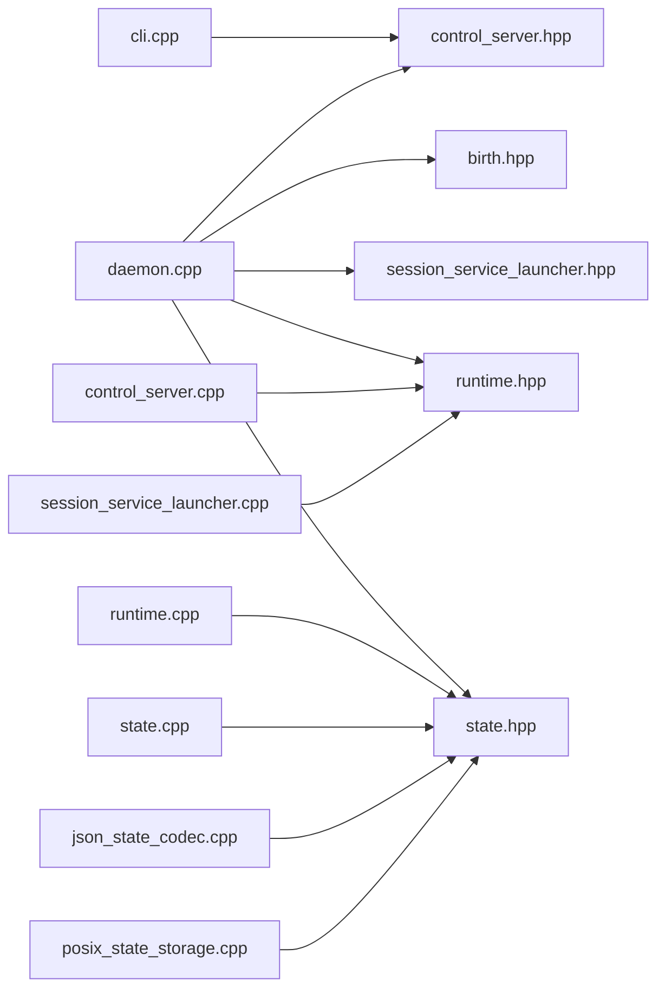

# Daemon Entrypoint

<cite>
**Referenced Files in This Document**
- [cli.cpp](file://services/supervisor/src/cli.cpp)
- [daemon.cpp](file://services/supervisor/src/daemon.cpp)
- [control_server.cpp](file://services/supervisor/src/control_server.cpp)
- [session_service_launcher.cpp](file://services/supervisor/src/session_service_launcher.cpp)
- [runtime.cpp](file://services/supervisor/src/runtime.cpp)
- [state.cpp](file://services/supervisor/src/state.cpp)
- [json_state_codec.cpp](file://services/supervisor/src/json_state_codec.cpp)
- [posix_state_storage.cpp](file://services/supervisor/src/posix_state_storage.cpp)
- [runtime.hpp](file://services/supervisor/include/lapis/supervisor/runtime.hpp)
- [state.hpp](file://services/supervisor/include/lapis/supervisor/state.hpp)
- [control_server.hpp](file://services/supervisor/include/lapis/supervisor/control_server.hpp)
- [session_service_launcher.hpp](file://services/supervisor/include/lapis/supervisor/session_service_launcher.hpp)
- [birth.hpp](file://services/supervisor/include/lapis/supervisor/birth.hpp)
</cite>

## Table of Contents
1. [Introduction](#introduction)
2. [Project Structure](#project-structure)
3. [Core Components](#core-components)
4. [Architecture Overview](#architecture-overview)
5. [Detailed Component Analysis](#detailed-component-analysis)
6. [Dependency Analysis](#dependency-analysis)
7. [Performance Considerations](#performance-considerations)
8. [Troubleshooting Guide](#troubleshooting-guide)
9. [Conclusion](#conclusion)

## Introduction
This document explains the supervisor daemon entrypoint and its command-line interface. It covers:

- The daemon `main()` function that initializes a Qt application, parses required options, validates absolute paths, installs signal handlers, builds the state registry, reconstructs persisted session state, and starts the control server.
- The headless CLI client used for status queries and explicit stop requests.
- Argument parsing rules, validation errors, and exit codes.
- The `RandomIdentity` provider that generates cryptographically random instance epochs, session IDs, session epochs, and spawn tokens.
- The startup sequence from storage acquisition through service launcher construction to runtime convergence.
- Integration with the desktop application via a Unix-domain control server and its concurrency model.
- Deployment considerations for macOS launchd and Linux systemd environments, including environment variable setup for the session service program path.

## Project Structure
The supervisor is implemented under `services/supervisor`. Its most relevant source files are:

| Area | File | Responsibility |
|---|---|---|
| Headless CLI | [cli.cpp](file://services/supervisor/src/cli.cpp) | Parses `status` and `stop`, sends control requests, and prints human-readable or JSON output. |
| Daemon entrypoint | [daemon.cpp](file://services/supervisor/src/daemon.cpp) | Initializes Qt, parses daemon options, constructs storage, registry, identity provider, reconstructed launcher, runtime, and control server. |
| Control server | [control_server.cpp](file://services/supervisor/src/control_server.cpp) | Accepts local Unix socket connections, reads length-prefixed frames, and delegates handler callbacks. |
| Session launcher | [session_service_launcher.cpp](file://services/supervisor/src/session_service_launcher.cpp) | Launches, adopts, observes, and terminates the child session service process. |
| Runtime lifecycle | [runtime.cpp](file://services/supervisor/src/runtime.cpp) | Applies start/stop/disable transitions, manages restart policy, and owns the child process lifecycle. |
| State model and registry | [state.cpp](file://services/supervisor/src/state.cpp), [state.hpp](file://services/supervisor/include/lapis/supervisor/state.hpp) | Defines state schema, validations, persistence interfaces, identity provider interface, and authoritative registry. |
| JSON codec | [json_state_codec.cpp](file://services/supervisor/src/json_state_codec.cpp) | Encodes and decodes supervisor state and control payloads. |
| POSIX storage | [posix_state_storage.cpp](file://services/supervisor/src/posix_state_storage.cpp) | Implements owner-only directory locking, atomic state file replacement, and filesystem validation. |
| Birth protocol | [birth.hpp](file://services/supervisor/include/lapis/supervisor/birth.hpp) | Describes the agent birth request and reply types used during service adoption. |

**Diagram sources**
- [daemon.cpp:1-200](file://services/supervisor/src/daemon.cpp#L1-L200)
- [cli.cpp:1-97](file://services/supervisor/src/cli.cpp#L1-L97)
- [control_server.cpp:1-200](file://services/supervisor/src/control_server.cpp#L1-L200)
- [session_service_launcher.cpp:1-200](file://services/supervisor/src/session_service_launcher.cpp#L1-L200)
- [runtime.cpp:1-200](file://services/supervisor/src/runtime.cpp#L1-L200)
- [state.cpp:1-200](file://services/supervisor/src/state.cpp#L1-L200)
- [json_state_codec.cpp:1-200](file://services/supervisor/src/json_state_codec.cpp#L1-L200)
- [posix_state_storage.cpp:1-171](file://services/supervisor/src/posix_state_storage.cpp#L1-L171)

**Section sources**
- [cli.cpp:1-97](file://services/supervisor/src/cli.cpp#L1-L97)
- [daemon.cpp:1-200](file://services/supervisor/src/daemon.cpp#L1-L200)
- [control_server.cpp:1-200](file://services/supervisor/src/control_server.cpp#L1-L200)
- [session_service_launcher.cpp:1-200](file://services/supervisor/src/session_service_launcher.cpp#L1-L200)
- [runtime.cpp:1-200](file://services/supervisor/src/runtime.cpp#L1-L200)
- [state.cpp:1-200](file://services/supervisor/src/state.cpp#L1-L200)
- [json_state_codec.cpp:1-200](file://services/supervisor/src/json_state_codec.cpp#L1-L200)
- [posix_state_storage.cpp:1-171](file://services/supervisor/src/posix_state_storage.cpp#L1-L171)

## Core Components

### Headless CLI
The headless executable is not the long-running daemon; it is a short-lived client used by users or automation tools to query supervisor status or send an explicit stop request.

Key behaviors:

- Initializes a Qt core application and names it `lapis`.
- Adds two required-style options:
  - `--control-endpoint`: the absolute supervisor control socket path.
  - `--state-directory`: the private supervisor state directory required only for `stop`.
- Adds a positional argument restricted to exactly one of `status` or `stop`.
- Supports a `--json` flag so machine-readable JSON can be printed instead of human-readable text.
- Returns exit code `2` for invalid usage, `0` for successful status or applied stop, and `1` for network or unexpected failure.

Argument validation flow:

**Diagram sources**
- [cli.cpp:1-97](file://services/supervisor/src/cli.cpp#L1-L97)

**Section sources**
- [cli.cpp:1-97](file://services/supervisor/src/cli.cpp#L1-L97)

### Daemon Entry Point
The daemon entry point is the long-running supervisor process. Its responsibilities include:

1. Initializing a Qt application.
2. Parsing `--state-directory` and `--control-endpoint`.
3. Validating that both paths are non-empty and absolute.
4. Creating a POSIX-backed state storage backed by an owner-only directory.
5. Building a `SupervisorRegistry` with JSON codec and `RandomIdentity`.
6. Reconstructing any persisted session using a `SessionServiceLauncher`.
7. Constructing `SupervisorRuntime` with the registry and launcher.
8. Installing SIGTERM handling for graceful shutdown.
9. Starting the local control server bound to the supplied endpoint.
10. Polling the control server until shutdown is requested.

**Diagram sources**
- [daemon.cpp:1-200](file://services/supervisor/src/daemon.cpp#L1-L200)
- [posix_state_storage.cpp:1-171](file://services/supervisor/src/posix_state_storage.cpp#L1-L171)
- [state.cpp:1-200](file://services/supervisor/src/state.cpp#L1-L200)
- [session_service_launcher.cpp:1-200](file://services/supervisor/src/session_service_launcher.cpp#L1-L200)
- [runtime.cpp:1-200](file://services/supervisor/src/runtime.cpp#L1-L200)
- [control_server.cpp:1-200](file://services/supervisor/src/control_server.cpp#L1-L200)

**Section sources**
- [daemon.cpp:1-200](file://services/supervisor/src/daemon.cpp#L1-L200)

### Argument Parsing and Validation
The daemon uses a simple prefix-based parser rather than Qt’s command-line parser. It expects exactly three arguments:

| Expected value | Meaning |
|---|---|
| Binary path | Process executable name. |
| `--state-directory=PATH` | Absolute path to the private supervisor state directory. |
| `--control-endpoint=SOCKET` | Absolute Unix domain socket path exposed to clients. |

Validation rules:

- Exactly three command-line arguments are required.
- Both `--state-directory` and `--control-endpoint` must be present.
- Both values must be non-empty.
- Both values must begin with `/`, enforcing absolute paths.
- Any violation throws a runtime error caught by the daemon entrypoint, which propagates as a fatal initialization failure.

The headless CLI uses Qt’s command-line parser and enforces stricter user-facing rules:

- Exactly one positional argument is required.
- The command must be `status` or `stop`.
- `--control-endpoint` is always required.
- `--state-directory` is required only for `stop`.
- Invalid usage returns exit code `2`; runtime failures return `1`; success returns `0`.

**Section sources**
- [daemon.cpp:1-200](file://services/supervisor/src/daemon.cpp#L1-L200)
- [cli.cpp:1-97](file://services/supervisor/src/cli.cpp#L1-L97)

### RandomIdentity Provider
`RandomIdentity` implements the `IdentityProvider` interface and produces cryptographically random identifiers through Qt UUID generation.

Generated identities:

| Identity | Purpose | Generation method |
|---|---|---|
| Instance epoch | Identifies a supervisor process lifetime. | Hex-encoded UUID-derived bytes. |
| Session ID | Durable logical session identifier. | Hex-encoded UUID-derived bytes. |
| Session epoch | Rotated per restart to reject stale reconnects. | Hex-encoded UUID-derived bytes. |
| Spawn token | Secret token authorizing control actions for a session. | Hex-encoded UUID-derived bytes. |

The implementation concatenates repeated UUID hex strings until enough bytes are available and truncates them to the expected sizes defined in the state header. This means each generated value is derived from cryptographic-quality randomness provided by the platform UUID generator.

**Diagram sources**
- [state.hpp:1-200](file://services/supervisor/include/lapis/supervisor/state.hpp#L1-L200)
- [daemon.cpp:1-200](file://services/supervisor/src/daemon.cpp#L1-L200)

**Section sources**
- [state.hpp:1-200](file://services/supervisor/include/lapis/supervisor/state.hpp#L1-L200)
- [daemon.cpp:1-200](file://services/supervisor/src/daemon.cpp#L1-L200)

### State Reconstruction and Persistence
The registry is the authoritative owner of supervisor state. On construction:

1. Storage is acquired, acquiring a file lock.
2. Existing JSON state is loaded and decoded.
3. If no persisted state exists, an instance epoch is generated by the identity provider.
4. Decoded state is validated against the current schema.
5. If validation fails, the registry constructor rethrows after releasing the storage lock.

Version behavior:

- Version 1 has no persisted launch payload.
- Version 2 requires a canonical launch payload describing the agent program, arguments, working directory, terminal size, and agent mode.
- A version mismatch prevents automatic reconstruction and requires explicit operator recovery.

Persistence properties:

- Directory must be owned by the running user and have mode `0700`.
- State file must be a singly linked regular file owned by the running user with mode `0600`.
- Writes use a pending file followed by atomic rename and directory sync.
- Maximum state size is bounded at compile time.
- Concurrent access is serialized through an exclusive flock on `.supervisor.lock`.

**Diagram sources**
- [state.cpp:1-200](file://services/supervisor/src/state.cpp#L1-L200)
- [posix_state_storage.cpp:1-171](file://services/supervisor/src/posix_state_storage.cpp#L1-L171)
- [json_state_codec.cpp:1-200](file://services/supervisor/src/json_state_codec.cpp#L1-L200)

**Section sources**
- [state.cpp:1-200](file://services/supervisor/src/state.cpp#L1-L200)
- [posix_state_storage.cpp:1-171](file://services/supervisor/src/posix_state_storage.cpp#L1-L171)
- [json_state_codec.cpp:1-200](file://services/supervisor/src/json_state_codec.cpp#L1-L200)

### Service Launcher Setup
When the persisted state contains a version 2 session, the daemon reconstructs a `SessionServiceLauncher` using:

- The persisted canonical launch payload.
- The stored session fingerprint.

The launcher then participates in:

- Adopting an existing child process if it still holds the authoritative spawn token.
- Launching a new child when none is alive.
- Checking whether the child is alive.
- Terminating the child.
- Releasing ownership resources.

The launcher validates terminal dimensions, checks that the service program path is absolute, and verifies that the endpoint parent directory is owned exclusively by the supervisor process.

**Section sources**
- [daemon.cpp:1-200](file://services/supervisor/src/daemon.cpp#L1-L200)
- [session_service_launcher.hpp:1-56](file://services/supervisor/include/lapis/supervisor/session_service_launcher.hpp#L1-L56)
- [session_service_launcher.cpp:1-200](file://services/supervisor/src/session_service_launcher.cpp#L1-L200)

### Graceful Shutdown
The daemon installs a signal handler for SIGTERM. When received:

1. A `sig_atomic_t` flag is set.
2. The control loop stops polling.
3. An internal stop request is built using the current instance epoch and session spawn token.
4. The runtime is asked to apply the stop action.
5. Convergence runs once more.
6. Exceptions in the shutdown path are swallowed so they do not replace the original failure reason.

**Diagram sources**
- [daemon.cpp:1-200](file://services/supervisor/src/daemon.cpp#L1-L200)

**Section sources**
- [daemon.cpp:1-200](file://services/supervisor/src/daemon.cpp#L1-L200)

## Architecture Overview

**Diagram sources**
- [daemon.cpp:1-200](file://services/supervisor/src/daemon.cpp#L1-L200)
- [control_server.cpp:1-200](file://services/supervisor/src/control_server.cpp#L1-L200)
- [runtime.cpp:1-200](file://services/supervisor/src/runtime.cpp#L1-L200)
- [session_service_launcher.cpp:1-200](file://services/supervisor/src/session_service_launcher.cpp#L1-L200)
- [state.cpp:1-200](file://services/supervisor/src/state.cpp#L1-L200)
- [json_state_codec.cpp:1-200](file://services/supervisor/src/json_state_codec.cpp#L1-L200)
- [posix_state_storage.cpp:1-171](file://services/supervisor/src/posix_state_storage.cpp#L1-L171)

## Detailed Component Analysis

### Daemon main() Lifecycle
The daemon entrypoint performs initialization in this order:

1. Create `QCoreApplication`.
2. Parse and validate `--state-directory` and `--control-endpoint`.
3. Construct `PosixStateStorage`.
4. Construct `SupervisorRegistry` with `JsonStateCodec` and `RandomIdentity`.
5. If a persisted session exists, construct `SessionServiceLauncher` from the persisted launch and fingerprint.
6. Construct `SupervisorRuntime` with registry and launcher.
7. Install SIGTERM handler.
8. Bind `LocalControlServer` to the control endpoint.
9. Enter a poll loop until shutdown is requested.

Important details:

- The daemon does not automatically start a session merely because it is running. It first restores state and then waits for external control to start the desired session.
- A stopped version 2 slot still validates the launcher construction but has no live child to adopt.
- If the persisted state is missing its canonical launch payload, reconstruction fails early.

**Section sources**
- [daemon.cpp:1-200](file://services/supervisor/src/daemon.cpp#L1-L200)

### Control Server Concurrency Model
The control server provides a strict single-frame API:

- Each accepted connection receives at most one request frame and one reply.
- Clients that cannot finish one strict frame are dropped rather than occupying a slot indefinitely.
- The maximum number of concurrent control clients is limited by `max_control_clients`.
- Each client has a timeout.
- Replies are length-prefixed with a big-endian 32-bit header.
- Peer authentication uses Unix domain socket credentials where supported:
  - macOS/OpenBSD/FreeBSD: `getpeereid`.
  - Linux: `SO_PEERCRED`.
- The server prepares endpoints through the shared local endpoint helper.

Concurrency characteristics:

- The server processes one client at a time within its poll loop.
- Malformed or abandoned connections are closed quickly.
- Long-running work should be delegated to the control handler callback, typically the runtime, rather than blocking the server loop.

**Diagram sources**
- [control_server.cpp:1-200](file://services/supervisor/src/control_server.cpp#L1-L200)
- [runtime.hpp:1-151](file://services/supervisor/include/lapis/supervisor/runtime.hpp#L1-L151)

**Section sources**
- [control_server.cpp:1-200](file://services/supervisor/src/control_server.cpp#L1-L200)
- [control_server.hpp:1-32](file://services/supervisor/include/lapis/supervisor/control_server.hpp#L1-L32)
- [runtime.hpp:1-151](file://services/supervisor/include/lapis/supervisor/runtime.hpp#L1-L151)

### Runtime Convergence and Lifecycle
`SupervisorRuntime` owns lifecycle policy:

- Bootstrap applies the initial start transition before normal remote control is allowed.
- Local authorization bootstrap is separate from remote control, which requires a token and instance epoch.
- `converge()` drives the system toward the desired state.
- Restart policy limits restarts per time window.
- Child process ownership is tracked through spawn tokens and optional protocol identity fields.
- Stopping the desired session reasons the transition and updates state.

Lifecycle states include:

| Convergence result | Meaning |
|---|---|
| `converged` | Desired state already reached. |
| `started` | New child was started. |
| `restarted` | Existing child was replaced. |
| `stopped` | Desired child was stopped. |
| `disabled` | Supervisor slot disabled. |
| `exhausted` | Restart limit exhausted. |
| `failed` | Transition failed. |

**Section sources**
- [runtime.cpp:1-200](file://services/supervisor/src/runtime.cpp#L1-L200)
- [runtime.hpp:1-151](file://services/supervisor/include/lapis/supervisor/runtime.hpp#L1-L151)

### State Schema and Validation
The state schema defines:

- `SupervisorState`: version, enabled flag, instance epoch, and optional session.
- `DesiredSession`: endpoint, fingerprint, identity, desired state, spawn token, blocked reason, and optional canonical launch.
- `DesiredSessionLaunch`: program, arguments, working directory, terminal columns and rows, and agent mode.
- `ControlRequest`: instance epoch, token, action, and optional session payload.
- `ControlOutcome`: status and resulting state.

Validation includes:

- Fixed-length lowercase hexadecimal identifiers.
- Endpoint bounds and absolute-path expectation.
- Fingerprint and spawn-token length checks.
- Bounded text fields rejecting null bytes and control characters.
- Launch payload size limits.
- Terminal dimension bounds.
- Agent mode enumeration validation.
- Constant-time token comparison for security-sensitive equality checks.

**Section sources**
- [state.hpp:1-200](file://services/supervisor/include/lapis/supervisor/state.hpp#L1-L200)
- [state.cpp:1-200](file://services/supervisor/src/state.cpp#L1-L200)
- [json_state_codec.cpp:1-200](file://services/supervisor/src/json_state_codec.cpp#L1-L200)

## Dependency Analysis

**Diagram sources**
- [cli.cpp:1-97](file://services/supervisor/src/cli.cpp#L1-L97)
- [daemon.cpp:1-200](file://services/supervisor/src/daemon.cpp#L1-L200)
- [control_server.cpp:1-200](file://services/supervisor/src/control_server.cpp#L1-L200)
- [session_service_launcher.cpp:1-200](file://services/supervisor/src/session_service_launcher.cpp#L1-L200)
- [runtime.cpp:1-200](file://services/supervisor/src/runtime.cpp#L1-L200)
- [state.cpp:1-200](file://services/supervisor/src/state.cpp#L1-L200)
- [json_state_codec.cpp:1-200](file://services/supervisor/src/json_state_codec.cpp#L1-L200)
- [posix_state_storage.cpp:1-171](file://services/supervisor/src/posix_state_storage.cpp#L1-L171)
- [control_server.hpp:1-32](file://services/supervisor/include/lapis/supervisor/control_server.hpp#L1-L32)
- [session_service_launcher.hpp:1-56](file://services/supervisor/include/lapis/supervisor/session_service_launcher.hpp#L1-L56)
- [runtime.hpp:1-151](file://services/supervisor/include/lapis/supervisor/runtime.hpp#L1-L151)
- [state.hpp:1-200](file://services/supervisor/include/lapis/supervisor/state.hpp#L1-L200)
- [birth.hpp:1-39](file://services/supervisor/include/lapis/supervisor/birth.hpp#L1-L39)

**Section sources**
- [daemon.cpp:1-200](file://services/supervisor/src/daemon.cpp#L1-L200)
- [control_server.cpp:1-200](file://services/supervisor/src/control_server.cpp#L1-L200)
- [session_service_launcher.cpp:1-200](file://services/supervisor/src/session_service_launcher.cpp#L1-L200)
- [runtime.cpp:1-200](file://services/supervisor/src/runtime.cpp#L1-L200)
- [state.cpp:1-200](file://services/supervisor/src/state.cpp#L1-L200)
- [json_state_codec.cpp:1-200](file://services/supervisor/src/json_state_codec.cpp#L1-L200)
- [posix_state_storage.cpp:1-171](file://services/supervisor/src/posix_state_storage.cpp#L1-L171)

## Performance Considerations

- The control server handles one request per connection and drops slow or malformed peers after timeouts. This protects throughput and prevents resource exhaustion.
- Filesystem operations are confined to the registry’s locked owner context.
- State writes use atomic rename plus directory sync, avoiding partial state exposure.
- Identity generation uses Qt UUID, which is appropriate for small per-request randomness but is not a general-purpose streaming RNG.
- Child termination and wait loops include bounded retry counts to avoid indefinite hangs.
- Restart limiting prevents rapid restart storms through a fixed time window.

[No sources needed since this section provides general guidance]

## Troubleshooting Guide

### CLI Exit Codes
| Exit code | Meaning |
|---|---|
| `0` | Successful status query or applied stop. |
| `1` | Unexpected runtime error or stop request returned a non-applied status. |
| `2` | Invalid command-line usage. |

Common CLI errors:

- Missing `--control-endpoint`: the CLI requires a control socket path for every operation.
- Missing `--state-directory` during `stop`: the stop command needs the state directory to read control state.
- Wrong positional command: only `status` or `stop` is accepted.

**Section sources**
- [cli.cpp:1-97](file://services/supervisor/src/cli.cpp#L1-L97)

### Daemon Initialization Errors
Common daemon errors include:

- Non-absolute `--state-directory` or `--control-endpoint`.
- State directory not owned by the supervisor user or not mode `0700`.
- State file not a singly linked owner-only regular file with mode `0600`.
- State exceeds the configured byte limit.
- Persisted state version cannot be reconstructed.
- Version 2 state missing its canonical launch payload.
- Control endpoint directory not owned exclusively by the supervisor process.

**Section sources**
- [daemon.cpp:1-200](file://services/supervisor/src/daemon.cpp#L1-L200)
- [posix_state_storage.cpp:1-171](file://services/supervisor/src/posix_state_storage.cpp#L1-L171)
- [session_service_launcher.cpp:1-200](file://services/supervisor/src/session_service_launcher.cpp#L1-L200)

### State Recovery
If the registry detects poisoned persistence state after a failed commit, it refuses later transitions until a new registry acquires the lock. Recovery steps generally involve:

1. Inspecting the state directory for consistency.
2. Verifying ownership and permissions.
3. Reviewing `supervisor.json` contents.
4. Correcting filesystem issues.
5. Restarting the supervisor so it can rebuild authority from the valid persisted state.

**Section sources**
- [state.cpp:1-200](file://services/supervisor/src/state.cpp#L1-L200)
- [posix_state_storage.cpp:1-171](file://services/supervisor/src/posix_state_storage.cpp#L1-L171)

## Conclusion
The supervisor daemon entrypoint is a focused initialization layer around three core subsystems: persistent state, child lifecycle, and local control. It rejects unsafe configuration early, reconstructs durable session state safely, and exposes a strict control protocol suitable for integration with a desktop application. Deployment should ensure that the state directory, control endpoint directory, and session service program path are correctly configured through the operating system’s process manager.

**Section sources**
- [daemon.cpp:1-200](file://services/supervisor/src/daemon.cpp#L1-L200)
- [cli.cpp:1-97](file://services/supervisor/src/cli.cpp#L1-L97)
- [control_server.cpp:1-200](file://services/supervisor/src/control_server.cpp#L1-L200)
- [runtime.cpp:1-200](file://services/supervisor/src/runtime.cpp#L1-L200)
- [state.cpp:1-200](file://services/supervisor/src/state.cpp#L1-L200)
- [posix_state_storage.cpp:1-171](file://services/supervisor/src/posix_state_storage.cpp#L1-L171)