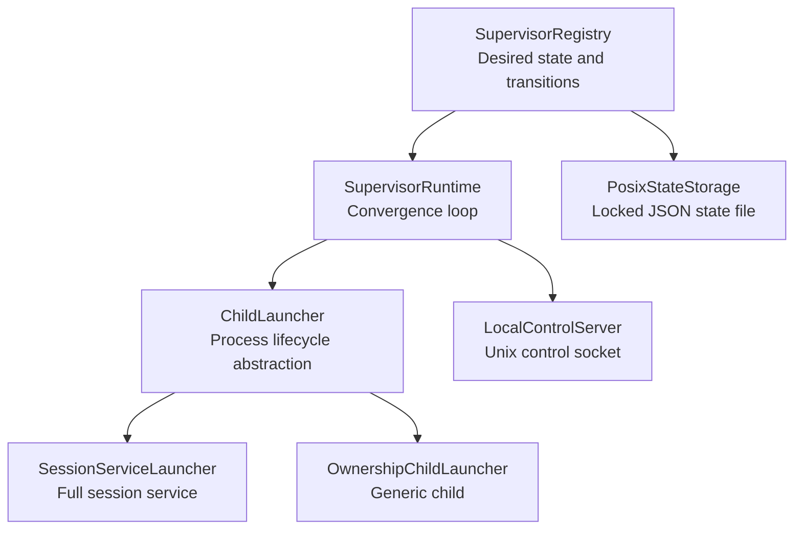
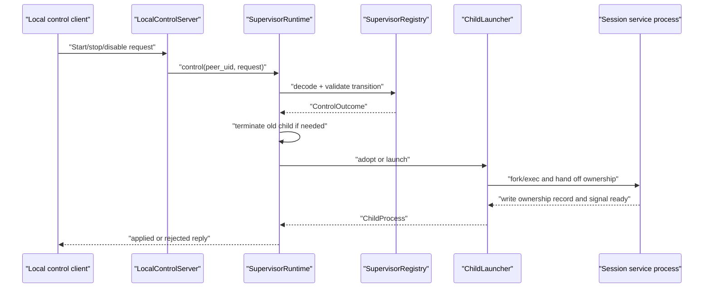
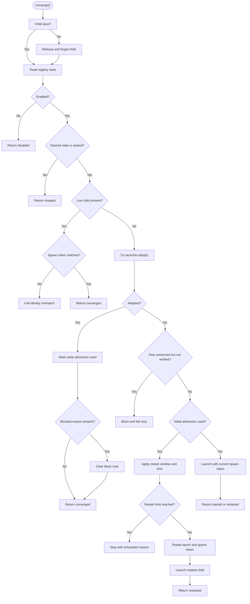
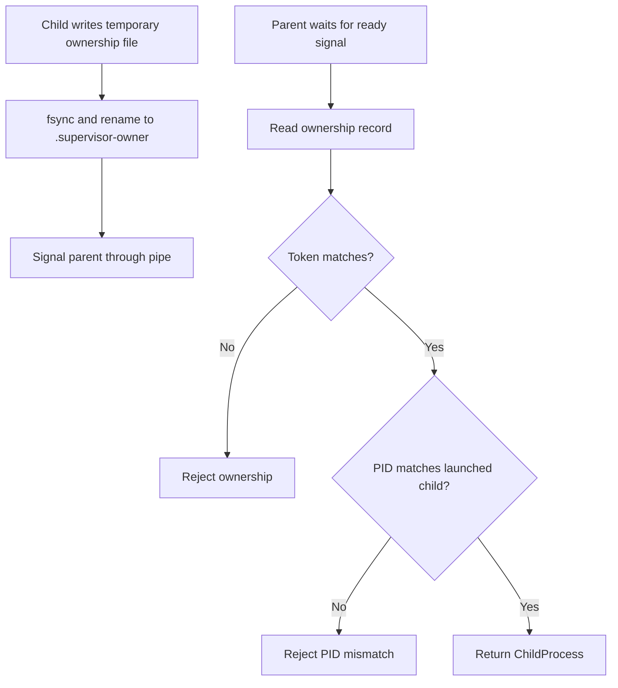
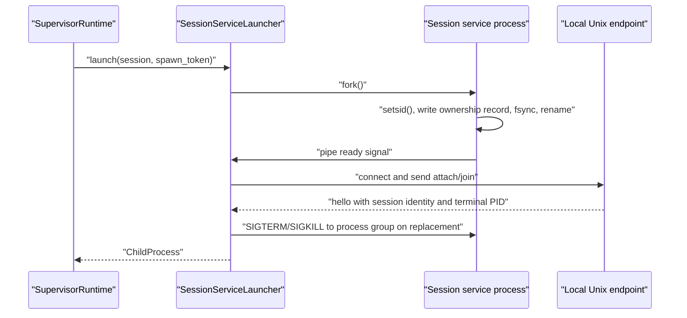
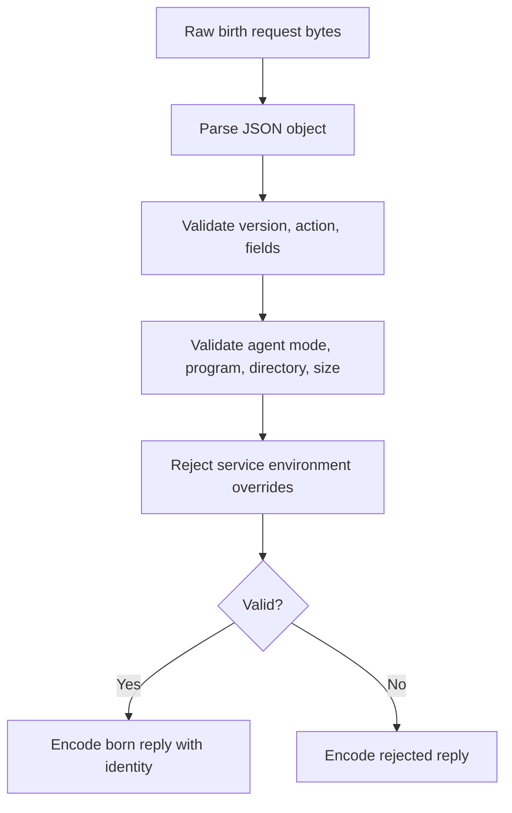
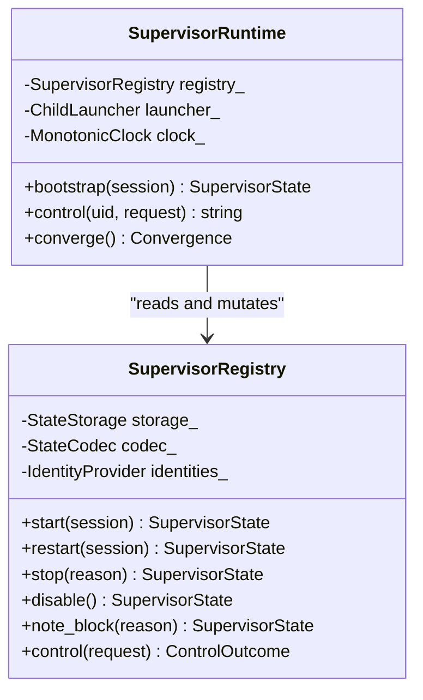
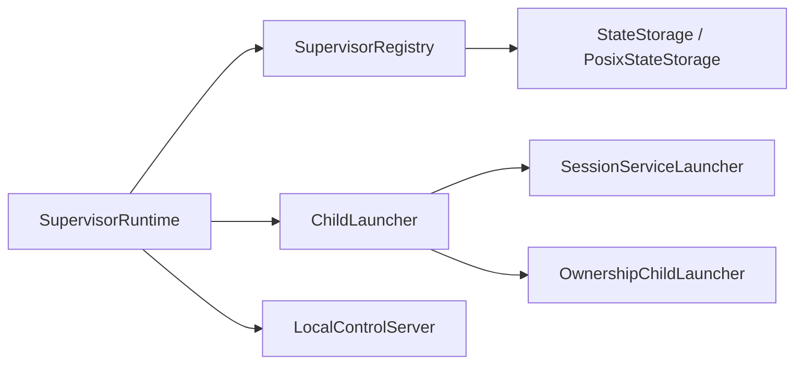

# Lifecycle Management

<cite>
**Referenced Files in This Document**   
- [runtime.hpp](file://services/supervisor/include/lapis/supervisor/runtime.hpp)
- [runtime.cpp](file://services/supervisor/src/runtime.cpp)
- [session_service_launcher.hpp](file://services/supervisor/include/lapis/supervisor/session_service_launcher.hpp)
- [session_service_launcher.cpp](file://services/supervisor/src/session_service_launcher.cpp)
- [birth.hpp](file://services/supervisor/include/lapis/supervisor/birth.hpp)
- [birth.cpp](file://services/supervisor/src/birth.cpp)
- [state.hpp](file://services/supervisor/include/lapis/supervisor/state.hpp)
- [state.cpp](file://services/supervisor/src/state.cpp)
- [control_server.hpp](file://services/supervisor/include/lapis/supervisor/control_server.hpp)
- [control_server.cpp](file://services/supervisor/src/control_server.cpp)
- [posix_state_storage.cpp](file://services/supervisor/src/posix_state_storage.cpp)
</cite>

## Table of Contents
1. [Introduction](#introduction)
2. [Project Structure](#project-structure)
3. [Core Components](#core-components)
4. [Architecture Overview](#architecture-overview)
5. [Detailed Component Analysis](#detailed-component-analysis)
6. [Dependency Analysis](#dependency-analysis)
7. [Performance Considerations](#performance-considerations)
8. [Troubleshooting Guide](#troubleshooting-guide)
9. [Conclusion](#conclusion)

## Introduction
This document explains how the supervisor manages the lifecycle of session service processes. It covers process ownership, birth validation, health checking, restart policy, graceful shutdown, and recovery from crashes or corrupted state. The design centers on three layers:

- **State layer:** authoritative desired session state, authentication tokens, and durable storage.
- **Runtime layer:** convergence loop that reconciles desired state with actual child processes.
- **Launcher layer:** platform-specific creation, adoption, health probing, and termination of session services.

The supervisor does not directly implement every process-management primitive; it delegates to a `ChildLauncher` abstraction so that generic harmless children and full session-service children can share the same convergence logic.

## Project Structure
The lifecycle system lives primarily under `services/supervisor`:

**Diagram sources**
- [runtime.hpp:60-151](file://services/supervisor/include/lapis/supervisor/runtime.hpp#L60-L151)
- [state.hpp:1-200](file://services/supervisor/include/lapis/supervisor/state.hpp#L1-L200)
- [session_service_launcher.hpp:1-56](file://services/supervisor/include/lapis/supervisor/session_service_launcher.hpp#L1-L56)
- [control_server.hpp:1-32](file://services/supervisor/include/lapis/supervisor/control_server.hpp#L1-L32)
- [posix_state_storage.cpp:1-171](file://services/supervisor/src/posix_state_storage.cpp#L1-L171)

**Section sources**
- [runtime.hpp:60-151](file://services/supervisor/include/lapis/supervisor/runtime.hpp#L60-L151)
- [state.hpp:1-200](file://services/supervisor/include/lapis/supervisor/state.hpp#L1-L200)

## Core Components
| Component | Responsibility | Key lifecycle behavior |
|---|---|---|
| `SupervisorRegistry` | Authoritative state machine for one session slot | Starts, stops, disables, restarts, and persists desired state. Enforces token-based authorization and launch payload validation. |
| `SupervisorRuntime` | Owns the convergence loop and live child | Adopts or launches a child when desired state is started, retires dead children, applies restart limits, and exposes bootstrap/control APIs. |
| `ChildLauncher` | Abstract child lifecycle interface | Defines adopt, launch, alive, terminate, release, and optional peer-preservation semantics. |
| `SessionServiceLauncher` | Full session-service launcher | Performs protocol handshake, process-group termination, endpoint probing, and safe replacement of verifiable peers. |
| `OwnershipChildLauncher` | Generic child launcher | Creates an unprivileged child bound to an ownership record and spawn token without assuming a protocol endpoint. |
| `LocalControlServer` | Local control socket server | Accepts one bounded request per client, validates peer UID, and delegates to runtime control. |
| `PosixStateStorage` | Locked POSIX-backed persistence | Uses exclusive flock, owner-only files, atomic rename, and directory fsync. |

**Section sources**
- [runtime.hpp:25-151](file://services/supervisor/include/lapis/supervisor/runtime.hpp#L25-L151)
- [state.hpp:1-200](file://services/supervisor/include/lapis/supervisor/state.hpp#L1-L200)
- [session_service_launcher.hpp:1-56](file://services/supervisor/include/lapis/supervisor/session_service_launcher.hpp#L1-L56)

## Architecture Overview
The supervisor lifecycle has two main directions:

1. **External control → state → convergence → process change.**
2. **Child failure → convergence → restart or stop.**

**Diagram sources**
- [control_server.cpp:1-200](file://services/supervisor/src/control_server.cpp#L1-L200)
- [runtime.cpp:330-430](file://services/supervisor/src/runtime.cpp#L330-L430)
- [session_service_launcher.cpp:250-420](file://services/supervisor/src/session_service_launcher.cpp#L250-L420)

**Section sources**
- [control_server.cpp:1-200](file://services/supervisor/src/control_server.cpp#L1-L200)
- [runtime.cpp:330-430](file://services/supervisor/src/runtime.cpp#L330-L430)

## Detailed Component Analysis

### SupervisorRuntime and Convergence Loop
`SupervisorRuntime` owns the current live child and repeatedly reconciles it with `SupervisorRegistry`. Its convergence algorithm follows this flow:

Key behaviors:

- If a live child exists but its spawn token differs from the registry’s desired token, convergence fails rather than silently replacing an authorized peer.
- Adoption is preferred over launching because it avoids unnecessary process churn after a supervisor restart.
- A “peer preserved” result means another supervisor-like process may own the endpoint; the supervisor refuses to replace it until explicit control or successful verification occurs.
- The first launch after bootstrap is an initial admission. Subsequent failures use rotating restarts with a bounded restart window.
- When restarts are exhausted, the runtime stops the desired session instead of spinning forever.

**Diagram sources**
- [runtime.cpp:430-560](file://services/supervisor/src/runtime.cpp#L430-L560)

**Section sources**
- [runtime.cpp:330-560](file://services/supervisor/src/runtime.cpp#L330-L560)
- [runtime.hpp:60-151](file://services/supervisor/include/lapis/supervisor/runtime.hpp#L60-L151)

### Spawn Tokens and Ownership Records
A spawn token is a 64-byte lowercase hexadecimal value generated by `IdentityProvider` and stored in the desired session. It serves as a short-lived, rotation-safe secret that binds a supervisor instance to a child process.

Ownership records are written by child processes into a file named `<endpoint>.supervisor-owner`. The record format is:

- Line prefix identifying the format version.
- Spawn token.
- Newline.
- Decimal PID.

Validation rules include:

- File must be a regular file owned by the effective UID.
- Link count must be exactly one.
- Permissions must be owner-only (`0600`).
- Size must be positive and bounded.
- Content must match the expected header, token length, newline delimiter, and numeric PID.
- The spawn token must match the token supplied by the supervisor.

This prevents unauthorized adoption even if a malicious process guesses the endpoint path.

**Diagram sources**
- [runtime.cpp:201-329](file://services/supervisor/src/runtime.cpp#L201-L329)
- [session_service_launcher.cpp:300-420](file://services/supervisor/src/session_service_launcher.cpp#L300-L420)

**Section sources**
- [runtime.cpp:201-329](file://services/supervisor/src/runtime.cpp#L201-L329)
- [session_service_launcher.cpp:201-420](file://services/supervisor/src/session_service_launcher.cpp#L201-L420)
- [state.hpp:10-20](file://services/supervisor/include/lapis/supervisor/state.hpp#L10-L20)

### OwnershipChildLauncher
`OwnershipChildLauncher` is intended for experimental or harmless children that do not expose the full session-service protocol. It:

- Validates that the program argument is absolute.
- Rejects existing ownership records for the same spawn token.
- Removes stale endpoint sockets before launch.
- Creates a pipe barrier for an atomic ownership handshake.
- Calls `setsid()` to create a new session.
- Duplicates `/dev/null` onto standard input, output, and error.
- Writes the ownership record atomically using a temporary file, `fsync`, and `rename`.
- Exits with distinct codes for handshake failure, exec failure, and other errors.
- Terminates children using process-group signals (`SIGTERM`, then `SIGKILL`) when supported.
- Releases the ownership file after termination.

Because it does not assume a protocol endpoint, its `alive` check uses PID liveness only, and its `release` method removes the ownership file.

**Section sources**
- [runtime.cpp:201-329](file://services/supervisor/src/runtime.cpp#L201-L329)
- [runtime.hpp:90-120](file://services/supervisor/include/lapis/supervisor/runtime.hpp#L90-L120)

### SessionServiceLauncher
`SessionServiceLauncher` manages the full session-service process, including terminal size, agent mode, fingerprint verification, protocol handshake, and process-group isolation.

Important responsibilities:

- Validates the launch specification at construction time.
- Canonicalizes the agent program and working directory.
- Verifies the launcher fingerprint against the computed launch payload.
- Builds arguments containing session identity, agent mode, terminal size, endpoint, working directory, and agent executable.
- Performs a protocol handshake over a local Unix domain socket using `QLocalSocket`.
- Rejects or retries startup overload messages during service initialization.
- Verifies that the hello frame includes the expected session identity and a non-zero terminal child PID.
- Adopts an existing process only if the ownership token matches and the protocol handshake succeeds.
- Preserves a live peer when the token does not match, preventing accidental replacement.
- Replaces a retained process only after sending `SIGTERM` and optionally `SIGKILL` to both the process and its process group.
- Cleans up log files and ownership records during launch.

**Diagram sources**
- [session_service_launcher.cpp:250-509](file://services/supervisor/src/session_service_launcher.cpp#L250-L509)

**Section sources**
- [session_service_launcher.cpp:201-509](file://services/supervisor/src/session_service_launcher.cpp#L201-L509)
- [session_service_launcher.hpp:1-56](file://services/supervisor/include/lapis/supervisor/session_service_launcher.hpp#L1-L56)

### Health Checking via Endpoint Probing
The supervisor performs lightweight endpoint probes to distinguish between a dead process and a live endpoint:

- For generic ownership children, it opens a nonblocking Unix-domain stream socket, sets `FD_CLOEXEC`, connects to the endpoint, and uses `poll` with a short timeout.
- For session-service children, it uses `QLocalSocket` and expects a protocol handshake response.
- Endpoint probing alone is not sufficient to authorize control; the spawn token remains mandatory.

Failure scenarios handled by probing:

- A stale endpoint socket left behind by a crashed child is removed before launch.
- A live endpoint blocks replacement unless the supervisor already owns the process and can verify it.
- An overloaded or starting service may be retried within a bounded budget.

**Section sources**
- [runtime.cpp:60-120](file://services/supervisor/src/runtime.cpp#L60-L120)
- [session_service_launcher.cpp:350-420](file://services/supervisor/src/session_service_launcher.cpp#L350-L420)

### Process Birth Validation
The `BirthRequest` mechanism allows a service to declare its identity and launch parameters through a controlled JSON envelope. The decoder enforces:

- Version one.
- Action equals `"birth"`.
- Endpoint starts with `/` and is bounded.
- Fingerprint is hex-encoded and bounded.
- Agent mode is one of terminal, codex, or claude.
- Program and working directory are required strings.
- Columns and rows are integers between 1 and 1024.
- Arguments are a bounded array of strings without null bytes.
- Service environment overrides are explicitly rejected.

Replies encode either a born status with session identity or a rejected status.

**Diagram sources**
- [birth.cpp:1-151](file://services/supervisor/src/birth.cpp#L1-L151)
- [birth.hpp:1-39](file://services/supervisor/include/lapis/supervisor/birth.hpp#L1-L39)

**Section sources**
- [birth.cpp:1-151](file://services/supervisor/src/birth.cpp#L1-L151)
- [birth.hpp:1-39](file://services/supervisor/include/lapis/supervisor/birth.hpp#L1-L39)

### Desired State and Authorization
`SupervisorRegistry` is the single authoritative owner of desired state. It supports:

- Starting a session with a fresh spawn token.
- Restarting a session with rotated epoch and spawn token.
- Stopping a session and recording a blocked reason.
- Disabling the supervisor entirely.
- Controlling start, stop, and disable through authenticated requests.

Authorization rules:

- Local control requires the caller UID to equal the effective UID.
- Remote control requires an instance epoch matching the current state and a spawn token compared in constant time.
- A fresh or disabled registry has no control capability until the first slot exists.
- A failed persistence commit poisons the registry and refuses later transitions until reload.

**Diagram sources**
- [state.hpp:1-200](file://services/supervisor/include/lapis/supervisor/state.hpp#L1-L200)
- [state.cpp:201-284](file://services/supervisor/src/state.cpp#L201-L284)
- [runtime.hpp:60-151](file://services/supervisor/include/lapis/supervisor/runtime.hpp#L60-L151)

**Section sources**
- [state.cpp:201-284](file://services/supervisor/src/state.cpp#L201-L284)
- [state.hpp:1-200](file://services/supervisor/include/lapis/supervisor/state.hpp#L1-L200)

### Platform-Specific Considerations
The implementation targets POSIX systems with specific assumptions:

- Process groups: `setsid()` creates a new session, and termination uses `killpg` to send signals to the entire process group.
- File safety: ownership records and state files require owner-only permissions, single link counts, and strict size bounds.
- Atomicity: ownership records and state updates use temporary files, `fsync`, and `rename`.
- Socket safety: endpoints are validated to reside in directories owned by the effective UID with restricted permissions.
- macOS specifics: `proc_pidpath` is used to discover whether a running process executes the expected service program.
- Linux specifics: `/proc/<pid>/exe` is used for executable discovery.
- Control socket credentials: peer UID is obtained via `getpeereid` on BSD-style platforms or `SO_PEERCRED` on Linux.

These choices make orphaned processes easier to detect, prevent unauthorized process adoption, and support graceful shutdown.

**Section sources**
- [runtime.cpp:60-120](file://services/supervisor/src/runtime.cpp#L60-L120)
- [session_service_launcher.cpp:201-350](file://services/supervisor/src/session_service_launcher.cpp#L201-L350)
- [control_server.cpp:1-200](file://services/supervisor/src/control_server.cpp#L1-L200)
- [posix_state_storage.cpp:1-171](file://services/supervisor/src/posix_state_storage.cpp#L1-L171)

### Graceful Shutdown and Failure Scenarios
Graceful shutdown proceeds in stages:

1. Terminate the process group with `SIGTERM`.
2. Wait briefly for termination.
3. Escalate to `SIGKILL` if necessary.
4. Release ownership files and endpoint artifacts.
5. Update desired state to stopped or disabled.

Failure scenarios and recovery strategies:

| Scenario | Behavior | Recovery |
|---|---|---|
| Orphaned process | Ownership record still exists but PID is dead or runs a different program. | Record is treated as absent; ownership file is removed during adoption or launch checks. |
| Corrupted ownership file | Invalid header, token, PID, permissions, or incomplete read. | Treated as unsafe; operation fails closed rather than adopting an unknown process. |
| Supervisor crash after ownership write | Child remains alive with ownership record. | On restart, supervisor attempts adoption; if protocol handshake fails, peer is preserved and retry is allowed. |
| Supervisor crash during launch | Temporary ownership file or stale endpoint may remain. | Cleanup logic removes temporary files and stale endpoints before relaunch. |
| Restart storm | Too many failures within the restart window. | Supervisor stops the desired session with an exhausted reason. |
| Poisoned persistence | Store fails mid-commit. | Registry becomes poisoned and refuses further transitions until a new registry is constructed. |

**Section sources**
- [runtime.cpp:430-560](file://services/supervisor/src/runtime.cpp#L430-L560)
- [session_service_launcher.cpp:350-509](file://services/supervisor/src/session_service_launcher.cpp#L350-L509)
- [state.cpp:201-284](file://services/supervisor/src/state.cpp#L201-L284)
- [posix_state_storage.cpp:100-171](file://services/supervisor/src/posix_state_storage.cpp#L100-L171)

## Dependency Analysis
The supervisor components have clear boundaries:

- `SupervisorRuntime` depends on `SupervisorRegistry` for state and `ChildLauncher` for process management.
- `SessionServiceLauncher` extends `ChildLauncher` and depends on session launch specifications, local protocol framing, and POSIX process utilities.
- `OwnershipChildLauncher` extends `ChildLauncher` and depends only on POSIX process and file primitives.
- `LocalControlServer` depends on `SupervisorRuntime` for control handling.
- `SupervisorRegistry` depends on `StateStorage`, `StateCodec`, and `IdentityProvider`.
- `PosixStateStorage` depends on POSIX locking, file permissions, and directory synchronization.

**Diagram sources**
- [runtime.hpp:60-151](file://services/supervisor/include/lapis/supervisor/runtime.hpp#L60-L151)
- [state.hpp:1-200](file://services/supervisor/include/lapis/supervisor/state.hpp#L1-L200)
- [session_service_launcher.hpp:1-56](file://services/supervisor/include/lapis/supervisor/session_service_launcher.hpp#L1-L56)
- [control_server.hpp:1-32](file://services/supervisor/include/lapis/supervisor/control_server.hpp#L1-L32)

**Section sources**
- [runtime.hpp:60-151](file://services/supervisor/include/lapis/supervisor/runtime.hpp#L60-L151)
- [state.hpp:1-200](file://services/supervisor/include/lapis/supervisor/state.hpp#L1-L200)

## Performance Considerations
- Convergence avoids tight loops by using process liveness checks, bounded wait loops, and explicit restart windows.
- Endpoint probing uses nonblocking sockets and short timeouts to avoid blocking the convergence loop.
- Handshake retries share a bounded budget and include small sleeps to prevent busy polling of starting services.
- Control clients are limited to one strict frame per connection with a bounded reply timeout, preventing slow or malformed clients from holding control slots.
- Persistence uses locked access and atomic file updates to reduce contention and corruption risk.

[No sources needed since this section provides general guidance]

## Troubleshooting Guide
Common symptoms and diagnostics:

| Symptom | Likely cause | Diagnostic action |
|---|---|---|
| Supervisor reports exhausted restarts | Too many failed launches within the restart window | Inspect child logs and endpoint health; verify spawn token rotation and service binary availability. |
| Supervisor cannot adopt a child | Ownership token mismatch or protocol handshake failure | Check `.supervisor-owner` content, process executable path, and endpoint liveness. |
| Live peer preserved | Another supervisor or process owns the endpoint with a different token | Use explicit stop control to release the peer before replacement. |
| Control request rejected | Unauthorized, stale epoch, malformed request, or poisoned registry | Verify caller UID, instance epoch, spawn token, and recent persistence failures. |
| Endpoint exists but child is dead | Crashed child left a stale socket | Remove stale endpoint; supervisor will attempt re-adoption or restart. |
| State file refused | Unsafe permissions, wrong owner, symlink, or multi-link file | Ensure state directory is owner-only `0700`, state file is `0600`, owned by the supervisor UID, and singly linked. |

Recommended recovery steps:

1. Stop the supervisor gracefully through local control if possible.
2. Inspect ownership files and endpoint sockets.
3. Remove stale temporary ownership files and logs only after confirming the child is dead.
4. Restart the supervisor so convergence can reattempt adoption or launch.
5. If the registry is poisoned, construct a new registry after releasing the lock.

**Section sources**
- [runtime.cpp:430-560](file://services/supervisor/src/runtime.cpp#L430-L560)
- [session_service_launcher.cpp:350-509](file://services/supervisor/src/session_service_launcher.cpp#L350-L509)
- [posix_state_storage.cpp:100-171](file://services/supervisor/src/posix_state_storage.cpp#L100-L171)
- [state.cpp:201-284](file://services/supervisor/src/state.cpp#L201-L284)

## Conclusion
The supervisor’s lifecycle management combines strict ownership records, spawn-token binding, process-group isolation, endpoint probing, and a bounded convergence loop. It prefers adopting existing children when safe, rotates identity on restart, tolerates transient startup conditions, and falls back to stopping the desired session when repeated failures indicate a deeper problem. The separation between abstract `ChildLauncher` implementations and shared runtime logic makes the system extensible while keeping critical safety properties—ownership validation, authorization, and graceful failure—central to every lifecycle transition.