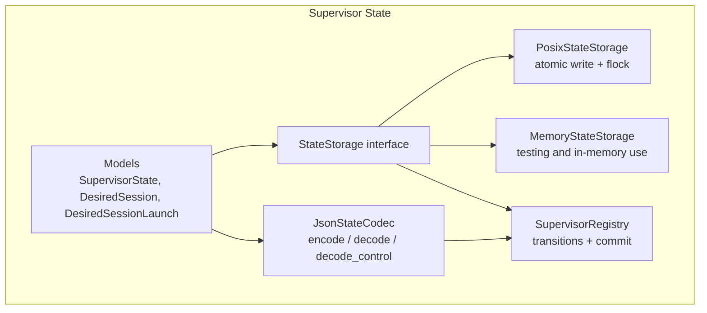
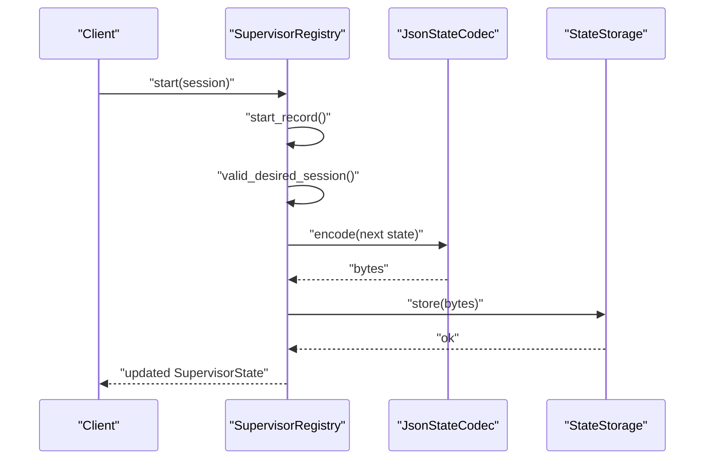
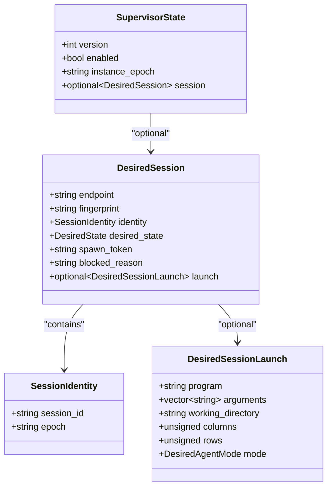
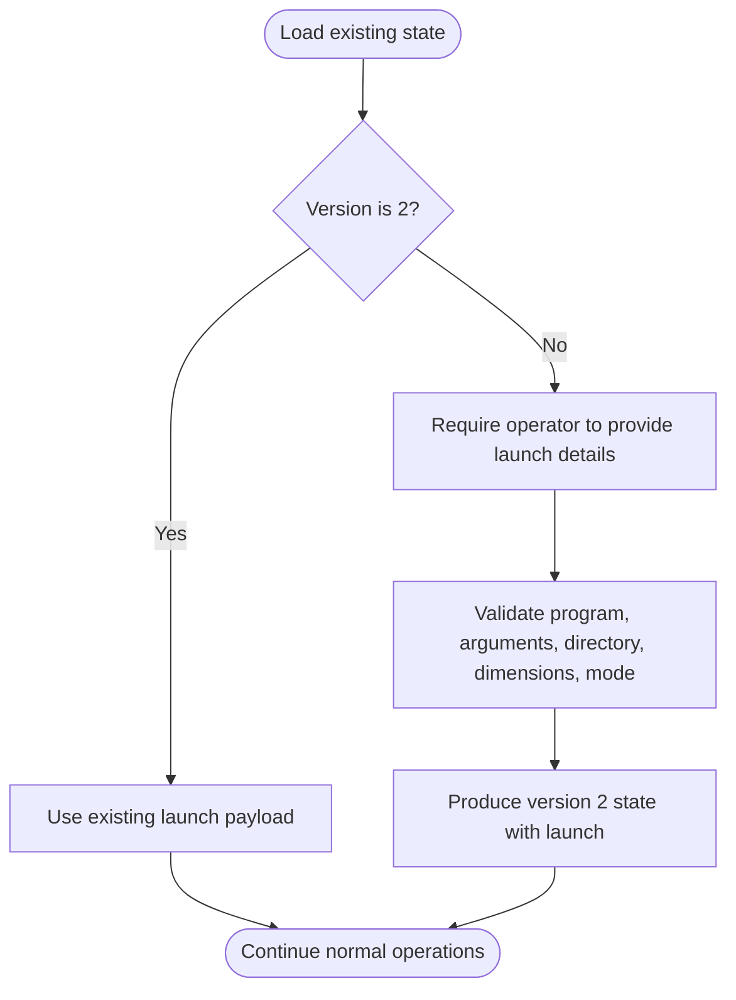
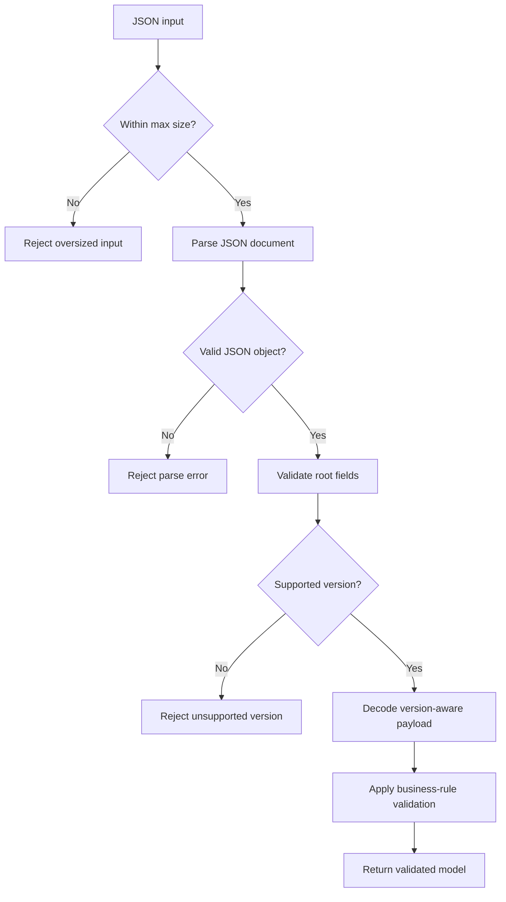
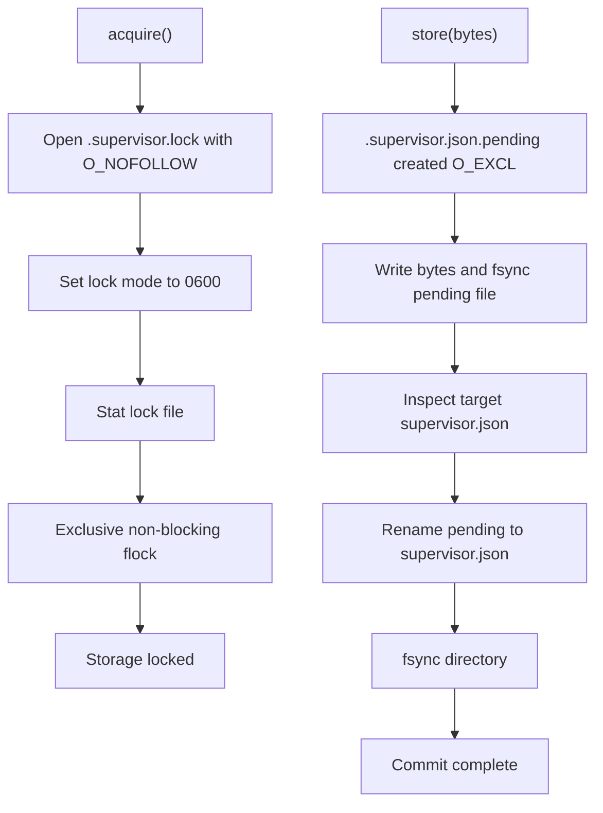
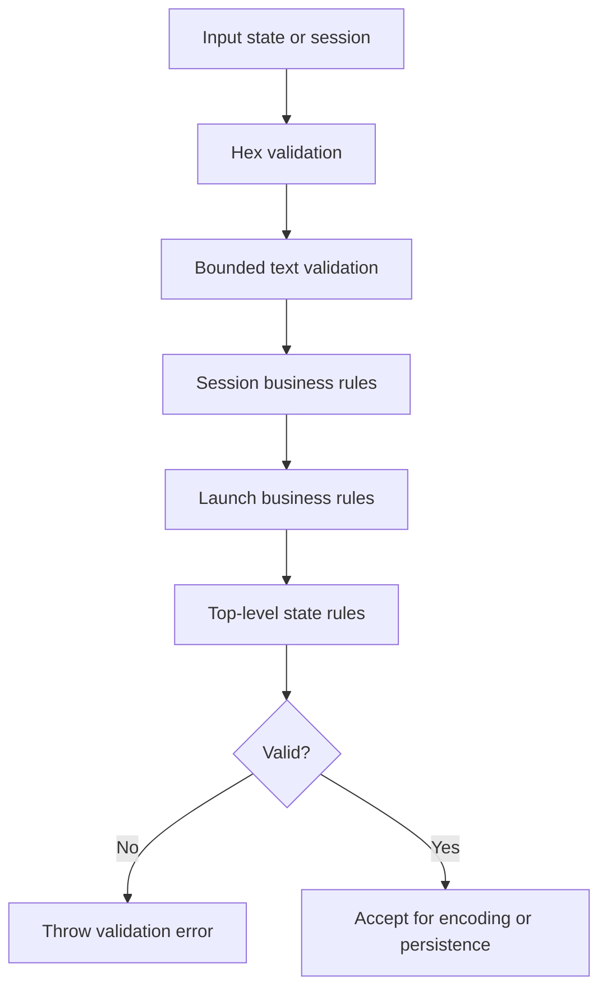
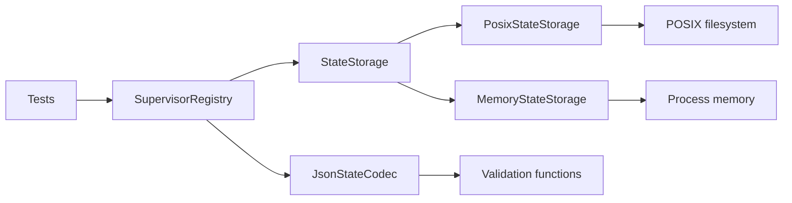

# State Persistence

<cite>
**Referenced Files in This Document**
- [state.hpp](file://services/supervisor/include/lapis/supervisor/state.hpp)
- [json_state_codec.cpp](file://services/supervisor/src/json_state_codec.cpp)
- [posix_state_storage.cpp](file://services/supervisor/src/posix_state_storage.cpp)
- [state.cpp](file://services/supervisor/src/state.cpp)
- [supervisor_state_test.cpp](file://services/supervisor/tests/supervisor_state_test.cpp)
</cite>

## Table of Contents
1. [Introduction](#introduction)
2. [Project Structure](#project-structure)
3. [Core Components](#core-components)
4. [Architecture Overview](#architecture-overview)
5. [Detailed Component Analysis](#detailed-component-analysis)
6. [Dependency Analysis](#dependency-analysis)
7. [Performance Considerations](#performance-considerations)
8. [Security Considerations](#security-considerations)
9. [Troubleshooting Guide](#troubleshooting-guide)
10. [Conclusion](#conclusion)

## Introduction
This document explains the supervisor’s state persistence system. It covers the data model for current and desired session state, the versioned JSON schema, its codec, file-based storage with atomic writes and filesystem locking, in-memory testing storage, validation rules, and security properties. The goal is to make the design understandable for both developers extending the supervisor and operators maintaining it.

## Project Structure
The state persistence logic lives under the supervisor service:

- Header definitions for models, codecs, storage interfaces, and registry behavior are in `state.hpp`.
- JSON serialization and control request parsing are implemented in `json_state_codec.cpp`.
- POSIX-backed persistent storage with locking and permission checks is implemented in `posix_state_storage.cpp`.
- Validation helpers, memory storage implementation, and registry transitions are implemented in `state.cpp`.
- Tests exercise legacy state upgrades, invalid inputs, lock behavior, and transition rules in `supervisor_state_test.cpp`.

**Diagram sources**
- [state.hpp:1-200](file://services/supervisor/include/lapis/supervisor/state.hpp#L1-L200)
- [json_state_codec.cpp:1-339](file://services/supervisor/src/json_state_codec.cpp#L1-L339)
- [posix_state_storage.cpp:1-171](file://services/supervisor/src/posix_state_storage.cpp#L1-L171)
- [state.cpp:1-284](file://services/supervisor/src/state.cpp#L1-L284)

**Section sources**
- [state.hpp:1-200](file://services/supervisor/include/lapis/supervisor/state.hpp#L1-L200)

## Core Components
This section summarizes the primary types and responsibilities before diving into implementation details.

### Data Model
- `SupervisorState` captures the persisted snapshot:
  - `version`: schema version, currently supporting versions 1 and 2.
  - `enabled`: whether the supervisor is enabled.
  - `instance_epoch`: hex identifier for the current supervisor instance.
  - `session`: optional current desired session configuration.
- `DesiredSession` captures the active or requested agent session:
  - `endpoint`, `fingerprint`, `spawn_token`, `blocked_reason`.
  - `identity` containing `session_id` and `epoch`.
  - `desired_state`: started or stopped.
  - `launch`: optional canonical launch description introduced in version 2.
- `DesiredSessionLaunch` describes how a replacement daemon should start the same service:
  - `program`, `arguments`, `working_directory`, `columns`, `rows`, `mode`.
- `ControlRequest` represents an authenticated command from the client:
  - `instance_epoch`, `token`, `action`, and optional `session` payload for start.

These fields carry business meaning beyond raw bytes. For example, `spawn_token` authenticates local control requests, while `launch` lets a new process adopt or restart the same logical session without guessing.

**Section sources**
- [state.hpp:15-120](file://services/supervisor/include/lapis/supervisor/state.hpp#L15-L120)

### Storage Abstraction
`StateStorage` defines the persistence contract:
- `acquire()` and `release()` manage singleton ownership.
- `load()` returns the stored byte string or no value when absent.
- `store()` writes serialized state.

Two implementations exist:
- `PosixStateStorage`: real disk-backed persistence with strict directory and file checks, owner-only permissions, and exclusive filesystem locking.
- `MemoryStateStorage`: thread-local in-memory storage used by tests and short-lived processes; it also tracks durability metadata such as whether a write was fsynced and whether owner-only mode is enforced.

**Section sources**
- [state.hpp:122-170](file://services/supervisor/include/lapis/supervisor/state.hpp#L122-L170)
- [state.cpp:100-127](file://services/supervisor/src/state.cpp#L100-L127)

### Codecs and Control Parsing
`StateCodec` separates state representation from serialization. `JsonStateCodec` implements:
- Encoding `SupervisorState` to compact JSON.
- Decoding JSON back to `SupervisorState`, including version-aware handling.
- Parsing incoming `ControlRequest` objects, validating action, epoch, token, and session payloads.

Malformed or oversized input throws rather than silently accepting unsafe values. Authentication and transition semantics are intentionally kept in the registry layer.

**Section sources**
- [state.hpp:100-120](file://services/supervisor/include/lapis/supervisor/state.hpp#L100-L120)
- [json_state_codec.cpp:1-339](file://services/supervisor/src/json_state_codec.cpp#L1-L339)

## Architecture Overview
At runtime, the `SupervisorRegistry` is the single authoritative owner of state:

1. It acquires the storage.
2. It loads existing state if present; otherwise it initializes an instance epoch.
3. It decodes and validates the loaded state.
4. It applies controlled transitions such as start, restart, stop, disable, or note-block.
5. Each transition produces a new `SupervisorState`, which is encoded and atomically committed through storage.

**Diagram sources**
- [state.cpp:129-170](file://services/supervisor/src/state.cpp#L129-L170)
- [state.cpp:201-284](file://services/supervisor/src/state.cpp#L201-L284)
- [json_state_codec.cpp:239-339](file://services/supervisor/src/json_state_codec.cpp#L239-L339)

**Section sources**
- [state.cpp:129-284](file://services/supervisor/src/state.cpp#L129-L284)

## Detailed Component Analysis

### SupervisorState and Session Data Model
The state model separates what is currently running from what the supervisor wants to run.

| Field | Type | Meaning | Constraints |
|---|---|---|---|
| `version` | integer | Schema version | Must be 1 or 2 |
| `enabled` | boolean | Whether the supervisor is enabled | Must match session policy |
| `instance_epoch` | hexadecimal string | Current supervisor instance identity | Fixed length, lowercase hex |
| `session` | optional object | Current desired session | When present, must satisfy session and launch rules |
| `session.endpoint` | text | Local endpoint path | Non-empty, bounded, starts with `/` |
| `session.fingerprint` | hexadecimal string | Service fingerprint | Fixed length, lowercase hex |
| `session.identity.session_id` | hexadecimal string | Logical session identity | Fixed length, lowercase hex |
| `session.identity.epoch` | hexadecimal string | Per-launch epoch | Fixed length, lowercase hex |
| `session.desired_state` | enum | Started or stopped | Enumerated values only |
| `session.spawn_token` | optional hexadecimal string | Authenticated control token | Empty or fixed-length lowercase hex |
| `session.blocked_reason` | optional text | Human-readable block reason | Bounded text |
| `session.launch` | optional object | Canonical launch specification | Present only under defined version rules |
| `launch.program` | text | Agent binary path | Bounded text |
| `launch.arguments` | array of text | Program arguments | Bounded count and total size |
| `launch.working_directory` | text | Working directory | Bounded text |
| `launch.columns` | unsigned integer | Terminal width | Positive, at most 1024 |
| `launch.rows` | unsigned integer | Terminal height | Positive, at most 1024 |
| `launch.mode` | enum | Terminal, codex, or claude | Enumerated values only |

Version-specific rules:
- Version 1 has no `launch` field.
- Version 2 requires `launch` when present and validates it.
- A started session must have a non-empty `spawn_token`.
- An enabled state without a session is invalid.

**Diagram sources**
- [state.hpp:23-98](file://services/supervisor/include/lapis/supervisor/state.hpp#L23-L98)

**Section sources**
- [state.hpp:23-98](file://services/supervisor/include/lapis/supervisor/state.hpp#L23-L98)
- [state.cpp:41-98](file://services/supervisor/src/state.cpp#L41-L98)

### Versioned State Schema Evolution
The schema evolved from version 1 to version 2 to make the supervisor self-describing enough for recovery:

- **Version 1**:
  - Contains the basic session record without `launch`.
  - Does not include enough information for another process to reconstruct how the agent should be launched.
- **Version 2**:
  - Adds `launch` to capture the canonical program, arguments, working directory, terminal dimensions, and agent mode.
  - Allows a replacement daemon to adopt or restart the service described by the previous instance.

Because version 1 omits launch details, upgrading cannot safely guess a replacement command. The upgrade path requires explicit operator intervention:
- The operator must supply the correct agent program, arguments, working directory, terminal dimensions, and agent mode.
- Once supplied, the registry can produce a valid version 2 state that includes `launch`.
- Without this step, attempting to create a new session from a version 1 state fails closed rather than launching an untrusted or guessed program.

Tests verify that a legacy version 1 state can be upgraded to version 2 and that the resulting session includes the required launch payload.

**Diagram sources**
- [state.hpp:58-98](file://services/supervisor/include/lapis/supervisor/state.hpp#L58-L98)
- [state.cpp:41-98](file://services/supervisor/src/state.cpp#L41-L98)
- [json_state_codec.cpp:107-199](file://services/supervisor/src/json_state_codec.cpp#L107-L199)
- [json_state_codec.cpp:201-237](file://services/supervisor/src/json_state_codec.cpp#L201-L237)
- [supervisor_state_test.cpp:127-159](file://services/supervisor/tests/supervisor_state_test.cpp#L127-L159)

**Section sources**
- [state.hpp:58-98](file://services/supervisor/include/lapis/supervisor/state.hpp#L58-L98)
- [json_state_codec.cpp:107-237](file://services/supervisor/src/json_state_codec.cpp#L107-L237)
- [state.cpp:41-98](file://services/supervisor/src/state.cpp#L41-L98)
- [supervisor_state_test.cpp:127-159](file://services/supervisor/tests/supervisor_state_test.cpp#L127-L159)

### JsonStateCodec Implementation
`JsonStateCodec` is responsible for three main jobs:

1. **Encoding state**
   - Validates the state through `valid_state`.
   - Serializes it to compact JSON.
   - Rejects output exceeding `max_state_bytes`.

2. **Decoding state**
   - Enforces the maximum byte size before JSON parsing.
   - Parses JSON and rejects malformed documents.
   - Requires exactly the expected root fields: `version`, `enabled`, `instance_epoch`, and `session`.
   - Accepts only supported versions 1 and 2.
   - Decodes the session according to the declared version:
     - Version 1 forbids a `launch` field.
     - Version 2 expects an object for `launch`.
   - Re-validates the decoded state before returning it.

3. **Parsing control requests**
   - Enforces the maximum control request size.
   - Requires version 1 for control messages.
   - Requires `supervisor_epoch`, `token`, `action`, and `session`.
   - Supports actions:
     - `start`: requires a session with endpoint, fingerprint, and identity.
     - `stop`: must not include a session payload.
     - `disable`: must not include a session payload.
   - Uses exact-object validation so unknown fields cause rejection.

All failures throw `std::runtime_error`; authentication decisions such as stale epoch or unauthorized tokens are handled later by the registry.

**Diagram sources**
- [json_state_codec.cpp:1-106](file://services/supervisor/src/json_state_codec.cpp#L1-L106)
- [json_state_codec.cpp:201-339](file://services/supervisor/src/json_state_codec.cpp#L201-L339)

**Section sources**
- [json_state_codec.cpp:1-339](file://services/supervisor/src/json_state_codec.cpp#L1-L339)

### PosixStateStorage Implementation
`PosixStateStorage` provides safe, durable file-based persistence.

#### Directory and File Rules
- The constructor requires an absolute directory.
- It creates the directory if needed but then verifies:
  - Owner matches the effective user ID.
  - Directory mode is `0700`.
- On load, the state file must be:
  - A regular file.
  - Owned by the effective user.
  - Mode `0600`.
  - Single-linked (no hard links).
  - Non-empty and within `max_state_bytes`.

#### Locking
- `acquire()` opens `.supervisor.lock` with `O_NOFOLLOW`.
- It sets the lock file mode to `0600`.
- It verifies the lock file passes the same owner-only, single-link, regular-file checks.
- It obtains an exclusive, non-blocking lock using `flock`.
- `release()` closes the lock descriptor.

#### Atomic Write Strategy
- Writes go to `.supervisor.json.pending`.
- The pending file is created with `O_EXCL | O_CLOEXEC | O_NOFOLLOW` and mode `0600`.
- After writing and syncing the pending file, the process renames it to `supervisor.json`.
- Before renaming, it inspects the target to ensure it is still a safe file.
- Finally, it syncs the directory to flush metadata.

**Diagram sources**
- [posix_state_storage.cpp:1-171](file://services/supervisor/src/posix_state_storage.cpp#L1-L171)

**Section sources**
- [posix_state_storage.cpp:1-171](file://services/supervisor/src/posix_state_storage.cpp#L1-L171)

### MemoryStateStorage Implementation
`MemoryStateStorage` is a lightweight test double:

- It stores bytes in memory.
- It enforces the same acquire/release ownership contract as the POSIX implementation.
- It rejects writes when unlocked.
- It records write count, fsync status, and owner-only enforcement for assertions.
- It does not perform filesystem operations, making it suitable for unit tests and temporary processes.

This makes it easy to validate state transitions without touching the filesystem while still exercising the registry’s encoding, validation, and persistence pipeline.

**Section sources**
- [state.hpp:139-157](file://services/supervisor/include/lapis/supervisor/state.hpp#L139-L157)
- [state.cpp:100-127](file://services/supervisor/src/state.cpp#L100-L127)

### State Validation Functions
Validation is centralized to prevent invalid or unsafe state from being accepted or persisted.

| Function | Purpose | Key Rules |
|---|---|---|
| `valid_hex` | Checks hexadecimal strings | Exact length and lowercase hex digits only |
| `bounded_text` | Checks bounded UTF-8-like text | No null bytes, no control characters, respects maximum size and emptiness rule |
| `valid_desired_session` | Validates session-level fields | Endpoint format, fingerprint, identities, optional token, optional blocked reason |
| `valid_desired_session_launch` | Validates launch payload | Mode, program, working directory, argument count, argument sizes, terminal dimensions |
| `valid_state` | Validates top-level state | Supported version, instance epoch, session presence vs enabled flag, launch rules per version, started-session token requirement |
| `constant_time_equal` | Compares tokens securely | Fixed-window comparison to avoid timing side channels |

The registry uses these validators during construction, transitions, and commit. If any validation fails, the operation throws, preventing partial or inconsistent state.

**Diagram sources**
- [state.cpp:1-98](file://services/supervisor/src/state.cpp#L1-L98)

**Section sources**
- [state.cpp:1-98](file://services/supervisor/src/state.cpp#L1-L98)

### Registry Transitions and Poisoning
`SupervisorRegistry` coordinates state changes:

- `start` and `restart` set the session to started, assign fresh identity and spawn token, and clear blocked reasons.
- `restart` rotates the session epoch and spawn token so stale reconnects cannot impersonate a replacement process.
- `stop` marks the session stopped, records a blocked reason, and rotates the spawn token.
- `note_block` annotates a session with a blocked reason.
- `disable` disables the supervisor and stops any existing session.
- `control` handles authenticated commands after checking epoch, authorization, and action validity.

If a commit fails partway, the registry becomes poisoned: it retains the last known in-memory state but refuses further transitions until reloaded. This prevents a partially written state from being trusted again by the same process.

**Section sources**
- [state.cpp:129-284](file://services/supervisor/src/state.cpp#L129-L284)

## Dependency Analysis
The following diagram shows how components depend on each other.

**Diagram sources**
- [state.hpp:100-170](file://services/supervisor/include/lapis/supervisor/state.hpp#L100-L170)
- [state.cpp:1-284](file://services/supervisor/src/state.cpp#L1-L284)
- [json_state_codec.cpp:1-339](file://services/supervisor/src/json_state_codec.cpp#L1-L339)
- [posix_state_storage.cpp:1-171](file://services/supervisor/src/posix_state_storage.cpp#L1-L171)

Key relationships:
- `SupervisorRegistry` depends on both `StateCodec` and `StateStorage` via shared pointers.
- `JsonStateCodec` depends on validation helpers and Qt JSON facilities.
- `PosixStateStorage` depends on POSIX system calls and the repository’s unique file descriptor abstraction.
- `MemoryStateStorage` is a pure-in-memory implementation with no external dependencies.

**Section sources**
- [state.hpp:100-170](file://services/supervisor/include/lapis/supervisor/state.hpp#L100-L170)
- [state.cpp:129-284](file://services/supervisor/src/state.cpp#L129-L284)

## Performance Considerations
- JSON encoding and decoding allocate intermediate Qt containers, but the overall state is bounded by `max_state_bytes`, keeping memory usage predictable.
- The POSIX store performs synchronous I/O inside the registry’s I/O context, which is intentional because the registry owns the singleton lock.
- Atomic rename plus directory sync ensures durability but means commits are not lock-free; callers should avoid frequent micro-transactions.
- The in-memory storage avoids filesystem overhead and is useful for benchmarks and unit tests.
- Validation runs on every decode and before every commit, adding small CPU cost but preventing expensive or unsafe downstream work.

[No sources needed since this section provides general guidance]

## Security Considerations

### Filesystem Access Controls
- The state directory must be owned by the effective user and restricted to mode `0700`.
- The state file and lock file must be regular files, owned by the effective user, with mode `0600`.
- Hard links are rejected by requiring a link count of one.
- Symlinks are avoided by opening state and lock paths with `O_NOFOLLOW`.

### Path Validation
- The constructor rejects empty directories and non-absolute paths.
- Directory creation uses owner-only read/write/execute flags.
- Pending and target filenames are constructed directly from the validated directory, reducing path interpolation risks.

### Symlink and Race Protections
- `O_NOFOLLOW` prevents symlink traversal for both the lock and state files.
- `O_EXCL` prevents replacing an existing pending file unintentionally.
- Exclusive `flock` ensures only one supervisor instance holds authority.
- Target inspection before rename guards against a race where the target became unsafe between the initial check and the rename.

### Token Security
- Spawn tokens are compared with constant-time comparison to reduce timing leakage.
- Tokens are bounded and validated as fixed-length lowercase hexadecimal.
- Restart rotations change both session epoch and spawn token, preventing replay of stale connections.

### Operator Recovery Safety
- Version 1 state deliberately lacks launch information.
- Upgrading cannot guess a program or arguments.
- Explicit operator recovery ensures that only trusted, verified launch parameters enter version 2 state.

**Section sources**
- [posix_state_storage.cpp:20-171](file://services/supervisor/src/posix_state_storage.cpp#L20-L171)
- [state.cpp:99-98](file://services/supervisor/src/state.cpp#L99-L98)
- [state.cpp:129-284](file://services/supervisor/src/state.cpp#L129-L284)

## Troubleshooting Guide

### Common Failure Modes
- **Unsupported state version**: The codec accepts only versions 1 and 2. Unknown or missing versions are rejected.
- **Malformed JSON**: Invalid JSON, wrong root fields, or unexpected fields cause immediate rejection.
- **Invalid hex identifiers**: Instance epoch, session identity, fingerprint, and spawn token must be fixed-length lowercase hexadecimal.
- **Oversized state**: Both state and control payloads are bounded. Exceeding limits rejects the input early.
- **Unlocked storage access**: Loading or storing without acquiring the registry lock throws.
- **Unsafe filesystem state**: Incorrect ownership, permissions, symlink behavior, or hard links cause POSIX storage to reject the state.
- **Stale epoch**: Control requests must include the current `instance_epoch`; otherwise they are rejected as stale.
- **Unauthorized control**: Control requires a nonempty spawn token matching the current session token.
- **Poisoned registry**: A failed commit causes the registry to refuse further transitions until reload.

### Operational Steps
1. Inspect the state directory permissions and ownership.
2. Verify that `supervisor.json` and `.supervisor.lock` are regular files with mode `0600`.
3. Confirm that no symlinks or extra hard links point to them.
4. Check whether the state is version 1 and whether operator recovery is required.
5. Supply the correct agent program, arguments, working directory, terminal dimensions, and agent mode to produce a valid version 2 state.
6. Reload the registry after repairing the filesystem or updating state.

**Section sources**
- [json_state_codec.cpp:107-339](file://services/supervisor/src/json_state_codec.cpp#L107-L339)
- [posix_state_storage.cpp:40-171](file://services/supervisor/src/posix_state_storage.cpp#L40-L171)
- [state.cpp:129-284](file://services/supervisor/src/state.cpp#L129-L284)
- [supervisor_state_test.cpp:256-287](file://services/supervisor/tests/supervisor_state_test.cpp#L256-L287)

## Conclusion
The supervisor’s state persistence system is designed around safety, clarity, and recoverability. The `SupervisorState` model separates current and desired session state, while version 2 adds a canonical launch description so replacement processes do not need to guess how to restart the service. `JsonStateCodec` enforces schema, bounds, and business rules before any state is trusted. `PosixStateStorage` protects the filesystem with owner-only permissions, symlink avoidance, hard-link checks, and exclusive locking, and writes state atomically. `MemoryStateStorage` enables reliable testing without filesystem risk. Together with strict validation and registry poisoning, the system minimizes the chance of corrupted, ambiguous, or unsafe supervisor state.