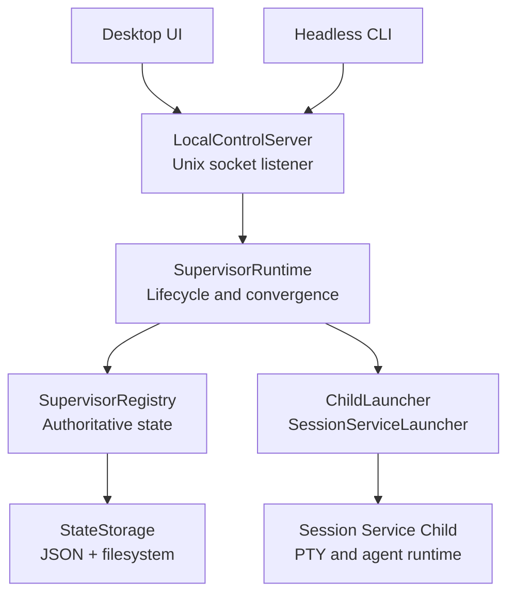
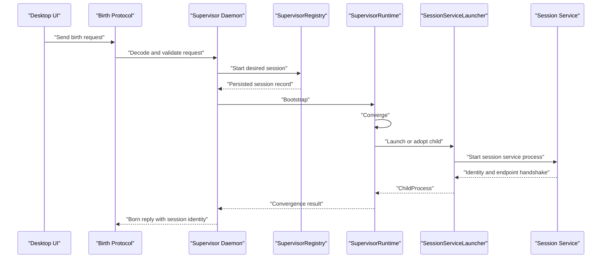
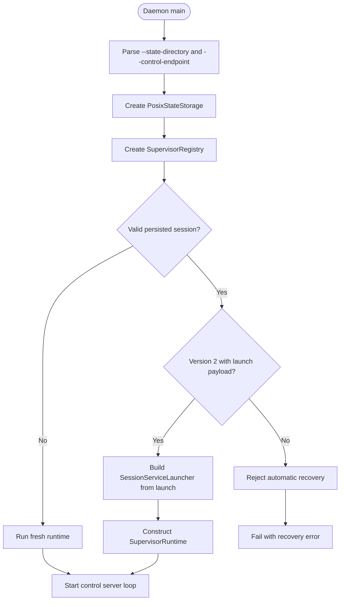
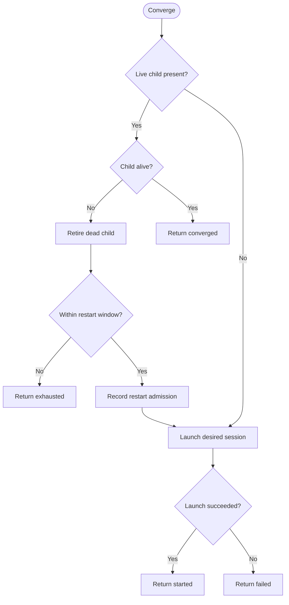
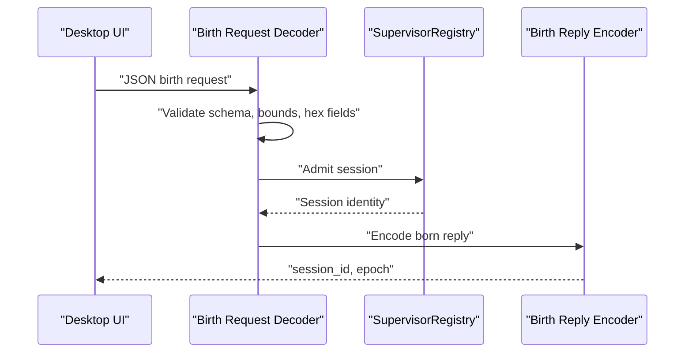
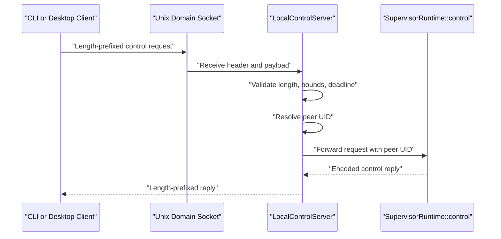
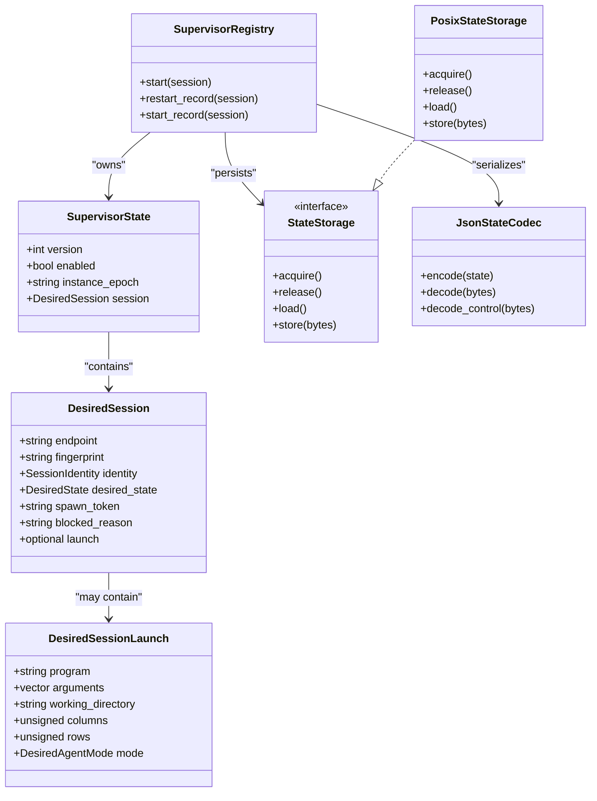
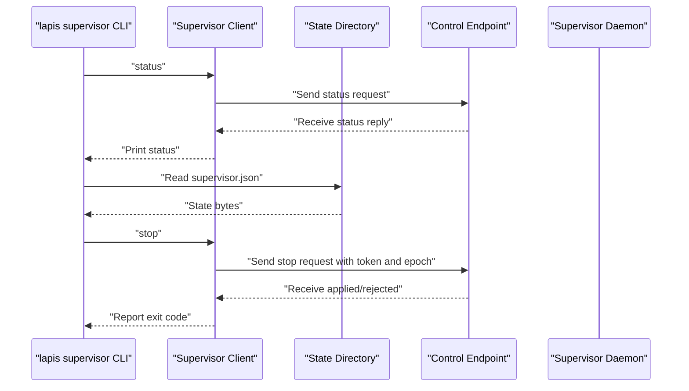
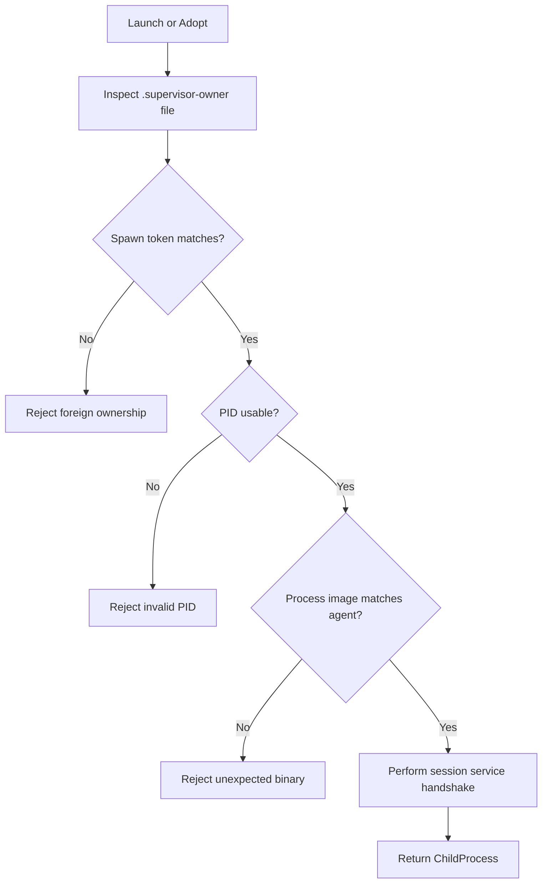
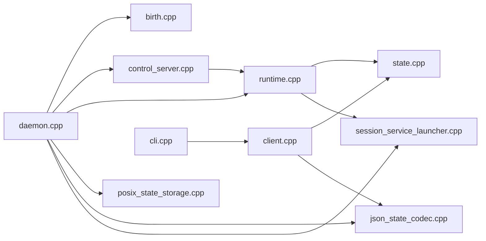

# Supervisor Daemon

<cite>
**Referenced Files in This Document**
- [README.md](file://README.md)
- [architecture.md](file://docs/architecture.md)
- [install.md](file://docs/install.md)
- [runtime.hpp](file://services/supervisor/include/lapis/supervisor/runtime.hpp)
- [runtime.cpp](file://services/supervisor/src/runtime.cpp)
- [control_server.hpp](file://services/supervisor/include/lapis/supervisor/control_server.hpp)
- [control_server.cpp](file://services/supervisor/src/control_server.cpp)
- [client.hpp](file://services/supervisor/include/lapis/supervisor/client.hpp)
- [client.cpp](file://services/supervisor/src/client.cpp)
- [state.hpp](file://services/supervisor/include/lapis/supervisor/state.hpp)
- [state.cpp](file://services/supervisor/src/state.cpp)
- [json_state_codec.cpp](file://services/supervisor/src/json_state_codec.cpp)
- [posix_state_storage.cpp](file://services/supervisor/src/posix_state_storage.cpp)
- [birth.hpp](file://services/supervisor/include/lapis/supervisor/birth.hpp)
- [birth.cpp](file://services/supervisor/src/birth.cpp)
- [session_service_launcher.hpp](file://services/supervisor/include/lapis/supervisor/session_service_launcher.hpp)
- [session_service_launcher.cpp](file://services/supervisor/src/session_service_launcher.cpp)
- [daemon.cpp](file://services/supervisor/src/daemon.cpp)
- [cli.cpp](file://services/supervisor/src/cli.cpp)
</cite>

## Table of Contents
1. [Introduction](#introduction)
2. [Project Structure](#project-structure)
3. [Core Components](#core-components)
4. [Architecture Overview](#architecture-overview)
5. [Detailed Component Analysis](#detailed-component-analysis)
6. [Dependency Analysis](#dependency-analysis)
7. [Performance Considerations](#performance-considerations)
8. [Troubleshooting Guide](#troubleshooting-guide)
9. [Conclusion](#conclusion)

## Introduction
The supervisor daemon is the long-lived process that owns and monitors a single session service process. Its role is to keep one coding agent session alive, resilient to crashes, recoverable after daemon restarts, and safely controlled by the desktop application or headless CLI. The supervisor does not directly manage terminal PTYs; instead, it launches and observes a separate session service child, which owns the terminal, transport, and conversation state.

At a high level:
- The daemon persists the desired session identity, launch description, and control tokens to disk.
- It validates every external request, including birth requests from the desktop UI and control messages from the CLI or GUI.
- It enforces a bounded restart policy so repeated failures cannot loop forever.
- It exposes a local Unix socket control API for status queries, explicit stop operations, and supervised session admission.
- On macOS, it integrates with launchd ownership records and uses process path inspection to confirm that an adopted child is really the expected binary.

This document focuses on the supervisor implementation under `services/supervisor`. It does not claim production readiness until the architecture’s release gates are satisfied, but the current code already implements the core lifecycle, serialization, control server, client, birth protocol, launcher abstraction, and POSIX-backed persistence.

**Section sources**
- [README.md:1-40](file://README.md#L1-L40)
- [architecture.md:1-40](file://docs/architecture.md#L1-L40)

## Project Structure
The supervisor lives under `services/supervisor` and is split into headers and source files organized by responsibility:

| Area | Header | Source | Responsibility |
|---|---|---|---|
| Runtime | `runtime.hpp` | `runtime.cpp` | Lifecycle policy, convergence, restart limits, child adoption and termination |
| Control server | `control_server.hpp` | `control_server.cpp` | Local Unix socket listener, peer UID validation, strict frame framing |
| Client | `client.hpp` | `client.cpp` | Status query, stop request, state file reading, control socket communication |
| State model | `state.hpp` | `state.cpp` | Data model, validators, registry, codecs, storage interfaces |
| JSON codec | — | `json_state_codec.cpp` | JSON serialization for state and control payloads |
| POSIX storage | — | `posix_state_storage.cpp` | Private directory, exclusive lock, atomic state file replacement |
| Birth protocol | `birth.hpp` | `birth.cpp` | Desktop-to-supervisor admission request format |
| Session launcher | `session_service_launcher.hpp` | `session_service_launcher.cpp` | Launches the actual session service child, verifies identity, manages ownership |
| Daemon entry point | — | `daemon.cpp` | Argument parsing, reconstruction, signal handling, runtime wiring |
| CLI | — | `cli.cpp` | Headless `status` and `stop` commands |

**Diagram sources**
- [control_server.cpp:1-120](file://services/supervisor/src/control_server.cpp#L1-L120)
- [runtime.cpp:1-120](file://services/supervisor/src/runtime.cpp#L1-L120)
- [state.hpp:120-200](file://services/supervisor/include/lapis/supervisor/state.hpp#L120-L200)
- [posix_state_storage.cpp:1-171](file://services/supervisor/src/posix_state_storage.cpp#L1-L171)
- [session_service_launcher.cpp:1-120](file://services/supervisor/src/session_service_launcher.cpp#L1-L120)

**Section sources**
- [daemon.cpp:1-80](file://services/supervisor/src/daemon.cpp#L1-L80)
- [runtime.hpp:1-60](file://services/supervisor/include/lapis/supervisor/runtime.hpp#L1-L60)
- [state.hpp:1-80](file://services/supervisor/include/lapis/supervisor/state.hpp#L1-L80)

## Core Components
The supervisor is composed of five cooperating layers:

1. **Daemon entry point:** Parses required absolute paths for state directory and control endpoint, creates persistent storage, constructs the registry, reconstructs the runtime when prior state exists, and wires the control server to the runtime’s control handler.
2. **State registry and codecs:** Owns the canonical `SupervisorState`, validates all fields, assigns identities, rotates restart tokens, and persists transitions through a pluggable storage interface.
3. **Runtime:** Implements convergence between desired and actual child state, enforces restart windows, handles child death, and coordinates adoption versus fresh launch.
4. **Control server:** Accepts one strict control frame per connection, validates peer credentials where available, and forwards requests to the runtime.
5. **Client:** Encodes status and stop requests, decodes replies, reads the persisted state file, and connects to the control endpoint.

Key constants define system-wide bounds:
- Maximum state size: 8 KiB.
- Maximum control message size: 8 KiB.
- Maximum endpoint length: 4096 bytes.
- Maximum blocked reason: 512 bytes.
- Maximum agent arguments: 256.
- Maximum serialized agent launch payload: 64 KiB.
- Epoch, identity, fingerprint, and spawn token lengths are fixed hexadecimal sizes.
- Restart limit: three restarts per 60-second window.
- Control client timeout: 5 seconds.
- Maximum concurrent control clients: four.

These values make the supervisor fail closed on malformed input rather than accepting unbounded data.

**Section sources**
- [state.hpp:12-40](file://services/supervisor/include/lapis/supervisor/state.hpp#L12-L40)
- [runtime.hpp:10-35](file://services/supervisor/include/lapis/supervisor/runtime.hpp#L10-L35)
- [runtime.hpp:120-151](file://services/supervisor/include/lapis/supervisor/runtime.hpp#L120-L151)

## Architecture Overview
The supervisor follows a client-server architecture with clear boundaries between the desktop UI, the headless CLI, the supervisor daemon, and the session service child.

**Diagram sources**
- [birth.cpp:60-151](file://services/supervisor/src/birth.cpp#L60-L151)
- [daemon.cpp:80-200](file://services/supervisor/src/daemon.cpp#L80-L200)
- [runtime.cpp:120-200](file://services/supervisor/src/runtime.cpp#L120-L200)
- [session_service_launcher.cpp:120-200](file://services/supervisor/src/session_service_launcher.cpp#L120-L200)

The architecture separates responsibilities deliberately:
- The desktop UI initiates birth but does not own the process.
- The supervisor owns the process lifecycle and private identity tokens.
- The session service owns the terminal and agent interaction.
- The CLI is a trusted operator tool that requires both the control endpoint and the state directory for privileged actions like stop.

**Section sources**
- [architecture.md:40-100](file://docs/architecture.md#L40-L100)
- [daemon.cpp:120-200](file://services/supervisor/src/daemon.cpp#L120-L200)

## Detailed Component Analysis

### Daemon Entry Point and Reconstruction
The daemon executable parses exactly two required options:
- `--state-directory`: Absolute path to the private state directory.
- `--control-endpoint`: Absolute path to the local control Unix socket.

It then constructs:
- A `PosixStateStorage` backed by the provided directory.
- A `SupervisorRegistry` using JSON encoding and random identity generation.
- A reconstructed runtime if a valid version-2 persisted session exists.

Reconstruction is intentionally conservative:
- Version-1 state without a launch payload cannot be reconstructed automatically.
- Version-2 state must include the canonical launch description.
- If the persisted slot is stopped, the daemon still validates the launcher construction but has no child to adopt.
- Birth remains refused until an explicit reset or start transition occurs.

The daemon also sets up a SIGINT/SIGTERM handler that triggers an internal stop request against its own runtime, ensuring shutdown does not throw from the signal handler.

**Diagram sources**
- [daemon.cpp:20-120](file://services/supervisor/src/daemon.cpp#L20-L120)
- [daemon.cpp:120-200](file://services/supervisor/src/daemon.cpp#L120-L200)

**Section sources**
- [daemon.cpp:20-120](file://services/supervisor/src/daemon.cpp#L20-L120)
- [daemon.cpp:120-200](file://services/supervisor/src/daemon.cpp#L120-L200)

### Runtime Management and Convergence
`SupervisorRuntime` is the central orchestrator. It maintains:
- The authoritative `SupervisorState`.
- A `ChildLauncher` abstraction.
- An optional live child process handle.
- A monotonic clock for restart-window enforcement.
- A vector of restart admission timestamps.

Its public surface includes:
- `bootstrap`: Initializes the first session record.
- `control`: Validates and applies control requests.
- `converge`: Drives the system toward the desired state.
- `state`: Returns the current state.
- `child_pid`: Exposes the live child PID.

Convergence distinguishes several outcomes:
- Converged: Desired state matches reality.
- Started: A new child was launched.
- Restarted: A crashed child was replaced.
- Stopped: The child was terminated.
- Disabled: The supervisor slot was disabled.
- Exhausted: Restart policy prevented another attempt.
- Failed: Convergence could not proceed.

Restart policy rejects additional restarts within the configured window after repeated failures, preventing runaway restart loops.

**Diagram sources**
- [runtime.hpp:60-151](file://services/supervisor/include/lapis/supervisor/runtime.hpp#L60-L151)
- [runtime.cpp:120-200](file://services/supervisor/src/runtime.cpp#L120-L200)

**Section sources**
- [runtime.hpp:60-151](file://services/supervisor/include/lapis/supervisor/runtime.hpp#L60-L151)
- [runtime.cpp:120-200](file://services/supervisor/src/runtime.cpp#L120-L200)

### Process Birth Validation
The birth protocol is how the desktop UI asks the supervisor to admit a session. The request contains:
- A version field.
- An action field constrained to `"birth"`.
- A session endpoint.
- A fingerprint.
- Agent metadata: mode, program, arguments, working directory, columns, rows.
- A service object whose environment override map must be empty.

Validation rules include:
- Strict JSON schema with exact field names.
- Endpoint must be absolute and bounded.
- Fingerprint must be the correct-length lowercase hex string.
- Agent mode must be one of `terminal`, `codex`, or `claude`.
- Program and working directory must be non-empty strings.
- Columns and rows must be integers from 1 to 1024.
- Arguments must be a bounded array of strings without null characters.
- Environment overrides are rejected; the service runs under the supervisor’s environment.

A successful birth returns a born reply carrying the assigned session ID and epoch. A rejected birth returns a minimal rejected envelope.

**Diagram sources**
- [birth.hpp:1-39](file://services/supervisor/include/lapis/supervisor/birth.hpp#L1-L39)
- [birth.cpp:60-151](file://services/supervisor/src/birth.cpp#L60-L151)

**Section sources**
- [birth.cpp:1-151](file://services/supervisor/src/birth.cpp#L1-L151)

### Control Server API
The control server listens on a local Unix domain socket and accepts at most four concurrent clients. Each connection is limited to one strict frame and one reply, dropping malformed or abandoned peers rather than holding slots indefinitely.

Protocol framing:
- A 4-byte big-endian length header.
- A payload bounded by `max_control_bytes`.
- A per-request deadline used to reject incomplete or slow clients.

Peer authentication:
- On BSD-like systems, the server uses `getpeereid`.
- On Linux, it uses `SO_PEERCRED`.
- If peer credentials cannot be resolved, the connection is rejected.

Supported control actions:
- `status`: Read-only status query.
- `stop`: Requires the current supervisor epoch and spawn token.
- `disable`: Disables the supervisor slot.

Status requests are explicitly validated before being forwarded to the runtime. Stop requests require both the instance epoch and spawn token, preventing unauthorized termination.

**Diagram sources**
- [control_server.hpp:1-32](file://services/supervisor/include/lapis/supervisor/control_server.hpp#L1-L32)
- [control_server.cpp:1-200](file://services/supervisor/src/control_server.cpp#L1-L200)
- [runtime.hpp:120-151](file://services/supervisor/include/lapis/supervisor/runtime.hpp#L120-L151)

**Section sources**
- [control_server.cpp:1-200](file://services/supervisor/src/control_server.cpp#L1-L200)

### State Serialization and Recovery
The state system consists of three parts:

1. **Data model:** `SupervisorState`, `DesiredSession`, `DesiredSessionLaunch`, `SessionIdentity`, control request and outcome types.
2. **Codec:** JSON encoder/decoder for state and control payloads.
3. **Storage:** In-memory storage for tests and POSIX-backed storage for the real daemon.

Persistence guarantees:
- State is written atomically via a `.supervisor.json.pending` file, fsynced, then renamed to `supervisor.json`.
- The directory itself is fsynced after rename.
- The registry holds an exclusive lock using `flock`.
- Both the directory and state file must be owner-only regular files with correct permissions.
- Malformed or oversized state is rejected.
- A failed commit poisons the registry so it refuses further transitions until a new registry loads fresh state.

Versioning:
- Version 1 supports only a basic session record without a persistent launch payload.
- Version 2 adds the canonical launch payload, enabling a replacement daemon to adopt or restart the same service.
- Version-1 state without a session cannot be promoted automatically to version 2 without explicit recovery.

Identity rotation:
- A fresh start assigns a new session ID and epoch.
- A restart preserves the durable session ID but rotates the epoch and spawn token so stale reconnects cannot accept a replacement process as the original.

**Diagram sources**
- [state.hpp:1-120](file://services/supervisor/include/lapis/supervisor/state.hpp#L1-L120)
- [state.hpp:120-232](file://services/supervisor/include/lapis/supervisor/state.hpp#L120-L232)
- [json_state_codec.cpp:1-200](file://services/supervisor/src/json_state_codec.cpp#L1-L200)
- [posix_state_storage.cpp:1-171](file://services/supervisor/src/posix_state_storage.cpp#L1-L171)

**Section sources**
- [state.hpp:1-120](file://services/supervisor/include/lapis/supervisor/state.hpp#L1-L120)
- [state.cpp:1-120](file://services/supervisor/src/state.cpp#L1-L120)
- [json_state_codec.cpp:1-200](file://services/supervisor/src/json_state_codec.cpp#L1-L200)
- [posix_state_storage.cpp:1-171](file://services/supervisor/src/posix_state_storage.cpp#L1-L171)

### Client-Server Communication for Discovery and Lifecycle
The supervisor client provides:
- `encode_status_request`: Creates a version-1 status request.
- `send_control_request`: Connects to the control endpoint and sends a bounded request.
- `decode_status_reply`: Decodes the full status envelope.
- `read_control_state`: Reads and validates the persisted state file.
- `encode_stop_request`: Builds a stop request requiring the current spawn token and supervisor epoch.

The decoded `SupervisorStatus` exposes:
- Schema version.
- Enabled flag.
- Whether the service is live.
- Whether the state is reconstructable.
- Instance epoch.
- Slot: empty, started, or stopped.
- Blocked reason.
- Service endpoint (present only when the service is live).

The client validates:
- State directory is absolute and owned by the current user with mode `0700`.
- State file is a singly linked, owner-only regular file with mode `0600`.
- State size is within `max_state_bytes`.
- State version is supported and structurally valid.
- Control endpoint is absolute.
- Requests are non-empty and bounded.

**Diagram sources**
- [client.hpp:1-34](file://services/supervisor/include/lapis/supervisor/client.hpp#L1-L34)
- [client.cpp:1-200](file://services/supervisor/src/client.cpp#L1-L200)
- [cli.cpp:1-97](file://services/supervisor/src/cli.cpp#L1-L97)

**Section sources**
- [client.cpp:1-200](file://services/supervisor/src/client.cpp#L1-L200)
- [cli.cpp:1-97](file://services/supervisor/src/cli.cpp#L1-L97)

### Session Service Launcher and Ownership Validation
The `SessionServiceLauncher` implements `ChildLauncher` and is responsible for launching the actual session service child process. It receives:
- A service program path.
- An agent program path.
- Agent arguments.
- Working directory.
- Terminal dimensions.
- Agent mode flags.
- A launch fingerprint.

Important behaviors:
- It validates terminal dimensions and absolute service program paths.
- It computes an expected fingerprint from the launch specification.
- It writes an ownership record alongside the session endpoint containing the PID and spawn token.
- On adoption, it checks the ownership record, verifies the PID, and confirms the process image matches the expected agent program.
- On macOS, it uses `proc_pidpath`; on Linux, `/proc/<pid>/exe`.
- It performs a handshake with the session service over the local wire protocol.

The ownership record format is strict:
- Prefix marker.
- Spawn token.
- PID.
- Owner UID check.
- File mode restricted to `0600`.
- Single link.
- Bounded size.

This prevents arbitrary processes from being adopted as legitimate session services.

**Diagram sources**
- [session_service_launcher.hpp:1-56](file://services/supervisor/include/lapis/supervisor/session_service_launcher.hpp#L1-L56)
- [session_service_launcher.cpp:120-200](file://services/supervisor/src/session_service_launcher.cpp#L120-L200)
- [runtime.cpp:120-200](file://services/supervisor/src/runtime.cpp#L120-L200)

**Section sources**
- [session_service_launcher.cpp:1-200](file://services/supervisor/src/session_service_launcher.cpp#L1-L200)
- [runtime.cpp:120-200](file://services/supervisor/src/runtime.cpp#L120-L200)

### CLI Interface
The headless CLI is built around `QCommandLineParser` and supports:
- `status`: Queries the supervisor status and prints human-readable output or compact JSON.
- `stop`: Requires both `--control-endpoint` and `--state-directory`. It reads the persisted state, encodes a stop request with the current spawn token and supervisor epoch, sends it, and returns exit code 0 for `applied`, 1 otherwise.

Error behavior:
- Missing positional command returns exit code 2.
- Missing required options return exit code 2.
- Control errors, invalid state, or malformed replies return exit code 1.
- Successful status or applied stop returns exit code 0.

This design makes `stop` intentionally harder to use accidentally: callers must possess both the network control address and the private state directory containing the authenticated token.

**Section sources**
- [cli.cpp:1-97](file://services/supervisor/src/cli.cpp#L1-L97)

## Dependency Analysis
The supervisor’s dependencies form a layered graph with clear ownership:

**Diagram sources**
- [daemon.cpp:1-80](file://services/supervisor/src/daemon.cpp#L1-L80)
- [runtime.cpp:1-120](file://services/supervisor/src/runtime.cpp#L1-L120)
- [control_server.cpp:1-120](file://services/supervisor/src/control_server.cpp#L1-L120)
- [client.cpp:1-120](file://services/supervisor/src/client.cpp#L1-L120)

Coupling observations:
- The daemon depends on almost every subsystem because it wires them together.
- The runtime depends on state, launcher, and clock abstractions, keeping lifecycle logic testable.
- The control server depends on the runtime but not on filesystem state directly.
- The client depends on state and codec models but does not need the registry.
- The launcher depends on platform-specific process discovery and the session service transport.
- Persistence is isolated behind `StateStorage`, allowing memory-based testing.

Potential circular concerns:
- No direct cyclic imports exist among the primary modules shown.
- The runtime and launcher collaborate through `ChildProcess`, but this is a data contract, not a module cycle.

External integration points:
- POSIX sockets and `flock`.
- macOS `libproc.h` and `proc_pidpath`.
- Linux `/proc/<pid>/exe`.
- Qt JSON and command-line utilities.
- The session service’s local wire protocol.

**Section sources**
- [runtime.cpp:1-120](file://services/supervisor/src/runtime.cpp#L1-L120)
- [session_service_launcher.cpp:1-120](file://services/supervisor/src/session_service_launcher.cpp#L1-L120)
- [posix_state_storage.cpp:1-80](file://services/supervisor/src/posix_state_storage.cpp#L1-L80)

## Performance Considerations
The supervisor is designed for small, bounded workloads rather than high-throughput networking:

- Control connections are one-frame-per-client and short-lived.
- Malformed or slow clients are dropped to protect status and stop operations.
- State persistence is synchronous and held under an exclusive lock, serializing all transitions.
- Convergence may poll or wait briefly for child termination.
- Restart limiting protects against rapid failure loops.
- The maximum number of control clients is small.
- All external inputs are strictly bounded before processing.

Optimization opportunities visible in the current design:
- Move blocking I/O away from hot paths if the control server needs to scale beyond one event loop iteration.
- Cache health-check results when querying many endpoints concurrently.
- Separate the control server event loop from persistence I/O if future concurrency is added.
- Avoid unnecessary JSON re-encoding in tight loops.

[No sources needed since this section provides general guidance]

## Troubleshooting Guide

### Common Failure Modes

| Symptom | Likely Cause | Recommended Action |
|---|---|---|
| Status request fails | Control endpoint unavailable or malformed request | Verify the control socket path and ensure the daemon is running |
| Stop request rejected | Missing or wrong spawn token, stale supervisor epoch, or unauthorized peer | Confirm the state directory belongs to the caller and the daemon epoch matches |
| Daemon refuses recovery | Persisted state is version 1 or missing launch payload | Use explicit recovery; do not edit state manually |
| Adoption fails | Ownership record mismatch, wrong PID, or unexpected process image | Check that the child process is the expected session service binary |
| State file rejected | Wrong permissions, multiple links, wrong owner, or oversized file | Ensure `supervisor.json` is mode `0600`, single link, owned by the user |
| Control server drops client | Malformed frame, oversized payload, or exceeded deadline | Validate JSON schema, payload size, and client timeouts |
| Restart exhaustion | Too many failures within the restart window | Inspect child logs and reduce transient failure rate |

### Security and Permission Checks
The supervisor enforces strong assumptions about ownership:
- State directory must be owned by the effective user with mode `0700`.
- State file must be a regular file with mode `0600` and link count 1.
- Ownership records must match the effective UID, spawn token, and PID.
- Endpoint parent directories must be owned by the effective user with mode `0700`.
- Control peers must resolve to a real UID where the platform supports it.

If these checks fail, the daemon treats the condition as unsafe rather than silently proceeding.

### Recovery Steps
1. Verify the state directory exists and is owned by the current user.
2. Inspect `~/.lapis/runtime` or the configured state directory for `supervisor.json`.
3. Run `lapis supervisor status --control-endpoint=PATH` to see whether the daemon responds.
4. If the daemon cannot reconstruct, inspect the persisted state version and presence of the launch payload.
5. Use `lapis supervisor stop --control-endpoint=PATH --state-directory=PATH` only when you have the authoritative state file and understand the implications.
6. After stopping, restart the supervisor daemon to allow a fresh bootstrap or explicit reset flow.

**Section sources**
- [client.cpp:120-249](file://services/supervisor/src/client.cpp#L120-L249)
- [posix_state_storage.cpp:80-171](file://services/supervisor/src/posix_state_storage.cpp#L80-L171)
- [runtime.cpp:120-200](file://services/supervisor/src/runtime.cpp#L120-L200)
- [session_service_launcher.cpp:120-200](file://services/supervisor/src/session_service_launcher.cpp#L120-L200)

## Conclusion
The supervisor daemon provides a focused, safety-oriented boundary between the desktop UI and the long-running session service. Its key strengths are strict validation, bounded resources, explicit identity management, durable state serialization, and cautious recovery. It does not try to be a generic process manager; it owns one session slot, enforces a restart policy, and delegates terminal and agent work to a separately qualified service process.

For production readiness, the project’s architecture document defines ordered release gates covering real daemon behavior, distinct PIDs, read-only status, explicit cleanup, GUI-supervised birth routes, launchd registration, packaging, and workload qualification. Until those gates pass, the supervisor should be treated as experimental infrastructure supporting early-access workflows rather than a fully qualified production control plane.

**Section sources**
- [architecture.md:100-165](file://docs/architecture.md#L100-L165)
- [README.md:1-40](file://README.md#L1-L40)