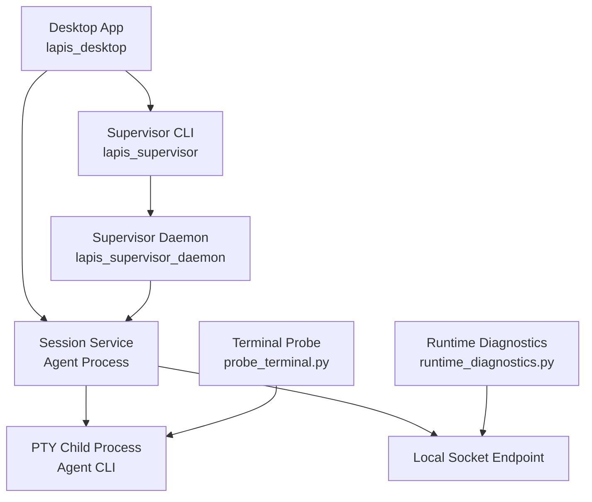
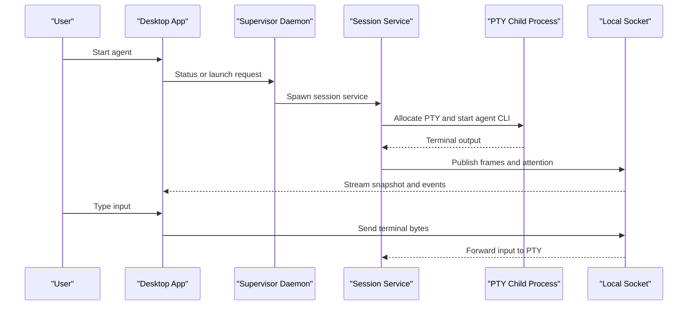
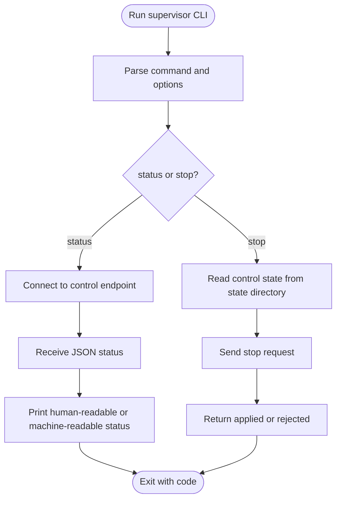
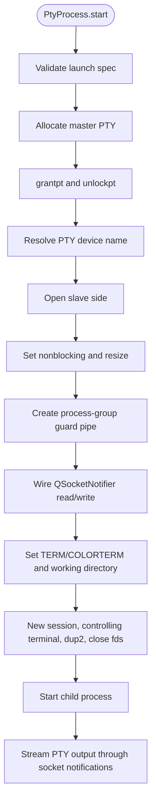
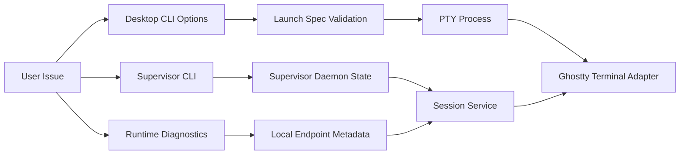
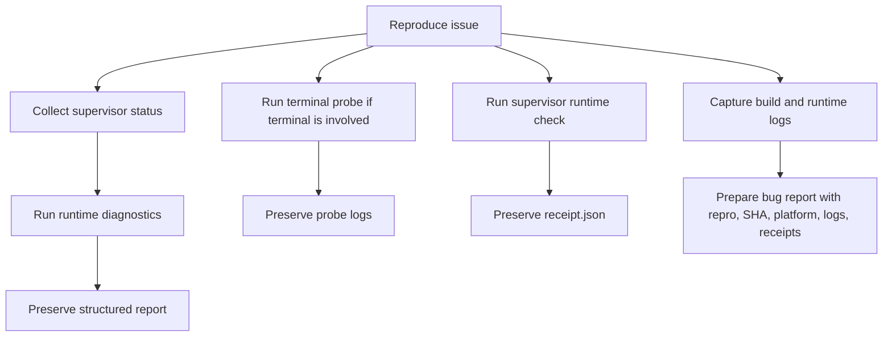

# Troubleshooting

<cite>
**Referenced Files in This Document**
- [README.md](file://README.md)
- [CONTRIBUTING.md](file://CONTRIBUTING.md)
- [docs/install.md](file://docs/install.md)
- [docs/status.md](file://docs/status.md)
- [apps/desktop/src/main.cpp](file://apps/desktop/src/main.cpp)
- [services/supervisor/src/cli.cpp](file://services/supervisor/src/cli.cpp)
- [services/supervisor/src/daemon.cpp](file://services/supervisor/src/daemon.cpp)
- [services/session/src/launch_spec.cpp](file://services/session/src/launch_spec.cpp)
- [services/session/src/platform/posix/local_endpoint.cpp](file://services/session/src/platform/posix/local_endpoint.cpp)
- [services/session/src/platform/posix/pty_process.cpp](file://services/session/src/platform/posix/pty_process.cpp)
- [services/session/src/session_service.cpp](file://services/session/src/session_service.cpp)
- [scripts/check_supervisor_runtime.py](file://scripts/check_supervisor_runtime.py)
- [scripts/probe_terminal.py](file://scripts/probe_terminal.py)
- [scripts/runtime_diagnostics.py](file://scripts/runtime_diagnostics.py)
- [scripts/lapis.py](file://scripts/lapis.py)
</cite>

## Table of Contents
1. [Introduction](#introduction)
2. [Project Structure](#project-structure)
3. [Core Components](#core-components)
4. [Architecture Overview](#architecture-overview)
5. [Detailed Component Analysis](#detailed-component-analysis)
6. [Dependency Analysis](#dependency-analysis)
7. [Performance Considerations](#performance-considerations)
8. [Troubleshooting Guide](#troubleshooting-guide)
9. [Evidence Collection and Bug Reports](#evidence-collection-and-bug-reports)
10. [Conclusion](#conclusion)

## Introduction
This document is a symptom-based troubleshooting guide for Lapis. It focuses on diagnosing agent launch failures, session connection problems, terminal rendering issues, permission errors, process isolation failures, and IPC communication failures. It also covers the built-in diagnostic tools, automated checks, platform-specific macOS behavior, and performance investigation for terminal rendering slowdowns, memory usage, and CPU utilization.

Lapis runs multiple coding agents concurrently, each with its own live terminal. Agents are isolated by separate session services, and the desktop app communicates with those services through local sockets. The supervisor daemon owns service lifecycle, while the session service owns PTY-backed child processes and terminal state.

**Section sources**
- [README.md:1-100](file://README.md#L1-L100)
- [docs/status.md:1-91](file://docs/status.md#L1-L91)

## Project Structure
The troubleshooting-relevant parts of the repository fall into five layers:

| Layer | Responsibility | Key paths |
|---|---|---|
| Desktop GUI | User interaction, launch options, Qt/QML UI, screen capture, frame tracing | `apps/desktop/src/main.cpp` |
| Supervisor | Daemon, control server, client CLI, runtime state, session launcher | `services/supervisor/src/*` |
| Session service | Agent process isolation, PTY allocation, terminal adapter, history, attention, IPC protocol | `services/session/src/*` |
| Platform primitives | POSIX PTY, local socket endpoints, process groups, descriptor ownership | `services/session/src/platform/posix/*` |
| Diagnostics and automation | Runtime diagnostics, terminal probes, restore checks, quality gates | `scripts/*` |

**Diagram sources**
- [apps/desktop/src/main.cpp:1-200](file://apps/desktop/src/main.cpp#L1-L200)
- [services/supervisor/src/cli.cpp:1-97](file://services/supervisor/src/cli.cpp#L1-L97)
- [services/supervisor/src/daemon.cpp:1-200](file://services/supervisor/src/daemon.cpp#L1-L200)
- [services/session/src/session_service.cpp:1-200](file://services/session/src/session_service.cpp#L1-L200)
- [services/session/src/platform/posix/local_endpoint.cpp:1-93](file://services/session/src/platform/posix/local_endpoint.cpp#L1-L93)
- [services/session/src/platform/posix/pty_process.cpp:1-200](file://services/session/src/platform/posix/pty_process.cpp#L1-L200)
- [scripts/runtime_diagnostics.py:1-200](file://scripts/runtime_diagnostics.py#L1-L200)
- [scripts/probe_terminal.py:1-200](file://scripts/probe_terminal.py#L1-L200)

**Section sources**
- [apps/desktop/src/main.cpp:1-200](file://apps/desktop/src/main.cpp#L1-L200)
- [services/supervisor/src/cli.cpp:1-97](file://services/supervisor/src/cli.cpp#L1-L97)
- [services/session/src/platform/posix/local_endpoint.cpp:1-93](file://services/session/src/platform/posix/local_endpoint.cpp#L1-L93)

## Core Components
This section maps symptoms to components so you can identify where an issue originates.

| Symptom area | Likely component | What to inspect |
|---|---|---|
| Agent cannot start or exits immediately | Launch validation, supervisor daemon, session service launcher | `--codex`, `--claude`, `--development-shell`, program resolution, working directory |
| Desktop cannot connect to an agent | Session service, local endpoint, stale socket, Codex symlink handling | Socket path, `.session` descriptor, owner-only permissions |
| Terminal shows no output or freezes | PTY allocation, QSocketNotifier, Ghostty terminal adapter, output admission | PTY open/resolution/configuration, resize, write queue limit |
| Permission error during launch or save | Trusted directory check, private endpoint directory mode 0700, file descriptors | Owner, group/world bits, symlinks, sticky directories |
| Supervisor reports absent or blocked | Supervisor CLI status, daemon state directory, control endpoint | Absolute paths, JSON status, blocked reason |
| Restore after reboot fails | Resume records, checkpoint files, login shell environment | Endpoint resume JSON, `SHELL`, real shell executability |
| Slow terminal rendering | Ghostty VT adapter, frame pacing, socket buffer sizing, GPU surface | Frame traces, capture logs, Qt/QML settings, Vulkan/MoltenVK |

**Section sources**
- [apps/desktop/src/main.cpp:1-200](file://apps/desktop/src/main.cpp#L1-L200)
- [services/session/src/launch_spec.cpp:1-144](file://services/session/src/launch_spec.cpp#L1-L144)
- [services/session/src/platform/posix/local_endpoint.cpp:1-93](file://services/session/src/platform/posix/local_endpoint.cpp#L1-L93)
- [services/session/src/platform/posix/pty_process.cpp:1-200](file://services/session/src/platform/posix/pty_process.cpp#L1-L200)
- [services/session/src/session_service.cpp:1-200](file://services/session/src/session_service.cpp#L1-L200)

## Architecture Overview
A typical Lapis workflow involves these stages:

**Diagram sources**
- [apps/desktop/src/main.cpp:1-200](file://apps/desktop/src/main.cpp#L1-L200)
- [services/supervisor/src/daemon.cpp:1-200](file://services/supervisor/src/daemon.cpp#L1-L200)
- [services/session/src/session_service.cpp:1-200](file://services/session/src/session_service.cpp#L1-L200)
- [services/session/src/platform/posix/pty_process.cpp:1-200](file://services/session/src/platform/posix/pty_process.cpp#L1-L200)

## Detailed Component Analysis

### Supervisor CLI and Daemon Health
The supervisor CLI provides headless status and explicit stop commands. Its key fields include schema version, slot, enabled state, service liveness, epoch, blocked reason, and endpoint. The daemon requires absolute state and control paths, validates persisted state version, reconstructs the session launcher, and exposes a control interface for status and stop actions.

Common diagnostic questions:
- Is the supervisor control endpoint reachable?
- Does the status reply contain a valid JSON object with a string status field?
- Is the service live or absent?
- Is there a blocked reason preventing normal operation?
- Are the required absolute paths correct?

Resolution steps:
1. Run the supervisor status command with the expected control endpoint.
2. If stopped, verify that the state directory exists, is owned by the current user, and contains a supported supervisor state version.
3. If the daemon refuses to start because persisted state cannot be reconstructed, follow the documented operator recovery path rather than manually editing state.
4. Use the explicit stop command only when the state directory is supplied; it sends a bounded JSON action over the control endpoint and returns an applied or rejected status.

**Diagram sources**
- [services/supervisor/src/cli.cpp:1-97](file://services/supervisor/src/cli.cpp#L1-L97)
- [services/supervisor/src/daemon.cpp:1-200](file://services/supervisor/src/daemon.cpp#L1-L200)

**Section sources**
- [services/supervisor/src/cli.cpp:1-97](file://services/supervisor/src/cli.cpp#L1-L97)
- [services/supervisor/src/daemon.cpp:1-200](file://services/supervisor/src/daemon.cpp#L1-L200)

### Agent Launch Validation
Launch validation is strict. It rejects unknown agent modes, disallows conflicting managed-agent flags, enforces argument count and size limits, requires a non-empty program and working directory, verifies the directory exists, resolves the executable, and confirms the resolved program is an executable file. For interactive shells, it prefers `SHELL`, falls back to the account’s login shell, and finally uses `/bin/sh`.

Common failure patterns:
- Program not found or not executable.
- Working directory missing or not a directory.
- Too many arguments or excessively long launch values.
- Managed Claude launched with `--settings`, `--bare`, or `--safe-mode`.
- Managed Codex launched with `--remote`.
- Initial terminal dimensions invalid or exceeding cell limits.

Resolution steps:
1. Verify the agent executable exists and is executable.
2. Confirm the working directory is present and canonicalized.
3. Check the number and length of arguments.
4. Remove unsupported managed-agent flags.
5. Ensure terminal rows and columns are nonzero and within bounds.

**Section sources**
- [services/session/src/launch_spec.cpp:1-144](file://services/session/src/launch_spec.cpp#L1-L144)

### PTY Allocation and Process Isolation
The PTY backend allocates a master/slave pair, resolves the PTY device name, opens the slave side, configures nonblocking I/O, sets the terminal size, creates a process-group guard pipe, wires Qt socket notifications, and launches the child process with a new session. The child becomes the controlling terminal, receives duplicated standard streams, and is terminated as a process group during teardown.

Failure signals:
- `Open PTY`: PTY creation failed.
- `Resolve PTY`: Device name lookup failed.
- `Configure PTY`: Slave open, flag change, or resize failed.
- `Create process-group guard pipe`: Descriptor limit or pipe setup failed.
- `PTY already started`: Reuse attempt on an active PTY.
- `FailedToStart`: Child process could not start.

Resolution steps:
1. Inspect the failure message emitted by the PTY wrapper.
2. Check system PTY availability and descriptor limits.
3. Avoid launching the same PTY twice.
4. If the child cannot start, inspect the agent executable path, arguments, working directory, and environment.
5. On teardown, ensure the process group is killed before reaping; do not reuse a saved PID after reaping.

**Diagram sources**
- [services/session/src/platform/posix/pty_process.cpp:1-200](file://services/session/src/platform/posix/pty_process.cpp#L1-L200)

**Section sources**
- [services/session/src/platform/posix/pty_process.cpp:1-200](file://services/session/src/platform/posix/pty_process.cpp#L1-L200)

### Local Endpoint and IPC Security
Local endpoints enforce trusted directories, owner-only private directories, symlink safety, socket-path length limits, and safe ancestor traversal. Private endpoint parents must be owned by the current user with mode `0700`; existing directories are never `chmod`ed, so the fix is explicit. Socket buffers are widened to at least 1 MiB per direction when possible, helping large terminal frames avoid repeated kernel buffering.

Common IPC failures:
- Socket path too long.
- Socket path is a symlink.
- Socket path already contains a non-socket file.
- Private directory not owned by the current user.
- Private directory mode is not `0700`.
- Path traverses an untrusted writable ancestor.

Resolution steps:
1. Ensure the runtime directory under `~/.lapis/runtime` (or `$LAPIS_HOME`) is owned by your user.
2. Set the private directory to mode `0700`.
3. Remove stale symlinks or leftover non-socket files at the expected socket path.
4. Avoid placing endpoints under world-writable or group-writable directories unless protected by a sticky bit.

**Section sources**
- [services/session/src/platform/posix/local_endpoint.cpp:1-93](file://services/session/src/platform/posix/local_endpoint.cpp#L1-L93)

### Session Service and Connection Problems
The session service owns the terminal, history, attention, checkpoints, and local IPC. It removes stale Codex symlinks when needed, binds the local socket, manages admission pressure at 64 KiB, and publishes snapshots and attention updates. Stale endpoints left by power loss are handled by replacing dead links.

Common connection symptoms:
- “Endpoint already in use.”
- “Cannot remove stale Codex endpoint.”
- No snapshots arriving.
- Snapshots arrive but have mismatched attachment identity.
- History paging or attention replay fails.

Resolution steps:
1. Confirm the socket path matches the expected endpoint.
2. Remove stale Codex symlinks only if the connection test indicates they are dead.
3. Verify the `.session` descriptor and owner-only metadata exist and match the running service.
4. Check whether output admission pressure is active due to sustained terminal output.
5. Use runtime diagnostics and the supervisor CLI to confirm service presence without changing state.

**Section sources**
- [services/session/src/session_service.cpp:1-200](file://services/session/src/session_service.cpp#L1-L200)

## Dependency Analysis
The following diagram shows how troubleshooting depends on layered evidence:

**Diagram sources**
- [apps/desktop/src/main.cpp:1-200](file://apps/desktop/src/main.cpp#L1-L200)
- [services/supervisor/src/cli.cpp:1-97](file://services/supervisor/src/cli.cpp#L1-L97)
- [services/supervisor/src/daemon.cpp:1-200](file://services/supervisor/src/daemon.cpp#L1-L200)
- [services/session/src/launch_spec.cpp:1-144](file://services/session/src/launch_spec.cpp#L1-L144)
- [services/session/src/platform/posix/local_endpoint.cpp:1-93](file://services/session/src/platform/posix/local_endpoint.cpp#L1-L93)
- [services/session/src/platform/posix/pty_process.cpp:1-200](file://services/session/src/platform/posix/pty_process.cpp#L1-L200)
- [scripts/runtime_diagnostics.py:1-200](file://scripts/runtime_diagnostics.py#L1-L200)

**Section sources**
- [scripts/runtime_diagnostics.py:1-200](file://scripts/runtime_diagnostics.py#L1-L200)
- [scripts/lapis.py:1-200](file://scripts/lapis.py#L1-L200)

## Performance Considerations
Terminal rendering slowdowns can originate in several layers:

| Area | Evidence | Typical cause | Action |
|---|---|---|---|
| Desktop frame pacing | `--capture`, `--trace`, frame observation files | QML composition, event loop contention, oversized terminal frames | Reduce terminal size, isolate UI preview, examine trace timestamps |
| Terminal adapter | Ghostty VT integration, terminal snapshot extraction | Large grids, hyperlink scanning, palette conversion | Keep terminal width reasonable, avoid extremely wide outputs |
| IPC throughput | Socket buffer widening, 64 KiB admission limit | Sustained PTY output exceeding default socket buffers | Verify endpoint directory permissions and socket existence; rely on widened buffers |
| Memory retention | Snapshot text, hyperlinks, history store | Retaining large terminal output or many hyperlinks | Limit terminal size, avoid persistent huge workspaces |
| CPU utilization | Frame rate, input latency, terminal processing loops | Continuous redraws, parsing OSC/hyperlinks, attention churn | Reduce motion, focus one agent, disable unnecessary background features |

The repository documents native input-to-frame p50 and p95 measurements and frames-per-submission targets, but those are measured qualifications rather than universal guarantees. When investigating performance:
1. Reproduce with the smallest workspace and terminal size.
2. Capture a bounded frame trace using the desktop capture and trace options.
3. Compare results between software and hardware rendering surfaces.
4. Rule out networked agents by testing a local development shell first.
5. Measure before and after disabling optional features such as suggestions or background attention rotation.

**Section sources**
- [docs/status.md:1-91](file://docs/status.md#L1-L91)
- [apps/desktop/src/main.cpp:1-200](file://apps/desktop/src/main.cpp#L1-L200)
- [services/session/src/session_service.cpp:1-200](file://services/session/src/session_service.cpp#L1-L200)

## Troubleshooting Guide

### A. Agent Launch Failures

#### Symptoms
- Desktop rejects the launch.
- Agent process starts and exits immediately.
- Error mentions an unknown agent mode, missing program, invalid directory, or unsupported flag.

#### Diagnosis
1. Determine whether the launch is a qualified desktop option:
   - `--codex` requires an explicit Codex executable.
   - `--claude` requires an explicit Claude executable.
   - `--development-shell` qualifies a development terminal.
   - `--smoke-input` sends a test command to a live shell.
2. Check the desktop command-line validation output.
3. Validate the agent executable and working directory independently.
4. Inspect launch validation for argument count, size, and mode conflicts.

#### Resolution
- Use the exact executable path for `--codex` or `--claude`.
- Remove unsupported managed-agent flags.
- Provide a valid working directory.
- For shell-based sessions, verify `SHELL` points to an executable shell.
- If the program resolves but is not executable, install or repair the agent CLI.

**Section sources**
- [apps/desktop/src/main.cpp:1-200](file://apps/desktop/src/main.cpp#L1-L200)
- [services/session/src/launch_spec.cpp:1-144](file://services/session/src/launch_spec.cpp#L1-L144)

### B. Session Connection Problems

#### Symptoms
- Desktop connects to the wrong endpoint.
- Connection is refused or times out.
- Stale Codex symlink blocks connection.
- Service appears absent even though the agent is running.

#### Diagnosis
1. Identify the endpoint used by the desktop or supervisor.
2. Run the supervisor status command against the control endpoint.
3. Inspect the runtime directory for socket files, `.session` descriptors, and `.resume` records.
4. Check whether the endpoint is a stale symlink.
5. Confirm the session service is listening on the expected Unix socket.

#### Resolution
- Clear stale Codex symlinks only when the socket connection test indicates the link is dead.
- Fix private directory ownership and mode `0700`.
- Restart the supervisor and session service if the control endpoint is stale.
- Avoid copying runtime state between machines; it is owner-specific.

**Section sources**
- [services/supervisor/src/cli.cpp:1-97](file://services/supervisor/src/cli.cpp#L1-L97)
- [services/session/src/platform/posix/local_endpoint.cpp:1-93](file://services/session/src/platform/posix/local_endpoint.cpp#L1-L93)
- [services/session/src/session_service.cpp:1-200](file://services/session/src/session_service.cpp#L1-L200)

### C. Terminal Rendering Issues

#### Symptoms
- Terminal output is blank, delayed, truncated, or flickers.
- Links, colors, or Unicode glyphs render incorrectly.
- Typing input does not appear.
- Rendering slows dramatically under sustained output.

#### Diagnosis
1. Distinguish PTY I/O from rendering:
   - If the child process exits, the problem is upstream of the terminal adapter.
   - If output arrives but the UI does not update, investigate frame pacing and Qt rendering.
2. Inspect PTY configuration:
   - Master/slave allocation succeeded.
   - Device name was resolved.
   - Resize ioctl succeeded.
   - QSocketNotifier read/write events fire.
3. Inspect terminal adapter behavior:
   - Hyperlink URI extraction and UTF-8 validation.
   - Palette and style color mapping.
   - Cell grid and row data access.
4. Capture a bounded frame trace and compare timestamps.

#### Resolution
- Repair PTY allocation by fixing OS-level resource limits or environment.
- Resize the terminal to a stable width and height.
- Disable optional UI motion or reduce terminal width to reduce frame cost.
- Use the terminal probe tool to validate pinned engine experiments.
- Investigate Qt and Vulkan/MoltenVK surface issues separately from PTY I/O.

**Section sources**
- [services/session/src/platform/posix/pty_process.cpp:1-200](file://services/session/src/platform/posix/pty_process.cpp#L1-L200)
- [scripts/probe_terminal.py:1-200](file://scripts/probe_terminal.py#L1-L200)

### D. Permission Errors

#### Symptoms
- Error says a directory must be owned by you with mode `0700`.
- Error says the path traverses an untrusted writable directory.
- Runtime diagnostics report inaccessible or invalid metadata.
- Desktop cannot write reset journals or session descriptors.

#### Diagnosis
1. Check the runtime directory owner and mode.
2. Inspect ancestors of the endpoint path for writable directories.
3. Confirm the socket path is not a symlink.
4. Verify private metadata files are regular files owned by the current user with mode `0600`.

#### Resolution
- Run `chmod 700 ~/.lapis/runtime` or `$LAPIS_HOME/runtime`.
- Move endpoints to a private directory tree.
- Remove stale symlinks or non-socket files at the endpoint path.
- Do not share `~/.lapis/runtime` between users.

**Section sources**
- [services/session/src/platform/posix/local_endpoint.cpp:1-93](file://services/session/src/platform/posix/local_endpoint.cpp#L1-L93)
- [scripts/runtime_diagnostics.py:1-200](file://scripts/runtime_diagnostics.py#L1-L200)

### E. macOS-Specific Issues

#### Background Execution and Updates
On macOS, agents started from the window may count as background processes. The app must be allowed under **Allow in the Background**, and the old application bundle must remain until the old window exits. Otherwise macOS can terminate every agent when the window quits.

Resolution:
- Enable background execution for Lapis in System Settings.
- Do not delete the previous Lapis bundle until all windows close.
- Follow the documented quit-and-open upgrade path.

#### Login Shell Environment
Managed agents should run with your login shell environment. If `SHELL` is unset or points to a non-executable shell, Lapis falls back to the password database shell and then `/bin/sh`. This fallback can break agent CLIs that expect aliases, PATH, or rc files.

Resolution:
- Set `SHELL` to a valid login shell.
- Verify the shell is executable.
- Test the agent CLI directly from your normal terminal before launching through Lapis.

**Section sources**
- [docs/install.md:1-58](file://docs/install.md#L1-L58)
- [services/session/src/launch_spec.cpp:1-144](file://services/session/src/launch_spec.cpp#L1-L144)

### F. Process Isolation and IPC Failures

#### Symptoms
- PTY teardown leaves zombie children.
- Process-group kill fails.
- IPC messages stall under heavy terminal output.
- Two services appear to claim the same endpoint.

#### Diagnosis
1. Check whether the child process is still alive after service shutdown.
2. Inspect the process-group guard pipe and descriptor limits.
3. Check whether output admission pressure is active.
4. Verify socket buffers were widened.
5. Confirm only one service owns the endpoint lock and descriptor.

#### Resolution
- Allow the process-group termination sequence to complete; do not force-kill the parent service prematurely.
- Reduce terminal output rate or terminal size temporarily.
- Verify the endpoint directory is private and not shared.
- Restart the supervisor cleanly using the CLI stop command when necessary.

**Section sources**
- [services/session/src/platform/posix/pty_process.cpp:1-200](file://services/session/src/platform/posix/pty_process.cpp#L1-L200)
- [services/session/src/session_service.cpp:1-200](file://services/session/src/session_service.cpp#L1-L200)

### G. Network Connectivity Issues
Remote hosts, shared plans, phone gateways, and remote agent connections are outside the early-access support slice. Diagnose them separately from local sessions:
- Verify SSH connectivity from the same shell Lapis inherits.
- Confirm the remote host appears in the machine picker.
- Treat remote session reconnect and fan-out as unqualified until explicitly exercised.
- Collect network logs and gateway diagnostics separately from local IPC diagnostics.

**Section sources**
- [README.md:1-100](file://README.md#L1-L100)
- [docs/status.md:1-91](file://docs/status.md#L1-L91)

## Evidence Collection and Bug Reports

### Step-by-Step Evidence Collection
1. Record the exact reproduction steps.
2. Record the source SHA or installed release identifier.
3. Record the platform, macOS version, Qt/Ghostty versions when relevant.
4. Capture the supervisor status output in both human-readable and JSON form.
5. Inspect the runtime directory structure without sharing private conversation data.
6. Capture terminal output and frame traces when rendering is involved.
7. Run the focused supervisor runtime check and preserve its receipt.
8. Run the terminal probe only with the intended build root and archive verification.
9. Run the runtime diagnostics command and collect its structural report.
10. Preserve logs under `build/` and concise sanitized evidence under `evidence/`.

### Automated Checks for Quality Assurance
| Tool | Purpose | Important behavior |
|---|---|---|
| `python3 scripts/lapis.py doctor` | Report dependency readiness | Resolves Ghostty prefix and Qt automatically |
| `python3 scripts/lapis.py bootstrap` | Build pinned terminal dependencies | Validates Ghostty artifacts and receipt |
| `python3 scripts/lapis.py check` | Repository baseline and checks | Non-GUI baseline before full desktop gate |
| `python3 scripts/lapis.py ui-review` | Routine background UI reviews | Requires logged-in graphical session |
| `scripts/check_supervisor_runtime.py` | Focused supervisor runtime build/tests | Writes a receipt and distinguishes skipped sandbox cases |
| `scripts/probe_terminal.py` | Pinned terminal engine experiments | Verifies archive checksums, source trees, and process cleanup |
| `scripts/runtime_diagnostics.py` | Read-only package/runtime inspection | Connect-only socket probes, bounded metadata, no state changes |
| `scripts/check_restore.py` | Power-loss resume qualification | Uses real desktop restore helper and fake model stand-ins |

**Diagram sources**
- [scripts/check_supervisor_runtime.py:1-200](file://scripts/check_supervisor_runtime.py#L1-L200)
- [scripts/probe_terminal.py:1-200](file://scripts/probe_terminal.py#L1-L200)
- [scripts/runtime_diagnostics.py:1-200](file://scripts/runtime_diagnostics.py#L1-L200)
- [scripts/lapis.py:1-200](file://scripts/lapis.py#L1-L200)

**Section sources**
- [CONTRIBUTING.md:1-200](file://CONTRIBUTING.md#L1-L200)
- [scripts/check_supervisor_runtime.py:1-200](file://scripts/check_supervisor_runtime.py#L1-L200)
- [scripts/probe_terminal.py:1-200](file://scripts/probe_terminal.py#L1-L200)
- [scripts/runtime_diagnostics.py:1-200](file://scripts/runtime_diagnostics.py#L1-L200)

## Conclusion
Most Lapis failures can be narrowed to one of five areas: launch validation, supervisor lifecycle, session service health, PTY/process isolation, or terminal rendering. Use the supervisor CLI for service state, runtime diagnostics for safe structural inspection, and the terminal probe for pinned engine experiments. Fix permission and endpoint problems first, because they commonly masquerade as connection or rendering failures. Collect bounded, owner-safe evidence, record the exact source or release, and distinguish local early-access behavior from remote or packaged-workload claims that remain unqualified.