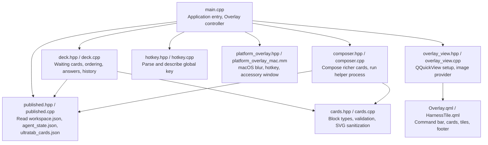
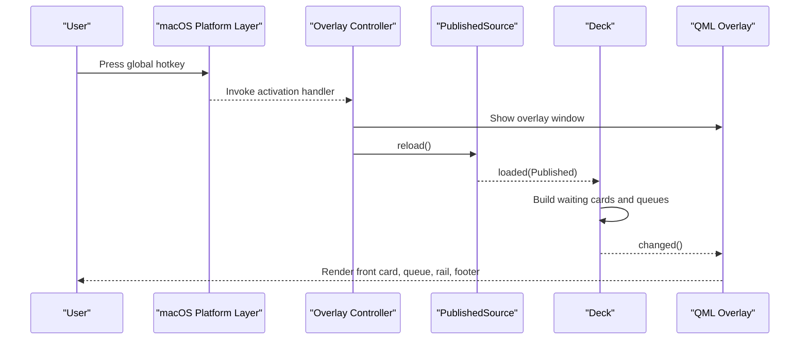
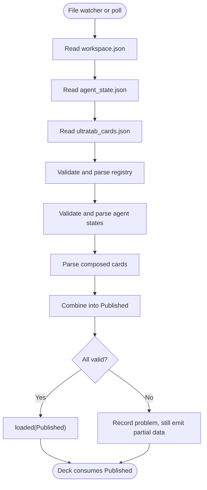
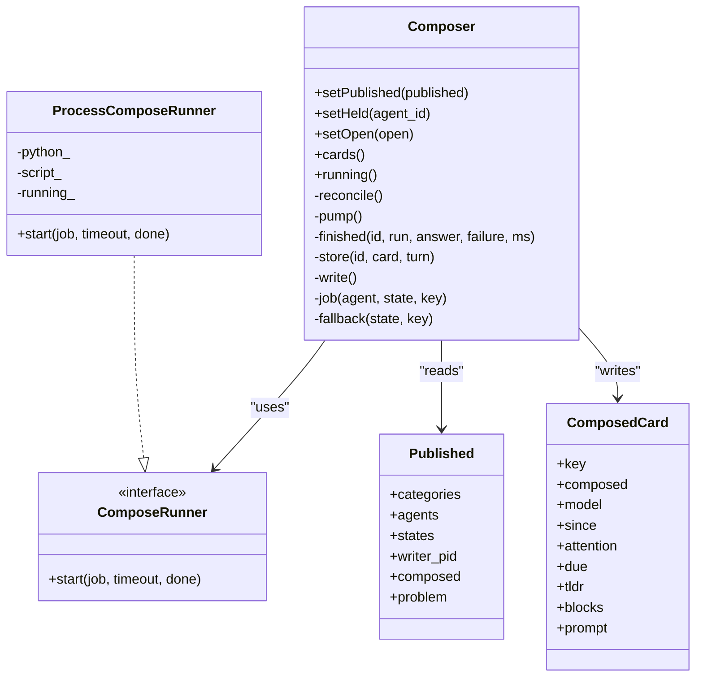
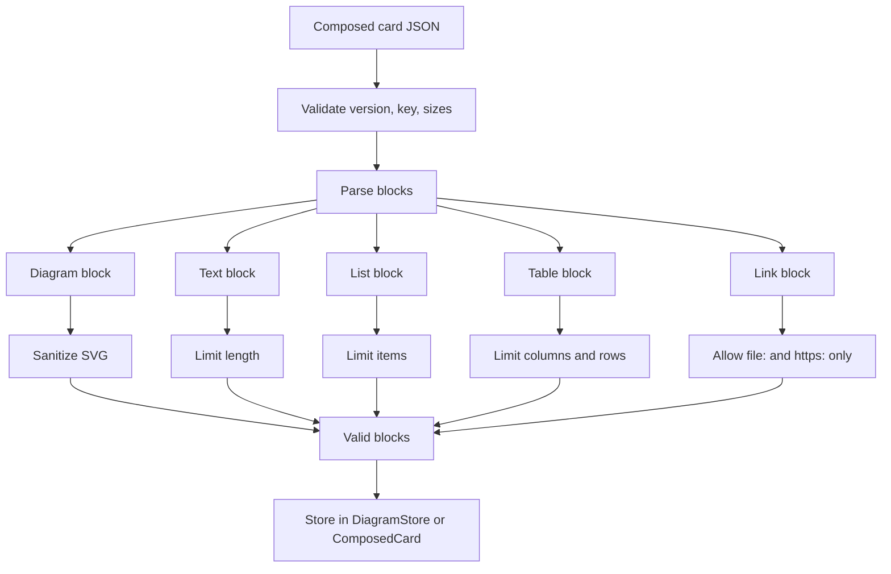
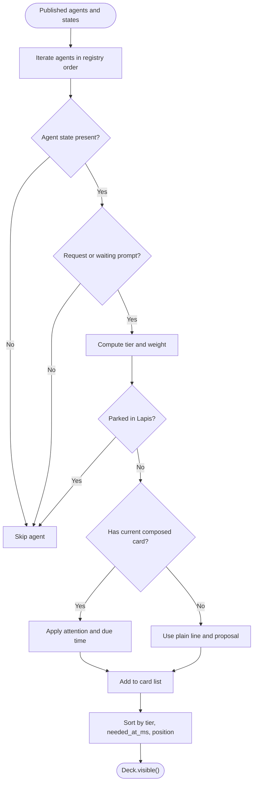
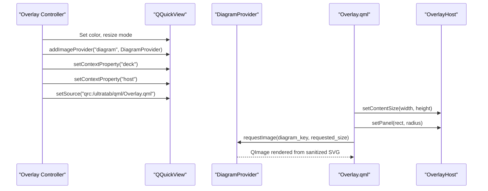
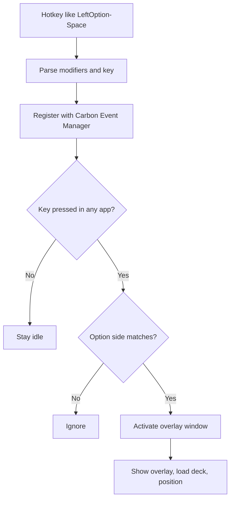
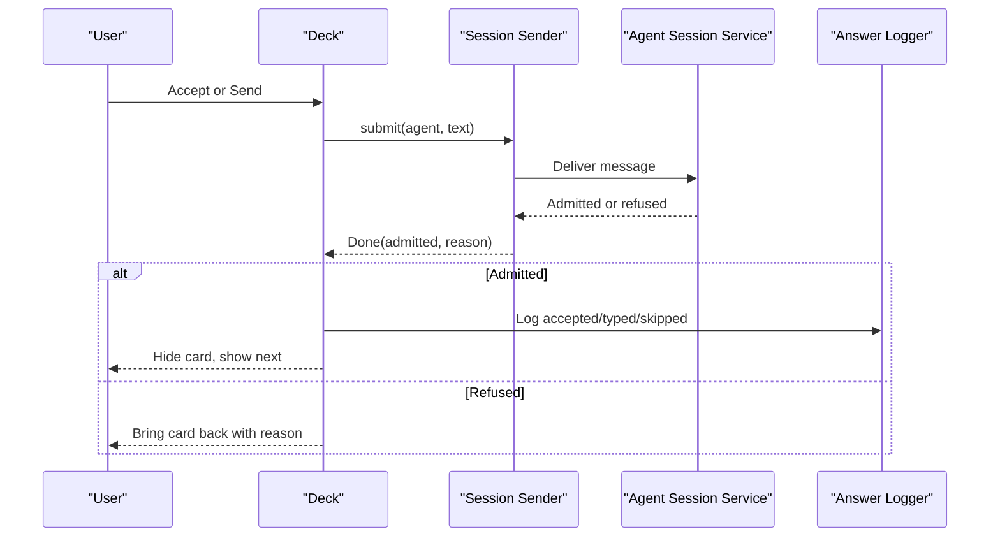
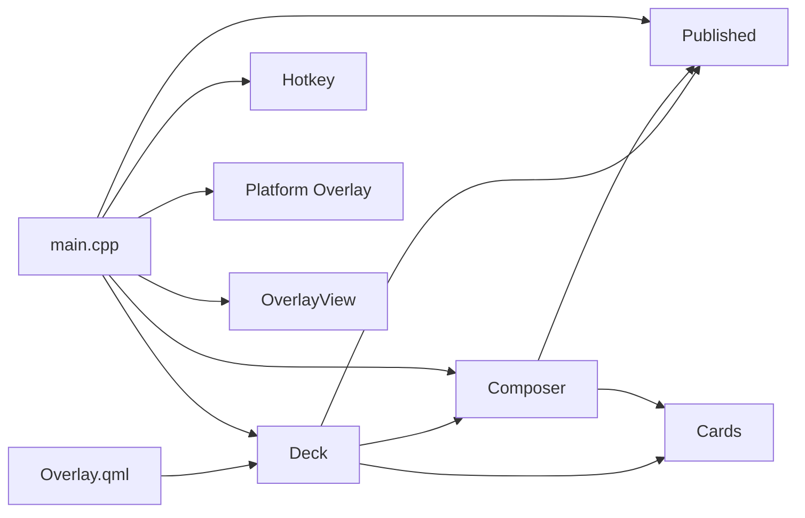

# Ultra Tab Overlay

<cite>
**Referenced Files in This Document**
- [README.md](file://README.md)
- [ultratab.md](file://docs/ultratab.md)
- [main.cpp](file://apps/ultratab/src/main.cpp)
- [deck.hpp](file://apps/ultratab/src/deck.hpp)
- [deck.cpp](file://apps/ultratab/src/deck.cpp)
- [cards.hpp](file://apps/ultratab/src/cards.hpp)
- [cards.cpp](file://apps/ultratab/src/cards.cpp)
- [composer.hpp](file://apps/ultratab/src/composer.hpp)
- [composer.cpp](file://apps/ultratab/src/composer.cpp)
- [published.hpp](file://apps/ultratab/src/published.hpp)
- [published.cpp](file://apps/ultratab/src/published.cpp)
- [hotkey.hpp](file://apps/ultratab/src/hotkey.hpp)
- [hotkey.cpp](file://apps/ultratab/src/hotkey.cpp)
- [overlay_view.hpp](file://apps/ultratab/src/overlay_view.hpp)
- [overlay_view.cpp](file://apps/ultratab/src/overlay_view.cpp)
- [platform_overlay.hpp](file://apps/ultratab/src/platform_overlay.hpp)
- [platform_overlay_mac.mm](file://apps/ultratab/src/platform_overlay_mac.mm)
- [Overlay.qml](file://apps/ultratab/qml/Overlay.qml)
- [HarnessTile.qml](file://apps/ultratab/qml/HarnessTile.qml)
</cite>

## Table of Contents
1. [Introduction](#introduction)
2. [Project Structure](#project-structure)
3. [Core Components](#core-components)
4. [Architecture Overview](#architecture-overview)
5. [Detailed Component Analysis](#detailed-component-analysis)
6. [Dependency Analysis](#dependency-analysis)
7. [Performance Considerations](#performance-considerations)
8. [Troubleshooting Guide](#troubleshooting-guide)
9. [Conclusion](#conclusion)

## Introduction
Ultra Tab is a standalone overlay application that sits beside the main Lapis agent workspace and turns waiting agents into a deck of cards. Its goal is to give quick, glanceable access to what an agent needs without interrupting your primary workflow: you summon it from anywhere on macOS, see the most urgent card, accept or edit its proposed reply, send a nudge, skip it, or open it back in Lapis. The overlay reads data published by Lapis and never takes Lapis’s workspace lock or writes Lapis files directly.

The deck-of-cards metaphor is central. Each agent that needs you becomes one card. Cards are ordered by urgency and age, so red “needs you” items come first, yellow “could steer” items follow, and green background work is shown as tiles but not as cards. You interact with the front card using keyboard shortcuts; when answered, it slides away and the next card comes forward. A composed-card system can enrich each card with a summary, structured blocks, diagrams, links, and a proposed next message, while a platform-specific macOS implementation provides a translucent panel, a localized blur behind the panel, and a global hotkey.

This document explains how the overlay works end-to-end, how cards are composed, how the published state synchronizes data between Lapis and Ultra Tab, and how the QML-based interface renders lightweight tiles for CLI icons and agent status.

**Section sources**
- [README.md:1-100](file://README.md#L1-L100)
- [ultratab.md:1-200](file://docs/ultratab.md#L1-L200)

## Project Structure
Ultra Tab lives under `apps/ultratab`. Its C++ core owns the window lifecycle, the card deck, the published-state reader, the composer coordinator, the global hotkey, and the platform overlay bridge. Its QML layer renders the command bar, the current card, the queue, the rail, the footer lights, and the harness tiles. Supporting assets include the compose helper scripts and macOS entitlements.

**Diagram sources**
- [main.cpp:1-80](file://apps/ultratab/src/main.cpp#L1-L80)
- [published.hpp:1-112](file://apps/ultratab/src/published.hpp#L1-L112)
- [composer.hpp:1-158](file://apps/ultratab/src/composer.hpp#L1-L158)
- [cards.hpp:1-73](file://apps/ultratab/src/cards.hpp#L1-L73)
- [deck.hpp:1-215](file://apps/ultratab/src/deck.hpp#L1-L215)
- [hotkey.hpp:1-26](file://apps/ultratab/src/hotkey.hpp#L1-L26)
- [platform_overlay.hpp:1-53](file://apps/ultratab/src/platform_overlay.hpp#L1-L53)
- [overlay_view.hpp:1-94](file://apps/ultratab/src/overlay_view.hpp#L1-L94)
- [Overlay.qml:1-1129](file://apps/ultratab/qml/Overlay.qml#L1-L1129)
- [HarnessTile.qml:1-105](file://apps/ultratab/qml/HarnessTile.qml#L1-L105)

**Section sources**
- [ultratab.md:1-200](file://docs/ultratab.md#L1-L200)
- [main.cpp:1-80](file://apps/ultratab/src/main.cpp#L1-L80)

## Core Components
Ultra Tab is organized around six cooperating responsibilities:

| Component | Responsibility | Key data or behavior |
|---|---|---|
| Published source | Reads Lapis’s runtime files safely and emits the latest snapshot | Workspace registry, agent states, composed cards, writer PID, problems |
| Composer | Runs the composition helper and writes enriched cards | Debounce, concurrency limit, held card, timeout, log |
| Cards model | Defines block shapes and validates them | Text, list, table, diagram, link; size and byte limits |
| Deck | Builds the visible deck of waiting cards | Ordering, weight, tier, queue, rail, running, history, answers |
| Overlay view | Loads QML and binds `deck` and `host` | Image provider for sanitized diagrams, context properties |
| Platform overlay | macOS-specific window and input integration | Translucent window, blur rectangle, global hotkey, accessory mode |

The deck is the user-facing abstraction. It exposes properties such as the front card, behind card, queued cards, category rail, running agents, groups by attention level, a small map of categories and agents, history, a notice explaining why the deck may be incomplete, and whether it is listening.

**Section sources**
- [deck.hpp:1-215](file://apps/ultratab/src/deck.hpp#L1-L215)
- [deck.cpp:1-200](file://apps/ultratab/src/deck.cpp#L1-L200)
- [published.hpp:1-112](file://apps/ultratab/src/published.hpp#L1-L112)
- [composer.hpp:1-158](file://apps/ultratab/src/composer.hpp#L1-L158)
- [cards.hpp:1-73](file://apps/ultratab/src/cards.hpp#L1-L73)
- [overlay_view.hpp:1-94](file://apps/ultratab/src/overlay_view.hpp#L1-L94)
- [platform_overlay.hpp:1-53](file://apps/ultratab/src/platform_overlay.hpp#L1-L53)

## Architecture Overview
At startup, Ultra Tab loads configuration, creates the deck, sets up the published-state source, installs the QML overlay, registers the global hotkey, and shows the window only when the person invokes it. The overlay itself does not take focus from other applications until the hotkey is pressed. When active, the overlay stays above the desktop, blurs only the panel area, and grows to fit the current card.

**Diagram sources**
- [main.cpp:80-200](file://apps/ultratab/src/main.cpp#L80-L200)
- [published.cpp:150-210](file://apps/ultratab/src/published.cpp#L150-L210)
- [deck.cpp:1-120](file://apps/ultratab/src/deck.cpp#L1-L120)
- [overlay_view.cpp:1-74](file://apps/ultratab/src/overlay_view.cpp#L1-L74)
- [platform_overlay_mac.mm:1-120](file://apps/ultratab/src/platform_overlay_mac.mm#L1-L120)

## Detailed Component Analysis

### Published State Mechanism
The published state is the contract between Lapis and Ultra Tab. Lapis writes three runtime artifacts:

1. `workspace.json`: workspace categories and agents.
2. `agent_state.json`: the current window’s view of each agent.
3. `ultratab_cards.json`: composed cards written by the composer.

Ultra Tab reads these files through `PublishedSource`, which watches the runtime directory and falls back to polling when necessary. Reads are bounded, validated, and serialized into a single `Published` object before being emitted. If a file is missing, too large, malformed, or refers to an unsafe endpoint, the problem is recorded rather than crashing the overlay.

**Diagram sources**
- [published.cpp:1-150](file://apps/ultratab/src/published.cpp#L1-L150)
- [published.cpp:150-210](file://apps/ultratab/src/published.cpp#L150-L210)
- [published.hpp:60-112](file://apps/ultratab/src/published.hpp#L60-L112)

Key characteristics:
- Registry bytes are limited to 1 MiB; state bytes to 4 MiB; composed cards to 8 MiB.
- Agent endpoints must be Unix sockets under the runtime directory.
- Programs and directories must be absolute paths.
- The writer PID allows the overlay to detect when Lapis has exited since last publishing.
- File events are deduplicated: if a read is already scheduled, another event marks a reload to happen after the current one finishes.

**Section sources**
- [published.hpp:1-112](file://apps/ultratab/src/published.hpp#L1-L112)
- [published.cpp:1-210](file://apps/ultratab/src/published.cpp#L1-L210)

### Card Composition System
The composition system turns plain waiting information into richer cards. A helper script (`compose.py`) runs as a separate process and receives a job describing the agent, its conversation tail, interaction hints, project context, and recent output. Ultra Tab controls invocation, timeout, concurrency, and persistence.

**Diagram sources**
- [composer.hpp:1-158](file://apps/ultratab/src/composer.hpp#L1-L158)
- [composer.cpp:1-200](file://apps/ultratab/src/composer.cpp#L1-L200)
- [cards.hpp:1-73](file://apps/ultratab/src/cards.hpp#L1-L73)

Important behaviors:
- Composition is debounced by default (two seconds of quiet).
- At most two compositions run concurrently.
- While `only_while_open` is enabled, new compositions start only while the overlay is visible; existing ones finish.
- The front card composes first because it is most likely to be opened.
- A guess arriving for a turn already composed replaces only the proposed message, avoiding unnecessary model calls.
- Results are stored in `runtime/ultratab_cards.json`; the file is owner-only and capped at 512 KiB.
- Composition attempts are logged to `runtime/ultratab_compose.jsonl`.

**Section sources**
- [composer.hpp:1-158](file://apps/ultratab/src/composer.hpp#L1-L158)
- [composer.cpp:1-200](file://apps/ultratab/src/composer.cpp#L1-L200)

### Card Model and Validation
A composed card consists of typed blocks: text, list, table, diagram, and link. Every block type has explicit limits to keep the overlay responsive and safe.

| Block type | Fields and limits | Purpose |
|---|---|---|
| Text | Bounded string | One-line or short paragraph summary |
| List | Up to eight items, each bounded | Checklist or bullet points |
| Table | Up to six columns and eight rows, numeric columns detected | Comparison of metrics |
| Diagram | Sanitized SVG with bounded size and renderer check | Visual structure |
| Link | Only `file:` and `https:` URLs, bounded label | Report or artifact reference |

SVG safety is implemented as a single-pass XML scan that forbids executable elements, external references, dangerous attributes, and styles containing imports or expressions. Links are restricted to local files and HTTPS. These constraints allow Ultra Tab to render diagrams and open links without trusting untrusted agent output.

**Diagram sources**
- [cards.hpp:1-73](file://apps/ultratab/src/cards.hpp#L1-L73)
- [cards.cpp:1-200](file://apps/ultratab/src/cards.cpp#L1-L200)

**Section sources**
- [cards.hpp:1-73](file://apps/ultratab/src/cards.hpp#L1-L73)
- [cards.cpp:1-200](file://apps/ultratab/src/cards.cpp#L1-L200)

### Deck and Waiting-Card Ordering
The deck converts the published registry and agent states into a prioritized list of cards. An agent becomes a card only when it is waiting for the person: it has a pending request, or it finished a turn unseen with an offer, or it is idle and has an offer. Agents currently working, unknown, or parked in Lapis are excluded.

Card priority uses three dimensions:

1. **Tier**: request > unseen guess > finished unseen > seen guess.
2. **Age**: the longer an agent has waited, the earlier it appears.
3. **Registry position**: stable tie-breaking within the same tier and age.

Weight distinguishes attention levels:
- Weight 2 (“needs you”) is red.
- Weight 1 (“could steer”) is yellow.
- Weight 0 (“running” or “fyi”) is green and never a card.

Composed cards can override attention: a composer-labeled “needs” raises weight to 2, while “fyi” removes the card entirely. A parked future check remains invisible until its `due` time arrives.

**Diagram sources**
- [deck.cpp:1-120](file://apps/ultratab/src/deck.cpp#L1-L120)
- [deck.hpp:1-120](file://apps/ultratab/src/deck.hpp#L1-L120)

**Section sources**
- [deck.hpp:1-215](file://apps/ultratab/src/deck.hpp#L1-L215)
- [deck.cpp:1-200](file://apps/ultratab/src/deck.cpp#L1-L200)

### Overlay Window and QML Rendering
The overlay is a transparent Qt Quick view. `load_overlay` configures the view, injects the `Deck` instance as `deck`, exposes the `OverlayHost` for layout communication, and loads `Overlay.qml`. A custom image provider renders sanitized SVG diagrams on demand, scaling them to the requested size but capping dimensions to avoid oversized images.

**Diagram sources**
- [overlay_view.cpp:1-74](file://apps/ultratab/src/overlay_view.cpp#L1-L74)
- [overlay_view.hpp:1-94](file://apps/ultratab/src/overlay_view.hpp#L1-L94)
- [Overlay.qml:1-200](file://apps/ultratab/qml/Overlay.qml#L1-L200)

The QML overlay implements:
- A fixed-width command bar about 680 points wide.
- A ghost-text reply line that accepts Tab to fill and second Tab or Return to send.
- A card body showing the harness tile, name, headline, composed blocks, and a small category map.
- A footer with three lights: red, yellow, and green, each listing agents by harness.
- Keyboard feedback with lit keycaps.
- Drag-and-snap positioning for the panel.

**Section sources**
- [overlay_view.hpp:1-94](file://apps/ultratab/src/overlay_view.hpp#L1-L94)
- [overlay_view.cpp:1-74](file://apps/ultratab/src/overlay_view.cpp#L1-L74)
- [Overlay.qml:1-200](file://apps/ultratab/qml/Overlay.qml#L1-L200)

### Global Hotkey and macOS Overlay Implementation
On macOS, Ultra Tab uses Carbon to register a global hotkey. The parser supports modifiers such as Command, Option, Control, and Shift, plus letters, digits, function keys, Space, Return, Tab, and Escape. At least one of Command, Option, or Control is required so a plain key is never captured globally.

The macOS implementation:
- Wraps Qt’s native NSView in a container.
- Installs an `NSVisualEffectView` behind the Qt view with HUD-style dark blur.
- Restricts the blur to the panel rectangle and applies rounded corners.
- Marks the window as accessible across spaces and full-screen apps.
- Provides no Dock icon or menu bar; Ultra Tab is a background app.
- Activates the overlay when the hotkey is pressed.
- Can bring the main Lapis bundle forward when opening an agent there.

**Diagram sources**
- [hotkey.hpp:1-26](file://apps/ultratab/src/hotkey.hpp#L1-L26)
- [hotkey.cpp:1-89](file://apps/ultratab/src/hotkey.cpp#L1-L89)
- [platform_overlay_mac.mm:1-200](file://apps/ultratab/src/platform_overlay_mac.mm#L1-L200)
- [platform_overlay.hpp:1-53](file://apps/ultratab/src/platform_overlay.hpp#L1-L53)

**Section sources**
- [hotkey.hpp:1-26](file://apps/ultratab/src/hotkey.hpp#L1-L26)
- [hotkey.cpp:1-89](file://apps/ultratab/src/hotkey.cpp#L1-L89)
- [platform_overlay.hpp:1-53](file://apps/ultratab/src/platform_overlay.hpp#L1-L53)
- [platform_overlay_mac.mm:1-200](file://apps/ultratab/src/platform_overlay_mac.mm#L1-L200)

### Answer Flow and Session Integration
When you accept or send a reply, the deck asks a session sender to deliver the text to the agent’s session service. The sender callback reports whether the agent admitted the message. Accepted sends are logged to `runtime/ultratab_answers.jsonl` alongside the phone gateway; older logs rotate past 16 MiB. A refused send brings the card back with a reason instead of hiding it permanently.

**Diagram sources**
- [deck.hpp:120-215](file://apps/ultratab/src/deck.hpp#L120-L215)
- [deck.cpp:120-200](file://apps/ultratab/src/deck.cpp#L120-L200)
- [main.cpp:1-200](file://apps/ultratab/src/main.cpp#L1-L200)

**Section sources**
- [deck.hpp:120-215](file://apps/ultratab/src/deck.hpp#L120-L215)
- [deck.cpp:120-200](file://apps/ultratab/src/deck.cpp#L120-L200)
- [main.cpp:1-200](file://apps/ultratab/src/main.cpp#L1-L200)

### Harness Tile Rendering
Each agent’s CLI is represented by a glossy tile called `HarnessTile.qml`. It draws a small logo or fallback letter inside a dark rounded rectangle, adds a subtle glow and sheen, and surrounds the tile with a colored ring indicating attention level. Known harnesses include Codex, OMP, Grok, Kimi, OpenCode, and Antigravity; Claude Code uses a pixel-art mascot path instead of a vector logo.

The tile normalizes visual weight by scaling logos to a common optical area, allowing different CLIs to look consistent even when their original vectors have different ink density.

**Section sources**
- [HarnessTile.qml:1-105](file://apps/ultratab/qml/HarnessTile.qml#L1-L105)
- [ultratab.md:1-200](file://docs/ultratab.md#L1-L200)

## Dependency Analysis
Ultra Tab has a clear layered dependency graph. The UI depends on the deck, the deck depends on the published state and composed cards, and the composer depends on both published state and card validation. Platform and hotkey code are mostly isolated behind thin interfaces.

**Diagram sources**
- [main.cpp:1-80](file://apps/ultratab/src/main.cpp#L1-L80)
- [deck.cpp:1-120](file://apps/ultratab/src/deck.cpp#L1-L120)
- [composer.cpp:1-120](file://apps/ultratab/src/composer.cpp#L1-L120)
- [published.cpp:1-150](file://apps/ultratab/src/published.cpp#L1-L150)
- [cards.cpp:1-120](file://apps/ultratab/src/cards.cpp#L1-L120)

Coupling is intentionally low:
- `Deck` interacts with the outside world through a `Sender` interface, making tests replaceable.
- `PublishedSource` encapsulates file watching, polling, threading, and validation.
- `OverlayHost` abstracts the QML-to-C++ layout protocol.
- `platform::` functions are no-ops outside macOS, keeping non-Mac builds simple.

Potential circular dependencies are avoided by separating data models (`cards.hpp`, `published.hpp`) from orchestration (`deck.cpp`, `composer.cpp`).

**Section sources**
- [deck.hpp:1-120](file://apps/ultratab/src/deck.hpp#L1-L120)
- [published.hpp:1-60](file://apps/ultratab/src/published.hpp#L1-L60)
- [overlay_view.hpp:1-94](file://apps/ultratab/src/overlay_view.hpp#L1-L94)
- [platform_overlay.hpp:1-53](file://apps/ultratab/src/platform_overlay.hpp#L1-L53)

## Performance Considerations
Ultra Tab is designed to stay lightweight while monitoring multiple agents:

| Concern | Approach |
|---|---|
| File I/O | Bounded file sizes, filesystem watcher with single-threaded pool, polling fallback |
| Card updates | Deck rebuilds only when published state changes; parked checks wake on timers |
| Diagram rendering | Sanitized SVG cached by hash; rasterized only when requested and capped at 4096 px |
| Composition cost | Debounced, concurrent limit of two, optional “only while open”, per-job timeout |
| Memory | Strict limits on registry, state, cards, blocks, tables, lists, diagrams, and logs |
| UI responsiveness | Keys act immediately; animations follow state rather than blocking it; Reduce Motion disables motion where possible |
| Window lifecycle | No auto-focus stealing; overlay hides when another app becomes active after a short settle period |

For many agents, the dominant costs are reading Lapis’s runtime files and running composition helpers. The design keeps those separate from the GUI thread and avoids holding locks during long operations.

**Section sources**
- [published.cpp:150-210](file://apps/ultratab/src/published.cpp#L150-L210)
- [cards.cpp:1-200](file://apps/ultratab/src/cards.cpp#L1-L200)
- [overlay_view.cpp:1-74](file://apps/ultratab/src/overlay_view.cpp#L1-L74)
- [composer.cpp:1-200](file://apps/ultratab/src/composer.cpp#L1-L200)
- [main.cpp:80-200](file://apps/ultratab/src/main.cpp#L80-L200)

## Troubleshooting Guide

| Symptom | Likely cause | What to check |
|---|---|---|
| No agents appear | Lapis is not running or no workspace found | Verify `runtime/workspace.json` and `runtime/agent_state.json` exist and are readable |
| Deck says “no agent state published” | Lapis window closed or state file unreadable | Check writer PID and file permissions |
| Rich cards do not show | Composed card file invalid or too large | Inspect `runtime/ultratab_cards.json` size and schema |
| SVG diagrams are blank | SVG failed sanitization or rendering | Confirm SVG contains no forbidden elements or external references |
| Global hotkey does nothing | Another app holds the key or unsupported combination | Check parsed hotkey and macOS event registration |
| Blur is missing | Non-macOS build or blur installation failed | Confirm macOS build and that the window’s native view is available |
| Answers are not logged | Answer log is not a regular file or write fails | Check ownership, rotation, and filesystem permissions |
| Sending a reply brings the card back | Agent session rejected the message | Read the reason shown in the footer or deck notice |

Common diagnostics:
- Use the `--list` mode to print the deck as text without a window.
- Watch the runtime directory for changes to confirm Lapis and the composer are updating files.
- Review `runtime/ultratab_compose.jsonl` for composition outcomes.
- Review `runtime/ultratab_answers.jsonl` for accepted or refused answers.

**Section sources**
- [main.cpp:1-200](file://apps/ultratab/src/main.cpp#L1-L200)
- [published.cpp:1-150](file://apps/ultratab/src/published.cpp#L1-L150)
- [cards.cpp:1-200](file://apps/ultratab/src/cards.cpp#L1-L200)
- [platform_overlay_mac.mm:1-200](file://apps/ultratab/src/platform_overlay_mac.mm#L1-L200)

## Conclusion
Ultra Tab extends Lapis with a focused, lightweight overlay that turns agent attention into a navigable deck of cards. Its architecture separates data publication, composition, card modeling, UI rendering, and platform integration so each part can be understood and maintained independently. The deck-of-cards metaphor makes it easy to prioritize what matters, while the published-state mechanism keeps Ultra Tab synchronized with Lapis without interfering with Lapis’s workspace. On macOS, the translucent panel, localized blur, and global hotkey make the overlay feel like a natural extension of the desktop rather than another foreground app. For users and developers, the key boundaries are:

- Lapis publishes state.
- Ultra Tab reads, validates, and renders it.
- Cards can be plain or enriched by a controlled composer.
- Answers go to agent sessions, never through Lapis’s file lock.
- The UI stays fast by bounding inputs, deferring heavy work, and animating after state changes.

[No sources needed since this section summarizes without analyzing specific files]