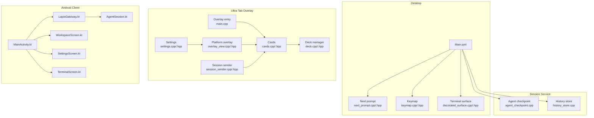
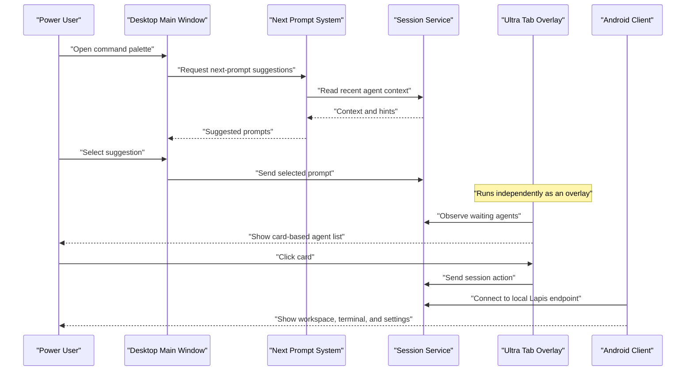
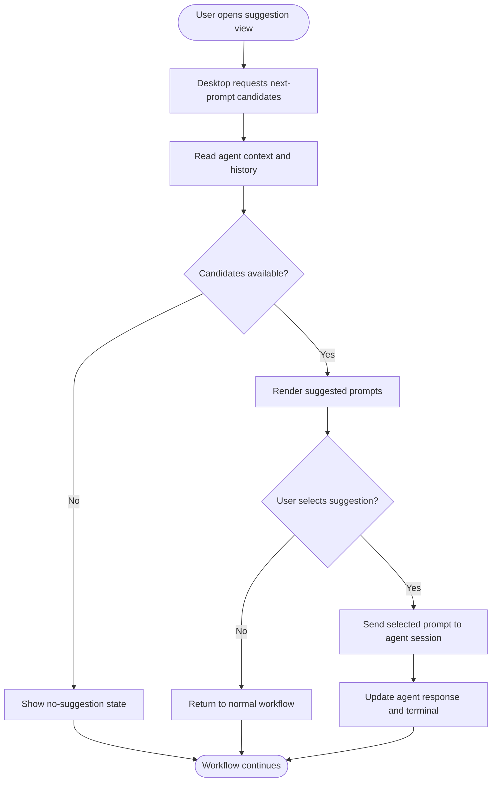
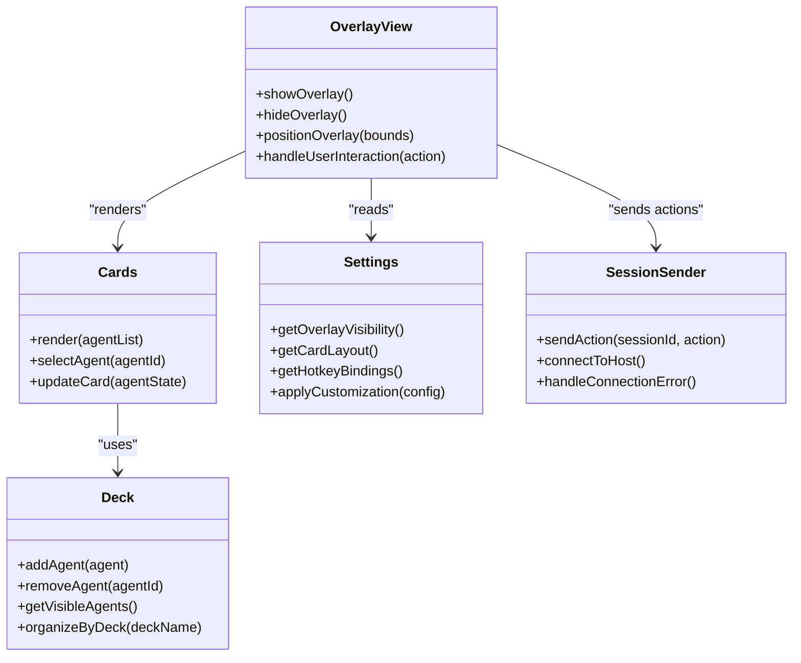
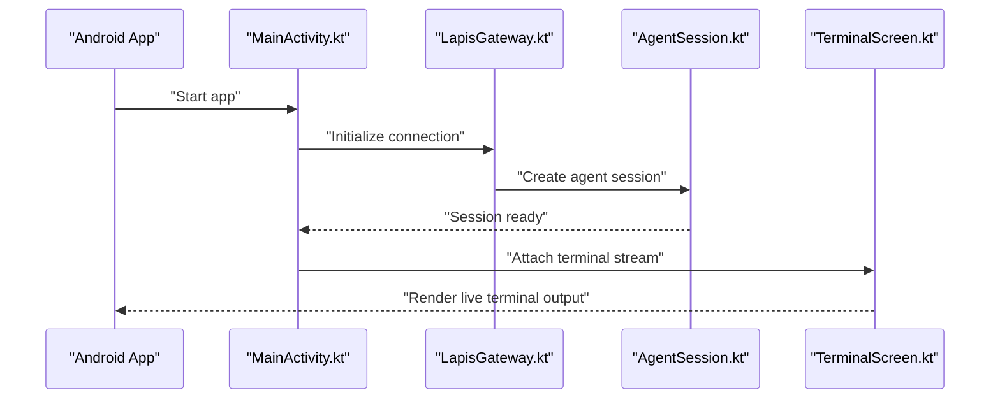
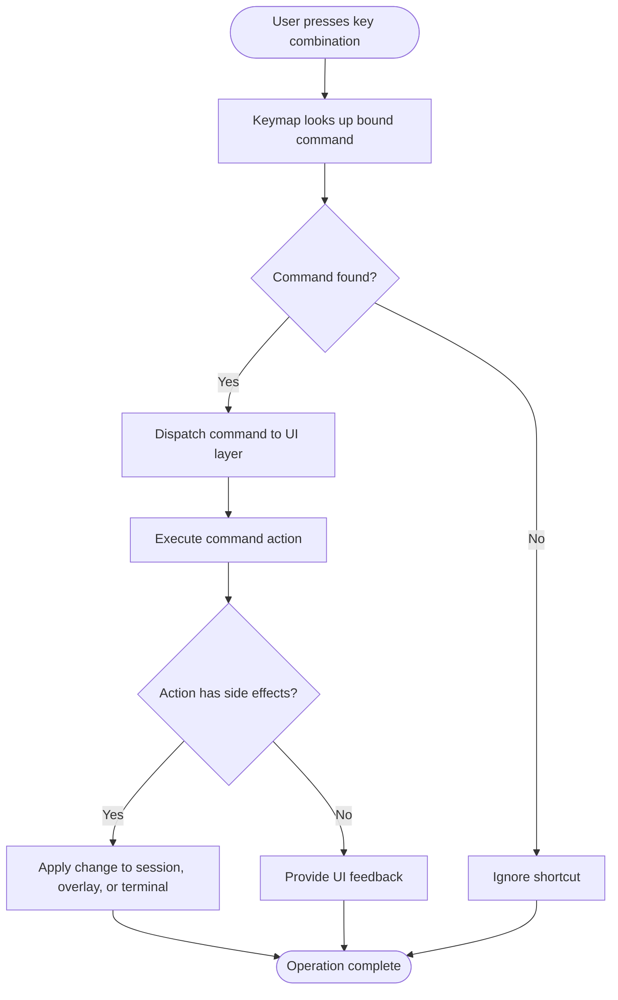
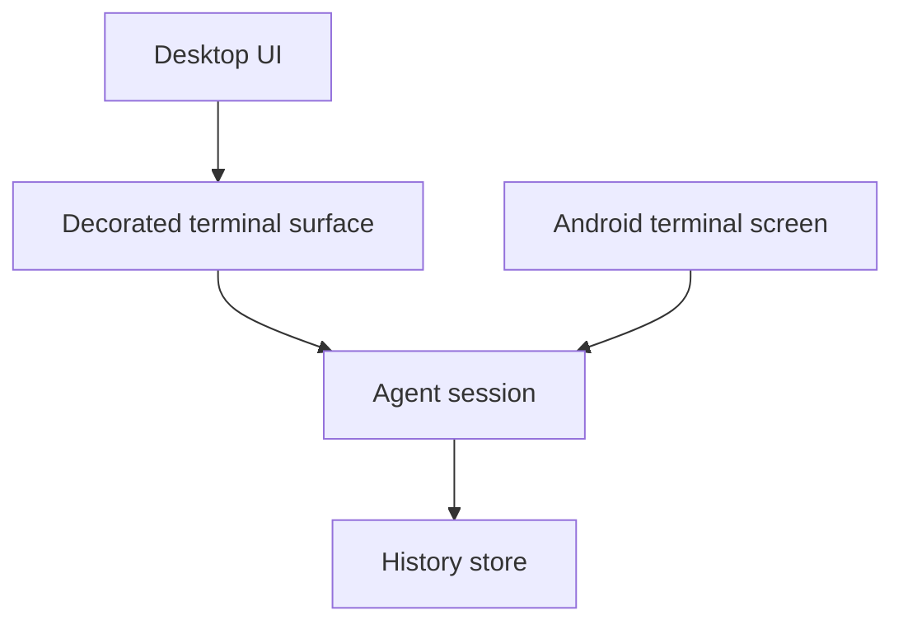
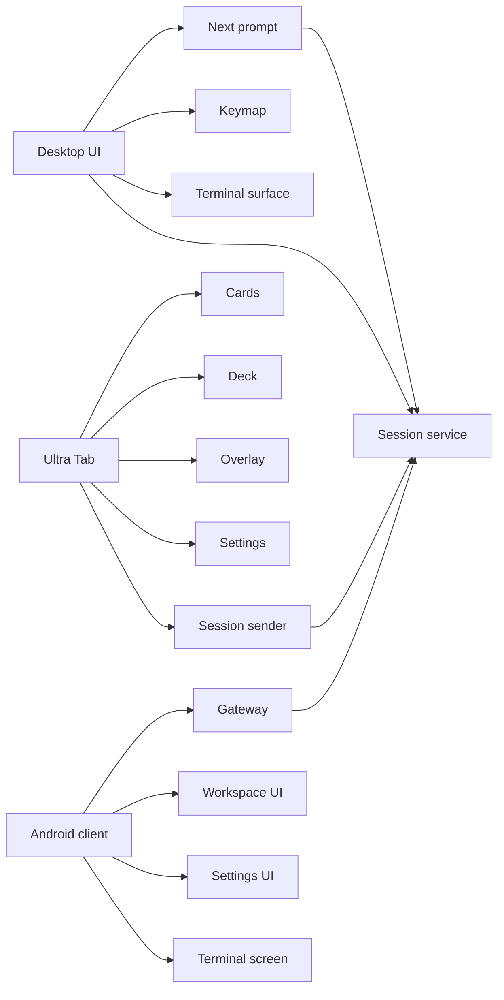

# Advanced Features

<cite>
**Referenced Files in This Document**
- [README.md](file://README.md)
- [suggestions.md](file://docs/suggestions.md)
- [ultratab.md](file://docs/ultratab.md)
- [phone.md](file://docs/phone.md)
- [keys.md](file://docs/keys.md)
- [config.md](file://docs/config.md)
- [apps/desktop/src/next_prompt.cpp](file://apps/desktop/src/next_prompt.cpp)
- [apps/desktop/src/next_prompt.hpp](file://apps/desktop/src/next_prompt.hpp)
- [apps/desktop/src/keymap.cpp](file://apps/desktop/src/keymap.cpp)
- [apps/desktop/src/keymap.hpp](file://apps/desktop/src/keymap.hpp)
- [apps/desktop/src/decorated_surface.cpp](file://apps/desktop/src/decorated_surface.cpp)
- [apps/desktop/src/decorated_surface.hpp](file://apps/desktop/src/decorated_surface.hpp)
- [apps/desktop/qml/Main.qml](file://apps/desktop/qml/Main.qml)
- [apps/desktop/qml/Commands.qml](file://apps/desktop/qml/Commands.qml)
- [apps/desktop/qml/Search.qml](file://apps/desktop/qml/Search.qml)
- [apps/desktop/qml/Tools.qml](file://apps/desktop/qml/Tools.qml)
- [apps/desktop/qml/Settings.qml](file://apps/desktop/qml/Settings.qml)
- [apps/ultratab/src/main.cpp](file://apps/ultratab/src/main.cpp)
- [apps/ultratab/src/cards.cpp](file://apps/ultratab/src/cards.cpp)
- [apps/ultratab/src/cards.hpp](file://apps/ultratab/src/cards.hpp)
- [apps/ultratab/src/deck.cpp](file://apps/ultratab/src/deck.cpp)
- [apps/ultratab/src/deck.hpp](file://apps/ultratab/src/deck.hpp)
- [apps/ultratab/src/overlay_view.cpp](file://apps/ultratab/src/overlay_view.cpp)
- [apps/ultratab/src/overlay_view.hpp](file://apps/ultratab/src/overlay_view.hpp)
- [apps/ultratab/src/settings.cpp](file://apps/ultratab/src/settings.cpp)
- [apps/ultratab/src/settings.hpp](file://apps/ultratab/src/settings.hpp)
- [apps/ultratab/src/session_sender.cpp](file://apps/ultratab/src/session_sender.cpp)
- [apps/ultratab/src/session_sender.hpp](file://apps/ultratab/src/session_sender.hpp)
- [apps/android/app/src/main/kotlin/dev/lapis/remote/ui/MainActivity.kt](file://apps/android/app/src/main/kotlin/dev/lapis/remote/ui/MainActivity.kt)
- [apps/android/app/src/main/kotlin/dev/lapis/remote/gateway/LapisGateway.kt](file://apps/android/app/src/main/kotlin/dev/lapis/remote/gateway/LapisGateway.kt)
- [apps/android/app/src/main/kotlin/dev/lapis/remote/session/AgentSession.kt](file://apps/android/app/src/main/kotlin/dev/lapis/remote/session/AgentSession.kt)
- [apps/android/app/src/main/kotlin/dev/lapis/remote/ui/WorkspaceScreen.kt](file://apps/android/app/src/main/kotlin/dev/lapis/remote/ui/WorkspaceScreen.kt)
- [apps/android/app/src/main/kotlin/dev/lapis/remote/ui/SettingsScreen.kt](file://apps/android/app/src/main/kotlin/dev/lapis/remote/ui/SettingsScreen.kt)
- [apps/android/app/src/main/kotlin/dev/lapis/remote/terminal/TerminalScreen.kt](file://apps/android/app/src/main/kotlin/dev/lapis/remote/terminal/TerminalScreen.kt)
- [apps/android/app/src/main/AndroidManifest.xml](file://apps/android/app/src/main/AndroidManifest.xml)
- [services/session/src/agent_checkpoint.cpp](file://services/session/src/agent_checkpoint.cpp)
- [services/session/src/history_store.cpp](file://services/session/src/history_store.cpp)
</cite>

## Table of Contents
1. [Introduction](#introduction)
2. [Project Structure](#project-structure)
3. [Core Components](#core-components)
4. [Architecture Overview](#architecture-overview)
5. [Detailed Component Analysis](#detailed-component-analysis)
6. [Dependency Analysis](#dependency-analysis)
7. [Performance Considerations](#performance-considerations)
8. [Troubleshooting Guide](#troubleshooting-guide)
9. [Conclusion](#conclusion)
10. [Appendices](#appendices)

## Introduction
This document explains Lapis power-user capabilities that extend beyond basic agent interaction. It focuses on:

- Next-prompt suggestions for interpreting and integrating AI-generated prompts into your workflow.
- Ultra Tab overlay for card-based visibility of waiting agents, deck management, and overlay customization.
- Phone-based remote access through the Android client, including connection to local agents and mobile workflow optimization.
- Custom keybinding configuration, advanced terminal features, and debugging tools.
- Productivity tips for combining these features.
- Platform-specific considerations for iOS preview targets and Android device compatibility.

The goal is to help experienced users build sophisticated development workflows while keeping Lapis responsive, observable, and portable across desktop and mobile platforms.

**Section sources**
- [README.md:1-80](file://README.md#L1-L80)

## Project Structure
The advanced features are implemented across several apps and services:

| Area | Primary Location | Responsibility |
|---|---|---|
| Desktop UI and next-prompt integration | `apps/desktop` | Agent sessions, command palette, search, settings, next-prompt handling, keymaps, terminal surfaces |
| Ultra Tab overlay | `apps/ultratab` | Card display, deck management, platform overlay, session sending |
| Android remote client | `apps/android` | Remote gateway, workspace navigation, terminal screen, settings |
| Session service | `services/session` | Agent checkpoints, history store, transport protocols |
| Documentation | `docs` | User-facing feature guides |

**Diagram sources**
- [apps/desktop/qml/Main.qml:1-120](file://apps/desktop/qml/Main.qml#L1-L120)
- [apps/desktop/src/next_prompt.cpp:1-120](file://apps/desktop/src/next_prompt.cpp#L1-L120)
- [apps/desktop/src/keymap.cpp:1-120](file://apps/desktop/src/keymap.cpp#L1-L120)
- [apps/desktop/src/decorated_surface.cpp:1-120](file://apps/desktop/src/decorated_surface.cpp#L1-L120)
- [apps/ultratab/src/main.cpp:1-120](file://apps/ultratab/src/main.cpp#L1-L120)
- [apps/ultratab/src/cards.cpp:1-120](file://apps/ultratab/src/cards.cpp#L1-L120)
- [apps/ultratab/src/deck.cpp:1-120](file://apps/ultratab/src/deck.cpp#L1-L120)
- [apps/ultratab/src/overlay_view.cpp:1-120](file://apps/ultratab/src/overlay_view.cpp#L1-L120)
- [apps/ultratab/src/settings.cpp:1-120](file://apps/ultratab/src/settings.cpp#L1-L120)
- [apps/ultratab/src/session_sender.cpp:1-120](file://apps/ultratab/src/session_sender.cpp#L1-L120)
- [apps/android/app/src/main/kotlin/dev/lapis/remote/ui/MainActivity.kt:1-120](file://apps/android/app/src/main/kotlin/dev/lapis/remote/ui/MainActivity.kt#L1-L120)
- [apps/android/app/src/main/kotlin/dev/lapis/remote/gateway/LapisGateway.kt:1-120](file://apps/android/app/src/main/kotlin/dev/lapis/remote/gateway/LapisGateway.kt#L1-L120)
- [apps/android/app/src/main/kotlin/dev/lapis/remote/session/AgentSession.kt:1-120](file://apps/android/app/src/main/kotlin/dev/lapis/remote/session/AgentSession.kt#L1-L120)
- [apps/android/app/src/main/kotlin/dev/lapis/remote/ui/WorkspaceScreen.kt:1-120](file://apps/android/app/src/main/kotlin/dev/lapis/remote/ui/WorkspaceScreen.kt#L1-L120)
- [apps/android/app/src/main/kotlin/dev/lapis/remote/ui/SettingsScreen.kt:1-120](file://apps/android/app/src/main/kotlin/dev/lapis/remote/ui/SettingsScreen.kt#L1-L120)
- [apps/android/app/src/main/kotlin/dev/lapis/remote/terminal/TerminalScreen.kt:1-120](file://apps/android/app/src/main/kotlin/dev/lapis/remote/terminal/TerminalScreen.kt#L1-L120)
- [services/session/src/agent_checkpoint.cpp:1-120](file://services/session/src/agent_checkpoint.cpp#L1-L120)
- [services/session/src/history_store.cpp:1-120](file://services/session/src/history_store.cpp#L1-L120)

**Section sources**
- [apps/desktop/qml/Main.qml:1-120](file://apps/desktop/qml/Main.qml#L1-L120)
- [apps/ultratab/src/main.cpp:1-120](file://apps/ultratab/src/main.cpp#L1-L120)
- [apps/android/app/src/main/kotlin/dev/lapis/remote/ui/MainActivity.kt:1-120](file://apps/android/app/src/main/kotlin/dev/lapis/remote/ui/MainActivity.kt#L1-L120)
- [services/session/src/agent_checkpoint.cpp:1-120](file://services/session/src/agent_checkpoint.cpp#L1-L120)

## Core Components
The advanced features share a common pattern: user actions trigger application components that interact with agent sessions, overlays, or remote transports. The most important components for power users are:

- **Next-prompt suggestion system**: Generates candidate follow-up prompts from recent agent context and exposes them through the desktop interface.
- **Ultra Tab overlay**: Renders waiting agents as cards, manages decks, and communicates with sessions without taking focus away from the active application.
- **Android remote client**: Connects to a local Lapis instance, navigates workspaces, runs sessions, and renders a mobile-friendly terminal.
- **Custom keybindings**: Map keyboard shortcuts to Lapis commands, including navigation, session control, and tool invocation.
- **Advanced terminal and debugging surfaces**: Provide terminal rendering, inspection, and diagnostic information useful for troubleshooting and performance tuning.

These components are configured and extended through desktop QML views, C++ implementation modules, Kotlin screens, and shared session services.

**Section sources**
- [apps/desktop/src/next_prompt.cpp:1-120](file://apps/desktop/src/next_prompt.cpp#L1-L120)
- [apps/desktop/src/next_prompt.hpp:1-120](file://apps/desktop/src/next_prompt.hpp#L1-L120)
- [apps/ultratab/src/cards.cpp:1-120](file://apps/ultratab/src/cards.cpp#L1-L120)
- [apps/ultratab/src/deck.cpp:1-120](file://apps/ultratab/src/deck.cpp#L1-L120)
- [apps/android/app/src/main/kotlin/dev/lapis/remote/gateway/LapisGateway.kt:1-120](file://apps/android/app/src/main/kotlin/dev/lapis/remote/gateway/LapisGateway.kt#L1-L120)
- [apps/desktop/src/keymap.cpp:1-120](file://apps/desktop/src/keymap.cpp#L1-L120)
- [apps/desktop/src/decorated_surface.cpp:1-120](file://apps/desktop/src/decorated_surface.cpp#L1-L120)

## Architecture Overview
The advanced features form three interacting subsystems:

1. **Desktop workflow subsystem**: The main desktop window hosts command, search, tools, and settings panels. It integrates next-prompt suggestions and keybindings into the normal agent editing flow.
2. **Ultra Tab overlay subsystem**: A lightweight overlay process reads waiting-agent state, displays cards, supports deck organization, and sends session actions back to the host Lapis instance.
3. **Remote mobile subsystem**: The Android app connects over a local network or Unix-style endpoint to the same Lapis session service, exposing workspace browsing, terminal output, and settings.

**Diagram sources**
- [apps/desktop/qml/Main.qml:1-120](file://apps/desktop/qml/Main.qml#L1-L120)
- [apps/desktop/src/next_prompt.cpp:1-120](file://apps/desktop/src/next_prompt.cpp#L1-L120)
- [apps/ultratab/src/main.cpp:1-120](file://apps/ultratab/src/main.cpp#L1-L120)
- [apps/ultratab/src/session_sender.cpp:1-120](file://apps/ultratab/src/session_sender.cpp#L1-L120)
- [apps/android/app/src/main/kotlin/dev/lapis/remote/gateway/LapisGateway.kt:1-120](file://apps/android/app/src/main/kotlin/dev/lapis/remote/gateway/LapisGateway.kt#L1-L120)
- [services/session/src/agent_checkpoint.cpp:1-120](file://services/session/src/agent_checkpoint.cpp#L1-L120)

## Detailed Component Analysis

### Next-Prompt Suggestions
Next-prompt suggestions let you turn recent agent activity into actionable follow-ups. The desktop implementation includes both a C++ backend and QML interfaces.

#### How It Works
1. The desktop main window requests next-prompt suggestions.
2. The next-prompt component queries recent session context.
3. Candidate prompts are presented in the UI.
4. Selecting a suggestion sends it to the active agent session.

**Diagram sources**
- [apps/desktop/src/next_prompt.cpp:1-120](file://apps/desktop/src/next_prompt.cpp#L1-L120)
- [apps/desktop/src/next_prompt.hpp:1-120](file://apps/desktop/src/next_prompt.hpp#L1-L120)
- [apps/desktop/qml/Main.qml:1-120](file://apps/desktop/qml/Main.qml#L1-L120)
- [services/session/src/history_store.cpp:1-120](file://services/session/src/history_store.cpp#L1-L120)

#### Enabling Experimental Features
Next-prompt behavior may be controlled by experimental toggles. Power users should:

- Open Settings to locate experimental options related to next prompts.
- Enable only one experimental flag at a time during testing.
- Observe whether suggestions appear, improve relevance, or affect performance.
- Disable flags if they introduce instability or unexpected behavior.

Relevant documentation covers suggestions and configuration; consult those guides when evaluating experimental behavior.

**Section sources**
- [docs/suggestions.md:1-200](file://docs/suggestions.md#L1-L200)
- [apps/desktop/qml/Settings.qml:1-200](file://apps/desktop/qml/Settings.qml#L1-L200)
- [docs/config.md:1-200](file://docs/config.md#L1-L200)

#### Interpreting AI-Generated Prompts
Treat generated prompts as hypotheses rather than commands:

- Read the full suggestion before executing it.
- Check whether the suggestion assumes files, tools, or environment variables present in your current workspace.
- Use the terminal or tools panel to verify assumptions.
- Prefer small, incremental suggestions for complex tasks.
- Keep a mental model of which agent is responding so you do not mix unrelated prompts.

#### Integrating Suggestions Into Workflows
Useful patterns include:

- **Review then refine**: Accept a suggestion, edit it in the input area, then send it.
- **Task decomposition**: Ask the agent to produce a sequence of focused prompts, then execute them one by one.
- **Cross-session consistency**: Use similar suggestion wording across related projects to keep agent behavior predictable.
- **Audit trail**: When working with sensitive code, review the exact text sent to the agent before execution.

**Section sources**
- [apps/desktop/src/next_prompt.cpp:1-120](file://apps/desktop/src/next_prompt.cpp#L1-L120)
- [apps/desktop/qml/Main.qml:1-120](file://apps/desktop/qml/Main.qml#L1-L120)
- [services/session/src/agent_checkpoint.cpp:1-120](file://services/session/src/agent_checkpoint.cpp#L1-L120)

### Ultra Tab Overlay
Ultra Tab provides a floating, card-based interface for waiting agents. It is especially useful when you want to monitor multiple agents without switching focus from your primary editor or browser.

#### Overlay Functionality
- Displays waiting agents as cards with enough context to choose the right agent.
- Lets you interact with agents through the overlay instead of opening the full desktop window.
- Keeps the overlay lightweight and non-blocking.

**Diagram sources**
- [apps/ultratab/src/cards.cpp:1-120](file://apps/ultratab/src/cards.cpp#L1-L120)
- [apps/ultratab/src/cards.hpp:1-120](file://apps/ultratab/src/cards.hpp#L1-L120)
- [apps/ultratab/src/deck.cpp:1-120](file://apps/ultratab/src/deck.cpp#L1-L120)
- [apps/ultratab/src/deck.hpp:1-120](file://apps/ultratab/src/deck.hpp#L1-L120)
- [apps/ultratab/src/overlay_view.cpp:1-120](file://apps/ultratab/src/overlay_view.cpp#L1-L120)
- [apps/ultratab/src/overlay_view.hpp:1-120](file://apps/ultratab/src/overlay_view.hpp#L1-L120)
- [apps/ultratab/src/settings.cpp:1-120](file://apps/ultratab/src/settings.cpp#L1-L120)
- [apps/ultratab/src/settings.hpp:1-120](file://apps/ultratab/src/settings.hpp#L1-L120)
- [apps/ultratab/src/session_sender.cpp:1-120](file://apps/ultratab/src/session_sender.cpp#L1-L120)
- [apps/ultratab/src/session_sender.hpp:1-120](file://apps/ultratab/src/session_sender.hpp#L1-L120)

#### Deck Management
Decks organize agents into logical groups. Typical usage includes:

- Creating separate decks for different projects, review tasks, or experiment branches.
- Keeping long-running agents in one deck and short-lived helpers in another.
- Using consistent naming so you can quickly scan cards.
- Avoiding too many agents per deck; split large sets into focused groups.

Deck operations generally include adding agents, removing finished agents, and organizing visible agents by deck name.

**Section sources**
- [apps/ultratab/src/deck.cpp:1-120](file://apps/ultratab/src/deck.cpp#L1-L120)
- [apps/ultratab/src/deck.hpp:1-120](file://apps/ultratab/src/deck.hpp#L1-L120)
- [docs/ultratab.md:1-200](file://docs/ultratab.md#L1-L200)

#### Overlay Customization
Power users can adjust how Ultra Tab appears and behaves:

- Control overlay visibility and placement.
- Customize card layout for readability.
- Configure hotkeys for quick overlay toggling.
- Tune responsiveness by limiting the number of simultaneously observed agents.

Settings are read by the overlay layer and applied when the overlay is shown or reconfigured.

**Section sources**
- [apps/ultratab/src/settings.cpp:1-120](file://apps/ultratab/src/settings.cpp#L1-L120)
- [apps/ultratab/src/settings.hpp:1-120](file://apps/ultratab/src/settings.hpp#L1-L120)
- [apps/ultratab/src/overlay_view.cpp:1-120](file://apps/ultratab/src/overlay_view.cpp#L1-L120)
- [docs/ultratab.md:1-200](file://docs/ultratab.md#L1-L200)

### Phone-Based Remote Access
The Android client lets you monitor and interact with Lapis agents from a phone. It connects to a local Lapis instance and presents workspace browsing, session status, and terminal output.

#### Android Client Setup
Typical setup steps:

1. Install the Lapis Android app from the project’s Android build artifacts.
2. Run Lapis on your computer so the session service is listening.
3. Ensure your phone can reach the computer over the local network or appropriate transport.
4. Open the Android app and configure the connection endpoint.
5. Verify that the workspace list and agent status appear.

Important platform considerations include network permissions, local endpoint discovery, and the ability of the Android device to connect to the host machine where Lapis runs.

**Section sources**
- [apps/android/app/src/main/AndroidManifest.xml:1-200](file://apps/android/app/src/main/AndroidManifest.xml#L1-L200)
- [docs/phone.md:1-200](file://docs/phone.md#L1-L200)

#### Connection to Local Agents
The Android client uses a gateway abstraction to communicate with Lapis. The typical flow is:

**Diagram sources**
- [apps/android/app/src/main/kotlin/dev/lapis/remote/ui/MainActivity.kt:1-120](file://apps/android/app/src/main/kotlin/dev/lapis/remote/ui/MainActivity.kt#L1-L120)
- [apps/android/app/src/main/kotlin/dev/lapis/remote/gateway/LapisGateway.kt:1-120](file://apps/android/app/src/main/kotlin/dev/lapis/remote/gateway/LapisGateway.kt#L1-L120)
- [apps/android/app/src/main/kotlin/dev/lapis/remote/session/AgentSession.kt:1-120](file://apps/android/app/src/main/kotlin/dev/lapis/remote/session/AgentSession.kt#L1-L120)
- [apps/android/app/src/main/kotlin/dev/lapis/remote/terminal/TerminalScreen.kt:1-120](file://apps/android/app/src/main/kotlin/dev/lapis/remote/terminal/TerminalScreen.kt#L1-L120)

#### Mobile Workflow Optimization
For productive phone use:

- Keep the workspace narrow: select only the relevant project folder.
- Use clear agent names and decks so you can identify agents on a small screen.
- Reserve the phone for monitoring and light interactions; perform heavy edits on the desktop.
- Watch terminal output for errors but avoid scrolling endlessly; filter or pause streams when possible.
- Combine Ultra Tab on desktop with the Android client for dual-screen oversight.

**Section sources**
- [apps/android/app/src/main/kotlin/dev/lapis/remote/ui/WorkspaceScreen.kt:1-120](file://apps/android/app/src/main/kotlin/dev/lapis/remote/ui/WorkspaceScreen.kt#L1-L120)
- [apps/android/app/src/main/kotlin/dev/lapis/remote/ui/SettingsScreen.kt:1-120](file://apps/android/app/src/main/kotlin/dev/lapis/remote/ui/SettingsScreen.kt#L1-L120)
- [apps/android/app/src/main/kotlin/dev/lapis/remote/terminal/TerminalScreen.kt:1-120](file://apps/android/app/src/main/kotlin/dev/lapis/remote/terminal/TerminalScreen.kt#L1-L120)
- [docs/phone.md:1-200](file://docs/phone.md#L1-L200)

### Custom Keybinding Configuration
Lapis supports custom keybindings that map keyboard shortcuts to commands. This is essential for fast navigation, session control, and tool activation without reaching for the mouse.

#### Keybinding Model
Keybindings are defined in the desktop keymap layer and consumed by the UI. They typically support:

- Global shortcuts for overlay toggling.
- Command shortcuts for opening the command palette, search, tools, and settings.
- Session-specific shortcuts for stopping agents, focusing terminals, or navigating between agents.

**Diagram sources**
- [apps/desktop/src/keymap.cpp:1-120](file://apps/desktop/src/keymap.cpp#L1-L120)
- [apps/desktop/src/keymap.hpp:1-120](file://apps/desktop/src/keymap.hpp#L1-L120)
- [apps/desktop/qml/Commands.qml:1-200](file://apps/desktop/qml/Commands.qml#L1-L200)
- [apps/desktop/qml/Search.qml:1-200](file://apps/desktop/qml/Search.qml#L1-L200)
- [apps/desktop/qml/Tools.qml:1-200](file://apps/desktop/qml/Tools.qml#L1-L200)

#### Recommended Keybinding Patterns
- Assign one modifier-heavy global shortcut to toggle Ultra Tab.
- Bind a dedicated key to open the command palette.
- Use distinct prefixes for navigation, session control, and terminal actions.
- Avoid conflicting with your editor’s native shortcuts.
- Test bindings in isolation before building complex multi-step workflows.

**Section sources**
- [apps/desktop/src/keymap.cpp:1-120](file://apps/desktop/src/keymap.cpp#L1-L120)
- [apps/desktop/src/keymap.hpp:1-120](file://apps/desktop/src/keymap.hpp#L1-L120)
- [docs/keys.md:1-200](file://docs/keys.md#L1-L200)

### Advanced Terminal Features
The desktop terminal surface and Android terminal screen provide rich terminal rendering and interaction. For advanced users, these surfaces are valuable for debugging agent behavior, inspecting command output, and diagnosing performance issues.

Key capabilities include:

- Live terminal rendering for agent-driven commands.
- Terminal-focused navigation through the desktop UI.
- Remote terminal streaming through the Android client.
- Inspection of agent checkpoints and history for understanding agent state transitions.

**Diagram sources**
- [apps/desktop/src/decorated_surface.cpp:1-120](file://apps/desktop/src/decorated_surface.cpp#L1-L120)
- [apps/desktop/src/decorated_surface.hpp:1-120](file://apps/desktop/src/decorated_surface.hpp#L1-L120)
- [apps/android/app/src/main/kotlin/dev/lapis/remote/terminal/TerminalScreen.kt:1-120](file://apps/android/app/src/main/kotlin/dev/lapis/remote/terminal/TerminalScreen.kt#L1-L120)
- [services/session/src/history_store.cpp:1-120](file://services/session/src/history_store.cpp#L1-L120)

**Section sources**
- [apps/desktop/src/decorated_surface.cpp:1-120](file://apps/desktop/src/decorated_surface.cpp#L1-L120)
- [apps/desktop/src/decorated_surface.hpp:1-120](file://apps/desktop/src/decorated_surface.hpp#L1-L120)
- [apps/android/app/src/main/kotlin/dev/lapis/remote/terminal/TerminalScreen.kt:1-120](file://apps/android/app/src/main/kotlin/dev/lapis/remote/terminal/TerminalScreen.kt#L1-L120)
- [services/session/src/history_store.cpp:1-120](file://services/session/src/history_store.cpp#L1-L120)

### Debugging Tools
Debugging Lapis involves observing sessions, overlays, and remote connections. Useful approaches include:

- Use the command palette to open diagnostics or tool panels.
- Inspect agent checkpoints to understand session state changes.
- Review terminal output for error messages, timeouts, or adapter failures.
- Check Ultra Tab overlay behavior when agents appear stuck or disappear unexpectedly.
- Validate Android connectivity using workspace listing and terminal output.

When debugging remote access, confirm that the Android client can reach the Lapis endpoint and that workspace listings reflect the expected environment.

**Section sources**
- [apps/desktop/qml/Tools.qml:1-200](file://apps/desktop/qml/Tools.qml#L1-L200)
- [apps/desktop/qml/Settings.qml:1-200](file://apps/desktop/qml/Settings.qml#L1-L200)
- [services/session/src/agent_checkpoint.cpp:1-120](file://services/session/src/agent_checkpoint.cpp#L1-L120)
- [apps/android/app/src/main/kotlin/dev/lapis/remote/ui/WorkspaceScreen.kt:1-120](file://apps/android/app/src/main/kotlin/dev/lapis/remote/ui/WorkspaceScreen.kt#L1-L120)

### Platform-Specific Considerations

#### iOS Preview Targets
The repository includes an iOS application structure and an Ultra Tab target for iOS. iOS preview and deployment involve platform-specific assets, Info.plist configuration, and Xcode project settings. Power users should:

- Build and run the iOS target using the provided project configuration.
- Verify preview behavior against the iOS simulator first.
- Confirm that Ultra Tab assets and overlays are included for the intended iOS target.
- Treat iOS preview as complementary to desktop and Android workflows rather than a replacement.

**Section sources**
- [apps/ios/project.yml:1-200](file://apps/ios/project.yml#L1-L200)
- [apps/ios/UltraTab/Info.plist:1-200](file://apps/ios/UltraTab/Info.plist#L1-L200)

#### Android Device Compatibility
Android compatibility depends on device version, network permissions, and transport support. Recommendations include:

- Test on a physical Android device when possible.
- Confirm that the device can resolve or connect to the host Lapis endpoint.
- Verify that required permissions are granted for networking.
- Check terminal rendering on devices with different screen densities and orientations.
- Fall back to simpler workflows if the terminal stream is slow or unstable.

**Section sources**
- [apps/android/app/src/main/AndroidManifest.xml:1-200](file://apps/android/app/src/main/AndroidManifest.xml#L1-L200)
- [docs/phone.md:1-200](file://docs/phone.md#L1-L200)

## Dependency Analysis
The advanced features have clear dependency boundaries:

- Desktop UI depends on next-prompt logic, keymap resolution, terminal surface rendering, and session state.
- Ultra Tab depends on card rendering, deck organization, overlay presentation, settings, and session communication.
- Android depends on the gateway abstraction, agent session lifecycle, workspace UI, settings UI, and terminal screen.
- All remote-facing components depend on the session service for agent checkpoints and history.

**Diagram sources**
- [apps/desktop/qml/Main.qml:1-120](file://apps/desktop/qml/Main.qml#L1-L120)
- [apps/desktop/src/next_prompt.cpp:1-120](file://apps/desktop/src/next_prompt.cpp#L1-L120)
- [apps/desktop/src/keymap.cpp:1-120](file://apps/desktop/src/keymap.cpp#L1-L120)
- [apps/desktop/src/decorated_surface.cpp:1-120](file://apps/desktop/src/decorated_surface.cpp#L1-L120)
- [apps/ultratab/src/cards.cpp:1-120](file://apps/ultratab/src/cards.cpp#L1-L120)
- [apps/ultratab/src/deck.cpp:1-120](file://apps/ultratab/src/deck.cpp#L1-L120)
- [apps/ultratab/src/overlay_view.cpp:1-120](file://apps/ultratab/src/overlay_view.cpp#L1-L120)
- [apps/ultratab/src/settings.cpp:1-120](file://apps/ultratab/src/settings.cpp#L1-L120)
- [apps/ultratab/src/session_sender.cpp:1-120](file://apps/ultratab/src/session_sender.cpp#L1-L120)
- [apps/android/app/src/main/kotlin/dev/lapis/remote/gateway/LapisGateway.kt:1-120](file://apps/android/app/src/main/kotlin/dev/lapis/remote/gateway/LapisGateway.kt#L1-L120)
- [apps/android/app/src/main/kotlin/dev/lapis/remote/ui/WorkspaceScreen.kt:1-120](file://apps/android/app/src/main/kotlin/dev/lapis/remote/ui/WorkspaceScreen.kt#L1-L120)
- [apps/android/app/src/main/kotlin/dev/lapis/remote/ui/SettingsScreen.kt:1-120](file://apps/android/app/src/main/kotlin/dev/lapis/remote/ui/SettingsScreen.kt#L1-L120)
- [apps/android/app/src/main/kotlin/dev/lapis/remote/terminal/TerminalScreen.kt:1-120](file://apps/android/app/src/main/kotlin/dev/lapis/remote/terminal/TerminalScreen.kt#L1-L120)
- [services/session/src/agent_checkpoint.cpp:1-120](file://services/session/src/agent_checkpoint.cpp#L1-L120)

**Section sources**
- [apps/desktop/src/next_prompt.cpp:1-120](file://apps/desktop/src/next_prompt.cpp#L1-L120)
- [apps/ultratab/src/session_sender.cpp:1-120](file://apps/ultratab/src/session_sender.cpp#L1-L120)
- [apps/android/app/src/main/kotlin/dev/lapis/remote/gateway/LapisGateway.kt:1-120](file://apps/android/app/src/main/kotlin/dev/lapis/remote/gateway/LapisGateway.kt#L1-L120)
- [services/session/src/agent_checkpoint.cpp:1-120](file://services/session/src/agent_checkpoint.cpp#L1-L120)

## Performance Considerations
Power-user features can increase CPU, memory, and network usage. Follow these guidelines:

- Limit the number of active agents observed by Ultra Tab.
- Avoid enabling multiple experimental features simultaneously.
- Keep terminal streams paused or filtered when not actively reviewing output.
- Use focused decks rather than one large agent list.
- Monitor Android terminal latency and reduce unnecessary scrolling.
- Test performance changes incrementally after adjusting keybindings, overlays, or suggestions.

[No sources needed since this section provides general guidance]

## Troubleshooting Guide

| Symptom | Likely Cause | Resolution |
|---|---|---|
| Next-prompt suggestions do not appear | No recent agent context or experimental feature disabled | Run an agent task, check settings, and enable the relevant experimental option temporarily. |
| Suggestions look irrelevant | Context comes from an unrelated workspace or agent | Switch to the correct workspace and agent, then retry. |
| Ultra Tab does not show agents | Overlay settings hide cards or connection fails | Check overlay visibility, card layout, and session sender connection. |
| Ultra Tab cards disappear | Agents finish or deck filtering removes them | Review deck organization and agent lifecycle. |
| Android cannot connect to Lapis | Network permission, endpoint misconfiguration, or host unreachable | Verify permissions, endpoint address, and host accessibility. |
| Android terminal is empty or frozen | Stream disconnected or terminal rendering issue | Reattach the terminal, restart the session, or switch to desktop terminal inspection. |
| Keybindings do nothing | Shortcut conflict or missing binding | Review keymap configuration and test the shortcut in isolation. |
| iOS preview fails | Target configuration or asset issue | Check iOS project configuration and Ultra Tab iOS assets. |

**Section sources**
- [apps/desktop/src/next_prompt.cpp:1-120](file://apps/desktop/src/next_prompt.cpp#L1-L120)
- [apps/desktop/src/keymap.cpp:1-120](file://apps/desktop/src/keymap.cpp#L1-L120)
- [apps/ultratab/src/settings.cpp:1-120](file://apps/ultratab/src/settings.cpp#L1-L120)
- [apps/ultratab/src/session_sender.cpp:1-120](file://apps/ultratab/src/session_sender.cpp#L1-L120)
- [apps/android/app/src/main/kotlin/dev/lapis/remote/gateway/LapisGateway.kt:1-120](file://apps/android/app/src/main/kotlin/dev/lapis/remote/gateway/LapisGateway.kt#L1-L120)
- [apps/android/app/src/main/kotlin/dev/lapis/remote/terminal/TerminalScreen.kt:1-120](file://apps/android/app/src/main/kotlin/dev/lapis/remote/terminal/TerminalScreen.kt#L1-L120)
- [apps/ios/project.yml:1-200](file://apps/ios/project.yml#L1-L200)

## Conclusion
Lapis’s advanced features are designed for users who want precise control over agent prompts, agent visibility, remote access, keyboard workflows, and terminal inspection. The most effective power-user setups combine:

- Carefully interpreted next-prompt suggestions.
- Ultra Tab for non-intrusive agent monitoring.
- Android for mobile oversight and lightweight interaction.
- Consistent keybindings for fast navigation.
- Terminal and debugging surfaces for observability.

By configuring these components thoughtfully and testing changes incrementally, you can build a responsive, portable, and sophisticated development workflow across desktop and mobile platforms.

[No sources needed since this section summarizes without analyzing specific files]

## Appendices

### Quick Power-User Checklist
- Enable and test next-prompt suggestions in isolated mode.
- Organize agents into focused Ultra Tab decks.
- Assign a global shortcut for Ultra Tab toggling.
- Connect the Android client and verify workspace listing.
- Review terminal output for errors during agent tasks.
- Validate iOS preview using the project’s iOS target.

[No sources needed since this section provides general guidance]