# Agent Management

<cite>
**Referenced Files in This Document**   
- [README.md](file://README.md)
- [agents.md](file://docs/agents.md)
- [config.md](file://docs/config.md)
- [lapis.json](file://lapis.json)
- [harness_catalog.hpp](file://apps/desktop/src/harness_catalog.hpp)
- [harness_catalog.cpp](file://apps/desktop/src/harness_catalog.cpp)
- [harness_models.hpp](file://apps/desktop/src/harness_models.hpp)
- [harness_models.cpp](file://apps/desktop/src/harness_models.cpp)
- [agent_state.hpp](file://apps/desktop/src/agent_state.hpp)
- [agent_state.cpp](file://apps/desktop/src/agent_state.cpp)
- [live_connection.hpp](file://apps/desktop/src/live_connection.hpp)
- [live_connection.cpp](file://apps/desktop/src/live_connection.cpp)
- [launch_spec.hpp](file://services/session/src/launch_spec.hpp)
- [launch_spec.cpp](file://services/session/src/launch_spec.cpp)
- [agent_checkpoint.hpp](file://services/session/src/agent_checkpoint.hpp)
- [agent_checkpoint.cpp](file://services/session/src/agent_checkpoint.cpp)
- [history_store.hpp](file://services/session/src/history_store.hpp)
- [history_store.cpp](file://services/session/src/history_store.cpp)
- [attention.cpp](file://services/session/src/attention.cpp)
</cite>

## Table of Contents
1. [Introduction](#introduction)
2. [Project Structure](#project-structure)
3. [Core Components](#core-components)
4. [Architecture Overview](#architecture-overview)
5. [Detailed Component Analysis](#detailed-component-analysis)
6. [Dependency Analysis](#dependency-analysis)
7. [Performance Considerations](#performance-considerations)
8. [Troubleshooting Guide](#troubleshooting-guide)
9. [Conclusion](#conclusion)

## Introduction
Lapis lets you run multiple coding agents at once, each in its own live terminal. The supported agent CLIs are Claude Code, Codex, Grok, OpenCode, OMP, Kimi and Antigravity. Every agent runs as a separate session service so that closing Lapis normally leaves it alive; when the app restarts, Lapis can restart a missing service and resume the conversation where the underlying CLI supports it.

The Command-T launcher is the main entry point for starting agents. It asks for the CLI, folder, model and approval mode, then launches the agent in a top-level session with its own identity, endpoint and terminal.

This document explains how to launch agents through Command-T, configure harnesses, connect remotely over SSH, manage sessions, observe turn and attention events, and troubleshoot common problems.

**Section sources**
- [README.md:1-40](file://README.md#L1-L40)
- [agents.md:1-40](file://docs/agents.md#L1-L40)

## Project Structure
Agent management spans three layers:

- **Desktop UI layer**: picks CLIs, models, folders and machines, then requests a session.
- **Session service layer**: validates launch specifications, starts the CLI, owns the PTY or remote transport, records history and checkpoints, and reports attention events.
- **CLI adapters**: describe how Lapis observes or integrates with each agent CLI.

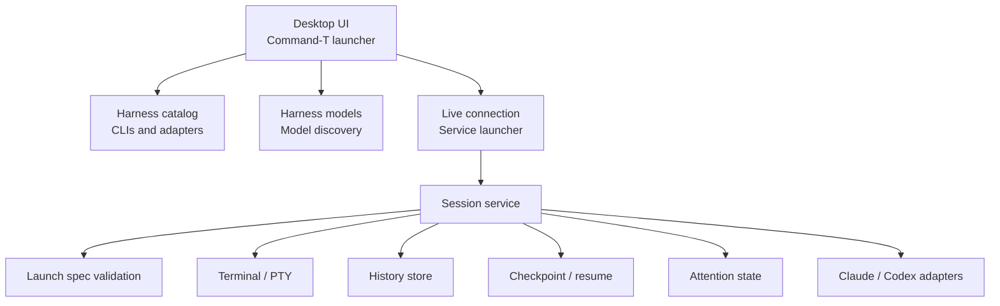

**Diagram sources**
- [harness_catalog.hpp:1-54](file://apps/desktop/src/harness_catalog.hpp#L1-L54)
- [harness_models.hpp:1-89](file://apps/desktop/src/harness_models.hpp#L1-L89)
- [live_connection.hpp:1-116](file://apps/desktop/src/live_connection.hpp#L1-L116)
- [launch_spec.hpp:1-32](file://services/session/src/launch_spec.hpp#L1-L32)
- [history_store.hpp:1-74](file://services/session/src/history_store.hpp#L1-L74)
- [agent_checkpoint.hpp:1-66](file://services/session/src/agent_checkpoint.hpp#L1-L66)
- [attention.cpp:1-50](file://services/session/src/attention.cpp#L1-L50)

**Section sources**
- [README.md:1-40](file://README.md#L1-L40)
- [harness_catalog.hpp:1-54](file://apps/desktop/src/harness_catalog.hpp#L1-L54)
- [harness_models.hpp:1-89](file://apps/desktop/src/harness_models.hpp#L1-L89)
- [live_connection.hpp:1-116](file://apps/desktop/src/live_connection.hpp#L1-L116)
- [launch_spec.hpp:1-32](file://services/session/src/launch_spec.hpp#L1-L32)
- [history_store.hpp:1-74](file://services/session/src/history_store.hpp#L1-L74)
- [agent_checkpoint.hpp:1-66](file://services/session/src/agent_checkpoint.hpp#L1-L66)

## Core Components

### Harness catalog and adapter selection
The harness catalog defines every known CLI, including retired ones, and their integration behavior. Each entry identifies:

- **Identifier and label**, such as `claude`, `codex`, `opencode`, `grok`, `omp`, `agy` (Antigravity), and `kimi`.
- **Adapter type**, which tells Lapis how to observe the agent:
  - `claude`: uses the hook relay adapter for permission prompts and questions.
  - `codex`: uses the observer-based integration.
  - `terminal`: treats the CLI as a normal terminal program without special observation.
- **Model option shape**, indicating whether the CLI accepts `-m`, `--model`, `--model=`, or no model flag.
- **Resume option**, such as `--resume`, `resume`, `-r`, `--session` or `--conversation`.
- **Default arguments**, for example disabling Codex’s update prompt or passing `--fullscreen` to Grok.

The order in the catalog is the order shown in the new-agent picker.

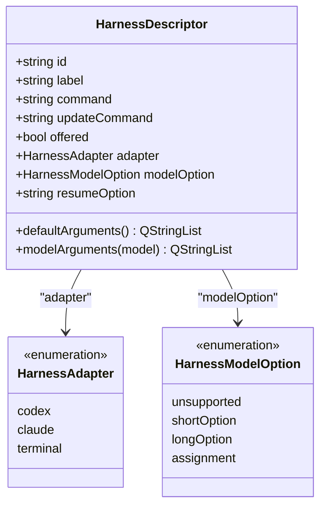

**Diagram sources**
- [harness_catalog.hpp:1-54](file://apps/desktop/src/harness_catalog.hpp#L1-L54)

**Section sources**
- [harness_catalog.hpp:1-54](file://apps/desktop/src/harness_catalog.hpp#L1-L54)
- [harness_catalog.cpp:1-135](file://apps/desktop/src/harness_catalog.cpp#L1-L135)

### Model discovery per CLI
Before launching, Lapis discovers available models from the CLI itself. Discovery runs in the background and refreshes hourly.

| CLI | Source |
|---|---|
| Codex | App-server model listing |
| Claude | Initialize control request model list |
| Grok | Model listing output |
| Antigravity | Model listing output |
| Kimi | Config file model aliases |
| OpenCode | Recent and favorite models |
| OMP | Configured roles plus newest sessions |

At most eight models are shown per CLI. The default model is placed first and duplicates are removed. For provider-style identifiers like `provider/model`, the display name usually comes from the part after the slash unless two providers share the same name.

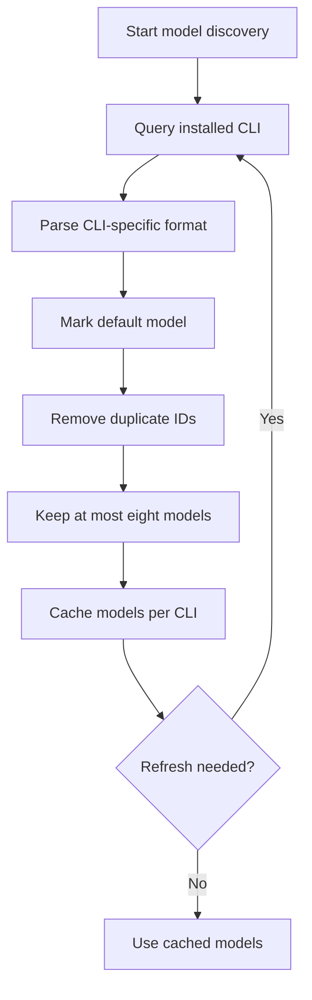

**Diagram sources**
- [harness_models.hpp:1-89](file://apps/desktop/src/harness_models.hpp#L1-L89)
- [harness_models.cpp:1-200](file://apps/desktop/src/harness_models.cpp#L1-L200)

**Section sources**
- [harness_models.hpp:1-89](file://apps/desktop/src/harness_models.hpp#L1-L89)
- [harness_models.cpp:1-200](file://apps/desktop/src/harness_models.cpp#L1-L200)

### Live connection and service lifecycle
A live connection represents one Lapis window’s channel to a session service. Its responsibilities include:

- Starting or attaching to the service.
- Sending attach, resize, paste, history and other wire frames.
- Receiving snapshots, history pages, attention events and status changes.
- Retrying failed connections.
- Persisting the agent’s conversation identity when possible.
- Managing paste transactions and terminal size negotiation.

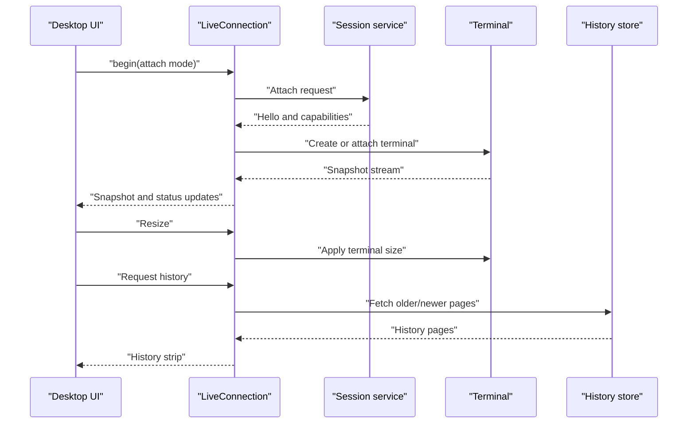

**Diagram sources**
- [live_connection.hpp:1-116](file://apps/desktop/src/live_connection.hpp#L1-L116)
- [live_connection.cpp:1-200](file://apps/desktop/src/live_connection.cpp#L1-L200)
- [history_store.hpp:1-74](file://services/session/src/history_store.hpp#L1-L74)

**Section sources**
- [live_connection.hpp:1-116](file://apps/desktop/src/live_connection.hpp#L1-L116)
- [live_connection.cpp:1-200](file://apps/desktop/src/live_connection.cpp#L1-L200)

## Architecture Overview
The end-to-end flow from Command-T to a running agent looks like this:

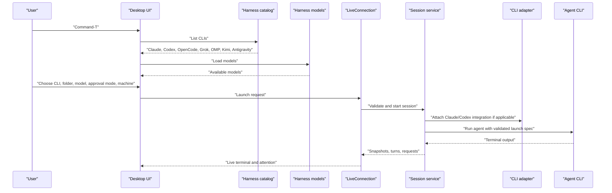

**Diagram sources**
- [harness_catalog.cpp:1-135](file://apps/desktop/src/harness_catalog.cpp#L1-L135)
- [harness_models.cpp:1-200](file://apps/desktop/src/harness_models.cpp#L1-L200)
- [launch_spec.cpp:1-144](file://services/session/src/launch_spec.cpp#L1-L144)
- [live_connection.cpp:1-200](file://apps/desktop/src/live_connection.cpp#L1-L200)

## Detailed Component Analysis

### Launching agents through Command-T
The new-agent form follows a fixed sequence:

1. Choose the CLI.
2. Choose the folder.
3. Choose the model and approval mode.
4. Optionally choose a machine.

#### CLI selection
The picker shows Claude, Codex, OpenCode, Grok, OMP, Antigravity and Kimi. An unavailable CLI is marked but remains discoverable for saved agents. Shell aliases do not apply because Lapis starts the executable directly.

#### Folder selection
The field starts near your home directory. It ranks recent and frequently used folders first, then alphabetical names, with `_folders` last. You can use arrows, Tab, Return or the native browse button.

#### Model and approval mode
- Models come from the active CLI’s account or configuration.
- Approval modes map to the CLI’s own flags: Accept edits, Auto or Full access.
- If the selected mode is not supported by the CLI, Lapis chooses the nearest supported mode with less access, or adds no mode flag.
- Explicit request modes take precedence over defaults.
- Literal arguments after `--` are passed through and do not replace generated resume or mode arguments.

#### Machine selection
The Machine row offers this Mac and hosts from your SSH configuration. On another machine, the agent runs in that host’s configured folder or its home directory, using its login shell.

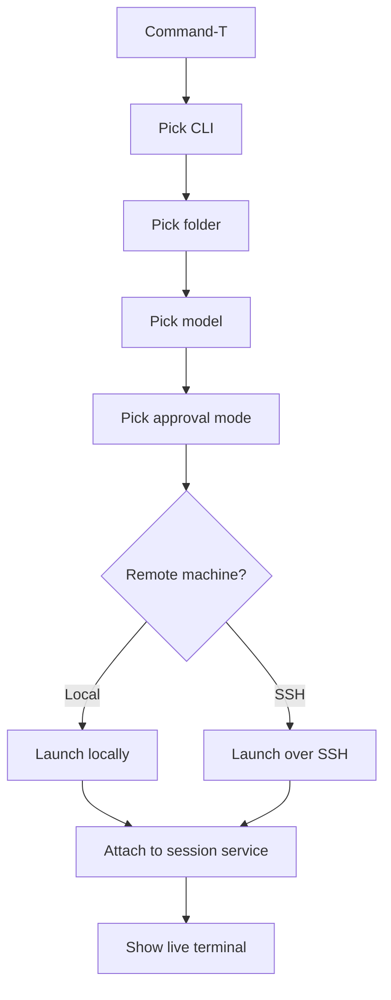

**Diagram sources**
- [agents.md:1-40](file://docs/agents.md#L1-L40)
- [harness_catalog.cpp:1-135](file://apps/desktop/src/harness_catalog.cpp#L1-L135)

**Section sources**
- [agents.md:1-40](file://docs/agents.md#L1-L40)
- [harness_catalog.cpp:1-135](file://apps/desktop/src/harness_catalog.cpp#L1-L135)

### Harness configuration
Configuration lives in `lapis.json`. For development builds, the checkout’s `lapis.json` applies; for the installed app, it is typically under `~/.lapis/lapis.json`. Settings apply immediately and can be reloaded.

#### New agent defaults
The `newAgent` section controls defaults for the Command-T form:

| Key | Purpose |
|---|---|
| `harness` | Default CLI identifier |
| `folder` | Default working folder |
| `mode` | Default approval mode (`edits`, `auto` or `full`) |
| `machines` | Per-machine folder overrides |
| `models` | Per-CLI model lists |

#### Harness arguments
`harnessArguments` adds extra flags to every new agent of a specific CLI. These are added alongside Lapis-generated model, approval and resume arguments. They do not replace explicit request modes or literal `--` arguments.

#### CLI updates
`harnessUpdates` can disable automatic updates for specific CLIs. When disabled, Lapis does not run the CLI’s update command for new agents of that CLI.

#### Alerts and usage
Alerts control chimes, notifications, away detection and next-prompt judgment. Usage configuration controls which CLIs and machines appear in usage views.

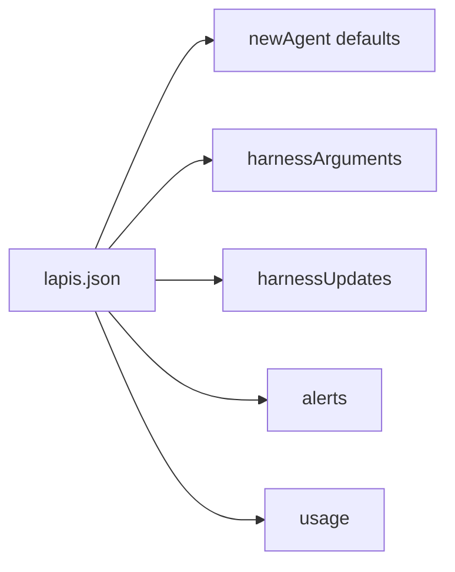

**Diagram sources**
- [config.md:1-120](file://docs/config.md#L1-L120)

**Section sources**
- [lapis.json:1-4](file://lapis.json#L1-L4)
- [config.md:1-120](file://docs/config.md#L1-L120)

### Remote SSH agent support
Remote agents run over SSH on a host from your SSH configuration. Important details:

- The agent runs in that host’s configured folder, or its home directory.
- It runs in the host’s login shell.
- Hook-based features such as Claude Code hooks are transferred to the remote process.
- Turn reporting goes through the remote terminal, so the remote side needs the required tools.
- Network changes or sleep can drop the connection; Lapis reconnects and resumes the conversation when the CLI supports it.

Remote sessions are outside the early-access support slice for some workflows such as full phone integration and fan-out, but the core local desktop behavior supports them.

**Section sources**
- [agents.md:25-60](file://docs/agents.md#L25-L60)
- [README.md:15-40](file://README.md#L15-L40)

### Session lifecycle management

#### Launching and identity
Every agent gets its own session service, identity and endpoint. Agents always start as top-level sessions: if Lapis was opened inside another agent’s terminal, child-session markers and sandbox markers are removed before launching the new agent. Global approval settings are not changed; hook or notification configuration is attached only to the relevant process.

#### Live terminal sessions
The live terminal receives screen snapshots from the session service. Lapis handles:

- Alternate screen buffers.
- Program wheel tracking.
- Pacing between multiple viewers.
- Paste transactions with admission feedback.
- Resize negotiation.
- History browsing.

#### Persistence across app restarts
If an agent’s session service is gone when Lapis opens, Lapis restarts it in its card. Resume behavior depends on the CLI:

- Claude, Codex, Grok, OpenCode, OMP, Kimi and Antigravity resume their saved conversation through their native resume option.
- Other CLIs or conversations without a saved transcript start fresh in the same folder.
- Explicit resume arguments win over auto-added ones.

Conversation identity is persisted beside the private endpoint as `<endpoint>.resume`. Sources include:

- Claude hook adapter.
- Codex observer.
- Terminal restore hooks through an `agent_checkpoint` sequence.

For unqualified Codex builds, Lapis can read the thread from rollouts held open by the app server, following `/new` and `/resume`, within the expected layout.

#### Process monitoring and status
Each agent tracks:

- Whether it is connected.
- Whether a snapshot has been received.
- Pending paste transactions.
- History request state.
- Retry attempts.
- Whether the terminal is ready.

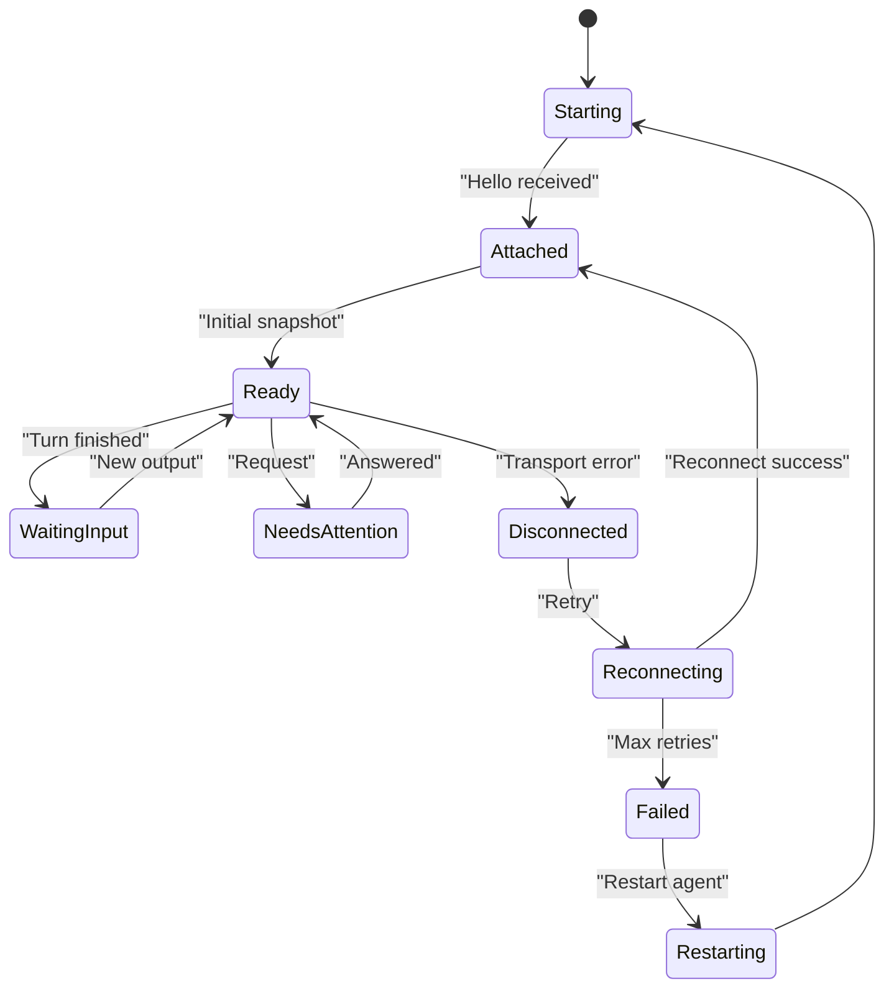

**Diagram sources**
- [live_connection.hpp:1-116](file://apps/desktop/src/live_connection.hpp#L1-L116)
- [live_connection.cpp:1-200](file://apps/desktop/src/live_connection.cpp#L1-L200)
- [agent_checkpoint.hpp:1-66](file://services/session/src/agent_checkpoint.hpp#L1-L66)

**Section sources**
- [agents.md:40-120](file://docs/agents.md#L40-L120)
- [live_connection.hpp:1-116](file://apps/desktop/src/live_connection.hpp#L1-L116)
- [live_connection.cpp:1-200](file://apps/desktop/src/live_connection.cpp#L1-L200)
- [agent_checkpoint.hpp:1-66](file://services/session/src/agent_checkpoint.hpp#L1-L66)

### Adapter-specific features

#### Claude Code
- Uses the hook relay adapter.
- One Lapis hook per event; hooks report permission prompts and questions.
- Hooks never print decisions or block tools; Claude Code’s own rules still decide approvals.
- Permission prompts are serialized so parallel tool calls appear as one request.
- Idle reminders are not treated as requests.
- Runs full screen by default through environment configuration.

#### Codex
- Uses the observer-based integration.
- Reports turns through the observer.
- Supports explicit request handling through the Commands interface.
- Keeps qualified build versions and disables the CLI’s built-in update prompt.
- Transcript recovery may use rollouts held open by the app server for unqualified builds.

#### Grok, OpenCode, OMP, Kimi, Antigravity
- Use the terminal adapter unless otherwise noted.
- Turn estimates come from output analysis rather than structured turn events.
- Support their respective resume options.
- Some run full screen automatically, such as Grok through `--fullscreen`.

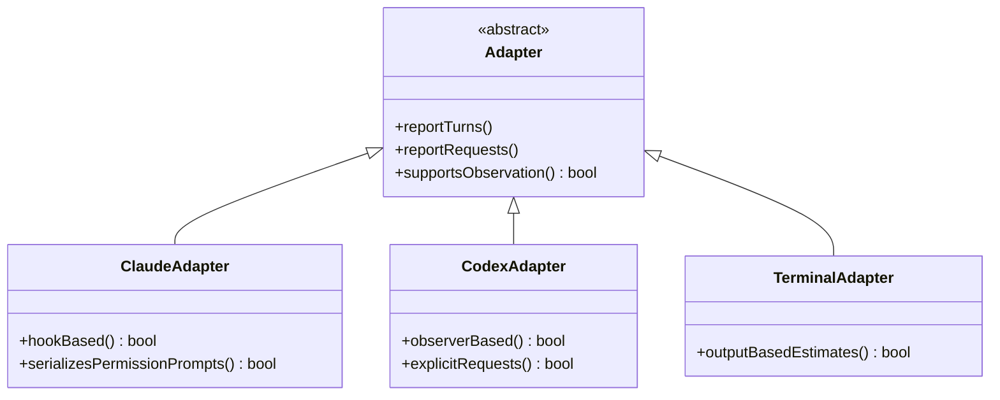

**Diagram sources**
- [harness_catalog.hpp:1-54](file://apps/desktop/src/harness_catalog.hpp#L1-L54)
- [agents.md:60-120](file://docs/agents.md#L60-L120)

**Section sources**
- [agents.md:60-120](file://docs/agents.md#L60-L120)
- [harness_catalog.hpp:1-54](file://apps/desktop/src/harness_catalog.hpp#L1-L54)

### Turn tracking and attention events
Turn tracking differs by adapter:

- Codex and Claude Code report turns explicitly.
- Other CLIs show an estimate based on output activity, or indicate Output active or Quiet.
- A finished turn means the turn ended, not necessarily that the task completed.

Attention events represent requests such as permission prompts or questions. The attention subsystem enforces bounds on:

- Session ID and adapter ID length.
- Request fields such as thread ID, turn ID, item ID and reason.
- Number of pending and retired requests.
- Request choices.
- Revision counters and epoch sequencing.

When synchronization fails, the attention state becomes unknown and pending items are marked stale.

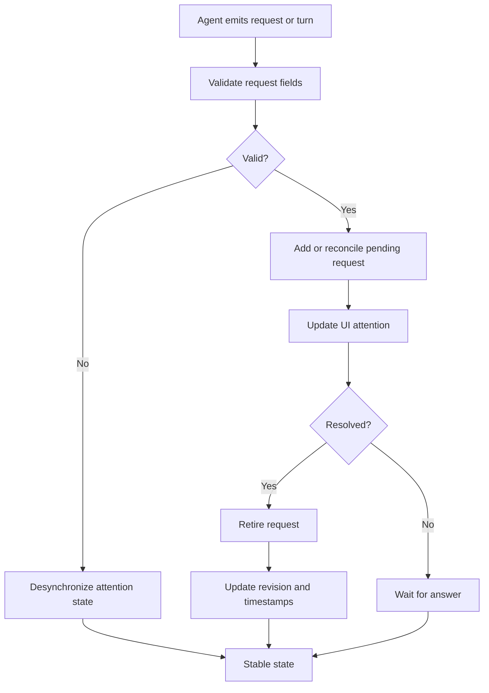

**Diagram sources**
- [attention.cpp:1-200](file://services/session/src/attention.cpp#L1-L200)

**Section sources**
- [agents.md:60-100](file://docs/agents.md#L60-L100)
- [attention.cpp:1-200](file://services/session/src/attention.cpp#L1-L200)

### Practical agent workflows

#### Workflow 1: Start a local Codex agent
1. Press Command-T.
2. Select Codex.
3. Choose the project folder.
4. Choose a model from the Codex account listing.
5. Choose Accept edits, Auto or Full access.
6. Keep the machine as this Mac.
7. Lapis launches the agent with its qualified build and an explicit sandbox flag.

#### Workflow 2: Start a remote Claude Code agent
1. Press Command-T.
2. Select Claude.
3. Choose the folder.
4. Choose a model and approval mode.
5. Select a remote machine from SSH configuration.
6. Lapis starts the agent in the host’s configured folder or home directory.
7. If the network drops, Lapis reconnects and resumes the conversation.

#### Workflow 3: Resume after reboot
1. Open Lapis.
2. If a session service is missing, Lapis restarts it.
3. Lapis reads the checkpoint or transcript.
4. The agent resumes its previous conversation where supported.

#### Workflow 4: Handle a request
1. A request appears as attention and may ping.
2. Open the agent’s terminal or Requests view.
3. Approve, decline, cancel or send an answer explicitly.
4. Opening or selecting a request does not approve it.

#### Workflow 5: Reload an agent
1. Use Reload tab, Reload category or Reload window.
2. Lapis ends and restarts the agent in its card.
3. The conversation resumes where the CLI supports it.

**Section sources**
- [agents.md:1-120](file://docs/agents.md#L1-L120)
- [README.md:15-40](file://README.md#L15-L40)

## Dependency Analysis
The main runtime dependencies are:

- Desktop UI depends on the harness catalog and model discovery.
- Live connection depends on descriptor stores, service launchers and the wire protocol.
- Session service depends on launch validation, terminal execution, history storage, checkpoint persistence and attention state.
- Adapters depend on the chosen integration mode.

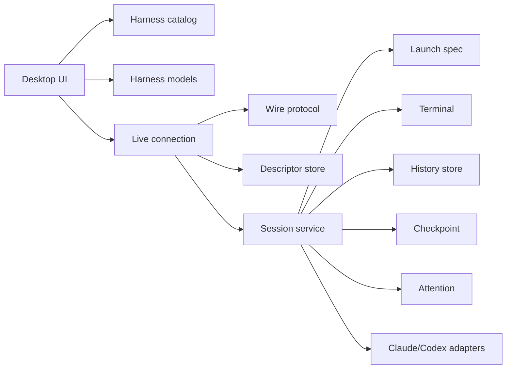

**Diagram sources**
- [harness_catalog.cpp:1-135](file://apps/desktop/src/harness_catalog.cpp#L1-L135)
- [harness_models.cpp:1-200](file://apps/desktop/src/harness_models.cpp#L1-L200)
- [live_connection.cpp:1-200](file://apps/desktop/src/live_connection.cpp#L1-L200)
- [launch_spec.cpp:1-144](file://services/session/src/launch_spec.cpp#L1-L144)
- [history_store.cpp:1-200](file://services/session/src/history_store.cpp#L1-L200)
- [agent_checkpoint.cpp:1-200](file://services/session/src/agent_checkpoint.cpp#L1-L200)
- [attention.cpp:1-200](file://services/session/src/attention.cpp#L1-L200)

**Section sources**
- [harness_catalog.cpp:1-135](file://apps/desktop/src/harness_catalog.cpp#L1-L135)
- [live_connection.cpp:1-200](file://apps/desktop/src/live_connection.cpp#L1-L200)
- [launch_spec.cpp:1-144](file://services/session/src/launch_spec.cpp#L1-L144)
- [history_store.cpp:1-200](file://services/session/src/history_store.cpp#L1-L200)
- [agent_checkpoint.cpp:1-200](file://services/session/src/agent_checkpoint.cpp#L1-L200)
- [attention.cpp:1-200](file://services/session/src/attention.cpp#L1-L200)

## Performance Considerations
- Switching agents and typing should feel instant on supported hardware.
- Full-screen CLIs repaint more aggressively; scrolling can trigger whole-screen redraws.
- Claude Code uses synchronized updates so incomplete frames are not shown during scroll.
- Long-running jobs may exceed built-in limits; detached processes are safer for long work.
- Background CLI updates are queued and limited to avoid blocking agents.
- History storage uses compressed pages and global budgets to keep disk usage bounded.

[No sources needed since this section provides general guidance]

## Troubleshooting Guide

### Agent does not start
Check:

- The CLI is installed and found in PATH.
- The folder exists and is readable.
- The selected model and approval mode are supported.
- The executable is actually an executable file.
- Launch values stay within bounds.

Lapis validates programs, directories, argument count, sizes and initial terminal dimensions. Invalid requests throw validation errors rather than launching unsafe or malformed commands.

**Section sources**
- [launch_spec.cpp:1-144](file://services/session/src/launch_spec.cpp#L1-L144)

### Remote agent loses connection
Common causes:

- Network change.
- Machine sleep.
- SSH session termination.

Lapis reconnects and resumes the conversation when supported. If the remote host is not local, checkpoints from nested terminals cannot be resumed here.

**Section sources**
- [agents.md:25-60](file://docs/agents.md#L25-L60)
- [agent_checkpoint.cpp:1-200](file://services/session/src/agent_checkpoint.cpp#L1-L200)

### Agent does not resume after reboot
Verify:

- The session service was restarted.
- A checkpoint record exists beside the endpoint.
- The record is owned by the current user and not a symlink.
- The resume identity is valid and printable.
- The CLI supports its resume option.

**Section sources**
- [agents.md:120-197](file://docs/agents.md#L120-L197)
- [agent_checkpoint.hpp:1-66](file://services/session/src/agent_checkpoint.hpp#L1-L66)
- [agent_checkpoint.cpp:1-200](file://services/session/src/agent_checkpoint.cpp#L1-L200)

### Requests are not handled correctly
Remember:

- Lapis never changes a CLI’s approval policy.
- Answer requests in the agent’s terminal.
- For Codex, use the Requests or Review requests view to explicitly approve, decline, cancel or send answers.
- Unsupported Codex builds have stricter limits and cannot bypass qualification.

**Section sources**
- [agents.md:60-100](file://docs/agents.md#L60-L100)

### History or terminal feels slow
Consider:

- Reducing concurrent viewers.
- Avoiding extremely large pastes.
- Checking disk space for history storage.
- Using detached processes for very long jobs.
- Verifying that the terminal renderer is not showing torn prompts.

**Section sources**
- [live_connection.cpp:1-200](file://apps/desktop/src/live_connection.cpp#L1-L200)
- [history_store.cpp:1-200](file://services/session/src/history_store.cpp#L1-L200)
- [agents.md:100-120](file://docs/agents.md#L100-L120)

## Conclusion
Lapis manages agents through a layered design: the desktop UI selects CLIs, folders, models and machines; the session service validates and launches agents; adapters integrate with Claude and Codex; and shared services handle terminal I/O, history, checkpoints and attention.

For everyday work, use Command-T to start agents, rely on resume for continuity, handle requests explicitly in the terminal or Requests view, and adjust `lapis.json` for defaults, harness arguments and update behavior. For remote work, target SSH hosts carefully and expect reconnection where the CLI supports conversation resumption.

[No sources needed since this section summarizes without analyzing specific files]