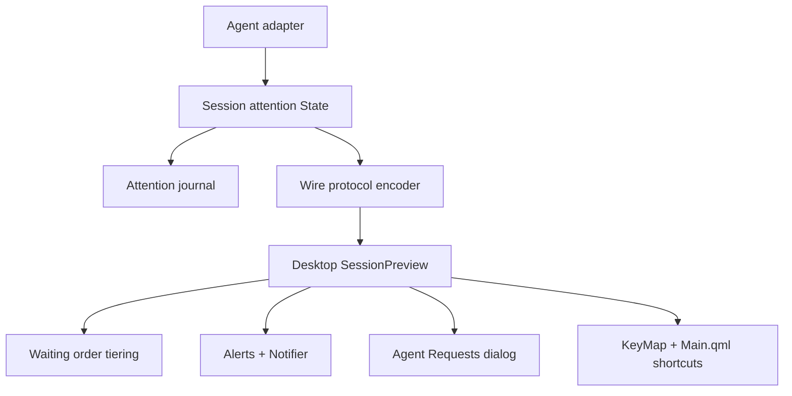
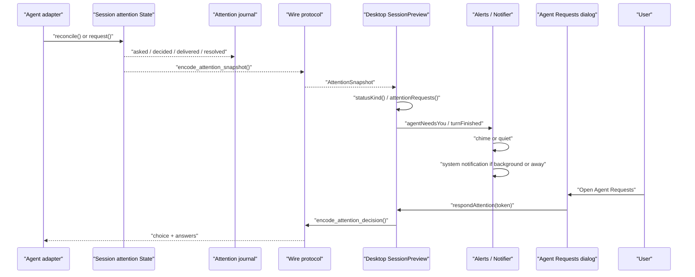
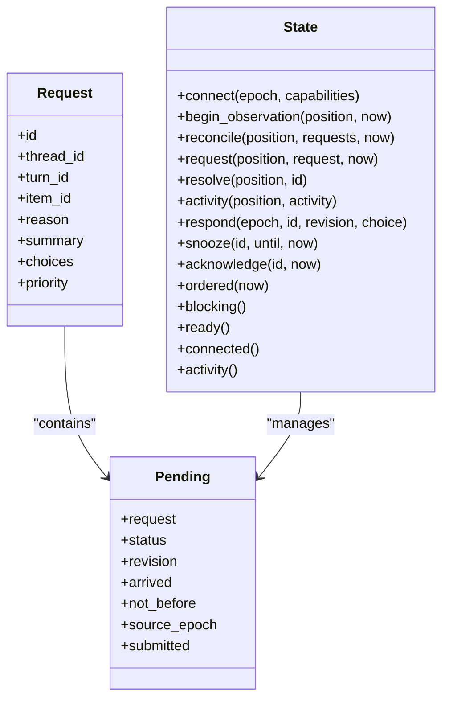
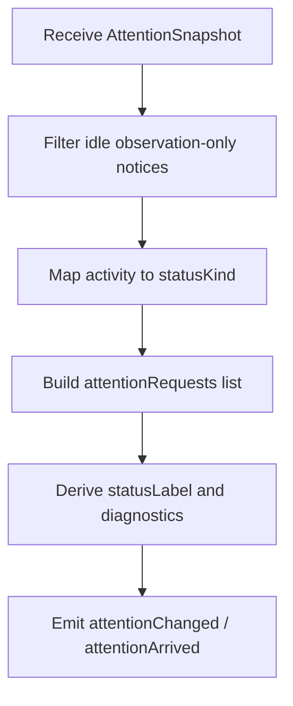
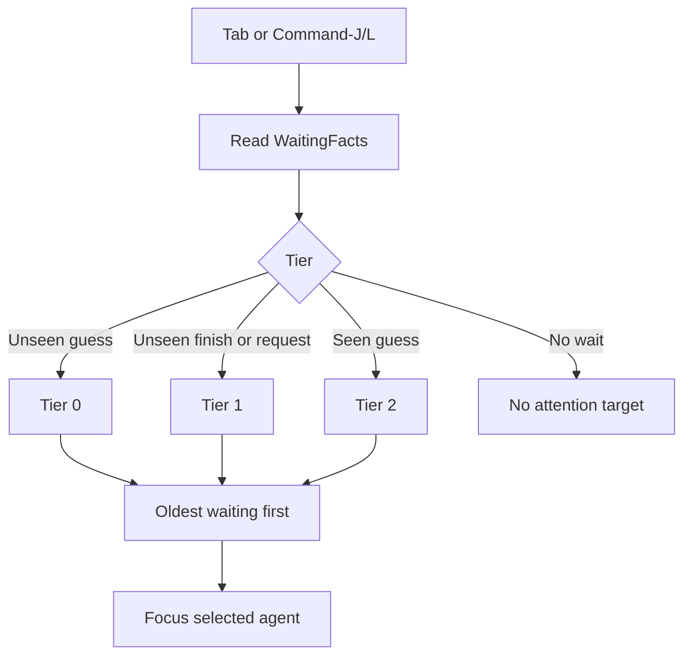
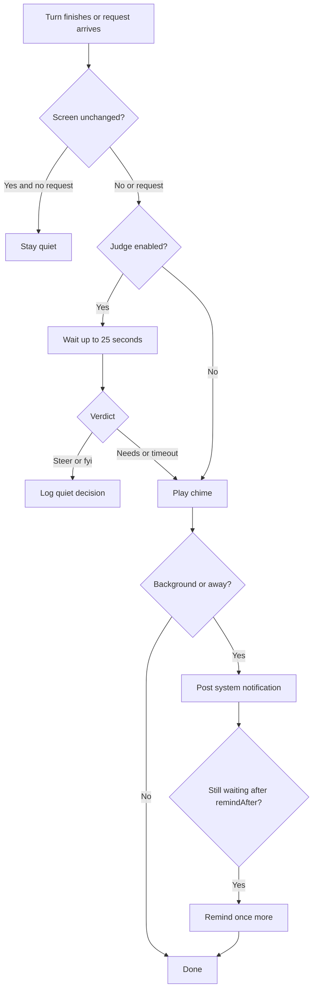
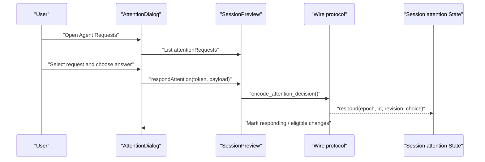
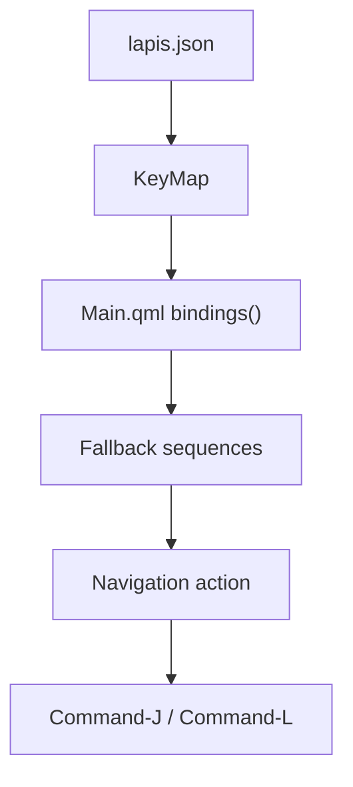
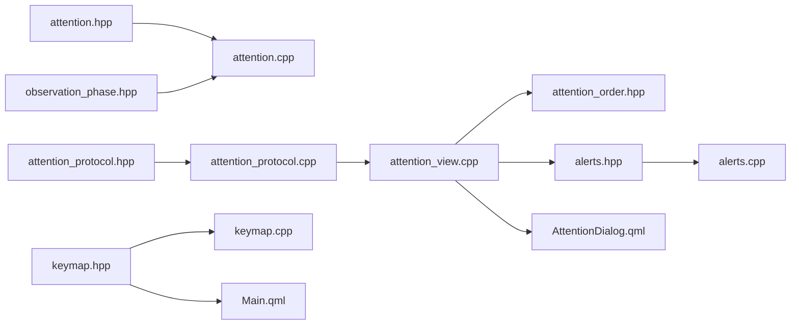

# Attention and Focus

<cite>
**Referenced Files in This Document**
- [attention.hpp](file://services/session/include/lapis/session/attention.hpp)
- [observation_phase.hpp](file://services/session/include/lapis/session/observation_phase.hpp)
- [attention.cpp](file://services/session/src/attention.cpp)
- [attention_journal.cpp](file://services/session/src/attention_journal.cpp)
- [attention_audit.cpp](file://services/session/src/attention_audit.cpp)
- [attention_protocol.hpp](file://services/session/src/transport/attention_protocol.hpp)
- [attention_protocol.cpp](file://services/session/src/transport/attention_protocol.cpp)
- [attention_order.hpp](file://apps/desktop/src/attention_order.hpp)
- [attention_view.cpp](file://apps/desktop/src/attention_view.cpp)
- [alerts.hpp](file://apps/desktop/src/alerts.hpp)
- [alerts.cpp](file://apps/desktop/src/alerts.cpp)
- [keymap.hpp](file://apps/desktop/src/keymap.hpp)
- [keymap.cpp](file://apps/desktop/src/keymap.cpp)
- [Main.qml](file://apps/desktop/qml/Main.qml)
- [AttentionDialog.qml](file://apps/desktop/qml/AttentionDialog.qml)
- [keys.md](file://docs/keys.md)
- [config.md](file://docs/config.md)
</cite>

## Table of Contents
1. [Introduction](#introduction)
2. [Project Structure](#project-structure)
3. [Core Components](#core-components)
4. [Architecture Overview](#architecture-overview)
5. [Detailed Component Analysis](#detailed-component-analysis)
6. [Dependency Analysis](#dependency-analysis)
7. [Performance Considerations](#performance-considerations)
8. [Troubleshooting Guide](#troubleshooting-guide)
9. [Conclusion](#conclusion)

## Introduction
Lapis’s attention-driven navigation system turns agent interactions into user-visible attention, sound, notifications, and keyboard-accessible focus movement. At its core, an agent adapter produces attention requests; the session service validates, orders, persists, and transports them to the desktop client; the client surfaces them through status indicators, the Agent Requests dialog, chimes, system notifications, and Command-J / Command-L navigation. The system distinguishes between background processing, pending decisions, unseen finished turns, and active work so users can respond efficiently without being overwhelmed.

## Project Structure
The attention subsystem spans three layers:

| Layer | Responsibility | Key files |
|---|---|---|
| Session service | Maintains authoritative request state, enforces limits, serializes decisions, and writes audit journals | `attention.hpp`, `attention.cpp`, `attention_protocol.hpp`, `attention_protocol.cpp`, `attention_journal.cpp`, `attention_audit.cpp` |
| Desktop presentation | Translates snapshots into UI status, handles chimes, notifications, seen-screen deduplication, and next-prompt judgment | `attention_view.cpp`, `attention_order.hpp`, `alerts.hpp`, `alerts.cpp` |
| User interface and configuration | Displays requests, routes responses, binds keyboard shortcuts, and exposes alert settings | `AttentionDialog.qml`, `Main.qml`, `keymap.hpp`, `keymap.cpp`, `keys.md`, `config.md` |

**Diagram sources**
- [attention.cpp:1-120](file://services/session/src/attention.cpp#L1-L120)
- [attention_protocol.cpp:1-120](file://services/session/src/transport/attention_protocol.cpp#L1-L120)
- [attention_view.cpp:1-120](file://apps/desktop/src/attention_view.cpp#L1-L120)
- [attention_order.hpp:1-33](file://apps/desktop/src/attention_order.hpp#L1-L33)
- [alerts.hpp:1-120](file://apps/desktop/src/alerts.hpp#L1-L120)
- [Main.qml:1-120](file://apps/desktop/qml/Main.qml#L1-L120)

**Section sources**
- [attention.hpp:1-136](file://services/session/include/lapis/session/attention.hpp#L1-L136)
- [attention_protocol.hpp:1-41](file://services/session/src/transport/attention_protocol.hpp#L1-L41)
- [attention_view.cpp:1-120](file://apps/desktop/src/attention_view.cpp#L1-L120)
- [alerts.hpp:1-120](file://apps/desktop/src/alerts.hpp#L1-L120)
- [keymap.hpp:1-120](file://apps/desktop/src/keymap.hpp#L1-L120)

## Core Components
- **Session attention state**: Tracks per-session requests, their revision numbers, source epochs, activity, readiness, snoozes, acknowledgements, and whether new input is blocked by unresponded evidence.
- **Wire snapshot and decision types**: Transportable representations of the current attention snapshot and a user choice.
- **Desktop preview mapping**: Converts wire snapshots into status labels such as working, idle, finished, waiting, connecting, or unknown.
- **Waiting order**: Ranks agents that need you by whether a next-prompt guess has been seen, whether a turn was unseen, and whether there is a pending request.
- **Alerts and notifier**: Plays chimes, suppresses repeated cues for unchanged screens, and posts system notifications when lapis is in the background or the user is away.
- **Key binding and shortcut system**: Loads user-defined shortcuts from `lapis.json`, provides built-in defaults, and resolves Command-J / Command-L attention navigation.
- **Agent Requests dialog**: Lets the user select a request, type answers, approve commands, decline, cancel, or send answers back to the agent.

**Section sources**
- [attention.hpp:26-136](file://services/session/include/lapis/session/attention.hpp#L26-L136)
- [attention_protocol.hpp:1-41](file://services/session/src/transport/attention_protocol.hpp#L1-L41)
- [attention_view.cpp:1-120](file://apps/desktop/src/attention_view.cpp#L1-L120)
- [attention_order.hpp:1-33](file://apps/desktop/src/attention_order.hpp#L1-L33)
- [alerts.hpp:120-213](file://apps/desktop/src/alerts.hpp#L120-L213)
- [keymap.hpp:120-220](file://apps/desktop/src/keymap.hpp#L120-L220)
- [AttentionDialog.qml:1-120](file://apps/desktop/qml/AttentionDialog.qml#L1-L120)

## Architecture Overview
Attention flows from adapters into the session service, then across the local transport into the desktop application, where it becomes visual, auditory, and navigational feedback.

**Diagram sources**
- [attention.cpp:80-180](file://services/session/src/attention.cpp#L80-L180)
- [attention_audit.cpp:1-82](file://services/session/src/attention_audit.cpp#L1-L82)
- [attention_protocol.cpp:1-120](file://services/session/src/transport/attention_protocol.cpp#L1-L120)
- [attention_view.cpp:120-234](file://apps/desktop/src/attention_view.cpp#L120-L234)
- [alerts.hpp:120-213](file://apps/desktop/src/alerts.hpp#L120-L213)
- [AttentionDialog.qml:120-200](file://apps/desktop/qml/AttentionDialog.qml#L120-L200)

## Detailed Component Analysis

### Session Attention State and Ordering
The session-level attention state models requests with identity, thread identifiers, reason, summary, choices, priority, arrival time, revision, submission status, and request status. It enforces:
- Valid identities and limits.
- Monotonic timestamps.
- Epoch-based synchronization.
- Pending and retired request bounds.
- Revision overflow protection.
- Blocking behavior when evidence must be answered before new input.

Request ordering is not purely FIFO. Priority helps older lower-priority items outrank newer higher-priority ones as they age, while snoozing delays delivery and acknowledgement marks delivery intent.

**Diagram sources**
- [attention.hpp:26-136](file://services/session/include/lapis/session/attention.hpp#L26-L136)
- [attention.cpp:1-120](file://services/session/src/attention.cpp#L1-L120)

**Section sources**
- [attention.hpp:26-136](file://services/session/include/lapis/session/attention.hpp#L26-L136)
- [attention.cpp:1-120](file://services/session/src/attention.cpp#L1-L120)

### Wire Protocol and Snapshot Mapping
The wire layer encodes and decodes attention snapshots and decisions with strict size limits for snapshots, decisions, metadata, summaries, JSON payloads, choices, and choice text. It also validates UTF-8 strings, request IDs, pending entries, and consistency among connection state, epoch, and request source epochs.

The desktop preview maps these snapshots into human-readable states:
- Connection lifecycle: ended, connecting, synchronizing, disconnected.
- Activity: working, idle, finished.
- Attention-specific: waiting, unknown, unavailable, connected, no prompt yet, status pending.

Idle observation-only notices are filtered out of the actionable requests list so attention focuses on decisions requiring the user.

**Diagram sources**
- [attention_protocol.cpp:1-120](file://services/session/src/transport/attention_protocol.cpp#L1-L120)
- [attention_view.cpp:1-120](file://apps/desktop/src/attention_view.cpp#L1-L120)

**Section sources**
- [attention_protocol.hpp:1-41](file://services/session/src/transport/attention_protocol.hpp#L1-L41)
- [attention_protocol.cpp:1-120](file://services/session/src/transport/attention_protocol.cpp#L1-L120)
- [attention_view.cpp:1-120](file://apps/desktop/src/attention_view.cpp#L1-L120)

### Waiting Order and Keyboard Navigation
The waiting-order logic separates three tiers:
1. A next-prompt guess not yet seen.
2. A finished turn seen only after it finished, or a pending request.
3. A next-prompt guess already seen.

Within each tier, the longest-waiting item comes first. This prevents rapid bouncing between two unconfirmed guesses and ensures real requests and unseen work rise above guessed prompts.

Command-J and Command-L navigate this queue:
- Command-J moves to the next agent that needs you across categories.
- Command-L moves to the most recent agent that needed you, and again to the previous one.
- On Linux, Control-Shift replaces Command.
- All bindings can be overridden in `lapis.json`.

**Diagram sources**
- [attention_order.hpp:1-33](file://apps/desktop/src/attention_order.hpp#L1-L33)
- [keys.md:1-40](file://docs/keys.md#L1-L40)

**Section sources**
- [attention_order.hpp:1-33](file://apps/desktop/src/attention_order.hpp#L1-L33)
- [keys.md:1-40](file://docs/keys.md#L1-L40)

### Alert System: Chimes, Notifications, and Seen-Screen Deduplication
Alerts coordinate three behaviors:
- **Chimes**: Play a shared cue for “needs you” and finished turns. Repeated playback is rate-limited, and quiet periods prevent rapid re-cuing.
- **Seen-screen deduplication**: While lapis is visible and the user is present, the focused agent’s screen is sampled every second. If a finished turn still shows what was last seen, it stays quiet. Claude Code’s input box area is excluded because its status line can tick independently.
- **System notifications**: When lapis is in the background or the user is away (no keyboard/mouse input for `alerts.awayAfter` seconds), a notification posts. An agent left waiting without being looked at or started on a new turn notifies again after `alerts.remindAfter` minutes or when the user returns.

Next-prompt judgment adds another quiet path: when enabled, finished turns wait up to 25 seconds for a model to judge whether the agent needs you, would steer, or is just reporting. Steer and fyi stay quiet; needs-you and explicit requests proceed.

**Diagram sources**
- [alerts.hpp:1-213](file://apps/desktop/src/alerts.hpp#L1-L213)
- [alerts.cpp:1-120](file://apps/desktop/src/alerts.cpp#L1-L120)
- [config.md:1-120](file://docs/config.md#L1-L120)

**Section sources**
- [alerts.hpp:1-213](file://apps/desktop/src/alerts.hpp#L1-L213)
- [alerts.cpp:1-120](file://apps/desktop/src/alerts.cpp#L1-L120)
- [config.md:1-120](file://docs/config.md#L1-L120)

### Agent Requests Dialog and Response Flow
The Agent Requests dialog presents actionable attention requests. Each request carries a token, reason, summary, available choices, response details, submission state, eligibility, and enablement. Users can:
- Open the dialog for a session.
- Select a specific request.
- Fill optional multi-question answers.
- Approve, decline, cancel, or send custom answers.
- Submit the response back through the preview.

**Diagram sources**
- [attention_view.cpp:120-234](file://apps/desktop/src/attention_view.cpp#L120-L234)
- [AttentionDialog.qml:120-200](file://apps/desktop/qml/AttentionDialog.qml#L120-L200)
- [attention_protocol.cpp:120-200](file://services/session/src/transport/attention_protocol.cpp#L120-L200)
- [attention.cpp:120-200](file://services/session/src/attention.cpp#L120-L200)

**Section sources**
- [AttentionDialog.qml:1-200](file://apps/desktop/qml/AttentionDialog.qml#L1-L200)
- [attention_view.cpp:120-234](file://apps/desktop/src/attention_view.cpp#L120-L234)

### Activity Indicators and Agent States
Status indicators communicate both agent lifecycle and attention state:

| Indicator | Meaning |
|---|---|
| Working | Agent is actively processing. |
| Idle | Agent is ready but not busy. |
| Finished | Turn completed; may require user action. |
| Waiting | There is a pending attention request. |
| Connecting / Synchronizing | Agent is establishing or syncing attention state. |
| Disconnected | Input is unavailable. |
| Ended | Agent session has ended. |
| Unknown / Status pending / No prompt yet | Attention source is not yet ready. |

Themes assign separate semantic colors for focus, activity, attention, and faults, ensuring color is never the only signal.

**Section sources**
- [attention_view.cpp:1-120](file://apps/desktop/src/attention_view.cpp#L1-L120)
- [keymap.hpp:1-120](file://apps/desktop/src/keymap.hpp#L1-L120)
- [Main.qml:1-120](file://apps/desktop/qml/Main.qml#L1-L120)

### Keyboard Shortcuts and Overrides
Built-in macOS defaults include:
- Command-J: Next agent that needs you.
- Command-L: Most recent agent that needed you; repeat to go backward.
- Command-Option-L: Same as Command-L but brings Lapis to the front even from another app.
- Other navigation keys for categories, tiles, terminal, and window management.

On Linux, Command is replaced by Control-Shift. Every binding is configurable through `lapis.json`. The keymap loads user sequences, falls back to built-ins for missing actions, and exposes the current shortcut map to QML.

**Diagram sources**
- [keymap.cpp:1-120](file://apps/desktop/src/keymap.cpp#L1-L120)
- [keymap.hpp:120-220](file://apps/desktop/src/keymap.hpp#L120-L220)
- [Main.qml:120-240](file://apps/desktop/qml/Main.qml#L120-L240)
- [keys.md:1-40](file://docs/keys.md#L1-L40)

**Section sources**
- [keys.md:1-40](file://docs/keys.md#L1-L40)
- [keymap.hpp:120-220](file://apps/desktop/src/keymap.hpp#L120-L220)
- [keymap.cpp:1-120](file://apps/desktop/src/keymap.cpp#L1-L120)
- [Main.qml:120-240](file://apps/desktop/qml/Main.qml#L120-L240)

### Audit and Persistence
The attention journal records asked, decided, delivered, and resolved events with epoch, revision, origin, request data, and choice information. It uses a binary format with magic header, CRC-32 integrity checks, bounded string sizes, and lexicographic readers that distinguish torn records from corruption. The audit helpers decide which pending requests should be journaled as asked and close them when resolved or decided.

This supports recovery, debugging, and verification of attention flow without exposing sensitive content unnecessarily.

**Section sources**
- [attention_journal.cpp:1-120](file://services/session/src/attention_journal.cpp#L1-L120)
- [attention_audit.cpp:1-82](file://services/session/src/attention_audit.cpp#L1-L82)

## Dependency Analysis
The attention system exhibits clear layering:

**Diagram sources**
- [attention.hpp:1-136](file://services/session/include/lapis/session/attention.hpp#L1-L136)
- [attention.cpp:1-120](file://services/session/src/attention.cpp#L1-L120)
- [observation_phase.hpp:1-16](file://services/session/include/lapis/session/observation_phase.hpp#L1-L16)
- [attention_protocol.hpp:1-41](file://services/session/src/transport/attention_protocol.hpp#L1-L41)
- [attention_protocol.cpp:1-120](file://services/session/src/transport/attention_protocol.cpp#L1-L120)
- [attention_view.cpp:1-120](file://apps/desktop/src/attention_view.cpp#L1-L120)
- [attention_order.hpp:1-33](file://apps/desktop/src/attention_order.hpp#L1-L33)
- [alerts.hpp:1-120](file://apps/desktop/src/alerts.hpp#L1-L120)
- [alerts.cpp:1-120](file://apps/desktop/src/alerts.cpp#L1-L120)
- [keymap.hpp:120-220](file://apps/desktop/src/keymap.hpp#L120-L220)
- [keymap.cpp:1-120](file://apps/desktop/src/keymap.cpp#L1-L120)
- [Main.qml:120-240](file://apps/desktop/qml/Main.qml#L120-L240)
- [AttentionDialog.qml:1-120](file://apps/desktop/qml/AttentionDialog.qml#L1-L120)

Coupling is strongest between the desktop preview and the wire snapshot, since the preview depends on the exact fields used to derive status, diagnostic messages, and request eligibility. Alerts depend on workspace signals and keymap configuration rather than on wire internals. Shortcut handling depends on the keymap but not on attention state directly.

## Performance Considerations
- **Request limits**: The session state enforces maximum pending and retired requests, preventing unbounded growth.
- **Revision accounting**: Revisions are monotonically incremented and protected against overflow, which forces resynchronization rather than silently corrupting state.
- **Seen-screen sampling**: Screens are sampled once per second for the focused agent, reducing CPU pressure while still catching meaningful changes.
- **Judgment wait**: Next-prompt judgment waits up to 25 seconds; if disabled or inactive, turns pass immediately, avoiding unnecessary delay.
- **Audit journal limits**: Journal records have bounded string lengths and choice counts, and rotation protects disk usage.
- **Wire validation**: Strict size and UTF-8 validation prevents oversized or malformed messages from consuming resources.

[No sources needed since this section provides general guidance]

## Troubleshooting Guide

### Attention Does Not Appear
Possible causes:
- The attention source is not ready or not connected.
- The session is synchronizing or awaiting its first prompt.
- Only an observation-only idle notice arrived; actionable requests are filtered.
- The connection was invalidated and requires retry.

Check:
- `SessionPreview::statusKind()` for connecting, synchronizing, unknown, or status-pending values.
- `SessionPreview::hasAttentionSource()` and `attentionReady()`.
- Whether idle notices were filtered from `attentionRequests()`.
- `attentionDiagnostic()` for connection loss messages.

**Section sources**
- [attention_view.cpp:1-120](file://apps/desktop/src/attention_view.cpp#L1-L120)

### Agent Keeps Pinging Without Asking Anything
Causes:
- A finished turn is judged as “steer” or “fyi”, staying quiet but logged.
- The screen sampler detects no change.
- Next-prompt judgment is disabled, causing immediate pings.
- The agent is genuinely waiting on background work.

Check:
- The attention decision log for quiet judgments.
- Whether `alerts.judge` is enabled.
- Whether the user moved away from the agent too quickly.

**Section sources**
- [config.md:1-120](file://docs/config.md#L1-L120)
- [alerts.cpp:1-120](file://apps/desktop/src/alerts.cpp#L1-L120)

### Command-J or Command-L Skips Agents Unexpectedly
Likely reasons:
- A next-prompt guess has already been seen, placing it in a lower tier.
- A request or unseen finished turn outranks a seen guess.
- The agent is marked as waiting due to background work.
- The user is navigating within tiles or categories differently than expected.

Check:
- `WaitingFacts` values: guessed, guess_seen, status, unseen, request.
- The waiting-tier calculation.
- Whether the agent has a pending request versus merely finishing a turn.

**Section sources**
- [attention_order.hpp:1-33](file://apps/desktop/src/attention_order.hpp#L1-L33)

### Notification Never Appears
Possible reasons:
- Lapis is in the foreground and the user is looking at the agent.
- The screen has not changed since it was last seen.
- `notify` is disabled.
- `awayAfter` has not elapsed.
- The reminder timer has not reached `remindAfter`.

Check:
- `alerts.notify`.
- Presence and looking callbacks in the notifier.
- Configuration for `alerts.awayAfter` and `alerts.remindAfter`.

**Section sources**
- [alerts.hpp:120-213](file://apps/desktop/src/alerts.hpp#L120-L213)
- [config.md:1-120](file://docs/config.md#L1-L120)

### Custom Sound Does Not Play
Possible reasons:
- `alerts.finishedFile` is set but unavailable or invalid.
- The file exceeds size limits.
- Playback is unavailable on the platform.
- Built-in fallback is playing instead.

Check:
- File path resolution relative to `lapis.json`.
- File size and permissions.
- Chime diagnostic reported by the keymap.

**Section sources**
- [config.md:1-120](file://docs/config.md#L1-L120)
- [keymap.hpp:120-220](file://apps/desktop/src/keymap.hpp#L120-L220)

## Conclusion
Lapis’s attention system separates authority, transport, presentation, and user interaction. The session service maintains consistent, bounded, and auditable request state. The desktop client translates that state into accessible status indicators, prioritized navigation, sound, and system notifications. Keyboard shortcuts let users move efficiently through attention queues, while the Agent Requests dialog centralizes responses. With seen-screen deduplication, next-prompt judgment, configurable alerts, and theme-aware indicators, the system balances urgency with calmness, making it easier to respond to important agent requests without losing focus during busy periods.