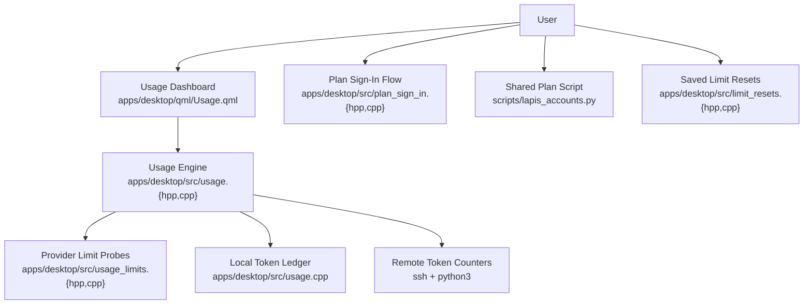
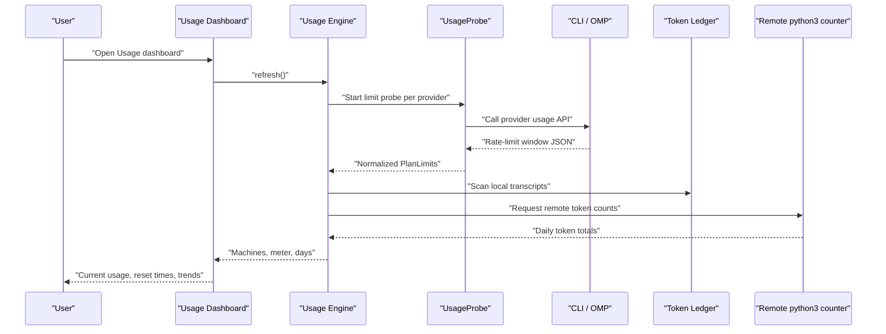
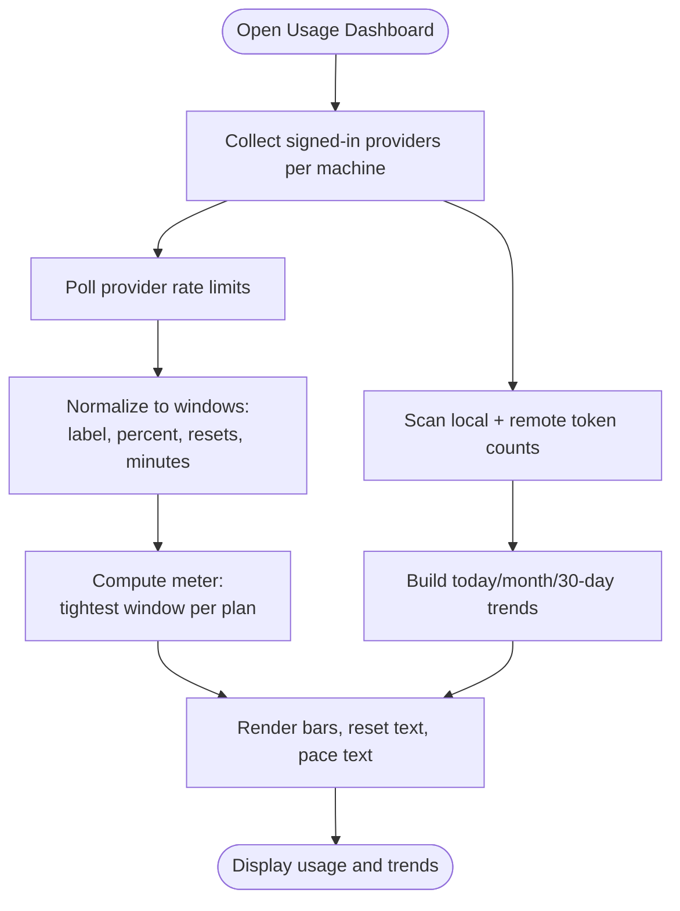
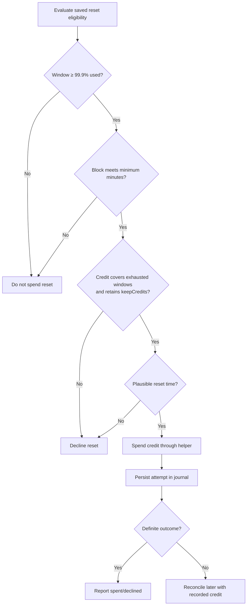
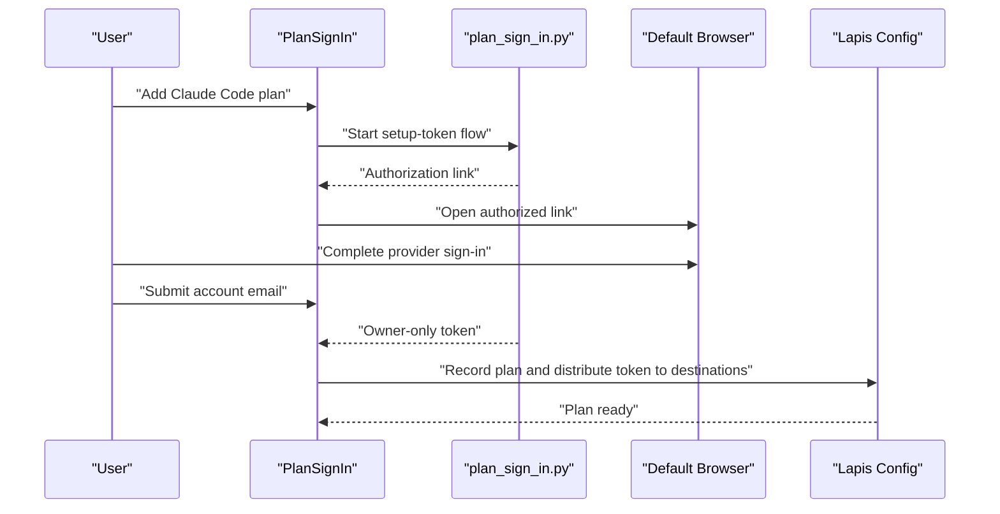
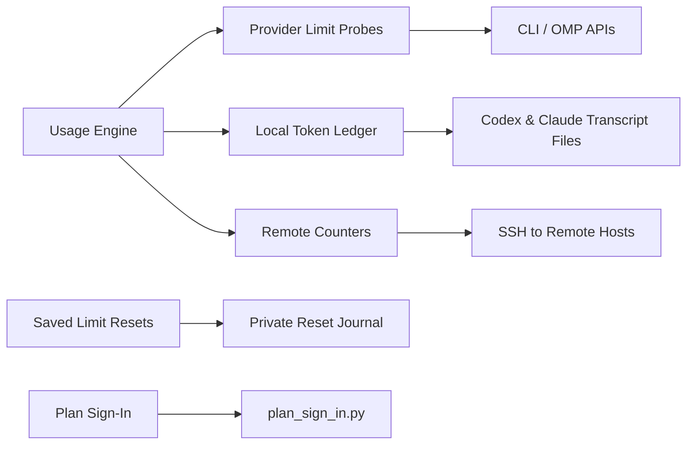

# Usage and Limits

<cite>
**Referenced Files in This Document**
- [usage.md](file://docs/usage.md)
- [architecture.md](file://docs/architecture.md)
- [status.md](file://docs/status.md)
- [usage.hpp](file://apps/desktop/src/usage.hpp)
- [usage.cpp](file://apps/desktop/src/usage.cpp)
- [usage_limits.hpp](file://apps/desktop/src/usage_limits.hpp)
- [usage_limits.cpp](file://apps/desktop/src/usage_limits.cpp)
- [limit_resets.hpp](file://apps/desktop/src/limit_resets.hpp)
- [limit_resets.cpp](file://apps/desktop/src/limit_resets.cpp)
- [plan_sign_in.hpp](file://apps/desktop/src/plan_sign_in.hpp)
- [plan_sign_in.cpp](file://apps/desktop/src/plan_sign_in.cpp)
- [lapis_accounts.py](file://scripts/lapis_accounts.py)
- [Usage.qml](file://apps/desktop/qml/Usage.qml)
</cite>

## Table of Contents
1. [Introduction](#introduction)
2. [Project Structure](#project-structure)
3. [Core Components](#core-components)
4. [Architecture Overview](#architecture-overview)
5. [Detailed Component Analysis](#detailed-component-analysis)
6. [Dependency Analysis](#dependency-analysis)
7. [Performance Considerations](#performance-considerations)
8. [Troubleshooting Guide](#troubleshooting-guide)
9. [Conclusion](#conclusion)

## Introduction
This document explains how Lapis observes, displays, and manages usage and limits for supported agent providers, including current consumption metrics, remaining quotas, reset schedules, usage trends, account authentication, saved limit resets, alerting guidance, capacity planning, error handling, and connectivity troubleshooting. It is intended for users managing Claude Code, Codex, Grok, Kimi, and OpenAI Multiplayer (OMP)-managed plans through the desktop application.

## Project Structure
Lapis implements usage and limits as a combination of:
- A desktop C++/Qt module that polls provider interfaces, parses quota windows, and aggregates token counts from local transcripts.
- A per-machine dashboard UI that visualizes remaining quotas, reset times, pace projections, and 30-day token trends.
- A saved-limit-reset system that can automatically or manually apply eligible credits to blocked sessions.
- A plan sign-in flow for adding Claude Code accounts from inside Lapis.
- A Python helper script for managing shared plan configuration across machines.

**Diagram sources**
- [Usage.qml:1-386](file://apps/desktop/qml/Usage.qml#L1-L386)
- [usage.hpp:1-203](file://apps/desktop/src/usage.hpp#L1-L203)
- [usage_limits.hpp:1-106](file://apps/desktop/src/usage_limits.hpp#L1-L106)
- [limit_resets.hpp:1-103](file://apps/desktop/src/limit_resets.hpp#L1-L103)
- [plan_sign_in.hpp:1-140](file://apps/desktop/src/plan_sign_in.hpp#L1-L140)
- [lapis_accounts.py:1-477](file://scripts/lapis_accounts.py#L1-L477)

**Section sources**
- [usage.md:1-108](file://docs/usage.md#L1-L108)
- [architecture.md:1-165](file://docs/architecture.md#L1-L165)

## Core Components
- **Usage engine**: Polls provider quota data and local token transcripts, combines results per machine, and exposes meter and dashboard data to the UI.
- **Provider limit probes**: Call each CLI’s own usage interface without prompts and translate its response into normalized plan windows with percent used, reset time, and available reset credits.
- **Token ledger**: Scans local Codex and Claude transcript directories, counting input, cached reads/writes, and output tokens per day and model.
- **Saved limit resets**: Manages durable admission, provider credit spending, replay protection, and automatic or manual reset application for selected plans.
- **Plan sign-in**: Adds Claude Code plans interactively by launching the provider setup, opening the authorization link, capturing the token securely, and distributing it only to configured destinations.
- **Account management script**: Lists homes, signs in missing plans, and adds Claude Code or Codex plans while respecting host validation and atomic config writes.

**Section sources**
- [usage.hpp:43-182](file://apps/desktop/src/usage.hpp#L43-L182)
- [usage_limits.hpp:15-106](file://apps/desktop/src/usage_limits.hpp#L15-L106)
- [limit_resets.hpp:14-103](file://apps/desktop/src/limit_resets.hpp#L14-L103)
- [plan_sign_in.hpp:17-140](file://apps/desktop/src/plan_sign_in.hpp#L17-L140)
- [lapis_accounts.py:1-200](file://scripts/lapis_accounts.py#L1-L200)

## Architecture Overview
The usage pipeline has two parallel data streams:

1. **Quota stream**: The usage engine schedules `UsageProbe` calls every five minutes for installed CLIs and OMP. Each probe runs locally or over SSH, collects rate-limit windows, and normalizes them into plan limits.
2. **Token trend stream**: The token ledger scans local transcript files incrementally. Remote machines count tokens through their own Python process and return aggregated daily totals.

**Diagram sources**
- [usage.hpp:121-182](file://apps/desktop/src/usage.hpp#L121-L182)
- [usage_limits.hpp:63-106](file://apps/desktop/src/usage_limits.hpp#L63-L106)
- [usage.cpp:1-120](file://apps/desktop/src/usage.cpp#L1-L120)

**Section sources**
- [usage.hpp:89-182](file://apps/desktop/src/usage.hpp#L89-L182)
- [usage_limits.hpp:15-106](file://apps/desktop/src/usage_limits.hpp#L15-L106)
- [usage.md:1-30](file://docs/usage.md#L1-L30)

## Detailed Component Analysis

### Plan Usage Display
The usage display shows:
- Current consumption as percentage remaining for each plan window.
- Reset timestamps when known.
- Pace-based projections indicating when usage will run out at the current rate, or how much will remain at the next reset.
- Per-provider token counts for today, this month, and a 30-day bar chart.
- Account-level notes such as “Limit reached,” “No plan limits for this login,” or free reset credits.

The meter under categories picks the tightest window per signed-in plan and colors bars green with plenty left, orange below 30%, and red below 10%. Clicking the meter opens a per-machine dashboard listing every account’s windows, reset times, pace projections, and token trends.

**Diagram sources**
- [usage.hpp:121-182](file://apps/desktop/src/usage.hpp#L121-L182)
- [usage_limits.cpp:1-200](file://apps/desktop/src/usage_limits.cpp#L1-L200)
- [Usage.qml:1-386](file://apps/desktop/qml/Usage.qml#L1-L386)

Key behaviors:
- Quota polling interval is five minutes for limits.
- Token scanning runs on a longer schedule; remote token counts are refreshed less frequently.
- Missing providers or uninstalled CLIs are omitted rather than shown as errors.
- Token counts exclude prices and come from local transcript files and remote counters.

**Section sources**
- [usage.md:1-30](file://docs/usage.md#L1-L30)
- [usage.hpp:121-182](file://apps/desktop/src/usage.hpp#L121-L182)
- [usage_limits.cpp:1-200](file://apps/desktop/src/usage_limits.cpp#L1-L200)
- [Usage.qml:1-386](file://apps/desktop/qml/Usage.qml#L1-L386)

### Limit Reset Management
Lapis supports saved limit resets for Claude Code and Codex plans. The system can operate in two modes:
- Manual reset use via a command that targets the currently selected agent’s plan.
- Automatic reset checks controlled by configuration.

Automatic reset policy requires:
- A plan window at least 99.9% used.
- A block duration meeting the configured minimum.
- A credit covering every exhausted window while retaining the configured number of credits.
- A plausible reset time.
- Weekly Claude session resets clear only specific short windows; they do not clear weekly Opus/Sonnet caps, and credit identity is tied to that weekly boundary.

Important constraints:
- Automatic mode is off by default.
- Keychain-backed Claude Code sign-ins on macOS are skipped by automation because credential reads may prompt for a password.
- Missing credentials, provider IDs, or account mismatches stop operations.
- Definite provider refusals are reported with bounded reasons.
- Unknown outcomes are reconciled using recorded credits without reissuing the provider request.
- Expired or absent credits can settle uncertainty without reporting a newly spent reset.
- Journals are durable, bounded, and protected against replay; corrupt or unwritable journals refuse new operations.

**Diagram sources**
- [limit_resets.cpp:1-200](file://apps/desktop/src/limit_resets.cpp#L1-L200)
- [limit_resets.hpp:14-103](file://apps/desktop/src/limit_resets.hpp#L14-L103)
- [usage.md:60-108](file://docs/usage.md#L60-L108)

Operational guidance:
- Enable automatic resets only if you understand the identity and scope constraints.
- Use the manual reset action when you need immediate control for a specific agent plan.
- Keep the private runtime journal directory intact during recovery or reinstall.
- Monitor provider refusal messages; they provide bounded diagnostic details.

**Section sources**
- [usage.md:60-108](file://docs/usage.md#L60-L108)
- [limit_resets.cpp:1-200](file://apps/desktop/src/limit_resets.cpp#L1-L200)
- [limit_resets.hpp:14-103](file://apps/desktop/src/limit_resets.hpp#L14-L103)

### Quota Monitoring and Alerting Guidance
Lapis provides built-in visual alerts through color-coded usage bars and status labels:
- Green indicates ample remaining quota.
- Orange appears when remaining usage falls below 30%.
- Red appears when remaining usage falls below 10%.
- Notes such as “Limit reached” indicate hard blocks.
- Free reset credits are displayed per account when available.

Lapis does not implement external alerting, email notifications, or webhook-based thresholds. Users should treat the dashboard colors and notes as the primary monitoring signals and combine them with their own operational processes.

Recommended monitoring practices:
- Review the usage dashboard regularly during high-volume development.
- Watch for orange bars as early warnings and red bars as critical signals.
- Track reset times and pace projections to anticipate upcoming exhaustion.
- Use saved limit resets where appropriate to recover blocked sessions.
- Log recurring limit reaches for cost analysis and capacity planning.

**Section sources**
- [usage.md:1-30](file://docs/usage.md#L1-L30)
- [Usage.qml:1-386](file://apps/desktop/qml/Usage.qml#L1-L386)
- [usage_limits.cpp:1-200](file://apps/desktop/src/usage_limits.cpp#L1-L200)

### Account Authentication and Sign-In Processes
Lapis supports adding Claude Code plans from inside the application:
- It launches the provider’s setup-token flow through a helper process.
- It passes the authorization link instead of directly opening an unrestricted browser command.
- It copies the link and keeps it visible for retry.
- After the user completes sign-in in the browser, the user supplies the account email.
- Lapis captures the printed token securely, stores it owner-only, and records the plan only after successful storage.
- New plans start on the local machine; existing plans can be refreshed to additional explicitly listed destinations.
- Credential distribution respects ownership permissions and avoids writing to unrelated SSH configurations.

For shared plans, Lapis reads plan definitions from its configuration, distinguishing home machines and destination machines. The Python helper script supports listing homes, signing in missing Claude plans, adding Claude or Codex plans, and validating hosts before remote operations.

**Diagram sources**
- [plan_sign_in.hpp:17-140](file://apps/desktop/src/plan_sign_in.hpp#L17-L140)
- [plan_sign_in.cpp:1-200](file://apps/desktop/src/plan_sign_in.cpp#L1-L200)
- [lapis_accounts.py:1-200](file://scripts/lapis_accounts.py#L1-L200)

Security considerations:
- Tokens never appear on command lines.
- Pending tokens are temporary and cleaned up on cancellation or failure.
- Output diagnostics mask sensitive token patterns.
- Destination copying is bounded and permission-aware.

**Section sources**
- [plan_sign_in.cpp:1-200](file://apps/desktop/src/plan_sign_in.cpp#L1-L200)
- [plan_sign_in.hpp:17-140](file://apps/desktop/src/plan_sign_in.hpp#L17-L140)
- [lapis_accounts.py:1-200](file://scripts/lapis_accounts.py#L1-L200)
- [usage.md:30-60](file://docs/usage.md#L30-L60)

### Practical Guidance for Monitoring Agent Costs and Optimizing Usage
Lapis token counting separates:
- Input tokens excluding cached prompt material.
- Cached input read tokens.
- Cached input write tokens.
- Output tokens, including reasoning.

This breakdown helps identify whether high costs come from repeated prompt construction, cache utilization, or expensive model outputs.

Optimization recommendations:
- Prefer shorter, reusable prompts to improve cache hit rates.
- Monitor cache read/write versus raw input to understand caching effectiveness.
- Track monthly model-level totals to identify expensive models.
- Use the 30-day trend bars to detect sudden increases in token consumption.
- Avoid unnecessary concurrent agents when approaching limits.
- Use saved limit resets sparingly and deliberately for critical workflows.
- For multi-machine setups, ensure only necessary machines are configured as plan destinations.

Capacity planning tips:
- Treat the dashboard’s “runs out at this pace” projection as an estimate, not a guarantee.
- Plan around reset windows rather than assuming instant recovery.
- For high-volume development, provision multiple plans or accounts so Lapis can switch to one with more room.
- Review provider-specific behavior: some weekly resets do not cover all model-scoped caps.

**Section sources**
- [usage.cpp:1-120](file://apps/desktop/src/usage.cpp#L1-L120)
- [Usage.qml:200-386](file://apps/desktop/qml/Usage.qml#L200-L386)
- [usage.md:1-30](file://docs/usage.md#L1-L30)

### Error Handling When Usage Data Is Unavailable
Common states and their meanings:
- No CLIs signed in: The dashboard reports no signed-in plans and no found transcripts.
- Not installed or not signed in: The provider is omitted from the result set.
- No plan limits for this login: The provider answered but did not expose usable plan data for that account.
- Limit reached: The provider reports a hard quota block.
- Remote machine unreachable: The machine entry includes a note explaining why it could not be queried.
- Unknown outcome for reset operations: Lapis reconciles later using recorded state without repeating the provider request.

Error handling principles:
- Provider responses are validated and bounded.
- Network timeouts and oversized outputs are handled.
- SSH-based remote queries use batch mode and bounded output sizes.
- Corrupt or unwritable reset journals refuse new operations rather than silently continuing.

**Section sources**
- [usage_limits.hpp:63-106](file://apps/desktop/src/usage_limits.hpp#L63-L106)
- [usage_limits.cpp:1-200](file://apps/desktop/src/usage_limits.cpp#L1-L200)
- [limit_resets.cpp:1-200](file://apps/desktop/src/limit_resets.cpp#L1-L200)
- [Usage.qml:1-386](file://apps/desktop/qml/Usage.qml#L1-L386)

### Troubleshooting Account Connectivity Issues
Symptoms and resolutions:
- **Dashboard shows no machines or providers:** Verify that CLIs are installed, signed in, and reachable. Check whether the machine is included in usage configuration.
- **SSH host unreachable:** Confirm SSH access, host naming rules, and that the remote machine can run the required commands.
- **Claude Code keychain prompts block automation:** Automatic reset checks skip the local keychain-backed Claude Code account; use the manual reset action instead.
- **Sign-in link fails:** Ensure the provider URL is allowed, the browser can open it, and the correct account completes authorization.
- **Token not recorded:** Check that the helper output contains the expected token, that the accounts directory has correct ownership, and that saving the plan configuration succeeded.
- **Reset credit uncertain:** Look for recorded journal entries and provider refusal details; do not assume a reset was spent unless reconciliation confirms it.

Connectivity checklist:
- Validate CLI availability on each machine.
- Confirm OMP logins exist when relying on OMP-managed accounts.
- Verify SSH inventory matches configured usage machines.
- Inspect provider-specific notes such as “Limit reached.”
- Preserve the private runtime journal directory during recovery.

**Section sources**
- [usage.md:1-108](file://docs/usage.md#L1-L108)
- [plan_sign_in.cpp:1-200](file://apps/desktop/src/plan_sign_in.cpp#L1-L200)
- [limit_resets.cpp:1-200](file://apps/desktop/src/limit_resets.cpp#L1-L200)
- [status.md:60-161](file://docs/status.md#L60-L161)

## Dependency Analysis
The usage subsystem depends on:
- Qt for GUI, networking, process management, timers, and JSON parsing.
- Provider CLIs for live quota data.
- OMP for aggregated account information.
- Local transcript directories for token counting.
- SSH for remote machine queries.
- Python helpers for remote token counting and plan administration.
- Durable journal storage for reset attempts.

**Diagram sources**
- [usage.hpp:121-182](file://apps/desktop/src/usage.hpp#L121-L182)
- [usage_limits.hpp:63-106](file://apps/desktop/src/usage_limits.hpp#L63-L106)
- [limit_resets.hpp:14-103](file://apps/desktop/src/limit_resets.hpp#L14-L103)
- [plan_sign_in.hpp:17-140](file://apps/desktop/src/plan_sign_in.hpp#L17-L140)

**Section sources**
- [usage.hpp:121-182](file://apps/desktop/src/usage.hpp#L121-L182)
- [usage_limits.hpp:15-106](file://apps/desktop/src/usage_limits.hpp#L15-L106)
- [limit_resets.hpp:14-103](file://apps/desktop/src/limit_resets.hpp#L14-L103)
- [plan_sign_in.hpp:17-140](file://apps/desktop/src/plan_sign_in.hpp#L17-L140)

## Performance Considerations
- Quota polling runs every five minutes; token scanning uses incremental file reads and a separate schedule.
- Remote token counts refresh less frequently to reduce SSH overhead.
- Transcript scanning skips unchanged folders and tracks file offsets to avoid full re-reads.
- Provider responses and helper output are bounded to prevent memory growth.
- Concurrent operations are limited to protect resources.

Best practices:
- Avoid configuring excessive remote machines unless needed.
- Keep transcript directories organized so incremental scans remain efficient.
- Do not enable automatic resets unnecessarily if your environment lacks stable provider identities.
- Monitor dashboard performance and refresh behavior under heavy usage.

**Section sources**
- [usage.hpp:121-182](file://apps/desktop/src/usage.hpp#L121-L182)
- [usage.cpp:1-120](file://apps/desktop/src/usage.cpp#L1-L120)
- [usage_limits.hpp:63-106](file://apps/desktop/src/usage_limits.hpp#L63-L106)
- [limit_resets.cpp:1-200](file://apps/desktop/src/limit_resets.cpp#L1-L200)

## Troubleshooting Guide
Use this guide when usage data is missing, limits cannot be applied, or account connectivity fails.

| Symptom | Likely Cause | Action |
|---|---|---|
| Dashboard says no CLIs are signed in | No installed CLI or no active plan session | Install and sign in the relevant CLI; verify provider availability |
| One provider missing | Not installed, not signed in, or unsupported | Install CLI or add the plan; check provider support |
| “No plan limits for this login” | Login does not expose plan data | Use an account with plan limits or accept partial visibility |
| “Limit reached” | Hard quota block detected | Wait for reset, use saved reset credits, or switch plans |
| Remote machine note present | SSH or remote CLI unavailable | Fix SSH access, validate host name, confirm remote CLI |
| Reset operation unknown | Provider reply lost or inconsistent | Let reconciliation settle using recorded journal; inspect journal state |
| Sign-in fails after opening link | Invalid link, wrong account, or token capture failed | Retry sign-in, verify browser approval, check helper output |
| Keychain prompts block automation | Local Claude Code keychain sign-in | Use manual reset action instead of automatic mode |
| Plans not visible on other machines | Destinations not configured or copy failed | Add explicit destination machines; check copy reasons |

Recovery steps:
- Refresh the dashboard manually.
- Restart Lapis if local state appears stale.
- Inspect provider-specific notes and reset journal entries.
- Restore the private runtime journal directory from backup when recovering from reinstall or corruption.
- Re-run plan sign-in or account synchronization only after diagnosing credential and destination issues.

**Section sources**
- [usage_limits.cpp:1-200](file://apps/desktop/src/usage_limits.cpp#L1-L200)
- [limit_resets.cpp:1-200](file://apps/desktop/src/limit_resets.cpp#L1-L200)
- [plan_sign_in.cpp:1-200](file://apps/desktop/src/plan_sign_in.cpp#L1-L200)
- [usage.md:1-108](file://docs/usage.md#L1-L108)

## Conclusion
Lapis provides a practical, localized view of agent plan usage, combining live provider quota data, local transcript-based token trends, and saved limit reset management. Its dashboard surfaces current consumption, reset timing, pace projections, and historical token usage without exposing prices. For reliable operations, monitor color-coded thresholds, review reset windows, configure shared plans carefully, and use manual reset actions when automation constraints apply. When data is unavailable, rely on provider notes, machine notes, and durable journal state to diagnose and recover.