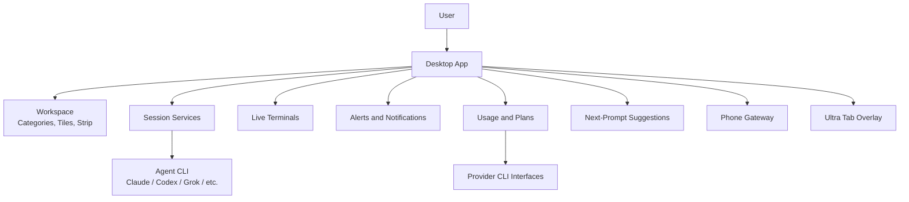
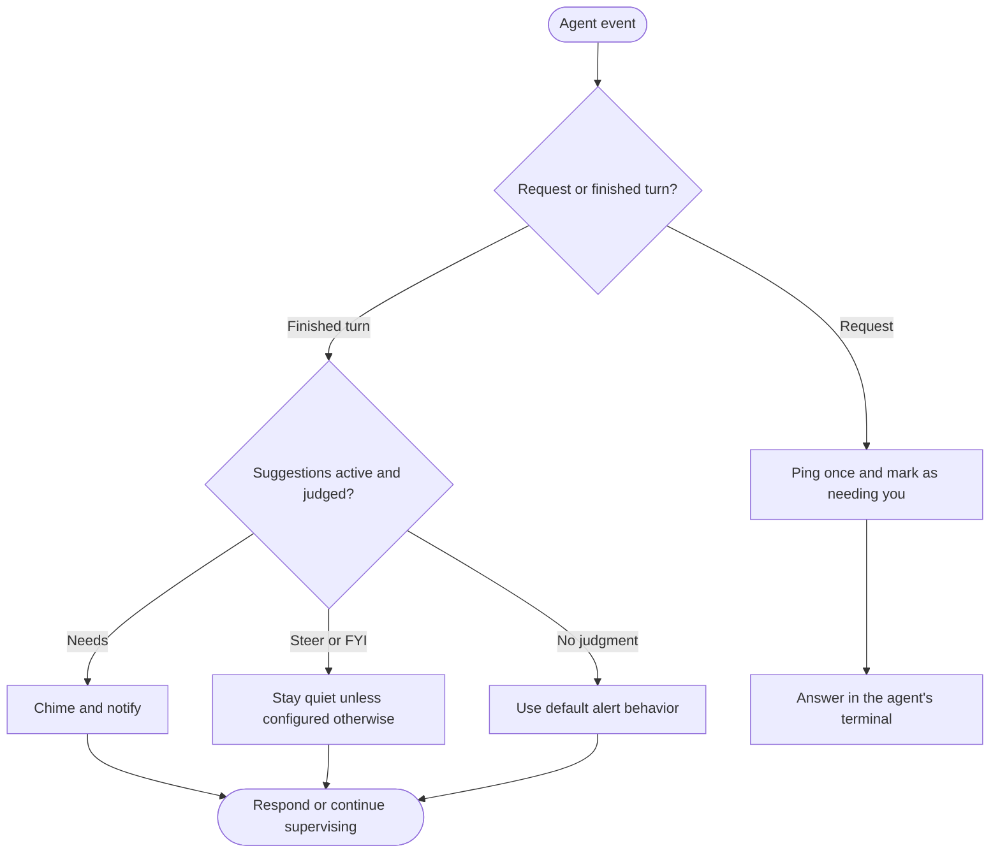
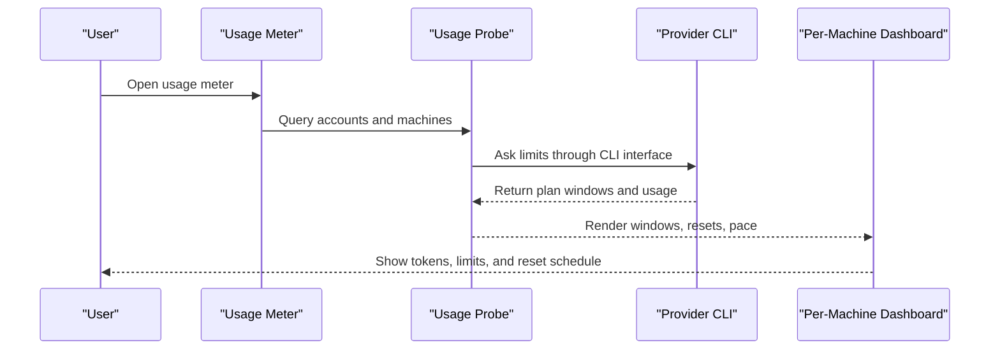
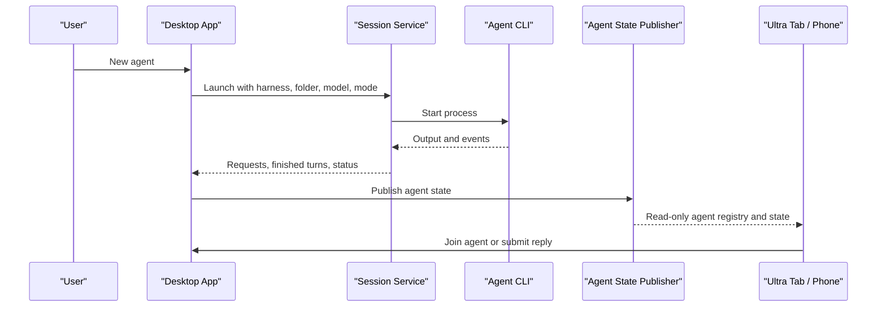
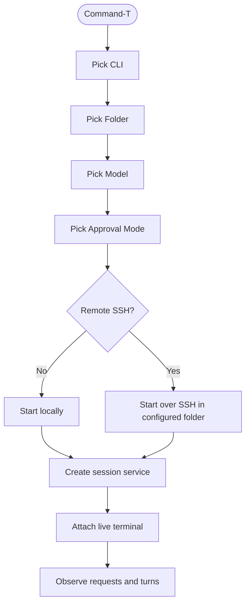
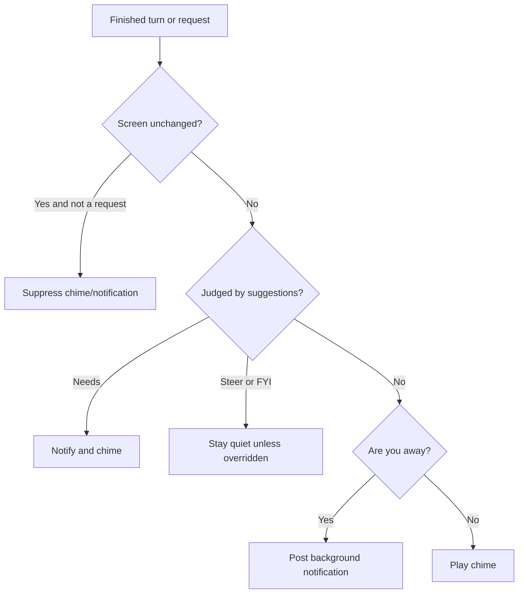
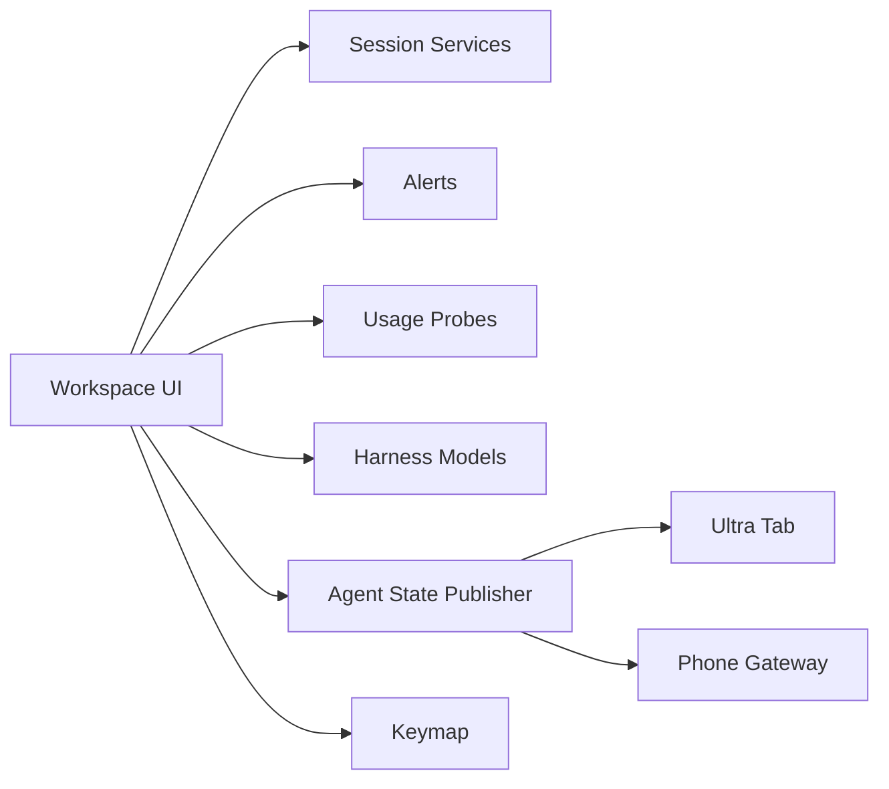

# User Guide

<cite>
**Referenced Files in This Document**   
- [README.md](file://README.md)
- [agents.md](file://docs/agents.md)
- [workspace.md](file://docs/workspace.md)
- [keys.md](file://docs/keys.md)
- [suggestions.md](file://docs/suggestions.md)
- [ultratab.md](file://docs/ultratab.md)
- [phone.md](file://docs/phone.md)
- [usage.md](file://docs/usage.md)
- [config.md](file://docs/config.md)
- [harness_models.hpp](file://apps/desktop/src/harness_models.hpp)
- [agent_state.hpp](file://apps/desktop/src/agent_state.hpp)
- [alerts.hpp](file://apps/desktop/src/alerts.hpp)
- [keymap.hpp](file://apps/desktop/src/keymap.hpp)
- [usage_limits.hpp](file://apps/desktop/src/usage_limits.hpp)
- [workspace_control.hpp](file://apps/desktop/src/workspace_control.hpp)
</cite>

## Table of Contents
1. [Introduction](#introduction)
2. [Project Structure](#project-structure)
3. [Core Components](#core-components)
4. [Architecture Overview](#architecture-overview)
5. [Detailed Component Analysis](#detailed-component-analysis)
6. [Dependency Analysis](#dependency-analysis)
7. [Performance Considerations](#performance-considerations)
8. [Troubleshooting Guide](#troubleshooting-guide)
9. [Conclusion](#conclusion)
10. [Appendices](#appendices)

## Introduction
Lapis is a Mac application for running multiple coding agents at once. Each agent gets its own live terminal, and you organize them into categories, watch their latest output in a strip, and jump to whichever one needs your attention. The app supports Claude Code, Codex, Grok, OpenCode, OMP, Kimi, and Antigravity agents. It starts from the CLIs you already have installed, keeps agents running through session services, and provides workspace navigation, alerts, usage monitoring, optional next-prompt suggestions, phone-based remote access, and an Ultra Tab overlay for handling waiting agents.

The early-access support slice begins with local Codex or Claude Code workspaces. Remote hosts, shared plans, the phone interface, and next-prompt suggestions are implemented or prototype surfaces but may not yet be fully qualified.

**Section sources**
- [README.md:1-40](file://README.md#L1-L40)

## Project Structure
At the user level, Lapis presents one main window with:
- A category rail on the left.
- One terminal stage for the selected agent.
- A strip under the stage showing cards for each agent in the current category.
- Optional tiled layouts when several agents share the screen.
- Commands, search, and settings accessible through keyboard shortcuts.

Behind the UI, Lapis launches each agent through a session service, records history, publishes agent state for other local apps (such as Ultra Tab), and integrates with provider CLIs for models, usage, and account information.

**Diagram sources**
- [README.md:1-40](file://README.md#L1-L40)
- [workspace.md:1-40](file://docs/workspace.md#L1-L40)
- [usage_limits.hpp:1-106](file://apps/desktop/src/usage_limits.hpp#L1-L106)
- [agent_state.hpp:1-72](file://apps/desktop/src/agent_state.hpp#L1-L72)

**Section sources**
- [README.md:1-40](file://README.md#L1-L40)
- [workspace.md:1-40](file://docs/workspace.md#L1-L40)

## Core Components
This section summarizes the end-user features that matter most when working with agents every day.

### Agent Management Fundamentals
- **New agent**: Press Command-T to open the new-agent form. Choose a CLI, folder, model, and approval mode.
- **Supported CLIs**: Claude, Codex, OpenCode, Grok, OMP, Antigravity, and Kimi appear in order; missing CLIs are marked unavailable.
- **Approval modes**: Accept edits, Auto, and Full access are passed as the CLI’s own flags. If a CLI does not support the requested mode, Lapis chooses the nearest supported mode with less access.
- **Harness arguments**: Add custom flags for every new agent of a CLI using `harnessArguments` in `lapis.json`. Literal arguments after `--` do not replace generated resume arguments.
- **Remote SSH agents**: The machine picker includes hosts from your SSH configuration. On another machine, the agent runs over SSH in the configured folder or login shell, reports turns through its terminal, and reconnects if the connection drops.
- **Full-screen CLIs**: Claude Code and Grok run full screen. A full-screen program repaints when resized; Lapis shows finished frames rather than partially painted screens.
- **CLI updates**: Lapis can update CLIs before launching an agent, except Codex, which uses only qualified builds. You can disable automatic updates per CLI in `harnessUpdates`.
- **Restart and reload**: Restart an ended or unreachable agent, reload a tab/category/window, or reopen the last closed agent with Command-Shift-T. Resume past Claude Code or Codex conversations with Command-O.

**Section sources**
- [agents.md:1-120](file://docs/agents.md#L1-L120)
- [config.md:1-60](file://docs/config.md#L1-L60)

### Model Selection
When starting an agent, Lapis offers models from the CLI itself:
- Claude Code lists models through its initialize control request.
- Codex lists models through its app-server endpoint.
- Grok lists models through `grok models`.
- Kimi reads model aliases from its configuration.
- OpenCode lists recent and favorite models.
- OMP lists configured roles and models used by recent sessions.

Models are refreshed in the background initially and then hourly, so the new-agent form reflects what your plan can use.

**Section sources**
- [harness_models.hpp:1-89](file://apps/desktop/src/harness_models.hpp#L1-L89)

### Workspace Organization
- **Stage and strip**: The stage shows the selected agent. The strip under it shows every agent in the category as cards with their latest lines. Move along the strip to navigate; there is no separate tab row.
- **Categories**: Categories group agents and remember their selected agent. The Dock badge counts agents across all categories that need attention and have not been viewed.
- **Tiled layouts**: Drag a card onto the stage edge to tile an agent beside the selected one, or onto a tile to swap it in. Use Command-D to start a tiled agent to the right, Command-Shift-D below, Command-Control-arrows to move between tiles, and Command-Shift-Return to fill the stage.
- **Terminal navigation**: Drag the history bar, scroll back, press Live to return to the newest line, and type to reach the agent. Web links and file paths are clickable with Command-hover or Command-click.
- **Side terminal**: Command-` opens a plain shell over half the stage; Command-~ selects this Mac or an SSH host. It is never an agent and persists independently.
- **Finding**: Command-K searches agents by name, folder, category, CLI, machine, or screen text. Command-F finds text in the selected terminal, including older history. Command-O resumes past Claude Code or Codex conversations.

**Section sources**
- [workspace.md:1-105](file://docs/workspace.md#L1-L105)

### Attention-Driven Navigation
Lapis helps you respond to agents without scanning every terminal:
- **Next and latest**: Command-J jumps to the next agent that needs you. Command-L jumps to the most recent agent that needed you; pressing it again goes backward.
- **Global attention**: Command-Option-L brings Lapis to the front and navigates to the latest attention target from any app.
- **Activity indicators**: Cards pulse while an agent finishes a turn or starts needing you. Colors distinguish keyboard focus, activity, pending requests, and lost connections.
- **Alert system**: Finished turns and requests play chimes and post notifications according to your attention settings. An away timer triggers background notifications when you are not at the Mac.
- **Attention logging**: Every decision about chimes or notifications is logged owner-only in `runtime/attention.jsonl`, including reasons such as “needs you,” “finished,” or quiet judgments.

**Diagram sources**
- [alerts.hpp:1-200](file://apps/desktop/src/alerts.hpp#L1-L200)
- [config.md:60-150](file://docs/config.md#L60-L150)

**Section sources**
- [workspace.md:1-60](file://docs/workspace.md#L1-L60)
- [alerts.hpp:1-200](file://apps/desktop/src/alerts.hpp#L1-L200)
- [config.md:60-150](file://docs/config.md#L60-L150)

### Keyboard Shortcuts
All macOS defaults are documented, and Linux uses Control-Shift in place of Command. Every binding can be changed in `lapis.json`. Important groups include:

- **Agents and categories**: New agent, new category, close, reopen last agent, resume conversation, switch categories, next/latest attention, find agent.
- **Stage and tiles**: Tiled splits, tile navigation, side terminal, sidebar visibility.
- **Terminal**: Find text, copy/paste, font size, line editing, link/file interaction.
- **Window**: Commands palette, appearance, reload config, minimize, close window, quit.

**Section sources**
- [keys.md:1-64](file://docs/keys.md#L1-L64)

### Usage Monitoring and Plan Limits
- **Meter**: When enabled, plan usage appears under the categories. It shows every plan a CLI is signed in to, with a color-coded bar: green with plenty left, orange under 30%, red under 10%.
- **Dashboard**: Clicking the meter opens a dashboard per machine. It shows remaining windows, reset times, pace estimates, and token usage by model.
- **Shared plans**: List plans under `accounts`. Sessions can switch plans automatically when one reaches a threshold, restarting the agent on another plan while resuming its conversation.
- **Saved limit resets**: Lapis can spend saved Claude Code or Codex resets for the plan selected by an agent. Automatic spending can be turned on, with thresholds for block duration, retained credits, and salvage hours.

**Diagram sources**
- [usage.md:1-108](file://docs/usage.md#L1-L108)
- [usage_limits.hpp:1-106](file://apps/desktop/src/usage_limits.hpp#L1-L106)

**Section sources**
- [usage.md:1-108](file://docs/usage.md#L1-L108)
- [usage_limits.hpp:1-106](file://apps/desktop/src/usage_limits.hpp#L1-L106)

### Next-Prompt Suggestions
Suggestions can predict your next prompt for Claude Code and Codex:
- Enable `nextPrompt.auto` in `lapis.json`.
- With a dim guess visible, Tab types it for editing; Tab twice sends it.
- With no guess offered, Tab moves to the next agent that truly needs you.
- Guesses are based on the agent’s conversation, screen, other agents’ states, and your recent prompts elsewhere.
- Unseen guesses remain armed across window restarts until consumed or replaced.

**Section sources**
- [suggestions.md:1-176](file://docs/suggestions.md#L1-L176)

### Ultra Tab Overlay
Ultra Tab is a standalone overlay that deals with waiting agents as a deck of cards:
- Red cards need you; yellow cards could use a nudge; green agents are running but do not become cards.
- The front card shows the agent’s reply summary, proposed next message, and small workspace map.
- Answer cards with Tab, Option-Tab, typed nudges, push-back corrections, or skip.
- While open, Ultra Tab composes cards with summaries, blocks, and proposals.
- Run it from a desktop build and interact with it from any app.

**Section sources**
- [ultratab.md:1-200](file://docs/ultratab.md#L1-L200)

### Phone-Based Remote Access
The iPhone app connects to a gateway on the Mac via Tailscale or ZeroTier:
- No sign-in is required; access is gated by the Mac owner’s Tailscale identity or a trusted ZeroTier network.
- The phone shows categories, agents, a phone-width terminal, and controls.
- You can start agents, resume conversations, rename, move, restart, and close agents from the phone.
- The phone joins the agent beside the desktop, sharing the same terminal screen.
- Ultra Tab for iPhone uses the same gateway routes to read agent state and submit replies.

**Section sources**
- [phone.md:1-130](file://docs/phone.md#L1-L130)

### Custom Keybindings
Custom keybindings live in `lapis.json`. Missing or malformed input falls back to built-in defaults, so changing keys cannot break the window. The keymap also manages layout, theme, density, terminal font, alerts, editor selection, usage display, and more.

**Section sources**
- [keymap.hpp:1-200](file://apps/desktop/src/keymap.hpp#L1-L200)
- [config.md:1-60](file://docs/config.md#L1-L60)

## Architecture Overview
From the user’s perspective, Lapis coordinates three major flows:

1. **Agent launch flow**: You choose a harness, folder, model, and mode. Lapis starts the CLI through a session service, preserves resume data, and attaches a live terminal.
2. **Attention flow**: Agents report requests and finished turns. Lapis decides whether to chime, notify, stay quiet, or wait for suggestion-based judgment, then exposes attention targets for navigation.
3. **State publication flow**: Lapis publishes agent state for local consumers like Ultra Tab and the phone gateway, keeping the desktop app authoritative.

**Diagram sources**
- [workspace_control.hpp:1-70](file://apps/desktop/src/workspace_control.hpp#L1-L70)
- [agent_state.hpp:1-72](file://apps/desktop/src/agent_state.hpp#L1-L72)
- [agents.md:1-120](file://docs/agents.md#L1-L120)

## Detailed Component Analysis

### Agent Launch and Approval Workflow
The new-agent workflow guides you through CLI, folder, model, and approval mode. Lapis adds no arbitrary flags of its own; it passes the selected mode and any configured `harnessArguments`. For remote agents, hooks or notify programs are attached to the command line so turns and suggestions behave like local agents.

**Diagram sources**
- [agents.md:1-120](file://docs/agents.md#L1-L120)
- [config.md:1-60](file://docs/config.md#L1-L60)

**Section sources**
- [agents.md:1-120](file://docs/agents.md#L1-L120)
- [config.md:1-60](file://docs/config.md#L1-L60)

### Workspace Layout and Navigation
Lapis treats the strip as the primary navigation layer for a category. Tiles extend that model by letting you compare agents side by side. History is persistent and compressed from the first line, and interactive links make it easy to open files or web addresses directly from agent output.

**Section sources**
- [workspace.md:1-105](file://docs/workspace.md#L1-L105)

### Alert Decision Logic
Alerts combine several signals:
- Whether the event is a request or a finished turn.
- Whether the agent truly needs you versus being busy.
- Whether you are looking at the agent’s screen.
- Whether you are away from the Mac.
- Whether suggestion-based judgment classifies the turn as needs, steer, or fyi.

**Diagram sources**
- [alerts.hpp:1-200](file://apps/desktop/src/alerts.hpp#L1-L200)
- [config.md:60-150](file://docs/config.md#L60-L150)

**Section sources**
- [alerts.hpp:1-200](file://apps/desktop/src/alerts.hpp#L1-L200)
- [config.md:60-150](file://docs/config.md#L60-L150)

### Suggestion Flow and Tab Behavior
Suggestions attach to Claude Code and Codex agents. When enabled, Tab either fills a predicted prompt or navigates to the next agent that needs you. The system logs acceptance, similarity, failure arms, and evaluation metrics privately.

**Section sources**
- [suggestions.md:1-176](file://docs/suggestions.md#L1-L176)

### Phone and Gateway Integration
The phone gateway communicates with the desktop workspace through a local socket protocol. It can create agents, manage categories, open terminals, and change settings exposed by the keymap.

**Section sources**
- [phone.md:1-130](file://docs/phone.md#L1-L130)
- [workspace_control.hpp:1-70](file://apps/desktop/src/workspace_control.hpp#L1-L70)

## Dependency Analysis
End-user workflows depend on several internal components:

- **Workspace and UI**: Category rail, strip, tiles, commands, and terminal rendering.
- **Session services**: Process lifecycle, resume data, and terminal I/O.
- **Alerts and attention**: Screen sampling, judgment, chimes, and notifications.
- **Usage probing**: Provider-specific interfaces for limits and billing.
- **Model catalog**: Background discovery of available models per CLI.
- **State publisher**: Published JSON consumed by Ultra Tab and the phone.
- **Keymap**: Configuration-driven bindings and appearance.

**Diagram sources**
- [workspace.md:1-105](file://docs/workspace.md#L1-L105)
- [alerts.hpp:1-200](file://apps/desktop/src/alerts.hpp#L1-L200)
- [usage_limits.hpp:1-106](file://apps/desktop/src/usage_limits.hpp#L1-L106)
- [harness_models.hpp:1-89](file://apps/desktop/src/harness_models.hpp#L1-L89)
- [agent_state.hpp:1-72](file://apps/desktop/src/agent_state.hpp#L1-L72)
- [keymap.hpp:1-200](file://apps/desktop/src/keymap.hpp#L1-L200)

**Section sources**
- [workspace.md:1-105](file://docs/workspace.md#L1-L105)
- [usage_limits.hpp:1-106](file://apps/desktop/src/usage_limits.hpp#L1-L106)
- [harness_models.hpp:1-89](file://apps/desktop/src/harness_models.hpp#L1-L89)
- [agent_state.hpp:1-72](file://apps/desktop/src/agent_state.hpp#L1-L72)
- [keymap.hpp:1-200](file://apps/desktop/src/keymap.hpp#L1-L200)

## Performance Considerations
- Switching agents and typing should feel instant on Apple Silicon Macs with high-refresh displays.
- The strip refreshes at most four times per second, balancing responsiveness with CPU cost.
- Full-screen agents repaint frequently; Lapis avoids showing half-finished frames and caps unending updates.
- Usage probes and model discovery run asynchronously and are rate-limited.
- Interaction logs rotate and drop records when disk writes cannot keep up, so typing remains responsive.

[No sources needed since this section provides general guidance]

## Troubleshooting Guide
Common situations and how Lapis handles them:

- **Agent ended or unreachable**: The card keeps the last screen and shows a reason. Use Commands to restart the agent in the same card.
- **Connection drops for a remote Claude agent**: Lapis reconnects and resumes the conversation.
- **CLI update conflicts**: Queued agents wait for the updater; `--no-harness-updates` disables automatic updates globally.
- **Long-running jobs**: Detach jobs outside the agent when they must outlive restarts or plan switches.
- **Missing or wrong plan credentials**: Saved-limit reset operations require a verified plan identity; email alone is insufficient.
- **Suggestion failures**: Up to three consecutive failed guesses show in the agent terminal corner. Failed attempts are logged with masked sensitive data.
- **Phone gateway access**: Ensure Tailscale or ZeroTier is active, the Mac owner is authenticated, and the gateway is installed and running.

**Section sources**
- [agents.md:120-197](file://docs/agents.md#L120-L197)
- [usage.md:60-108](file://docs/usage.md#L60-L108)
- [suggestions.md:100-176](file://docs/suggestions.md#L100-L176)
- [phone.md:1-130](file://docs/phone.md#L1-L130)

## Conclusion
Lapis organizes multi-agent supervision around a small set of practical interactions: launch agents through familiar CLIs, group them into categories, follow attention cues, and respond quickly through the terminal, keyboard, phone, or Ultra Tab. Configuration lives in `lapis.json`, allowing you to tune defaults, alerts, usage, suggestions, and keybindings without leaving the workflow.

[No sources needed since this section summarizes without analyzing specific files]

## Appendices

### Practical Scenarios

#### Multi-Agent Development Workflow
1. Open the new-agent form with Command-T and start a Claude Code agent for feature work and a Codex agent for tests.
2. Put related agents in the same category and tile them with Command-D and Command-Shift-D.
3. Use Command-J to jump to whichever agent asks a question or needs approval.
4. Keep a plain shell in the side terminal for quick commands with Command-`.
5. Use Command-K to find an agent by folder or screen text when many tabs are open.

**Section sources**
- [workspace.md:1-105](file://docs/workspace.md#L1-L105)
- [keys.md:1-64](file://docs/keys.md#L1-L64)

#### Handling Agent Requests
1. Watch for a pulsing card or chime indicating a pending request.
2. Navigate to the agent with Command-J or Command-L.
3. Answer the request in the agent’s terminal; Lapis does not change the CLI’s approval policy.
4. For Codex, use the Requests list to explicitly approve, decline, cancel, or send answers.
5. Avoid approving unintentionally: opening or selecting a request does not approve it.

**Section sources**
- [agents.md:60-120](file://docs/agents.md#L60-L120)

#### Maintaining Productive Session States
- Park finished turns by looking at them briefly and moving away; Tab will pass parked agents until they wait again.
- Raise `minConfidence` in suggestion settings to bring attention back when Tab always takes a guess.
- Use Ultra Tab for focused card-based triage when you want to answer agents without switching the main window.
- Enable saved limit resets for automated recovery when plan windows exhaust during long sessions.

**Section sources**
- [suggestions.md:60-176](file://docs/suggestions.md#L60-L176)
- [ultratab.md:1-200](file://docs/ultratab.md#L1-L200)
- [usage.md:60-108](file://docs/usage.md#L60-L108)