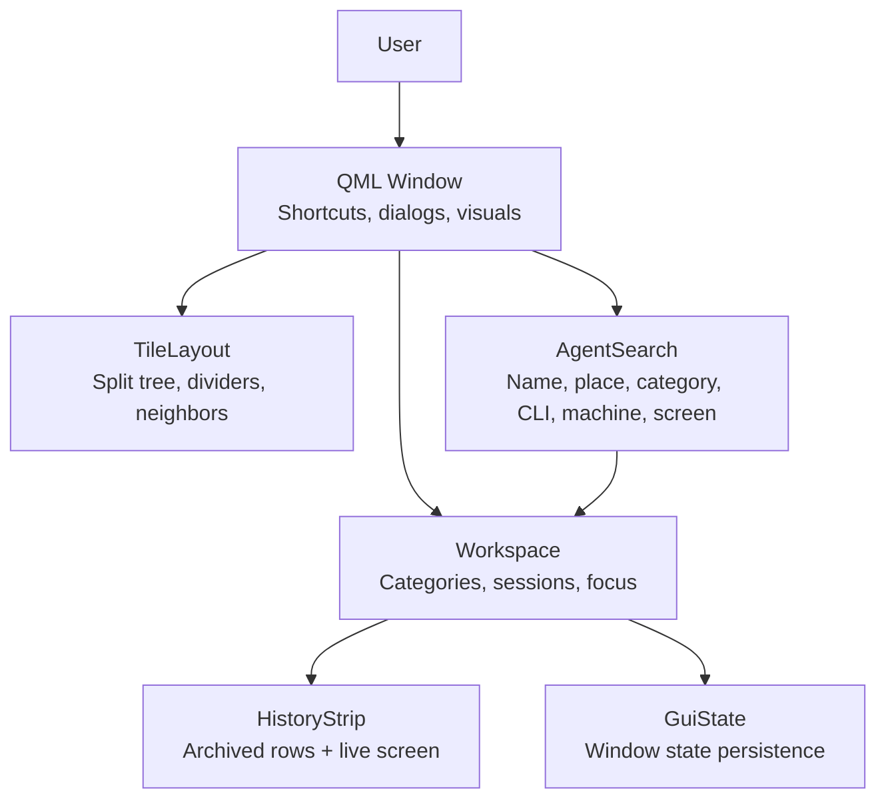
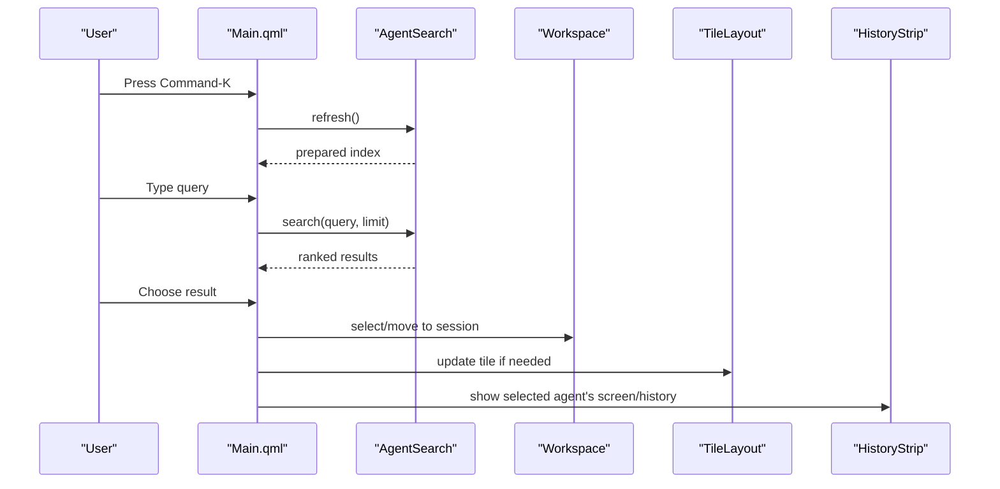
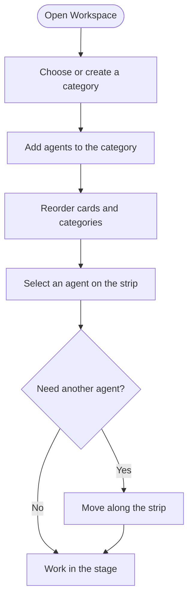
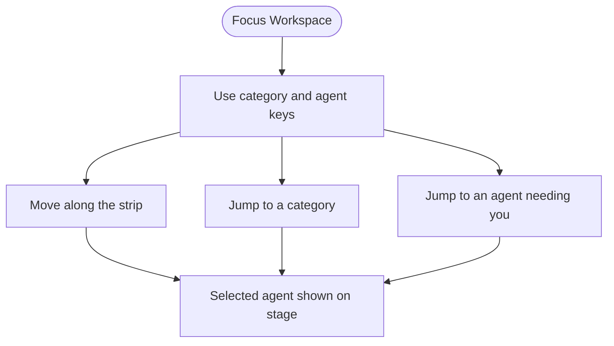
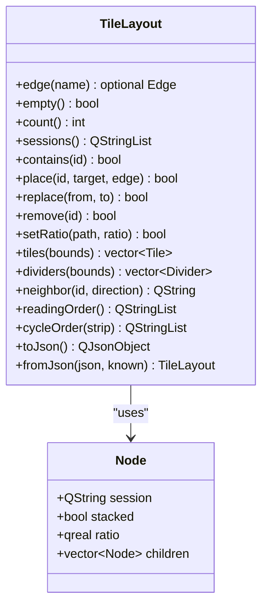
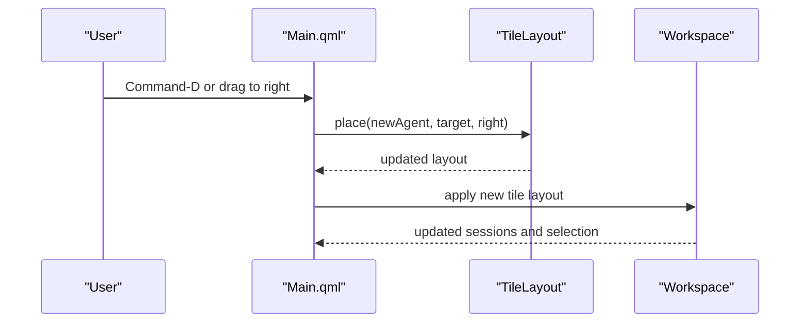
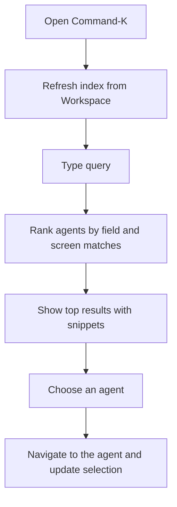
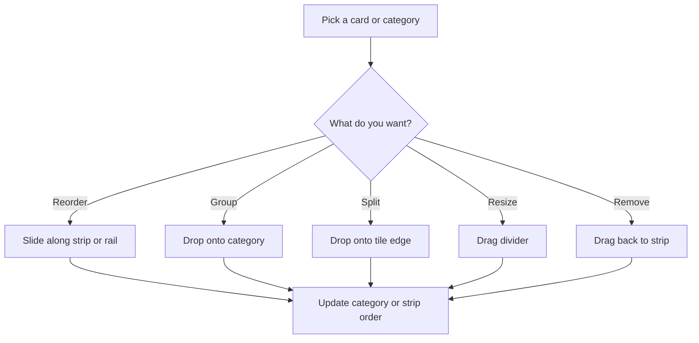
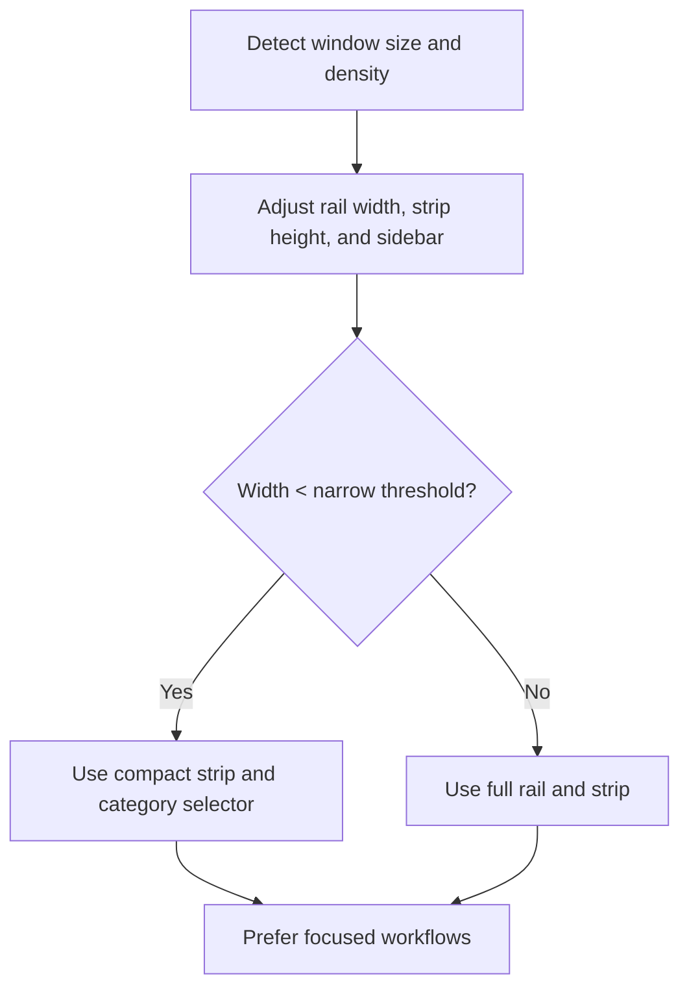
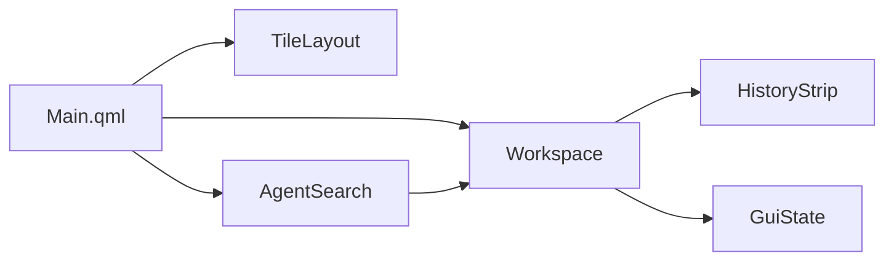

# Workspace Navigation

<cite>
**Referenced Files in This Document**
- [workspace.md](file://docs/workspace.md)
- [keys.md](file://docs/keys.md)
- [workspace.hpp](file://apps/desktop/src/workspace.hpp)
- [workspace.cpp](file://apps/desktop/src/workspace.cpp)
- [history_strip.hpp](file://apps/desktop/src/history_strip.hpp)
- [history_strip.cpp](file://apps/desktop/src/history_strip.cpp)
- [tile_layout.hpp](file://apps/desktop/src/tile_layout.hpp)
- [tile_layout.cpp](file://apps/desktop/src/tile_layout.cpp)
- [agent_search.hpp](file://apps/desktop/src/agent_search.hpp)
- [agent_search.cpp](file://apps/desktop/src/agent_search.cpp)
- [gui_state.hpp](file://apps/desktop/src/gui_state.hpp)
- [gui_state.cpp](file://apps/desktop/src/gui_state.cpp)
- [Main.qml](file://apps/desktop/qml/Main.qml)
- [Search.qml](file://apps/desktop/qml/Search.qml)
</cite>

## Table of Contents
1. [Introduction](#introduction)
2. [Project Structure](#project-structure)
3. [Core Components](#core-components)
4. [Architecture Overview](#architecture-overview)
5. [Detailed Component Analysis](#detailed-component-analysis)
6. [Dependency Analysis](#dependency-analysis)
7. [Performance Considerations](#performance-considerations)
8. [Troubleshooting Guide](#troubleshooting-guide)
9. [Conclusion](#conclusion)

## Introduction
This document explains how to navigate Lapis’ workspace when managing multiple agents. It focuses on the desktop application’s category-based organization, terminal strip navigation, tiled layouts, search, drag-and-drop operations, and responsive behavior. The goal is to help you organize related agents, switch between them quickly, and keep your development workflow efficient across different screen sizes.

At a high level:
- One agent is shown on the stage.
- A strip below the stage shows that category’s agents as cards with live previews.
- Categories group agents; each category remembers its selected agent and its own tile layout.
- You can split the stage into tiles for side-by-side agents, rearrange categories and cards, and find agents by name, folder, category, CLI, machine, or screen text.

**Section sources**
- [workspace.md:1-20](file://docs/workspace.md#L1-L20)
- [keys.md:1-12](file://docs/keys.md#L1-L12)

## Project Structure
The workspace experience is built from several cooperating components:

- Documentation layer: user-facing workspace and keyboard documentation.
- Desktop UI layer: QML window composition, shortcuts, and dialogs.
- State and layout layer: categories, sessions, history, tiles, search, and persisted GUI state.

**Diagram sources**
- [Main.qml:1-120](file://apps/desktop/qml/Main.qml#L1-L120)
- [Search.qml:1-60](file://apps/desktop/qml/Search.qml#L1-L60)
- [workspace.hpp:1-80](file://apps/desktop/src/workspace.hpp#L1-L80)
- [history_strip.hpp:1-48](file://apps/desktop/src/history_strip.hpp#L1-L48)
- [tile_layout.hpp:1-90](file://apps/desktop/src/tile_layout.hpp#L1-L90)
- [agent_search.hpp:1-63](file://apps/desktop/src/agent_search.hpp#L1-L63)
- [gui_state.hpp:1-97](file://apps/desktop/src/gui_state.hpp#L1-L97)

**Section sources**
- [workspace.md:1-20](file://docs/workspace.md#L1-L20)
- [keys.md:1-12](file://docs/keys.md#L1-L12)
- [Main.qml:1-120](file://apps/desktop/qml/Main.qml#L1-L120)

## Core Components
This section maps workspace features to their core implementation areas.

| Feature | Primary component | What it manages |
|---|---|---|
| Category-based organization | `Workspace` | Categories, active category, session placement, move/rename/reorder actions |
| Terminal strip navigation | `HistoryStrip` plus UI strip | Live preview cards, row-scrolled history, scrubbing |
| Tiled layouts | `TileLayout` | Binary split tree, dividers, neighbor selection, cycle order |
| Agent search | `AgentSearch` | Indexed query over title, place, category, harness, machine, screen lines |
| Visual indicators | `SessionPreview` / `Workspace` | Attention, activity, fault, unseen pulses |
| Persistent layout state | `GuiState` | Window-level choices and runtime state sections |

Key responsibilities:
- `Workspace` coordinates categories, sessions, focus, attention, and tile changes.
- `HistoryStrip` represents archived terminal output and the current screen, supporting row scrolling and page management.
- `TileLayout` models splits as a binary tree and computes tile rectangles, divider positions, and navigation order.
- `AgentSearch` builds an index and ranks results without blocking terminals.
- `GuiState` persists window-related state with bounded size and rate-limited writes.

**Section sources**
- [workspace.hpp:1-120](file://apps/desktop/src/workspace.hpp#L1-L120)
- [history_strip.hpp:1-48](file://apps/desktop/src/history_strip.hpp#L1-L48)
- [tile_layout.hpp:1-90](file://apps/desktop/src/tile_layout.hpp#L1-L90)
- [agent_search.hpp:1-63](file://apps/desktop/src/agent_search.hpp#L1-L63)
- [gui_state.hpp:1-97](file://apps/desktop/src/gui_state.hpp#L1-L97)

## Architecture Overview
The following diagram shows how navigation flows through the workspace.

**Diagram sources**
- [Search.qml:1-60](file://apps/desktop/qml/Search.qml#L1-L60)
- [agent_search.cpp:60-120](file://apps/desktop/src/agent_search.cpp#L60-L120)
- [workspace.cpp:1140-1180](file://apps/desktop/src/workspace.cpp#L1140-L1180)
- [tile_layout.hpp:40-90](file://apps/desktop/src/tile_layout.hpp#L40-L90)
- [history_strip.hpp:1-48](file://apps/desktop/src/history_strip.hpp#L1-L48)

**Section sources**
- [Search.qml:1-60](file://apps/desktop/qml/Search.qml#L1-L60)
- [agent_search.cpp:60-120](file://apps/desktop/src/agent_search.cpp#L60-L120)
- [workspace.cpp:1140-1180](file://apps/desktop/src/workspace.cpp#L1140-L1180)

## Detailed Component Analysis

### Category-Based Organization and Grouping
Categories are the primary grouping mechanism for agents. Each category:
- Holds its own set of agents.
- Remembers its selected agent.
- Keeps its own tile layout.
- Is navigated separately from the terminal strip.

A narrow window may replace the full category rail with a compact category selector, while the strip remains the main way to move within a category.

Practical strategies:
- Group by feature area, such as frontend, backend, database, and testing.
- Group by agent role, such as code review, debugging, documentation, and deployment.
- Use one category per environment, such as local, staging, or production.
- Keep frequently used agents near the front of the strip; use search to locate less common ones.

Category actions include renaming, reordering, removing, and moving agents between categories without restarting them.

**Diagram sources**
- [workspace.md:1-20](file://docs/workspace.md#L1-L20)
- [workspace.cpp:1143-1180](file://apps/desktop/src/workspace.cpp#L1143-L1180)
- [workspace.cpp:1227-1269](file://apps/desktop/src/workspace.cpp#L1227-L1269)
- [workspace.cpp:1387-1417](file://apps/desktop/src/workspace.cpp#L1387-L1417)

**Section sources**
- [workspace.md:1-20](file://docs/workspace.md#L1-L20)
- [workspace.cpp:1143-1180](file://apps/desktop/src/workspace.cpp#L1143-L1180)
- [workspace.cpp:1227-1269](file://apps/desktop/src/workspace.cpp#L1227-L1269)
- [workspace.cpp:1387-1417](file://apps/desktop/src/workspace.cpp#L1387-L1417)

### Terminal Strip Navigation
The terminal strip replaces a traditional tab bar. For the active category, it shows cards in tab order, including a new-agent card at the end. Moving along the strip keeps neighboring cards partially visible.

Visual indicators:
- Focus: keyboard focus color and border.
- Activity: an activity-colored cue.
- Attention: a pulsing dot on the category and a pulsing card until selected.
- Fault: lost connection or error state with a distinct color and shape.
- Unseen: agents that need you while another agent was selected.

Keyboard movement:
- Move to previous or next agent in the category.
- Jump to the next agent that needs you.
- Jump to the most recent agent that needed you.
- Open numbered categories directly.
- Toggle the sidebar.

These behaviors are defined in the key documentation and implemented by the QML bindings and workspace logic.

**Diagram sources**
- [keys.md:1-40](file://docs/keys.md#L1-L40)
- [Main.qml:100-190](file://apps/desktop/qml/Main.qml#L100-L190)
- [workspace.cpp:1143-1180](file://apps/desktop/src/workspace.cpp#L1143-L1180)

**Section sources**
- [workspace.md:1-20](file://docs/workspace.md#L1-L20)
- [keys.md:1-40](file://docs/keys.md#L1-L40)
- [Main.qml:100-190](file://apps/desktop/qml/Main.qml#L100-L190)
- [workspace.cpp:1143-1180](file://apps/desktop/src/workspace.cpp#L1143-L1180)

### Tiled Layouts and Splitting
Tiled layouts let you arrange related agents beside or below each other, similar to splitting a tab in other terminals. The layout is a binary tree:
- Leaves are agents.
- Internal nodes are either stacked vertically or placed side by side horizontally.
- Each split has a ratio controlling the first child’s share.

Operations:
- Drag a card onto an edge to split next to the target agent.
- Drag onto a tile’s center to replace it.
- Drag dividers to resize panes.
- Use keyboard shortcuts to split right or down.
- Use arrow-based tile navigation to move between adjacent tiles.
- Zoom a tile to fill the stage.
- Remove a tile by closing it or dragging it back to the strip.

Each category maintains its own tile layout independently.

**Diagram sources**
- [tile_layout.hpp:1-90](file://apps/desktop/src/tile_layout.hpp#L1-L90)
- [tile_layout.cpp:1-120](file://apps/desktop/src/tile_layout.cpp#L1-L120)

**Diagram sources**
- [tile_layout.cpp:195-236](file://apps/desktop/src/tile_layout.cpp#L195-L236)
- [workspace.cpp:770-820](file://apps/desktop/src/workspace.cpp#L770-L820)
- [Main.qml:130-190](file://apps/desktop/qml/Main.qml#L130-L190)

**Section sources**
- [workspace.md:20-40](file://docs/workspace.md#L20-L40)
- [keys.md:12-36](file://docs/keys.md#L12-L36)
- [tile_layout.hpp:1-90](file://apps/desktop/src/tile_layout.hpp#L1-L90)
- [tile_layout.cpp:195-340](file://apps/desktop/src/tile_layout.cpp#L195-L340)
- [workspace.cpp:770-820](file://apps/desktop/src/workspace.cpp#L770-L820)

### Search Functionality
Command-K opens the agent search dialog. It indexes every agent’s:
- Name.
- Folder or place.
- Category.
- CLI or harness.
- Machine, such as an SSH host.
- Non-empty screen lines.

The index is rebuilt when the search opens, so typing does not block terminals. Results are scored and ranked:
- Word matches in structured fields receive bonuses.
- Screen-line matches provide snippets.
- Empty queries return all agents.
- Multiple words must match across indexed fields.

The search dialog displays the agent mark, title, category, place, and optionally a matching screen snippet.

**Diagram sources**
- [agent_search.cpp:60-184](file://apps/desktop/src/agent_search.cpp#L60-L184)
- [Search.qml:1-187](file://apps/desktop/qml/Search.qml#L1-L187)
- [workspace.hpp:1-80](file://apps/desktop/src/workspace.hpp#L1-L80)

**Section sources**
- [workspace.md:40-60](file://docs/workspace.md#L40-L60)
- [keys.md:1-20](file://docs/keys.md#L1-L20)
- [agent_search.hpp:1-63](file://apps/desktop/src/agent_search.hpp#L1-L63)
- [agent_search.cpp:60-184](file://apps/desktop/src/agent_search.cpp#L60-L184)
- [Search.qml:1-187](file://apps/desktop/qml/Search.qml#L1-L187)

### Drag-and-Drop Operations
Drag-and-drop supports both organization and arrangement:

- Reorder cards along the strip.
- Move a card onto a category rail to recategorize it.
- Create a new category by dropping onto the rail’s new-category control.
- Select multiple cards using modifier clicks and drag them together.
- Rearrange categories up and down the rail.
- Split tiles by dragging a card onto an edge.
- Swap a tile by dropping onto its center.
- Resize tiles by dragging dividers.
- Remove a tile by dragging it back to the strip.

These interactions are coordinated by the QML interface and backed by `Workspace` and `TileLayout`.

**Diagram sources**
- [workspace.md:40-60](file://docs/workspace.md#L40-L60)
- [tile_layout.cpp:195-340](file://apps/desktop/src/tile_layout.cpp#L195-L340)
- [workspace.cpp:1387-1506](file://apps/desktop/src/workspace.cpp#L1387-L1506)

**Section sources**
- [workspace.md:40-60](file://docs/workspace.md#L40-L60)
- [tile_layout.hpp:1-90](file://apps/desktop/src/tile_layout.hpp#L1-L90)
- [tile_layout.cpp:195-340](file://apps/desktop/src/tile_layout.cpp#L195-L340)
- [workspace.cpp:1387-1506](file://apps/desktop/src/workspace.cpp#L1387-L1506)

### Responsive Behavior and Screen Size Considerations
Lapis adapts to narrower windows:
- The category rail width and tab height vary with density mode.
- The strip height decreases on shorter windows.
- A `narrow` flag controls whether the sidebar is expanded.
- Minimum window dimensions ensure usable interaction space.

On small screens:
- Prefer fewer large tiles.
- Use Command-Control-arrow navigation instead of many side-by-side agents.
- Rely on search rather than scanning long strips.
- Use one category per task and move agents between categories as context shifts.
- Hide the sidebar when not needed and toggle it with the configured shortcut.

**Diagram sources**
- [Main.qml:1-120](file://apps/desktop/qml/Main.qml#L1-L120)

**Section sources**
- [Main.qml:1-120](file://apps/desktop/qml/Main.qml#L1-L120)

### Practical Workspace Layouts

#### Multi-Agent Debugging
Goal: Compare logs, errors, and fixes across related agents.

Recommended layout:
- One category named after the issue or subsystem.
- Two or three tiles showing the failing agent, the relevant log source, and the fixer agent.
- Use left/right splits for parallel logs and a stacked split for notes or reproduction steps.
- Use Command-Control-arrow navigation to jump between tiles without losing context.
- Use Command-F inside the terminal to search history for specific errors.

Why this works:
- Tiles keep related outputs aligned.
- The strip still lists other agents in the same category for quick switching.
- Search finds the exact agent by name, folder, or screen content.

#### Parallel Feature Development
Goal: Develop multiple features without mixing contexts.

Recommended layout:
- One category per feature branch or feature area.
- Within each category, one or two tiles for the feature agent and its test or reviewer.
- Use the category rail to switch between features.
- Rename categories clearly and sort them by priority.
- Use Command-O to resume past conversations when returning to a feature.

Why this works:
- Categories isolate attention and attention counts.
- Tiles keep related agents close.
- Keyboard shortcuts allow fast switching without mouse-heavy workflows.

#### Testing Workflow
Goal: Run tests, inspect failures, and iterate quickly.

Recommended layout:
- One category for testing.
- Left tile: test runner or command shell.
- Right tile: failing test output or debugger.
- Bottom tile: fix agent or documentation.
- Use zoom tile to temporarily focus the failing test, then return to the multi-tile view.
- Use search to locate a test by file path, error message, or status.

Why this works:
- Test output is often short and scrollable; tiles give immediate comparison.
- History scrubbing helps review earlier test runs.
- Search reduces time spent scanning strips during fast iteration.

[No sources needed since this section provides practical guidance derived from documented features]

## Dependency Analysis
The workspace navigation depends on these relationships:

- `Main.qml` binds user input and UI state to `Workspace`, `TileLayout`, and `AgentSearch`.
- `AgentSearch` reads from `Workspace` sessions and snapshots to build a searchable index.
- `TileLayout` computes geometry and navigation order for tiled agents.
- `HistoryStrip` stores archived terminal pages and exposes a view suitable for scrolling.
- `GuiState` persists window-level state, including settings and runtime selections.

**Diagram sources**
- [Main.qml:1-120](file://apps/desktop/qml/Main.qml#L1-L120)
- [agent_search.hpp:1-63](file://apps/desktop/src/agent_search.hpp#L1-L63)
- [workspace.hpp:1-80](file://apps/desktop/src/workspace.hpp#L1-L80)
- [history_strip.hpp:1-48](file://apps/desktop/src/history_strip.hpp#L1-L48)
- [tile_layout.hpp:1-90](file://apps/desktop/src/tile_layout.hpp#L1-L90)
- [gui_state.hpp:1-97](file://apps/desktop/src/gui_state.hpp#L1-L97)

**Section sources**
- [agent_search.cpp:60-120](file://apps/desktop/src/agent_search.cpp#L60-L120)
- [workspace.cpp:1143-1180](file://apps/desktop/src/workspace.cpp#L1143-L1180)
- [tile_layout.cpp:286-340](file://apps/desktop/src/tile_layout.cpp#L286-L340)
- [gui_state.cpp:1-120](file://apps/desktop/src/gui_state.cpp#L1-L120)

## Performance Considerations
Workspace navigation is designed for responsiveness:

- Screen decoding is deferred until a view needs it, reducing unnecessary work.
- Preview cards are refreshed at a limited rate, while the stage updates more frequently.
- Agent search rebuilds its index only when opened; typing searches the in-memory index.
- History paging fetches nearby pages and forgets distant ones.
- GUI state writes are rate-limited and run off the GUI thread, with bounds on size and complexity.

Optimization tips:
- Avoid keeping too many wide tiles open simultaneously on low-end hardware.
- Use search rather than scanning long strips when many agents are present.
- Close unused tiles by dragging them back to the strip.
- Keep categories focused; move older agents out of the active category.

**Section sources**
- [workspace.hpp:120-220](file://apps/desktop/src/workspace.hpp#L120-L220)
- [history_strip.cpp:1-120](file://apps/desktop/src/history_strip.cpp#L1-L120)
- [agent_search.cpp:60-120](file://apps/desktop/src/agent_search.cpp#L60-L120)
- [gui_state.cpp:1-120](file://apps/desktop/src/gui_state.cpp#L1-L120)

## Troubleshooting Guide

| Symptom | Likely cause | Resolution |
|---|---|---|
| Search returns no results | Query words do not match any indexed field or screen line | Try broader terms, check spelling, or remove some words |
| An agent appears but cannot be interacted with | Connection lost or history browsing is active | Check connection state and return to live if needed |
| Tiles do not appear where expected | Target tile does not share the required span | Use neighbor-aware navigation or clear the layout and split again |
| Dragging a card does nothing | Dialog or terminal composition owns the keyboard | Close dialogs or finish composing/pasting before dragging |
| Window state is not saved | File is missing, corrupted, oversized, or version mismatch | Allow recovery; avoid placing large data in window state |
| Strip feels slow on very long categories | Too many preview cards and frequent redraws | Reduce visible agents, use search, or hide the sidebar |

Additional checks:
- Verify the correct category is active when looking for an agent.
- Use the commands palette to confirm available actions.
- Reload configuration if shortcuts or appearance seem incorrect.
- Inspect the terminal history bar to verify whether you are viewing live output or archived rows.

**Section sources**
- [workspace.md:20-80](file://docs/workspace.md#L20-L80)
- [keys.md:1-64](file://docs/keys.md#L1-L64)
- [agent_search.cpp:120-184](file://apps/desktop/src/agent_search.cpp#L120-L184)
- [gui_state.cpp:120-213](file://apps/desktop/src/gui_state.cpp#L120-L213)

## Conclusion
Lapis’ workspace navigation centers on categories, a live terminal strip, and flexible tiled layouts. Use categories to group related agents, the strip for quick horizontal movement, and tiles for side-by-side comparison. Combine keyboard shortcuts, search, and drag-and-drop to build layouts suited to debugging, parallel development, and testing. On smaller screens, prefer focused arrangements and rely on search and history tools to maintain efficiency.

[No sources needed since this section summarizes without analyzing specific files]